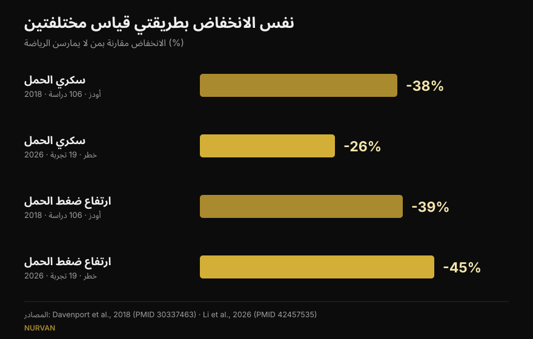
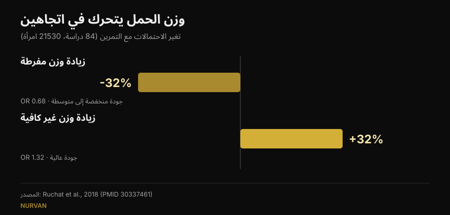

# رفع الأثقال أثناء الحمل: ماذا تقول الأبحاث فعلاً

بقلم [جياماريا لوي](/autore/giammaria-loi) · تحديث 16 أكتوبر 2026

انتشر منشوران في الأسابيع نفسها: أحدهما يعدّد خمسة أسباب لمواصلة تمرين الأثقال أثناء الحمل، والآخر يعرض أرقاماً دقيقة جداً — انخفاض 38% في سكري الحمل و41% في تسمم الحمل. قرأت الدراسات وراء الاثنين. الأرقام موجودة فعلاً، وهذا بحد ذاته خبر جيد. لكن واحداً منها يعني شيئاً مختلفاً عن الطريقة التي يُقرأ بها، وآخر لا يوجد في المصدر المذكور، وثلاث معطيات كانت ستغيّر قرارات القارئة لا تظهر في أي من المنشورين.

## باختصار

- **أرقام المنشور صحيحة**، لكنها *نسب أرجحية*: أرجحية أقل بنسبة 38% لسكري الحمل، وليس خطراً أقل بنسبة 38%. أحدث تحليل تلوي، الذي يعمل بالخطر النسبي، يعطي 26% (Li et al., 2026).
- **600 دقيقة-ميت أسبوعياً**، أي نحو 140 دقيقة من النشاط المعتدل، هي العتبة المنشورة لخفض لا يقل عن 25%. **مؤكدة حرفياً** (Davenport et al., 2018).
- **«كلما زاد كان أفضل» لا يصمد**: منحنى الجرعة والاستجابة لعام 2026 يبلغ ذروته قرب 500–550 دقيقة-ميت ثم يستوي. البدء مبكراً والانتظام أهم.
- **عن الأثقال تحديداً نعرف أقل مما يبدو**: في المراجعة المخصصة لتدريب القوة، 90% من الدراسات خلطت القوة بالهوائي، ولم تكد أي منها تصف الأحمال والتدرّج (Prevett et al., 2025).
- **ما غاب عن المنشورين**: التمرين يخفض أرجحية زيادة الوزن المفرطة، لكنه **يرفع** أرجحية الزيادة غير الكافية — وهذه هي النتيجة الوحيدة في تلك المراجعة المصنّفة دليلاً عالي الجودة (Ruchat et al., 2018).

## من أين جاءت هذه الأرقام

منشور مارجي دافنبورت، الباحثة في جامعة ألبرتا، يذكر المصدر كاملاً: مراجعة منهجية من 2018 تشمل 106 دراسات و273,182 حالة حمل. هذا نادر ويستحق الذكر. تحققت: الأرقام الثلاثة في الشرائح تطابق النتائج المنشورة تماماً.

في التدخلات **القائمة على التمرين وحده** — دون حمية أو مكوّنات أخرى — تنخفض الأرجحية هكذا: سكري الحمل 0.62 مقارنة بمن لا يتمرّنّ، ارتفاع ضغط الحمل 0.61، تسمم الحمل 0.59. بالنسب المئوية: 38% و39% و41%. تماماً ما تقوله الشرائح.

هناك تفصيل لا يبرزه المنشور وهو أكثر نتائج الدراسة مخالفةً للحدس: **عندما أُضيف تدخل غذائي إلى التمرين، اختفى الانخفاض**. ليس لأن الأكل الأفضل يضر، بل لأن تلك البرامج كانت مختلفة: أقصر، بإشراف أقل، والتزام أضعف. تذكير مفيد بأن *كيفية* تنفيذ البرنامج لا تقل أهمية عن محتواه.

## «أقل بـ38%» من ماذا بالضبط

هنا التوضيح الأهم، وهو لا يمس نزاهة أحد: يتعلق بكيفية قراءتنا للنسب المئوية.

نسبة الأرجحية ليست خطراً. حين يكون الاختلاط نادراً يتشابه الرقمان؛ وحين لا يكون كذلك، تسبق نسبة الأرجحية الخطر. وسكري الحمل ليس نادراً.

أحدث تحليل تلوي، نُشر في سبتمبر 2026 في المجلة نفسها، أخذ 19 تجربة عشوائية لتمارين **تحت إشراف** (6,213 امرأة) وحسب **الخطر النسبي**. النتيجة: سكري الحمل أقل بـ**26%**، لا 38%. لكن في التحليل نفسه ينخفض ارتفاع ضغط الحمل بـ**45%**، أي أكثر من 39% في المنشور. فالرقم الأحدث ليس أصغر دائماً: إنه مقياس مختلف على دراسات مختلفة.

*سؤال واحد وأربعة أرقام. الاتجاه ثابت، أما الحجم فلا. المصادر: Davenport et al., 2018 (106 دراسات) وLi et al., 2026 (19 تجربة عشوائية، تمارين تحت إشراف).*

## كم من التمرين يلزم فعلاً

الرقم القابل للتحقق واحد: **600 دقيقة-ميت أسبوعياً** من النشاط المعتدل لخفض لا يقل عن 25%. الأمثلة من الدراسة نفسها: نحو 140 دقيقة من المشي السريع أو تمارين الماء أو الدراجة الثابتة أو تدريب القوة. وقد نقل المنشور هذه العبارة حرفياً.

لكن الشريحة التالية تفكك هذا المجموع حسب كل اختلاط: 60 دقيقة أسبوعياً لتسمم الحمل، 93 لارتفاع ضغط الحمل، 106 لزيادة الوزن، 137 لسكري الحمل. **لم أجد هذه القيم الأربع في المصدر المذكور** ولا في مصادر ثانوية متاحة: المنشور في الملخص هو المجموع وحده، 600 دقيقة-ميت. هذا لا يعني أنها خاطئة — قد تكون من شكل بياني في النص الكامل — لكنها غير قابلة للتحقق، وتفصيل بهذه الدقة يغري بأداء الحد الأدنى من أجل نتيجة واحدة.

عمل 2026 يضيف النصف الناقص: منحنى الجرعة والاستجابة **يستوي قرب 500–550 دقيقة-ميت** بالنسبة لزيادة الوزن. وما بعد ذلك لم يضف حجم أكبر أي فائدة. وما حرّك النتائج فعلاً لم يكن الدقائق بل البدء مبكراً في الحمل (فرق معنوي بين المجموعات الفرعية لسكري الحمل، p = 0.009)، والاستمرار أكثر من 20 أسبوعاً (p = 0.010)، والتزام فوق 80%، و**الجمع بين الهوائي والقوة** — وهي نقطة صحيحة خارج الحمل أيضاً، كما كتبت عن [تدريب القوة والعضلات والكارديو في برنامج واحد](/ar/blog/tadrib-alquwa-walazalat-walkardio-maan).

## وماذا عن الأثقال وحدها؟

عنوان المنشور الأول هو «خمسة أسباب تدفع الحوامل لرفع الأثقال»، ثم يعترف بأمانة بخط صغير بأن 7 من الدراسات التسع جمعت القوة بالهوائي.

المشكلة أكبر مما تبدو. المراجعة المخصصة لتدريب القوة في الحمل، الصادرة في 2025 على 50 دراسة و47,619 مشاركة، تجد نتائج حقيقية: ارتفاع ضغط حمل أقل (أرجحية 0.42)، سكري حمل أقل (0.62)، اضطرابات مزاج محيطة بالولادة أقل (0.48)، وعملقة جنينية أقل، أي مواليد بوزن زائد (0.67). لكن المؤلفات تختمن بتحذير: **90% من الدراسات كانت برامج متعددة المكونات**، وجرعة القوة كانت «منخفضة إلى معتدلة»، ووصف الأحمال والتدرّج كان ضعيفاً.

بعبارة واضحة: نعرف أن البرامج التي *تحتوي* على عمل قوة مفيدة. ولا نعرف بعد ماذا يفعل تدريب قوة **مُبرمج بشكل صحيح** — حمل يتدرّج، ومجموعات تُنفذ إلى هامش تكرارات معقول، وأسابيع تُبنى فوق بعضها. هذا البحث لم يُنجز بعد، والمؤلفات يكتبن ذلك كدعوة للعمل.

أما مراجعة 2025 عن جودة الحياة، التي يأخذ منها المنشور نقاطه الخمس، فلها القيد نفسه وقيد إضافي: إنها مراجعة **بلا تحليل تلوي**، أي بلا أثر مجمّع ولا فواصل ثقة. تسع دراسات، 1,581 امرأة، واتجاه مؤاتٍ في الوزن وألم أسفل الظهر والمزاج والطاقة والقوة والنوم. أما نقطة النوم فتستند إلى دراسة واحدة فقط.

## ثلاث معطيات لا يذكرها أي من المنشورين

### 1. السلامة، مقيسة

هذا أول سؤال لدى الحامل، ولا يظهر في أي من الشرائح الاثنتي عشرة. توجد مراجعة مخصصة له: 46 دراسة، 266,778 امرأة. لا زيادة في أرجحية الإجهاض (0.88) ولا في وفيات الفترة المحيطة بالولادة (0.86). ويكتب المؤلفون بعبارة بسيطة أن التمرين يبدو «آمناً» بالنسبة لهاتين النتيجتين.

مع تحفظين صريحين: جودة الأدلة الإجمالية مصنّفة **منخفضة جداً**، ومعظم الدراسات فحصت شدة معتدلة **حتى 60 دقيقة للجلسة**. وما بعد هذه المدة، كما يقولون، لا يمكنهم الحكم.

### 2. قاع الحوض ولحظة البدء

مراجعة أخرى للفريق نفسه، على 24 دراسة و15,982 امرأة، تقيس تدريب عضلات قاع الحوض في الحمل: تنخفض أرجحية سلس البول إلى **0.50** أثناء الحمل وإلى **0.63** بعد الولادة.

التفصيل الذي يغيّر كل شيء: **نجح لدى النساء اللواتي لم يكن لديهن سلس قبل البدء، لا لدى من تعانين منه أصلاً**. فعند وجود أعراض، لم يتصرف التدريب كعلاج. هذه معلومة عن *متى*، لا عن *هل* — وهي بالضبط ما تسقطه شريحة تحفيزية.

### 3. الوزن له اتجاهان

يضع المنشور الأول «زيادة وزن مفرطة أقل» في المرتبة الأولى ويصفها بالنتيجة الأكثر اتساقاً. هذا صحيح. لكن المراجعة التي جاءت منها — 84 دراسة، 21,530 امرأة — تذكر الوجه الآخر أيضاً: التمرين **يرفع** أرجحية زيادة الوزن **غير الكافية** (1.32 مرة). وهذه هي النتيجة الوحيدة في المراجعة التي يمنحها المؤلفون جودة أدلة **عالية**؛ أما فائدة خفض الزيادة المفرطة فمصنّفة من منخفضة إلى معتدلة.

*الدراسة نفسها، نتيجتان متعاكستان. الثانية تستند إلى أدلة أقوى ولا تظهر في أي من المنشورين. المصدر: Ruchat et al., 2018.*

والمؤلفون أنفسهم يدعون إلى الحذر لأن هذه النتيجة تستند إلى خمس تجارب عشوائية. لكن الخلاصة تبقى: «التمرين يساعد على ضبط الوزن» في الحمل ليس خيراً بلا شروط، وهذا سبب إضافي لترك متابعة الوزن لمن يتابعون الحمل.

## ماذا تقول الأبحاث فعلاً

[[V|ok|مؤكَّد|في التدخلات القائمة على التمرين وحده، تنخفض أرجحية سكري الحمل وارتفاع ضغط الحمل وتسمم الحمل إلى 0.62 و0.61 و0.59 مقارنة بعدم التمرين. الأرقام الثلاثة في الشرائح صحيحة.]]
[[V|ok|مؤكَّد|600 دقيقة-ميت أسبوعياً (نحو 140 دقيقة من النشاط المعتدل) هي العتبة المنشورة لخفض لا يقل عن 25%. منقولة حرفياً.]]
[[V|ok|مؤكَّد|الإرشادات الحالية تضم عمل القوة في حالات الحمل غير المعقدة: الدليل الكندي 2019 يقيّم الفائدة بأنها معتدلة ولا يرصد أضراراً.]]
[[V|part|يحتاج توضيحاً|«أقل بـ38%» أرجحية لا خطر. بالخطر النسبي، في التحليل التلوي لعام 2026 للتمارين تحت إشراف، ينخفض سكري الحمل 26% وارتفاع ضغط الحمل 45%.]]
[[V|part|يحتاج توضيحاً|الجرعة ليست خطية: الفائدة على الوزن تستوي قرب 500–550 دقيقة-ميت. البدء مبكراً والانتظام أثقل وزناً من الدقائق.]]
[[V|part|يحتاج توضيحاً|الفوائد المنسوبة إلى «الأثقال» تأتي غالباً من برامج مختلطة بجرعة قوة منخفضة وتدرّج غير موصوف. تدريب القوة المُجرّع جيداً لم يُدرس بعد.]]
[[V|no|مُفنَّد|أن ضبط الوزن فائدة بلا وجه آخر: التمرين يرفع أيضاً أرجحية زيادة الوزن غير الكافية (1.32 مرة)، وهي النتيجة الأعلى جودة في المراجعة.]]
[[V|nv|غير قابل للتحقق|الدقائق لكل اختلاط في الشريحة الخامسة (60 و93 و106 و137 أسبوعياً): ليست في ملخص المصدر المذكور ولا في مصادر ثانوية متاحة.]]

## كيف تطبّقينه

أولاً: هذا المقال يشرح دراسات، وليس برنامجاً. هناك حالات طبية يُمنع فيها التمرين أثناء الحمل، ولا يستطيع أحد غير من يتابعون حملك أن يقول إن كانت حالتك منها. ما يلي إطار لتلك المحادثة، لا بديل عنها.

1. **ابدئي من السؤال الصحيح.** كما تكتب دافنبورت في إحدى الشرائح، كان السؤال لسنوات «هل هذا آمن؟». بيانات الإجهاض ووفيات ما حول الولادة لا تُظهر زيادة في الخطر، فيصبح السؤال المفيد مختلفاً: ما الذي تحتاجينه أنتِ، في هذا الثلث، من هذه النقطة.
2. **انظري إلى المجموع الأسبوعي لا إلى الجلسة الواحدة.** 600 دقيقة-ميت ميزانية سبعة أيام. وبعد 500–550 يستوي المنحنى: حجم أكبر لم يعطِ فائدة أكبر.
3. **اجمعي الهوائي والقوة.** هذا المزيج كان الأفضل في المجموعات الفرعية لعام 2026، ويتوافق مع ما نعرفه خارج الحمل.
4. **سجّلي الجهد لا الحمل فقط.** في الحمل لا يقول الرقم على البار الكثير: المجموعة نفسها قد تكلّف أكثر بكثير من قبل ستة أسابيع. تسجيل هامش التكرارات المتبقية (RIR) أبسط طريقة للانتباه في الوقت المناسب — وهو المبدأ نفسه الذي أستخدمه عند [اختيار المجموعات والتكرارات خارج الحمل](/ar/blog/kam-takrar-lilkutla-aladalia).
5. **قاع الحوض يُدرَّب قبل الأعراض لا بعدها.** في البيانات يظهر الأثر لدى من لا تعانين أعراضاً بعد. أما الكيفية والمقدار فيحددهما مختص.
6. **الوزن يتابعه من يتابعك.** الزيادة الكبيرة والزيادة القليلة كلاهما نتيجة يجب تفاديها، ولا يُقيَّم أي منهما بمفردك على ميزان.

[[APP|الحمل يتغير، والسجل يبقى|في Nurvan تسجّلين الحمل والتكرارات وهامش التكرارات (RIR) جلسة بجلسة: حين يبدأ الوزن نفسه يكلّف أكثر، ترينه في الرسم البياني بدل اكتشافه في منتصف المجموعة. ومع وحدة المدرب–الرياضي يرى مختصك البيانات نفسها لحظياً، دون لقطات شاشة على واتساب.|جرّبي Nurvan]]

## أسئلة شائعة

**هل أستطيع مواصلة تمرين الأثقال إن كنت أمارسه قبل الحمل؟**
الإرشادات الحالية تضم عمل القوة في حالات الحمل غير المعقدة، ومراجعة 2018 لم تجد زيادة في الإجهاض أو وفيات ما حول الولادة. ما يتغير، في الدراسات كما في الواقع، هو طريقة التمرين: الشدة واختيار التمارين والتحمل تتبدل مع الثلثين الثاني والثالث. لكن القرار يمر عبر من يتابعون حملك: وحدهم يعرفون إن كانت هناك موانع في حالتك.

**كم تمريناً في الأسبوع؟**
القيمة المنشورة هي 600 دقيقة-ميت أسبوعياً من النشاط المعتدل، نحو 140 دقيقة، لخفض لا يقل عن 25% في الاختلاطات المدروسة. غير أن التحليل التلوي لعام 2026 يُظهر أن الفائدة تستوي قرب 500–550 دقيقة-ميت، وأن البدء مبكراً والالتزام العالي أهم من الحجم.

**هل التمرين أثناء الحمل يضر الجنين؟**
في أكثر نتيجتين إثارة للقلق — الإجهاض ووفيات ما حول الولادة — لا تجد المراجعة على 266,778 امرأة زيادة في الأرجحية. ويوضح المؤلفون أن جودة الأدلة منخفضة جداً وأن معظم الدراسات فحصت شدة معتدلة حتى 60 دقيقة للجلسة: وما بعدها، كما يقولون، لا يمكن الاستنتاج.

**هل أستطيع البدء من الصفر وأنا حامل؟**
الدراسات المشمولة تتعلق بنساء بلا موانع للتمرين، وكثير من البرامج بدأ أثناء الحمل نفسه. وتشير المجموعات الفرعية لعام 2026 إلى أن البدء المبكر مهم. لكن «البدء من الصفر» هو تحديداً الحالة التي تحتاج موافقة طبيب أو قابلة قبل البدء، لا بعده.

## اقرأ أيضًا

- [القوة والعضلات والكارديو معاً: هل ينجح؟](/ar/blog/tadrib-alquwa-walazalat-walkardio-maan) — لماذا ينجح الجمع ومتى يتعارضان
- [كم تكراراً لبناء الكتلة: أسطورة 8-12](/ar/blog/kam-takrar-lilkutla-aladalia) — كيف تُختار المجموعات والتكرارات والراحة من البيانات
- [تقسيم التدريب: مبتدئ أم متقدم](/ar/blog/taqsim-altadrib-mubtadi-mutaqaddim) — كم مرة في الأسبوع تُدرَّب المجموعة العضلية

## المصادر

1. Davenport MH, Ruchat SM, Poitras VJ, et al., 2018. Prenatal exercise for the prevention of gestational diabetes mellitus and hypertensive disorders of pregnancy: a systematic review and meta-analysis. *Br J Sports Med* 52(21):1367-1375. PMID 30337463 — [doi.org/10.1136/bjsports-2018-099355](https://doi.org/10.1136/bjsports-2018-099355)
2. Li L, He J, Wang C, et al., 2026. Effects of supervised exercise during pregnancy on gestational diabetes mellitus and other pregnancy outcomes: a systematic review and meta-analysis. *Br J Sports Med* 60(17):1350-1358. PMID 42457535 — [doi.org/10.1136/bjsports-2026-111586](https://doi.org/10.1136/bjsports-2026-111586)
3. Prevett C, Gingerich J, Sivak A, Davenport MH, 2025. Resistance training in pregnancy: systematic review and meta-analysis of pregnancy, delivery, fetal and pelvic floor outcomes and call to action. *Br J Sports Med* 59(16):1173-1182. PMID 40610191 — [doi.org/10.1136/bjsports-2024-109123](https://doi.org/10.1136/bjsports-2024-109123)
4. Redondo-Delgado P, Blanco-Giménez P, López-Ortiz S, et al., 2025. Effects of strength training on quality of life in pregnant women: a systematic review. *Acta Obstet Gynecol Scand* 104(7):1231-1243. PMID 40230063 — [doi.org/10.1111/aogs.15122](https://doi.org/10.1111/aogs.15122)
5. Ruchat SM, Mottola MF, Skow RJ, et al., 2018. Effectiveness of exercise interventions in the prevention of excessive gestational weight gain and postpartum weight retention: a systematic review and meta-analysis. *Br J Sports Med* 52(21):1347-1356. PMID 30337461 — [doi.org/10.1136/bjsports-2018-099399](https://doi.org/10.1136/bjsports-2018-099399)
6. Davenport MH, Kathol AJ, Mottola MF, et al., 2018. Prenatal exercise is not associated with fetal mortality: a systematic review and meta-analysis. *Br J Sports Med* 53(2):108-115. PMID 30337346 — [doi.org/10.1136/bjsports-2018-099773](https://doi.org/10.1136/bjsports-2018-099773)
7. Davenport MH, Nagpal TS, Mottola MF, et al., 2018. Prenatal exercise (including but not limited to pelvic floor muscle training) and urinary incontinence during and following pregnancy: a systematic review and meta-analysis. *Br J Sports Med* 52(21):1397-1404. PMID 30337466 — [doi.org/10.1136/bjsports-2018-099780](https://doi.org/10.1136/bjsports-2018-099780)
8. Mottola MF, Davenport MH, Ruchat SM, et al., 2018. 2019 Canadian guideline for physical activity throughout pregnancy. *Br J Sports Med* 52(21):1339-1346. PMID 30337460 — [doi.org/10.1136/bjsports-2018-100056](https://doi.org/10.1136/bjsports-2018-100056)

نقطة الانطلاق: منشورا [Built With Science](https://www.instagram.com/p/Dd9PB-olsG2/) (1 أكتوبر 2026) و[مارجي دافنبورت](https://www.instagram.com/p/DdrC7OHm3xe/) (24 سبتمبر 2026). لم يُعد إنتاج أي نص أو صورة من المنشورين: أُعيدت صياغة الادعاءات وتم التحقق منها في الأدبيات الأولية.

[[BIO|جياماريا لوي مؤسس Nurvan. يتدرب بالأثقال منذ 2012، ويعمل مدرباً شخصياً ومدرباً معتمداً من FIPE منذ 2013، وينافس في رفع الأثقال القوة على المستوى الوطني منذ 2018. كل مقال يوقّعه ينطلق من الدراسات العلمية وينتهي عند ما ينفع فعلاً في الصالة.]]

> ملاحظة: محتوى تثقيفي ولا يغني عن رأي طبيب أو قابلة أو مختص صحي آخر. في الحمل توجد حالات يُمنع فيها التمرين: تحدثي مع من يتابعون حملك قبل تغيير تدريبك.
