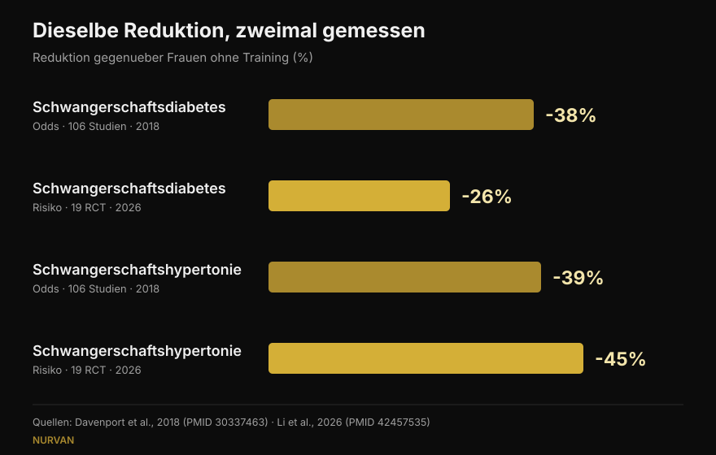
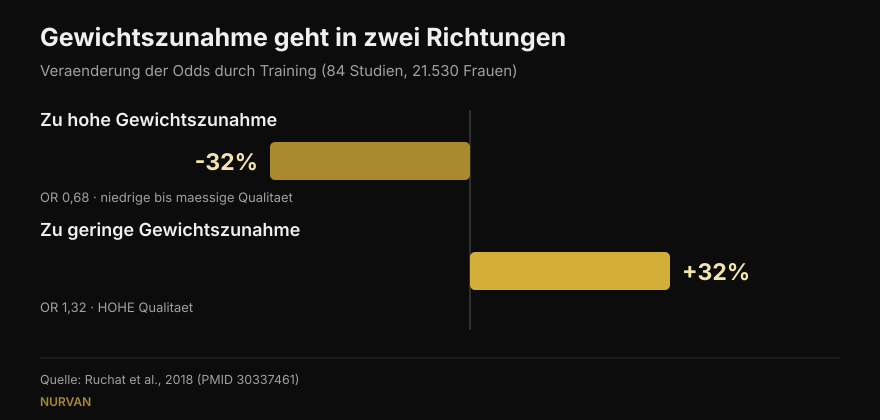

# Krafttraining in der Schwangerschaft: was die Forschung wirklich sagt

Von [Giammaria Loi](/autore/giammaria-loi) · aktualisiert am 16. Oktober 2026

Zwei Beiträge kursierten in denselben Wochen: einer nennt fünf Gründe, in der Schwangerschaft weiter mit Gewichten zu trainieren, der andere zeigt sehr präzise Zahlen — 38 % weniger Schwangerschaftsdiabetes, 41 % weniger Präeklampsie. Ich habe die Studien hinter beiden gelesen. Die Zahlen existieren, das ist schon eine gute Nachricht. Aber eine bedeutet etwas anderes, als sie gelesen wird, eine steht nicht in der genannten Quelle, und drei Befunde, die Entscheidungen verändern würden, fehlen in beiden.

## Kurz gefasst

- **Die Zahlen des Posts stimmen**, aber es sind *Odds Ratios*: 38 % geringere Chancen auf Schwangerschaftsdiabetes, nicht 38 % weniger Risiko. Die neueste Metaanalyse, die mit Risiken rechnet, sagt 26 % (Li et al., 2026).
- **600 MET-Minuten pro Woche**, also rund 140 Minuten moderate Aktivität, sind der publizierte Schwellenwert für mindestens 25 % Reduktion. **Wörtlich bestätigt** (Davenport et al., 2018).
- **„Viel hilft viel" trägt nicht**: die Dosis-Wirkungs-Kurve von 2026 erreicht ihr Maximum bei etwa 500–550 MET-Minuten und flacht dann ab. Früh anfangen und dranbleiben wiegt schwerer.
- **Speziell zum Krafttraining wissen wir weniger als es scheint**: in der Übersichtsarbeit zum Krafttraining mischten 90 % der Studien Kraft und Ausdauer, und fast keine beschrieb Lasten oder Progression (Prevett et al., 2025).
- **Was in beiden Posts fehlt**: Training senkt die Chancen auf eine zu hohe Gewichtszunahme, **erhöht** aber die Chancen auf eine zu geringe — und das ist der einzige Befund jener Übersichtsarbeit mit hoher Evidenzqualität (Ruchat et al., 2018).

## Woher diese Zahlen kommen

Der Beitrag von Margie Davenport, Forscherin an der University of Alberta, nennt die Quelle vollständig: eine systematische Übersichtsarbeit von 2018 über 106 Studien und 273.182 Schwangerschaften. Das ist selten und gehört gesagt. Ich habe nachgeprüft: Die drei Zahlen der Folien entsprechen exakt den publizierten Ergebnissen.

In **reinen Trainingsinterventionen** — ohne Ernährung oder andere Zusatzkomponenten — sinken die Chancen so: Schwangerschaftsdiabetes 0,62-fach gegenüber Frauen ohne Training, Schwangerschaftshypertonie 0,61, Präeklampsie 0,59. In Prozent: 38 %, 39 %, 41 %. Genau das sagen die Folien.

Ein Detail hebt der Post nicht hervor, und es ist das kontraintuitivste Ergebnis der Arbeit: **Kam zur Bewegung eine Ernährungsintervention hinzu, verschwand die Reduktion.** Nicht weil besseres Essen schadet, sondern weil jene Programme anders waren: kürzer, weniger betreut, mit schlechterer Adhärenz. Eine nützliche Erinnerung daran, wie sehr das *Wie* zählt, nicht nur der Inhalt.

## „38 % weniger" — wovon genau?

Hier liegt die wichtigste Präzisierung, und sie stellt niemandes Redlichkeit infrage: Es geht darum, wie unser Kopf Prozentzahlen liest.

Ein Odds Ratio ist kein Risiko. Ist eine Komplikation selten, ähneln sich beide Zahlen; ist sie es nicht, läuft das Odds Ratio dem Risiko davon. Schwangerschaftsdiabetes ist nicht selten.

Die neueste Metaanalyse, im September 2026 in derselben Zeitschrift erschienen, nahm 19 randomisierte Studien zu **betreutem** Training (6.213 Frauen) und rechnete mit **relativen Risiken**. Ergebnis: Schwangerschaftsdiabetes **26 %** weniger, nicht 38 %. In derselben Analyse sinkt die Schwangerschaftshypertonie allerdings um **45 %**, mehr als die 39 % des Posts. Die neuere Zahl ist also nicht systematisch kleiner: Sie ist ein anderes Maß an anderen Studien.

*Dieselbe Frage, vier Zahlen. Die Richtung ist stabil, die Größe nicht. Quellen: Davenport et al., 2018 (106 Studien) und Li et al., 2026 (19 randomisierte Studien, betreutes Training).*

## Wie viel Bewegung wirklich nötig ist

Nachprüfbar ist eine Zahl: **600 MET-Minuten pro Woche** moderater Aktivität für mindestens 25 % Reduktion. Die Beispiele liefert die Studie selbst: etwa 140 Minuten zügiges Gehen, Aquagymnastik, Ergometer oder Krafttraining. Die Bildunterschrift des Posts zitiert das wortwörtlich.

Die nächste Folie zerlegt diesen Gesamtwert jedoch nach Komplikation: 60 Minuten pro Woche für Präeklampsie, 93 für Schwangerschaftshypertonie, 106 für die Gewichtszunahme, 137 für Schwangerschaftsdiabetes. **Diese vier Werte habe ich weder in der genannten Quelle** noch in zugänglichen Sekundärquellen gefunden: Im Abstract steht allein der Gesamtwert von 600 MET-Minuten. Das macht sie nicht falsch — sie könnten aus einer Abbildung des Volltexts stammen — aber sie sind nicht überprüfbar, und eine so genaue Aufschlüsselung lädt dazu ein, für ein einzelnes Ziel das Minimum zu tun.

Die Arbeit von 2026 liefert die fehlende Hälfte: Die Dosis-Wirkungs-Kurve **flacht bei etwa 500–550 MET-Minuten ab**, bezogen auf die Gewichtszunahme. Darüber hinaus brachte mehr Volumen nichts. Und bewegt haben die Ergebnisse nicht die Minuten, sondern ein früher Beginn in der Schwangerschaft (signifikanter Subgruppenunterschied für Schwangerschaftsdiabetes, p = 0,009), eine Dauer über 20 Wochen (p = 0,010), eine Adhärenz über 80 % und **die Kombination aus Ausdauer und Kraft** — ein Punkt, der auch außerhalb der Schwangerschaft gilt, wie ich beim Thema [Kraft, Muskeln und Ausdauer im selben Programm](/de/blog/kraft-muskeln-und-ausdauer-gleichzeitig-trainieren) beschrieben habe.

## Und Krafttraining allein?

Der erste Beitrag heißt „fünf Gründe, warum Schwangere Gewichte heben sollten" — und räumt dann fair im Kleingedruckten ein, dass 7 der 9 Studien Kraft und Ausdauer kombinierten.

Das Problem ist größer, als es klingt. Die Übersichtsarbeit speziell zum Krafttraining in der Schwangerschaft, 2025 über 50 Studien und 47.619 Teilnehmerinnen erschienen, findet reale Ergebnisse: weniger Schwangerschaftshypertonie (Chancen 0,42-fach), weniger Schwangerschaftsdiabetes (0,62), weniger perinatale Stimmungsstörungen (0,48), weniger Makrosomie, also Neugeborene mit zu hohem Geburtsgewicht (0,67). Doch die Autorinnen schließen mit einer Warnung: **90 % der Studien waren Multikomponenten-Programme**, die Kraftdosis war „niedrig bis moderat", und Lasten, Progression und Belastungssteuerung wurden kaum beschrieben.

Klar gesagt: Wir wissen, dass Programme, die Krafttraining *enthalten*, wirken. Was ein **sauber programmiertes** Krafttraining bewirkt — mit steigender Last, Sätzen bis zu einem sinnvollen Wiederholungspuffer, aufeinander aufbauenden Wochen — wissen wir noch nicht. Diese Forschung fehlt, und die Autorinnen schreiben das als Aufruf.

Die Übersichtsarbeit von 2025 zur Lebensqualität, aus der der Post seine fünf Punkte zieht, hat dieselbe Grenze plus eine: Sie ist eine Übersicht **ohne Metaanalyse**, also ohne gepoolten Effekt und ohne Konfidenzintervalle. Neun Studien, 1.581 Frauen, günstige Richtung bei Gewicht, Rückenschmerz, Stimmung, Energie, Kraft und Schlaf. Der Punkt zum Schlaf stützt sich auf eine einzige Studie.

## Die drei Befunde, die in keinem der Posts stehen

### 1. Sicherheit, gemessen

Es ist die erste Frage Schwangerer, und sie taucht auf keiner der zwölf Folien auf. Es gibt eine eigene Übersichtsarbeit: 46 Studien, 266.778 Frauen. Keine Erhöhung der Chancen auf Fehlgeburt (0,88) oder perinatale Mortalität (0,86). Die Autoren schreiben in einfachen Worten, Bewegung erscheine bezogen auf diese beiden Endpunkte „sicher".

Mit zwei redlichen Einschränkungen: Die Gesamtqualität der Evidenz wird als **sehr niedrig** eingestuft, und die meisten Studien untersuchten moderate Intensität **bis 60 Minuten pro Einheit**. Darüber hinaus, schreiben sie, könnten sie nichts sagen.

### 2. Der Beckenboden — und der Zeitpunkt des Beginns

Eine weitere Arbeit derselben Gruppe, über 24 Studien und 15.982 Frauen, misst Beckenbodentraining in der Schwangerschaft: Die Chancen auf Harninkontinenz sinken während der Schwangerschaft auf **0,50** und nach der Geburt auf **0,63**.

Das entscheidende Detail: **Es wirkte bei Frauen, die vor Beginn kontinent waren, nicht bei jenen, die bereits Beschwerden hatten.** Bei bestehenden Symptomen verhielt sich das Training nicht wie eine Therapie. Das ist eine Information über das *Wann*, nicht über das *Ob* — genau das, was eine motivierende Folie weglässt.

### 3. Das Gewicht hat zwei Richtungen

Der erste Post setzt „weniger übermäßige Gewichtszunahme" an die erste Stelle und nennt es den konsistentesten Befund. Das stimmt. Aber die Übersichtsarbeit, aus der er stammt — 84 Studien, 21.530 Frauen — berichtet auch die andere Seite: Training **erhöht** die Chancen auf eine **zu geringe** Gewichtszunahme (1,32-fach). Und das ist das einzige Ergebnis dieser Arbeit, dem die Autorinnen eine **hohe** Evidenzqualität zuschreiben; der Nutzen bei der übermäßigen Zunahme gilt als niedrig bis moderat.

*Dieselbe Studie, zwei gegenläufige Ergebnisse. Das zweite hat die solidere Evidenz und steht in keinem der beiden Posts. Quelle: Ruchat et al., 2018.*

Die Autorinnen mahnen selbst zur Vorsicht, denn dieser Befund stützt sich auf fünf randomisierte Studien. Der Punkt bleibt: „Bewegung hilft, das Gewicht zu kontrollieren" ist in der Schwangerschaft kein bedingungsloses Gut — ein Grund mehr, das Gewicht den Betreuenden zu überlassen.

## Was die Forschung wirklich sagt

[[V|ok|Bestätigt|In reinen Trainingsinterventionen sinken die Chancen auf Schwangerschaftsdiabetes, Schwangerschaftshypertonie und Präeklampsie auf 0,62, 0,61 und 0,59 gegenüber keinem Training. Die drei Zahlen der Folien sind korrekt.]]
[[V|ok|Bestätigt|600 MET-Minuten pro Woche (rund 140 Minuten moderate Aktivität) sind der publizierte Schwellenwert für mindestens 25 % Reduktion. Wörtlich zitiert.]]
[[V|ok|Bestätigt|Aktuelle Leitlinien schließen Krafttraining bei unkomplizierten Schwangerschaften ein: Die kanadische Leitlinie 2019 bewertet den Nutzen als moderat und identifiziert keine Schäden.]]
[[V|part|Zu präzisieren|„38 % weniger" sind Odds, kein Risiko. In relativen Risiken sinkt in der Metaanalyse 2026 zu betreutem Training der Schwangerschaftsdiabetes um 26 % und die Schwangerschaftshypertonie um 45 %.]]
[[V|part|Zu präzisieren|Die Dosis ist nicht linear: Der Nutzen beim Gewicht flacht bei etwa 500–550 MET-Minuten ab. Früh beginnen und dranbleiben wiegt schwerer als Minuten.]]
[[V|part|Zu präzisieren|Die dem „Krafttraining" zugeschriebenen Effekte stammen fast immer aus gemischten Programmen mit niedriger Kraftdosis und unbeschriebener Progression. Sauber dosiertes Krafttraining ist noch nicht untersucht.]]
[[V|no|Widerlegt|Dass Gewichtskontrolle ein Nutzen ohne Kehrseite sei: Training erhöht auch die Chancen auf eine zu geringe Gewichtszunahme (1,32-fach) — und das ist der Befund mit der höchsten Evidenzqualität.]]
[[V|nv|Nicht überprüfbar|Die Minutenangaben je Komplikation auf Folie 5 (60, 93, 106, 137 pro Woche): weder im Abstract der genannten Quelle noch in zugänglichen Sekundärquellen zu finden.]]

## So setzt du es um

Zuerst: Dieser Text erklärt Studien, er ist kein Trainingsplan. Es gibt medizinische Situationen, in denen Sport in der Schwangerschaft kontraindiziert ist, und nur die Betreuenden können sagen, ob das auf dich zutrifft. Was folgt, ist ein Rahmen für dieses Gespräch, kein Ersatz dafür.

1. **Starte mit der richtigen Frage.** Wie Davenport auf einer Folie schreibt, lautete die Frage jahrelang „Ist es sicher?". Die Daten zu Fehlgeburt und perinataler Mortalität zeigen keine Risikoerhöhung — die nützliche Frage ist also eine andere: Was brauchst du, in diesem Trimester, von diesem Ausgangspunkt aus?
2. **Schau auf die Wochensumme, nicht auf die einzelne Einheit.** 600 MET-Minuten sind eine Sieben-Tage-Bilanz. Und jenseits von 500–550 flacht die Kurve ab: mehr Volumen brachte keinen Zusatznutzen.
3. **Kombiniere Ausdauer und Kraft.** Diese Kombination schnitt in den Subgruppen 2026 am besten ab und passt zu dem, was wir außerhalb der Schwangerschaft wissen.
4. **Dokumentiere die Anstrengung, nicht nur die Last.** In der Schwangerschaft sagt das Gewicht auf der Stange wenig: Derselbe Satz kann deutlich mehr kosten als vor sechs Wochen. Den Wiederholungspuffer (RIR) zu notieren ist der einfachste Weg, das rechtzeitig zu merken — dasselbe Prinzip wie beim [Wählen von Sätzen und Wiederholungen außerhalb der Schwangerschaft](/de/blog/wie-viele-wiederholungen-muskelaufbau).
5. **Beckenboden trainiert man vorher, nicht hinterher.** In den Daten zeigt sich der Effekt bei Frauen ohne Symptome. Wie und wie viel, entscheidet eine Fachperson.
6. **Das Gewicht verfolgen die, die dich betreuen.** Zu viel und zu wenig Zunahme sind beides zu vermeidende Endpunkte, und keines davon beurteilt man allein auf der Waage.

[[APP|Die Last ändert sich, das Logbuch bleibt|In Nurvan trägst du Last, Wiederholungen und RIR Einheit für Einheit ein: Wenn dasselbe Gewicht mehr kostet, siehst du es im Diagramm, statt es mitten im Satz zu merken. Und über das Coach-Athlet-Modul sieht deine Fachperson dieselben Daten in Echtzeit — ohne Screenshots per WhatsApp.|Nurvan testen]]

## Häufige Fragen

**Darf ich weiter Gewichte heben, wenn ich es vorher schon getan habe?**
Aktuelle Leitlinien schließen Krafttraining bei unkomplizierten Schwangerschaften ein, und die Übersichtsarbeit von 2018 fand keine Erhöhung von Fehlgeburten oder perinataler Mortalität. Was sich ändert, in den Studien wie in der Praxis, ist das Wie: Intensität, Übungsauswahl und Verträglichkeit verschieben sich mit den Trimestern. Die Entscheidung läuft über die Betreuenden — nur sie wissen, ob in deinem Fall Kontraindikationen bestehen.

**Wie viel Bewegung pro Woche?**
Der publizierte Wert sind 600 MET-Minuten pro Woche moderater Aktivität, rund 140 Minuten, für mindestens 25 % Reduktion der untersuchten Komplikationen. Die Metaanalyse 2026 zeigt jedoch, dass der Nutzen bei etwa 500–550 MET-Minuten abflacht und dass früher Beginn und hohe Adhärenz mehr zählen als Volumen.

**Schadet Training in der Schwangerschaft dem Kind?**
Bei den beiden am meisten gefürchteten Endpunkten — Fehlgeburt und perinatale Mortalität — findet die Übersichtsarbeit über 266.778 Frauen keine Erhöhung. Die Autoren betonen, die Evidenzqualität sei sehr niedrig und die meisten Studien hätten moderate Intensität bis 60 Minuten pro Einheit untersucht: darüber hinaus sei keine Aussage möglich.

**Kann ich in der Schwangerschaft bei null anfangen?**
Die eingeschlossenen Studien betrafen Frauen ohne Kontraindikationen, und viele Programme begannen in der Schwangerschaft. Die Subgruppen von 2026 sprechen dafür, dass ein früher Beginn zählt. Aber „bei null anfangen" ist genau die Situation, die vorher das Okay von Ärztin oder Hebamme braucht, nicht hinterher.

## Auch lesenswert

- [Kraft, Muskeln und Ausdauer gleichzeitig: geht das?](/de/blog/kraft-muskeln-und-ausdauer-gleichzeitig-trainieren) — warum die Kombination funktioniert und wann sie sich stört
- [Wie viele Wiederholungen für Muskelaufbau: der 8-12-Mythos](/de/blog/wie-viele-wiederholungen-muskelaufbau) — wie Sätze, Wiederholungen und Pausen aus den Daten gewählt werden
- [Trainingssplit: Anfänger oder Fortgeschrittene](/de/blog/trainingssplit-anfaenger-fortgeschrittene) — wie oft pro Woche eine Muskelgruppe trainiert gehört

## Quellen

1. Davenport MH, Ruchat SM, Poitras VJ, et al., 2018. Prenatal exercise for the prevention of gestational diabetes mellitus and hypertensive disorders of pregnancy: a systematic review and meta-analysis. *Br J Sports Med* 52(21):1367-1375. PMID 30337463 — [doi.org/10.1136/bjsports-2018-099355](https://doi.org/10.1136/bjsports-2018-099355)
2. Li L, He J, Wang C, et al., 2026. Effects of supervised exercise during pregnancy on gestational diabetes mellitus and other pregnancy outcomes: a systematic review and meta-analysis. *Br J Sports Med* 60(17):1350-1358. PMID 42457535 — [doi.org/10.1136/bjsports-2026-111586](https://doi.org/10.1136/bjsports-2026-111586)
3. Prevett C, Gingerich J, Sivak A, Davenport MH, 2025. Resistance training in pregnancy: systematic review and meta-analysis of pregnancy, delivery, fetal and pelvic floor outcomes and call to action. *Br J Sports Med* 59(16):1173-1182. PMID 40610191 — [doi.org/10.1136/bjsports-2024-109123](https://doi.org/10.1136/bjsports-2024-109123)
4. Redondo-Delgado P, Blanco-Giménez P, López-Ortiz S, et al., 2025. Effects of strength training on quality of life in pregnant women: a systematic review. *Acta Obstet Gynecol Scand* 104(7):1231-1243. PMID 40230063 — [doi.org/10.1111/aogs.15122](https://doi.org/10.1111/aogs.15122)
5. Ruchat SM, Mottola MF, Skow RJ, et al., 2018. Effectiveness of exercise interventions in the prevention of excessive gestational weight gain and postpartum weight retention: a systematic review and meta-analysis. *Br J Sports Med* 52(21):1347-1356. PMID 30337461 — [doi.org/10.1136/bjsports-2018-099399](https://doi.org/10.1136/bjsports-2018-099399)
6. Davenport MH, Kathol AJ, Mottola MF, et al., 2018. Prenatal exercise is not associated with fetal mortality: a systematic review and meta-analysis. *Br J Sports Med* 53(2):108-115. PMID 30337346 — [doi.org/10.1136/bjsports-2018-099773](https://doi.org/10.1136/bjsports-2018-099773)
7. Davenport MH, Nagpal TS, Mottola MF, et al., 2018. Prenatal exercise (including but not limited to pelvic floor muscle training) and urinary incontinence during and following pregnancy: a systematic review and meta-analysis. *Br J Sports Med* 52(21):1397-1404. PMID 30337466 — [doi.org/10.1136/bjsports-2018-099780](https://doi.org/10.1136/bjsports-2018-099780)
8. Mottola MF, Davenport MH, Ruchat SM, et al., 2018. 2019 Canadian guideline for physical activity throughout pregnancy. *Br J Sports Med* 52(21):1339-1346. PMID 30337460 — [doi.org/10.1136/bjsports-2018-100056](https://doi.org/10.1136/bjsports-2018-100056)

Ausgangspunkt: die Karussells von [Built With Science](https://www.instagram.com/p/Dd9PB-olsG2/) (1. Oktober 2026) und [Margie Davenport](https://www.instagram.com/p/DdrC7OHm3xe/) (24. September 2026). Kein Text und kein Bild der beiden Posts wurde reproduziert: Die Aussagen wurden neu geschrieben und an der Primärliteratur geprüft.

[[BIO|Giammaria Loi ist der Gründer von Nurvan. Er trainiert seit 2012 mit Gewichten, arbeitet seit 2013 als FIPE-zertifizierter Personal Trainer und Coach und startet seit 2018 national im Powerlifting. Jeder Artikel, den er zeichnet, beginnt bei den Studien und endet bei dem, was im Gym wirklich funktioniert.]]

> Hinweis: informativer Inhalt, kein Ersatz für den Rat einer Ärztin, einer Hebamme oder einer anderen Fachperson. In der Schwangerschaft gibt es Situationen, in denen Sport kontraindiziert ist: Sprich mit deinen Betreuenden, bevor du dein Training änderst.
