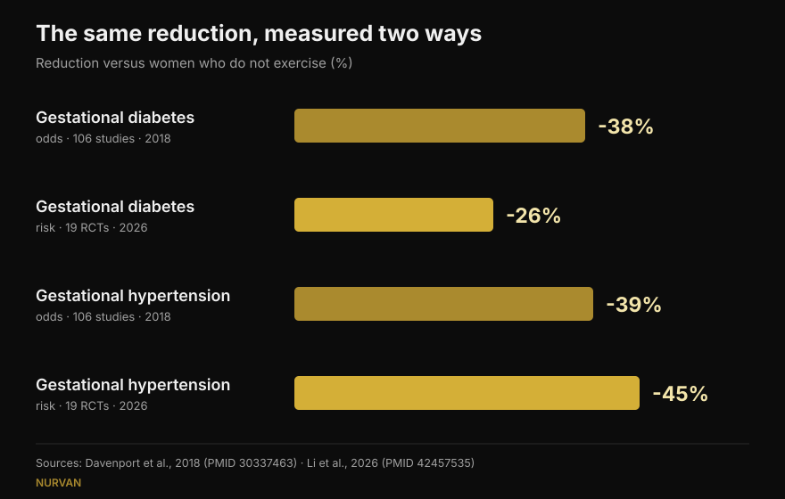
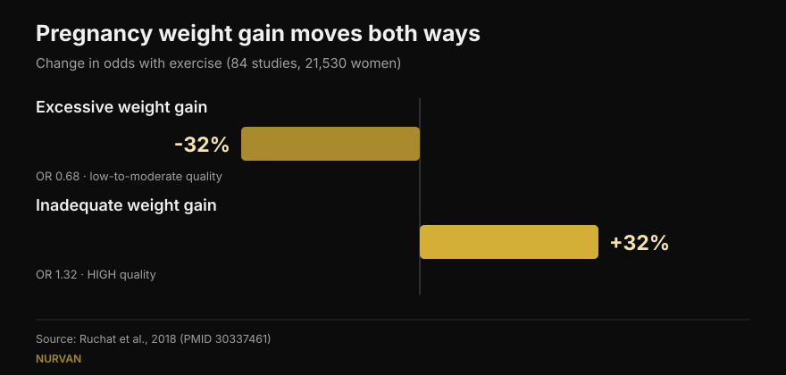

# Lifting weights in pregnancy: what the research actually says

By [Giammaria Loi](/autore/giammaria-loi) · updated 16 October 2026

Two posts went round in the same few weeks. One lists five reasons to keep lifting while pregnant. The other puts up very precise numbers: 38% less gestational diabetes, 41% less pre-eclampsia. I read the studies behind both. The numbers are real, which is already good news. But one of them means something different from how it reads, one isn't in the paper it is credited to, and three findings that would change a reader's decisions appear in neither post.

## The short version

- **The numbers are accurate**, but they are *odds ratios*: 38% lower odds of gestational diabetes, not 38% lower risk. The newest meta-analysis, which works in risk, says 26% (Li et al., 2026).
- **600 MET-minutes a week** — roughly 140 minutes of moderate activity — is the published threshold for at least a 25% reduction. **Confirmed word for word** (Davenport et al., 2018).
- **"More is better" does not hold**: the 2026 dose-response peaks around 500–550 MET-minutes and then flattens. Starting early and sticking with it matter more.
- **We know less about lifting specifically than it looks**: in the review built around resistance training, 90% of studies mixed strength with aerobic work and almost none described load or progression (Prevett et al., 2025).
- **What both posts miss**: exercise lowers the odds of excessive weight gain but **raises** the odds of gaining too little — and that is the only finding in that review rated high-quality evidence (Ruchat et al., 2018).

## Where those numbers come from

Margie Davenport, a researcher at the University of Alberta, cites her source in full: a 2018 systematic review of 106 studies and 273,182 pregnancies. That is rare and worth saying out loud. I checked: the three numbers on the slides match the published results exactly.

In **exercise-only** interventions — no diet or other components bolted on — the odds drop like this: gestational diabetes 0.62 times those of women who do not exercise, gestational hypertension 0.61, pre-eclampsia 0.59. In percentages: 38%, 39%, 41%. Exactly what the slides say.

There is a detail the post does not flag, and it is the paper's most counter-intuitive result: **when a dietary intervention was added to the exercise, the reduction disappeared**. Not because eating better hurts, but because those programmes were different — usually shorter, less supervised, with worse adherence. A useful reminder that *how* a programme is delivered matters as much as what is in it.

## "38% less" of what, exactly

This is the most important correction, and it is not about anyone's honesty. It is about how our brains read percentages.

An odds ratio is not a risk. When a complication is rare, the two numbers look alike; when it isn't, the odds ratio runs ahead of the risk. Gestational diabetes is not rare.

The newest meta-analysis on the question, published in September 2026 in the same journal, took 19 randomised trials of **supervised** exercise (6,213 women) and calculated **relative risks** rather than odds. Result: gestational diabetes **26%** lower, not 38%. In the same analysis, though, gestational hypertension falls **45%** — more than the post's 39%. The newer number isn't systematically smaller: it is a different measure, on different studies.

*Same question, four numbers. The direction is stable, the size is not. Sources: Davenport et al., 2018 (106 studies) and Li et al., 2026 (19 randomised trials, supervised exercise).*

## How much exercise you actually need

There is one verifiable number: **600 MET-minutes a week** of moderate activity for at least a 25% reduction. The examples come from the paper itself: about 140 minutes of brisk walking, water aerobics, stationary cycling or resistance training. The caption quotes it word for word.

The next slide, though, breaks that total down by complication: 60 minutes a week for pre-eclampsia, 93 for gestational hypertension, 106 for weight gain, 137 for gestational diabetes. **I could not find those four values in the cited source** or in any accessible secondary source: the only figure published in the abstract is the 600 MET-minute total. That does not make them wrong — they may come from a figure in the full paper — but they are not verifiable, and a breakdown that precise invites doing the bare minimum for one outcome.

The 2026 paper supplies the missing half: the dose-response curve **flattens around 500–550 MET-minutes** for weight gain. Past that, more volume bought nothing extra. And what moved the results was not minutes but starting early in pregnancy (significant subgroup difference for gestational diabetes, p = 0.009), carrying on for more than 20 weeks (p = 0.010), adherence above 80%, and **combining aerobic work with strength** — a point that holds outside pregnancy too, as I covered when writing about [training strength, muscle and cardio in the same programme](/en/blog/training-strength-muscle-and-cardio-together).

## And lifting on its own?

The first post is titled "five reasons pregnant women should lift weights", and then — fairly — admits in small print that 7 of the 9 studies it leans on combined strength with aerobic work.

That is a bigger problem than it sounds. The review built specifically around resistance training, published in 2025 across 50 studies and 47,619 participants, finds real results: lower odds of gestational hypertension (0.42), gestational diabetes (0.62), perinatal mood disorders (0.48) and macrosomia, meaning oversized newborns (0.67). But the authors close with a warning: **90% of the studies were multicomponent programmes**, the resistance-training dose was "low-to-moderate", and reporting of load, progression and loading guidance was poor.

Put plainly: we know that programmes *containing* strength work help. We still do not know what **properly programmed** strength training does — load that progresses, sets taken to a sensible rep margin, weeks that build on each other. That research has not been done, and the authors write it up as a call to action.

The 2025 quality-of-life review, the one the first post takes its five points from, has the same limit plus one: it is a systematic review **without meta-analysis**, so there is no pooled effect and no confidence intervals. Nine studies, 1,581 women, a favourable direction on weight, low-back pain, mood, energy, strength and sleep. The sleep point rests on a single study.

## The three findings neither post reports

### 1. Safety, measured

It is the first question most pregnant women ask, and it appears on none of the twelve slides. There is a review dedicated to it: 46 studies, 266,778 women. No increase in the odds of miscarriage (0.88) or perinatal mortality (0.86). The authors write, in plain terms, that exercise appears "safe" with respect to those two outcomes.

With two honest caveats worth repeating: the overall quality of the evidence is rated **very low**, and most studies examined moderate intensity **up to 60 minutes per session**. Beyond that duration, they say, they cannot comment.

### 2. The pelvic floor — and when you start

Another review from the same group, across 24 studies and 15,982 women, measures pelvic floor muscle training in pregnancy: the odds of urinary incontinence fall to **0.50** during pregnancy and **0.63** after birth.

The detail that changes everything: **it worked in women who were continent before starting, not in women who already leaked**. In women with existing symptoms, training did not behave as a treatment. That is information about *when*, not *whether* — exactly the kind of thing a motivational slide drops.

### 3. Weight moves in two directions

The first post puts "less excessive weight gain" at the top of its list and calls it the most consistent finding. True. But the review that result comes from — 84 studies, 21,530 women — also reports the other side: exercise **raises** the odds of **inadequate** weight gain (1.32 times). And that is the only result in the review the authors grade as **high**-quality evidence; the benefit on excessive gain is graded low to moderate.

*One study, two opposite results. The second has the stronger evidence behind it, and appears in neither post. Source: Ruchat et al., 2018.*

The authors themselves urge caution, since that finding rests on five randomised trials. But the point stands: "exercise helps control weight" in pregnancy is not an unconditional good, and it is one more reason to leave weight to the people looking after your pregnancy.

## What the research actually says

[[V|ok|Confirmed|In exercise-only interventions the odds of gestational diabetes, gestational hypertension and pre-eclampsia fall to 0.62, 0.61 and 0.59 respectively versus no exercise. The three numbers on the slides are correct.]]
[[V|ok|Confirmed|600 MET-minutes a week (about 140 minutes of moderate activity) is the published threshold for at least a 25% reduction. Quoted word for word.]]
[[V|ok|Confirmed|Current guidelines include strength work in uncomplicated pregnancies: the 2019 Canadian guideline rates the benefits moderate and identifies no harms.]]
[[V|part|Needs context|"38% less" is odds, not risk. In relative risk, in the 2026 meta-analysis of supervised exercise, gestational diabetes falls 26% and gestational hypertension 45%.]]
[[V|part|Needs context|The dose is not linear: the weight-gain benefit flattens around 500–550 MET-minutes. Starting early and staying consistent weigh more than minutes.]]
[[V|part|Needs context|Benefits credited to "lifting" almost always come from mixed programmes, with low strength doses and undescribed progression. Properly dosed resistance training has not been studied yet.]]
[[V|no|Overturned|That weight control is a benefit with no downside: exercise also raises the odds of inadequate weight gain (1.32 times), and that is the highest-quality finding in the review.]]
[[V|nv|Unverifiable|The per-complication minutes on slide 5 (60, 93, 106, 137 a week): not in the abstract of the cited source, nor in any accessible secondary source.]]

## How to apply it

First: this article explains studies, it is not a programme. There are medical conditions in which exercise in pregnancy is contraindicated, and only the people looking after your pregnancy can tell you whether that applies to you. What follows is a frame for that conversation, not a substitute for it.

1. **Start from the right question.** As Davenport puts it on one slide, for years the question was "is it safe?". The miscarriage and perinatal mortality data show no increase in risk, so the useful question becomes a different one: what do you need, in this trimester, from this starting point.
2. **Look at the weekly total, not the single session.** 600 MET-minutes is a seven-day budget, not a daily chore. And past 500–550 the curve flattens: more volume did not buy more benefit.
3. **Combine aerobic work and strength.** That is the subgroup that did best in 2026, and it matches what we know outside pregnancy.
4. **Track effort, not just load.** In pregnancy the number on the bar tells you little: the same set can cost far more than it did six weeks ago. Logging reps in reserve (RIR) is the simplest way to notice in time — the same principle I use when [choosing sets and reps outside pregnancy](/en/blog/how-many-reps-build-muscle).
5. **Pelvic floor work comes before symptoms, not after.** In the data the effect is there in women without symptoms yet. How much and how is a professional's call.
6. **Weight is tracked by the people tracking you.** Gaining too much and gaining too little are both outcomes to avoid, and neither is judged alone with a bathroom scale.

[[APP|The load changes — the log stays|Nurvan logs load, reps and RIR session by session, so when the same weight starts costing more you see it on a chart instead of discovering it mid-set. And with the coach–athlete module your professional sees the same data live, without screenshots over WhatsApp.|Try Nurvan]]

## Frequently asked questions

**Can I keep lifting if I already lifted before pregnancy?**
Current guidelines include strength work in uncomplicated pregnancies, and the 2018 review found no increase in miscarriage or perinatal mortality. What changes, in the studies as in practice, is how you train: intensity, exercise selection and tolerance shift with the trimesters. The decision, though, runs through the people looking after your pregnancy — only they know whether there are contraindications in your case.

**How much exercise per week?**
The published figure is 600 MET-minutes a week of moderate activity, about 140 minutes, for at least a 25% reduction in the complications studied. The 2026 meta-analysis shows the benefit flattening around 500–550 MET-minutes, and that starting early and keeping adherence high count for more than volume.

**Is exercising in pregnancy bad for the baby?**
On the two most feared outcomes — miscarriage and perinatal mortality — the review of 266,778 women finds no increase in odds. The authors do note that the quality of the evidence is very low and that most studies looked at moderate intensity up to 60 minutes per session: beyond that, they say, no conclusion can be drawn.

**Can I start from zero while pregnant?**
The studies in these reviews involved women without contraindications to exercise, and many programmes began during pregnancy. The 2026 subgroups suggest starting early helps. But "starting from zero" is exactly the situation that needs a doctor's or midwife's green light first, not afterwards.

## Read also

- [Strength, muscle and cardio together: can it work?](/en/blog/training-strength-muscle-and-cardio-together) — why the combination works and when the two interfere
- [How many reps to build muscle: the 8–12 myth](/en/blog/how-many-reps-build-muscle) — how sets, reps and rest are chosen from the data
- [Training splits: beginner vs advanced](/en/blog/training-split-beginner-vs-advanced) — how often a muscle group should be trained each week

## Sources

1. Davenport MH, Ruchat SM, Poitras VJ, et al., 2018. Prenatal exercise for the prevention of gestational diabetes mellitus and hypertensive disorders of pregnancy: a systematic review and meta-analysis. *Br J Sports Med* 52(21):1367-1375. PMID 30337463 — [doi.org/10.1136/bjsports-2018-099355](https://doi.org/10.1136/bjsports-2018-099355)
2. Li L, He J, Wang C, et al., 2026. Effects of supervised exercise during pregnancy on gestational diabetes mellitus and other pregnancy outcomes: a systematic review and meta-analysis. *Br J Sports Med* 60(17):1350-1358. PMID 42457535 — [doi.org/10.1136/bjsports-2026-111586](https://doi.org/10.1136/bjsports-2026-111586)
3. Prevett C, Gingerich J, Sivak A, Davenport MH, 2025. Resistance training in pregnancy: systematic review and meta-analysis of pregnancy, delivery, fetal and pelvic floor outcomes and call to action. *Br J Sports Med* 59(16):1173-1182. PMID 40610191 — [doi.org/10.1136/bjsports-2024-109123](https://doi.org/10.1136/bjsports-2024-109123)
4. Redondo-Delgado P, Blanco-Giménez P, López-Ortiz S, et al., 2025. Effects of strength training on quality of life in pregnant women: a systematic review. *Acta Obstet Gynecol Scand* 104(7):1231-1243. PMID 40230063 — [doi.org/10.1111/aogs.15122](https://doi.org/10.1111/aogs.15122)
5. Ruchat SM, Mottola MF, Skow RJ, et al., 2018. Effectiveness of exercise interventions in the prevention of excessive gestational weight gain and postpartum weight retention: a systematic review and meta-analysis. *Br J Sports Med* 52(21):1347-1356. PMID 30337461 — [doi.org/10.1136/bjsports-2018-099399](https://doi.org/10.1136/bjsports-2018-099399)
6. Davenport MH, Kathol AJ, Mottola MF, et al., 2018. Prenatal exercise is not associated with fetal mortality: a systematic review and meta-analysis. *Br J Sports Med* 53(2):108-115. PMID 30337346 — [doi.org/10.1136/bjsports-2018-099773](https://doi.org/10.1136/bjsports-2018-099773)
7. Davenport MH, Nagpal TS, Mottola MF, et al., 2018. Prenatal exercise (including but not limited to pelvic floor muscle training) and urinary incontinence during and following pregnancy: a systematic review and meta-analysis. *Br J Sports Med* 52(21):1397-1404. PMID 30337466 — [doi.org/10.1136/bjsports-2018-099780](https://doi.org/10.1136/bjsports-2018-099780)
8. Mottola MF, Davenport MH, Ruchat SM, et al., 2018. 2019 Canadian guideline for physical activity throughout pregnancy. *Br J Sports Med* 52(21):1339-1346. PMID 30337460 — [doi.org/10.1136/bjsports-2018-100056](https://doi.org/10.1136/bjsports-2018-100056)

Prompted by carousels from [Built With Science](https://www.instagram.com/p/Dd9PB-olsG2/) (1 October 2026) and [Margie Davenport](https://www.instagram.com/p/DdrC7OHm3xe/) (24 September 2026). No text and no image from either post was reproduced: the claims were rewritten and checked against the primary literature.

[[BIO|Giammaria Loi is the founder of Nurvan. He has been lifting since 2012, has worked as a FIPE-certified personal trainer and coach since 2013, and has competed in powerlifting at national level since 2018. Every article he writes starts from the research and ends with what actually works in the gym.]]

> Note: educational content, not a substitute for advice from a doctor, midwife or other health professional. Some conditions make exercise in pregnancy inadvisable: talk to the people looking after you before changing how you train.
