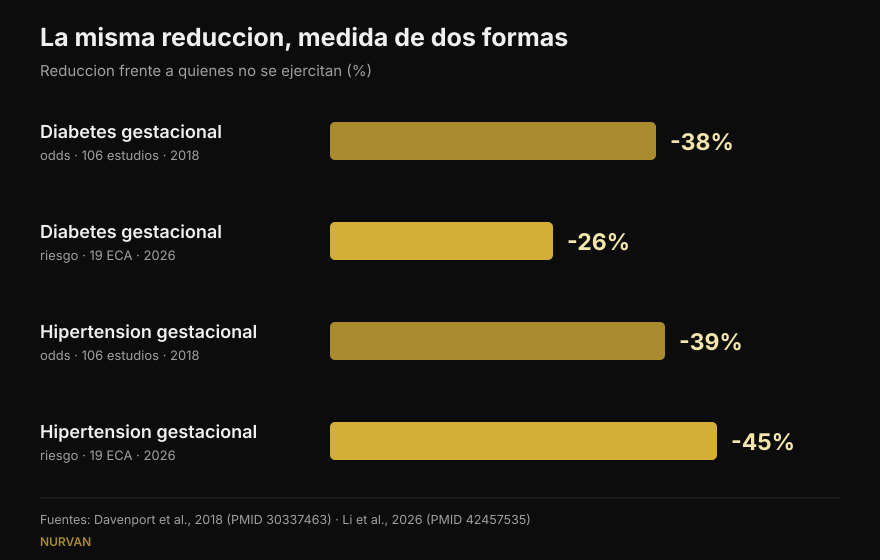
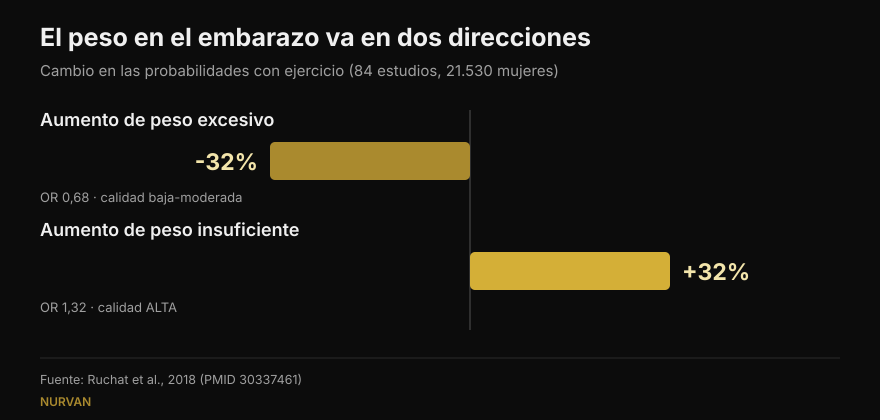

# Pesas en el embarazo: qué dice realmente la ciencia

Por [Giammaria Loi](/autore/giammaria-loi) · actualizado el 16 de octubre de 2026

Dos publicaciones circularon en las mismas semanas: una enumera cinco motivos para seguir entrenando con pesas durante el embarazo, la otra muestra cifras muy precisas — 38% menos de diabetes gestacional, 41% menos de preeclampsia. He leído los estudios de ambas. Las cifras existen, y eso ya es una buena noticia. Pero una significa algo distinto de cómo se lee, otra no aparece en la fuente citada, y hay tres datos que cambiarían decisiones y que no están en ninguna de las dos.

## En resumen

- **Las cifras del post son exactas**, pero son *odds ratio*: 38% menos de probabilidades de diabetes gestacional, no 38% menos de riesgo. El metaanálisis más reciente, que trabaja con riesgos, dice 26% (Li et al., 2026).
- **600 MET-minutos por semana**, unos 140 minutos de actividad moderada, es el umbral publicado para al menos un 25% de reducción. **Confirmado al pie de la letra** (Davenport et al., 2018).
- **"Cuanto más, mejor" no se sostiene**: la curva dosis-respuesta de 2026 alcanza su pico hacia 500–550 MET-minutos y luego se aplana. Empezar pronto y ser constante pesa más.
- **Sobre las pesas en concreto sabemos menos de lo que parece**: en la revisión dedicada a la fuerza, el 90% de los estudios mezclaba fuerza y aeróbico y casi ninguno describía cargas ni progresión (Prevett et al., 2025).
- **El dato que falta en los dos posts**: el ejercicio reduce el aumento de peso excesivo, pero **aumenta** las probabilidades de un aumento insuficiente, y ese es el único resultado de esa revisión con calidad de evidencia alta (Ruchat et al., 2018).

## De dónde salen esas cifras

El post de Margie Davenport, investigadora de la Universidad de Alberta, cita la fuente completa: una revisión sistemática de 2018 sobre 106 estudios y 273.182 embarazos. Es poco habitual y hay que decirlo. Lo he comprobado: las tres cifras de las diapositivas coinciden exactamente con los resultados publicados.

En las intervenciones de **solo ejercicio** — sin dieta ni otros componentes añadidos — las probabilidades bajan así: diabetes gestacional 0,62 veces respecto a quien no entrena, hipertensión gestacional 0,61, preeclampsia 0,59. En porcentaje: 38%, 39%, 41%. Justo lo que dicen las diapositivas.

Hay un detalle que el post no destaca y que es el resultado más contraintuitivo del estudio: **cuando al ejercicio se le añadía una intervención dietética, la reducción desaparecía**. No porque comer mejor perjudique, sino porque esos programas eran distintos: más cortos, menos supervisados, con peor adherencia. Un recordatorio de cuánto importa *cómo* se aplica un programa, no solo qué contiene.

## "38% menos" ¿de qué, exactamente?

Aquí está la precisión más importante, y no cuestiona la honestidad de nadie: tiene que ver con cómo leemos los porcentajes.

Un *odds ratio* no es un riesgo. Cuando una complicación es rara, ambos números se parecen; cuando no lo es, el odds ratio se adelanta. La diabetes gestacional no es rara.

El metaanálisis más reciente, publicado en septiembre de 2026 en la misma revista, tomó 19 ensayos aleatorizados de ejercicio **supervisado** (6.213 mujeres) y calculó **riesgos relativos**. Resultado: diabetes gestacional **26%** menos, no 38%. En ese mismo análisis, sin embargo, la hipertensión gestacional baja un **45%**, más que el 39% del post. No es que la cifra nueva sea siempre menor: es otra medida, sobre otros estudios.

*La misma pregunta, cuatro cifras. La dirección es estable, la magnitud no. Fuentes: Davenport et al., 2018 (106 estudios) y Li et al., 2026 (19 ensayos aleatorizados, ejercicio supervisado).*

## Cuánto ejercicio hace falta de verdad

La cifra verificable es una: **600 MET-minutos por semana** de actividad moderada para al menos un 25% de reducción. Los ejemplos los pone el propio estudio: unos 140 minutos de caminata rápida, aquagym, bicicleta estática o trabajo de fuerza. El pie de foto del post lo reproduce palabra por palabra.

La diapositiva siguiente, en cambio, desglosa ese total por complicación: 60 minutos semanales para la preeclampsia, 93 para la hipertensión gestacional, 106 para el aumento de peso, 137 para la diabetes gestacional. **No he encontrado esos cuatro valores en la fuente citada** ni en fuentes secundarias accesibles: lo único publicado en el resumen es el total de 600 MET-minutos. No significa que sean erróneos — podrían venir de una figura del artículo completo — pero no son verificables, y un desglose tan preciso invita a hacer el mínimo para un solo resultado.

El trabajo de 2026 añade lo que falta: la curva dosis-respuesta **se aplana hacia 500–550 MET-minutos** para el aumento de peso. Más allá, añadir volumen no aportó beneficios. Y lo que movió los resultados no fueron los minutos, sino empezar pronto en el embarazo (diferencia significativa entre subgrupos para la diabetes gestacional, p = 0,009), seguir más de 20 semanas (p = 0,010), una adherencia superior al 80% y **combinar aeróbico y fuerza** — algo que también vale fuera del embarazo, como conté al hablar de [entrenar fuerza, músculo y cardio a la vez](/es/blog/entrenar-fuerza-musculo-y-cardio-a-la-vez).

## ¿Y las pesas, solas?

El primer post se titula "cinco motivos por los que las embarazadas deberían levantar pesas" y después, con honestidad, admite en letra pequeña que 7 de los 9 estudios combinaban fuerza y aeróbico.

El problema es mayor de lo que parece. La revisión dedicada al entrenamiento de fuerza en el embarazo, publicada en 2025 sobre 50 estudios y 47.619 participantes, encuentra resultados reales: menos hipertensión gestacional (probabilidades 0,42 veces), menos diabetes gestacional (0,62), menos trastornos del estado de ánimo perinatales (0,48) y menos macrosomía, es decir recién nacidos de peso excesivo (0,67). Pero los autores cierran con una advertencia: **el 90% de los estudios eran programas multicomponente**, la dosis de fuerza era "de baja a moderada" y la descripción de cargas y progresión era escasa.

Dicho claro: sabemos que los programas *que contienen* fuerza funcionan. No sabemos aún qué hace un entrenamiento de fuerza **bien programado**, con carga que progresa, series llevadas a un margen de repeticiones sensato y semanas que se construyen una sobre otra. Esa investigación no existe todavía, y los autores lo escriben como una llamada a la acción.

La revisión de 2025 sobre calidad de vida, de donde el post saca sus cinco puntos, tiene el mismo límite y uno más: es una revisión **sin metaanálisis**, así que no hay efecto medio ni intervalos de confianza. Nueve estudios, 1.581 mujeres, dirección favorable en peso, dolor lumbar, ánimo, energía, fuerza y sueño. El punto del sueño descansa en un solo estudio.

## Los tres datos que no aparecen en ninguno de los dos posts

### 1. La seguridad, medida

Es la primera pregunta de quien está embarazada y no aparece en ninguna de las doce diapositivas. Existe una revisión dedicada: 46 estudios, 266.778 mujeres. Ningún aumento de las probabilidades de aborto espontáneo (0,88) ni de mortalidad perinatal (0,86). Los autores escriben, en términos sencillos, que el ejercicio parece "seguro" respecto a esos dos resultados.

Con dos advertencias honestas: la calidad global de la evidencia se califica de **muy baja**, y la mayoría de los estudios examinó intensidad moderada **hasta 60 minutos por sesión**. Más allá de esa duración, dicen, no pueden pronunciarse.

### 2. El suelo pélvico y el momento de empezar

Otra revisión del mismo grupo, sobre 24 estudios y 15.982 mujeres, mide el entrenamiento del suelo pélvico en el embarazo: las probabilidades de incontinencia urinaria bajan a **0,50** durante el embarazo y a **0,63** tras el parto.

El detalle que lo cambia todo: **funcionó en mujeres continentes antes de empezar, no en quienes ya tenían pérdidas**. En ellas el entrenamiento no se comportó como un tratamiento. Es información sobre el *cuándo*, no sobre el *si* — justo lo que una diapositiva motivacional deja fuera.

### 3. El peso va en dos direcciones

El primer post pone "menos aumento de peso excesivo" en primer lugar y lo llama el resultado más consistente. Es cierto. Pero la revisión de la que procede — 84 estudios, 21.530 mujeres — también informa de la otra cara: el ejercicio **aumenta** las probabilidades de un aumento de peso **insuficiente** (1,32 veces). Y ese es el único resultado de la revisión al que los autores asignan calidad de evidencia **alta**; el beneficio sobre el aumento excesivo se clasifica de baja a moderada.

*El mismo estudio, dos resultados opuestos. El segundo tiene la evidencia más sólida y no aparece en ninguno de los dos posts. Fuente: Ruchat et al., 2018.*

Los propios autores piden prudencia, porque ese dato se apoya en cinco ensayos aleatorizados. Pero el punto se mantiene: "el ejercicio ayuda a controlar el peso" en el embarazo no es un bien sin condiciones, y es una razón más para que el peso lo siga quien sigue tu embarazo.

## Qué dice realmente la investigación

[[V|ok|Confirmado|En las intervenciones de solo ejercicio las probabilidades de diabetes gestacional, hipertensión gestacional y preeclampsia bajan a 0,62, 0,61 y 0,59 respecto a quien no entrena. Las tres cifras de las diapositivas son correctas.]]
[[V|ok|Confirmado|600 MET-minutos por semana (unos 140 minutos de actividad moderada) son el umbral publicado para al menos un 25% de reducción. Citado literalmente.]]
[[V|ok|Confirmado|Las guías actuales incluyen el trabajo de fuerza en embarazos sin complicaciones: la guía canadiense de 2019 juzga los beneficios moderados y no identifica daños.]]
[[V|part|Matizado|"38% menos" son odds, no riesgo. Con riesgos relativos, en el metaanálisis de 2026 de ejercicio supervisado, la diabetes gestacional baja un 26% y la hipertensión gestacional un 45%.]]
[[V|part|Matizado|La dosis no es lineal: el beneficio sobre el peso se aplana hacia 500–550 MET-minutos. Empezar pronto y ser constante pesa más que los minutos.]]
[[V|part|Matizado|Los beneficios atribuidos a "las pesas" vienen casi siempre de programas mixtos, con dosis de fuerza bajas y progresión no descrita. La fuerza bien programada aún no se ha estudiado.]]
[[V|no|Desmentido|Que controlar el peso sea un beneficio sin reverso: el ejercicio también aumenta las probabilidades de un aumento de peso insuficiente (1,32 veces), y es la evidencia de mayor calidad de la revisión.]]
[[V|nv|No verificable|Los minutos por complicación de la diapositiva 5 (60, 93, 106, 137 semanales): no aparecen en el resumen de la fuente citada ni en fuentes secundarias accesibles.]]

## Cómo aplicarlo

Antes de nada: este artículo explica estudios, no es un programa. Existen condiciones médicas en las que el ejercicio en el embarazo está contraindicado, y solo quien sigue tu embarazo puede decirte si es tu caso. Lo que sigue sirve como marco para esa conversación, no en su lugar.

1. **Parte de la pregunta correcta.** Como escribe Davenport en una diapositiva, durante años la pregunta fue "¿es seguro?". Los datos sobre aborto y mortalidad perinatal no muestran aumento de riesgo, así que la pregunta útil es otra: qué necesitas tú, en este trimestre, desde este punto de partida.
2. **Mira el total semanal, no la sesión suelta.** 600 MET-minutos es un balance de siete días. Y más allá de 500–550 la curva se aplana: más volumen no dio más beneficio.
3. **Junta aeróbico y fuerza.** Es la combinación que mejor funcionó en los subgrupos de 2026 y encaja con lo que sabemos fuera del embarazo.
4. **Registra el esfuerzo, no solo la carga.** En el embarazo el peso de la barra dice poco: la misma serie puede costar mucho más que hace seis semanas. Anotar el margen de repeticiones (RIR) es la forma más sencilla de notarlo a tiempo, el mismo principio que uso al [elegir series y repeticiones fuera del embarazo](/es/blog/cuantas-repeticiones-masa-muscular).
5. **El suelo pélvico se entrena antes, no después.** En los datos el efecto está en quien aún no tiene síntomas. Cómo y cuánto lo decide un profesional.
6. **El peso lo sigue quien te sigue.** Subir demasiado y subir demasiado poco son resultados a evitar, y ninguno se valora en solitario con una báscula.

[[APP|La carga cambia, el registro queda|En Nurvan registras carga, repeticiones y RIR sesión a sesión: cuando el mismo peso empieza a costar más, lo ves en el gráfico en lugar de descubrirlo a mitad de serie. Y con el módulo coach–atleta tu profesional ve los mismos datos en tiempo real, sin capturas por WhatsApp.|Prueba Nurvan]]

## Preguntas frecuentes

**¿Puedo seguir entrenando con pesas si ya lo hacía antes del embarazo?**
Las guías actuales incluyen el trabajo de fuerza en embarazos sin complicaciones, y la revisión de 2018 no encontró aumento de aborto ni de mortalidad perinatal. Lo que cambia, en los estudios y en la práctica, es cómo se entrena: intensidad, selección de ejercicios y tolerancia se modifican con los trimestres. La decisión pasa por quien sigue tu embarazo: solo esa persona sabe si hay contraindicaciones en tu caso.

**¿Cuánto ejercicio por semana?**
El valor publicado es 600 MET-minutos semanales de actividad moderada, unos 140 minutos, para al menos un 25% de reducción de las complicaciones estudiadas. El metaanálisis de 2026 muestra que el beneficio se aplana hacia 500–550 MET-minutos y que empezar pronto y mantener alta la adherencia cuentan más que el volumen.

**¿Entrenar en el embarazo perjudica al bebé?**
Sobre los dos resultados más temidos — aborto espontáneo y mortalidad perinatal — la revisión de 266.778 mujeres no encuentra aumento de probabilidades. Los autores precisan que la calidad de la evidencia es muy baja y que la mayoría de los estudios examinó intensidad moderada hasta 60 minutos por sesión: más allá, dicen, no se puede concluir.

**¿Puedo empezar de cero estando embarazada?**
Los estudios incluidos se referían a mujeres sin contraindicaciones, y muchos programas empezaban durante el embarazo. Los subgrupos de 2026 sugieren que empezar pronto cuenta. Pero "empezar de cero" es justo la situación que necesita el visto bueno de un médico o una matrona antes, no después.

## Lee también

- [Fuerza, músculo y cardio a la vez: ¿se puede?](/es/blog/entrenar-fuerza-musculo-y-cardio-a-la-vez) — por qué la combinación funciona y cuándo se estorban
- [Cuántas repeticiones para ganar masa: el mito del 8-12](/es/blog/cuantas-repeticiones-masa-muscular) — cómo se eligen series, repeticiones y descanso según los datos
- [Rutina de entrenamiento: principiante o avanzado](/es/blog/rutina-entrenamiento-principiante-avanzado) — cuántas veces por semana entrenar cada grupo muscular

## Fuentes

1. Davenport MH, Ruchat SM, Poitras VJ, et al., 2018. Prenatal exercise for the prevention of gestational diabetes mellitus and hypertensive disorders of pregnancy: a systematic review and meta-analysis. *Br J Sports Med* 52(21):1367-1375. PMID 30337463 — [doi.org/10.1136/bjsports-2018-099355](https://doi.org/10.1136/bjsports-2018-099355)
2. Li L, He J, Wang C, et al., 2026. Effects of supervised exercise during pregnancy on gestational diabetes mellitus and other pregnancy outcomes: a systematic review and meta-analysis. *Br J Sports Med* 60(17):1350-1358. PMID 42457535 — [doi.org/10.1136/bjsports-2026-111586](https://doi.org/10.1136/bjsports-2026-111586)
3. Prevett C, Gingerich J, Sivak A, Davenport MH, 2025. Resistance training in pregnancy: systematic review and meta-analysis of pregnancy, delivery, fetal and pelvic floor outcomes and call to action. *Br J Sports Med* 59(16):1173-1182. PMID 40610191 — [doi.org/10.1136/bjsports-2024-109123](https://doi.org/10.1136/bjsports-2024-109123)
4. Redondo-Delgado P, Blanco-Giménez P, López-Ortiz S, et al., 2025. Effects of strength training on quality of life in pregnant women: a systematic review. *Acta Obstet Gynecol Scand* 104(7):1231-1243. PMID 40230063 — [doi.org/10.1111/aogs.15122](https://doi.org/10.1111/aogs.15122)
5. Ruchat SM, Mottola MF, Skow RJ, et al., 2018. Effectiveness of exercise interventions in the prevention of excessive gestational weight gain and postpartum weight retention: a systematic review and meta-analysis. *Br J Sports Med* 52(21):1347-1356. PMID 30337461 — [doi.org/10.1136/bjsports-2018-099399](https://doi.org/10.1136/bjsports-2018-099399)
6. Davenport MH, Kathol AJ, Mottola MF, et al., 2018. Prenatal exercise is not associated with fetal mortality: a systematic review and meta-analysis. *Br J Sports Med* 53(2):108-115. PMID 30337346 — [doi.org/10.1136/bjsports-2018-099773](https://doi.org/10.1136/bjsports-2018-099773)
7. Davenport MH, Nagpal TS, Mottola MF, et al., 2018. Prenatal exercise (including but not limited to pelvic floor muscle training) and urinary incontinence during and following pregnancy: a systematic review and meta-analysis. *Br J Sports Med* 52(21):1397-1404. PMID 30337466 — [doi.org/10.1136/bjsports-2018-099780](https://doi.org/10.1136/bjsports-2018-099780)
8. Mottola MF, Davenport MH, Ruchat SM, et al., 2018. 2019 Canadian guideline for physical activity throughout pregnancy. *Br J Sports Med* 52(21):1339-1346. PMID 30337460 — [doi.org/10.1136/bjsports-2018-100056](https://doi.org/10.1136/bjsports-2018-100056)

Punto de partida: los carruseles de [Built With Science](https://www.instagram.com/p/Dd9PB-olsG2/) (1 de octubre de 2026) y de [Margie Davenport](https://www.instagram.com/p/DdrC7OHm3xe/) (24 de septiembre de 2026). No se ha reproducido ningún texto ni ninguna imagen de los dos posts: las afirmaciones se han reescrito y verificado en la literatura primaria.

[[BIO|Giammaria Loi es el fundador de Nurvan. Entrena con pesas desde 2012, trabaja como entrenador personal y coach certificado FIPE desde 2013 y compite en powerlifting a nivel nacional desde 2018. Cada artículo que firma parte de los estudios científicos y llega a lo que funciona de verdad en el gimnasio.]]

> Nota: contenido informativo, no sustituye la opinión de un médico, una matrona u otro profesional sanitario. En el embarazo existen condiciones en las que el ejercicio está contraindicado: háblalo con quien te sigue antes de cambiar tu entrenamiento.
