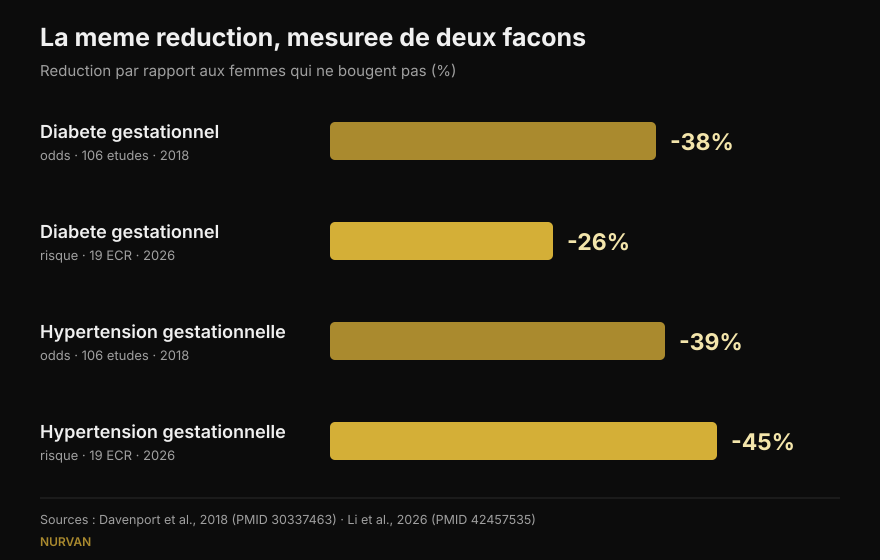
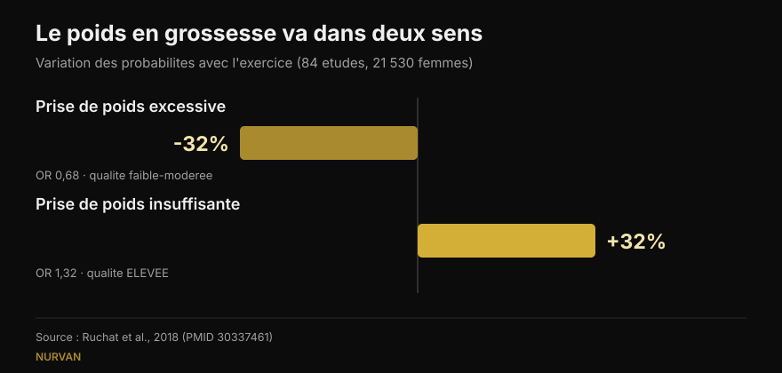

# Musculation et grossesse : ce que dit vraiment la recherche

Par [Giammaria Loi](/autore/giammaria-loi) · mis à jour le 16 octobre 2026

Deux publications ont circulé les mêmes semaines : l'une liste cinq raisons de continuer la musculation enceinte, l'autre affiche des chiffres très précis — 38 % de diabète gestationnel en moins, 41 % de prééclampsie en moins. J'ai lu les études derrière les deux. Les chiffres existent, et c'est déjà une bonne nouvelle. Mais l'un veut dire autre chose que ce qu'on y lit, l'autre est introuvable dans la source citée, et trois données qui changeraient les décisions ne figurent dans aucun des deux.

## En bref

- **Les chiffres du post sont exacts**, mais ce sont des *odds ratios* : 38 % de probabilités en moins de diabète gestationnel, pas 38 % de risque en moins. La méta-analyse la plus récente, qui travaille en risques, donne 26 % (Li et al., 2026).
- **600 MET-minutes par semaine**, soit environ 140 minutes d'activité modérée, est le seuil publié pour au moins 25 % de réduction. **Confirmé mot pour mot** (Davenport et al., 2018).
- **« Plus on en fait, mieux c'est » ne tient pas** : la courbe dose-réponse de 2026 culmine vers 500–550 MET-minutes puis s'aplatit. Commencer tôt et rester régulière pèse davantage.
- **Sur la musculation en particulier, on sait moins qu'il n'y paraît** : dans la revue consacrée au travail de force, 90 % des études mélangeaient force et aérobie et presque aucune ne décrivait charges ni progression (Prevett et al., 2025).
- **La donnée absente des deux posts** : l'exercice réduit la prise de poids excessive mais **augmente** les probabilités d'une prise insuffisante — et c'est le seul résultat de cette revue classé preuve de qualité élevée (Ruchat et al., 2018).

## D'où viennent ces chiffres

Le post de Margie Davenport, chercheuse à l'Université de l'Alberta, cite sa source en entier : une revue systématique de 2018 portant sur 106 études et 273 182 grossesses. C'est rare, il faut le dire. J'ai vérifié : les trois chiffres des diapositives correspondent exactement aux résultats publiés.

Dans les interventions **d'exercice seul** — sans régime ni composante ajoutée — les probabilités baissent ainsi : diabète gestationnel 0,62 fois celles des femmes qui ne bougent pas, hypertension gestationnelle 0,61, prééclampsie 0,59. En pourcentages : 38 %, 39 %, 41 %. Exactement ce qu'annoncent les diapositives.

Un détail que le post ne met pas en avant, et c'est le résultat le plus contre-intuitif de l'étude : **lorsqu'on ajoutait une intervention diététique à l'exercice, la réduction disparaissait**. Non pas parce que mieux manger nuit, mais parce que ces programmes étaient différents : plus courts, moins encadrés, avec une observance moindre. Un rappel utile de l'importance du *comment*, pas seulement du contenu.

## « 38 % en moins » de quoi, exactement ?

C'est la précision la plus importante, et elle ne met en cause l'honnêteté de personne : elle concerne la façon dont nous lisons les pourcentages.

Un odds ratio n'est pas un risque. Quand une complication est rare, les deux se ressemblent ; quand elle ne l'est pas, l'odds ratio exagère. Le diabète gestationnel n'est pas rare.

La méta-analyse la plus récente, publiée en septembre 2026 dans la même revue, a repris 19 essais randomisés d'exercice **supervisé** (6 213 femmes) et calculé des **risques relatifs**. Résultat : diabète gestationnel **26 %** en moins, pas 38 %. Dans la même analyse, pourtant, l'hypertension gestationnelle recule de **45 %**, plus que les 39 % du post. Le chiffre récent n'est donc pas systématiquement plus petit : c'est une autre mesure, sur d'autres études.

*Même question, quatre chiffres. La direction est stable, l'ampleur non. Sources : Davenport et al., 2018 (106 études) et Li et al., 2026 (19 essais randomisés, exercice supervisé).*

## Combien d'exercice faut-il vraiment

Un seul chiffre est vérifiable : **600 MET-minutes par semaine** d'activité modérée pour au moins 25 % de réduction. Les exemples viennent de l'étude elle-même : environ 140 minutes de marche rapide, aquagym, vélo d'appartement ou travail de force. La légende du post le reprend mot pour mot.

La diapositive suivante décompose pourtant ce total par complication : 60 minutes par semaine pour la prééclampsie, 93 pour l'hypertension gestationnelle, 106 pour la prise de poids, 137 pour le diabète gestationnel. **Je n'ai pas retrouvé ces quatre valeurs dans la source citée** ni dans des sources secondaires accessibles : seul le total de 600 MET-minutes est publié dans le résumé. Cela ne les rend pas fausses — elles viennent peut-être d'une figure de l'article complet — mais elles ne sont pas vérifiables, et un découpage aussi précis invite à viser le minimum pour un seul résultat.

Le travail de 2026 apporte la moitié manquante : la courbe dose-réponse **s'aplatit vers 500–550 MET-minutes** pour la prise de poids. Au-delà, ajouter du volume n'a rien apporté. Et ce qui a réellement déplacé les résultats, ce ne sont pas les minutes mais le fait de commencer tôt dans la grossesse (différence significative entre sous-groupes pour le diabète gestationnel, p = 0,009), de poursuivre plus de 20 semaines (p = 0,010), une observance supérieure à 80 % et **la combinaison aérobie + force** — un point valable aussi hors grossesse, comme je l'ai raconté à propos de [la force, le muscle et le cardio dans le même programme](/fr/blog/entrainer-force-muscle-et-cardio-ensemble).

## Et la musculation seule ?

Le premier post s'intitule « cinq raisons pour lesquelles les femmes enceintes devraient soulever des poids », puis admet honnêtement, en petits caractères, que 7 des 9 études combinaient force et aérobie.

Le problème est plus large qu'il n'y paraît. La revue consacrée au seul travail de force pendant la grossesse, parue en 2025 sur 50 études et 47 619 participantes, trouve des résultats réels : moins d'hypertension gestationnelle (probabilités 0,42 fois), moins de diabète gestationnel (0,62), moins de troubles de l'humeur périnataux (0,48), moins de macrosomie, c'est-à-dire de nouveau-nés de poids excessif (0,67). Mais les auteurs concluent par un avertissement : **90 % des études étaient des programmes multicomposants**, la dose de force était « faible à modérée » et la description des charges et de la progression était insuffisante.

Autrement dit : nous savons que les programmes *contenant* du travail de force fonctionnent. Nous ignorons encore ce que produit une musculation **correctement programmée** — charge qui progresse, séries menées à une marge de répétitions sensée, semaines qui se construisent l'une sur l'autre. Cette recherche n'a pas été faite, et les auteurs l'écrivent comme un appel.

La revue de 2025 sur la qualité de vie, d'où le post tire ses cinq points, a la même limite plus une : c'est une revue **sans méta-analyse**, donc sans effet moyen ni intervalles de confiance. Neuf études, 1 581 femmes, direction favorable sur le poids, la lombalgie, l'humeur, l'énergie, la force et le sommeil. Le point sur le sommeil repose sur une seule étude.

## Les trois données qu'aucun des deux posts ne donne

### 1. La sécurité, mesurée

C'est la première question des femmes enceintes, et elle n'apparaît sur aucune des douze diapositives. Une revue lui est consacrée : 46 études, 266 778 femmes. Aucune augmentation des probabilités de fausse couche (0,88) ni de mortalité périnatale (0,86). Les auteurs écrivent, en termes simples, que l'exercice paraît « sûr » sur ces deux critères.

Avec deux réserves honnêtes : la qualité globale des preuves est jugée **très faible**, et la plupart des études ont examiné une intensité modérée **jusqu'à 60 minutes par séance**. Au-delà, disent-ils, ils ne peuvent rien conclure.

### 2. Le périnée, et le moment où l'on commence

Une autre revue du même groupe, sur 24 études et 15 982 femmes, mesure l'entraînement du plancher pelvien pendant la grossesse : les probabilités d'incontinence urinaire tombent à **0,50** pendant la grossesse et à **0,63** après l'accouchement.

Le détail qui change tout : **cela a fonctionné chez les femmes continentes avant de commencer, pas chez celles qui avaient déjà des fuites**. Chez ces dernières, l'entraînement ne s'est pas comporté comme un traitement. C'est une information sur le *quand*, pas sur le *si* — exactement ce qu'une diapositive motivante laisse de côté.

### 3. Le poids va dans deux sens

Le premier post place « moins de prise de poids excessive » en tête et la qualifie de résultat le plus constant. C'est vrai. Mais la revue d'où vient ce résultat — 84 études, 21 530 femmes — rapporte aussi l'autre face : l'exercice **augmente** les probabilités d'une prise de poids **insuffisante** (1,32 fois). Et c'est le seul résultat de cette revue auquel les auteurs attribuent une qualité de preuve **élevée** ; le bénéfice sur la prise excessive est classé faible à modéré.

*La même étude, deux résultats opposés. Le second repose sur les preuves les plus solides et ne figure dans aucun des deux posts. Source : Ruchat et al., 2018.*

Les auteurs eux-mêmes appellent à la prudence, car ce résultat s'appuie sur cinq essais randomisés. Mais l'essentiel demeure : « l'exercice aide à contrôler le poids » n'est pas un bien sans condition pendant la grossesse, et c'est une raison de plus de laisser le suivi du poids à l'équipe qui suit la grossesse.

## Ce que dit vraiment la recherche

[[V|ok|Confirmé|Dans les interventions d'exercice seul, les probabilités de diabète gestationnel, d'hypertension gestationnelle et de prééclampsie tombent respectivement à 0,62, 0,61 et 0,59 par rapport à l'absence d'exercice. Les trois chiffres des diapositives sont corrects.]]
[[V|ok|Confirmé|600 MET-minutes par semaine (environ 140 minutes d'activité modérée) sont le seuil publié pour au moins 25 % de réduction. Cité mot pour mot.]]
[[V|ok|Confirmé|Les recommandations actuelles incluent le travail de force dans les grossesses non compliquées : la ligne directrice canadienne 2019 juge les bénéfices modérés et n'identifie aucun risque.]]
[[V|part|À préciser|« 38 % en moins » sont des odds, pas un risque. En risques relatifs, dans la méta-analyse 2026 d'exercice supervisé, le diabète gestationnel baisse de 26 % et l'hypertension gestationnelle de 45 %.]]
[[V|part|À préciser|La dose n'est pas linéaire : le bénéfice sur le poids s'aplatit vers 500–550 MET-minutes. Commencer tôt et rester régulière pèse plus que les minutes.]]
[[V|part|À préciser|Les bénéfices attribués à « la musculation » viennent presque toujours de programmes mixtes, avec des doses de force faibles et une progression non décrite. La musculation bien dosée n'a pas encore été étudiée.]]
[[V|no|Démenti|Que le contrôle du poids soit un bénéfice sans revers : l'exercice augmente aussi les probabilités d'une prise de poids insuffisante (1,32 fois), et c'est la preuve de meilleure qualité de la revue.]]
[[V|nv|Non vérifiable|Les minutes par complication de la diapositive 5 (60, 93, 106, 137 par semaine) : absentes du résumé de la source citée comme des sources secondaires accessibles.]]

## Comment l'appliquer

D'abord : cet article explique des études, ce n'est pas un programme. Il existe des situations médicales où l'exercice est contre-indiqué pendant la grossesse, et seule l'équipe qui vous suit peut dire si c'est votre cas. Ce qui suit sert de cadre à cette conversation, pas de substitut.

1. **Partez de la bonne question.** Comme l'écrit Davenport sur une diapositive, la question a longtemps été « est-ce sûr ? ». Les données sur la fausse couche et la mortalité périnatale ne montrent pas d'augmentation du risque : la question utile devient donc ce dont vous avez besoin, à ce trimestre, depuis ce niveau de départ.
2. **Regardez le total hebdomadaire, pas la séance isolée.** 600 MET-minutes, c'est un bilan sur sept jours. Et au-delà de 500–550, la courbe s'aplatit : plus de volume n'a pas donné plus de bénéfice.
3. **Associez aérobie et force.** C'est la combinaison la plus efficace dans les sous-groupes de 2026, et elle recoupe ce que l'on sait hors grossesse.
4. **Notez l'effort, pas seulement la charge.** Enceinte, le poids sur la barre dit peu de choses : la même série peut coûter bien plus qu'il y a six semaines. Noter la marge de répétitions restantes (RIR) est le moyen le plus simple de s'en apercevoir à temps — le principe que j'utilise pour [choisir séries et répétitions hors grossesse](/fr/blog/combien-de-repetitions-masse-musculaire).
5. **Le périnée se travaille avant, pas après.** Dans les données, l'effet existe chez celles qui n'ont pas encore de symptômes. Le comment et le combien relèvent d'un professionnel.
6. **Le poids est suivi par ceux qui vous suivent.** Prendre trop et prendre trop peu sont deux écueils, et aucun ne s'évalue seule sur une balance.

[[APP|La charge change, le carnet reste|Dans Nurvan vous notez charge, répétitions et RIR séance après séance : quand le même poids commence à coûter plus cher, vous le voyez sur un graphique au lieu de le découvrir au milieu d'une série. Et avec le module coach–athlète, votre professionnel voit les mêmes données en direct, sans captures d'écran sur WhatsApp.|Essayer Nurvan]]

## Questions fréquentes

**Puis-je continuer la musculation si j'en faisais déjà avant la grossesse ?**
Les recommandations actuelles incluent le travail de force dans les grossesses non compliquées, et la revue de 2018 n'a trouvé aucune hausse des fausses couches ni de la mortalité périnatale. Ce qui change, dans les études comme en pratique, c'est la façon de s'entraîner : intensité, choix des exercices et tolérance évoluent avec les trimestres. La décision passe toutefois par l'équipe qui suit la grossesse : elle seule sait s'il existe des contre-indications dans votre cas.

**Combien d'exercice par semaine ?**
La valeur publiée est de 600 MET-minutes hebdomadaires d'activité modérée, environ 140 minutes, pour au moins 25 % de réduction des complications étudiées. La méta-analyse 2026 montre cependant que le bénéfice s'aplatit vers 500–550 MET-minutes et que commencer tôt et maintenir une bonne observance comptent plus que le volume.

**S'entraîner enceinte est-il mauvais pour le bébé ?**
Sur les deux issues les plus redoutées — fausse couche et mortalité périnatale — la revue portant sur 266 778 femmes ne trouve pas d'augmentation. Les auteurs précisent que la qualité des preuves est très faible et que la plupart des études ont examiné une intensité modérée jusqu'à 60 minutes par séance : au-delà, disent-ils, aucune conclusion n'est possible.

**Puis-je commencer de zéro pendant la grossesse ?**
Les études incluses portaient sur des femmes sans contre-indication, et beaucoup de programmes démarraient pendant la grossesse. Les sous-groupes de 2026 suggèrent que commencer tôt compte. Mais « partir de zéro » est précisément la situation qui demande le feu vert d'un médecin ou d'une sage-femme avant, pas après.

## À lire aussi

- [Force, muscle et cardio ensemble : possible ?](/fr/blog/entrainer-force-muscle-et-cardio-ensemble) — pourquoi la combinaison fonctionne et quand les deux se gênent
- [Combien de répétitions pour la masse : le mythe du 8-12](/fr/blog/combien-de-repetitions-masse-musculaire) — comment choisir séries, répétitions et récupération d'après les données
- [Split d'entraînement : débutant ou avancé](/fr/blog/split-entrainement-debutant-avance) — à quelle fréquence entraîner un groupe musculaire

## Sources

1. Davenport MH, Ruchat SM, Poitras VJ, et al., 2018. Prenatal exercise for the prevention of gestational diabetes mellitus and hypertensive disorders of pregnancy: a systematic review and meta-analysis. *Br J Sports Med* 52(21):1367-1375. PMID 30337463 — [doi.org/10.1136/bjsports-2018-099355](https://doi.org/10.1136/bjsports-2018-099355)
2. Li L, He J, Wang C, et al., 2026. Effects of supervised exercise during pregnancy on gestational diabetes mellitus and other pregnancy outcomes: a systematic review and meta-analysis. *Br J Sports Med* 60(17):1350-1358. PMID 42457535 — [doi.org/10.1136/bjsports-2026-111586](https://doi.org/10.1136/bjsports-2026-111586)
3. Prevett C, Gingerich J, Sivak A, Davenport MH, 2025. Resistance training in pregnancy: systematic review and meta-analysis of pregnancy, delivery, fetal and pelvic floor outcomes and call to action. *Br J Sports Med* 59(16):1173-1182. PMID 40610191 — [doi.org/10.1136/bjsports-2024-109123](https://doi.org/10.1136/bjsports-2024-109123)
4. Redondo-Delgado P, Blanco-Giménez P, López-Ortiz S, et al., 2025. Effects of strength training on quality of life in pregnant women: a systematic review. *Acta Obstet Gynecol Scand* 104(7):1231-1243. PMID 40230063 — [doi.org/10.1111/aogs.15122](https://doi.org/10.1111/aogs.15122)
5. Ruchat SM, Mottola MF, Skow RJ, et al., 2018. Effectiveness of exercise interventions in the prevention of excessive gestational weight gain and postpartum weight retention: a systematic review and meta-analysis. *Br J Sports Med* 52(21):1347-1356. PMID 30337461 — [doi.org/10.1136/bjsports-2018-099399](https://doi.org/10.1136/bjsports-2018-099399)
6. Davenport MH, Kathol AJ, Mottola MF, et al., 2018. Prenatal exercise is not associated with fetal mortality: a systematic review and meta-analysis. *Br J Sports Med* 53(2):108-115. PMID 30337346 — [doi.org/10.1136/bjsports-2018-099773](https://doi.org/10.1136/bjsports-2018-099773)
7. Davenport MH, Nagpal TS, Mottola MF, et al., 2018. Prenatal exercise (including but not limited to pelvic floor muscle training) and urinary incontinence during and following pregnancy: a systematic review and meta-analysis. *Br J Sports Med* 52(21):1397-1404. PMID 30337466 — [doi.org/10.1136/bjsports-2018-099780](https://doi.org/10.1136/bjsports-2018-099780)
8. Mottola MF, Davenport MH, Ruchat SM, et al., 2018. 2019 Canadian guideline for physical activity throughout pregnancy. *Br J Sports Med* 52(21):1339-1346. PMID 30337460 — [doi.org/10.1136/bjsports-2018-100056](https://doi.org/10.1136/bjsports-2018-100056)

Point de départ : les carrousels de [Built With Science](https://www.instagram.com/p/Dd9PB-olsG2/) (1er octobre 2026) et de [Margie Davenport](https://www.instagram.com/p/DdrC7OHm3xe/) (24 septembre 2026). Aucun texte ni aucune image des deux posts n'a été reproduit : les affirmations ont été réécrites et vérifiées dans la littérature primaire.

[[BIO|Giammaria Loi est le fondateur de Nurvan. Il s'entraîne avec des poids depuis 2012, travaille comme entraîneur personnel et coach certifié FIPE depuis 2013 et compète en force athlétique au niveau national depuis 2018. Chaque article qu'il signe part des études scientifiques et aboutit à ce qui fonctionne vraiment en salle.]]

> Note : contenu informatif, ne remplace pas l'avis d'un médecin, d'une sage-femme ou d'un autre professionnel de santé. Pendant la grossesse, certaines situations contre-indiquent l'exercice : parlez-en à l'équipe qui vous suit avant de modifier votre entraînement.
