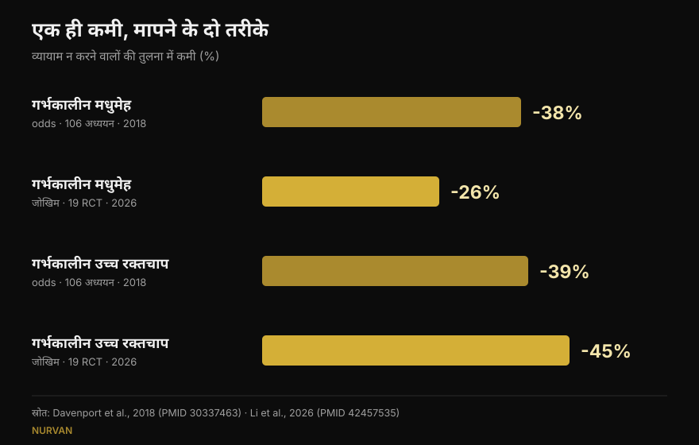
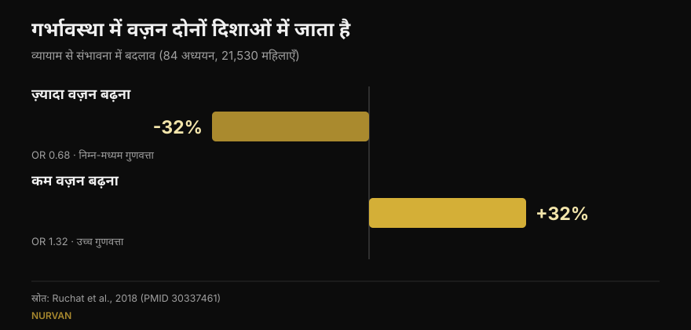

# प्रेग्नेंसी में वेट ट्रेनिंग: रिसर्च असल में क्या कहती है

लेखक: [जियाम्मारिया लोई](/autore/giammaria-loi) · 16 अक्टूबर 2026 को अपडेट

एक ही हफ़्तों में दो पोस्ट घूमे: एक में प्रेग्नेंसी में वेट ट्रेनिंग जारी रखने की पाँच वजहें हैं, दूसरे में बहुत सटीक आँकड़े — जेस्टेशनल डायबिटीज़ 38% कम, प्री-एक्लेम्पसिया 41% कम। दोनों के पीछे की स्टडी मैंने पढ़ीं। आँकड़े सचमुच मौजूद हैं, और यही अपने आप में अच्छी ख़बर है। पर एक का मतलब वह नहीं जो पढ़ा जा रहा है, दूसरा जिस स्रोत के नाम पर दिया गया है उसमें मिलता ही नहीं, और तीन ऐसी बातें जो पढ़ने वाली के फ़ैसले बदल देतीं, किसी भी पोस्ट में नहीं हैं।

## संक्षेप में

- **पोस्ट के आँकड़े सही हैं**, पर वे *ऑड्स रेशियो* हैं: जेस्टेशनल डायबिटीज़ की संभावना 38% कम, जोखिम 38% कम नहीं। सबसे नया मेटा-विश्लेषण, जो जोखिम पर काम करता है, 26% बताता है (Li et al., 2026)।
- **हफ़्ते में 600 MET-मिनट**, यानी लगभग 140 मिनट मध्यम गतिविधि, कम से कम 25% कमी के लिए प्रकाशित सीमा है। **शब्दशः पुष्ट** (Davenport et al., 2018)।
- **"जितना ज़्यादा उतना बेहतर" टिकता नहीं**: 2026 का डोज़–रिस्पॉन्स वक्र 500–550 MET-मिनट के आसपास शिखर पर पहुँचकर सपाट हो जाता है। जल्दी शुरू करना और नियमित रहना ज़्यादा मायने रखता है।
- **ख़ास तौर पर वेट ट्रेनिंग के बारे में हम उतना नहीं जानते जितना लगता है**: स्ट्रेंथ ट्रेनिंग पर केंद्रित समीक्षा में 90% अध्ययनों ने स्ट्रेंथ और एरोबिक को मिला दिया था और लगभग किसी ने भार व प्रोग्रेशन नहीं बताया (Prevett et al., 2025)।
- **जो दोनों पोस्ट में नहीं है**: व्यायाम वज़न ज़्यादा बढ़ने की संभावना घटाता है, लेकिन वज़न **कम** बढ़ने की संभावना **बढ़ा** देता है — और उस समीक्षा में यही अकेला नतीजा है जिसे उच्च गुणवत्ता का प्रमाण माना गया (Ruchat et al., 2018)।

## ये आँकड़े आए कहाँ से

अल्बर्टा विश्वविद्यालय की शोधकर्ता मार्गी डेवनपोर्ट की पोस्ट स्रोत पूरा देती है: 2018 की एक व्यवस्थित समीक्षा, 106 अध्ययन और 273,182 गर्भधारण। यह दुर्लभ है और कहा जाना चाहिए। मैंने जाँचा: स्लाइड के तीनों आँकड़े प्रकाशित नतीजों से हूबहू मेल खाते हैं।

**सिर्फ़ व्यायाम** वाले हस्तक्षेपों में — बिना डाइट या अन्य घटक जोड़े — संभावनाएँ इस तरह गिरती हैं: जेस्टेशनल डायबिटीज़ न चलने-फिरने वालों की तुलना में 0.62 गुना, जेस्टेशनल हाइपरटेंशन 0.61, प्री-एक्लेम्पसिया 0.59। प्रतिशत में: 38%, 39%, 41%। ठीक वही जो स्लाइड कहती हैं।

एक बात पोस्ट उभारती नहीं, और वही अध्ययन का सबसे चौंकाने वाला नतीजा है: **जब व्यायाम के साथ खानपान का हस्तक्षेप जोड़ा गया, कमी ग़ायब हो गई।** इसलिए नहीं कि बेहतर खाना नुक़सान करता है, बल्कि इसलिए कि वे कार्यक्रम अलग थे: छोटे, कम निगरानी वाले, कम पालन वाले। यह याद दिलाता है कि कार्यक्रम *कैसे* चलाया जाता है, यह उसमें क्या है उतना ही अहम है।

## "38% कम" — किसमें, ठीक-ठीक?

यही सबसे ज़रूरी स्पष्टीकरण है, और इसका किसी की ईमानदारी से लेना-देना नहीं: बात यह है कि हम प्रतिशत कैसे पढ़ते हैं।

ऑड्स रेशियो जोखिम नहीं है। जब जटिलता दुर्लभ हो तो दोनों आँकड़े एक जैसे लगते हैं; जब न हो तो ऑड्स रेशियो आगे निकल जाता है। जेस्टेशनल डायबिटीज़ दुर्लभ नहीं है।

इसी पत्रिका में सितंबर 2026 में छपे सबसे नए मेटा-विश्लेषण ने **निगरानी में किए गए** व्यायाम की 19 यादृच्छिक ट्रायल (6,213 महिलाएँ) लीं और **सापेक्ष जोखिम** निकाला। नतीजा: जेस्टेशनल डायबिटीज़ **26%** कम, 38% नहीं। पर उसी विश्लेषण में जेस्टेशनल हाइपरटेंशन **45%** गिरता है, पोस्ट के 39% से ज़्यादा। यानी नया आँकड़ा हमेशा छोटा नहीं होता: वह अलग माप है, अलग अध्ययनों पर।

*एक ही सवाल, चार आँकड़े। दिशा स्थिर है, आकार नहीं। स्रोत: Davenport et al., 2018 (106 अध्ययन) और Li et al., 2026 (19 यादृच्छिक ट्रायल, निगरानी में व्यायाम)।*

## असल में कितना व्यायाम चाहिए

जाँचा जा सकने वाला आँकड़ा एक ही है: **हफ़्ते में 600 MET-मिनट** मध्यम गतिविधि, कम से कम 25% कमी के लिए। उदाहरण अध्ययन ख़ुद देता है: लगभग 140 मिनट तेज़ चाल, वॉटर एरोबिक्स, स्थिर साइकिल या स्ट्रेंथ ट्रेनिंग। पोस्ट का कैप्शन इसे शब्दशः दोहराता है।

पर अगली स्लाइड उस कुल को हर जटिलता के हिसाब से बाँट देती है: प्री-एक्लेम्पसिया के लिए हफ़्ते में 60 मिनट, जेस्टेशनल हाइपरटेंशन के लिए 93, वज़न बढ़ने के लिए 106, जेस्टेशनल डायबिटीज़ के लिए 137। **ये चार आँकड़े मुझे न उद्धृत स्रोत में मिले** और न किसी सुलभ द्वितीयक स्रोत में: सारांश में प्रकाशित केवल 600 MET-मिनट का कुल है। इसका मतलब यह नहीं कि वे ग़लत हैं — वे पूरे लेख के किसी ग्राफ़ से आ सकते हैं — पर उन्हें जाँचा नहीं जा सकता, और इतना सटीक विभाजन किसी एक नतीजे के लिए न्यूनतम करने का न्योता देता है।

2026 का काम बचा हुआ आधा हिस्सा जोड़ता है: वज़न बढ़ने के मामले में डोज़–रिस्पॉन्स वक्र **500–550 MET-मिनट के आसपास सपाट** हो जाता है। उससे आगे अतिरिक्त मात्रा से कोई लाभ नहीं मिला। और नतीजे मिनटों ने नहीं बदले, बल्कि गर्भावस्था में जल्दी शुरुआत (जेस्टेशनल डायबिटीज़ के लिए उपसमूह अंतर सार्थक, p = 0.009), 20 हफ़्ते से ज़्यादा जारी रखना (p = 0.010), 80% से ऊपर पालन और **एरोबिक व स्ट्रेंथ का मेल** — यह बात गर्भावस्था के बाहर भी सच है, जैसा मैंने [एक ही प्रोग्राम में स्ट्रेंथ, मसल और कार्डियो](/hi/blog/strength-muscle-cardio-ek-saath-training) पर लिखा था।

## और अकेले वज़न उठाना?

पहली पोस्ट का शीर्षक है "गर्भवती महिलाओं को वज़न क्यों उठाना चाहिए: पाँच वजहें", और फिर वह ईमानदारी से छोटे अक्षरों में मानती है कि जिन 9 अध्ययनों पर वह टिकी है उनमें से 7 ने स्ट्रेंथ और एरोबिक को मिलाया था।

समस्या दिखने से बड़ी है। गर्भावस्था में स्ट्रेंथ ट्रेनिंग पर केंद्रित समीक्षा, जो 2025 में 50 अध्ययनों और 47,619 प्रतिभागियों पर छपी, असली नतीजे पाती है: जेस्टेशनल हाइपरटेंशन कम (संभावना 0.42 गुना), जेस्टेशनल डायबिटीज़ कम (0.62), प्रसवकालीन मूड विकार कम (0.48) और मैक्रोसोमिया यानी ज़्यादा वज़न वाले नवजात कम (0.67)। पर लेखक चेतावनी के साथ ख़त्म करते हैं: **90% अध्ययन बहु-घटक कार्यक्रम थे**, स्ट्रेंथ की मात्रा "कम से मध्यम" थी, और भार, प्रोग्रेशन व भार-चयन का विवरण कमज़ोर था।

सीधे कहें: हम जानते हैं कि स्ट्रेंथ *शामिल करने वाले* कार्यक्रम काम करते हैं। हम अब भी नहीं जानते कि **ठीक से प्रोग्राम की गई** स्ट्रेंथ ट्रेनिंग क्या करती है — बढ़ता हुआ भार, समझदारी भरे रेप-मार्जिन तक ले जाए गए सेट, एक-दूसरे पर टिके हफ़्ते। वह शोध हुआ ही नहीं, और लेखक इसे एक आह्वान के रूप में लिखते हैं।

जीवन-गुणवत्ता पर 2025 की वह समीक्षा, जहाँ से पोस्ट अपने पाँच बिंदु लेती है, में वही सीमा है और एक अतिरिक्त: यह **मेटा-विश्लेषण के बिना** समीक्षा है, यानी न औसत प्रभाव, न विश्वास अंतराल। नौ अध्ययन, 1,581 महिलाएँ, वज़न, कमर दर्द, मूड, ऊर्जा, ताक़त और नींद में अनुकूल दिशा। नींद वाली बात केवल एक अध्ययन पर टिकी है।

## वे तीन बातें जो किसी पोस्ट में नहीं हैं

### 1. सुरक्षा, मापी हुई

यह गर्भवती महिला का पहला सवाल है, और बारह स्लाइड में कहीं नहीं आता। इस पर अलग समीक्षा है: 46 अध्ययन, 266,778 महिलाएँ। गर्भपात (0.88) या प्रसवकालीन मृत्यु (0.86) की संभावना में कोई बढ़ोतरी नहीं। लेखक सरल शब्दों में लिखते हैं कि इन दो नतीजों के लिहाज़ से व्यायाम "सुरक्षित" दिखता है।

दो ईमानदार चेतावनियों के साथ: प्रमाणों की कुल गुणवत्ता **बहुत कम** आँकी गई है, और अधिकतर अध्ययनों ने **प्रति सत्र 60 मिनट तक** की मध्यम तीव्रता देखी। उससे आगे, वे कहते हैं, कुछ नहीं कह सकते।

### 2. पेल्विक फ़्लोर, और शुरू करने का समय

उसी समूह की दूसरी समीक्षा, 24 अध्ययनों और 15,982 महिलाओं पर, गर्भावस्था में पेल्विक फ़्लोर मांसपेशी प्रशिक्षण मापती है: मूत्र असंयम की संभावना गर्भावस्था में **0.50** और प्रसव के बाद **0.63** रह जाती है।

जो बात सब कुछ बदल देती है: **यह उन महिलाओं में काम आया जिन्हें शुरू करने से पहले रिसाव नहीं था, उनमें नहीं जिन्हें पहले से था।** लक्षण पहले से होने पर प्रशिक्षण इलाज की तरह काम नहीं कर पाया। यह *कब* की जानकारी है, *करें या नहीं* की नहीं — और यही प्रेरक स्लाइड छोड़ देती है।

### 3. वज़न दोनों दिशाओं में जाता है

पहली पोस्ट "वज़न ज़्यादा बढ़ना कम" को पहले नंबर पर रखती है और इसे सबसे सुसंगत नतीजा कहती है। सही है। पर जिस समीक्षा से यह नतीजा आया — 84 अध्ययन, 21,530 महिलाएँ — वह दूसरा पहलू भी बताती है: व्यायाम वज़न **कम** बढ़ने की संभावना **बढ़ा** देता है (1.32 गुना)। और यही उस समीक्षा का अकेला नतीजा है जिसे लेखक **उच्च** गुणवत्ता का प्रमाण मानते हैं; ज़्यादा बढ़ने पर मिलने वाला लाभ निम्न से मध्यम आँका गया है।

*एक ही अध्ययन, दो उलटे नतीजे। दूसरे के पीछे प्रमाण ज़्यादा मज़बूत हैं, और वह किसी पोस्ट में नहीं है। स्रोत: Ruchat et al., 2018।*

लेखक ख़ुद सावधानी की सलाह देते हैं, क्योंकि यह नतीजा पाँच यादृच्छिक ट्रायल पर टिका है। पर बात वही रहती है: गर्भावस्था में "व्यायाम वज़न नियंत्रित रखने में मदद करता है" बिना शर्त अच्छी बात नहीं, और यह एक और वजह है कि वज़न पर नज़र वही रखें जो आपकी गर्भावस्था देख रहे हैं।

## रिसर्च असल में क्या कहती है

[[V|ok|पुष्ट|सिर्फ़ व्यायाम वाले हस्तक्षेपों में जेस्टेशनल डायबिटीज़, जेस्टेशनल हाइपरटेंशन और प्री-एक्लेम्पसिया की संभावना न चलने-फिरने वालों की तुलना में क्रमशः 0.62, 0.61 और 0.59 रह जाती है। स्लाइड के तीनों आँकड़े सही हैं।]]
[[V|ok|पुष्ट|हफ़्ते में 600 MET-मिनट (लगभग 140 मिनट मध्यम गतिविधि) कम से कम 25% कमी के लिए प्रकाशित सीमा है। शब्दशः उद्धृत।]]
[[V|ok|पुष्ट|मौजूदा दिशानिर्देश जटिलता रहित गर्भावस्था में स्ट्रेंथ ट्रेनिंग शामिल करते हैं: 2019 का कनाडाई दिशानिर्देश लाभ को मध्यम मानता है और कोई नुक़सान नहीं पाता।]]
[[V|part|स्पष्टीकरण ज़रूरी|"38% कम" संभावना है, जोखिम नहीं। सापेक्ष जोखिम में, निगरानी वाले व्यायाम के 2026 मेटा-विश्लेषण में जेस्टेशनल डायबिटीज़ 26% और जेस्टेशनल हाइपरटेंशन 45% घटता है।]]
[[V|part|स्पष्टीकरण ज़रूरी|मात्रा रेखीय नहीं है: वज़न पर लाभ 500–550 MET-मिनट के आसपास सपाट हो जाता है। जल्दी शुरू करना और नियमितता मिनटों से भारी पड़ती है।]]
[[V|part|स्पष्टीकरण ज़रूरी|"वेट ट्रेनिंग" के नाम पर गिनाए गए लाभ लगभग हमेशा मिश्रित कार्यक्रमों से आते हैं, जिनमें स्ट्रेंथ की मात्रा कम और प्रोग्रेशन अवर्णित है। ठीक से मात्रा तय की गई स्ट्रेंथ ट्रेनिंग अब तक अध्ययन नहीं हुई।]]
[[V|no|खंडित|कि वज़न नियंत्रण बिना दूसरे पहलू वाला लाभ है: व्यायाम वज़न कम बढ़ने की संभावना भी बढ़ाता है (1.32 गुना), और समीक्षा में यही सबसे उच्च गुणवत्ता वाला प्रमाण है।]]
[[V|nv|जाँचा नहीं जा सका|स्लाइड 5 में हर जटिलता के मिनट (हफ़्ते में 60, 93, 106, 137): न उद्धृत स्रोत के सारांश में हैं, न किसी सुलभ द्वितीयक स्रोत में।]]

## इसे कैसे लागू करें

पहले यह साफ़ कर दें: यह लेख अध्ययनों की व्याख्या है, प्रोग्राम नहीं। कुछ चिकित्सीय स्थितियों में गर्भावस्था में व्यायाम वर्जित है, और यह आपकी स्थिति है या नहीं, यह केवल वही बता सकते हैं जो आपकी गर्भावस्था देख रहे हैं। आगे जो है वह उस बातचीत का ढाँचा है, उसका विकल्प नहीं।

1. **सही सवाल से शुरू करें।** जैसा डेवनपोर्ट एक स्लाइड में लिखती हैं, सालों तक सवाल था "क्या यह सुरक्षित है?"। गर्भपात और प्रसवकालीन मृत्यु के आँकड़े जोखिम में बढ़ोतरी नहीं दिखाते, तो काम का सवाल दूसरा बनता है: इस तिमाही में, इस शुरुआती स्तर से, आपको क्या चाहिए।
2. **हफ़्ते का कुल देखें, एक सत्र नहीं।** 600 MET-मिनट सात दिन का हिसाब है। और 500–550 के बाद वक्र सपाट हो जाता है: ज़्यादा मात्रा से ज़्यादा लाभ नहीं मिला।
3. **एरोबिक और स्ट्रेंथ साथ रखें।** 2026 के उपसमूहों में यही संयोजन सबसे अच्छा रहा, और यह गर्भावस्था के बाहर की जानकारी से मेल खाता है।
4. **भार ही नहीं, मेहनत दर्ज करें।** गर्भावस्था में बार पर लिखा नंबर कम बताता है: वही सेट छह हफ़्ते पहले से कहीं भारी पड़ सकता है। बचे हुए रेप (RIR) लिखना समय रहते पहचानने का सबसे आसान तरीक़ा है — वही सिद्धांत जो मैं [गर्भावस्था के बाहर सेट और रेप चुनने](/hi/blog/kitne-reps-muscle-ke-liye) में इस्तेमाल करता हूँ।
5. **पेल्विक फ़्लोर पहले, बाद में नहीं।** आँकड़ों में असर उन पर दिखा जिन्हें अभी लक्षण नहीं थे। कैसे और कितना, यह विशेषज्ञ तय करें।
6. **वज़न पर नज़र वही रखें जो आप पर रखते हैं।** बहुत ज़्यादा बढ़ना और बहुत कम बढ़ना, दोनों से बचना है, और दोनों अकेले तराज़ू पर तय नहीं होते।

[[APP|भार बदलता है, रिकॉर्ड रहता है|Nurvan में आप हर सत्र का भार, रेप और RIR दर्ज करती हैं: जब वही वज़न ज़्यादा भारी पड़ने लगे, तो यह ग्राफ़ में दिखेगा, सेट के बीच में नहीं। और कोच–एथलीट मॉड्यूल से आपका विशेषज्ञ वही डेटा लाइव देख सकता है, व्हाट्सऐप पर स्क्रीनशॉट भेजे बिना।|Nurvan आज़माएँ]]

## अक्सर पूछे जाने वाले सवाल

**अगर मैं प्रेग्नेंसी से पहले वेट ट्रेनिंग करती थी तो क्या जारी रख सकती हूँ?**
मौजूदा दिशानिर्देश जटिलता रहित गर्भावस्था में स्ट्रेंथ ट्रेनिंग शामिल करते हैं, और 2018 की समीक्षा में गर्भपात या प्रसवकालीन मृत्यु में बढ़ोतरी नहीं मिली। अध्ययनों में भी और व्यवहार में भी जो बदलता है वह है तरीक़ा: तीव्रता, व्यायाम का चुनाव और सहनशीलता तिमाही के साथ बदलते हैं। पर फ़ैसला उन्हीं से होकर जाता है जो आपकी गर्भावस्था देख रहे हैं: केवल वही जानते हैं कि आपके मामले में कोई वर्जना है या नहीं।

**हफ़्ते में कितना व्यायाम?**
प्रकाशित आँकड़ा है हफ़्ते में 600 MET-मिनट मध्यम गतिविधि, लगभग 140 मिनट, अध्ययन की गई जटिलताओं में कम से कम 25% कमी के लिए। पर 2026 का मेटा-विश्लेषण दिखाता है कि लाभ 500–550 MET-मिनट के आसपास सपाट हो जाता है और जल्दी शुरू करना व पालन ऊँचा रखना मात्रा से ज़्यादा मायने रखता है।

**क्या गर्भावस्था में व्यायाम बच्चे के लिए हानिकारक है?**
सबसे ज़्यादा डराने वाले दो नतीजों — गर्भपात और प्रसवकालीन मृत्यु — पर 266,778 महिलाओं की समीक्षा संभावना में बढ़ोतरी नहीं पाती। लेखक यह भी बताते हैं कि प्रमाणों की गुणवत्ता बहुत कम है और अधिकतर अध्ययनों ने प्रति सत्र 60 मिनट तक की मध्यम तीव्रता देखी: उससे आगे, वे कहते हैं, निष्कर्ष नहीं निकाला जा सकता।

**क्या गर्भावस्था में शून्य से शुरू कर सकती हूँ?**
इन समीक्षाओं में शामिल अध्ययन उन महिलाओं के थे जिन्हें व्यायाम की कोई वर्जना नहीं थी, और कई कार्यक्रम गर्भावस्था में ही शुरू हुए थे। 2026 के उपसमूह बताते हैं कि जल्दी शुरू करना मायने रखता है। पर "शून्य से शुरू करना" ठीक वही स्थिति है जिसमें पहले डॉक्टर या दाई की हरी झंडी चाहिए, बाद में नहीं।

## यह भी पढ़ें

- [स्ट्रेंथ, मसल और कार्डियो एक साथ: हो सकता है?](/hi/blog/strength-muscle-cardio-ek-saath-training) — यह मेल क्यों काम करता है और कब एक-दूसरे में अड़ंगा डालता है
- [मसल के लिए कितने रेप: 8-12 का मिथक](/hi/blog/kitne-reps-muscle-ke-liye) — आँकड़ों से सेट, रेप और आराम कैसे चुनें
- [ट्रेनिंग स्प्लिट: बिगिनर बनाम एडवांस्ड](/hi/blog/training-split-beginner-advanced) — एक मसल ग्रुप हफ़्ते में कितनी बार

## स्रोत

1. Davenport MH, Ruchat SM, Poitras VJ, et al., 2018. Prenatal exercise for the prevention of gestational diabetes mellitus and hypertensive disorders of pregnancy: a systematic review and meta-analysis. *Br J Sports Med* 52(21):1367-1375. PMID 30337463 — [doi.org/10.1136/bjsports-2018-099355](https://doi.org/10.1136/bjsports-2018-099355)
2. Li L, He J, Wang C, et al., 2026. Effects of supervised exercise during pregnancy on gestational diabetes mellitus and other pregnancy outcomes: a systematic review and meta-analysis. *Br J Sports Med* 60(17):1350-1358. PMID 42457535 — [doi.org/10.1136/bjsports-2026-111586](https://doi.org/10.1136/bjsports-2026-111586)
3. Prevett C, Gingerich J, Sivak A, Davenport MH, 2025. Resistance training in pregnancy: systematic review and meta-analysis of pregnancy, delivery, fetal and pelvic floor outcomes and call to action. *Br J Sports Med* 59(16):1173-1182. PMID 40610191 — [doi.org/10.1136/bjsports-2024-109123](https://doi.org/10.1136/bjsports-2024-109123)
4. Redondo-Delgado P, Blanco-Giménez P, López-Ortiz S, et al., 2025. Effects of strength training on quality of life in pregnant women: a systematic review. *Acta Obstet Gynecol Scand* 104(7):1231-1243. PMID 40230063 — [doi.org/10.1111/aogs.15122](https://doi.org/10.1111/aogs.15122)
5. Ruchat SM, Mottola MF, Skow RJ, et al., 2018. Effectiveness of exercise interventions in the prevention of excessive gestational weight gain and postpartum weight retention: a systematic review and meta-analysis. *Br J Sports Med* 52(21):1347-1356. PMID 30337461 — [doi.org/10.1136/bjsports-2018-099399](https://doi.org/10.1136/bjsports-2018-099399)
6. Davenport MH, Kathol AJ, Mottola MF, et al., 2018. Prenatal exercise is not associated with fetal mortality: a systematic review and meta-analysis. *Br J Sports Med* 53(2):108-115. PMID 30337346 — [doi.org/10.1136/bjsports-2018-099773](https://doi.org/10.1136/bjsports-2018-099773)
7. Davenport MH, Nagpal TS, Mottola MF, et al., 2018. Prenatal exercise (including but not limited to pelvic floor muscle training) and urinary incontinence during and following pregnancy: a systematic review and meta-analysis. *Br J Sports Med* 52(21):1397-1404. PMID 30337466 — [doi.org/10.1136/bjsports-2018-099780](https://doi.org/10.1136/bjsports-2018-099780)
8. Mottola MF, Davenport MH, Ruchat SM, et al., 2018. 2019 Canadian guideline for physical activity throughout pregnancy. *Br J Sports Med* 52(21):1339-1346. PMID 30337460 — [doi.org/10.1136/bjsports-2018-100056](https://doi.org/10.1136/bjsports-2018-100056)

प्रेरणा: [Built With Science](https://www.instagram.com/p/Dd9PB-olsG2/) (1 अक्टूबर 2026) और [मार्गी डेवनपोर्ट](https://www.instagram.com/p/DdrC7OHm3xe/) (24 सितंबर 2026) की कैरोसेल पोस्ट। दोनों पोस्ट का कोई टेक्स्ट या चित्र दोहराया नहीं गया: दावों को नए सिरे से लिखा गया और प्राथमिक साहित्य पर जाँचा गया।

[[BIO|जियाम्मारिया लोई Nurvan के संस्थापक हैं। वे 2012 से वेट ट्रेनिंग करते हैं, 2013 से FIPE-प्रमाणित पर्सनल ट्रेनर और कोच के रूप में काम करते हैं और 2018 से राष्ट्रीय स्तर पर पावरलिफ्टिंग में प्रतिस्पर्धा करते हैं। उनके हस्ताक्षर वाला हर लेख वैज्ञानिक अध्ययनों से शुरू होकर वहीं पहुँचता है जो जिम में सचमुच काम करता है।]]

> नोट: यह जानकारीपरक सामग्री है, डॉक्टर, दाई या किसी अन्य स्वास्थ्य पेशेवर की सलाह का विकल्प नहीं। गर्भावस्था में ऐसी स्थितियाँ होती हैं जिनमें व्यायाम वर्जित है: अपना प्रशिक्षण बदलने से पहले उनसे बात करें जो आपकी गर्भावस्था देख रहे हैं।
