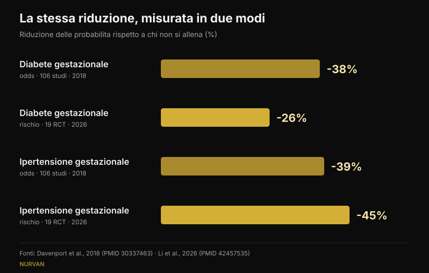

# Pesi in gravidanza: cosa dicono davvero gli studi

Di [Giammaria Loi](/autore/giammaria-loi) · aggiornato il 16 ottobre 2026

Due post sono circolati nelle stesse settimane: uno elenca cinque motivi per continuare ad allenarsi con i pesi in gravidanza, l'altro mostra numeri molto precisi — 38% di diabete gestazionale in meno, 41% di preeclampsia in meno. Ho letto gli studi dietro entrambi. I numeri ci sono davvero, ed è una buona notizia. Ma uno è un'altra cosa rispetto a come viene letto, uno non si trova nella fonte citata, e tre dati che cambierebbero le decisioni di chi legge non compaiono in nessuno dei due.

## In breve

- **I numeri del post sono esatti**, ma sono *odds ratio*: 38% di probabilità in meno di diabete gestazionale, non 38% di rischio in meno. La meta-analisi più recente, che lavora con i rischi, dice 26% (Li et al., 2026).
- **600 MET-minuti a settimana**, cioè circa 140 minuti di attività moderata, è la soglia pubblicata per almeno il 25% di riduzione. **Confermata alla lettera** (Davenport et al., 2018).
- **"Più ne fai, meglio è" non regge**: la dose-risposta del 2026 trova un picco intorno a 500–550 MET-minuti e poi un plateau. Contano di più l'inizio precoce e la costanza.
- **Sui pesi in particolare sappiamo meno di quanto sembri**: nella revisione dedicata al lavoro di forza, il 90% degli studi mescolava forza e aerobico e quasi nessuno descriveva carichi e progressione (Prevett et al., 2025).
- **Il dato che manca a entrambi i post**: l'esercizio riduce l'aumento di peso eccessivo, ma **aumenta** le probabilità di un aumento insufficiente — ed è l'unico risultato di quella revisione giudicato di qualità alta (Ruchat et al., 2018).

## Da dove nascono quei numeri

Il post di Margie Davenport, ricercatrice all'Università dell'Alberta, cita per esteso la fonte: una revisione sistematica del 2018 su 106 studi e 273.182 gravidanze. È raro e va detto. Ho controllato: i tre numeri delle slide corrispondono esattamente ai risultati pubblicati.

Negli interventi di **solo esercizio** — senza dieta o altri componenti aggiunti — le probabilità scendono così: diabete gestazionale 0,62 volte rispetto a chi non si allena, ipertensione gestazionale 0,61, preeclampsia 0,59. Tradotto in percentuali: 38%, 39%, 41%. È proprio quello che dicono le slide.

C'è un dettaglio che il post non evidenzia e che è il risultato più controintuitivo dello studio: **quando all'esercizio si aggiungeva un intervento sulla dieta, la riduzione spariva**. Non perché mangiare meglio faccia male, ma perché quei programmi erano diversi — di solito più brevi, meno supervisionati, con aderenza peggiore. È un promemoria utile su quanto conti *come* un programma viene seguito, non solo cosa contiene.

## "38% in meno" di cosa, esattamente

Qui sta la precisazione più importante, e non riguarda l'onestà di chi ha fatto il post: riguarda il modo in cui il nostro cervello legge le percentuali.

Un *odds ratio* non è un rischio. Quando una complicanza è rara, i due numeri si somigliano; quando non lo è, l'odds ratio esagera. Il diabete gestazionale non è raro.

La meta-analisi più recente sul tema, pubblicata a settembre 2026 sullo stesso giornale, ha preso 19 studi randomizzati su esercizio **supervisionato** (6.213 donne) e ha calcolato i **rischi relativi**, non gli odds. Risultato: diabete gestazionale **26%** in meno, non 38%. Nella stessa analisi, però, l'ipertensione gestazionale scende del **45%**, più del 39% del post. Non è che il numero nuovo sia sempre più piccolo: è un numero diverso, misurato diversamente, su studi diversi.

*Stessa domanda, quattro numeri. La direzione è stabile, l'ampiezza no. Fonti: Davenport et al., 2018 (106 studi) e Li et al., 2026 (19 studi randomizzati, esercizio supervisionato).*

## Quanto esercizio serve davvero

Il numero verificabile è uno: **600 MET-minuti a settimana** di attività moderata per ottenere almeno il 25% di riduzione. Gli esempi li fa lo studio stesso: circa 140 minuti di cammino svelto, acquagym, cyclette o lavoro di forza. La didascalia del post lo riporta parola per parola.

La slide successiva, però, scompone quel numero per singola complicanza: 60 minuti a settimana per la preeclampsia, 93 per l'ipertensione gestazionale, 106 per l'aumento di peso, 137 per il diabete gestazionale. **Questi quattro valori non li ho trovati nella fonte citata** né in fonti secondarie accessibili: l'unico dato pubblicato nell'abstract è il totale di 600 MET-minuti. Non significa che siano sbagliati — potrebbero venire da una figura dell'articolo completo — ma non sono verificabili, e una scaletta così precisa invita a fare il minimo indispensabile per un singolo esito.

Il lavoro del 2026 aggiunge la parte che manca: la curva dose-risposta **si appiattisce intorno a 500–550 MET-minuti** per l'aumento di peso. Oltre quella soglia, aggiungere volume non ha dato benefici ulteriori. E i fattori che hanno spostato davvero i risultati non erano i minuti, ma iniziare presto nella gravidanza (differenza significativa fra sottogruppi, p = 0,009), continuare per più di 20 settimane (p = 0,010), un'aderenza sopra l'80% e **la combinazione di aerobico e forza** — un punto che vale anche fuori dalla gravidanza, come ho raccontato parlando di [forza, muscoli e cardio nello stesso programma](/blog/allenare-forza-muscoli-cardio-insieme).

## E i pesi, da soli?

Il primo post si intitola "cinque motivi per cui le donne incinte dovrebbero sollevare pesi", e poi — con onestà — ammette in piccolo che 7 degli 9 studi citati combinavano forza e aerobico.

È un problema più grande di quanto sembri. La revisione dedicata al solo lavoro di forza in gravidanza, uscita nel 2025 su 50 studi e 47.619 partecipanti, trova risultati reali: meno ipertensione gestazionale (probabilità 0,42 volte), meno diabete gestazionale (0,62), meno disturbi dell'umore perinatali (0,48), meno macrosomia, cioè neonati di peso eccessivo (0,67). Ma gli autori chiudono con un avvertimento: **il 90% degli studi erano programmi multicomponente**, la dose di lavoro di forza era "da bassa a moderata" e la descrizione di carichi, progressione e criteri di scelta del peso era scarsa.

In altre parole: sappiamo che i programmi *che contengono* lavoro di forza funzionano. Non sappiamo ancora cosa faccia un allenamento di forza **programmato bene** — con un carico che progredisce, serie portate a un margine di ripetizioni sensato, settimane che si costruiscono una sull'altra. Quella ricerca non è ancora stata fatta, e gli autori lo scrivono come una chiamata alle armi.

La revisione del 2025 sulla qualità della vita, quella da cui il post prende i suoi cinque punti, ha lo stesso limite più uno: è una revisione **senza meta-analisi**, quindi non produce un effetto medio né intervalli di confidenza. Nove studi, 1.581 donne, direzione favorevole su peso, dolore lombare, umore, energia, forza e sonno. Il punto sul sonno viene da un solo studio.

## I tre dati che nessuno dei due post riporta

### 1. La sicurezza, misurata

È la domanda numero uno di chi è incinta, e in nessuna delle dodici slide compare. Esiste una revisione dedicata: 46 studi, 266.778 donne. Nessun aumento delle probabilità di aborto spontaneo (0,88 volte) né di mortalità perinatale (0,86). Gli autori scrivono, in parole semplici, che l'esercizio appare "sicuro" rispetto a questi due esiti.

Con due avvertenze oneste che riporto perché contano: la qualità complessiva delle prove è giudicata **molto bassa**, e la maggior parte degli studi ha esaminato intensità moderata **fino a 60 minuti per sessione**. Oltre quella durata, scrivono, non possono dire nulla.

### 2. Il pavimento pelvico, e il momento in cui si comincia

Un'altra revisione dello stesso gruppo, su 24 studi e 15.982 donne, misura l'effetto dell'allenamento del pavimento pelvico in gravidanza: le probabilità di incontinenza urinaria scendono a **0,50** durante la gravidanza e a **0,63** dopo il parto.

Il dettaglio che cambia tutto: **funziona nelle donne continenti prima di iniziare, non in chi ha già perdite**. In chi aveva già sintomi, l'allenamento non si è comportato come una terapia. È un'informazione sul *quando*, non sul *se* — ed è esattamente il tipo di dato che una slide motivazionale lascia fuori.

### 3. Il peso ha due direzioni

Il primo post mette "meno aumento di peso eccessivo" al primo posto dei benefici, definendolo il risultato più consistente. È vero. Ma la revisione da cui viene quel risultato — 84 studi, 21.530 donne — riporta anche l'altra faccia: l'esercizio **aumenta** le probabilità di un aumento di peso **insufficiente** (1,32 volte). E questo è l'unico risultato di quella revisione a cui gli autori assegnano una qualità delle prove **alta**; il beneficio sull'aumento eccessivo è classificato da basso a moderato.

*Lo stesso studio, due risultati opposti. Il secondo è quello con le prove più solide, e non compare in nessuno dei due post. Fonte: Ruchat et al., 2018.*

Gli autori stessi invitano alla prudenza, perché quel dato poggia su cinque studi randomizzati. Ma il punto resta: "l'esercizio aiuta a controllare il peso" in gravidanza non è un bene senza condizioni, ed è una ragione in più perché il peso lo segua chi ti segue la gravidanza.

## Cosa dice davvero la ricerca

[[V|ok|Confermato|Negli interventi di solo esercizio le probabilità di diabete gestazionale, ipertensione gestazionale e preeclampsia scendono rispettivamente a 0,62, 0,61 e 0,59 rispetto a chi non si allena. I tre numeri delle slide sono corretti.]]
[[V|ok|Confermato|600 MET-minuti a settimana (circa 140 minuti di attività moderata) sono la soglia pubblicata per almeno il 25% di riduzione. Citata alla lettera.]]
[[V|ok|Confermato|Le linee guida attuali includono il lavoro di forza nelle gravidanze non complicate: la linea guida canadese 2019 giudica i benefici moderati e non identifica danni.]]
[[V|part|Da precisare|"38% in meno" sono odds, non rischio. Con i rischi relativi, sulla meta-analisi 2026 di esercizio supervisionato, il diabete gestazionale scende del 26% e l'ipertensione gestazionale del 45%.]]
[[V|part|Da precisare|La dose non è lineare: il beneficio sull'aumento di peso si appiattisce intorno a 500–550 MET-minuti. Iniziare presto e restare costanti pesa più dei minuti.]]
[[V|part|Da precisare|I benefici attribuiti ai "pesi" vengono quasi sempre da programmi misti, con dosi di forza basse e progressione non descritta. Il lavoro di forza fatto come si deve non è ancora stato studiato.]]
[[V|no|Smentito|Che il controllo del peso sia un beneficio senza rovescio: l'esercizio aumenta anche le probabilità di un aumento di peso insufficiente (1,32 volte), e questa è la prova di qualità più alta della revisione.]]
[[V|nv|Non verificabile|I minuti per singola complicanza della slide 5 (60, 93, 106, 137 a settimana): non compaiono nell'abstract della fonte citata né in fonti secondarie accessibili.]]

## Come applicarlo

Prima di tutto: questo è un articolo che spiega degli studi, non un programma. Esistono condizioni mediche in cui l'esercizio in gravidanza è controindicato, e solo chi ti segue la gravidanza può dirti se è il tuo caso. Quello che segue vale come cornice per quella conversazione, non al posto suo.

1. **Parti dalla domanda giusta.** Come scrive Davenport in una delle slide, per anni la domanda è stata "è sicuro?". I dati su aborto spontaneo e mortalità perinatale non mostrano un aumento di rischio, quindi la domanda utile diventa un'altra: cosa serve a te, in questo trimestre, con questo livello di partenza.
2. **Guarda il totale settimanale, non la singola seduta.** 600 MET-minuti è un bilancio di sette giorni, non un compito giornaliero. E oltre 500–550 il grafico si appiattisce: più volume non ha prodotto più beneficio.
3. **Metti insieme aerobico e forza.** È la combinazione che nei sottogruppi del 2026 è andata meglio, e combacia con quello che sappiamo fuori dalla gravidanza.
4. **Tieni traccia dello sforzo, non solo del carico.** In gravidanza il peso sul bilanciere dice poco: la stessa serie può costare molto di più di sei settimane fa. Registrare il margine di ripetizioni rimaste (RIR) è il modo più semplice per accorgersene in tempo — lo stesso principio che uso per [scegliere serie e ripetizioni fuori dalla gravidanza](/blog/ripetizioni-serie-recupero-ipertrofia).
5. **Il pavimento pelvico si allena prima, non dopo.** Nei dati l'effetto c'è in chi non ha ancora sintomi. Come e quanto, lo stabilisce un professionista.
6. **Il peso lo segue chi ti segue.** Salire troppo e salire troppo poco sono entrambi esiti da evitare, e nessuno dei due si valuta da soli con una bilancia.

[[APP|Il carico cambia, il diario resta|In Nurvan registri carico, ripetizioni e RIR seduta per seduta: quando lo stesso peso inizia a costare di più, lo vedi nel grafico invece di accorgertene a metà serie. E con il modulo coach–atleta il tuo professionista vede gli stessi dati in tempo reale, senza screenshot su WhatsApp.|Prova Nurvan]]

## Domande frequenti

**Posso continuare ad allenarmi con i pesi se lo facevo già prima della gravidanza?**
Le linee guida attuali includono il lavoro di forza nelle gravidanze non complicate, e la revisione del 2018 non ha trovato un aumento di aborto spontaneo o mortalità perinatale. Ciò che cambia, negli studi come nella pratica, è come ci si allena: intensità, scelta degli esercizi e tolleranza si modificano con i trimestri. La decisione, però, passa da chi ti segue la gravidanza: solo lui o lei sa se ci sono controindicazioni nel tuo caso.

**Quanto esercizio serve a settimana?**
Il valore pubblicato è 600 MET-minuti a settimana di attività moderata, circa 140 minuti, per almeno il 25% di riduzione delle complicanze studiate. La meta-analisi 2026 mostra però che il beneficio si appiattisce intorno a 500–550 MET-minuti e che iniziare presto e mantenere un'aderenza alta contano più del volume.

**Allenarsi in gravidanza fa male al bambino?**
Sui due esiti più temuti — aborto spontaneo e mortalità perinatale — la revisione su 266.778 donne non trova un aumento delle probabilità. Gli autori precisano però che la qualità delle prove è molto bassa e che la maggior parte degli studi ha esaminato intensità moderata fino a 60 minuti per sessione: oltre quella durata, dicono, non si può concludere.

**Posso iniziare da zero in gravidanza?**
Gli studi inclusi in queste revisioni riguardavano donne senza controindicazioni all'esercizio, e molti programmi partivano proprio in gravidanza. I sottogruppi del 2026 suggeriscono che iniziare presto conta. Ma "partire da zero" è esattamente la situazione in cui serve il via libera di un medico o di un'ostetrica prima di cominciare, non dopo.

## Leggi anche

- [Forza, muscoli e cardio insieme: si può?](/blog/allenare-forza-muscoli-cardio-insieme) — perché la combinazione funziona e quando si ostacolano a vicenda
- [Quante ripetizioni per la massa: il mito dell'8-12](/blog/ripetizioni-serie-recupero-ipertrofia) — come si scelgono serie, ripetizioni e recupero sui dati
- [Split di allenamento: principiante vs avanzato](/blog/split-allenamento-principiante-avanzato) — quante volte a settimana allenare un gruppo muscolare

## Fonti

1. Davenport MH, Ruchat SM, Poitras VJ, et al., 2018. Prenatal exercise for the prevention of gestational diabetes mellitus and hypertensive disorders of pregnancy: a systematic review and meta-analysis. *Br J Sports Med* 52(21):1367-1375. PMID 30337463 — [doi.org/10.1136/bjsports-2018-099355](https://doi.org/10.1136/bjsports-2018-099355)
2. Li L, He J, Wang C, et al., 2026. Effects of supervised exercise during pregnancy on gestational diabetes mellitus and other pregnancy outcomes: a systematic review and meta-analysis. *Br J Sports Med* 60(17):1350-1358. PMID 42457535 — [doi.org/10.1136/bjsports-2026-111586](https://doi.org/10.1136/bjsports-2026-111586)
3. Prevett C, Gingerich J, Sivak A, Davenport MH, 2025. Resistance training in pregnancy: systematic review and meta-analysis of pregnancy, delivery, fetal and pelvic floor outcomes and call to action. *Br J Sports Med* 59(16):1173-1182. PMID 40610191 — [doi.org/10.1136/bjsports-2024-109123](https://doi.org/10.1136/bjsports-2024-109123)
4. Redondo-Delgado P, Blanco-Giménez P, López-Ortiz S, et al., 2025. Effects of strength training on quality of life in pregnant women: a systematic review. *Acta Obstet Gynecol Scand* 104(7):1231-1243. PMID 40230063 — [doi.org/10.1111/aogs.15122](https://doi.org/10.1111/aogs.15122)
5. Ruchat SM, Mottola MF, Skow RJ, et al., 2018. Effectiveness of exercise interventions in the prevention of excessive gestational weight gain and postpartum weight retention: a systematic review and meta-analysis. *Br J Sports Med* 52(21):1347-1356. PMID 30337461 — [doi.org/10.1136/bjsports-2018-099399](https://doi.org/10.1136/bjsports-2018-099399)
6. Davenport MH, Kathol AJ, Mottola MF, et al., 2018. Prenatal exercise is not associated with fetal mortality: a systematic review and meta-analysis. *Br J Sports Med* 53(2):108-115. PMID 30337346 — [doi.org/10.1136/bjsports-2018-099773](https://doi.org/10.1136/bjsports-2018-099773)
7. Davenport MH, Nagpal TS, Mottola MF, et al., 2018. Prenatal exercise (including but not limited to pelvic floor muscle training) and urinary incontinence during and following pregnancy: a systematic review and meta-analysis. *Br J Sports Med* 52(21):1397-1404. PMID 30337466 — [doi.org/10.1136/bjsports-2018-099780](https://doi.org/10.1136/bjsports-2018-099780)
8. Mottola MF, Davenport MH, Ruchat SM, et al., 2018. 2019 Canadian guideline for physical activity throughout pregnancy. *Br J Sports Med* 52(21):1339-1346. PMID 30337460 — [doi.org/10.1136/bjsports-2018-100056](https://doi.org/10.1136/bjsports-2018-100056)

Spunto: carosello di [Built With Science](https://www.instagram.com/p/Dd9PB-olsG2/) (1 ottobre 2026) e carosello di [Margie Davenport](https://www.instagram.com/p/DdrC7OHm3xe/) (24 settembre 2026). Nessun testo e nessuna immagine dei due post è stato riprodotto: le affermazioni sono state riscritte e verificate sulla letteratura primaria.

[[BIO|Giammaria Loi è il fondatore di Nurvan. Si allena con i pesi dal 2012, lavora come personal trainer e coach certificato FIPE dal 2013 e gareggia nel powerlifting a livello nazionale dal 2018. Ogni articolo che firma parte dagli studi scientifici e arriva a ciò che funziona davvero in palestra.]]

> Nota: contenuto informativo, non sostituisce il parere di un medico, di un'ostetrica o di un altro professionista sanitario. In gravidanza esistono condizioni in cui l'esercizio è controindicato: parlane con chi ti segue prima di cambiare il tuo allenamento.
