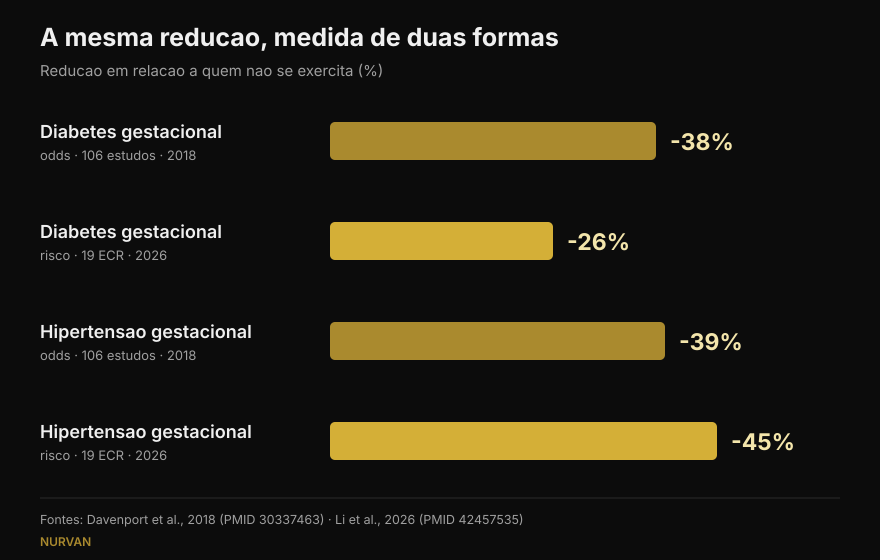
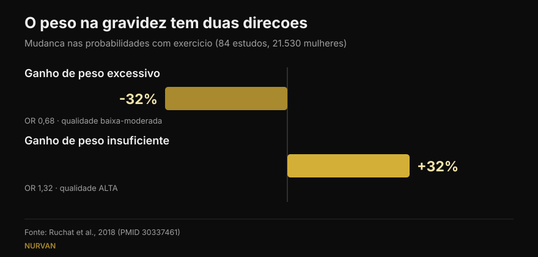

# Musculação na gravidez: o que a investigação diz de facto

Por [Giammaria Loi](/autore/giammaria-loi) · atualizado em 16 de outubro de 2026

Duas publicações circularam nas mesmas semanas: uma enumera cinco razões para continuar a treinar com pesos na gravidez, a outra mostra números muito precisos — 38% menos diabetes gestacional, 41% menos pré-eclâmpsia. Li os estudos por trás de ambas. Os números existem, e isso já é boa notícia. Mas um significa algo diferente do que se lê, outro não aparece na fonte citada, e três dados que mudariam decisões não estão em nenhuma das duas.

## Em resumo

- **Os números do post estão certos**, mas são *odds ratios*: 38% menos probabilidades de diabetes gestacional, não 38% menos risco. A meta-análise mais recente, que trabalha com riscos, diz 26% (Li et al., 2026).
- **600 MET-minutos por semana**, cerca de 140 minutos de atividade moderada, é o limiar publicado para pelo menos 25% de redução. **Confirmado à letra** (Davenport et al., 2018).
- **"Quanto mais, melhor" não se sustenta**: a curva dose-resposta de 2026 tem um pico perto de 500–550 MET-minutos e depois achata. Começar cedo e ser constante pesa mais.
- **Sobre os pesos em concreto sabemos menos do que parece**: na revisão dedicada ao treino de força, 90% dos estudos misturavam força e aeróbio e quase nenhum descrevia cargas ou progressão (Prevett et al., 2025).
- **O dado que falta nos dois posts**: o exercício reduz o aumento de peso excessivo, mas **aumenta** as probabilidades de um aumento insuficiente — e é o único resultado dessa revisão com qualidade de evidência alta (Ruchat et al., 2018).

## De onde vêm esses números

O post de Margie Davenport, investigadora na Universidade de Alberta, cita a fonte por inteiro: uma revisão sistemática de 2018 sobre 106 estudos e 273.182 gravidezes. É raro e merece ser dito. Verifiquei: os três números dos slides correspondem exatamente aos resultados publicados.

Nas intervenções de **só exercício** — sem dieta nem outras componentes — as probabilidades descem assim: diabetes gestacional 0,62 vezes as de quem não treina, hipertensão gestacional 0,61, pré-eclâmpsia 0,59. Em percentagem: 38%, 39%, 41%. Exatamente o que dizem os slides.

Há um detalhe que o post não destaca e que é o resultado mais contraintuitivo do estudo: **quando ao exercício se juntava uma intervenção alimentar, a redução desaparecia**. Não porque comer melhor faça mal, mas porque esses programas eram diferentes: mais curtos, menos supervisionados, com pior adesão. Um lembrete de quanto importa o *como*, não apenas o conteúdo.

## "38% menos" de quê, exatamente

Aqui está a precisão mais importante, e não põe em causa a honestidade de ninguém: tem a ver com a forma como lemos percentagens.

Um odds ratio não é um risco. Quando uma complicação é rara, os dois números parecem-se; quando não é, o odds ratio adianta-se. A diabetes gestacional não é rara.

A meta-análise mais recente, publicada em setembro de 2026 na mesma revista, pegou em 19 ensaios aleatorizados de exercício **supervisionado** (6.213 mulheres) e calculou **riscos relativos**. Resultado: diabetes gestacional **26%** menos, não 38%. Na mesma análise, porém, a hipertensão gestacional desce **45%**, mais do que os 39% do post. O número novo não é sistematicamente menor: é outra medida, sobre outros estudos.

*A mesma pergunta, quatro números. A direção é estável, a magnitude não. Fontes: Davenport et al., 2018 (106 estudos) e Li et al., 2026 (19 ensaios aleatorizados, exercício supervisionado).*

## Quanto exercício é mesmo preciso

O número verificável é um: **600 MET-minutos por semana** de atividade moderada para pelo menos 25% de redução. Os exemplos vêm do próprio estudo: cerca de 140 minutos de caminhada rápida, hidroginástica, bicicleta estática ou treino de força. A legenda do post reproduz isto palavra por palavra.

O slide seguinte, porém, decompõe esse total por complicação: 60 minutos semanais para a pré-eclâmpsia, 93 para a hipertensão gestacional, 106 para o aumento de peso, 137 para a diabetes gestacional. **Não encontrei esses quatro valores na fonte citada** nem em fontes secundárias acessíveis: o único dado publicado no resumo é o total de 600 MET-minutos. Isso não os torna errados — podem vir de uma figura do artigo completo — mas não são verificáveis, e uma divisão tão precisa convida a fazer o mínimo para um só resultado.

O trabalho de 2026 acrescenta a metade que falta: a curva dose-resposta **achata perto de 500–550 MET-minutos** para o aumento de peso. Acima disso, mais volume não trouxe benefício. E o que moveu os resultados não foram os minutos, mas começar cedo na gravidez (diferença significativa entre subgrupos para a diabetes gestacional, p = 0,009), continuar mais de 20 semanas (p = 0,010), adesão acima de 80% e **combinar aeróbio e força** — um ponto que vale também fora da gravidez, como contei ao falar de [treinar força, músculo e cardio no mesmo programa](/pt/blog/treinar-forca-musculo-e-cardio-juntos).

## E os pesos, sozinhos?

O primeiro post chama-se "cinco razões pelas quais as grávidas deviam levantar pesos" e depois, com honestidade, admite em letra pequena que 7 dos 9 estudos combinavam força e aeróbio.

O problema é maior do que parece. A revisão dedicada ao treino de força na gravidez, publicada em 2025 sobre 50 estudos e 47.619 participantes, encontra resultados reais: menos hipertensão gestacional (probabilidades 0,42 vezes), menos diabetes gestacional (0,62), menos perturbações do humor perinatais (0,48) e menos macrossomia, ou seja recém-nascidos com peso excessivo (0,67). Mas as autoras fecham com um aviso: **90% dos estudos eram programas multicomponentes**, a dose de força era "baixa a moderada" e a descrição de cargas e progressão era escassa.

Dito claro: sabemos que programas *que incluem* força funcionam. Ainda não sabemos o que faz um treino de força **bem programado** — carga que progride, séries levadas a uma margem de repetições sensata, semanas que se constroem umas sobre as outras. Essa investigação não existe, e as autoras escrevem-no como um apelo.

A revisão de 2025 sobre qualidade de vida, de onde o post tira os cinco pontos, tem o mesmo limite mais um: é uma revisão **sem meta-análise**, logo sem efeito médio nem intervalos de confiança. Nove estudos, 1.581 mulheres, direção favorável em peso, dor lombar, humor, energia, força e sono. O ponto do sono assenta num único estudo.

## Os três dados que nenhum dos posts refere

### 1. A segurança, medida

É a primeira pergunta de quem está grávida, e não aparece em nenhum dos doze slides. Existe uma revisão dedicada: 46 estudos, 266.778 mulheres. Nenhum aumento das probabilidades de aborto espontâneo (0,88) nem de mortalidade perinatal (0,86). Os autores escrevem, em termos simples, que o exercício parece "seguro" quanto a estes dois desfechos.

Com duas ressalvas honestas: a qualidade global da evidência é classificada como **muito baixa**, e a maioria dos estudos examinou intensidade moderada **até 60 minutos por sessão**. Além dessa duração, dizem, não podem concluir nada.

### 2. O pavimento pélvico e o momento de começar

Outra revisão do mesmo grupo, sobre 24 estudos e 15.982 mulheres, mede o treino do pavimento pélvico na gravidez: as probabilidades de incontinência urinária descem para **0,50** durante a gravidez e **0,63** após o parto.

O detalhe que muda tudo: **funcionou em mulheres continentes antes de começar, não em quem já tinha perdas**. Nestas, o treino não se comportou como tratamento. É informação sobre o *quando*, não sobre o *se* — exatamente o que um slide motivacional deixa de fora.

### 3. O peso tem duas direções

O primeiro post coloca "menos aumento de peso excessivo" em primeiro lugar e chama-lhe o resultado mais consistente. É verdade. Mas a revisão de onde vem esse resultado — 84 estudos, 21.530 mulheres — também relata o outro lado: o exercício **aumenta** as probabilidades de um aumento de peso **insuficiente** (1,32 vezes). E esse é o único resultado da revisão a que as autoras atribuem qualidade de evidência **alta**; o benefício sobre o aumento excessivo é classificado de baixo a moderado.

*O mesmo estudo, dois resultados opostos. O segundo tem a evidência mais sólida e não aparece em nenhum dos posts. Fonte: Ruchat et al., 2018.*

As próprias autoras pedem prudência, porque esse dado assenta em cinco ensaios aleatorizados. Mas o ponto mantém-se: "o exercício ajuda a controlar o peso" na gravidez não é um bem sem condições, e é mais uma razão para deixar o peso a quem acompanha a gravidez.

## O que a investigação diz de facto

[[V|ok|Confirmado|Nas intervenções de só exercício, as probabilidades de diabetes gestacional, hipertensão gestacional e pré-eclâmpsia descem para 0,62, 0,61 e 0,59 face a quem não treina. Os três números dos slides estão corretos.]]
[[V|ok|Confirmado|600 MET-minutos por semana (cerca de 140 minutos de atividade moderada) são o limiar publicado para pelo menos 25% de redução. Citado à letra.]]
[[V|ok|Confirmado|As diretrizes atuais incluem o trabalho de força em gravidezes sem complicações: a diretriz canadiana de 2019 considera os benefícios moderados e não identifica danos.]]
[[V|part|A precisar|"38% menos" são odds, não risco. Em riscos relativos, na meta-análise de 2026 de exercício supervisionado, a diabetes gestacional desce 26% e a hipertensão gestacional 45%.]]
[[V|part|A precisar|A dose não é linear: o benefício sobre o peso achata perto de 500–550 MET-minutos. Começar cedo e ser constante pesa mais do que os minutos.]]
[[V|part|A precisar|Os benefícios atribuídos aos "pesos" vêm quase sempre de programas mistos, com doses de força baixas e progressão não descrita. A força bem programada ainda não foi estudada.]]
[[V|no|Desmentido|Que controlar o peso seja um benefício sem reverso: o exercício também aumenta as probabilidades de um aumento de peso insuficiente (1,32 vezes), e é a evidência de maior qualidade da revisão.]]
[[V|nv|Não verificável|Os minutos por complicação do slide 5 (60, 93, 106, 137 por semana): não constam do resumo da fonte citada nem de fontes secundárias acessíveis.]]

## Como aplicar

Antes de mais: este artigo explica estudos, não é um programa. Há condições médicas em que o exercício na gravidez está contraindicado, e só quem acompanha a gravidez pode dizer se é o teu caso. O que se segue serve de enquadramento para essa conversa, não em vez dela.

1. **Parte da pergunta certa.** Como escreve Davenport num slide, durante anos a pergunta foi "é seguro?". Os dados sobre aborto e mortalidade perinatal não mostram aumento de risco, por isso a pergunta útil passa a ser outra: do que precisas tu, neste trimestre, a partir deste ponto.
2. **Olha para o total semanal, não para a sessão isolada.** 600 MET-minutos é um balanço de sete dias. E acima de 500–550 a curva achata: mais volume não deu mais benefício.
3. **Junta aeróbio e força.** É a combinação que melhor correu nos subgrupos de 2026 e encaixa no que sabemos fora da gravidez.
4. **Regista o esforço, não só a carga.** Na gravidez o peso na barra diz pouco: a mesma série pode custar muito mais do que há seis semanas. Anotar a margem de repetições (RIR) é a forma mais simples de reparar a tempo — o mesmo princípio que uso ao [escolher séries e repetições fora da gravidez](/pt/blog/quantas-repeticoes-massa-muscular).
5. **O pavimento pélvico treina-se antes, não depois.** Nos dados o efeito está em quem ainda não tem sintomas. Como e quanto, decide um profissional.
6. **O peso é acompanhado por quem te acompanha.** Subir demasiado e subir demasiado pouco são ambos desfechos a evitar, e nenhum se avalia sozinha numa balança.

[[APP|A carga muda, o registo fica|No Nurvan registas carga, repetições e RIR sessão a sessão: quando o mesmo peso começa a custar mais, vês no gráfico em vez de descobrires a meio da série. E com o módulo treinador–atleta o teu profissional vê os mesmos dados em tempo real, sem capturas no WhatsApp.|Experimentar o Nurvan]]

## Perguntas frequentes

**Posso continuar a treinar com pesos se já o fazia antes da gravidez?**
As diretrizes atuais incluem o trabalho de força em gravidezes sem complicações, e a revisão de 2018 não encontrou aumento de aborto nem de mortalidade perinatal. O que muda, nos estudos como na prática, é o como: intensidade, escolha de exercícios e tolerância alteram-se com os trimestres. A decisão passa por quem acompanha a gravidez: só essa pessoa sabe se há contraindicações no teu caso.

**Quanto exercício por semana?**
O valor publicado são 600 MET-minutos semanais de atividade moderada, cerca de 140 minutos, para pelo menos 25% de redução das complicações estudadas. A meta-análise de 2026 mostra que o benefício achata perto de 500–550 MET-minutos e que começar cedo e manter adesão alta contam mais do que o volume.

**Treinar na gravidez faz mal ao bebé?**
Sobre os dois desfechos mais temidos — aborto espontâneo e mortalidade perinatal — a revisão de 266.778 mulheres não encontra aumento. Os autores precisam que a qualidade da evidência é muito baixa e que a maioria dos estudos examinou intensidade moderada até 60 minutos por sessão: acima disso, dizem, não é possível concluir.

**Posso começar do zero estando grávida?**
Os estudos incluídos referiam-se a mulheres sem contraindicações, e muitos programas começavam durante a gravidez. Os subgrupos de 2026 sugerem que começar cedo conta. Mas "começar do zero" é precisamente a situação que precisa do aval de um médico ou de uma parteira antes, não depois.

## Leia também

- [Força, músculo e cardio juntos: dá?](/pt/blog/treinar-forca-musculo-e-cardio-juntos) — porque a combinação funciona e quando se atrapalham
- [Quantas repetições para ganhar massa: o mito do 8-12](/pt/blog/quantas-repeticoes-massa-muscular) — como escolher séries, repetições e descanso a partir dos dados
- [Divisão de treino: iniciante ou avançado](/pt/blog/divisao-treino-iniciante-avancado) — quantas vezes por semana treinar cada grupo muscular

## Fontes

1. Davenport MH, Ruchat SM, Poitras VJ, et al., 2018. Prenatal exercise for the prevention of gestational diabetes mellitus and hypertensive disorders of pregnancy: a systematic review and meta-analysis. *Br J Sports Med* 52(21):1367-1375. PMID 30337463 — [doi.org/10.1136/bjsports-2018-099355](https://doi.org/10.1136/bjsports-2018-099355)
2. Li L, He J, Wang C, et al., 2026. Effects of supervised exercise during pregnancy on gestational diabetes mellitus and other pregnancy outcomes: a systematic review and meta-analysis. *Br J Sports Med* 60(17):1350-1358. PMID 42457535 — [doi.org/10.1136/bjsports-2026-111586](https://doi.org/10.1136/bjsports-2026-111586)
3. Prevett C, Gingerich J, Sivak A, Davenport MH, 2025. Resistance training in pregnancy: systematic review and meta-analysis of pregnancy, delivery, fetal and pelvic floor outcomes and call to action. *Br J Sports Med* 59(16):1173-1182. PMID 40610191 — [doi.org/10.1136/bjsports-2024-109123](https://doi.org/10.1136/bjsports-2024-109123)
4. Redondo-Delgado P, Blanco-Giménez P, López-Ortiz S, et al., 2025. Effects of strength training on quality of life in pregnant women: a systematic review. *Acta Obstet Gynecol Scand* 104(7):1231-1243. PMID 40230063 — [doi.org/10.1111/aogs.15122](https://doi.org/10.1111/aogs.15122)
5. Ruchat SM, Mottola MF, Skow RJ, et al., 2018. Effectiveness of exercise interventions in the prevention of excessive gestational weight gain and postpartum weight retention: a systematic review and meta-analysis. *Br J Sports Med* 52(21):1347-1356. PMID 30337461 — [doi.org/10.1136/bjsports-2018-099399](https://doi.org/10.1136/bjsports-2018-099399)
6. Davenport MH, Kathol AJ, Mottola MF, et al., 2018. Prenatal exercise is not associated with fetal mortality: a systematic review and meta-analysis. *Br J Sports Med* 53(2):108-115. PMID 30337346 — [doi.org/10.1136/bjsports-2018-099773](https://doi.org/10.1136/bjsports-2018-099773)
7. Davenport MH, Nagpal TS, Mottola MF, et al., 2018. Prenatal exercise (including but not limited to pelvic floor muscle training) and urinary incontinence during and following pregnancy: a systematic review and meta-analysis. *Br J Sports Med* 52(21):1397-1404. PMID 30337466 — [doi.org/10.1136/bjsports-2018-099780](https://doi.org/10.1136/bjsports-2018-099780)
8. Mottola MF, Davenport MH, Ruchat SM, et al., 2018. 2019 Canadian guideline for physical activity throughout pregnancy. *Br J Sports Med* 52(21):1339-1346. PMID 30337460 — [doi.org/10.1136/bjsports-2018-100056](https://doi.org/10.1136/bjsports-2018-100056)

Ponto de partida: os carrosséis de [Built With Science](https://www.instagram.com/p/Dd9PB-olsG2/) (1 de outubro de 2026) e de [Margie Davenport](https://www.instagram.com/p/DdrC7OHm3xe/) (24 de setembro de 2026). Nenhum texto e nenhuma imagem dos dois posts foi reproduzido: as afirmações foram reescritas e verificadas na literatura primária.

[[BIO|Giammaria Loi é o fundador do Nurvan. Treina com pesos desde 2012, trabalha como personal trainer e treinador certificado FIPE desde 2013 e compete em powerlifting a nível nacional desde 2018. Cada artigo que assina parte dos estudos científicos e chega ao que funciona mesmo no ginásio.]]

> Nota: conteúdo informativo, não substitui a opinião de um médico, de uma parteira ou de outro profissional de saúde. Na gravidez há condições em que o exercício está contraindicado: fala com quem te acompanha antes de mudares o teu treino.
