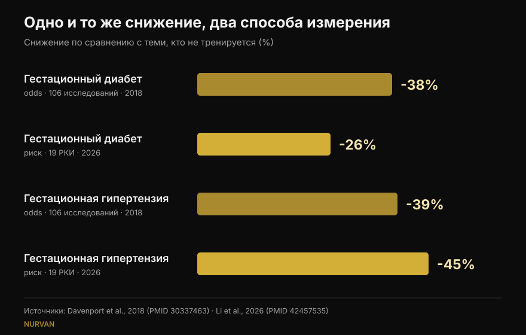
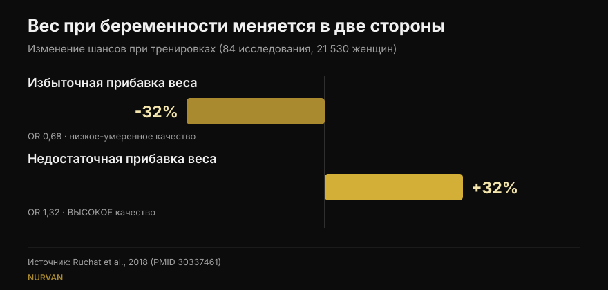

# Силовые тренировки при беременности: что на самом деле показывают исследования

Автор: [Джаммария Лои](/autore/giammaria-loi) · обновлено 16 октября 2026 года

В одни и те же недели разошлись два поста: один перечисляет пять причин продолжать силовые тренировки во время беременности, другой приводит очень точные цифры — на 38% меньше гестационного диабета, на 41% меньше преэклампсии. Я прочитал исследования, стоящие за обоими. Цифры действительно есть, и это уже хорошая новость. Но одна из них означает не то, как её читают, другой нет в указанном источнике, а три факта, которые изменили бы решения читательниц, не попали ни в один из постов.

## Коротко

- **Цифры поста точны**, но это *отношения шансов*: на 38% ниже шансы гестационного диабета, а не на 38% ниже риск. Самый свежий метаанализ, работающий с рисками, даёт 26% (Li et al., 2026).
- **600 МЕТ-минут в неделю** — около 140 минут умеренной активности — опубликованный порог для снижения минимум на 25%. **Подтверждено дословно** (Davenport et al., 2018).
- **«Чем больше, тем лучше» не подтверждается**: кривая «доза — эффект» 2026 года выходит на пик около 500–550 МЕТ-минут и дальше уплощается. Важнее начать рано и не бросать.
- **Про силовые отдельно мы знаем меньше, чем кажется**: в обзоре, посвящённом силовой работе, 90% исследований смешивали силу и аэробику, и почти ни одно не описывало отягощения и прогрессию (Prevett et al., 2025).
- **Чего нет ни в одном посте**: тренировки снижают шансы избыточной прибавки веса, но **повышают** шансы недостаточной — и это единственный результат того обзора с высоким качеством доказательств (Ruchat et al., 2018).

## Откуда эти цифры

Пост Марджи Дэвенпорт, исследовательницы из Университета Альберты, приводит источник целиком: систематический обзор 2018 года по 106 исследованиям и 273 182 беременностям. Это редкость, и об этом стоит сказать. Я проверил: три цифры со слайдов точно совпадают с опубликованными результатами.

В вмешательствах **только с физической нагрузкой** — без диеты и других компонентов — шансы снижаются так: гестационный диабет 0,62 от шансов тех, кто не тренируется, гестационная гипертензия 0,61, преэклампсия 0,59. В процентах: 38%, 39%, 41%. Ровно то, что на слайдах.

Есть деталь, которую пост не подчёркивает, и это самый контринтуитивный результат работы: **когда к нагрузке добавляли вмешательство по питанию, снижение исчезало**. Не потому, что питаться лучше вредно, а потому что те программы были другими: короче, с меньшим сопровождением, с худшей приверженностью. Полезное напоминание о том, насколько важно *как*, а не только что.

## «На 38% меньше» — чего именно

Это самое важное уточнение, и оно не ставит под сомнение чью-то честность: речь о том, как наш мозг читает проценты.

Отношение шансов — это не риск. Когда осложнение редкое, числа похожи; когда нет, отношение шансов убегает вперёд. Гестационный диабет не редкость.

Самый свежий метаанализ, опубликованный в сентябре 2026 года в том же журнале, взял 19 рандомизированных исследований **контролируемых** занятий (6 213 женщин) и посчитал **относительные риски**. Результат: гестационный диабет на **26%** ниже, а не на 38%. Зато в том же анализе гестационная гипертензия снижается на **45%**, больше, чем 39% из поста. То есть новая цифра не всегда меньше: это другая мера на других исследованиях.

*Один вопрос, четыре числа. Направление устойчиво, величина — нет. Источники: Davenport et al., 2018 (106 исследований) и Li et al., 2026 (19 рандомизированных исследований, контролируемые занятия).*

## Сколько нагрузки нужно на самом деле

Проверяемое число одно: **600 МЕТ-минут в неделю** умеренной активности для снижения минимум на 25%. Примеры даёт само исследование: около 140 минут быстрой ходьбы, аквааэробики, велотренажёра или силовой работы. Подпись к посту цитирует это слово в слово.

Следующий слайд, однако, раскладывает этот итог по осложнениям: 60 минут в неделю для преэклампсии, 93 для гестационной гипертензии, 106 для прибавки веса, 137 для гестационного диабета. **Этих четырёх значений я не нашёл ни в указанном источнике**, ни в доступных вторичных источниках: в резюме опубликован только общий порог в 600 МЕТ-минут. Это не делает их ошибочными — они могут быть взяты из рисунка полного текста, — но проверить их нельзя, а столь точная разбивка подталкивает делать минимум ради одного исхода.

Работа 2026 года добавляет недостающую половину: кривая «доза — эффект» **уплощается около 500–550 МЕТ-минут** применительно к прибавке веса. Дальше дополнительный объём ничего не дал. И двигали результат не минуты, а ранний старт в беременности (значимое различие подгрупп по гестационному диабету, p = 0,009), продолжительность более 20 недель (p = 0,010), приверженность выше 80% и **сочетание аэробной и силовой работы** — это верно и вне беременности, о чём я писал в тексте про [силу, мышцы и кардио в одной программе](/ru/blog/trenirovka-sily-myshts-i-kardio-vmeste).

## А силовые сами по себе?

Первый пост называется «пять причин, почему беременным стоит поднимать вес», а затем честно признаёт мелким шрифтом, что 7 из 9 исследований сочетали силу и аэробику.

Проблема шире, чем кажется. Обзор, посвящённый именно силовым тренировкам при беременности, вышедший в 2025 году по 50 исследованиям и 47 619 участницам, находит реальные результаты: меньше гестационной гипертензии (шансы 0,42), меньше гестационного диабета (0,62), меньше перинатальных расстройств настроения (0,48), меньше макросомии, то есть новорождённых с избыточным весом (0,67). Но авторы заканчивают предупреждением: **90% исследований были многокомпонентными программами**, доза силовой работы была «низкой или умеренной», а описание отягощений и прогрессии — скудным.

Проще говоря: мы знаем, что программы, *включающие* силовую работу, работают. Мы до сих пор не знаем, что даёт **грамотно спланированная** силовая тренировка — с растущим отягощением, подходами до разумного запаса повторений, неделями, которые строятся одна на другой. Такого исследования нет, и авторы пишут об этом как о призыве к действию.

Обзор 2025 года о качестве жизни, из которого пост берёт свои пять пунктов, имеет то же ограничение плюс ещё одно: это обзор **без метаанализа**, значит, без усреднённого эффекта и доверительных интервалов. Девять исследований, 1 581 женщина, благоприятное направление по весу, боли в пояснице, настроению, энергии, силе и сну. Пункт про сон опирается на одно-единственное исследование.

## Три факта, которых нет ни в одном посте

### 1. Безопасность, измеренная

Это первый вопрос беременной женщины, и его нет ни на одном из двенадцати слайдов. Есть отдельный обзор: 46 исследований, 266 778 женщин. Никакого повышения шансов выкидыша (0,88) или перинатальной смертности (0,86). Авторы пишут простыми словами, что в отношении этих двух исходов нагрузка выглядит «безопасной».

С двумя честными оговорками: общее качество доказательств оценено как **очень низкое**, а большинство исследований рассматривало умеренную интенсивность **до 60 минут за занятие**. Дальше этой длительности, пишут они, выводов сделать нельзя.

### 2. Тазовое дно и момент начала

Другой обзор той же группы, по 24 исследованиям и 15 982 женщинам, измеряет тренировку мышц тазового дна во время беременности: шансы недержания мочи падают до **0,50** в беременность и до **0,63** после родов.

Деталь, которая всё меняет: **это сработало у женщин, которые были континентны до начала, и не сработало у тех, у кого уже были подтекания**. У них тренировка не вела себя как лечение. Это информация о *когда*, а не о *надо ли* — ровно то, что мотивирующий слайд опускает.

### 3. У веса два направления

Первый пост ставит «меньше избыточной прибавки веса» на первое место и называет это самым устойчивым результатом. Верно. Но обзор, откуда взят результат — 84 исследования, 21 530 женщин, — сообщает и обратную сторону: нагрузка **повышает** шансы **недостаточной** прибавки веса (в 1,32 раза). И это единственный результат обзора, которому авторы присваивают **высокое** качество доказательств; польза по избыточной прибавке оценена как низкая-умеренная.

*Одно исследование, два противоположных результата. У второго доказательства сильнее, и его нет ни в одном посте. Источник: Ruchat et al., 2018.*

Сами авторы призывают к осторожности: этот вывод опирается на пять рандомизированных исследований. Но суть остаётся: «нагрузка помогает контролировать вес» при беременности — не безусловное благо, и это ещё одна причина оставить вес тем, кто ведёт беременность.

## Что на самом деле говорят исследования

[[V|ok|Подтверждено|В вмешательствах только с нагрузкой шансы гестационного диабета, гестационной гипертензии и преэклампсии падают до 0,62, 0,61 и 0,59 по сравнению с отсутствием тренировок. Три цифры со слайдов верны.]]
[[V|ok|Подтверждено|600 МЕТ-минут в неделю (около 140 минут умеренной активности) — опубликованный порог для снижения минимум на 25%. Процитировано дословно.]]
[[V|ok|Подтверждено|Действующие рекомендации включают силовую работу при неосложнённой беременности: канадское руководство 2019 года оценивает пользу как умеренную и не находит вреда.]]
[[V|part|Нужно уточнить|«На 38% меньше» — это шансы, а не риск. В относительных рисках, в метаанализе 2026 года по контролируемым занятиям, гестационный диабет снижается на 26%, а гестационная гипертензия на 45%.]]
[[V|part|Нужно уточнить|Доза нелинейна: польза по весу уплощается около 500–550 МЕТ-минут. Ранний старт и постоянство весят больше минут.]]
[[V|part|Нужно уточнить|Польза, приписываемая «силовым», почти всегда получена в смешанных программах с низкой дозой силовой работы и неописанной прогрессией. Грамотно дозированная силовая работа ещё не изучена.]]
[[V|no|Опровергнуто|Что контроль веса — польза без обратной стороны: нагрузка также повышает шансы недостаточной прибавки веса (в 1,32 раза), и это вывод с самым высоким качеством доказательств в обзоре.]]
[[V|nv|Непроверяемо|Минуты по каждому осложнению со слайда 5 (60, 93, 106, 137 в неделю): их нет ни в резюме указанного источника, ни в доступных вторичных источниках.]]

## Как это применить

Сразу оговорка: эта статья объясняет исследования, это не программа. Есть медицинские состояния, при которых нагрузка во время беременности противопоказана, и только те, кто ведёт вашу беременность, могут сказать, ваш ли это случай. Дальнейшее — рамка для такого разговора, а не замена ему.

1. **Начните с правильного вопроса.** Как пишет Дэвенпорт на одном из слайдов, годами вопрос звучал «безопасно ли это?». Данные по выкидышам и перинатальной смертности не показывают роста риска, поэтому полезный вопрос другой: что нужно именно вам, в этом триместре, с этого стартового уровня.
2. **Смотрите на недельную сумму, а не на одно занятие.** 600 МЕТ-минут — это баланс за семь дней. И после 500–550 кривая уплощается: больший объём не дал большей пользы.
3. **Соединяйте аэробную и силовую работу.** Именно это сочетание показало лучший результат в подгруппах 2026 года и совпадает с тем, что мы знаем вне беременности.
4. **Фиксируйте усилие, а не только вес.** При беременности число на штанге говорит мало: тот же подход может стоить гораздо дороже, чем шесть недель назад. Записывать запас повторений (RIR) — самый простой способ заметить это вовремя; тот же принцип я использую, [выбирая подходы и повторения вне беременности](/ru/blog/skolko-povtoreniy-dlya-massy).
5. **Тазовое дно тренируют до, а не после.** В данных эффект есть у тех, у кого ещё нет симптомов. Как и сколько — решает специалист.
6. **Вес отслеживают те, кто отслеживает вас.** Набрать слишком много и слишком мало — оба исхода нежелательны, и ни один не оценивается в одиночку по весам.

[[APP|Вес меняется, дневник остаётся|В Nurvan вы записываете вес, повторения и RIR занятие за занятием: когда тот же вес начинает стоить дороже, вы видите это на графике, а не узнаёте посреди подхода. А через модуль «тренер — спортсмен» ваш специалист видит те же данные в реальном времени, без скриншотов в мессенджере.|Попробовать Nurvan]]

## Частые вопросы

**Можно ли продолжать силовые, если я занималась до беременности?**
Действующие рекомендации включают силовую работу при неосложнённой беременности, а обзор 2018 года не нашёл роста выкидышей или перинатальной смертности. Меняется — и в исследованиях, и на практике — то, как тренироваться: интенсивность, выбор упражнений и переносимость смещаются от триместра к триместру. Но решение принимают вместе с теми, кто ведёт беременность: только они знают, есть ли противопоказания в вашем случае.

**Сколько нагрузки в неделю?**
Опубликованное значение — 600 МЕТ-минут в неделю умеренной активности, около 140 минут, для снижения изученных осложнений минимум на 25%. Метаанализ 2026 года показывает, что польза уплощается около 500–550 МЕТ-минут и что ранний старт и высокая приверженность значат больше объёма.

**Вредны ли тренировки при беременности для ребёнка?**
По двум самым пугающим исходам — выкидышу и перинатальной смертности — обзор по 266 778 женщинам не находит роста шансов. Авторы уточняют, что качество доказательств очень низкое и что большинство исследований рассматривало умеренную интенсивность до 60 минут за занятие: дальше, пишут они, выводов делать нельзя.

**Можно ли начать с нуля во время беременности?**
Включённые исследования касались женщин без противопоказаний, и многие программы начинались именно в беременность. Подгруппы 2026 года говорят в пользу раннего старта. Но «начать с нуля» — это ровно та ситуация, где нужно согласие врача или акушерки заранее, а не потом.

## Читайте также

- [Сила, мышцы и кардио вместе: получится?](/ru/blog/trenirovka-sily-myshts-i-kardio-vmeste) — почему сочетание работает и когда они мешают друг другу
- [Сколько повторений нужно для массы: миф про 8-12](/ru/blog/skolko-povtoreniy-dlya-massy) — как выбирать подходы, повторения и отдых по данным
- [Сплит тренировок: новичок или продвинутый](/ru/blog/split-trenirovok-novichok-prodvinutyy) — как часто в неделю тренировать мышечную группу

## Источники

1. Davenport MH, Ruchat SM, Poitras VJ, et al., 2018. Prenatal exercise for the prevention of gestational diabetes mellitus and hypertensive disorders of pregnancy: a systematic review and meta-analysis. *Br J Sports Med* 52(21):1367-1375. PMID 30337463 — [doi.org/10.1136/bjsports-2018-099355](https://doi.org/10.1136/bjsports-2018-099355)
2. Li L, He J, Wang C, et al., 2026. Effects of supervised exercise during pregnancy on gestational diabetes mellitus and other pregnancy outcomes: a systematic review and meta-analysis. *Br J Sports Med* 60(17):1350-1358. PMID 42457535 — [doi.org/10.1136/bjsports-2026-111586](https://doi.org/10.1136/bjsports-2026-111586)
3. Prevett C, Gingerich J, Sivak A, Davenport MH, 2025. Resistance training in pregnancy: systematic review and meta-analysis of pregnancy, delivery, fetal and pelvic floor outcomes and call to action. *Br J Sports Med* 59(16):1173-1182. PMID 40610191 — [doi.org/10.1136/bjsports-2024-109123](https://doi.org/10.1136/bjsports-2024-109123)
4. Redondo-Delgado P, Blanco-Giménez P, López-Ortiz S, et al., 2025. Effects of strength training on quality of life in pregnant women: a systematic review. *Acta Obstet Gynecol Scand* 104(7):1231-1243. PMID 40230063 — [doi.org/10.1111/aogs.15122](https://doi.org/10.1111/aogs.15122)
5. Ruchat SM, Mottola MF, Skow RJ, et al., 2018. Effectiveness of exercise interventions in the prevention of excessive gestational weight gain and postpartum weight retention: a systematic review and meta-analysis. *Br J Sports Med* 52(21):1347-1356. PMID 30337461 — [doi.org/10.1136/bjsports-2018-099399](https://doi.org/10.1136/bjsports-2018-099399)
6. Davenport MH, Kathol AJ, Mottola MF, et al., 2018. Prenatal exercise is not associated with fetal mortality: a systematic review and meta-analysis. *Br J Sports Med* 53(2):108-115. PMID 30337346 — [doi.org/10.1136/bjsports-2018-099773](https://doi.org/10.1136/bjsports-2018-099773)
7. Davenport MH, Nagpal TS, Mottola MF, et al., 2018. Prenatal exercise (including but not limited to pelvic floor muscle training) and urinary incontinence during and following pregnancy: a systematic review and meta-analysis. *Br J Sports Med* 52(21):1397-1404. PMID 30337466 — [doi.org/10.1136/bjsports-2018-099780](https://doi.org/10.1136/bjsports-2018-099780)
8. Mottola MF, Davenport MH, Ruchat SM, et al., 2018. 2019 Canadian guideline for physical activity throughout pregnancy. *Br J Sports Med* 52(21):1339-1346. PMID 30337460 — [doi.org/10.1136/bjsports-2018-100056](https://doi.org/10.1136/bjsports-2018-100056)

Отправная точка: карусели [Built With Science](https://www.instagram.com/p/Dd9PB-olsG2/) (1 октября 2026) и [Марджи Дэвенпорт](https://www.instagram.com/p/DdrC7OHm3xe/) (24 сентября 2026). Ни текст, ни изображения обоих постов не воспроизводились: утверждения переписаны заново и проверены по первичной литературе.

[[BIO|Джаммария Лои — основатель Nurvan. Тренируется с отягощениями с 2012 года, работает персональным тренером и коучем с сертификацией FIPE с 2013 года и выступает в пауэрлифтинге на национальном уровне с 2018 года. Каждая статья за его подписью начинается с научных работ и заканчивается тем, что действительно работает в зале.]]

> Примечание: информационный материал, не заменяет консультацию врача, акушерки или другого специалиста. При беременности есть состояния, при которых нагрузка противопоказана: обсудите изменения в тренировках с теми, кто ведёт вашу беременность.
