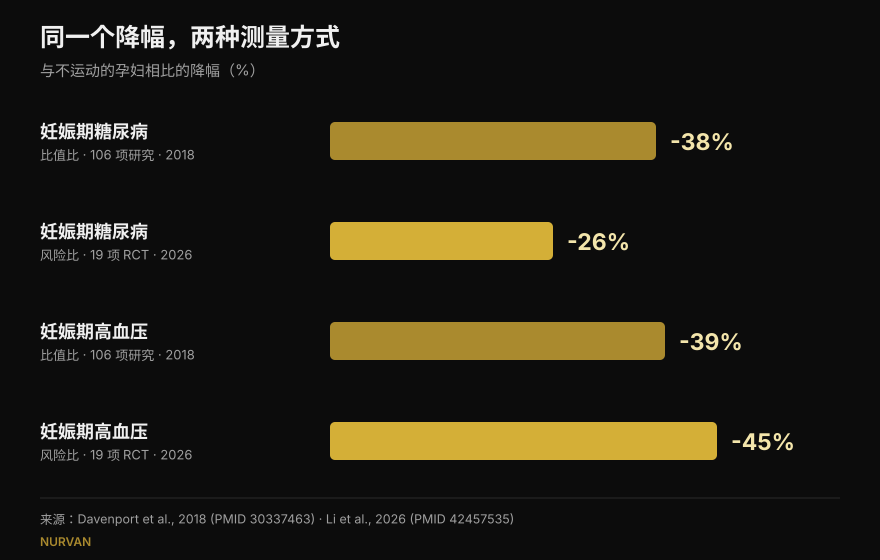
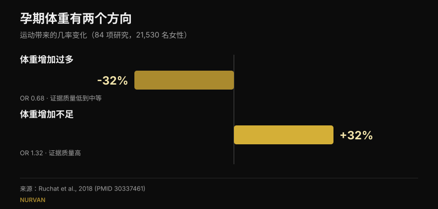

# 怀孕期间力量训练：研究到底怎么说

作者：[Giammaria Loi](/autore/giammaria-loi) · 更新于 2026 年 10 月 16 日

同一段时间里有两个帖子在转：一个列出孕期继续练力量的五个理由，另一个给出非常精确的数字——妊娠期糖尿病少 38%，子痫前期少 41%。两个帖子背后的研究我都读了。数字是真的，这本身已经是好消息。但其中一个的含义和大家读到的不一样，另一个在它标注的文献里根本找不到，而三个真正会影响决定的数据，两个帖子都没写。

## 要点速览

- **帖子的数字没错**，但那是*比值比*：妊娠期糖尿病的几率低 38%，不是风险低 38%。最新的那篇用风险来算的荟萃分析给出的是 26%（Li et al., 2026）。
- **每周 600 MET-分钟**，约等于 140 分钟中等强度活动，是文献里"至少降低 25%"的门槛。**逐字核对无误**（Davenport et al., 2018）。
- **"练得越多越好"站不住**：2026 年的剂量—反应曲线在 500–550 MET-分钟附近见顶，之后走平。开始得早、能坚持，比总量更重要。
- **单论力量训练，我们知道的比看上去少**：在专门针对力量训练的综述里，90% 的研究把力量和有氧混在一起，几乎没有一项说清负荷和进阶（Prevett et al., 2025）。
- **两个帖子都漏掉的一点**：运动降低体重增长过多的几率，却**提高**了体重增长不足的几率——而这是那篇综述里唯一被评为高质量证据的结果（Ruchat et al., 2018）。

## 这些数字从哪来

阿尔伯塔大学研究者 Margie Davenport 的帖子完整标注了来源：2018 年一篇涵盖 106 项研究、273,182 例妊娠的系统综述。这很少见，值得说明。我核对过：幻灯片上的三个数字与已发表结果完全一致。

在**纯运动干预**中——不叠加饮食或其他成分——几率是这样下降的：妊娠期糖尿病为不运动者的 0.62 倍，妊娠期高血压 0.61，子痫前期 0.59。换算成百分比就是 38%、39%、41%。和幻灯片一字不差。

有一个帖子没有强调的细节，也是这项研究最反直觉的结果：**一旦在运动之外再加上饮食干预，这种下降就消失了**。不是因为吃得更好有害，而是那些项目本身不同：通常更短、监督更少、依从性更差。这提醒我们，项目"怎么执行"和"包含什么"同样重要。

## "少 38%"，到底少的是什么

这是最重要的一处澄清，而且无关任何人的诚实与否：它关乎我们怎么读百分比。

比值比不是风险。并发症很罕见时，两个数字差不多；不罕见时，比值比会跑在风险前面。妊娠期糖尿病并不罕见。

同一本期刊 2026 年 9 月发表的最新荟萃分析，纳入 19 项**有监督**运动的随机对照试验（6,213 名女性），算的是**相对风险**。结果：妊娠期糖尿病降低 **26%**，不是 38%。但在同一份分析里，妊娠期高血压降低了 **45%**，比帖子的 39% 更多。所以新数字并非总是更小：它是另一种度量、另一批研究。

*同一个问题，四个数字。方向稳定，幅度不稳定。来源：Davenport et al., 2018（106 项研究）与 Li et al., 2026（19 项随机对照试验，有监督运动）。*

## 到底需要多少运动量

可核实的数字只有一个：**每周 600 MET-分钟**的中等强度活动，对应至少 25% 的下降。例子是研究自己给的：约 140 分钟的快走、水中健身操、固定自行车或力量训练。帖子的文案逐字引用了这一句。

但下一张幻灯片把这个总量拆到了每种并发症上：子痫前期每周 60 分钟，妊娠期高血压 93 分钟，体重增长 106 分钟，妊娠期糖尿病 137 分钟。**这四个数值我在被引用的文献里没有找到**，在可获取的二手文献里也没有：摘要里公布的只有 600 MET-分钟这个总量。这不代表它们是错的——可能来自全文中的某张图——但无法核实，而如此精确的拆分会诱导人只为某一个结局做最低限度的运动。

2026 年那篇补上了缺的另一半：就体重增长而言，剂量—反应曲线**在 500–550 MET-分钟附近走平**。再往上加量没有带来额外好处。真正改变结果的不是分钟数，而是在孕早期就开始（妊娠期糖尿病的亚组差异显著，p = 0.009）、持续超过 20 周（p = 0.010）、依从性高于 80%，以及**有氧与力量结合**——这一点在孕期之外同样成立，我在谈[同一套计划里练力量、肌肉和心肺](/zh/blog/liliang-jirou-youyang-tongshi-xunlian)时写过。

## 那只练力量呢

第一个帖子的标题是"孕妇应该举铁的五个理由"，随后又很诚实地用小字承认：它引用的 9 项研究里有 7 项把力量和有氧混在一起。

这个问题比看上去更大。2025 年专门针对孕期力量训练的综述，涵盖 50 项研究、47,619 名参与者，确实找到了真实结果：妊娠期高血压更少（几率 0.42 倍）、妊娠期糖尿病更少（0.62）、围产期情绪障碍更少（0.48）、巨大儿更少（0.67）。但作者最后给出警告：**90% 的研究是多成分项目**，力量训练的剂量属于"低到中等"，对负荷、进阶和选重依据的描述很差。

说白了：我们知道*包含*力量训练的项目有效；我们还不知道一套**真正按训练学安排**的力量计划会带来什么——负荷递增、每组留出合理的储备次数、周与周之间层层叠加。这样的研究还没有人做，作者把它写成了一份行动倡议。

帖子取用五个要点的那篇 2025 年生活质量综述，除了同样的局限还多一条：它是一篇**不做荟萃分析**的系统综述，因此没有合并效应量，也没有置信区间。九项研究、1,581 名女性，在体重、腰痛、情绪、精力、力量和睡眠上方向有利。关于睡眠的那一条只来自一项研究。

## 两个帖子都没写的三件事

### 1. 被量化的安全性

这是孕妇最先问的问题，却没有出现在十二张幻灯片中的任何一张上。有一篇专门的综述：46 项研究，266,778 名女性。流产几率没有升高（0.88），围产期死亡率也没有（0.86）。作者用很朴素的话写道，就这两个结局而言，运动看起来是"安全"的。

同时有两点诚实的限制值得复述：证据的总体质量被评为**极低**，而且大多数研究考察的是**每次不超过 60 分钟**的中等强度。超过这个时长，他们说，无法下结论。

### 2. 盆底，以及开始的时机

同一团队的另一篇综述，涵盖 24 项研究、15,982 名女性，衡量孕期盆底肌训练：尿失禁的几率在孕期降至 **0.50**，产后降至 **0.63**。

真正改变结论的细节是：**它对开始前没有漏尿的女性有效，对已经漏尿的女性无效**。在已有症状的人群中，训练并没有表现得像一种治疗。这是关于"什么时候"的信息，而不是"要不要"——恰恰是励志幻灯片会略去的部分。

### 3. 体重有两个方向

第一个帖子把"体重增长过多更少"放在第一位，称之为最一致的发现。这没错。但这个结果所出自的综述——84 项研究、21,530 名女性——同时报告了另一面：运动**提高**了体重增长**不足**的几率（1.32 倍）。而这是整篇综述里唯一被作者评为**高**质量证据的结果；关于增长过多的那条益处被评为低到中等。

*同一项研究，两个相反的结果。第二个证据更硬，却没有出现在任何一个帖子里。来源：Ruchat et al., 2018。*

作者本人也提醒要谨慎，因为这一条建立在五项随机对照试验之上。但要点不变：孕期"运动有助于控制体重"并不是无条件的好事，这也是更应该把体重交给产检团队盯的理由。

## 研究到底怎么说

[[V|ok|已证实|在纯运动干预中，妊娠期糖尿病、妊娠期高血压和子痫前期的几率相对不运动者分别降至 0.62、0.61 和 0.59。幻灯片上的三个数字是对的。]]
[[V|ok|已证实|每周 600 MET-分钟（约 140 分钟中等强度活动）是文献中"至少降低 25%"的门槛，原文逐字如此。]]
[[V|ok|已证实|现行指南将力量训练纳入无并发症妊娠：2019 年加拿大指南判定益处为中等，未发现危害。]]
[[V|part|需要补充|"少 38%"说的是几率，不是风险。按相对风险计算，2026 年有监督运动的荟萃分析显示妊娠期糖尿病降低 26%，妊娠期高血压降低 45%。]]
[[V|part|需要补充|剂量不是线性的：对体重的益处在 500–550 MET-分钟附近走平。开始得早、坚持得住，比分钟数更重要。]]
[[V|part|需要补充|归到"举铁"名下的好处几乎都来自混合项目，力量剂量偏低且进阶未被描述。按规范安排的力量训练尚未被研究。]]
[[V|no|被推翻|把控制体重当作没有反面的好处：运动同样提高了体重增长不足的几率（1.32 倍），而这是该综述中证据质量最高的结果。]]
[[V|nv|无法核实|第 5 张幻灯片按并发症拆分的分钟数（每周 60、93、106、137）：既不在所引文献的摘要中，也不在可获取的二手文献中。]]

## 怎么用

先说清楚：这篇文章解释的是研究，不是训练计划。有些医学状况下孕期运动属于禁忌，只有负责你产检的人才能判断是否适用于你。下面的内容是那场对话的框架，不能替代它。

1. **从正确的问题开始。** 正如 Davenport 在一张幻灯片里写的，多年来人们问的是"安全吗"。流产和围产期死亡率的数据没有显示风险升高，所以更有用的问题变成了：在这个孕期阶段、以你现在的基础，你需要什么。
2. **看一周的总量，而不是单次课。** 600 MET-分钟是七天的账，不是每天的作业。而且超过 500–550 之后曲线走平：加量没有换来更多益处。
3. **把有氧和力量放在一起。** 这是 2026 年亚组分析中表现最好的组合，也与孕期之外的结论一致。
4. **记录用力程度，而不只是重量。** 怀孕时杠铃上的数字说明不了多少：同样一组，可能比六周前吃力得多。记录储备次数（RIR）是最简单的早发现方式——这和我在[孕期之外选择组数与次数](/zh/blog/duoshao-cishu-zengji)时用的原则一样。
5. **盆底要提前练，不是出了问题再练。** 数据里的效果出现在还没有症状的人身上。怎么练、练多少，由专业人员决定。
6. **体重由产检团队盯。** 长得太多和长得太少都是要避免的结局，而且都不该一个人对着体重秤判断。

[[APP|重量在变，训练日志不变|在 Nurvan 里逐次记录负荷、次数和 RIR：当同样的重量开始变得更吃力，你会在曲线上看到，而不是在做组做到一半时才发觉。通过教练—学员模块，你的专业人员能实时看到同一份数据，不必再发微信截图。|试用 Nurvan]]

## 常见问题

**怀孕前就在练力量，还能继续吗？**
现行指南将力量训练纳入无并发症妊娠，2018 年的综述也没有发现流产或围产期死亡率升高。在研究里和在实践中变化的是"怎么练"：强度、动作选择和耐受度会随着孕周调整。但这个决定要经过负责你产检的人：只有他们知道你是否存在禁忌。

**一周需要多少运动量？**
文献给出的数值是每周 600 MET-分钟中等强度活动，约 140 分钟，对应所研究并发症至少 25% 的下降。但 2026 年的荟萃分析显示，益处在 500–550 MET-分钟附近走平，而早开始、依从性高比总量更重要。

**孕期运动会伤到宝宝吗？**
在两个最被担心的结局上——流产和围产期死亡——涵盖 266,778 名女性的综述没有发现几率升高。作者同时指出，证据质量很低，且大多数研究考察的是每次不超过 60 分钟的中等强度：超过这个范围，他们说无法下结论。

**怀孕后才从零开始可以吗？**
这些综述纳入的是没有运动禁忌的女性，而且很多项目本就是在孕期开始的。2026 年的亚组分析提示早开始更有利。但"从零开始"恰恰是需要先拿到医生或助产士许可的情况，而不是事后补。

## 延伸阅读

- [力量、肌肉和心肺一起练，行得通吗](/zh/blog/liliang-jirou-youyang-tongshi-xunlian) —— 为什么组合有效，以及它们何时互相干扰
- [增肌要做多少次：8-12 的迷思](/zh/blog/duoshao-cishu-zengji) —— 如何根据数据选择组数、次数和组间休息
- [训练分化：新手与进阶](/zh/blog/xunlian-fenhua-xinshou-gaoji) —— 一个肌群一周该练几次

## 参考文献

1. Davenport MH, Ruchat SM, Poitras VJ, et al., 2018. Prenatal exercise for the prevention of gestational diabetes mellitus and hypertensive disorders of pregnancy: a systematic review and meta-analysis. *Br J Sports Med* 52(21):1367-1375. PMID 30337463 — [doi.org/10.1136/bjsports-2018-099355](https://doi.org/10.1136/bjsports-2018-099355)
2. Li L, He J, Wang C, et al., 2026. Effects of supervised exercise during pregnancy on gestational diabetes mellitus and other pregnancy outcomes: a systematic review and meta-analysis. *Br J Sports Med* 60(17):1350-1358. PMID 42457535 — [doi.org/10.1136/bjsports-2026-111586](https://doi.org/10.1136/bjsports-2026-111586)
3. Prevett C, Gingerich J, Sivak A, Davenport MH, 2025. Resistance training in pregnancy: systematic review and meta-analysis of pregnancy, delivery, fetal and pelvic floor outcomes and call to action. *Br J Sports Med* 59(16):1173-1182. PMID 40610191 — [doi.org/10.1136/bjsports-2024-109123](https://doi.org/10.1136/bjsports-2024-109123)
4. Redondo-Delgado P, Blanco-Giménez P, López-Ortiz S, et al., 2025. Effects of strength training on quality of life in pregnant women: a systematic review. *Acta Obstet Gynecol Scand* 104(7):1231-1243. PMID 40230063 — [doi.org/10.1111/aogs.15122](https://doi.org/10.1111/aogs.15122)
5. Ruchat SM, Mottola MF, Skow RJ, et al., 2018. Effectiveness of exercise interventions in the prevention of excessive gestational weight gain and postpartum weight retention: a systematic review and meta-analysis. *Br J Sports Med* 52(21):1347-1356. PMID 30337461 — [doi.org/10.1136/bjsports-2018-099399](https://doi.org/10.1136/bjsports-2018-099399)
6. Davenport MH, Kathol AJ, Mottola MF, et al., 2018. Prenatal exercise is not associated with fetal mortality: a systematic review and meta-analysis. *Br J Sports Med* 53(2):108-115. PMID 30337346 — [doi.org/10.1136/bjsports-2018-099773](https://doi.org/10.1136/bjsports-2018-099773)
7. Davenport MH, Nagpal TS, Mottola MF, et al., 2018. Prenatal exercise (including but not limited to pelvic floor muscle training) and urinary incontinence during and following pregnancy: a systematic review and meta-analysis. *Br J Sports Med* 52(21):1397-1404. PMID 30337466 — [doi.org/10.1136/bjsports-2018-099780](https://doi.org/10.1136/bjsports-2018-099780)
8. Mottola MF, Davenport MH, Ruchat SM, et al., 2018. 2019 Canadian guideline for physical activity throughout pregnancy. *Br J Sports Med* 52(21):1339-1346. PMID 30337460 — [doi.org/10.1136/bjsports-2018-100056](https://doi.org/10.1136/bjsports-2018-100056)

灵感来源：[Built With Science](https://www.instagram.com/p/Dd9PB-olsG2/)（2026 年 10 月 1 日）与 [Margie Davenport](https://www.instagram.com/p/DdrC7OHm3xe/)（2026 年 9 月 24 日）的图文帖。两个帖子的文字和图片均未被复制：所有论点都是重新撰写并对照一手文献核实的。

[[BIO|Giammaria Loi 是 Nurvan 的创始人。他从 2012 年开始进行力量训练，自 2013 年起担任 FIPE 认证私人教练与教练，并自 2018 年起在国家级别参加力量举比赛。他署名的每一篇文章都从科研文献出发，落到健身房里真正有效的做法。]]

> 注意：本文为科普内容，不能替代医生、助产士或其他医疗专业人员的意见。孕期存在运动禁忌的情况：在改变训练之前，请先与负责你产检的人沟通。
