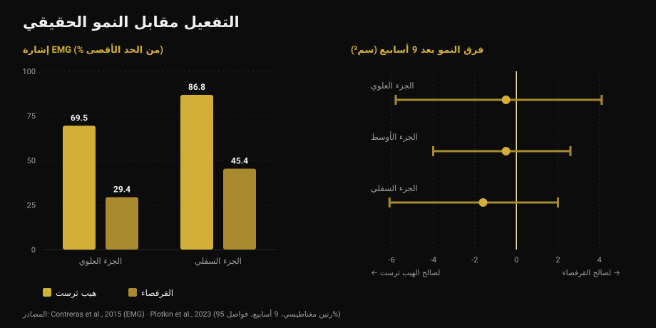
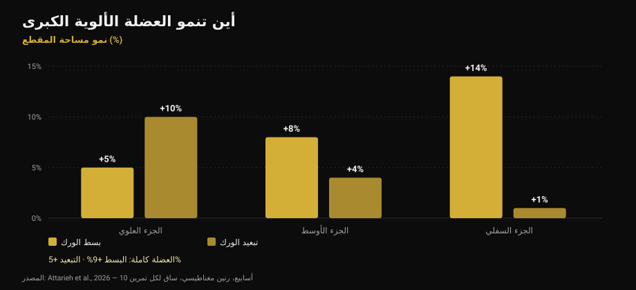

# تمارين المؤخرة: هيب ثرست أم قرفصاء؟

بقلم [جياماريا لوي](/autore/giammaria-loi) · حُدِّث في 17 أكتوبر 2026

منشور منتشر على نطاق واسع يقول إن عضلات المؤخرة تحتاج في كل يوم أرجل إلى ثلاث فئات إلزامية: تمارين مركبة ثقيلة، وتمارين مساعدة، وعمل عزل «للضخ». الإطار مرتّب ويبدو صحيحاً. قرأتُ تسع دراسات للتحقق منه. النصيحة النهائية — لا تكتفِ بالهيب ثرست — صامدة. أما ركيزتان من الثلاث التي يقوم عليها فلا: الضخ ليس الآلية التي يدّعيها المنشور، والتمرين الذي «يفعّل أكثر» ليس الذي ينمّي أكثر.

## باختصار

- **الهيب ثرست والقرفصاء ينميان المؤخرة بالقدر نفسه.** تسعة أسابيع، رنين مغناطيسي، عدد مجموعات متساوٍ: لا فرق قابل للقياس (Plotkin et al., 2023).
- **الهيب ثرست يفعّل أكثر بكثير** — حتى 69,5% مقابل 29,4% من الإشارة الكهربائية في العضلة الألوية الكبرى — **وهذا لا يتنبأ بالنمو** (Contreras et al., 2015؛ Plotkin et al., 2023).
- **«الضخ» ليس الآلية الثالثة للنمو.** الإجهاد الأيضي وتورّم الخلية والهرمونات الحادة ليست مدعومة كأسباب مستقلة للتضخم (Van Every et al., 2025).
- **تنويع التمارين مفيد فعلاً**، لكن لسبب آخر: بسط الورك وتبعيد الورك ينميان *مناطق مختلفة* من العضلة نفسها (Attarieh et al., 2026).
- **فترات الراحة 30-60 ثانية** الموصوفة لعمل الضخ هي أضعف حلقة: أقل من 60 ثانية يميل التضخم إلى التراجع (Singer et al., 2024).

## ما الذي يقترحه المنشور

ثلاث فئات في كل يوم أرجل. تمارين مركبة ثقيلة (قرفصاء، رفعة ميتة، عمل أحادي الساق) من أجل الشد الميكانيكي. تمارين مساعدة موجّهة للمؤخرة (هيب ثرست، صباح الخير، الرفعة الرومانية) من أجل نمو الألياف. عزل بتكرارات عالية (ركل خلفي، تبعيد) من أجل الضخ، الموصوف في الشرائح بأنه «الآلية الثالثة لنمو العضلات: الإجهاد الأيضي».

قبل العلم، ملاحظة غريبة: **النص المرافق والجدول لا يتطابقان**. النص يصف 5-8 و8-20 و25+ تكراراً؛ أما جدول الشريحة الأولى فيقول 3-8 و8-15 و15-25+. من يقرأ النص ومن ينظر إلى الصورة يخرجان ببرنامجين مختلفين. تفصيل صغير، لكنه يقول شيئاً عن الدقة الحقيقية لهذه الأطر.

## «يفعّل أكثر» لا تعني «ينمّي أكثر»

هذا هو الجزء الذي ينبغي أن يغيّر فعلاً طريقة اختيارك للتمارين.

في 2015 قامت مجموعة تضم بريت كونتريراس — الشخص الذي نشر الهيب ثرست — بقياس النشاط الكهربائي للعضلات (تخطيط كهربية العضل، أو EMG: مقدار الإشارة التي تصل إلى العضلة أثناء التمرين) لدى ثلاث عشرة امرأة مدرَّبة، بمقارنة الهيب ثرست والقرفصاء بأحمال 10 تكرارات. النتيجة واضحة: في الجزء العلوي من العضلة الألوية الكبرى يبلغ الهيب ثرست في المتوسط **69,5% من الحد الأقصى مقابل 29,4%** للقرفصاء؛ وفي الجزء السفلي **86,8% مقابل 45,4%**. أما في العضلة المتسعة الوحشية، أي الفخذ، فلا فرق ذا دلالة.

لو كان التفعيل دليلاً جيداً، لوجب أن ينمّي الهيب ثرست المؤخرة نحو الضعف. في 2023 شارك كونتريراس نفسه في تأليف الدراسة التي اختبرت هذه الفكرة: 34 شخصاً غير مدرَّب، تسعة أسابيع تدريب تحت إشراف، قرفصاء فقط أو هيب ثرست فقط، **بعدد مجموعات متساوٍ**، مع قياس مساحة المقطع العضلي بالرنين المغناطيسي.

جاء نمو المؤخرة **متشابهاً بين المجموعتين**. التقديرات تميل قليلاً لصالح الهيب ثرست — 1,6 سم² في الجزء السفلي، و0,5 في الأوسط، و0,5 في العلوي — بهوامش خطأ واسعة بما يكفي لتحتوي الصفر بأريحية. ويكتب المؤلفون ذلك بوضوح: إشارة EMG الأعلى أثناء الهيب ثرست *لم تتنبأ باستمرار* بتضخم المؤخرة.

*على اليسار: مقدار الإشارة التي تصل إلى العضلة (Contreras et al., 2015، أحمال 10 تكرارات). على اليمين: فرق النمو بعد تسعة أسابيع بالسنتيمتر المربع مع فواصل ثقة 95% (Plotkin et al., 2023). القيم الموجبة لصالح القرفصاء والسالبة لصالح الهيب ثرست: الفواصل الثلاثة كلها تعبر الصفر.*

وتضيف الدراسة نفسها معطيين غائبين عن المنشور: القرفصاء نمّت **العضلة رباعية الرؤوس (+3,6 سم²) والمقرّبات (+2,5 سم²)** أكثر بكثير من الهيب ثرست، وكان الانتقال إلى الرفعة الميتة **متطابقاً**. وهو المبدأ نفسه الذي شرحته في مقال [تمديد الساقين ودفع الأرجل](/ar/blog/tamdid-alsaqayn-am-dafe-alarjul-alfakhidh-almustaqim): التمرين الذي «تشعر» به أكثر ليس تلقائياً التمرين الذي يبني أكثر.

## الضخ ليس آلية نمو

تستند الفئة الثالثة إلى عبارة محددة: الضخ هو تورّم الخلية وتراكم التعب، «الآلية الثالثة لنمو العضلات: الإجهاد الأيضي».

حظيت هذه الفكرة بعشر سنوات من الرواج، وهي اليوم أكثر زوايا الأدبيات إثارة للجدل. مراجعة صدرت في 2025 في *Journal of Sport and Health Science*، بمشاركة ستيوارت فيليبس، تدرجها صراحةً ضمن المفاهيم المتجاوَزة: الادعاءات بأن الاستجابات الهرمونية الحادة أو الإجهاد الأيضي أو تورّم الخلية أو «الضخ» تسهم إسهاماً ذا شأن في التضخم **غير مدعومة بالأدلة العلمية**. ويذهب إلى الدرج نفسه ما يسمى التضخم «الساركوبلازمي».

وليست هذه مفاجأة طارئة. ففي 2017 خلصت مراجعة مخصصة للسؤال — هل تزيد النواتج الأيضية المتكوّنة أثناء التمرين من التضخم؟ — إلى أن **النواتج الأيضية لا تملك خصائص بنائية بحد ذاتها**. يمكنها أن تساعد، لكن بطريقة واحدة: زيادة تجنيد الألياف، أي إدخال ألياف أكثر تحت المحفّز الميكانيكي نفسه. فهي تعمل *عبر* الشد لا بجواره.

لا شيء من هذا يعني أن مجموعات الـ25 تكراراً لا تبني عضلات. إنها تبني، كما سنرى بعد قليل. بل يعني أنك لا تؤديها للسبب المكتوب على الشريحة، وأن تسميتها «فئة إلزامية» استناداً إلى آلية غير موجودة أساس هشّ لبناء برنامج.

## التنويع ينفع، لكن بحسب المناطق

هنا المنشور محق، والأبحاث الحديثة تمنحه سبباً أفضل من السبب الذي يستخدمه.

دراسة نُشرت في أكتوبر 2026 قارنت عشرة أسابيع من **بسط الورك على البكرة مقابل تبعيد الورك**، بتصميم نظيف بشكل لافت: كل مشارك يدرّب ساقاً بتمرين والأخرى بالتمرين الآخر، بالحجم نفسه (نحو 10 مجموعات أسبوعياً، 8-12 تكراراً)، مع رنين مغناطيسي على ثلاث مناطق من العضلة الألوية الكبرى.

أنتج البسط نمواً إجمالياً أكبر (**9% مقابل 5%**)، لكن الفارق المثير هو *أين*. البسط ينمّي الأسفل أساساً: +5% في الأعلى، +8% في الوسط، **+14% في الأسفل**. والتبعيد يفعل العكس: **+10% في الأعلى**، +4% في الوسط، +1% في الأسفل. والتبعيد وحده هو الذي طال العضلتين الأليويتين الوسطى والصغرى بشكل ملموس.

*نمو مساحة المقطع العرضي للعضلة الألوية الكبرى حسب المنطقة بعد 10 أسابيع، بقياس الرنين المغناطيسي. تصميم داخل الفرد: ساق لكل تمرين، بالحجم نفسه. المصدر: Attarieh et al., 2026.*

هذا أول دليل مباشر على أن اختيار التمرين يعدّل النمو **الإقليمي** للمؤخرة. إذن نعم: للتبعيد مكان يستحقه. لكن ليس بوصفه «عمل ضخ بـ25 تكراراً مع 30 ثانية راحة» — بل بوصفه تمريناً يدرّب جزءاً بالكاد يصل إليه بسط الورك، بالجدية نفسها المعطاة لبقية التمارين.

أما الخلفية فتقدّمها المراجعة التجميعية لعام 2025 حول تضخم العضلة الألوية الكبرى: في 12 دراسة ينتج تدريب المقاومة أثراً متوسطاً (0,71 على مقياس معياري، بتجانس مرتفع بين الدراسات)، و**القرفصاء العميقة أو الموازية ودفع الأرجل وبسط الورك والهيب ثرست تعمل جميعها**، منفردة أو مجتمعة. لا توجد تراتبية إلزامية.

## التكرارات والراحة: ما يصمد وما لا يصمد

عبارة الشريحة الرابعة — كل نطاقات التكرار تبني عضلات إذا اقتربت المجموعة من الفشل — **صحيحة**. المراجعة التجميعية الشبكية لعام 2021، على 28 دراسة و747 بالغاً وبكل المجموعات حتى الفشل، لا تجد فرقاً في التضخم بين الأحمال الثقيلة (حتى 8 تكرارات) والمتوسطة (9-15) والخفيفة (أكثر من 15). أما في القوة القصوى فالفرق موجود ولصالح الأحمال الثقيلة.

نقطة الضعف هي الراحة. المراجعة البايزية لعام 2024 تجد أفضلية صغيرة للراحات **فوق 60 ثانية**، على الأرجح لأن الراحات القصيرة تُسقط الحمل الكلي المرفوع؛ وبعد 90 ثانية لا فرق ملموس. والمنشور يضع **30-60 ثانية** تحديداً على العمل الأعلى تكراراً، وهو أصلاً الأكثر إرهاقاً: وهذه هي التركيبة الأكثر عرضة لأن تكلّف حجماً دون مقابل. وفي الطرف الآخر، الدقائق الثلاث الموصوفة للتمارين المركبة تفيد القوة، لكنها لا تضيف شيئاً فوق 90 ثانية إن كان الهدف النمو وحده.

وماذا عن «الفئات الثلاث الإلزامية»؟ خلاصة مؤتمر يوفاسكولا لعام 2025، المنشورة في 2026، ترتّب المتغيرات: المجموعات الأسبوعية وحجم الحمل ومدة الراحة والقرب من الفشل تؤثر تأثيراً ذا شأن في التضخم، **بينما يمكن أن يكون اختيار التمارين مرناً**. وهذا عكس تراتبية المنشور تماماً، إذ يجمّد أكثر المتغيرات مرونة ويترك المهمة منها سائبة.

## ما تقوله الأبحاث فعلاً

[[V|ok|مؤكَّد|كل نطاقات التكرار تبني عضلات إذا اقتربت المجموعة من الفشل: لا فرق في التضخم بين الأحمال الثقيلة والمتوسطة والخفيفة في 28 دراسة. أما القوة القصوى فما زالت تتطلب أحمالاً ثقيلة.]]
[[V|ok|مؤكَّد|الهيب ثرست وحده لا يكفي، لكن ليس للأسباب التي يذكرها المنشور: تمارين مختلفة تنمّي مناطق مختلفة من العضلة الألوية الكبرى. البسط ينمّي الجزء السفلي (+14%) والتبعيد الجزء العلوي (+10%).]]
[[V|ok|مؤكَّد|تمارين كثيرة تنفع للمؤخرة — القرفصاء العميقة أو الموازية، دفع الأرجل، بسط الورك، الهيب ثرست — بأثر متوسط ومتسق بين الدراسات.]]
[[V|part|يحتاج توضيحاً|«ثلاث فئات إلزامية في كل يوم أرجل»: الأدبيات تضع اختيار التمارين ضمن المتغيرات المرنة، وتضع المجموعات الأسبوعية وحجم الحمل والراحة والقرب من الفشل ضمن المتغيرات الحاسمة.]]
[[V|part|يحتاج توضيحاً|راحة 30-60 ثانية في العمل عالي التكرارات: فوق 60 ثانية يكون التضخم أفضل، وبعد 90 ثانية لا يتغير شيء. أما الدقائق الثلاث في المركبة فتخدم القوة.]]
[[V|no|مُفنَّد|«الضخ» بوصفه الآلية الثالثة للنمو: الإجهاد الأيضي وتورّم الخلية والاستجابات الهرمونية الحادة غير مدعومة كأسباب مستقلة للتضخم.]]
[[V|no|مُفنَّد|اختيار التمارين بحسب مقدار «تفعيلها»: الهيب ثرست ينتج أكثر من ضعف إشارة القرفصاء في العضلة الألوية الكبرى، وبعد تسعة أسابيع من الرنين يكون النمو واحداً.]]
[[V|nv|غير قابل للتحقق|نطاقات التكرار في المنشور نفسه: النص يقول 5-8 / 8-20 / 25+، وجدول الشريحة الأولى يقول 3-8 / 8-15 / 15-25+. الاثنان لا يتطابقان ولا يستند أي منهما إلى مصدر مذكور.]]

## كيف تطبّق ذلك

1. **اختر تمرينين أو ثلاثة لبسط الورك والتزم بها.** القرفصاء العميقة، الهيب ثرست، الرفعة الرومانية، البسط على البكرة: كلها صالحة. النمو يأتي من الحمل الذي يرتفع مع الوقت، لا من التمرين الذي «تشعر» به أفضل.
2. **أضف التبعيد من أجل الجزء العلوي.** ليس كتمرين إنهاك ختامي، بل كتمرين بالجدية نفسها: في البيانات هو الوحيد الذي يصل إلى الجزء القريب والعضلة الألوية الوسطى.
3. **احسب المجموعات الأسبوعية لا الفئات.** هذا هو المتغير الذي تضعه الأبحاث أولاً. عشر مجموعات أسبوعية من بسط الورك أنتجت +9% من المساحة في عشرة أسابيع لدى غير المدرَّبين.
4. **لا تنزل تحت 60 ثانية راحة**، ولا حتى في المجموعات الطويلة. ولا داعي لتجاوز 90-120 ثانية إن كان الهدف النمو: احتفظ بالدقائق الثلاث للمركبة الثقيلة.
5. **اقترب بالمجموعات من الفشل وسجّل مدى القرب.** التكرارات الاحتياطية (RIR) هي ما يجعل مجموعة من 6 ومجموعة من 25 قابلتين للمقارنة. بدون هذا الرقم لا تعني «التكرارات العالية» شيئاً — وهو موضوع مقال [كم تكراراً تحتاج للكتلة](/ar/blog/kam-takrar-lilkutla-aladalia).
6. **توقف عن مطاردة الحرقة.** الضخ إحساس لا قياس. إن استخدمته للحكم على حصة تدريبية فأنت تقيّم تدفق الدم لا النمو.

[[APP|الحجم هو ما يُحسب، لا الحرقة|يحسب Nurvan المجموعات الأسبوعية لكل مجموعة عضلية ويسجّل الحمل وRIR في كل مجموعة: ترى ما إذا كانت مؤخرتك قد نالت فعلاً عشر مجموعات هذا الأسبوع وما إذا كان الحمل يرتفع، بدل الاعتماد على الإحساس بعد التمرين. وأوقات الراحة محتسَبة داخل البرنامج.|جرّب Nurvan]]

## أسئلة شائعة

**هيب ثرست أم قرفصاء للمؤخرة؟**
كلاهما، وإن كان لا بد من واحد فالأبحاث لا تتوّج فائزاً. خلال تسعة أسابيع بالرنين وبمجموعات متساوية كان نمو المؤخرة متشابهاً. القرفصاء تنمّي إضافةً إلى ذلك رباعية الرؤوس والمقرّبات؛ والهيب ثرست يتيح أحمالاً أعلى بكثير في تلك الحركة تحديداً. ما يحسم الأمر هو بقية برنامجك لا العضلة.

**هل تنفع التكرارات العالية للمؤخرة؟**
نعم، لكن ليس بسبب الضخ. المجموعات الطويلة تبني بقدر القصيرة شرط أن تقترب من الفشل — وعندها تكون أكثر إرهاقاً بكثير. إن استخدمتها فامنحها الراحة نفسها: تحت 60 ثانية يميل الأثر إلى التراجع.

**هل التبعيد والركل الخلفي مفيدان فعلاً؟**
مفيدان، ولسبب أفضل من المعتاد. في دراسة 2026 نمّى تبعيد الورك الجزء العلوي من العضلة الألوية الكبرى بنسبة 10% مقابل 5% للبسط، وطال العضلة الألوية الوسطى. إنه تمرين بهدف مختلف لا لمسة ختامية.

**كم مرة في الأسبوع أدرّب المؤخرة؟**
أكثر البيانات مباشرةً عن هذه العضلة تأتي من برامج بحصتين أسبوعياً ونحو عشر مجموعات في الأسبوع، أنتجت نمواً قابلاً للقياس في عشرة أسابيع. عدد الحصص أقل أهمية من مجموع المجموعات الأسبوعي: المهمة توزيعه بشكل مستدام، وهو ما أتناوله في [تقسيم التمرين للمبتدئ والمتقدم](/ar/blog/taqsim-altadrib-mubtadi-mutaqaddim).

## اقرأ أيضاً

- [تمديد الساقين أم دفع الأرجل: ما الذي ينمو فعلاً](/ar/blog/tamdid-alsaqayn-am-dafe-alarjul-alfakhidh-almustaqim) — حين لا ينمّي التمرين «الأشمل» العضلة التي تهمك
- [كم تكرار لبناء العضلات؟ خرافة الـ 8-12](/ar/blog/kam-takrar-lilkutla-aladalia) — الأحمال والمجموعات والراحة بحسب البيانات
- [تقسيم التمرين: مبتدئ أم متقدم؟](/ar/blog/taqsim-altadrib-mubtadi-mutaqaddim) — كيف توزّع المجموعات الأسبوعية

## المصادر

1. Plotkin DL, Rodas MA, Vigotsky AD, et al., 2023. Hip thrust and back squat training elicit similar gluteus muscle hypertrophy and transfer similarly to the deadlift. *Front Physiol* 14:1279170. PMID 37877099 — [doi.org/10.3389/fphys.2023.1279170](https://doi.org/10.3389/fphys.2023.1279170)
2. Contreras B, Vigotsky AD, Schoenfeld BJ, Beardsley C, Cronin J, 2015. A comparison of gluteus maximus, biceps femoris, and vastus lateralis electromyographic activity in the back squat and barbell hip thrust exercises. *J Appl Biomech* 31(6):452-458. PMID 26214739 — [doi.org/10.1123/jab.2014-0301](https://doi.org/10.1123/jab.2014-0301)
3. Van Every DW, Lees MJ, Wilson B, Nippard J, Phillips SM, 2025. Load-induced human skeletal muscle hypertrophy: mechanisms, myths, and misconceptions. *J Sport Health Sci* 15:101104. PMID 41276164 — [doi.org/10.1016/j.jshs.2025.101104](https://doi.org/10.1016/j.jshs.2025.101104)
4. Dankel SJ, Mattocks KT, Jessee MB, et al., 2017. Do metabolites that are produced during resistance exercise enhance muscle hypertrophy? *Eur J Appl Physiol* 117(11):2125-2135. PMID 28776271 — [doi.org/10.1007/s00421-017-3690-1](https://doi.org/10.1007/s00421-017-3690-1)
5. Attarieh P, Nunes JP, Khani S, et al., 2026. Regional hypertrophy of the gluteal muscles is task-specific: differential responses to 10 weeks of hip extension versus hip abduction training. *J Strength Cond Res*، نشر مبكر على الإنترنت. PMID 42842490 — [doi.org/10.1519/JSC.0000000000005701](https://doi.org/10.1519/JSC.0000000000005701)
6. Krause Neto W, Krause TLV, Gama EF, 2025. The impact of resistance training on gluteus maximus hypertrophy: a systematic review and meta-analysis. *Front Physiol* 16:1542334. PMID 40276368 — [doi.org/10.3389/fphys.2025.1542334](https://doi.org/10.3389/fphys.2025.1542334)
7. Lopez P, Radaelli R, Taaffe DR, et al., 2021. Resistance training load effects on muscle hypertrophy and strength gain: systematic review and network meta-analysis. *Med Sci Sports Exerc* 53(6):1206-1216. PMID 33433148 — [doi.org/10.1249/MSS.0000000000002585](https://doi.org/10.1249/MSS.0000000000002585)
8. Singer A, Wolf M, Generoso L, et al., 2024. Give it a rest: a systematic review with Bayesian meta-analysis on the effect of inter-set rest interval duration on muscle hypertrophy. *Front Sports Act Living* 6:1429789. PMID 39205815 — [doi.org/10.3389/fspor.2024.1429789](https://doi.org/10.3389/fspor.2024.1429789)
9. Roberts MD, Bamman MM, Hornberger TA, et al., 2026. Research into resistance training response heterogeneity: a summary of the 2025 conference at the University of Jyväskylä. *J Appl Physiol* 140(6):1761-1776. PMID 42172438 — [doi.org/10.1152/japplphysiol.00289.2026](https://doi.org/10.1152/japplphysiol.00289.2026)

نقطة الانطلاق: منشور [John Rusin](https://www.instagram.com/p/Dc57wEdESMF/) (5 سبتمبر 2026). لم يُستنسخ أي نص أو صورة من المنشور: أُعيدت صياغة كل الادعاءات وجرى التحقق منها في الأدبيات الأولية.

[[BIO|جياماريا لوي هو مؤسس Nurvan. يتدرب بالأثقال منذ 2012، ويعمل مدرباً شخصياً ومدرباً معتمداً من FIPE منذ 2013، ويشارك في رفع القوة على المستوى الوطني منذ 2018. كل مقال يوقّعه ينطلق من الدراسات العلمية وينتهي عند ما ينفع فعلاً في الصالة.]]

> ملاحظة: محتوى تثقيفي لا يغني عن رأي طبيب أو مختص مؤهل. إن كنت تعاني ألماً في الورك أو الظهر أو إصابة قائمة، فاطلب تقييماً قبل تغيير تدريبك.
