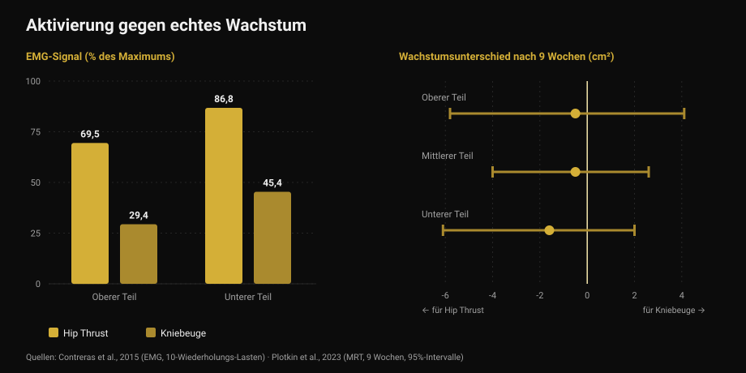
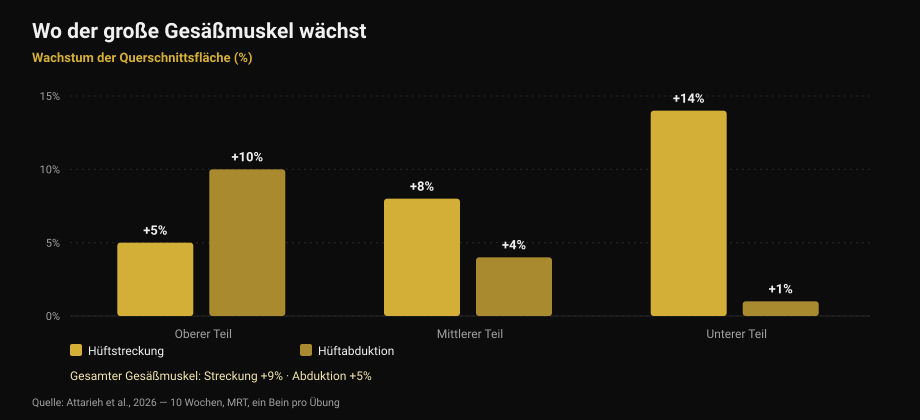

# Po-Übungen: Hip Thrust oder Kniebeuge?

Von [Giammaria Loi](/autore/giammaria-loi) · aktualisiert am 17. Oktober 2026

Ein vielgeteiltes Karussell behauptet, der Gesäßmuskel brauche an jedem Beintag drei Pflichtkategorien: schwere Grundübungen, Zusatzübungen und Isolationsarbeit „für den Pump". Das Schema ist sauber und klingt richtig. Ich habe neun Studien gelesen, um es zu prüfen. Der Rat am Ende — mach nicht nur Hip Thrusts — hält. Zwei der drei Säulen darunter nicht: Der Pump ist nicht der Mechanismus, den der Post behauptet, und die Übung, die „stärker aktiviert", ist nicht die, die stärker wachsen lässt.

## Kurz gefasst

- **Hip Thrust und Kniebeuge lassen den Po gleich wachsen.** Neun Wochen, MRT, gleiche Satzzahl: kein messbarer Unterschied (Plotkin et al., 2023).
- **Der Hip Thrust aktiviert deutlich stärker** — bis zu 69,5 % gegenüber 29,4 % des elektrischen Signals im großen Gesäßmuskel — **und das sagt nichts über das Wachstum** (Contreras et al., 2015; Plotkin et al., 2023).
- **Der „Pump" ist nicht der dritte Wachstumsmechanismus.** Metabolischer Stress, Zellschwellung und akute Hormone sind als eigenständige Ursachen von Hypertrophie nicht belegt (Van Every et al., 2025).
- **Übungen zu variieren bringt etwas**, aber aus einem anderen Grund: Hüftstreckung und Hüftabduktion lassen *unterschiedliche Regionen* desselben Muskels wachsen (Attarieh et al., 2026).
- **Die 30-60 Sekunden Pause** für die Pump-Arbeit sind das schwächste Glied: unter 60 Sekunden wird die Hypertrophie tendenziell schlechter (Singer et al., 2024).

## Was der Post vorschlägt

Drei Kategorien, an jedem Beintag. Schwere Grundübungen (Kniebeuge, Kreuzheben, einbeinig) für mechanische Spannung. Gesäßfokussierte Zusatzübungen (Hip Thrust, Good Morning, rumänisches Kreuzheben) für das Faserwachstum. Isolation mit hohen Wiederholungen (Kickbacks, Abduktionen) für den Pump, in den Slides beschrieben als „der dritte Mechanismus des Muskelwachstums: metabolischer Stress".

Vor der Wissenschaft eine Merkwürdigkeit: **Bildunterschrift und Tabelle stimmen nicht überein**. Der Text schreibt 5-8, 8-20 und 25+ Wiederholungen vor; die Tabelle auf der ersten Slide sagt 3-8, 8-15 und 15-25+. Wer den Text liest und wer das Bild ansieht, geht mit zwei verschiedenen Programmen nach Hause. Ein Detail, aber es sagt etwas darüber, wie präzise solche Schemata wirklich sind.

## „Aktiviert mehr" heißt nicht „wächst mehr"

Das ist der Teil, der die Übungsauswahl wirklich verändern sollte.

2015 maß eine Gruppe um Bret Contreras — den Mann, der den Hip Thrust populär gemacht hat — die elektrische Muskelaktivität (Elektromyografie, kurz EMG: wie viel Signal während der Übung am Muskel ankommt) bei dreizehn trainierten Frauen und verglich Hip Thrust und Kniebeuge mit 10-Wiederholungs-Lasten. Das Ergebnis ist eindeutig: Im oberen Teil des großen Gesäßmuskels erreicht der Hip Thrust im Mittel **69,5 % des Maximums gegenüber 29,4 %** bei der Kniebeuge; im unteren Teil **86,8 % gegenüber 45,4 %**. Im Vastus lateralis, also im Oberschenkel, kein signifikanter Unterschied.

Wäre Aktivierung ein guter Leitfaden, müsste der Hip Thrust den Po etwa doppelt so stark wachsen lassen. 2023 war Contreras Mitautor der Studie, die genau das prüfte: 34 untrainierte Personen, neun Wochen betreutes Training, nur Kniebeuge oder nur Hip Thrust, **gleiche Satzzahl**, Muskelquerschnitt per MRT gemessen.

Das Wachstum des Gesäßmuskels fiel in beiden Gruppen **ähnlich** aus. Die Schätzungen neigen leicht zum Hip Thrust — 1,6 cm² im unteren Abschnitt, 0,5 im mittleren, 0,5 im oberen — mit Unsicherheitsspannen, die die Null bequem einschließen. Die Autoren schreiben es klar: Das höhere EMG-Signal beim Hip Thrust *sagte die Hypertrophie nicht konsistent vorher*.

*Links: wie viel Signal am Muskel ankommt (Contreras et al., 2015, 10-Wiederholungs-Lasten). Rechts: der Wachstumsunterschied nach neun Wochen in Quadratzentimetern, mit 95%-Intervallen (Plotkin et al., 2023). Positive Werte sprechen für die Kniebeuge, negative für den Hip Thrust — alle drei Intervalle kreuzen die Null.*

Dieselbe Studie liefert zwei Daten, die im Post fehlen: Die Kniebeuge ließ **Quadrizeps (+3,6 cm²) und Adduktoren (+2,5 cm²)** weit stärker wachsen als der Hip Thrust, und der Transfer aufs Kreuzheben war **identisch**. Dasselbe Prinzip habe ich beim Thema [Beinstrecker und Beinpresse](/de/blog/beinstrecker-oder-beinpresse-rectus-femoris) beschrieben: Die Übung, die man am stärksten spürt, baut nicht automatisch am meisten auf.

## Der Pump ist kein Wachstumsmechanismus

Die dritte Kategorie steht auf einem konkreten Satz: Der Pump sei Zellschwellung und Ermüdungsakkumulation, „der dritte Mechanismus des Muskelwachstums: metabolischer Stress".

Diese Idee hatte zehn gute Jahre und ist heute die umstrittenste Ecke der Literatur. Eine Übersichtsarbeit von 2025 im *Journal of Sport and Health Science*, mitverfasst von Stuart Phillips, führt sie ausdrücklich unter den überholten Konzepten: Behauptungen, akute Hormonreaktionen, metabolischer Stress, Zellschwellung oder „der Pump" trügen wesentlich zur Hypertrophie bei, sind **durch die wissenschaftliche Evidenz nicht gestützt**. Die „sarkoplasmatische" Hypertrophie landet in derselben Schublade.

Das ist keine plötzliche Neuigkeit. Schon 2017 kam eine Übersichtsarbeit zur Frage, ob beim Training entstehende Metaboliten die Hypertrophie steigern, zu dem Schluss: **Metaboliten haben an sich keine anabolen Eigenschaften**. Sie können helfen, aber nur auf einem Weg — indem sie die Faserrekrutierung erhöhen, also mehr Fasern unter denselben mechanischen Reiz bringen. Sie wirken *über* die Spannung, nicht neben ihr.

Nichts davon heißt, dass Sätze mit 25 Wiederholungen keinen Muskel aufbauen. Sie tun es, wie gleich zu sehen. Es heißt, dass Sie sie nicht aus dem auf der Slide genannten Grund machen, und dass eine „Pflichtkategorie" auf Basis eines nicht existierenden Mechanismus ein brüchiges Fundament ist.

## Variation wirkt — aber regional

Hier hat der Post recht, und die neuere Forschung liefert ihm eine bessere Begründung als die verwendete.

Eine im Oktober 2026 veröffentlichte Studie verglich zehn Wochen **Hüftstreckung am Kabel gegen Hüftabduktion**, mit besonders sauberem Design: Jede Person trainierte ein Bein mit der einen, das andere mit der anderen Übung, gleiches Volumen (etwa 10 Sätze pro Woche, 8-12 Wiederholungen), mit MRT an drei Regionen des großen Gesäßmuskels.

Die Streckung erzeugte mehr Gesamtwachstum (**+9 % gegenüber +5 %**), aber interessant ist das *Wo*. Die Streckung wächst vor allem unten: +5 % oben, +8 % in der Mitte, **+14 % unten**. Die Abduktion macht das Gegenteil: **+10 % oben**, +4 % in der Mitte, +1 % unten. Und nur die Abduktion erreichte den mittleren und kleinen Gesäßmuskel nennenswert.

*Wachstum der Querschnittsfläche des großen Gesäßmuskels nach Region, nach 10 Wochen im MRT gemessen. Within-Subject-Design: ein Bein pro Übung, gleiches Volumen. Quelle: Attarieh et al., 2026.*

Das ist der erste direkte Beleg, dass die Übungsauswahl das **regionale** Wachstum des Gesäßmuskels verschiebt. Also ja: Abduktionen verdienen einen Platz. Aber nicht als „Pump-Arbeit mit 25 Wiederholungen und 30 Sekunden Pause" — sondern als Übung, die einen Abschnitt trainiert, den die Hüftstreckung kaum erreicht, mit demselben Ernst wie alles andere.

Den Hintergrund liefert die Metaanalyse von 2025 zur Hypertrophie des großen Gesäßmuskels: über 12 Studien erzeugt Krafttraining einen moderaten Effekt (0,71 auf standardisierter Skala, geringe Heterogenität), und **tiefe oder parallele Kniebeugen, Beinpresse, Hüftstreckungen und Hip Thrusts funktionieren alle**, allein oder kombiniert. Eine Pflichthierarchie gibt es nicht.

## Wiederholungen und Pausen: was hält und was nicht

Der Satz auf Slide 4 — alle Wiederholungsbereiche bauen Muskeln auf, wenn der Satz nahe ans Muskelversagen geht — ist **richtig**. Die Netzwerk-Metaanalyse von 2021 über 28 Studien und 747 Erwachsene, alle Sätze bis zum Versagen, findet keinen Hypertrophieunterschied zwischen schweren (bis 8 Wiederholungen), mittleren (9-15) und leichten (über 15) Lasten. Bei der Maximalkraft gibt es den Unterschied, und er spricht für schwere Lasten.

Die Schwachstelle ist die Pause. Die bayesianische Metaanalyse von 2024 findet einen kleinen Hypertrophievorteil für Pausen **über 60 Sekunden**, vermutlich weil kurze Pausen die insgesamt bewegte Last einbrechen lassen; jenseits von 90 Sekunden kein nennenswerter Unterschied. Der Post setzt **30-60 Sekunden** ausgerechnet auf die Arbeit mit den höchsten Wiederholungen, die ohnehin am anstrengendsten ist: genau die Kombination, die Volumen kostet und nichts dafür bringt. Am anderen Ende helfen die vorgeschriebenen 3 Minuten bei Grundübungen der Kraft, fügen aber für reines Wachstum nichts über 90 Sekunden hinaus hinzu.

Und die „drei Pflichtkategorien"? Die 2026 veröffentlichte Zusammenfassung der Jyväskylä-Konferenz 2025 ordnet die Variablen: Wochensätze, Volumenlast, Pausendauer und Nähe zum Muskelversagen beeinflussen die Hypertrophie deutlich, **während die Übungsauswahl flexibel sein kann**. Das ist genau die Umkehrung der Hierarchie des Posts, der die flexibelste Variable festzurrt und die wichtigen offen lässt.

## Was die Forschung wirklich sagt

[[V|ok|Bestätigt|Alle Wiederholungsbereiche bauen Muskeln auf, wenn der Satz nahe ans Versagen geht: kein Hypertrophieunterschied zwischen schweren, mittleren und leichten Lasten über 28 Studien. Maximalkraft braucht weiterhin schwere Lasten.]]
[[V|ok|Bestätigt|Hip Thrusts allein reichen nicht — aber nicht aus den Gründen des Posts: Unterschiedliche Übungen lassen unterschiedliche Regionen des großen Gesäßmuskels wachsen. Die Streckung den unteren Abschnitt (+14 %), die Abduktion den oberen (+10 %).]]
[[V|ok|Bestätigt|Viele Übungen funktionieren für den Po — tiefe oder parallele Kniebeugen, Beinpresse, Hüftstreckungen, Hip Thrusts — mit moderatem, über Studien hinweg konsistentem Effekt.]]
[[V|part|Zu präzisieren|„Drei Pflichtkategorien an jedem Beintag": Die Literatur zählt die Übungsauswahl zu den flexiblen Variablen und Wochensätze, Volumenlast, Pausen und Nähe zum Versagen zu den entscheidenden.]]
[[V|part|Zu präzisieren|Die 30-60 Sekunden Pause bei hohen Wiederholungen: Über 60 Sekunden ist die Hypertrophie besser, jenseits von 90 ändert sich nichts mehr. Die 3 Minuten bei Grundübungen dienen der Kraft.]]
[[V|no|Widerlegt|Der „Pump" als dritter Wachstumsmechanismus: Metabolischer Stress, Zellschwellung und akute Hormonreaktionen sind als eigenständige Ursachen von Hypertrophie nicht belegt.]]
[[V|no|Widerlegt|Übungen nach ihrer „Aktivierung" auszuwählen: Der Hip Thrust erzeugt im großen Gesäßmuskel mehr als das Doppelte des EMG-Signals der Kniebeuge, und nach neun Wochen MRT ist das Wachstum gleich.]]
[[V|nv|Nicht überprüfbar|Die Wiederholungsbereiche des Posts selbst: Die Bildunterschrift sagt 5-8 / 8-20 / 25+, die Tabelle der ersten Slide 3-8 / 8-15 / 15-25+. Beides passt nicht zusammen, und keines verweist auf eine zitierte Quelle.]]

## So setzt du es um

1. **Wähle zwei oder drei Hüftstreckungsübungen und bleib dabei.** Tiefe Kniebeuge, Hip Thrust, rumänisches Kreuzheben, Kabelstreckungen: alle tauglich. Wachstum kommt von der Last, die über die Zeit steigt, nicht von der Übung, die sich am besten anfühlt.
2. **Ergänze Abduktionen für den oberen Teil.** Nicht als Ausbrenner am Ende, sondern als Übung mit demselben Ernst wie der Rest: In den Daten ist sie die einzige, die den proximalen Abschnitt und den mittleren Gesäßmuskel erreicht.
3. **Zähle Wochensätze, nicht Kategorien.** Das ist die Variable, die die Forschung zuerst nennt. Zehn Wochensätze Hüftstreckung erzeugten bei Untrainierten +9 % Fläche in zehn Wochen.
4. **Geh nicht unter 60 Sekunden Pause**, auch nicht bei langen Sätzen. Und über 90-120 Sekunden braucht es für Wachstum nicht: Die 3 Minuten bleiben den schweren Grundübungen vorbehalten.
5. **Führe Sätze nahe ans Versagen und notiere, wie nah.** Die Wiederholungen in Reserve (RIR) machen einen Satz mit 6 und einen mit 25 vergleichbar. Ohne diese Zahl bedeutet „hohe Wiederholungen" nichts — darum geht es bei [wie viele Wiederholungen für Muskelaufbau](/de/blog/wie-viele-wiederholungen-muskelaufbau).
6. **Hör auf, dem Brennen hinterherzulaufen.** Der Pump ist ein Gefühl, keine Messung. Wer damit eine Einheit bewertet, benotet die Durchblutung, nicht das Wachstum.

[[APP|Das Volumen zählt, nicht das Brennen|Nurvan zählt die Wochensätze pro Muskelgruppe und protokolliert Last und RIR in jedem Satz: Du siehst, ob dein Gesäß diese Woche wirklich zehn Sätze bekommen hat und ob die Last steigt, statt dich auf das Gefühl nach dem Training zu verlassen. Die Pausen laufen als Timer im Trainingsplan mit.|Nurvan testen]]

## Häufige Fragen

**Hip Thrust oder Kniebeuge für den Po?**
Beides — und wenn nur eins, kürt die Forschung keinen Sieger. In neun Wochen mit MRT und gleicher Satzzahl war das Wachstum ähnlich. Die Kniebeuge lässt zusätzlich Quadrizeps und Adduktoren wachsen; der Hip Thrust erlaubt bei dieser Bewegung weit höhere Lasten. Entscheidend ist der Rest deines Programms, nicht der Muskel.

**Bringen hohe Wiederholungen für den Po etwas?**
Ja, aber nicht wegen des Pumps. Lange Sätze bauen so viel auf wie kurze, sofern sie nahe ans Versagen gehen — und dann sind sie deutlich anstrengender. Wenn du sie nutzt, gib ihnen dieselbe Pause wie dem Rest: unter 60 Sekunden wird der Effekt tendenziell schlechter.

**Bringen Abduktionen und Kickbacks wirklich etwas?**
Ja, und aus einem besseren Grund als dem üblichen. In der Studie von 2026 ließ die Hüftabduktion den oberen Abschnitt des großen Gesäßmuskels um 10 % wachsen, gegenüber 5 % bei der Streckung, und erreichte den mittleren Gesäßmuskel. Eine Übung mit anderem Ziel, kein Feinschliff.

**Wie oft pro Woche den Po trainieren?**
Die direktesten Daten zu diesem Muskel stammen aus Programmen mit zwei Einheiten pro Woche und rund zehn Wochensätzen, die in zehn Wochen messbares Wachstum erzeugten. Die Zahl der Einheiten zählt weniger als die Wochensumme der Sätze: Es geht darum, sie tragfähig zu verteilen — Thema von [Trainingssplit für Anfänger und Fortgeschrittene](/de/blog/trainingssplit-anfaenger-fortgeschrittene).

## Lies auch

- [Beinstrecker oder Beinpresse: Was wirklich wächst](/de/blog/beinstrecker-oder-beinpresse-rectus-femoris) — wenn die „komplettere" Übung nicht den gewünschten Muskel wachsen lässt
- [Wie viele Wiederholungen für Muskelaufbau? Der 8-12-Mythos](/de/blog/wie-viele-wiederholungen-muskelaufbau) — Lasten, Sätze und Pausen nach Datenlage
- [Trainingssplit: Anfänger oder Fortgeschrittene?](/de/blog/trainingssplit-anfaenger-fortgeschrittene) — wie man Wochensätze verteilt

## Quellen

1. Plotkin DL, Rodas MA, Vigotsky AD, et al., 2023. Hip thrust and back squat training elicit similar gluteus muscle hypertrophy and transfer similarly to the deadlift. *Front Physiol* 14:1279170. PMID 37877099 — [doi.org/10.3389/fphys.2023.1279170](https://doi.org/10.3389/fphys.2023.1279170)
2. Contreras B, Vigotsky AD, Schoenfeld BJ, Beardsley C, Cronin J, 2015. A comparison of gluteus maximus, biceps femoris, and vastus lateralis electromyographic activity in the back squat and barbell hip thrust exercises. *J Appl Biomech* 31(6):452-458. PMID 26214739 — [doi.org/10.1123/jab.2014-0301](https://doi.org/10.1123/jab.2014-0301)
3. Van Every DW, Lees MJ, Wilson B, Nippard J, Phillips SM, 2025. Load-induced human skeletal muscle hypertrophy: mechanisms, myths, and misconceptions. *J Sport Health Sci* 15:101104. PMID 41276164 — [doi.org/10.1016/j.jshs.2025.101104](https://doi.org/10.1016/j.jshs.2025.101104)
4. Dankel SJ, Mattocks KT, Jessee MB, et al., 2017. Do metabolites that are produced during resistance exercise enhance muscle hypertrophy? *Eur J Appl Physiol* 117(11):2125-2135. PMID 28776271 — [doi.org/10.1007/s00421-017-3690-1](https://doi.org/10.1007/s00421-017-3690-1)
5. Attarieh P, Nunes JP, Khani S, et al., 2026. Regional hypertrophy of the gluteal muscles is task-specific: differential responses to 10 weeks of hip extension versus hip abduction training. *J Strength Cond Res*, Online-Vorabveröffentlichung. PMID 42842490 — [doi.org/10.1519/JSC.0000000000005701](https://doi.org/10.1519/JSC.0000000000005701)
6. Krause Neto W, Krause TLV, Gama EF, 2025. The impact of resistance training on gluteus maximus hypertrophy: a systematic review and meta-analysis. *Front Physiol* 16:1542334. PMID 40276368 — [doi.org/10.3389/fphys.2025.1542334](https://doi.org/10.3389/fphys.2025.1542334)
7. Lopez P, Radaelli R, Taaffe DR, et al., 2021. Resistance training load effects on muscle hypertrophy and strength gain: systematic review and network meta-analysis. *Med Sci Sports Exerc* 53(6):1206-1216. PMID 33433148 — [doi.org/10.1249/MSS.0000000000002585](https://doi.org/10.1249/MSS.0000000000002585)
8. Singer A, Wolf M, Generoso L, et al., 2024. Give it a rest: a systematic review with Bayesian meta-analysis on the effect of inter-set rest interval duration on muscle hypertrophy. *Front Sports Act Living* 6:1429789. PMID 39205815 — [doi.org/10.3389/fspor.2024.1429789](https://doi.org/10.3389/fspor.2024.1429789)
9. Roberts MD, Bamman MM, Hornberger TA, et al., 2026. Research into resistance training response heterogeneity: a summary of the 2025 conference at the University of Jyväskylä. *J Appl Physiol* 140(6):1761-1776. PMID 42172438 — [doi.org/10.1152/japplphysiol.00289.2026](https://doi.org/10.1152/japplphysiol.00289.2026)

Ausgangspunkt: Karussell von [John Rusin](https://www.instagram.com/p/Dc57wEdESMF/) (5. September 2026). Kein Text und kein Bild des Posts wurde reproduziert: Alle Aussagen wurden neu geschrieben und an der Primärliteratur überprüft.

[[BIO|Giammaria Loi ist der Gründer von Nurvan. Er trainiert seit 2012 mit Gewichten, arbeitet seit 2013 als FIPE-zertifizierter Personal Trainer und Coach und startet seit 2018 im Powerlifting auf nationaler Ebene. Jeder Artikel von ihm beginnt bei den Studien und endet bei dem, was im Gym wirklich funktioniert.]]

> Hinweis: informativer Inhalt, kein Ersatz für die Einschätzung einer Ärztin, eines Arztes oder einer qualifizierten Fachperson. Bei Hüft- oder Rückenschmerzen oder einer bestehenden Verletzung lass dich abklären, bevor du dein Training änderst.
