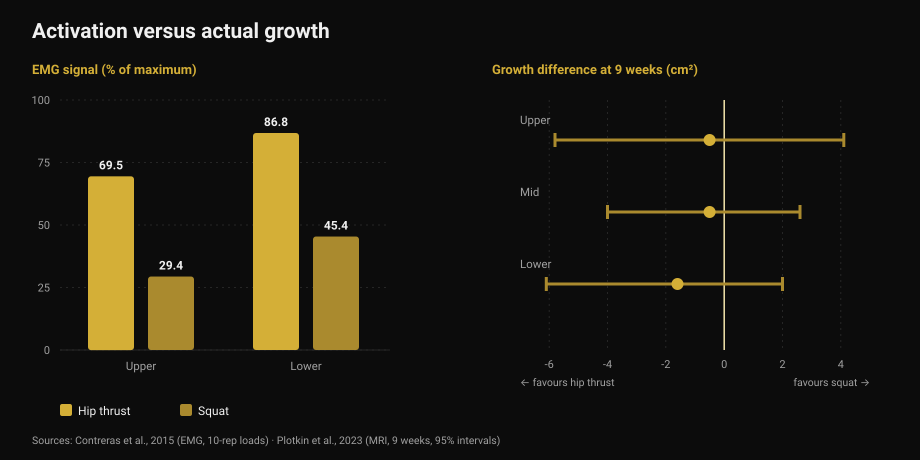
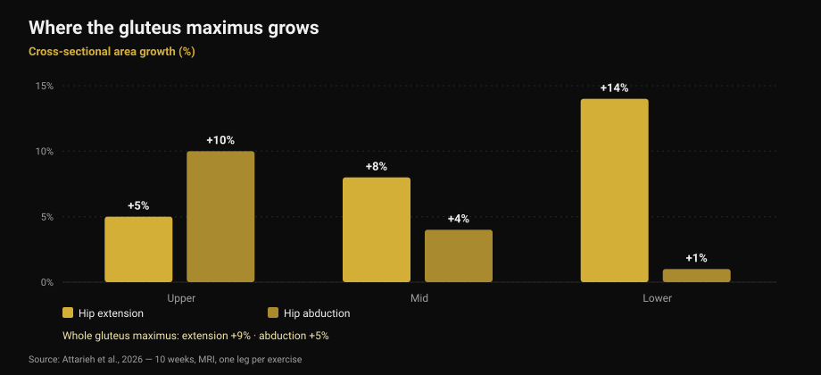

# Glute exercises: hip thrust or squat?

By [Giammaria Loi](/autore/giammaria-loi) · updated 17 October 2026

A widely shared carousel says your glutes need three mandatory categories every leg day: heavy compounds, accessories, and isolation "pump" work. The framework is tidy and sounds right. I read nine studies to check it. The headline advice — don't just hip thrust — holds up. Two of the three pillars it rests on do not: the pump isn't the mechanism the post says it is, and the exercise that "activates more" isn't the one that grows more.

## The short version

- **Hip thrusts and squats grow the glutes equally.** Nine weeks, MRI, set volume equated: no measurable difference (Plotkin et al., 2023).
- **The hip thrust activates far more** — up to 69.5% versus 29.4% of maximum electrical signal in the gluteus maximus — **and that tells you nothing about growth** (Contreras et al., 2015; Plotkin et al., 2023).
- **The "pump" is not the third mechanism of growth.** Metabolic stress, cell swelling and acute hormones are not supported as independent causes of hypertrophy (Van Every et al., 2025).
- **Varying exercises does matter**, for a different reason: hip extension and hip abduction grow *different regions* of the same muscle (Attarieh et al., 2026).
- **The 30-60 second rest** prescribed for pump work is the weakest link: below 60 seconds, hypertrophy tends to get worse (Singer et al., 2024).

## What the post actually prescribes

Three categories, every leg day. Heavy compounds (squats, deadlifts, single-leg work) for mechanical tension. Glute-focused accessories (hip thrusts, good mornings, RDLs) for fibre growth. High-rep isolation (kickbacks, abductions) for the pump, described in the slides as "the third mechanism of muscle growth: metabolic stress."

One oddity before the science: **the caption and the table don't agree**. The caption prescribes 5-8, 8-20 and 25+ reps. The table in the first slide says 3-8, 8-15 and 15-25+. Read the text and you get one programme; look at the image and you get another. Small detail, but it says something about how precise these frameworks really are.

## "Activates more" does not mean "grows more"

This is the part that should actually change how you pick exercises.

In 2015 a group including Bret Contreras — the man who popularised the hip thrust — measured muscle electrical activity (electromyography, or EMG: how much signal reaches the muscle during an exercise) in thirteen trained women, comparing hip thrusts and squats at 10-rep loads. The result is lopsided: in the upper gluteus maximus the hip thrust averaged **69.5% of maximum versus 29.4%** for the squat; in the lower gluteus maximus, **86.8% versus 45.4%**. In the vastus lateralis — the thigh — no significant difference.

If activation were a good guide, the hip thrust should grow glutes roughly twice as fast. In 2023 Contreras co-authored the study that tested exactly that: 34 untrained people, nine weeks of supervised training, squat only or hip thrust only, **sets equated**, muscle cross-sectional area measured by MRI.

Glute growth came out **similar in both groups**. The estimates lean slightly towards the hip thrust — 1.6 cm² in the lower region, 0.5 in the mid, 0.5 in the upper — with uncertainty wide enough to comfortably contain zero. The authors say it plainly: the higher EMG signal during hip thrusts *did not consistently predict* gluteal hypertrophy.

*Left: how much signal reaches the muscle (Contreras et al., 2015, 10-rep loads). Right: the difference in growth after nine weeks in square centimetres, with 95% intervals (Plotkin et al., 2023). Positive favours the squat, negative the hip thrust — all three intervals cross zero.*

The same study adds two things the post doesn't mention: squats grew **quadriceps (+3.6 cm²) and adductors (+2.5 cm²)** far more than hip thrusts, and transfer to the deadlift was **identical** between groups. It's the same principle I covered writing about [leg extensions and leg presses](/en/blog/leg-extension-vs-leg-press-rectus-femoris): the exercise you feel most is not automatically the one that builds most.

## The pump is not a growth mechanism

The third category rests on one specific claim: the pump is cell swelling and fatigue accumulation, "the third mechanism of muscle growth: metabolic stress."

That idea had a decade in the sun and is now the most contested corner of the literature. A 2025 review in the *Journal of Sport and Health Science*, co-authored by Stuart Phillips, lists it explicitly among outdated concepts: claims that acute hormonal responses, metabolic stress, cell swelling or "the pump" meaningfully contribute to hypertrophy are **not supported by scientific evidence**. Sarcoplasmic hypertrophy — the idea of a separate, non-contractile kind of growth — goes in the same bin.

This isn't sudden news. Back in 2017 a review dedicated to the question — do metabolites produced during exercise enhance hypertrophy? — concluded that **metabolites have no anabolic properties in themselves**. They can help, but only one way: by increasing fibre recruitment, bringing more fibres under the same mechanical stimulus. They work *through* tension, not alongside it.

None of this means 25-rep sets don't build muscle. They do, as the next section shows. It means you're not doing them for the reason on the slide, and calling them a "mandatory category" because of a mechanism that isn't there is a fragile way to build a programme.

## Variety works — but by region

Here the post is right, and recent research gives it a better reason than the one it uses.

A study published in October 2026 compared ten weeks of **cable hip extension against hip abduction**, with an unusually clean design: every participant trained one leg with one exercise and the other leg with the other, same volume (about 10 sets per week, 8-12 reps), with MRI on three regions of the gluteus maximus.

Hip extension produced more overall growth (**+9% versus +5%**), but the interesting difference is *where*. Extension grows the bottom: +5% upper, +8% mid, **+14% lower**. Abduction does the opposite: **+10% upper**, +4% mid, +1% lower. And only abduction meaningfully touched the gluteus medius and minimus.

*Gluteus maximus cross-sectional area growth by region after 10 weeks, measured by MRI. Within-subject design: one leg per exercise, same volume. Source: Attarieh et al., 2026.*

This is the first direct evidence that exercise selection shifts **regional** glute growth. So yes, abductions deserve a slot. But not as "pump work at 25 reps with 30 seconds rest" — as an exercise that trains a portion of muscle hip extension barely reaches, given the same effort as everything else.

The background comes from the 2025 meta-analysis on gluteus maximus hypertrophy: across 12 studies, resistance training produces a moderate effect (0.71 on a standardised scale, with low heterogeneity), and **parallel or deep squats, leg press, hip extensions and hip thrusts all work**, alone or combined. There is no mandatory hierarchy.

## Reps and rest: what holds, what doesn't

The claim on slide 4 — all rep ranges build muscle if the set gets close to failure — is **correct**. The 2021 network meta-analysis of 28 studies and 747 adults, with every set taken to failure, finds no hypertrophy difference between heavy (up to 8 reps), moderate (9-15) and light (above 15) loads. For maximal strength, the difference is real and favours heavy loads.

Rest is the weak point. The 2024 Bayesian meta-analysis on inter-set rest finds a small hypertrophy advantage for rests **above 60 seconds**, probably because short rests collapse total load lifted; beyond 90 seconds, no appreciable difference. The post puts **30-60 seconds** on the highest-rep work, which is already the most fatiguing: that's the combination most likely to cost volume and buy nothing. At the other end, the 3 minutes prescribed for compounds help strength, but add nothing over 90 seconds for hypertrophy alone.

And the "three mandatory categories"? The summary of the 2025 Jyväskylä conference on training response variability, published in 2026, ranks the variables: weekly sets, volume-load, rest duration and proximity to failure meaningfully influence hypertrophy, **whereas exercise selection can be flexible**. That is the exact inverse of the post's hierarchy, which locks down the flexible variable and leaves the ones that matter loose.

## What the research actually says

[[V|ok|Confirmed|All rep ranges build muscle when sets come close to failure: no hypertrophy difference between heavy, moderate and light loads across 28 studies. Maximal strength still needs heavy loads.]]
[[V|ok|Confirmed|Hip thrusts alone aren't enough — but not for the post's reasons: different exercises grow different regions of the gluteus maximus. Hip extension grows the lower portion (+14%), abduction the upper (+10%).]]
[[V|ok|Confirmed|Many exercises work for glutes — deep or parallel squats, leg press, hip extensions, hip thrusts — with a moderate, consistent effect across studies.]]
[[V|part|Needs nuance|"Three mandatory categories every leg day": the literature puts exercise selection among the flexible variables, and weekly sets, volume-load, rest and proximity to failure among the ones that count.]]
[[V|part|Needs nuance|The 30-60 second rest on high-rep work: hypertrophy is better above 60 seconds and stops changing past 90. The 3 minutes on compounds serve strength, not growth.]]
[[V|no|Busted|The "pump" as the third mechanism of growth: metabolic stress, cell swelling and acute hormonal responses are not supported as independent causes of hypertrophy. Metabolites act, if at all, by increasing recruitment.]]
[[V|no|Busted|Picking exercises by how much they "activate": the hip thrust produces more than double the squat's EMG signal in the gluteus maximus, and after nine weeks of MRI the growth is the same.]]
[[V|nv|Unverifiable|The post's own rep ranges: the caption says 5-8 / 8-20 / 25+, the table in slide one says 3-8 / 8-15 / 15-25+. The two don't match and neither is tied to a cited source.]]

## How to apply it

1. **Pick two or three hip extension exercises and stay with them.** Deep squats, hip thrusts, Romanian deadlifts, cable extensions: all qualify. Growth comes from load rising over time, not from the exercise you feel best.
2. **Add abductions for the upper portion.** Not as a burnout finisher, but as a real exercise with the same effort as the rest: in the data it's the only one reaching the proximal portion and the gluteus medius.
3. **Count weekly sets, not categories.** That's the variable research puts first. Ten weekly sets of hip extension produced +9% area in ten weeks in untrained people.
4. **Don't rest less than 60 seconds**, not even on long sets. And you don't need more than 90-120 seconds for growth — save the 3 minutes for heavy compounds, where strength benefits.
5. **Take sets close to failure and record how close.** Reps in reserve (RIR) is what makes a set of 6 and a set of 25 comparable. Without that number, "high reps" means nothing — which is the point of [how many reps actually build muscle](/en/blog/how-many-reps-build-muscle).
6. **Stop chasing the burn.** The pump is a sensation, not a measurement. If you use it to judge a session, you're grading blood flow, not growth.

[[APP|Volume counts, burn doesn't|Nurvan counts weekly sets per muscle group and logs load and RIR on every set: you can see whether your glutes actually got ten sets this week and whether the load is climbing, instead of trusting how the session felt. Rest timers run inside the workout.|Try Nurvan]]

## Frequently asked questions

**Hip thrust or squat for glutes?**
Both — and if you can only pick one, the research doesn't crown a winner. Over nine weeks with MRI and equated sets, glute growth was similar. The squat additionally grows quads and adductors; the hip thrust allows far higher loads on that specific movement. What decides it is the rest of your programme, not the muscle.

**Do high reps work for glutes?**
Yes, but not because of the pump. Long sets build as much muscle as short ones provided they get close to failure — and at that point they're far more tiring. If you use them, give them the same rest as everything else: under 60 seconds the effect tends to get worse.

**Are abductions and kickbacks actually useful?**
Yes, and for a better reason than the usual one. In the 2026 study, hip abduction grew the upper portion of the gluteus maximus by 10% against 5% for hip extension, and it reached the gluteus medius. It's an exercise with a different target, not a finishing touch.

**How often should I train glutes?**
The most direct data on this muscle come from programmes with two sessions a week and roughly ten weekly sets, which produced measurable growth in ten weeks. Session count matters less than the weekly set total: the job is spreading it sustainably, which is what I cover in [training splits for beginners and advanced lifters](/en/blog/training-split-beginner-vs-advanced).

## Read next

- [Leg extension vs leg press: what actually grows](/en/blog/leg-extension-vs-leg-press-rectus-femoris) — when the "more complete" exercise isn't the one growing the muscle you care about
- [How many reps build muscle? The 8-12 myth](/en/blog/how-many-reps-build-muscle) — loads, sets and rest chosen from data
- [Training split: beginner vs advanced lifter](/en/blog/training-split-beginner-vs-advanced) — how to spread weekly sets

## References

1. Plotkin DL, Rodas MA, Vigotsky AD, et al., 2023. Hip thrust and back squat training elicit similar gluteus muscle hypertrophy and transfer similarly to the deadlift. *Front Physiol* 14:1279170. PMID 37877099 — [doi.org/10.3389/fphys.2023.1279170](https://doi.org/10.3389/fphys.2023.1279170)
2. Contreras B, Vigotsky AD, Schoenfeld BJ, Beardsley C, Cronin J, 2015. A comparison of gluteus maximus, biceps femoris, and vastus lateralis electromyographic activity in the back squat and barbell hip thrust exercises. *J Appl Biomech* 31(6):452-458. PMID 26214739 — [doi.org/10.1123/jab.2014-0301](https://doi.org/10.1123/jab.2014-0301)
3. Van Every DW, Lees MJ, Wilson B, Nippard J, Phillips SM, 2025. Load-induced human skeletal muscle hypertrophy: mechanisms, myths, and misconceptions. *J Sport Health Sci* 15:101104. PMID 41276164 — [doi.org/10.1016/j.jshs.2025.101104](https://doi.org/10.1016/j.jshs.2025.101104)
4. Dankel SJ, Mattocks KT, Jessee MB, et al., 2017. Do metabolites that are produced during resistance exercise enhance muscle hypertrophy? *Eur J Appl Physiol* 117(11):2125-2135. PMID 28776271 — [doi.org/10.1007/s00421-017-3690-1](https://doi.org/10.1007/s00421-017-3690-1)
5. Attarieh P, Nunes JP, Khani S, et al., 2026. Regional hypertrophy of the gluteal muscles is task-specific: differential responses to 10 weeks of hip extension versus hip abduction training. *J Strength Cond Res*, online ahead of print. PMID 42842490 — [doi.org/10.1519/JSC.0000000000005701](https://doi.org/10.1519/JSC.0000000000005701)
6. Krause Neto W, Krause TLV, Gama EF, 2025. The impact of resistance training on gluteus maximus hypertrophy: a systematic review and meta-analysis. *Front Physiol* 16:1542334. PMID 40276368 — [doi.org/10.3389/fphys.2025.1542334](https://doi.org/10.3389/fphys.2025.1542334)
7. Lopez P, Radaelli R, Taaffe DR, et al., 2021. Resistance training load effects on muscle hypertrophy and strength gain: systematic review and network meta-analysis. *Med Sci Sports Exerc* 53(6):1206-1216. PMID 33433148 — [doi.org/10.1249/MSS.0000000000002585](https://doi.org/10.1249/MSS.0000000000002585)
8. Singer A, Wolf M, Generoso L, et al., 2024. Give it a rest: a systematic review with Bayesian meta-analysis on the effect of inter-set rest interval duration on muscle hypertrophy. *Front Sports Act Living* 6:1429789. PMID 39205815 — [doi.org/10.3389/fspor.2024.1429789](https://doi.org/10.3389/fspor.2024.1429789)
9. Roberts MD, Bamman MM, Hornberger TA, et al., 2026. Research into resistance training response heterogeneity: a summary of the 2025 conference at the University of Jyväskylä. *J Appl Physiol* 140(6):1761-1776. PMID 42172438 — [doi.org/10.1152/japplphysiol.00289.2026](https://doi.org/10.1152/japplphysiol.00289.2026)

Starting point: carousel by [John Rusin](https://www.instagram.com/p/Dc57wEdESMF/) (5 September 2026). No text or image from the post was reproduced: every claim was rewritten and checked against the primary literature.

[[BIO|Giammaria Loi is the founder of Nurvan. He has been lifting since 2012, has worked as a FIPE-certified personal trainer and coach since 2013, and has competed in powerlifting at national level since 2018. Every article he writes starts from the research and ends with what actually works in the gym.]]

> Note: educational content, not a substitute for advice from a doctor or qualified professional. If you have hip or back pain or a current injury, get assessed before changing your training.
