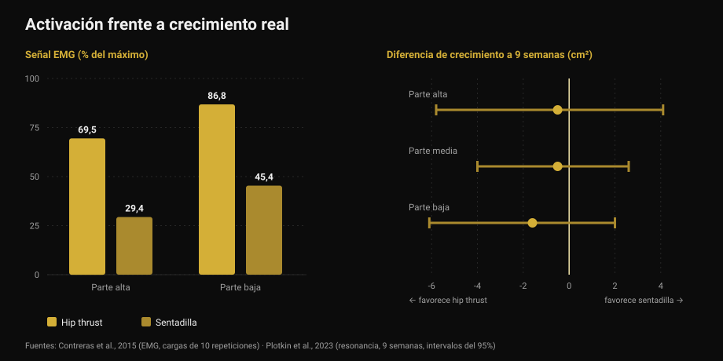
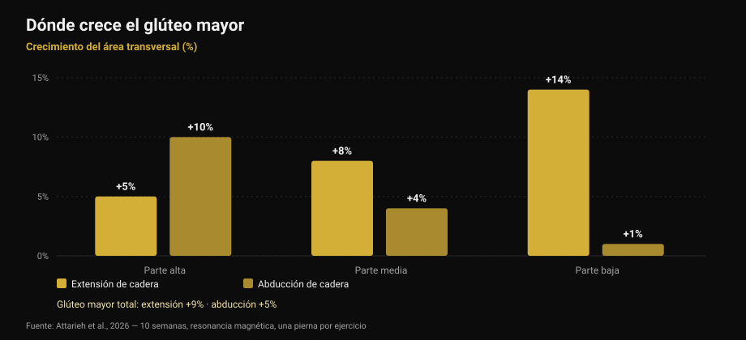

# Ejercicios de glúteos: ¿hip thrust o sentadilla?

Por [Giammaria Loi](/autore/giammaria-loi) · actualizado el 17 de octubre de 2026

Un carrusel muy compartido afirma que los glúteos necesitan tres categorías obligatorias en cada día de pierna: básicos pesados, accesorios y trabajo de aislamiento "de pump". El esquema es ordenado y suena bien. He leído nueve estudios para comprobarlo. El consejo final —no hagas solo hip thrust— se sostiene. Dos de los tres pilares sobre los que se apoya, no: el pump no es el mecanismo que dice el post, y el ejercicio que "activa más" no es el que más hace crecer.

## En resumen

- **Hip thrust y sentadilla hacen crecer los glúteos por igual.** Nueve semanas, resonancia magnética, mismo número de series: ninguna diferencia medible (Plotkin et al., 2023).
- **El hip thrust activa mucho más** —hasta 69,5% frente a 29,4% de señal eléctrica en el glúteo mayor— **y eso no predice el crecimiento** (Contreras et al., 2015; Plotkin et al., 2023).
- **El "pump" no es el tercer mecanismo del crecimiento.** El estrés metabólico, la hinchazón celular y las hormonas agudas no tienen respaldo como causas independientes de hipertrofia (Van Every et al., 2025).
- **Variar los ejercicios sí sirve**, pero por otro motivo: extensión y abducción de cadera hacen crecer *zonas distintas* del mismo músculo (Attarieh et al., 2026).
- **Los 30-60 segundos de descanso** del trabajo de pump son el punto más débil: por debajo de 60 segundos la hipertrofia tiende a empeorar (Singer et al., 2024).

## Lo que propone el post

Tres categorías, cada día de pierna. Básicos pesados (sentadilla, peso muerto, unilateral) para la tensión mecánica. Accesorios centrados en el glúteo (hip thrust, buenos días, peso muerto rumano) para el crecimiento de la fibra. Aislamiento a altas repeticiones (patadas, abducciones) para el pump, descrito en las diapositivas como "el tercer mecanismo del crecimiento muscular: el estrés metabólico".

Antes de la ciencia, una rareza: **el pie de foto y la tabla no coinciden**. El texto prescribe 5-8, 8-20 y 25+ repeticiones; la tabla de la primera diapositiva dice 3-8, 8-15 y 15-25+. Quien lee el texto y quien mira la imagen salen con dos programas distintos. Es un detalle, pero dice algo sobre la precisión real de estos esquemas.

## "Activa más" no significa "crece más"

Esta es la parte que debería cambiar de verdad cómo eliges los ejercicios.

En 2015 un grupo que incluía a Bret Contreras —quien popularizó el hip thrust— midió la actividad eléctrica muscular (electromiografía o EMG: cuánta señal llega al músculo durante el ejercicio) en trece mujeres entrenadas, comparando hip thrust y sentadilla con cargas de 10 repeticiones. El resultado es rotundo: en la parte alta del glúteo mayor el hip thrust promedia **69,5% del máximo frente al 29,4%** de la sentadilla; en la parte baja, **86,8% frente a 45,4%**. En el vasto lateral, es decir el muslo, no hay diferencia significativa.

Si la activación fuera buena guía, el hip thrust debería hacer crecer el glúteo casi el doble. En 2023 el propio Contreras firmó el estudio que puso a prueba esa idea: 34 personas no entrenadas, nueve semanas supervisadas, solo sentadilla o solo hip thrust, **series igualadas**, área muscular medida por resonancia magnética.

El crecimiento del glúteo resultó **similar en ambos grupos**. Las estimaciones se inclinan algo hacia el hip thrust —1,6 cm² en la porción baja, 0,5 en la media, 0,5 en la alta— con márgenes de error tan amplios que contienen el cero sin problema. Los autores lo escriben sin rodeos: la mayor señal EMG durante el hip thrust *no predijo de forma consistente* la hipertrofia del glúteo.

*A la izquierda, cuánta señal llega al músculo (Contreras et al., 2015, cargas de 10 repeticiones). A la derecha, la diferencia de crecimiento tras nueve semanas en centímetros cuadrados, con intervalos del 95% (Plotkin et al., 2023). Los valores positivos favorecen la sentadilla, los negativos el hip thrust: los tres intervalos cruzan el cero.*

El mismo estudio añade dos datos que el post no da: la sentadilla hizo crecer **cuádriceps (+3,6 cm²) y aductores (+2,5 cm²)** mucho más que el hip thrust, y la transferencia al peso muerto fue **idéntica**. Es el mismo principio que conté hablando de [extensión de piernas y prensa](/es/blog/extension-de-piernas-o-prensa-recto-femoral): el ejercicio que más "sientes" no es automáticamente el que más construye.

## El pump no es un mecanismo de crecimiento

La tercera categoría se apoya en una frase concreta: el pump sería hinchazón celular y acumulación de fatiga, "el tercer mecanismo del crecimiento muscular: el estrés metabólico".

Esa idea tuvo diez años de gloria y hoy es la esquina más discutida de la literatura. Una revisión de 2025 en el *Journal of Sport and Health Science*, firmada entre otros por Stuart Phillips, la incluye explícitamente entre los conceptos superados: las afirmaciones de que las respuestas hormonales agudas, el estrés metabólico, la hinchazón celular o "el pump" contribuyan de forma relevante a la hipertrofia **no están respaldadas por la evidencia científica**. En el mismo cajón acaba la hipertrofia "sarcoplásmica".

No es una novedad repentina. Ya en 2017 una revisión dedicada a la pregunta —¿los metabolitos producidos durante el ejercicio aumentan la hipertrofia?— concluía que **los metabolitos no tienen propiedades anabólicas por sí mismos**. Pueden ayudar, pero solo de una manera: aumentando el reclutamiento de fibras, es decir llevando más fibras al mismo estímulo mecánico. Actúan *a través* de la tensión, no junto a ella.

Nada de esto significa que las series de 25 repeticiones no construyan músculo. Lo hacen, como veremos. Significa que no las haces por el motivo escrito en la diapositiva, y llamarlas "categoría obligatoria" por un mecanismo que no existe es una forma frágil de construir un programa.

## Variar funciona, pero por regiones

Aquí el post acierta, y la investigación reciente le da un motivo mejor que el que usa.

Un estudio publicado en octubre de 2026 comparó diez semanas de **extensión de cadera en polea frente a abducción de cadera**, con un diseño especialmente limpio: cada participante entrenaba una pierna con un ejercicio y la otra con el otro, mismo volumen (unas 10 series semanales, 8-12 repeticiones), con resonancia magnética en tres regiones del glúteo mayor.

La extensión produjo más crecimiento total (**+9% frente a +5%**), pero lo interesante es *dónde*. La extensión crece sobre todo abajo: +5% arriba, +8% en el centro, **+14% abajo**. La abducción hace lo contrario: **+10% arriba**, +4% en el centro, +1% abajo. Y solo la abducción tocó el glúteo medio y menor de forma apreciable.

*Crecimiento del área transversal del glúteo mayor por región tras 10 semanas, medido por resonancia magnética. Diseño intrasujeto: una pierna por ejercicio, mismo volumen. Fuente: Attarieh et al., 2026.*

Es la primera evidencia directa de que la selección de ejercicios modula el crecimiento **regional** del glúteo. Así que sí: las abducciones merecen un sitio. Pero no como "trabajo de pump a 25 repeticiones con 30 segundos de descanso", sino como ejercicio que entrena una porción que la extensión alcanza poco, con el mismo empeño que el resto.

El fondo lo pone el metaanálisis de 2025 sobre hipertrofia del glúteo mayor: en 12 estudios el entrenamiento de fuerza produce un efecto moderado (0,71 en escala estandarizada, con poca heterogeneidad), y **funcionan sentadilla profunda o paralela, prensa, extensiones de cadera e hip thrust**, solos o combinados. No hay jerarquía obligatoria.

## Repeticiones y descansos: qué aguanta y qué no

La frase de la cuarta diapositiva —todos los rangos construyen músculo si la serie llega cerca del fallo— es **correcta**. El metaanálisis en red de 2021 sobre 28 estudios y 747 adultos, con todas las series al fallo, no encuentra diferencias de hipertrofia entre cargas altas (hasta 8 repeticiones), medias (9-15) y bajas (más de 15). En fuerza máxima sí hay diferencia, a favor de las cargas altas.

El punto débil es el descanso. El metaanálisis bayesiano de 2024 encuentra una pequeña ventaja para descansos **por encima de 60 segundos**, probablemente porque los descansos cortos hunden la carga total levantada; más allá de 90 segundos, ninguna diferencia apreciable. El post pone **30-60 segundos** justo en el trabajo de más repeticiones, que ya es el más fatigante: la combinación que más riesgo tiene de costar volumen sin comprar nada. En el otro extremo, los 3 minutos de los básicos sirven para la fuerza, pero no añaden nada sobre 90 segundos si solo buscas crecer.

¿Y las "tres categorías obligatorias"? La síntesis de la conferencia de Jyväskylä de 2025, publicada en 2026, ordena las variables: series semanales, volumen-carga, duración de los descansos y cercanía al fallo influyen de forma relevante en la hipertrofia, **mientras que la selección de ejercicios puede ser flexible**. Es justo lo contrario de la jerarquía del post, que rigidiza la variable más flexible y deja sueltas las que cuentan.

## Lo que dice de verdad la investigación

[[V|ok|Confirmado|Todos los rangos construyen músculo si la serie llega cerca del fallo: ninguna diferencia de hipertrofia entre cargas altas, medias y bajas en 28 estudios. La fuerza máxima sigue necesitando cargas altas.]]
[[V|ok|Confirmado|No basta el hip thrust, pero no por los motivos del post: ejercicios distintos hacen crecer regiones distintas del glúteo mayor. La extensión crece la porción baja (+14%), la abducción la alta (+10%).]]
[[V|ok|Confirmado|Muchos ejercicios funcionan para el glúteo —sentadilla profunda o paralela, prensa, extensiones de cadera, hip thrust— con un efecto moderado y coherente entre estudios.]]
[[V|part|Matizar|"Tres categorías obligatorias cada día de pierna": la literatura coloca la selección de ejercicios entre las variables flexibles, y las series semanales, el volumen-carga, los descansos y la cercanía al fallo entre las que cuentan.]]
[[V|part|Matizar|Los 30-60 segundos de descanso en el trabajo de altas repeticiones: por encima de 60 segundos la hipertrofia va mejor y más allá de 90 ya no cambia. Los 3 minutos de los básicos sirven a la fuerza.]]
[[V|no|Desmentido|El "pump" como tercer mecanismo del crecimiento: estrés metabólico, hinchazón celular y respuestas hormonales agudas no están respaldados como causas independientes de hipertrofia.]]
[[V|no|Desmentido|Elegir ejercicios según cuánto "activan": el hip thrust produce más del doble de señal EMG que la sentadilla en el glúteo mayor, y tras nueve semanas de resonancia el crecimiento es el mismo.]]
[[V|nv|No verificable|Los rangos del propio post: el texto dice 5-8 / 8-20 / 25+, la tabla de la primera diapositiva dice 3-8 / 8-15 / 15-25+. No coinciden y ninguno remite a una fuente citada.]]

## Cómo aplicarlo

1. **Elige dos o tres ejercicios de extensión de cadera y mantenlos.** Sentadilla profunda, hip thrust, peso muerto rumano, extensiones en polea: valen todos. El crecimiento viene de la carga que sube con el tiempo, no del ejercicio que mejor "sientes".
2. **Añade abducciones para la parte alta.** No como remate final, sino como ejercicio con el mismo empeño que el resto: en los datos es el único que llega a la porción proximal y al glúteo medio.
3. **Cuenta series semanales, no categorías.** Es la variable que la investigación pone primero. Diez series semanales de extensión de cadera produjeron +9% de área en diez semanas en personas no entrenadas.
4. **No bajes de 60 segundos de descanso**, ni siquiera en las series largas. Y no hace falta pasar de 90-120 segundos si el objetivo es crecer: guarda los 3 minutos para los básicos pesados.
5. **Lleva las series cerca del fallo y anota cuánto.** Las repeticiones en reserva (RIR) son lo que hace comparable una serie de 6 y una de 25. Sin ese número, "altas repeticiones" no significa nada: es el tema de [cuántas repeticiones hacen falta para la masa](/es/blog/cuantas-repeticiones-masa-muscular).
6. **Deja de perseguir el ardor.** El pump es una sensación, no una medida. Si lo usas para juzgar una sesión, estás evaluando el riego sanguíneo, no el crecimiento.

[[APP|Cuenta el volumen, no el ardor|Nurvan cuenta las series semanales por grupo muscular y registra carga y RIR en cada serie: ves si tus glúteos han recibido de verdad diez series esta semana y si la carga sube, en vez de fiarte de cómo te has sentido. Los descansos se cronometran dentro de la rutina.|Prueba Nurvan]]

## Preguntas frecuentes

**¿Hip thrust o sentadilla para los glúteos?**
Los dos, y si solo puedes elegir uno la investigación no corona ganador. En nueve semanas con resonancia y series igualadas el crecimiento del glúteo fue similar. La sentadilla además hace crecer cuádriceps y aductores; el hip thrust permite cargas mucho mayores en ese movimiento concreto. Lo decide el resto de tu programa, no el músculo.

**¿Sirven las altas repeticiones para glúteos?**
Sí, pero no por el pump. Las series largas construyen tanto como las cortas si llegan cerca del fallo, y en ese punto son mucho más fatigantes. Si las usas, dales el mismo descanso que al resto: por debajo de 60 segundos el efecto tiende a empeorar.

**¿Las abducciones y las patadas sirven de verdad?**
Sí, y por un motivo mejor que el habitual. En el estudio de 2026 la abducción hizo crecer la porción alta del glúteo mayor un 10% frente al 5% de la extensión, y alcanzó el glúteo medio. Es un ejercicio con otra diana, no un remate.

**¿Cuántas veces por semana entrenar glúteos?**
Los datos más directos sobre este músculo vienen de programas con dos sesiones semanales y unas diez series a la semana, que produjeron crecimiento medible en diez semanas. El número de sesiones importa menos que el total semanal de series: el reto es repartirlo de forma sostenible, como cuento en [rutinas para principiantes y avanzados](/es/blog/rutina-entrenamiento-principiante-avanzado).

## Lee también

- [Extensión de piernas o prensa: qué crece de verdad](/es/blog/extension-de-piernas-o-prensa-recto-femoral) — cuando el ejercicio "más completo" no hace crecer el músculo que te interesa
- [Cuántas repeticiones para masa muscular: el mito del 8-12](/es/blog/cuantas-repeticiones-masa-muscular) — cargas, series y descansos elegidos con datos
- [Rutina de entrenamiento: principiante o avanzado](/es/blog/rutina-entrenamiento-principiante-avanzado) — cómo repartir las series semanales

## Fuentes

1. Plotkin DL, Rodas MA, Vigotsky AD, et al., 2023. Hip thrust and back squat training elicit similar gluteus muscle hypertrophy and transfer similarly to the deadlift. *Front Physiol* 14:1279170. PMID 37877099 — [doi.org/10.3389/fphys.2023.1279170](https://doi.org/10.3389/fphys.2023.1279170)
2. Contreras B, Vigotsky AD, Schoenfeld BJ, Beardsley C, Cronin J, 2015. A comparison of gluteus maximus, biceps femoris, and vastus lateralis electromyographic activity in the back squat and barbell hip thrust exercises. *J Appl Biomech* 31(6):452-458. PMID 26214739 — [doi.org/10.1123/jab.2014-0301](https://doi.org/10.1123/jab.2014-0301)
3. Van Every DW, Lees MJ, Wilson B, Nippard J, Phillips SM, 2025. Load-induced human skeletal muscle hypertrophy: mechanisms, myths, and misconceptions. *J Sport Health Sci* 15:101104. PMID 41276164 — [doi.org/10.1016/j.jshs.2025.101104](https://doi.org/10.1016/j.jshs.2025.101104)
4. Dankel SJ, Mattocks KT, Jessee MB, et al., 2017. Do metabolites that are produced during resistance exercise enhance muscle hypertrophy? *Eur J Appl Physiol* 117(11):2125-2135. PMID 28776271 — [doi.org/10.1007/s00421-017-3690-1](https://doi.org/10.1007/s00421-017-3690-1)
5. Attarieh P, Nunes JP, Khani S, et al., 2026. Regional hypertrophy of the gluteal muscles is task-specific: differential responses to 10 weeks of hip extension versus hip abduction training. *J Strength Cond Res*, publicación anticipada en línea. PMID 42842490 — [doi.org/10.1519/JSC.0000000000005701](https://doi.org/10.1519/JSC.0000000000005701)
6. Krause Neto W, Krause TLV, Gama EF, 2025. The impact of resistance training on gluteus maximus hypertrophy: a systematic review and meta-analysis. *Front Physiol* 16:1542334. PMID 40276368 — [doi.org/10.3389/fphys.2025.1542334](https://doi.org/10.3389/fphys.2025.1542334)
7. Lopez P, Radaelli R, Taaffe DR, et al., 2021. Resistance training load effects on muscle hypertrophy and strength gain: systematic review and network meta-analysis. *Med Sci Sports Exerc* 53(6):1206-1216. PMID 33433148 — [doi.org/10.1249/MSS.0000000000002585](https://doi.org/10.1249/MSS.0000000000002585)
8. Singer A, Wolf M, Generoso L, et al., 2024. Give it a rest: a systematic review with Bayesian meta-analysis on the effect of inter-set rest interval duration on muscle hypertrophy. *Front Sports Act Living* 6:1429789. PMID 39205815 — [doi.org/10.3389/fspor.2024.1429789](https://doi.org/10.3389/fspor.2024.1429789)
9. Roberts MD, Bamman MM, Hornberger TA, et al., 2026. Research into resistance training response heterogeneity: a summary of the 2025 conference at the University of Jyväskylä. *J Appl Physiol* 140(6):1761-1776. PMID 42172438 — [doi.org/10.1152/japplphysiol.00289.2026](https://doi.org/10.1152/japplphysiol.00289.2026)

Punto de partida: carrusel de [John Rusin](https://www.instagram.com/p/Dc57wEdESMF/) (5 de septiembre de 2026). No se ha reproducido ningún texto ni imagen del post: todas las afirmaciones se han reescrito y verificado en la literatura primaria.

[[BIO|Giammaria Loi es el fundador de Nurvan. Entrena con pesas desde 2012, trabaja como entrenador personal y coach certificado FIPE desde 2013 y compite en powerlifting a nivel nacional desde 2018. Cada artículo que firma parte de los estudios científicos y llega a lo que funciona de verdad en el gimnasio.]]

> Nota: contenido informativo, no sustituye la opinión de un médico o profesional cualificado. Si tienes dolor de cadera o espalda o una lesión en curso, hazte valorar antes de cambiar tu entrenamiento.
