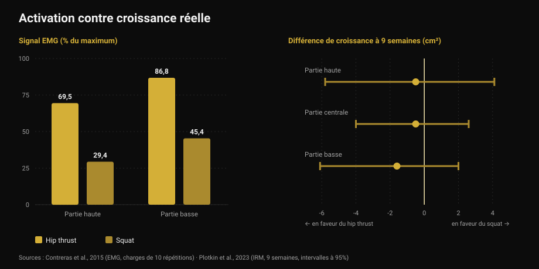
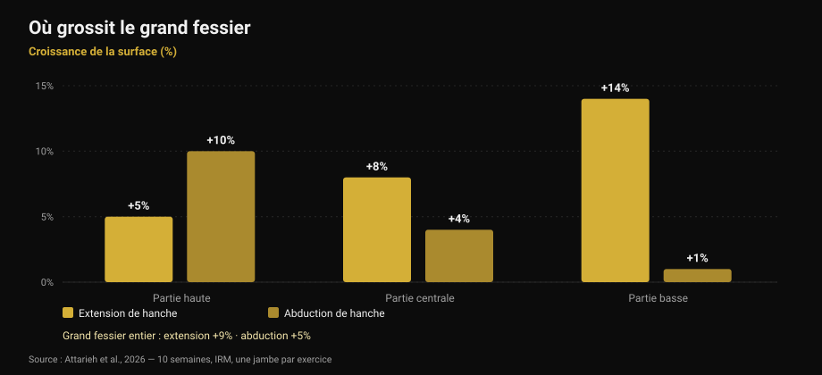

# Exercices fessiers : hip thrust ou squat ?

Par [Giammaria Loi](/autore/giammaria-loi) · mis à jour le 17 octobre 2026

Un carrousel très partagé affirme que les fessiers exigent trois catégories obligatoires à chaque séance jambes : polyarticulaires lourds, accessoires, et isolation « pump ». Le cadre est net et sonne juste. J'ai lu neuf études pour le vérifier. Le conseil final — ne faites pas que du hip thrust — tient. Deux des trois piliers sur lesquels il repose, non : le pump n'est pas le mécanisme annoncé, et l'exercice qui « active le plus » n'est pas celui qui fait le plus grossir.

## En bref

- **Hip thrust et squat font grossir les fessiers de la même façon.** Neuf semaines, IRM, volume de séries égalisé : aucune différence mesurable (Plotkin et al., 2023).
- **Le hip thrust active beaucoup plus** — jusqu'à 69,5 % contre 29,4 % du signal électrique dans le grand fessier — **et cela ne prédit pas la croissance** (Contreras et al., 2015 ; Plotkin et al., 2023).
- **Le « pump » n'est pas le troisième mécanisme de la croissance.** Stress métabolique, gonflement cellulaire et hormones aiguës ne sont pas étayés comme causes indépendantes d'hypertrophie (Van Every et al., 2025).
- **Varier les exercices sert vraiment**, mais pour une autre raison : extension et abduction de hanche font grossir des *zones différentes* du même muscle (Attarieh et al., 2026).
- **Les 30-60 secondes de repos** prescrites au travail « pump » sont le maillon faible : sous 60 secondes, l'hypertrophie a tendance à se dégrader (Singer et al., 2024).

## Ce que propose le post

Trois catégories, chaque séance jambes. Polyarticulaires lourds (squat, soulevé de terre, unilatéral) pour la tension mécanique. Accessoires ciblés fessiers (hip thrust, good morning, soulevé roumain) pour la croissance des fibres. Isolation à hautes répétitions (kickbacks, abductions) pour le pump, décrit dans les diapositives comme « le troisième mécanisme de la croissance musculaire : le stress métabolique ».

Avant la science, une bizarrerie : **la légende et le tableau ne concordent pas**. La légende prescrit 5-8, 8-20 et 25+ répétitions ; le tableau de la première diapositive indique 3-8, 8-15 et 15-25+. Qui lit le texte et qui regarde l'image repartent avec deux programmes différents. C'est un détail, mais il en dit long sur la précision réelle de ces cadres.

## « Active plus » ne veut pas dire « fait plus grossir »

C'est la partie qui devrait vraiment changer votre façon de choisir les exercices.

En 2015, un groupe incluant Bret Contreras — celui qui a popularisé le hip thrust — a mesuré l'activité électrique musculaire (électromyographie, ou EMG : combien de signal arrive au muscle pendant l'exercice) chez treize femmes entraînées, en comparant hip thrust et squat à des charges de 10 répétitions. Le résultat est tranché : sur la partie haute du grand fessier, le hip thrust atteint en moyenne **69,5 % du maximum contre 29,4 %** pour le squat ; sur la partie basse, **86,8 % contre 45,4 %**. Sur le vaste latéral, c'est-à-dire la cuisse, aucune différence significative.

Si l'activation était un bon guide, le hip thrust devrait faire grossir les fessiers environ deux fois plus. En 2023, Contreras a cosigné l'étude qui a testé précisément cette idée : 34 personnes non entraînées, neuf semaines supervisées, squat seul ou hip thrust seul, **séries égalisées**, surface musculaire mesurée par IRM.

La croissance des fessiers s'est révélée **similaire dans les deux groupes**. Les estimations penchent légèrement vers le hip thrust — 1,6 cm² sur la portion basse, 0,5 sur la moyenne, 0,5 sur la haute — avec des marges d'erreur assez larges pour contenir confortablement le zéro. Les auteurs l'écrivent sans détour : le signal EMG plus élevé pendant le hip thrust *n'a pas prédit de manière cohérente* l'hypertrophie fessière.

*À gauche, combien de signal arrive au muscle (Contreras et al., 2015, charges de 10 répétitions). À droite, la différence de croissance après neuf semaines en centimètres carrés, avec intervalles à 95 % (Plotkin et al., 2023). Les valeurs positives favorisent le squat, les négatives le hip thrust : les trois intervalles traversent le zéro.*

La même étude ajoute deux données absentes du post : le squat a fait grossir **quadriceps (+3,6 cm²) et adducteurs (+2,5 cm²)** bien plus que le hip thrust, et le transfert au soulevé de terre a été **identique**. C'est le principe que j'ai raconté à propos du [leg extension et de la presse](/fr/blog/leg-extension-ou-presse-a-cuisses-droit-femoral) : l'exercice que l'on « sent » le plus n'est pas automatiquement celui qui construit le plus.

## Le pump n'est pas un mécanisme de croissance

La troisième catégorie repose sur une phrase précise : le pump serait gonflement cellulaire et accumulation de fatigue, « le troisième mécanisme de la croissance musculaire : le stress métabolique ».

Cette idée a connu dix ans de gloire et constitue aujourd'hui le coin le plus contesté de la littérature. Une revue de 2025 dans le *Journal of Sport and Health Science*, cosignée par Stuart Phillips, la range explicitement parmi les concepts dépassés : les affirmations selon lesquelles les réponses hormonales aiguës, le stress métabolique, le gonflement cellulaire ou « le pump » contribueraient de façon significative à l'hypertrophie **ne sont pas étayées par les preuves scientifiques**. L'hypertrophie « sarcoplasmique » finit dans le même tiroir.

Ce n'est pas une nouveauté soudaine. Dès 2017, une revue consacrée à la question — les métabolites produits pendant l'exercice augmentent-ils l'hypertrophie ? — concluait que **les métabolites n'ont pas de propriétés anaboliques en eux-mêmes**. Ils peuvent aider, mais d'une seule façon : en augmentant le recrutement des fibres, donc en amenant plus de fibres sous le même stimulus mécanique. Ils agissent *par* la tension, pas à côté.

Rien de tout cela ne signifie que les séries de 25 répétitions ne font pas grossir. Elles le font, on le verra. Cela signifie que vous ne les faites pas pour la raison écrite sur la diapositive, et qu'en faire une « catégorie obligatoire » au nom d'un mécanisme inexistant est une base fragile.

## Varier marche, mais par régions

Ici le post a raison, et la recherche récente lui donne un meilleur motif que celui qu'il invoque.

Une étude publiée en octobre 2026 a comparé dix semaines d'**extension de hanche à la poulie contre abduction de hanche**, avec un protocole particulièrement propre : chaque participant entraînait une jambe avec un exercice et l'autre jambe avec l'autre, même volume (environ 10 séries par semaine, 8-12 répétitions), avec IRM sur trois régions du grand fessier.

L'extension a produit plus de croissance globale (**+9 % contre +5 %**), mais la différence intéressante est *où*. L'extension fait grossir surtout le bas : +5 % en haut, +8 % au milieu, **+14 % en bas**. L'abduction fait l'inverse : **+10 % en haut**, +4 % au milieu, +1 % en bas. Et seule l'abduction a touché le moyen et le petit fessier de façon appréciable.

*Croissance de la surface de section du grand fessier par région après 10 semaines, mesurée à l'IRM. Protocole intra-sujet : une jambe par exercice, même volume. Source : Attarieh et al., 2026.*

C'est la première preuve directe que le choix de l'exercice module la croissance **régionale** des fessiers. Donc oui, les abductions méritent une place. Mais pas comme « travail de pump à 25 répétitions avec 30 secondes de repos » — comme un exercice qui entraîne une portion que l'extension atteint peu, avec le même sérieux que le reste.

Le fond est donné par la méta-analyse de 2025 sur l'hypertrophie du grand fessier : sur 12 études, l'entraînement en résistance produit un effet modéré (0,71 sur une échelle standardisée, avec peu d'hétérogénéité), et **squat profond ou parallèle, presse, extensions de hanche et hip thrust fonctionnent tous**, seuls ou combinés. Il n'y a pas de hiérarchie obligatoire.

## Répétitions et repos : ce qui tient et ce qui ne tient pas

La phrase de la quatrième diapositive — tous les intervalles de répétitions construisent du muscle si la série approche l'échec — est **correcte**. La méta-analyse en réseau de 2021 sur 28 études et 747 adultes, toutes séries menées à l'échec, ne trouve aucune différence d'hypertrophie entre charges lourdes (jusqu'à 8 répétitions), moyennes (9-15) et légères (plus de 15). Sur la force maximale, la différence existe et favorise les charges lourdes.

Le point faible, c'est le repos. La méta-analyse bayésienne de 2024 trouve un petit avantage pour les repos **supérieurs à 60 secondes**, probablement parce que les repos courts font s'effondrer la charge totale soulevée ; au-delà de 90 secondes, aucune différence appréciable. Le post place **30-60 secondes** précisément sur le travail à très hautes répétitions, déjà le plus fatigant : c'est la combinaison qui risque de coûter du volume sans rien acheter. À l'autre bout, les 3 minutes prescrites aux polyarticulaires servent la force, mais n'ajoutent rien à 90 secondes si l'objectif est la croissance.

Et les « trois catégories obligatoires » ? La synthèse de la conférence de Jyväskylä 2025, publiée en 2026, classe les variables : séries hebdomadaires, volume-charge, durée des repos et proximité de l'échec influencent nettement l'hypertrophie, **tandis que le choix des exercices peut être flexible**. C'est exactement l'inverse de la hiérarchie du post, qui rigidifie la variable la plus souple et laisse filer celles qui comptent.

## Ce que dit vraiment la recherche

[[V|ok|Confirmé|Tous les intervalles de répétitions construisent du muscle si la série approche l'échec : aucune différence d'hypertrophie entre charges lourdes, moyennes et légères sur 28 études. La force maximale réclame toujours des charges lourdes.]]
[[V|ok|Confirmé|Le hip thrust seul ne suffit pas, mais pas pour les raisons du post : des exercices différents font grossir des régions différentes du grand fessier. L'extension fait grossir la portion basse (+14 %), l'abduction la haute (+10 %).]]
[[V|ok|Confirmé|Beaucoup d'exercices fonctionnent pour les fessiers — squat profond ou parallèle, presse, extensions de hanche, hip thrust — avec un effet modéré et cohérent entre études.]]
[[V|part|À nuancer|« Trois catégories obligatoires chaque séance jambes » : la littérature place le choix des exercices parmi les variables flexibles, et les séries hebdomadaires, le volume-charge, les repos et la proximité de l'échec parmi celles qui comptent.]]
[[V|part|À nuancer|Les 30-60 secondes de repos sur le travail à hautes répétitions : l'hypertrophie est meilleure au-dessus de 60 secondes et ne change plus au-delà de 90. Les 3 minutes sur les polyarticulaires servent la force.]]
[[V|no|Démenti|Le « pump » comme troisième mécanisme de la croissance : stress métabolique, gonflement cellulaire et réponses hormonales aiguës ne sont pas étayés comme causes indépendantes d'hypertrophie.]]
[[V|no|Démenti|Choisir ses exercices selon leur « activation » : le hip thrust produit plus du double du signal EMG du squat dans le grand fessier, et après neuf semaines d'IRM la croissance est la même.]]
[[V|nv|Non vérifiable|Les intervalles du post lui-même : la légende dit 5-8 / 8-20 / 25+, le tableau de la première diapositive dit 3-8 / 8-15 / 15-25+. Les deux ne coïncident pas et aucun ne renvoie à une source citée.]]

## Comment l'appliquer

1. **Choisissez deux ou trois exercices d'extension de hanche et gardez-les.** Squat profond, hip thrust, soulevé roumain, extensions à la poulie : tous valables. La croissance vient de la charge qui monte dans le temps, pas de l'exercice le mieux « senti ».
2. **Ajoutez les abductions pour la partie haute.** Pas en finisher de fin de séance, mais comme un exercice traité avec le même sérieux : dans les données, c'est le seul qui atteint la portion proximale et le moyen fessier.
3. **Comptez les séries hebdomadaires, pas les catégories.** C'est la variable que la recherche met en premier. Dix séries par semaine d'extension de hanche ont produit +9 % de surface en dix semaines chez des non-entraînés.
4. **Ne descendez pas sous 60 secondes de repos**, même sur les séries longues. Et inutile de dépasser 90-120 secondes si l'objectif est la croissance : gardez les 3 minutes pour les polyarticulaires lourds.
5. **Menez les séries près de l'échec et notez à quel point.** Les répétitions en réserve (RIR) rendent comparables une série de 6 et une série de 25. Sans ce chiffre, « hautes répétitions » ne veut rien dire — c'est le sujet de [combien de répétitions pour la masse](/fr/blog/combien-de-repetitions-masse-musculaire).
6. **Arrêtez de courir après la brûlure.** Le pump est une sensation, pas une mesure. L'utiliser pour juger une séance, c'est noter la circulation sanguine, pas la croissance.

[[APP|C'est le volume qui compte, pas la brûlure|Nurvan compte les séries hebdomadaires par groupe musculaire et enregistre charge et RIR à chaque série : vous voyez si vos fessiers ont vraiment reçu dix séries cette semaine et si la charge monte, au lieu de vous fier au ressenti. Les temps de repos sont chronométrés dans la séance.|Essayer Nurvan]]

## Questions fréquentes

**Hip thrust ou squat pour les fessiers ?**
Les deux, et s'il faut n'en garder qu'un, la recherche ne désigne pas de vainqueur. Sur neuf semaines avec IRM et séries égalisées, la croissance fessière a été similaire. Le squat fait en plus grossir quadriceps et adducteurs ; le hip thrust permet des charges bien plus élevées sur ce mouvement précis. Ce qui tranche, c'est le reste de votre programme.

**Les hautes répétitions servent-elles pour les fessiers ?**
Oui, mais pas à cause du pump. Les séries longues construisent autant que les courtes à condition d'approcher l'échec — et là, elles sont bien plus fatigantes. Si vous les utilisez, donnez-leur le même repos qu'au reste : sous 60 secondes, l'effet a tendance à se dégrader.

**Les abductions et les kickbacks servent-ils vraiment ?**
Oui, et pour une meilleure raison que celle qu'on lit d'habitude. Dans l'étude de 2026, l'abduction a fait grossir la portion haute du grand fessier de 10 % contre 5 % pour l'extension, et elle a touché le moyen fessier. C'est un exercice avec une autre cible, pas une finition.

**Combien de fois par semaine entraîner les fessiers ?**
Les données les plus directes viennent de programmes à deux séances par semaine et environ dix séries hebdomadaires, qui ont produit une croissance mesurable en dix semaines. Le nombre de séances compte moins que le total hebdomadaire : l'enjeu est de le répartir durablement, comme je l'explique à propos du [split débutant ou avancé](/fr/blog/split-entrainement-debutant-avance).

## À lire aussi

- [Leg extension ou presse : qu'est-ce qui grossit](/fr/blog/leg-extension-ou-presse-a-cuisses-droit-femoral) — quand l'exercice « plus complet » ne fait pas grossir le muscle visé
- [Combien de répétitions pour la masse : le mythe du 8-12](/fr/blog/combien-de-repetitions-masse-musculaire) — charges, séries et repos choisis sur les données
- [Split d'entraînement : débutant ou avancé ?](/fr/blog/split-entrainement-debutant-avance) — comment répartir les séries hebdomadaires

## Sources

1. Plotkin DL, Rodas MA, Vigotsky AD, et al., 2023. Hip thrust and back squat training elicit similar gluteus muscle hypertrophy and transfer similarly to the deadlift. *Front Physiol* 14:1279170. PMID 37877099 — [doi.org/10.3389/fphys.2023.1279170](https://doi.org/10.3389/fphys.2023.1279170)
2. Contreras B, Vigotsky AD, Schoenfeld BJ, Beardsley C, Cronin J, 2015. A comparison of gluteus maximus, biceps femoris, and vastus lateralis electromyographic activity in the back squat and barbell hip thrust exercises. *J Appl Biomech* 31(6):452-458. PMID 26214739 — [doi.org/10.1123/jab.2014-0301](https://doi.org/10.1123/jab.2014-0301)
3. Van Every DW, Lees MJ, Wilson B, Nippard J, Phillips SM, 2025. Load-induced human skeletal muscle hypertrophy: mechanisms, myths, and misconceptions. *J Sport Health Sci* 15:101104. PMID 41276164 — [doi.org/10.1016/j.jshs.2025.101104](https://doi.org/10.1016/j.jshs.2025.101104)
4. Dankel SJ, Mattocks KT, Jessee MB, et al., 2017. Do metabolites that are produced during resistance exercise enhance muscle hypertrophy? *Eur J Appl Physiol* 117(11):2125-2135. PMID 28776271 — [doi.org/10.1007/s00421-017-3690-1](https://doi.org/10.1007/s00421-017-3690-1)
5. Attarieh P, Nunes JP, Khani S, et al., 2026. Regional hypertrophy of the gluteal muscles is task-specific: differential responses to 10 weeks of hip extension versus hip abduction training. *J Strength Cond Res*, publication anticipée en ligne. PMID 42842490 — [doi.org/10.1519/JSC.0000000000005701](https://doi.org/10.1519/JSC.0000000000005701)
6. Krause Neto W, Krause TLV, Gama EF, 2025. The impact of resistance training on gluteus maximus hypertrophy: a systematic review and meta-analysis. *Front Physiol* 16:1542334. PMID 40276368 — [doi.org/10.3389/fphys.2025.1542334](https://doi.org/10.3389/fphys.2025.1542334)
7. Lopez P, Radaelli R, Taaffe DR, et al., 2021. Resistance training load effects on muscle hypertrophy and strength gain: systematic review and network meta-analysis. *Med Sci Sports Exerc* 53(6):1206-1216. PMID 33433148 — [doi.org/10.1249/MSS.0000000000002585](https://doi.org/10.1249/MSS.0000000000002585)
8. Singer A, Wolf M, Generoso L, et al., 2024. Give it a rest: a systematic review with Bayesian meta-analysis on the effect of inter-set rest interval duration on muscle hypertrophy. *Front Sports Act Living* 6:1429789. PMID 39205815 — [doi.org/10.3389/fspor.2024.1429789](https://doi.org/10.3389/fspor.2024.1429789)
9. Roberts MD, Bamman MM, Hornberger TA, et al., 2026. Research into resistance training response heterogeneity: a summary of the 2025 conference at the University of Jyväskylä. *J Appl Physiol* 140(6):1761-1776. PMID 42172438 — [doi.org/10.1152/japplphysiol.00289.2026](https://doi.org/10.1152/japplphysiol.00289.2026)

Point de départ : carrousel de [John Rusin](https://www.instagram.com/p/Dc57wEdESMF/) (5 septembre 2026). Aucun texte ni aucune image du post n'a été reproduit : toutes les affirmations ont été réécrites et vérifiées sur la littérature primaire.

[[BIO|Giammaria Loi est le fondateur de Nurvan. Il s'entraîne avec des poids depuis 2012, exerce comme entraîneur personnel et coach certifié FIPE depuis 2013 et compète en powerlifting au niveau national depuis 2018. Chaque article qu'il signe part des études scientifiques et arrive à ce qui fonctionne vraiment en salle.]]

> Note : contenu informatif, qui ne remplace pas l'avis d'un médecin ou d'un professionnel qualifié. En cas de douleur de hanche ou de dos, ou de blessure en cours, faites-vous évaluer avant de modifier votre entraînement.
