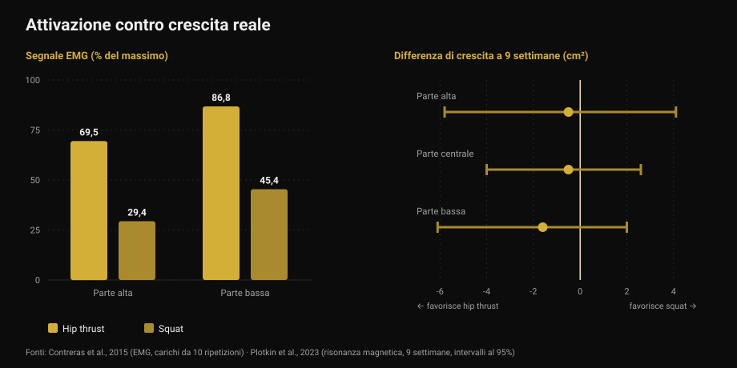
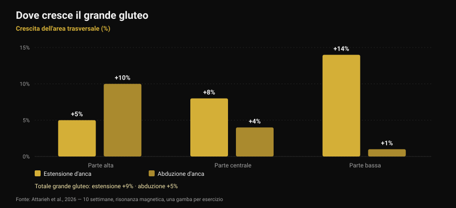

# Esercizi per i glutei: hip thrust o squat?

Di [Giammaria Loi](/autore/giammaria-loi) · aggiornato il 17 ottobre 2026

Un carosello molto condiviso dice che per i glutei servono tre categorie obbligatorie a ogni seduta gambe: compound pesanti, accessori, e lavoro di isolamento "da pump". Lo schema è ordinato e suona giusto. Ho letto nove studi per controllarlo. Il consiglio finale — non fare solo hip thrust — regge, ma due dei tre pilastri su cui è costruito non reggono: il pump non è il meccanismo che il post dice, e l'esercizio che "attiva di più" non è quello che fa crescere di più.

## In breve

- **Hip thrust e squat fanno crescere i glutei allo stesso modo.** Nove settimane, risonanza magnetica, volume pareggiato: nessuna differenza misurabile (Plotkin et al., 2023).
- **L'hip thrust attiva molto di più** — fino a 69,5% contro 29,4% di segnale elettrico sul grande gluteo — **e non serve a prevedere quanto crescerà** (Contreras et al., 2015; Plotkin et al., 2023).
- **Il "pump" non è il terzo meccanismo della crescita.** Stress metabolico, gonfiore cellulare e ormoni acuti non hanno supporto come cause indipendenti di ipertrofia (Van Every et al., 2025).
- **Variare gli esercizi serve davvero**, ma per un motivo diverso: estensione e abduzione d'anca fanno crescere *zone diverse* dello stesso muscolo (Attarieh et al., 2026).
- **I 30-60 secondi di recupero** consigliati per il lavoro "pump" sono il punto più debole dello schema: sotto i 60 secondi l'ipertrofia tende a peggiorare (Singer et al., 2024).

## Lo schema del post, in breve

Tre categorie, ogni seduta gambe. Compound pesanti (squat, stacchi, monopodalico) per la tensione meccanica. Accessori focalizzati sui glutei (hip thrust, good morning, stacco rumeno) per la crescita delle fibre. Isolamento ad alte ripetizioni (kickback, abduzioni) per il "pump", definito nelle slide come "il terzo meccanismo della crescita muscolare: lo stress metabolico".

Prima di entrare nel merito, una stranezza: **i numeri della didascalia e quelli della tabella non coincidono**. La didascalia prescrive 5-8, 8-20 e 25+ ripetizioni; la tabella nella prima slide dice 3-8, 8-15 e 15-25+. Chi legge il testo e chi guarda l'immagine esce con due programmi diversi. È un dettaglio, ma dice qualcosa su quanto siano precisi questi schemi.

## "Attiva di più" non vuol dire "cresce di più"

Questa è la parte che cambia davvero il modo di scegliere gli esercizi.

Nel 2015 un gruppo che includeva Bret Contreras, cioè la persona che ha reso popolare l'hip thrust, ha misurato l'attività elettrica dei muscoli (elettromiografia, in breve EMG: quanto segnale arriva al muscolo durante l'esercizio) in tredici donne allenate, confrontando hip thrust e squat con carichi da 10 ripetizioni. Il risultato è netto: sulla parte alta del grande gluteo l'hip thrust produce in media **69,5% del massimo contro il 29,4%** dello squat; sulla parte bassa **86,8% contro 45,4%**. Sul vasto laterale, cioè la coscia, nessuna differenza significativa.

Se l'attivazione fosse una buona guida, l'hip thrust dovrebbe far crescere i glutei circa il doppio. Nel 2023 lo stesso Contreras ha firmato lo studio che ha messo alla prova questa idea: 34 persone non allenate, nove settimane di programma supervisionato, solo squat o solo hip thrust, **numero di serie pareggiato**, misure di area muscolare con risonanza magnetica.

La crescita dei glutei è risultata **simile fra i due gruppi**. Le stime pendono leggermente verso l'hip thrust — 1,6 cm² sulla porzione bassa, 0,5 sulla centrale, 0,5 sull'alta — ma con margini di errore talmente ampi da contenere comodamente lo zero. Gli autori lo scrivono senza giri di parole: il segnale EMG più alto durante l'hip thrust *non ha predetto in modo coerente* la crescita.

*A sinistra quanto segnale arriva al muscolo (Contreras et al., 2015, carichi da 10 ripetizioni). A destra la differenza di crescita dopo nove settimane, in centimetri quadrati, con l'intervallo di confidenza al 95% (Plotkin et al., 2023). Valori positivi favoriscono lo squat, negativi l'hip thrust: tutti e tre gli intervalli attraversano lo zero.*

Lo stesso studio aggiunge due dati che il post non ha: lo squat ha fatto crescere **quadricipiti (+3,6 cm²) e adduttori (+2,5 cm²)** molto più dell'hip thrust, e il transfer allo stacco da terra è stato **identico** nei due gruppi. È lo stesso principio che ho raccontato parlando di [leg extension e leg press](/blog/leg-extension-o-leg-press-retto-femorale): l'esercizio che "senti" di più non è automaticamente quello che costruisce di più.

## Il pump non è un meccanismo di crescita

La terza categoria del post poggia su una frase precisa: il pump sarebbe gonfiore cellulare e accumulo di fatica, "il terzo meccanismo della crescita muscolare: lo stress metabolico".

Questa idea ha avuto dieci anni di popolarità ed è oggi la parte più contestata della letteratura. Una review del 2025 sul *Journal of Sport and Health Science*, firmata fra gli altri da Stuart Phillips, la elenca esplicitamente fra le concezioni superate: le affermazioni secondo cui risposte ormonali acute, stress metabolico, gonfiore cellulare o "il pump" contribuiscano in modo significativo all'ipertrofia **non sono supportate dalle prove scientifiche**. Nella stessa review finisce anche l'ipertrofia "sarcoplasmatica", cioè l'idea di una crescita non contrattile separata.

Non è una novità improvvisa. Già nel 2017 una revisione dedicata alla domanda — i metaboliti prodotti durante l'esercizio aumentano l'ipertrofia? — concludeva che **i metaboliti non hanno proprietà anaboliche di per sé**. Possono aiutare, ma solo in un modo: aumentando il reclutamento delle fibre, cioè facendo arrivare più fibre allo stesso stimolo meccanico. Agiscono *attraverso* la tensione, non accanto ad essa.

Questo non significa che serie da 25 ripetizioni non facciano crescere i muscoli. Lo fanno, e lo vedremo fra due paragrafi. Significa che non le stai facendo per il motivo scritto nella slide, e che chiamarle "categoria obbligatoria" per via di un meccanismo che non c'è è un modo fragile di costruire un programma.

## Variare funziona davvero, ma per le regioni

Qui il post ha ragione, e la ricerca più recente gli dà una motivazione migliore di quella che usa.

Uno studio pubblicato nell'ottobre 2026 ha confrontato per dieci settimane **estensione d'anca ai cavi contro abduzione d'anca**, con un disegno particolarmente pulito: ogni partecipante allenava una gamba con un esercizio e l'altra con l'altro, stesso volume (circa 10 serie a settimana, 8-12 ripetizioni), con risonanza magnetica su tre regioni del grande gluteo.

L'estensione ha prodotto più crescita complessiva (**+9% contro +5%**), ma la differenza interessante è *dove*. L'estensione cresce soprattutto in basso: +5% in alto, +8% al centro, **+14% in basso**. L'abduzione fa l'opposto: **+10% in alto**, +4% al centro, +1% in basso. E solo l'abduzione ha toccato il medio e piccolo gluteo in modo apprezzabile.

*Crescita dell'area trasversale del grande gluteo per regione dopo 10 settimane, misurata alla risonanza magnetica. Disegno within-subject: una gamba per esercizio, stesso volume. Fonte: Attarieh et al., 2026.*

È la prima evidenza diretta che la scelta dell'esercizio modula la crescita **regionale** dei glutei. Quindi sì: le abduzioni meritano un posto nel programma. Ma non come "lavoro di pump a 25 ripetizioni con 30 secondi di recupero" — come esercizio che allena una porzione di muscolo che l'estensione d'anca raggiunge poco, con lo stesso impegno degli altri.

Lo sfondo lo dà la meta-analisi del 2025 sull'ipertrofia del grande gluteo: su 12 studi l'allenamento contro resistenza produce un effetto moderato (0,71 su una scala di effetto standardizzata, con poca eterogeneità fra studi), e **funzionano squat profondo o parallelo, leg press, estensioni d'anca, hip thrust**, da soli o combinati. Non c'è una gerarchia obbligata.

## Ripetizioni e recuperi: cosa regge e cosa no

La frase della slide 4 — tutti i range di ripetizioni costruiscono muscolo se la serie arriva vicino al cedimento — è **corretta**. La network meta-analisi del 2021 su 28 studi e 747 adulti, con tutte le serie portate a cedimento, non trova differenze di ipertrofia fra carichi alti (fino a 8 ripetizioni), medi (9-15) e bassi (oltre 15). Sulla forza massimale, invece, la differenza c'è ed è a favore dei carichi alti.

Il punto debole è il recupero. La meta-analisi bayesiana del 2024 sui tempi di recupero fra le serie trova un piccolo vantaggio per i recuperi **sopra i 60 secondi**, probabilmente perché i recuperi brevi fanno crollare il carico totale sollevato; oltre i 90 secondi, nessuna differenza apprezzabile. Lo schema del post mette **30-60 secondi** proprio sul lavoro ad altissime ripetizioni, che è già il più faticoso: è la combinazione che rischia di costare volume senza comprare nulla. All'estremo opposto, i 3 minuti prescritti per i compound sono utili per la forza, ma per la sola ipertrofia non aggiungono niente rispetto a 90 secondi.

E le "tre categorie obbligatorie"? La sintesi della conferenza di Jyväskylä del 2025 sulla variabilità di risposta all'allenamento, pubblicata nel 2026, mette le variabili in ordine: serie settimanali, volume-carico, durata dei recuperi e vicinanza al cedimento influenzano l'ipertrofia in modo rilevante, **mentre la scelta degli esercizi può essere flessibile**. È esattamente il contrario della gerarchia del post, che rende rigida la variabile più flessibile e lascia libere quelle che contano.

## Cosa dice davvero la ricerca

[[V|ok|Confermato|Tutti i range di ripetizioni costruiscono muscolo se la serie arriva vicino al cedimento: nessuna differenza di ipertrofia fra carichi alti, medi e bassi su 28 studi. La forza massimale invece richiede carichi alti.]]
[[V|ok|Confermato|Non basta l'hip thrust, ma non per i motivi del post: esercizi diversi fanno crescere regioni diverse del grande gluteo. L'estensione d'anca cresce la porzione bassa (+14%), l'abduzione quella alta (+10%).]]
[[V|ok|Confermato|Molti esercizi funzionano per i glutei — squat profondo o parallelo, leg press, estensioni d'anca, hip thrust — con un effetto moderato e coerente fra studi.]]
[[V|part|Da precisare|"Tre categorie obbligatorie ogni leg day": la letteratura mette la scelta degli esercizi fra le variabili flessibili, e serie settimanali, volume-carico, recuperi e prossimità al cedimento fra quelle che contano.]]
[[V|part|Da precisare|I 30-60 secondi di recupero sul lavoro ad alte ripetizioni: sopra i 60 secondi l'ipertrofia va meglio, oltre i 90 non cambia più nulla. I 3 minuti sui compound servono alla forza, non all'ipertrofia.]]
[[V|no|Smentito|Il "pump" come terzo meccanismo della crescita: stress metabolico, gonfiore cellulare e risposte ormonali acute non sono supportati come cause indipendenti di ipertrofia. I metaboliti agiscono, se agiscono, aumentando il reclutamento.]]
[[V|no|Smentito|Scegliere gli esercizi in base a quanto "attivano": l'hip thrust produce oltre il doppio del segnale EMG dello squat sul grande gluteo, e dopo nove settimane di risonanza magnetica la crescita è la stessa.]]
[[V|nv|Non verificabile|I range di ripetizioni del post: la didascalia dice 5-8 / 8-20 / 25+, la tabella della prima slide dice 3-8 / 8-15 / 15-25+. Le due versioni non coincidono e nessuna è giustificata da una fonte citata.]]

## Come applicarlo

1. **Scegli due o tre esercizi di estensione d'anca e tienili.** Squat profondo, hip thrust, stacco rumeno, estensioni ai cavi: valgono tutti. La crescita arriva dal carico che aumenta nel tempo, non dall'esercizio che "senti" meglio.
2. **Aggiungi le abduzioni per la parte alta.** Non come lavoro di scarico a fine seduta, ma come esercizio con lo stesso impegno degli altri: è l'unico che nei dati raggiunge la porzione prossimale e il medio gluteo.
3. **Conta le serie settimanali, non le categorie.** È la variabile che la ricerca mette per prima. Dieci serie a settimana di estensione d'anca hanno prodotto +9% di area in dieci settimane su persone non allenate.
4. **Non scendere sotto i 60 secondi di recupero**, nemmeno nelle serie lunghe. E non serve superare i 90-120 secondi se l'obiettivo è la crescita: tienili per i compound pesanti, dove la forza beneficia dei 3 minuti.
5. **Porta le serie vicino al cedimento e registra quanto vicino.** Il margine di ripetizioni rimaste (RIR) è ciò che rende confrontabili una serie da 6 e una da 25. Senza quel numero, "alte ripetizioni" non vuol dire niente — è il tema di [quante ripetizioni servono per la massa](/blog/ripetizioni-serie-recupero-ipertrofia).
6. **Smetti di inseguire il bruciore.** Il pump è una sensazione, non una misura. Se la usi per decidere se una seduta è stata buona, stai valutando la circolazione sanguigna, non la crescita.

[[APP|Il volume che conta, non il bruciore|Nurvan conta le serie settimanali per gruppo muscolare e registra carico e RIR a ogni serie: vedi se i glutei stanno davvero ricevendo dieci serie a settimana e se il carico sta salendo, invece di fidarti di come ti senti a fine seduta. I tempi di recupero sono cronometrati dentro la scheda.|Prova Nurvan]]

## Domande frequenti

**Hip thrust o squat per i glutei?**
Entrambi, e se devi sceglierne uno solo la ricerca non indica un vincitore. Nelle nove settimane dello studio con risonanza magnetica la crescita dei glutei è stata simile, con volume di serie pareggiato. Lo squat in più fa crescere quadricipiti e adduttori; l'hip thrust permette carichi specifici più alti su quel movimento. La differenza pratica la fanno i tuoi altri esercizi, non il muscolo.

**Le alte ripetizioni servono per i glutei?**
Sì, ma non per il pump. Le serie lunghe costruiscono muscolo quanto le corte, a patto di arrivare vicino al cedimento — e a quel punto sono molto più faticose. Se le usi, dai loro lo stesso recupero degli altri esercizi: sotto i 60 secondi l'effetto tende a peggiorare.

**Le abduzioni e i kickback servono davvero?**
Servono, e il motivo è migliore di quello che si legge di solito. Nello studio del 2026 l'abduzione d'anca ha fatto crescere la porzione alta del grande gluteo del 10%, contro il 5% dell'estensione, e ha toccato il medio gluteo. È un esercizio con un bersaglio diverso, non un esercizio di rifinitura.

**Quante volte a settimana allenare i glutei?**
I dati più diretti su questo muscolo vengono da programmi con due sedute a settimana e circa dieci serie settimanali, che hanno prodotto crescita misurabile in dieci settimane. Il numero di sedute conta meno del totale settimanale di serie: il punto è distribuirlo in modo sostenibile, come racconto parlando di [split per principianti e avanzati](/blog/split-allenamento-principiante-avanzato).

## Leggi anche

- [Leg extension o leg press: cosa cresce davvero](/blog/leg-extension-o-leg-press-retto-femorale) — quando l'esercizio "più completo" non è quello che fa crescere il muscolo che ti interessa
- [Quante ripetizioni per la massa: il mito dell'8-12](/blog/ripetizioni-serie-recupero-ipertrofia) — carichi, serie e recuperi scelti sui dati
- [Split di allenamento: principiante vs avanzato](/blog/split-allenamento-principiante-avanzato) — come distribuire le serie settimanali

## Fonti

1. Plotkin DL, Rodas MA, Vigotsky AD, et al., 2023. Hip thrust and back squat training elicit similar gluteus muscle hypertrophy and transfer similarly to the deadlift. *Front Physiol* 14:1279170. PMID 37877099 — [doi.org/10.3389/fphys.2023.1279170](https://doi.org/10.3389/fphys.2023.1279170)
2. Contreras B, Vigotsky AD, Schoenfeld BJ, Beardsley C, Cronin J, 2015. A comparison of gluteus maximus, biceps femoris, and vastus lateralis electromyographic activity in the back squat and barbell hip thrust exercises. *J Appl Biomech* 31(6):452-458. PMID 26214739 — [doi.org/10.1123/jab.2014-0301](https://doi.org/10.1123/jab.2014-0301)
3. Van Every DW, Lees MJ, Wilson B, Nippard J, Phillips SM, 2025. Load-induced human skeletal muscle hypertrophy: mechanisms, myths, and misconceptions. *J Sport Health Sci* 15:101104. PMID 41276164 — [doi.org/10.1016/j.jshs.2025.101104](https://doi.org/10.1016/j.jshs.2025.101104)
4. Dankel SJ, Mattocks KT, Jessee MB, et al., 2017. Do metabolites that are produced during resistance exercise enhance muscle hypertrophy? *Eur J Appl Physiol* 117(11):2125-2135. PMID 28776271 — [doi.org/10.1007/s00421-017-3690-1](https://doi.org/10.1007/s00421-017-3690-1)
5. Attarieh P, Nunes JP, Khani S, et al., 2026. Regional hypertrophy of the gluteal muscles is task-specific: differential responses to 10 weeks of hip extension versus hip abduction training. *J Strength Cond Res*, pubblicazione anticipata online. PMID 42842490 — [doi.org/10.1519/JSC.0000000000005701](https://doi.org/10.1519/JSC.0000000000005701)
6. Krause Neto W, Krause TLV, Gama EF, 2025. The impact of resistance training on gluteus maximus hypertrophy: a systematic review and meta-analysis. *Front Physiol* 16:1542334. PMID 40276368 — [doi.org/10.3389/fphys.2025.1542334](https://doi.org/10.3389/fphys.2025.1542334)
7. Lopez P, Radaelli R, Taaffe DR, et al., 2021. Resistance training load effects on muscle hypertrophy and strength gain: systematic review and network meta-analysis. *Med Sci Sports Exerc* 53(6):1206-1216. PMID 33433148 — [doi.org/10.1249/MSS.0000000000002585](https://doi.org/10.1249/MSS.0000000000002585)
8. Singer A, Wolf M, Generoso L, et al., 2024. Give it a rest: a systematic review with Bayesian meta-analysis on the effect of inter-set rest interval duration on muscle hypertrophy. *Front Sports Act Living* 6:1429789. PMID 39205815 — [doi.org/10.3389/fspor.2024.1429789](https://doi.org/10.3389/fspor.2024.1429789)
9. Roberts MD, Bamman MM, Hornberger TA, et al., 2026. Research into resistance training response heterogeneity: a summary of the 2025 conference at the University of Jyväskylä. *J Appl Physiol* 140(6):1761-1776. PMID 42172438 — [doi.org/10.1152/japplphysiol.00289.2026](https://doi.org/10.1152/japplphysiol.00289.2026)

Spunto: carosello di [John Rusin](https://www.instagram.com/p/Dc57wEdESMF/) (5 settembre 2026). Nessun testo e nessuna immagine del post è stato riprodotto: le affermazioni sono state riscritte e verificate sulla letteratura primaria.

[[BIO|Giammaria Loi è il fondatore di Nurvan. Si allena con i pesi dal 2012, lavora come personal trainer e coach certificato FIPE dal 2013 e gareggia nel powerlifting a livello nazionale dal 2018. Ogni articolo che firma parte dagli studi scientifici e arriva a ciò che funziona davvero in palestra.]]

> Nota: contenuto informativo, non sostituisce il parere di un medico o di un professionista qualificato. Se hai dolore all'anca, alla schiena o un infortunio in corso, fatti valutare prima di cambiare il tuo allenamento.
