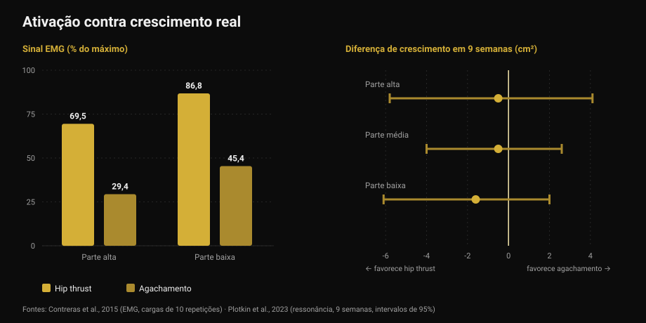
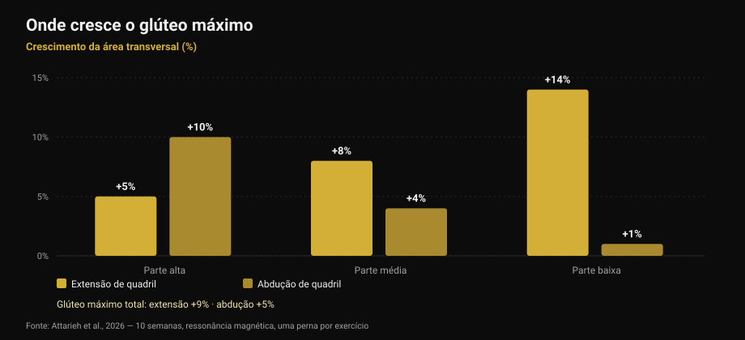

# Exercícios para glúteos: hip thrust ou agachamento?

Por [Giammaria Loi](/autore/giammaria-loi) · atualizado em 17 de outubro de 2026

Um carrossel muito compartilhado afirma que os glúteos precisam de três categorias obrigatórias em todo dia de perna: compostos pesados, acessórios e trabalho de isolamento "de pump". O esquema é organizado e soa certo. Li nove estudos para conferir. O conselho final — não faça só hip thrust — se sustenta. Dois dos três pilares em que ele se apoia, não: o pump não é o mecanismo que o post diz, e o exercício que "ativa mais" não é o que mais faz crescer.

## Em resumo

- **Hip thrust e agachamento fazem os glúteos crescerem igual.** Nove semanas, ressonância magnética, séries igualadas: nenhuma diferença mensurável (Plotkin et al., 2023).
- **O hip thrust ativa muito mais** — até 69,5% contra 29,4% do sinal elétrico no glúteo máximo — **e isso não prevê o crescimento** (Contreras et al., 2015; Plotkin et al., 2023).
- **O "pump" não é o terceiro mecanismo do crescimento.** Estresse metabólico, inchaço celular e hormônios agudos não têm respaldo como causas independentes de hipertrofia (Van Every et al., 2025).
- **Variar exercícios serve de verdade**, mas por outro motivo: extensão e abdução de quadril fazem crescer *regiões diferentes* do mesmo músculo (Attarieh et al., 2026).
- **Os 30-60 segundos de descanso** prescritos ao trabalho de pump são o elo mais fraco: abaixo de 60 segundos a hipertrofia tende a piorar (Singer et al., 2024).

## O que o post propõe

Três categorias, todo dia de perna. Compostos pesados (agachamento, levantamento terra, unilateral) para tensão mecânica. Acessórios focados em glúteo (hip thrust, good morning, terra romeno) para crescimento das fibras. Isolamento em altas repetições (coice, abduções) para o pump, descrito nos slides como "o terceiro mecanismo do crescimento muscular: o estresse metabólico".

Antes da ciência, uma estranheza: **a legenda e a tabela não batem**. O texto prescreve 5-8, 8-20 e 25+ repetições; a tabela do primeiro slide diz 3-8, 8-15 e 15-25+. Quem lê o texto e quem olha a imagem sai com dois programas diferentes. É um detalhe, mas diz algo sobre a precisão real desses esquemas.

## "Ativa mais" não quer dizer "cresce mais"

Esta é a parte que deveria mudar de verdade como você escolhe exercícios.

Em 2015, um grupo que incluía Bret Contreras — quem popularizou o hip thrust — mediu a atividade elétrica muscular (eletromiografia, ou EMG: quanto sinal chega ao músculo durante o exercício) em treze mulheres treinadas, comparando hip thrust e agachamento com cargas de 10 repetições. O resultado é claro: na parte alta do glúteo máximo o hip thrust alcança em média **69,5% do máximo contra 29,4%** do agachamento; na parte baixa, **86,8% contra 45,4%**. No vasto lateral, ou seja, a coxa, nenhuma diferença significativa.

Se a ativação fosse um bom guia, o hip thrust deveria fazer os glúteos crescerem cerca do dobro. Em 2023 o próprio Contreras assinou o estudo que testou essa ideia: 34 pessoas não treinadas, nove semanas supervisionadas, só agachamento ou só hip thrust, **séries igualadas**, área muscular medida por ressonância magnética.

O crescimento dos glúteos foi **semelhante nos dois grupos**. As estimativas pendem levemente para o hip thrust — 1,6 cm² na porção baixa, 0,5 na média, 0,5 na alta — com margens de erro amplas o bastante para conter o zero com folga. Os autores escrevem sem rodeios: o sinal de EMG mais alto durante o hip thrust *não previu de forma consistente* a hipertrofia glútea.

*À esquerda, quanto sinal chega ao músculo (Contreras et al., 2015, cargas de 10 repetições). À direita, a diferença de crescimento após nove semanas em centímetros quadrados, com intervalos de 95% (Plotkin et al., 2023). Valores positivos favorecem o agachamento, negativos o hip thrust: os três intervalos cruzam o zero.*

O mesmo estudo acrescenta dois dados ausentes do post: o agachamento fez crescer **quadríceps (+3,6 cm²) e adutores (+2,5 cm²)** muito mais que o hip thrust, e a transferência para o levantamento terra foi **idêntica**. É o mesmo princípio que contei ao falar de [cadeira extensora e leg press](/pt/blog/cadeira-extensora-ou-leg-press-reto-femoral): o exercício que você mais "sente" não é automaticamente o que mais constrói.

## O pump não é um mecanismo de crescimento

A terceira categoria se apoia numa frase específica: o pump seria inchaço celular e acúmulo de fadiga, "o terceiro mecanismo do crescimento muscular: o estresse metabólico".

Essa ideia teve dez anos de glória e hoje é o canto mais contestado da literatura. Uma revisão de 2025 no *Journal of Sport and Health Science*, assinada entre outros por Stuart Phillips, a lista explicitamente entre os conceitos superados: as afirmações de que respostas hormonais agudas, estresse metabólico, inchaço celular ou "o pump" contribuam de forma relevante para a hipertrofia **não são respaldadas pelas evidências científicas**. A hipertrofia "sarcoplasmática" vai para a mesma gaveta.

Não é novidade repentina. Já em 2017 uma revisão dedicada à pergunta — os metabólitos produzidos durante o exercício aumentam a hipertrofia? — concluía que **os metabólitos não têm propriedades anabólicas em si**. Podem ajudar, mas de um jeito só: aumentando o recrutamento de fibras, levando mais fibras ao mesmo estímulo mecânico. Agem *através* da tensão, não ao lado dela.

Nada disso significa que séries de 25 repetições não construam músculo. Constroem, como veremos. Significa que você não as faz pelo motivo escrito no slide, e que chamá-las de "categoria obrigatória" por causa de um mecanismo que não existe é uma base frágil.

## Variar funciona, mas por regiões

Aqui o post acerta, e a pesquisa recente lhe dá um motivo melhor do que o que ele usa.

Um estudo publicado em outubro de 2026 comparou dez semanas de **extensão de quadril na polia contra abdução de quadril**, com um desenho especialmente limpo: cada participante treinava uma perna com um exercício e a outra com o outro, mesmo volume (cerca de 10 séries por semana, 8-12 repetições), com ressonância magnética em três regiões do glúteo máximo.

A extensão produziu mais crescimento total (**+9% contra +5%**), mas a diferença interessante é *onde*. A extensão cresce sobretudo embaixo: +5% em cima, +8% no meio, **+14% embaixo**. A abdução faz o oposto: **+10% em cima**, +4% no meio, +1% embaixo. E só a abdução tocou o glúteo médio e mínimo de forma apreciável.

*Crescimento da área transversal do glúteo máximo por região após 10 semanas, medido por ressonância magnética. Desenho intrassujeito: uma perna por exercício, mesmo volume. Fonte: Attarieh et al., 2026.*

É a primeira evidência direta de que a escolha do exercício modula o crescimento **regional** dos glúteos. Então sim: as abduções merecem um lugar. Mas não como "trabalho de pump a 25 repetições com 30 segundos de descanso" — como exercício que treina uma porção que a extensão alcança pouco, com o mesmo empenho dos demais.

O pano de fundo vem da meta-análise de 2025 sobre hipertrofia do glúteo máximo: em 12 estudos o treino de força produz efeito moderado (0,71 em escala padronizada, com pouca heterogeneidade), e **agachamento profundo ou paralelo, leg press, extensões de quadril e hip thrust funcionam todos**, sozinhos ou combinados. Não existe hierarquia obrigatória.

## Repetições e descansos: o que se sustenta e o que não

A frase do quarto slide — todas as faixas de repetições constroem músculo se a série chega perto da falha — está **correta**. A meta-análise em rede de 2021 sobre 28 estudos e 747 adultos, com todas as séries até a falha, não encontra diferença de hipertrofia entre cargas altas (até 8 repetições), médias (9-15) e baixas (acima de 15). Na força máxima a diferença existe e favorece as cargas altas.

O ponto fraco é o descanso. A meta-análise bayesiana de 2024 encontra pequena vantagem para descansos **acima de 60 segundos**, provavelmente porque descansos curtos derrubam a carga total levantada; além de 90 segundos, nenhuma diferença apreciável. O post coloca **30-60 segundos** justamente no trabalho de maior número de repetições, que já é o mais fatigante: é a combinação com mais risco de custar volume sem comprar nada. No outro extremo, os 3 minutos dos compostos servem à força, mas não acrescentam nada acima de 90 segundos se o objetivo for só crescer.

E as "três categorias obrigatórias"? A síntese da conferência de Jyväskylä de 2025, publicada em 2026, ordena as variáveis: séries semanais, volume-carga, duração dos descansos e proximidade da falha influenciam a hipertrofia de forma relevante, **enquanto a escolha dos exercícios pode ser flexível**. É exatamente o inverso da hierarquia do post, que engessa a variável mais flexível e deixa soltas as que contam.

## O que a pesquisa realmente diz

[[V|ok|Confirmado|Todas as faixas de repetições constroem músculo se a série chega perto da falha: nenhuma diferença de hipertrofia entre cargas altas, médias e baixas em 28 estudos. A força máxima continua exigindo cargas altas.]]
[[V|ok|Confirmado|Só hip thrust não basta, mas não pelos motivos do post: exercícios diferentes fazem crescer regiões diferentes do glúteo máximo. A extensão cresce a porção baixa (+14%), a abdução a alta (+10%).]]
[[V|ok|Confirmado|Muitos exercícios funcionam para glúteos — agachamento profundo ou paralelo, leg press, extensões de quadril, hip thrust — com efeito moderado e coerente entre estudos.]]
[[V|part|A precisar|"Três categorias obrigatórias em todo dia de perna": a literatura coloca a escolha dos exercícios entre as variáveis flexíveis, e séries semanais, volume-carga, descansos e proximidade da falha entre as que contam.]]
[[V|part|A precisar|Os 30-60 segundos de descanso no trabalho de altas repetições: acima de 60 segundos a hipertrofia vai melhor e além de 90 não muda mais. Os 3 minutos dos compostos servem à força.]]
[[V|no|Desmentido|O "pump" como terceiro mecanismo do crescimento: estresse metabólico, inchaço celular e respostas hormonais agudas não têm respaldo como causas independentes de hipertrofia.]]
[[V|no|Desmentido|Escolher exercícios pelo quanto "ativam": o hip thrust produz mais que o dobro do sinal de EMG do agachamento no glúteo máximo, e após nove semanas de ressonância o crescimento é o mesmo.]]
[[V|nv|Não verificável|As faixas de repetições do próprio post: a legenda diz 5-8 / 8-20 / 25+, a tabela do primeiro slide diz 3-8 / 8-15 / 15-25+. As duas não coincidem e nenhuma remete a uma fonte citada.]]

## Como aplicar

1. **Escolha dois ou três exercícios de extensão de quadril e mantenha.** Agachamento profundo, hip thrust, terra romeno, extensões na polia: todos valem. O crescimento vem da carga que sobe ao longo do tempo, não do exercício que você "sente" melhor.
2. **Acrescente abduções para a parte alta.** Não como finalizador, mas como exercício com o mesmo empenho dos demais: nos dados é o único que alcança a porção proximal e o glúteo médio.
3. **Conte séries semanais, não categorias.** É a variável que a pesquisa coloca em primeiro lugar. Dez séries semanais de extensão de quadril produziram +9% de área em dez semanas em pessoas não treinadas.
4. **Não desça abaixo de 60 segundos de descanso**, nem nas séries longas. E não é preciso passar de 90-120 segundos se o objetivo é crescer: guarde os 3 minutos para os compostos pesados.
5. **Leve as séries perto da falha e registre quão perto.** As repetições em reserva (RIR) são o que torna comparável uma série de 6 e uma de 25. Sem esse número, "altas repetições" não significa nada — é o tema de [quantas repetições para massa muscular](/pt/blog/quantas-repeticoes-massa-muscular).
6. **Pare de perseguir a queimação.** O pump é uma sensação, não uma medida. Se você a usa para julgar um treino, está avaliando a circulação sanguínea, não o crescimento.

[[APP|O volume conta, a queimação não|O Nurvan conta as séries semanais por grupo muscular e registra carga e RIR em cada série: você vê se os glúteos receberam mesmo dez séries nesta semana e se a carga está subindo, em vez de confiar na sensação pós-treino. Os descansos são cronometrados dentro do treino.|Experimente o Nurvan]]

## Perguntas frequentes

**Hip thrust ou agachamento para glúteos?**
Os dois, e se precisar escolher um a pesquisa não coroa vencedor. Em nove semanas com ressonância e séries igualadas o crescimento do glúteo foi semelhante. O agachamento ainda faz crescer quadríceps e adutores; o hip thrust permite cargas bem maiores naquele movimento específico. Quem decide é o resto do seu programa, não o músculo.

**Altas repetições servem para glúteos?**
Sim, mas não pelo pump. Séries longas constroem tanto quanto as curtas desde que cheguem perto da falha — e aí são bem mais cansativas. Se usar, dê a elas o mesmo descanso dos outros exercícios: abaixo de 60 segundos o efeito tende a piorar.

**Abduções e coices servem mesmo?**
Servem, e por um motivo melhor do que o habitual. No estudo de 2026 a abdução de quadril fez a porção alta do glúteo máximo crescer 10%, contra 5% da extensão, e alcançou o glúteo médio. É um exercício com outro alvo, não um acabamento.

**Quantas vezes por semana treinar glúteos?**
Os dados mais diretos sobre este músculo vêm de programas com duas sessões por semana e cerca de dez séries semanais, que produziram crescimento mensurável em dez semanas. O número de sessões importa menos que o total semanal de séries: o desafio é distribuir de forma sustentável, como conto em [divisão de treino para iniciantes e avançados](/pt/blog/divisao-treino-iniciante-avancado).

## Leia também

- [Cadeira extensora ou leg press: o que cresce](/pt/blog/cadeira-extensora-ou-leg-press-reto-femoral) — quando o exercício "mais completo" não faz crescer o músculo que interessa
- [Quantas repetições para massa muscular? O mito do 8-12](/pt/blog/quantas-repeticoes-massa-muscular) — cargas, séries e descansos escolhidos pelos dados
- [Divisão de treino: iniciante ou avançado?](/pt/blog/divisao-treino-iniciante-avancado) — como distribuir as séries semanais

## Fontes

1. Plotkin DL, Rodas MA, Vigotsky AD, et al., 2023. Hip thrust and back squat training elicit similar gluteus muscle hypertrophy and transfer similarly to the deadlift. *Front Physiol* 14:1279170. PMID 37877099 — [doi.org/10.3389/fphys.2023.1279170](https://doi.org/10.3389/fphys.2023.1279170)
2. Contreras B, Vigotsky AD, Schoenfeld BJ, Beardsley C, Cronin J, 2015. A comparison of gluteus maximus, biceps femoris, and vastus lateralis electromyographic activity in the back squat and barbell hip thrust exercises. *J Appl Biomech* 31(6):452-458. PMID 26214739 — [doi.org/10.1123/jab.2014-0301](https://doi.org/10.1123/jab.2014-0301)
3. Van Every DW, Lees MJ, Wilson B, Nippard J, Phillips SM, 2025. Load-induced human skeletal muscle hypertrophy: mechanisms, myths, and misconceptions. *J Sport Health Sci* 15:101104. PMID 41276164 — [doi.org/10.1016/j.jshs.2025.101104](https://doi.org/10.1016/j.jshs.2025.101104)
4. Dankel SJ, Mattocks KT, Jessee MB, et al., 2017. Do metabolites that are produced during resistance exercise enhance muscle hypertrophy? *Eur J Appl Physiol* 117(11):2125-2135. PMID 28776271 — [doi.org/10.1007/s00421-017-3690-1](https://doi.org/10.1007/s00421-017-3690-1)
5. Attarieh P, Nunes JP, Khani S, et al., 2026. Regional hypertrophy of the gluteal muscles is task-specific: differential responses to 10 weeks of hip extension versus hip abduction training. *J Strength Cond Res*, publicação antecipada online. PMID 42842490 — [doi.org/10.1519/JSC.0000000000005701](https://doi.org/10.1519/JSC.0000000000005701)
6. Krause Neto W, Krause TLV, Gama EF, 2025. The impact of resistance training on gluteus maximus hypertrophy: a systematic review and meta-analysis. *Front Physiol* 16:1542334. PMID 40276368 — [doi.org/10.3389/fphys.2025.1542334](https://doi.org/10.3389/fphys.2025.1542334)
7. Lopez P, Radaelli R, Taaffe DR, et al., 2021. Resistance training load effects on muscle hypertrophy and strength gain: systematic review and network meta-analysis. *Med Sci Sports Exerc* 53(6):1206-1216. PMID 33433148 — [doi.org/10.1249/MSS.0000000000002585](https://doi.org/10.1249/MSS.0000000000002585)
8. Singer A, Wolf M, Generoso L, et al., 2024. Give it a rest: a systematic review with Bayesian meta-analysis on the effect of inter-set rest interval duration on muscle hypertrophy. *Front Sports Act Living* 6:1429789. PMID 39205815 — [doi.org/10.3389/fspor.2024.1429789](https://doi.org/10.3389/fspor.2024.1429789)
9. Roberts MD, Bamman MM, Hornberger TA, et al., 2026. Research into resistance training response heterogeneity: a summary of the 2025 conference at the University of Jyväskylä. *J Appl Physiol* 140(6):1761-1776. PMID 42172438 — [doi.org/10.1152/japplphysiol.00289.2026](https://doi.org/10.1152/japplphysiol.00289.2026)

Ponto de partida: carrossel de [John Rusin](https://www.instagram.com/p/Dc57wEdESMF/) (5 de setembro de 2026). Nenhum texto ou imagem do post foi reproduzido: todas as afirmações foram reescritas e verificadas na literatura primária.

[[BIO|Giammaria Loi é o fundador do Nurvan. Treina com pesos desde 2012, trabalha como personal trainer e coach certificado FIPE desde 2013 e compete em powerlifting em nível nacional desde 2018. Cada artigo que assina parte dos estudos científicos e chega ao que funciona de verdade na academia.]]

> Nota: conteúdo informativo, não substitui a opinião de um médico ou profissional qualificado. Se você tem dor no quadril ou nas costas ou uma lesão em curso, faça uma avaliação antes de mudar o treino.
