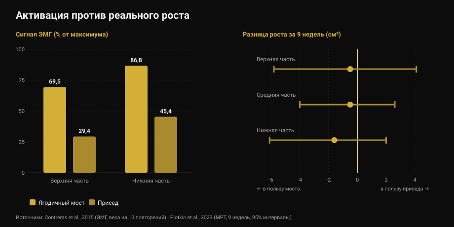
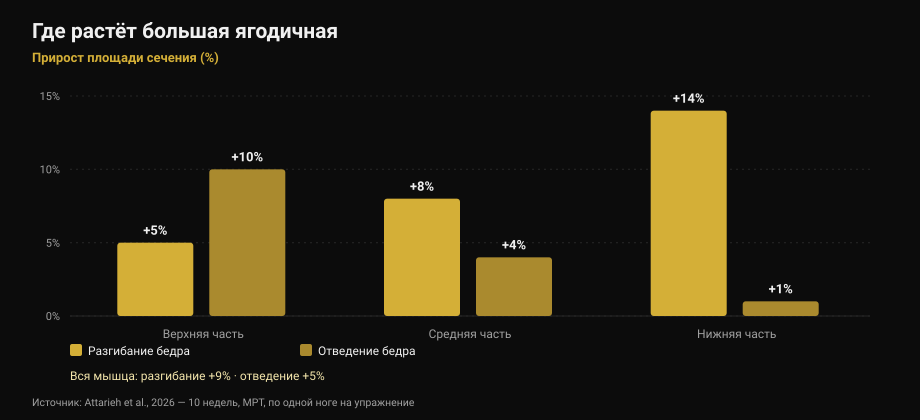

# Упражнения на ягодицы: мост или присед?

[Джаммария Лои](/autore/giammaria-loi) · обновлено 17 октября 2026

Популярная карусель утверждает: ягодицам нужны три обязательные категории в каждый день ног — тяжёлая база, вспомогательные упражнения и изоляция «на памп». Схема аккуратная и звучит убедительно. Я прочитал девять исследований, чтобы её проверить. Итоговый совет — не ограничивайся ягодичным мостом — выдерживает проверку. Две из трёх опор под ним — нет: памп не тот механизм, о котором говорит пост, а упражнение, которое «сильнее включает», не то, от которого больше растёт.

## Коротко

- **Ягодичный мост и присед растят ягодицы одинаково.** Девять недель, МРТ, уравненное число подходов: измеримой разницы нет (Plotkin et al., 2023).
- **Мост активирует гораздо сильнее** — до 69,5% против 29,4% электрического сигнала в большой ягодичной — **и это ничего не говорит о росте** (Contreras et al., 2015; Plotkin et al., 2023).
- **«Памп» — не третий механизм роста.** Метаболический стресс, набухание клетки и острые гормональные всплески не подтверждены как самостоятельные причины гипертрофии (Van Every et al., 2025).
- **Разнообразие упражнений действительно нужно**, но по другой причине: разгибание и отведение бедра растят *разные участки* одной и той же мышцы (Attarieh et al., 2026).
- **30-60 секунд отдыха** для «пампового» блока — самое слабое место схемы: меньше 60 секунд гипертрофия обычно становится хуже (Singer et al., 2024).

## Что предлагает пост

Три категории в каждый день ног. Тяжёлая база (приседания, тяги, работа на одной ноге) ради механического напряжения. Вспомогательные упражнения на ягодицы (мост, гуд морнинг, румынская тяга) ради роста волокон. Изоляция в высоких повторениях (махи, отведения) ради пампа, который на слайдах назван «третьим механизмом мышечного роста: метаболическим стрессом».

Прежде чем перейти к науке — странность: **подпись и таблица не совпадают**. В тексте указаны 5-8, 8-20 и 25+ повторений; в таблице на первом слайде — 3-8, 8-15 и 15-25+. Кто читает текст и кто смотрит картинку, получают две разные программы. Деталь, но она говорит о реальной точности таких схем.

## «Сильнее включает» не значит «больше растит»

Это та часть, которая по-настоящему должна изменить выбор упражнений.

В 2015 году группа, в которую входил Брет Контрерас — человек, популяризовавший ягодичный мост, — измерила электрическую активность мышц (электромиография, ЭМГ: сколько сигнала доходит до мышцы во время упражнения) у тринадцати тренированных женщин, сравнив мост и присед на весах 10 повторений. Результат однозначный: в верхней части большой ягодичной мост даёт в среднем **69,5% от максимума против 29,4%** у приседа; в нижней части — **86,8% против 45,4%**. В латеральной широкой мышце бедра значимой разницы нет.

Если бы активация была хорошим ориентиром, мост должен был бы растить ягодицы примерно вдвое быстрее. В 2023 году Контрерас стал соавтором исследования, которое это проверило: 34 нетренированных человека, девять недель под наблюдением, только присед или только мост, **уравненное число подходов**, площадь поперечного сечения мышц по МРТ.

Рост ягодиц оказался **схожим в обеих группах**. Оценки слегка склоняются в пользу моста — 1,6 см² в нижней части, 0,5 в средней, 0,5 в верхней — но с настолько широкими интервалами, что ноль попадает в них с запасом. Авторы пишут прямо: более высокий сигнал ЭМГ при мосте *не предсказывал последовательно* гипертрофию ягодиц.

*Слева — сколько сигнала доходит до мышцы (Contreras et al., 2015, веса на 10 повторений). Справа — разница в росте через девять недель в квадратных сантиметрах с 95% интервалами (Plotkin et al., 2023). Положительные значения в пользу приседа, отрицательные — в пользу моста: все три интервала пересекают ноль.*

То же исследование добавляет два факта, которых нет в посте: присед вырастил **квадрицепсы (+3,6 см²) и приводящие (+2,5 см²)** гораздо сильнее моста, а перенос на становую тягу оказался **одинаковым**. Тот же принцип я разбирал в тексте про [разгибания ног и жим ногами](/ru/blog/razgibaniya-nog-ili-zhim-nogami-pryamaya-myshtsa-bedra): упражнение, которое сильнее «чувствуется», не обязательно строит больше.

## Памп — не механизм роста

Третья категория держится на конкретной фразе: памп — это набухание клетки и накопление утомления, «третий механизм мышечного роста: метаболический стресс».

У этой идеи было десять успешных лет, и сегодня это самый спорный угол литературы. Обзор 2025 года в *Journal of Sport and Health Science*, среди соавторов которого Стюарт Филлипс, прямо относит её к устаревшим представлениям: утверждения, что острые гормональные реакции, метаболический стресс, набухание клетки или «памп» существенно влияют на гипертрофию, **научными данными не подтверждаются**. Туда же отправляется «саркоплазматическая» гипертрофия.

Это не внезапная новость. Ещё в 2017 году обзор, посвящённый вопросу, усиливают ли метаболиты гипертрофию, заключал: **сами по себе метаболиты не обладают анаболическими свойствами**. Помочь они могут лишь одним способом — увеличивая рекрутирование волокон, то есть подводя больше волокон под тот же механический стимул. Они работают *через* напряжение, а не рядом с ним.

Всё это не значит, что подходы по 25 повторений не растят мышцы. Растят, и об этом ниже. Это значит, что вы делаете их не по той причине, которая написана на слайде, и что называть их «обязательной категорией» из-за несуществующего механизма — шаткое основание для программы.

## Разнообразие работает, но по регионам

Здесь пост прав, и свежие данные дают ему более убедительное обоснование.

Исследование, опубликованное в октябре 2026 года, сравнило десять недель **разгибания бедра в блоке против отведения бедра** с особенно чистым дизайном: каждый участник тренировал одну ногу одним упражнением, вторую — другим, при равном объёме (около 10 подходов в неделю, 8-12 повторений), с МРТ по трём регионам большой ягодичной.

Разгибание дало больше общего роста (**+9% против +5%**), но интереснее — *где*. Разгибание растит прежде всего низ: +5% вверху, +8% в середине, **+14% внизу**. Отведение делает обратное: **+10% вверху**, +4% в середине, +1% внизу. И только отведение заметно затронуло среднюю и малую ягодичные.

*Прирост площади поперечного сечения большой ягодичной по регионам через 10 недель, измерено на МРТ. Внутрииндивидуальный дизайн: по одной ноге на упражнение, равный объём. Источник: Attarieh et al., 2026.*

Это первое прямое свидетельство того, что выбор упражнения меняет **региональный** рост ягодиц. Так что да, отведениям место в программе есть. Но не как «памповой работе на 25 повторений с 30 секундами отдыха», а как упражнению, которое тренирует участок, куда разгибание почти не достаёт, — с тем же вниманием, что и остальные.

Фон задаёт метаанализ 2025 года по гипертрофии большой ягодичной: на 12 исследованиях силовая тренировка даёт умеренный эффект (0,71 по стандартизированной шкале, с низкой разнородностью), и **глубокий или параллельный присед, жим ногами, разгибания бедра и мост работают все**, по отдельности и вместе. Обязательной иерархии нет.

## Повторения и отдых: что выдерживает проверку

Фраза с четвёртого слайда — любой диапазон повторений растит мышцы, если подход доходит близко к отказу — **верна**. Сетевой метаанализ 2021 года на 28 исследованиях и 747 взрослых, где все подходы выполнялись до отказа, не находит разницы в гипертрофии между тяжёлыми (до 8 повторений), средними (9-15) и лёгкими (больше 15) весами. А вот в максимальной силе разница есть, и она в пользу тяжёлых весов.

Слабое место — отдых. Байесовский метаанализ 2024 года находит небольшое преимущество у пауз **длиннее 60 секунд**, вероятно потому, что короткий отдых обрушивает общий поднятый тоннаж; дальше 90 секунд заметной разницы нет. Пост ставит **30-60 секунд** именно на самый высокоповторный блок, который и без того самый тяжёлый: это сочетание рискует стоить объёма и ничего не дать взамен. С другой стороны, прописанные для базы 3 минуты полезны для силы, но для чистой гипертрофии ничего не добавляют сверх 90 секунд.

А «три обязательные категории»? Итоговый обзор конференции в Ювяскюля 2025 года, опубликованный в 2026-м, расставляет переменные: недельное число подходов, объём-нагрузка, длительность пауз и близость к отказу значимо влияют на гипертрофию, **тогда как выбор упражнений может быть гибким**. Это ровно обратное иерархии поста, который жёстко фиксирует самую гибкую переменную и оставляет на волю случая те, что действительно важны.

## Что на самом деле говорит наука

[[V|ok|Подтверждено|Любой диапазон повторений растит мышцы, если подход близок к отказу: разницы в гипертрофии между тяжёлыми, средними и лёгкими весами в 28 исследованиях нет. Максимальной силе по-прежнему нужны тяжёлые веса.]]
[[V|ok|Подтверждено|Одного моста мало, но не по причинам из поста: разные упражнения растят разные регионы большой ягодичной. Разгибание — нижнюю часть (+14%), отведение — верхнюю (+10%).]]
[[V|ok|Подтверждено|Для ягодиц работают многие упражнения — глубокий или параллельный присед, жим ногами, разгибания бедра, мост — с умеренным и устойчивым между исследованиями эффектом.]]
[[V|part|Требует уточнения|«Три обязательные категории в каждый день ног»: литература относит выбор упражнений к гибким переменным, а недельные подходы, объём-нагрузку, отдых и близость к отказу — к решающим.]]
[[V|part|Требует уточнения|30-60 секунд отдыха в высокоповторной работе: дольше 60 секунд гипертрофия лучше, после 90 секунд разницы уже нет. Три минуты в базе работают на силу.]]
[[V|no|Опровергнуто|«Памп» как третий механизм роста: метаболический стресс, набухание клетки и острые гормональные реакции не подтверждены как самостоятельные причины гипертрофии.]]
[[V|no|Опровергнуто|Выбирать упражнения по тому, насколько они «включают»: мост даёт более чем вдвое больший сигнал ЭМГ, чем присед, а через девять недель МРТ показывает одинаковый рост.]]
[[V|nv|Не проверяемо|Собственные диапазоны поста: в подписи 5-8 / 8-20 / 25+, в таблице первого слайда 3-8 / 8-15 / 15-25+. Они не совпадают, и ни один не опирается на указанный источник.]]

## Как это применить

1. **Выберите два-три упражнения на разгибание бедра и держитесь их.** Глубокий присед, ягодичный мост, румынская тяга, разгибания в блоке — подходят все. Рост даёт вес, который растёт со временем, а не упражнение, которое лучше «чувствуется».
2. **Добавьте отведения ради верхней части.** Не как добивающее упражнение в конце, а наравне с остальными: по данным это единственное, что достаёт до проксимальной части и средней ягодичной.
3. **Считайте недельные подходы, а не категории.** Это переменная, которую наука ставит на первое место. Десять недельных подходов разгибания бедра дали +9% площади за десять недель у нетренированных.
4. **Не опускайтесь ниже 60 секунд отдыха**, даже в длинных подходах. И больше 90-120 секунд для роста не нужно: три минуты оставьте тяжёлой базе.
5. **Доводите подходы близко к отказу и записывайте, насколько близко.** Запас повторений (RIR) — то, что делает сопоставимыми подход на 6 и подход на 25. Без этой цифры «высокие повторения» ничего не значат — об этом текст [сколько повторений нужно для массы](/ru/blog/skolko-povtoreniy-dlya-massy).
6. **Перестаньте гнаться за жжением.** Памп — ощущение, а не измерение. Оценивая по нему тренировку, вы оцениваете кровоток, а не рост.

[[APP|Считается объём, а не жжение|Nurvan считает недельные подходы по мышечным группам и записывает вес и RIR в каждом подходе: видно, получили ли ягодицы на этой неделе свои десять подходов и растёт ли нагрузка, вместо того чтобы полагаться на ощущения. Паузы отсчитываются таймером прямо в тренировке.|Попробовать Nurvan]]

## Частые вопросы

**Мост или присед для ягодиц?**
Оба, а если выбирать один, наука победителя не называет. За девять недель с МРТ и уравненными подходами рост ягодиц был схожим. Присед вдобавок растит квадрицепсы и приводящие; мост позволяет намного большие веса в этом конкретном движении. Решает остальная программа, а не мышца.

**Работают ли высокие повторения на ягодицы?**
Да, но не из-за пампа. Длинные подходы строят столько же, сколько короткие, если доходят близко к отказу, — и тогда они заметно тяжелее. Если используете их, давайте такой же отдых, как остальным: меньше 60 секунд эффект обычно хуже.

**Отведения и махи действительно нужны?**
Нужны, и по более весомой причине, чем обычно говорят. В исследовании 2026 года отведение бедра вырастило верхнюю часть большой ягодичной на 10% против 5% у разгибания и затронуло среднюю ягодичную. Это упражнение с другой мишенью, а не финальный штрих.

**Сколько раз в неделю тренировать ягодицы?**
Самые прямые данные по этой мышце — программы из двух занятий в неделю и примерно десяти недельных подходов, давшие измеримый рост за десять недель. Число занятий важно меньше, чем недельная сумма подходов: задача — распределить её так, чтобы выдержать, об этом текст про [сплит для новичка и продвинутого](/ru/blog/split-trenirovok-novichok-prodvinutyy).

## Читайте также

- [Разгибания ног или жим ногами: что растёт](/ru/blog/razgibaniya-nog-ili-zhim-nogami-pryamaya-myshtsa-bedra) — когда «более полное» упражнение не растит нужную мышцу
- [Сколько повторений нужно для роста мышц: миф 8-12](/ru/blog/skolko-povtoreniy-dlya-massy) — веса, подходы и отдых по данным
- [Сплит: новичок и продвинутый — в чём разница](/ru/blog/split-trenirovok-novichok-prodvinutyy) — как распределить недельные подходы

## Источники

1. Plotkin DL, Rodas MA, Vigotsky AD, et al., 2023. Hip thrust and back squat training elicit similar gluteus muscle hypertrophy and transfer similarly to the deadlift. *Front Physiol* 14:1279170. PMID 37877099 — [doi.org/10.3389/fphys.2023.1279170](https://doi.org/10.3389/fphys.2023.1279170)
2. Contreras B, Vigotsky AD, Schoenfeld BJ, Beardsley C, Cronin J, 2015. A comparison of gluteus maximus, biceps femoris, and vastus lateralis electromyographic activity in the back squat and barbell hip thrust exercises. *J Appl Biomech* 31(6):452-458. PMID 26214739 — [doi.org/10.1123/jab.2014-0301](https://doi.org/10.1123/jab.2014-0301)
3. Van Every DW, Lees MJ, Wilson B, Nippard J, Phillips SM, 2025. Load-induced human skeletal muscle hypertrophy: mechanisms, myths, and misconceptions. *J Sport Health Sci* 15:101104. PMID 41276164 — [doi.org/10.1016/j.jshs.2025.101104](https://doi.org/10.1016/j.jshs.2025.101104)
4. Dankel SJ, Mattocks KT, Jessee MB, et al., 2017. Do metabolites that are produced during resistance exercise enhance muscle hypertrophy? *Eur J Appl Physiol* 117(11):2125-2135. PMID 28776271 — [doi.org/10.1007/s00421-017-3690-1](https://doi.org/10.1007/s00421-017-3690-1)
5. Attarieh P, Nunes JP, Khani S, et al., 2026. Regional hypertrophy of the gluteal muscles is task-specific: differential responses to 10 weeks of hip extension versus hip abduction training. *J Strength Cond Res*, онлайн-публикация до печати. PMID 42842490 — [doi.org/10.1519/JSC.0000000000005701](https://doi.org/10.1519/JSC.0000000000005701)
6. Krause Neto W, Krause TLV, Gama EF, 2025. The impact of resistance training on gluteus maximus hypertrophy: a systematic review and meta-analysis. *Front Physiol* 16:1542334. PMID 40276368 — [doi.org/10.3389/fphys.2025.1542334](https://doi.org/10.3389/fphys.2025.1542334)
7. Lopez P, Radaelli R, Taaffe DR, et al., 2021. Resistance training load effects on muscle hypertrophy and strength gain: systematic review and network meta-analysis. *Med Sci Sports Exerc* 53(6):1206-1216. PMID 33433148 — [doi.org/10.1249/MSS.0000000000002585](https://doi.org/10.1249/MSS.0000000000002585)
8. Singer A, Wolf M, Generoso L, et al., 2024. Give it a rest: a systematic review with Bayesian meta-analysis on the effect of inter-set rest interval duration on muscle hypertrophy. *Front Sports Act Living* 6:1429789. PMID 39205815 — [doi.org/10.3389/fspor.2024.1429789](https://doi.org/10.3389/fspor.2024.1429789)
9. Roberts MD, Bamman MM, Hornberger TA, et al., 2026. Research into resistance training response heterogeneity: a summary of the 2025 conference at the University of Jyväskylä. *J Appl Physiol* 140(6):1761-1776. PMID 42172438 — [doi.org/10.1152/japplphysiol.00289.2026](https://doi.org/10.1152/japplphysiol.00289.2026)

Отправная точка: карусель [John Rusin](https://www.instagram.com/p/Dc57wEdESMF/) (5 сентября 2026). Ни текст, ни изображения поста не воспроизводились: все утверждения переписаны и проверены по первичной литературе.

[[BIO|Джаммария Лои — основатель Nurvan. Тренируется с отягощениями с 2012 года, работает персональным тренером и коучем с сертификатом FIPE с 2013 года и выступает в пауэрлифтинге на национальном уровне с 2018 года. Каждая его статья начинается с научных работ и заканчивается тем, что действительно работает в зале.]]

> Примечание: информационный материал, не заменяет консультацию врача или квалифицированного специалиста. При боли в бедре или спине либо при текущей травме пройдите обследование, прежде чем менять тренировки.
