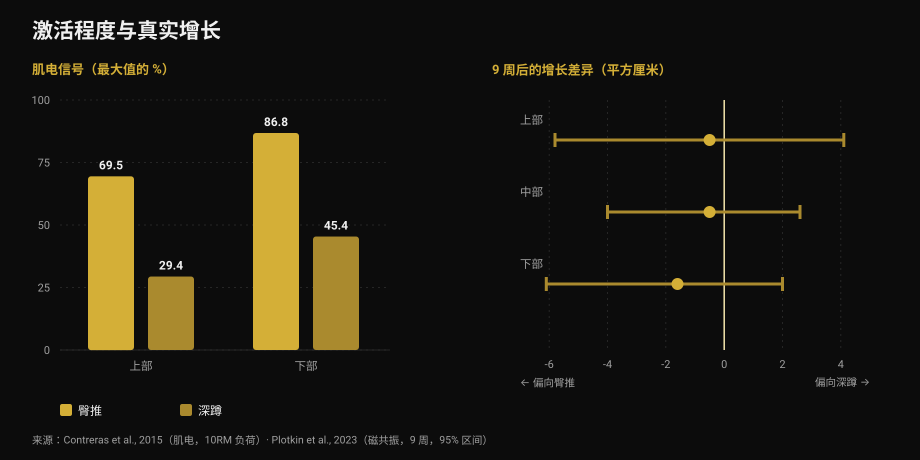
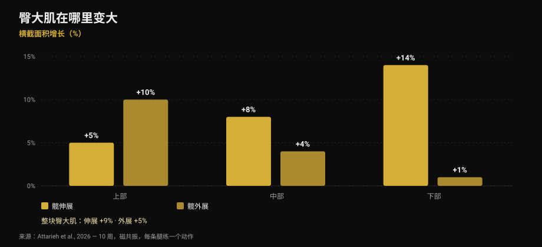

# 练臀：臀推还是深蹲更有效？

作者 [Giammaria Loi](/autore/giammaria-loi) · 更新于 2026 年 10 月 17 日

一则被大量转发的图文说：练臀每个腿部训练日都必须包含三类动作——大重量复合动作、辅助动作，以及「追泵感」的孤立动作。框架很整齐，听上去也对。我读了九篇研究来核对。最后那句建议——别只做臀推——站得住脚。但支撑它的三根柱子里有两根站不住：泵感并不是帖子所说的那个机制，而「激活更多」的动作，也不是长得更多的那个。

## 要点速览

- **臀推和深蹲让臀部长得一样多。** 九周、磁共振、组数对齐：没有可测量的差异（Plotkin et al., 2023）。
- **臀推的激活确实高得多**——臀大肌电信号最高 69.5% 对 29.4%——**但这预测不了增长**（Contreras et al., 2015；Plotkin et al., 2023）。
- **「泵感」不是第三个生长机制。** 代谢压力、细胞膨胀和急性激素反应，作为独立的肥大原因并没有证据支持（Van Every et al., 2025）。
- **动作多样化确实有用**，但理由不同：髋伸展和髋外展让同一块肌肉的*不同区域*变大（Attarieh et al., 2026）。
- **泵感动作的 30-60 秒组间休息**是整套方案最弱的一环：低于 60 秒，肥大效果往往更差（Singer et al., 2024）。

## 帖子到底在说什么

三类动作，每个练腿日都要做。大重量复合动作（深蹲、硬拉、单腿）负责机械张力。针对臀部的辅助动作（臀推、早安式、罗马尼亚硬拉）负责肌纤维生长。高次数孤立动作（后踢腿、外展）负责泵感，在图片里被称为「肌肉生长的第三个机制：代谢压力」。

进入科学之前先说一个怪处：**文案和表格对不上**。文案写的是 5-8、8-20 和 25+ 次；第一张图里的表格写的是 3-8、8-15 和 15-25+。读文字的人和看图的人，拿到的是两套不同的方案。细节虽小，却能说明这类框架真正的精确度。

## 「激活更多」不等于「长得更多」

这一段才是真正该改变你选动作方式的内容。

2015 年，一个包括 Bret Contreras（把臀推推广开来的人）在内的团队，测量了十三名有训练经验女性的肌肉电活动（肌电图，简称 EMG：动作过程中有多少信号到达肌肉），用 10RM 的负荷比较臀推和深蹲。结果一边倒：臀大肌上部，臀推平均达到**最大值的 69.5%，深蹲只有 29.4%**；下部是 **86.8% 对 45.4%**。而在股外侧肌，也就是大腿，没有显著差异。

如果激活是个好指标，臀推应该让臀部长快将近一倍。2023 年，Contreras 参与署名的研究正是检验这件事：34 名无训练经验者，九周有监督训练，只做深蹲或只做臀推，**组数对齐**，用磁共振测量肌肉横截面积。

结果两组的臀部增长**相近**。估计值略微偏向臀推——下部 1.6 平方厘米、中部 0.5、上部 0.5——但误差区间宽到轻松包含零。作者写得毫不含糊：臀推期间更高的 EMG 信号*并没有稳定地预测*臀部肥大。

*左边是有多少信号到达肌肉（Contreras et al., 2015，10RM 负荷）。右边是九周后的增长差异，单位平方厘米，附 95% 区间（Plotkin et al., 2023）。正值偏向深蹲，负值偏向臀推：三个区间都跨过零。*

同一项研究还给出两个帖子没提的数据：深蹲让**股四头肌（+3.6 平方厘米）和内收肌（+2.5 平方厘米）**的增长远超臀推，而两组对硬拉的迁移效果**完全相同**。这和我写[腿屈伸与倒蹬机](/zh/blog/tuibu-shenzhan-vs-dengtui-gusizhiji)时讲的是同一个道理：你「感觉」最强的动作，未必就是长得最多的动作。

## 泵感不是生长机制

第三类动作建立在一句具体的话上：泵感是细胞膨胀和疲劳累积，是「肌肉生长的第三个机制：代谢压力」。

这个说法流行了十年，如今是文献里争议最大的角落。2025 年发表在《Journal of Sport and Health Science》上的综述（作者之一是 Stuart Phillips）明确把它列入过时概念：认为急性激素反应、代谢压力、细胞膨胀或「泵感」对肥大有实质贡献的说法，**并没有科学证据支持**。所谓「肌浆型肥大」也被归入同一类。

这不是突然的新闻。早在 2017 年，一篇专门讨论「运动中产生的代谢物是否促进肥大」的综述就得出结论：**代谢物本身并不具备合成代谢特性**。它们能起作用的唯一途径，是提高肌纤维募集，让更多纤维接受同样的机械刺激。它们是*通过*张力起作用，而不是和张力并列。

这些都不意味着 25 次一组不长肌肉。它长，下一节就会讲到。它意味着你做这些组的理由并不是图片上写的那个，而用一个并不存在的机制把它定为「必做类别」，是很脆弱的编排依据。

## 多样化确实有用，但是按区域

这里帖子是对的，而最新研究给了它一个比它自己更好的理由。

2026 年 10 月发表的一项研究，用十周时间比较**绳索髋伸展与髋外展**，设计相当干净：每位受试者一条腿练一个动作、另一条腿练另一个，容量相同（每周约 10 组，8-12 次），并用磁共振测量臀大肌的三个区域。

髋伸展带来的整体增长更多（**+9% 对 +5%**），但真正有意思的是*长在哪里*。髋伸展主要长在下部：上部 +5%、中部 +8%、**下部 +14%**。髋外展正好相反：**上部 +10%**、中部 +4%、下部 +1%。而且只有外展明显练到了臀中肌和臀小肌。

*十周后臀大肌各区域横截面积的增长，磁共振测量。同体设计：每条腿一个动作，容量相同。来源：Attarieh et al., 2026。*

这是首个直接证据，说明动作选择会改变臀部的**区域性**增长。所以外展确实该有一席之地。但不是作为「25 次、休息 30 秒的泵感动作」，而是作为一个练到髋伸展几乎够不着的那块区域的动作，认真程度和其他动作一样。

背景则来自 2025 年关于臀大肌肥大的荟萃分析：12 项研究显示抗阻训练产生中等效应（标准化量表上 0.71，异质性低），而**深蹲或平行蹲、倒蹬机、髋伸展和臀推都有效**，单独做或组合做都行。并不存在必须遵守的等级。

## 次数和休息：哪些站得住

第四张图上的说法——只要组内接近力竭，任何次数区间都能长肌肉——是**正确的**。2021 年的网络荟萃分析涵盖 28 项研究、747 名成年人，所有组都做到力竭，在大重量（8 次以内）、中等（9-15 次）和小重量（15 次以上）之间没有找到肥大差异。而在最大力量上差异确实存在，偏向大重量。

弱点在休息。2024 年的贝叶斯荟萃分析发现，组间休息**超过 60 秒**有小幅肥大优势，很可能是因为休息太短会让总举起负荷崩掉；超过 90 秒后就没有明显差异了。帖子偏偏把 **30-60 秒**放在次数最高、本来就最累的那一类上：这正是最可能白白损失容量的组合。另一端，复合动作规定的 3 分钟对力量有用，但如果只追求增长，比 90 秒并没有多出什么。

那么「三类必做动作」呢？2026 年发表的 2025 年于韦斯屈莱会议综述把变量排了序：每周组数、容量负荷、休息时长和接近力竭的程度会显著影响肥大，**而动作选择可以灵活**。这正好和帖子的等级相反——它把最灵活的变量定死，却放任真正重要的那些。

## 研究实际上怎么说

[[V|ok|已证实|只要接近力竭，任何次数区间都能长肌肉：28 项研究中大、中、小重量之间没有肥大差异。最大力量仍然需要大重量。]]
[[V|ok|已证实|只做臀推确实不够，但理由不是帖子说的那个：不同动作让臀大肌的不同区域变大。髋伸展长下部（+14%），外展长上部（+10%）。]]
[[V|ok|已证实|练臀有效的动作很多——深蹲或平行蹲、倒蹬机、髋伸展、臀推——效应中等且在各研究之间一致。]]
[[V|part|需要澄清|「每个练腿日三类必做」：文献把动作选择列为灵活变量，而每周组数、容量负荷、休息和接近力竭的程度才是关键变量。]]
[[V|part|需要澄清|高次数动作的 30-60 秒休息：超过 60 秒肥大更好，超过 90 秒就不再变化。复合动作的 3 分钟服务于力量。]]
[[V|no|已推翻|把「泵感」当作第三个生长机制：代谢压力、细胞膨胀和急性激素反应作为独立的肥大原因缺乏证据支持。]]
[[V|no|已推翻|按「激活程度」选动作：臀推在臀大肌上的肌电信号是深蹲的两倍以上，九周磁共振后两者增长相同。]]
[[V|nv|无法核实|帖子自己的次数区间：文案写 5-8 / 8-20 / 25+，第一张图的表格写 3-8 / 8-15 / 15-25+。两者对不上，也都没有标注来源。]]

## 怎么执行

1. **选两到三个髋伸展动作并坚持下去。** 深蹲、臀推、罗马尼亚硬拉、绳索髋伸展都算。增长来自随时间上升的负重，而不是你「感觉」最好的那个动作。
2. **加入外展，练上部。** 不要当成收尾的消耗动作，而要和其他动作一样认真：在数据里，它是唯一能练到近端和臀中肌的动作。
3. **数每周组数，不要数类别。** 这是研究排在第一位的变量。每周十组髋伸展，在无训练经验者身上十周带来 +9% 的面积增长。
4. **休息不要低于 60 秒**，长组也一样。如果目标是增长，也不必超过 90-120 秒：3 分钟留给大重量复合动作。
5. **把每组做到接近力竭，并记录有多接近。** 储备次数（RIR）是让 6 次一组和 25 次一组可以相互比较的东西。没有这个数字，「高次数」就什么都不是——这正是[增肌到底需要多少次数](/zh/blog/duoshao-cishu-zengji)讨论的问题。
6. **别再追求灼烧感。** 泵感是一种感觉，不是一项测量。用它来判断一次训练好不好，评的是血流量，不是增长。

[[APP|有用的是容量，不是灼烧感|Nurvan 按肌群统计每周组数，并记录每一组的负重和 RIR：你能看到这周臀部是否真的练满十组、负重是不是在涨，而不用靠训练后的感觉去猜。组间休息直接在训练计划里计时。|试用 Nurvan]]

## 常见问题

**练臀选臀推还是深蹲？**
两个都要；如果只能选一个，研究并没有给出赢家。九周磁共振、组数对齐的条件下，臀部增长相近。深蹲额外还能长股四头肌和内收肌；臀推在这个动作上能用高得多的负重。真正决定的是你整套计划的其他部分，而不是肌肉本身。

**高次数对臀部有用吗？**
有用，但不是因为泵感。只要接近力竭，长组和短组长得一样多——而到那时它们累得多。如果要用，就给它和其他动作一样的休息：低于 60 秒效果往往更差。

**外展和后踢腿真的有用吗？**
有用，而且理由比常见说法更扎实。2026 年的研究中，髋外展让臀大肌上部增长 10%，髋伸展只有 5%，并且练到了臀中肌。它是一个目标不同的动作，不是收尾修饰。

**臀部一周练几次？**
关于这块肌肉最直接的数据来自每周两练、每周约十组的方案，十周产生了可测量的增长。训练次数不如每周总组数重要：关键是把它可持续地分配开，这正是[新手与进阶分化](/zh/blog/xunlian-fenhua-xinshou-gaoji)讨论的内容。

## 延伸阅读

- [腿屈伸还是倒蹬机：到底哪块肌肉在长](/zh/blog/tuibu-shenzhan-vs-dengtui-gusizhiji) — 当「更全面」的动作并不长你在意的那块肌肉
- [增肌每组做多少次？8-12 次的迷思](/zh/blog/duoshao-cishu-zengji) — 用数据选负重、组数和休息
- [训练分化：新手和高手该一样吗](/zh/blog/xunlian-fenhua-xinshou-gaoji) — 每周组数怎么分配

## 参考文献

1. Plotkin DL, Rodas MA, Vigotsky AD, et al., 2023. Hip thrust and back squat training elicit similar gluteus muscle hypertrophy and transfer similarly to the deadlift. *Front Physiol* 14:1279170. PMID 37877099 — [doi.org/10.3389/fphys.2023.1279170](https://doi.org/10.3389/fphys.2023.1279170)
2. Contreras B, Vigotsky AD, Schoenfeld BJ, Beardsley C, Cronin J, 2015. A comparison of gluteus maximus, biceps femoris, and vastus lateralis electromyographic activity in the back squat and barbell hip thrust exercises. *J Appl Biomech* 31(6):452-458. PMID 26214739 — [doi.org/10.1123/jab.2014-0301](https://doi.org/10.1123/jab.2014-0301)
3. Van Every DW, Lees MJ, Wilson B, Nippard J, Phillips SM, 2025. Load-induced human skeletal muscle hypertrophy: mechanisms, myths, and misconceptions. *J Sport Health Sci* 15:101104. PMID 41276164 — [doi.org/10.1016/j.jshs.2025.101104](https://doi.org/10.1016/j.jshs.2025.101104)
4. Dankel SJ, Mattocks KT, Jessee MB, et al., 2017. Do metabolites that are produced during resistance exercise enhance muscle hypertrophy? *Eur J Appl Physiol* 117(11):2125-2135. PMID 28776271 — [doi.org/10.1007/s00421-017-3690-1](https://doi.org/10.1007/s00421-017-3690-1)
5. Attarieh P, Nunes JP, Khani S, et al., 2026. Regional hypertrophy of the gluteal muscles is task-specific: differential responses to 10 weeks of hip extension versus hip abduction training. *J Strength Cond Res*，在线提前发表。PMID 42842490 — [doi.org/10.1519/JSC.0000000000005701](https://doi.org/10.1519/JSC.0000000000005701)
6. Krause Neto W, Krause TLV, Gama EF, 2025. The impact of resistance training on gluteus maximus hypertrophy: a systematic review and meta-analysis. *Front Physiol* 16:1542334. PMID 40276368 — [doi.org/10.3389/fphys.2025.1542334](https://doi.org/10.3389/fphys.2025.1542334)
7. Lopez P, Radaelli R, Taaffe DR, et al., 2021. Resistance training load effects on muscle hypertrophy and strength gain: systematic review and network meta-analysis. *Med Sci Sports Exerc* 53(6):1206-1216. PMID 33433148 — [doi.org/10.1249/MSS.0000000000002585](https://doi.org/10.1249/MSS.0000000000002585)
8. Singer A, Wolf M, Generoso L, et al., 2024. Give it a rest: a systematic review with Bayesian meta-analysis on the effect of inter-set rest interval duration on muscle hypertrophy. *Front Sports Act Living* 6:1429789. PMID 39205815 — [doi.org/10.3389/fspor.2024.1429789](https://doi.org/10.3389/fspor.2024.1429789)
9. Roberts MD, Bamman MM, Hornberger TA, et al., 2026. Research into resistance training response heterogeneity: a summary of the 2025 conference at the University of Jyväskylä. *J Appl Physiol* 140(6):1761-1776. PMID 42172438 — [doi.org/10.1152/japplphysiol.00289.2026](https://doi.org/10.1152/japplphysiol.00289.2026)

灵感来源：[John Rusin](https://www.instagram.com/p/Dc57wEdESMF/) 的图文（2026 年 9 月 5 日）。帖子的文字和图片均未被复制：所有说法都经过重写，并在原始文献上核对。

[[BIO|Giammaria Loi 是 Nurvan 的创始人。他自 2012 年开始力量训练，2013 年起担任 FIPE 认证私人教练与教练，2018 年起参加全国级力量举比赛。他署名的每篇文章都从科学研究出发，落到健身房里真正有用的做法。]]

> 注：本文为科普内容，不能替代医生或合格专业人士的意见。如果你有髋部或背部疼痛，或正处于伤病期，请先做评估再调整训练。
