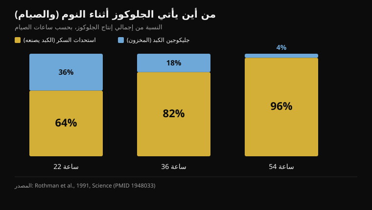
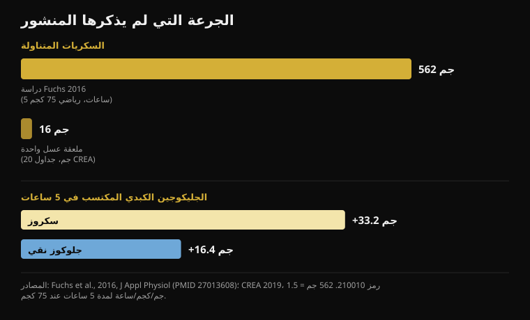

# العسل قبل النوم: هل ينفع فعلاً؟

بقلم [Giammaria Loi](/autore/giammaria-loi) · حُدِّث في 18 أكتوبر 2026

منشور متسلسل واسع الانتشار يشرح لماذا تمنع ملعقة عسل قبل النوم الاستيقاظ في الثالثة فجراً: الكبد يستنفد الجليكوجين، فينطلق الكورتيزول، فتستيقظ. السلسلة مرويّة بإتقان، والمنشور أصدق من المعتاد — فهو يعترف بأن البيانات البشرية حول النوم ضئيلة. قرأتُ إحدى عشرة دراسة لأتحقق من البقية. الآلية تنهار تحديداً عند النقطتين اللتين يقوم عليهما كل شيء، والرقم الغائب هو نفسه دائماً: الجرعة.

## باختصار

- **الكبد لا يجفّ أثناء الليل.** في أول 22 ساعة من الصيام، يصنع الكبد 64% من الجلوكوز الدائر بنفسه بدل أن يسحبه من المخزون (Rothman et al., 1991).
- **الكورتيزول الذي يرتفع في آخر الليل ساعةٌ لا إنذار.** إنه الإيقاع اليومي: أدنى ما يكون عند بدء النوم، وأعلى ما يكون لحظة الاستيقاظ (Mohd Azmi et al., 2021).
- **إيقاظ شخص سليم بانخفاض السكر يحتاج إلى 2.2 ملّي مول/لتر**، أي هبوط حادّ يُحدَث بالأنسولين — وحتى عندها استيقظ 10 فقط من 16 (Schultes et al., 2007).
- **ملعقة العسل الكبيرة تساوي 16 جراماً من السكريات** (جداول CREA). الدراسة التي تثبت آلية الفركتوز استخدمت 562 جراماً خلال خمس ساعات (Fuchs et al., 2016).
- **عبارة «الجلوكوز النقي لا يعيد بناء جليكوجين الكبد» خاطئة:** في الدراسة نفسها أضاف الجلوكوز وحده 16.4 جراماً، أي نحو نصف ما أضافه السكروز. النصف، لا الصفر.

## ما الذي يقوله المنشور

السلسلة كالتالي. الدماغ يمثّل 2% من وزن الجسم لكنه يحرق نحو 20% من الجلوكوز في الراحة. وفي الليل يواصل الاستهلاك، فينفد جليكوجين الكبد، فيحشد الجسم «وقود الطوارئ» برفع الكورتيزول نحو الثانية فجراً، والكورتيزول ينتزعك من النوم العميق. والعسل، نصفه جلوكوز ونصفه فركتوز، يمنح الدماغ سكراً فورياً ويمنح الكبد الفركتوز لإعادة بناء المخزون. البروتوكول: ملعقة عسل خام قبل النوم بثلاثين دقيقة.

الجزء الأول صحيح. الدماغ عضو باهظ التكلفة: يستهلك باستمرار بين 20% و25% من طاقة الجسم كله، بما في ذلك أثناء النوم. لا خلاف على ذلك.

ويجب القول أيضاً إن هذا المنشور أكثر شفافية من كل ما يشبهه تقريباً: شريحة كاملة مخصّصة لقوة الأدلة، ويعترف صراحةً بأن الدراسات البشرية حول العسل والنوم «ضئيلة» وأن كثيراً من الباقي مستقرأ من أبحاث الحيوان. هذه ميزة نادرة. المشكلة أن الشريحتين السابقتين تقدّمان كفيزيولوجيا مستقرّة خطوتين ترويهما الدراسات البشرية على نحو مختلف. وللسياق: إنستغرام يصنّف هذا المنشور بوصفه **محتوى مُولَّداً أو معدَّلاً بالذكاء الاصطناعي**.

## الكبد لا يجفّ وأنت نائم

هنا يسقط الجزء الأول من الآلية.

للكبد طريقتان لإبقاء سكر الدم مستقراً حين لا تأكل. يستطيع تفكيك الجليكوجين، أي مخزون السكر الجاهز (تحلل الجليكوجين)، أو يستطيع *تصنيع* جلوكوز جديد من اللاكتات والأحماض الأمينية والجليسرول: وهذا ما يُسمّى استحداث السكر، وهي عملية تعمل باستمرار.

في عام 1991 قاس فريق من جامعة ييل لأول مرة وزن كل مسار عند الإنسان، متتبعاً بالرنين المغناطيسي تركيز جليكوجين الكبد ساعةً بساعة خلال صيام دام 68 ساعة. النتيجة: **في أول 22 ساعة وحدها يغطي استحداث السكر 64% من إجمالي إنتاج الجلوكوز**. وعند 36 ساعة يرتفع إلى 82%، وعند 54 ساعة إلى 96%.

*نسبة إجمالي إنتاج الجلوكوز التي يغطيها مسارا الكبد، في ثلاث لحظات من الصيام. كلما طال الصيام قلّت أهمية مخزون الجليكوجين. المصدر: Rothman et al., 1991.*

بعبارة أخرى: مخزون جليكوجين الكبد ليس العمود الذي يحمل ليلتك، بل هو أصلاً الحصة الأصغر عند نهاية صيام يطول ثلاثة أضعاف ليلة نوم. خلال الساعات الثماني في السرير ينخفض المخزون فعلاً، لكنك لا تزال داخل النافذة التي يملك فيها الكبد خط إنتاج ثانياً كاملاً يعمل ويغطي معظم الحاجة. لا توجد لحظة «ينفد فيها الوقود» فتنطلق حالة الطوارئ.

## كورتيزول الثالثة فجراً ليس إنذار سكر

الجزء الثاني، وهو أيضاً لا يصمد.

يتبع الكورتيزول إيقاعاً يومياً واضحاً يتحكم فيه محور الوطاء-النخامى-الكظر: **يكون في أدنى مستوياته عند بدء النوم، ويبدأ بالصعود في النصف الثاني من الليل، ويبلغ ذروته في اللحظة التي تستيقظ فيها**. هذا الصعود الليلي ليس ردّ فعل على خلل في الأيض: إنه مبرمج، يهيّئ الجسم للاستيقاظ، ويحدث أيضاً عند من تناول عشاءً ممتازاً.

لكن هل يستطيع انخفاض السكر أن يوقظك؟ نعم — ونعرف بالضبط عند أي مستوى، لأن ذلك قيس فعلاً. في دراسة عام 2007 نُشرت في *PLoS Medicine*، خُفِّض سكر الدم بتسريب الأنسولين أثناء النوم لدى 16 شخصاً سليماً و16 مصاباً بالسكري من النوع الأول. وبلغ أدنى مستوى **2.2 ملّي مول/لتر**، أي نحو 40 ملغ/ديسيلتر: هبوط حادّ يستدعي التدخل. وعند تلك النقطة استيقظ **10 من 16 شخصاً سليماً** — وواحد فقط من 16 بين المصابين بالسكري.

هذه معلومتان في واحدة. الأولى: الجسم السليم يملك فعلاً آلية إيقاظ مرتبطة بالسكر، ويرتفع الأدرينالين وسطياً قبل سبع دقائق ونصف *من* ظهور أي علامة استيقاظ. والثانية، وهي الأهم: هذه الآلية تنطلق عند مستويات لا يبلغها شخص سليم نائم بعد العشاء. للوصول إليها لزم تسريب أنسولين.

إذا استيقظت في الثالثة فجراً فالأسباب المحتملة كثيرة: الكحول، حرارة الغرفة، التوتر، انقطاع النفس النومي، الكافيين في وقت متأخر، واليقظات القصيرة الطبيعية التي لا تتذكرها عادةً. وهو المنطق نفسه الذي اتبعته في حديثي عن [الكافيين والنوم](/ar/blog/alkafayin-walnawm-mata-tatawaqaf-an-alqahwa): قبل اللجوء إلى مكمّل، راجع المتغيرات التي قيست آثارها فعلاً.

## ملعقة واحدة قليلة جداً، والمنشور لا يقول ذلك أبداً

هذا هو الرقم الغائب عن الشرائح السبع كلها: **كم سكراً في ملعقة عسل**.

جداول التركيب الغذائي CREA، وهي نفسها التي يستخدمها تطبيق Nurvan ليوميات الطعام، تعطي العسل 80.3 جراماً من الكربوهيدرات لكل 100 جرام — كلها سكريات بسيطة — و304 سعرات، بحصة قياسية قدرها 20 جراماً. إذن الملعقة الكبيرة تساوي **نحو 16 جراماً من السكريات و61 سعرة**.

لنقارنها بالدراسة التي تثبت الآلية التي يستدعيها المنشور. في عام 2016 أفرغ خمسة عشر دراجاً مدرَّباً مخازنهم بتمرين مُنهِك، ثم تناولوا على مدى خمس ساعات **1.5 جرام كربوهيدرات لكل كيلوجرام من الوزن في الساعة**: أي نحو 112 جراماً في الساعة لرياضي وزنه 75 كيلوجراماً، **و562 جراماً إجمالاً**. وارتفع جليكوجين الكبد، المقيس بالرنين المغناطيسي، من 53.6 إلى 86.8 جراماً مع السكروز.

*في الأعلى الجرعة: جرعة الدراسة التي تثبت الآلية، وجرعة ملعقة عسل بحسب جداول CREA. وفي الأسفل النتيجة المقيسة بالرنين المغناطيسي: الجلوكوز النقي يضيف نحو نصف ما يضيفه السكروز، لا صفراً. المصادر: Fuchs et al., 2016؛ CREA 2019.*

ملعقة العسل تساوي **2.9%** من تلك الجرعة. والمراجعة نفسها حول جليكوجين الكبد تحدّد العتبة التي لا تكفي الكربوهيدرات دونها لمنع النفاد أثناء التمرين: أكثر من **1.5 جرام في الدقيقة**، أي ما يزيد على 90 جراماً كل ساعة. خمس ملاعق عسل في الساعة، لا ملعقة واحدة في آخر اليوم.

هذا لا يعني أن 16 جراماً من السكريات لا تفعل شيئاً إطلاقاً. يعني أنها لا تستطيع فعل الشيء المحدّد الذي ينسبه إليها المنشور: ملء مخزون كبدي كان يحوي لدى أولئك الرياضيين بين 49 و87 جراماً من الجليكوجين.

## «الجلوكوز النقي لا ينفع»: خطأ، والدراسة نفسها تقول ذلك

تحمل الشريحة الرابعة أقوى ادعاءات المنشور، وهو الذي يبرّر تفضيل العسل على أي سكر آخر: الجلوكوز النقي يرفع السكر بسرعة ويُخفضه بالسرعة نفسها من دون أن يعيد بناء جليكوجين الكبد «بشكل ذي معنى».

دراسة 2016 قارنت هذا بالضبط: السكروز مقابل الجلوكوز النقي، الجرعة نفسها والساعات الخمس نفسها. تفوّق السكروز، وهذه هي النتيجة التي تنصف الجزء الخاص بالفركتوز: **زيادة 3.4 جرام من جليكوجين الكبد في الساعة** مقارنةً بالجلوكوز (فاصل ثقة 95%: من 1.6 إلى 5.1). لكن الجلوكوز النقي لم يبقَ عند الصفر: رفع جليكوجين الكبد من 49.3 إلى 65.7 جراماً، أي **زيادة 16.4 جرام**، مقابل 33.2 للسكروز. نحو النصف. أما جليكوجين العضلات فكان السكران فيه متطابقين (p = 0.673).

«النصف» و«بلا معنى» ليسا الجملة ذاتها. أفضلية الفركتوز حقيقية ومقيسة، وهي سبب وجيه لتفضيل العسل أو السكروز أو خليط الجلوكوز والفركتوز حين تحتاج إلى إعادة شحن الكبد بسرعة — بين حصتين تدريبيتين في اليوم نفسه مثلاً. لكنها ليست سبباً للقول إن الجلوكوز لا يعمل.

## أما في التدريب فهناك شيء حقيقي

الجزء الخاص بالأداء هو الأمتن في المنشور، وهنا أيضاً تغيّر التفاصيل المعنى.

الدراسة التي يستند إليها الادعاء تعود إلى 2004: تسعة دراجين، سباق ضد الساعة بطول 64 كيلومتراً، ثلاث جولات معمّاة مع تناول **15 جراماً من العسل (مؤشر سكري 35) أو 15 جراماً من الدكستروز (مؤشر سكري 100) أو دواء وهمي كل 16 كيلومتراً**. الأزمنة: العسل 128 دقيقة و42 ثانية، الدكستروز 128:18، الدواء الوهمي 131:18. الفارق بين العسل والدكستروز **0.39%**، بفاصل يمتد من -3.39% إلى +4.15%: لا فرق. أما الكربوهيدرات مجتمعةً فتفوّقت على الدواء الوهمي (p < 0.02).

إذن نعم، العسل يعادل الجِل. لكن في التجربة نفسها **يعادله الدكستروز أيضاً، أي الجلوكوز النقي**، وهو ما تعلن الشريحة الرابعة أنه بلا فائدة. والجرعة كانت 15 جراماً كل 16 كيلومتراً، أي نحو 60 جراماً خلال ساعتين: ملعقة تلو الأخرى، أثناء الجهد. لا ملعقة واحدة قبل الخروج.

وثمة نتيجة أحدث تبرّد الحماس أكثر: في 2025 اختُبر مكمّل قائم على مسحوق العسل والبروتين على اثني عشر دراجاً بسباق ضد الساعة مدته 20 دقيقة بعد 100 دقيقة من العمل. الشغل الكلي 294 كيلوجول مقابل 292 للدواء الوهمي، ومتوسط القدرة 245 مقابل 243 واط: **لا فرق** (p = 0.72 وp = 0.61)، ولا في سكر الدم ولا اللاكتات ولا الجهد المُدرَك.

أما في التكلفة فالمنشور محقّ، وهذه نقطة عملية حقيقية: إذا كنت تقود الدراجة ثلاث ساعات وتحتاج إلى 60-90 جراماً من الكربوهيدرات في الساعة، فإن أخذها من العسل يكلّف جزءاً يسيراً مما تكلّفه الجِلّات. أما مسارا الامتصاص اللذان تذكرهما الشريحة السادسة — ناقل SGLT1 للجلوكوز وGLUT5 للفركتوز، يعملان بالتوازي — فحقيقيان ومهمّان فعلاً، *لكن عند معدلات التناول تلك فقط*. عند 16 جراماً لا يوجد مسار يحتاج إلى إشباع.

## وماذا عن العسل قبل النوم؟ البيانات غير موجودة

بخصوص العسل والنوم لدى البالغين، لم أجد أي تجربة عشوائية على PubMed. والمراجعة المخصّصة للموضوع، الصادرة عام 2024، تصف العسل بأنه مسار واعد للنوم لكنها تخلص إلى أن الآليات غير محدَّدة وأن الحاجة قائمة إلى مزيد من البحث: إنها جرد للفرضيات لا للنتائج.

التجربة العشوائية المضبوطة الوحيدة التي تقيس نتيجة متعلقة بالنوم أُجريت على الأطفال: 161 طفلاً بين عام وخمسة أعوام يعانون سعالاً من نزلة برد، عسل أكاسيا مقابل شراب وهمي بنكهة العسل في الساعة السابقة للنوم. تحسّنت المجموعتان، **من دون أي فرق بين العسل والدواء الوهمي**، لا في السعال ولا في صعوبات النوم. السياق مختلف، لكنها البيانات المضبوطة الوحيدة الموجودة، وهي تسير عكس رواية المنشور.

غير أن هناك أمراً ينفع فعلاً مع الكربوهيدرات والنوم، وقد فاتَ المنشور. في 2007 تناول اثنا عشر رجلاً سليماً وجبة ذات مؤشر سكري مرتفع **قبل النوم بأربع ساعات**: فانخفض زمن الخلود إلى النوم من 17.5 إلى 9.0 دقيقة (p = 0.009). والوجبة نفسها حين قُدّمت **قبل ساعة واحدة** كانت أسوأ: 14.6 دقيقة. وبروتوكول المنشور يقول ثلاثين دقيقة قبل النوم، أي على الجانب الخاطئ تماماً من البيانات الوحيدة المتاحة.

## ما الذي يقوله البحث فعلاً

- **مؤكَّد** — الدماغ مستهلك ضخم وثابت للطاقة: بين 20% و25% من استهلاك الجسم كله، ليلاً ونهاراً.
- **مؤكَّد** — الفركتوز يساعد على إعادة شحن جليكوجين الكبد أكثر من الجلوكوز وحده: 3.4 جرام إضافية في الساعة، مقيسة بالرنين المغناطيسي.
- **مؤكَّد** — في جهد التحمل يعادل العسل جِلّاً تجارياً في سباق 64 كيلومتراً ضد الساعة — لكن في الدراسة نفسها يعادله الجلوكوز النقي أيضاً.
- **يحتاج إلى تدقيق** — «نسبة 1:1 هي الآلية كلها»: الاتجاه صحيح، والجرعة لا. الملعقة تساوي 2.9% من الكربوهيدرات المستخدمة في الدراسة التي تثبت تلك الآلية.
- **يحتاج إلى تدقيق** — العسل أرخص من الجِلّات: صحيح، لكن المقارنة تصحّ عند تساوي الجرعة، أي 60-90 جراماً من الكربوهيدرات في الساعة أثناء الجهد، لا ملعقة واحدة.
- **مُفنَّد** — «في الليل يستنفد الكبد جليكوجينه»: في أول 22 ساعة من الصيام يأتي 64% من الجلوكوز المنتَج من استحداث السكر، لا من المخزون.
- **مُفنَّد** — «نفاد الجليكوجين يطلق الكورتيزول في الثانية فيوقظك»: ارتفاع الكورتيزول في آخر الليل إيقاع يومي، وإيقاظ شخص سليم عبر السكر يحتاج إلى هبوط إلى 2.2 ملّي مول/لتر بالأنسولين.
- **مُفنَّد** — «الجلوكوز النقي لا يعيد بناء جليكوجين الكبد بشكل ذي معنى»: أضاف 16.4 جراماً في خمس ساعات، أي نحو نصف السكروز.
- **غير قابل للتحقق** — «العسل الخام فقط: المعالَج يفقد النشاط الإنزيمي المهم». لا توجد دراسة على PubMed تقارن العسل الخام بالمعالَج في النوم أو الجليكوجين؛ وفي تجربة 2004 كان العسل منتجاً تجارياً وقد نجح.
- **غير قابل للتحقق** — تقليل الاستيقاظ في الثالثة فجراً بملعقة عسل: لا توجد تجربة عشوائية لدى البالغين. والنتيجة المضبوطة الوحيدة المتعلقة بالنوم، لدى الأطفال، لا تجد فرقاً عن الدواء الوهمي.

## كيف تطبّق ذلك

1. **إذا استيقظت ليلاً، ابدأ بالأسباب التي تسندها بيانات.** الكحول قبل النوم، الغرفة الدافئة، الكافيين المتأخر، التوتر، انقطاع النفس النومي. لهذه آثار مقيسة على النوم؛ أما جليكوجين الكبد لدى الأصحاء فلا.
2. **إن أردت تجربة الكربوهيدرات من أجل النوم، فغيّر توقيتها.** النتيجة الإيجابية الوحيدة تتعلق بوجبة ذات مؤشر سكري مرتفع قبل النوم بأربع ساعات، لا بملعقة قبل ثلاثين دقيقة. والعشاء العادي المحتوي على كربوهيدرات يؤدي هذه المهمة أصلاً.
3. **استخدم العسل حيث يستحق مكانه فعلاً: أثناء الجهد الطويل.** بعد 90 دقيقة، 60-90 جراماً من الكربوهيدرات في الساعة. العسل مصدر ممتاز ومنخفض الكلفة، وخليط الجلوكوز والفركتوز ميزة حقيقية عند تلك الكميات.
4. **بعد التمرين، إن كانت حصة أخرى قريبة، فالفركتوز مهم.** العسل أو السكروز أو مشروب الجلوكوز والفركتوز يعيد شحن الكبد بما يقارب ضعف سرعة الجلوكوز النقي. أما إن كانت الحصة التالية غداً فلديك متسع من الوقت ولا يكاد اختيار السكر يفرق.
5. **سجّله في اليوميات.** الملعقة 61 سعرة و16 جراماً من السكريات: لا تُذكر في ليلة واحدة، لكنها تُذكر حين تصير عادة يومية تُضاف إلى كل ما سواها. وهي المسألة نفسها التي تناولتها في [الكربوهيدرات والدهون الخفية](/ar/blog/hal-alkarbohidrat-tazid-alwazn-duhun-khafiya).
6. **وإن جربته، فجرّبه كتجربة حقيقية.** أسبوعان معه وأسبوعان بدونه، بالموعد نفسه للنوم، مع تسجيل مرات الاستيقاظ. هذه أفضل نصيحة في المنشور، وهي السبيل الوحيد للتمييز بين الأثر والتوقّع.

> **العسل في اليوميات، بالأرقام الصحيحة**  
> تعتمد وحدة التغذية في Nurvan على جداول CREA الرسمية: تبحث عن «العسل»، تختار الحصة، فتذهب تلك الـ16 جراماً من السكريات إلى مكانها الصحيح، ضمن إجمالي اليوم. وإن استخدمته وقوداً في التمارين الطويلة، فسجّله مع الحصة التدريبية بدل أن تحفظه في ذهنك.  
> [جرّب Nurvan](https://nurvan.app)

## أسئلة شائعة

### هل يساعد العسل قبل النوم فعلاً على نوم أفضل؟

لا توجد تجارب عشوائية لدى البالغين تثبت ذلك. والدراسة المضبوطة الوحيدة التي تقيس نتيجة متعلقة بالنوم أُجريت على أطفال يعانون السعال ولم تجد فرقاً بين العسل والشراب الوهمي. أما آلية جليكوجين الكبد، وهي التفسير الأكثر تداولاً، فلا تصمد أمام البيانات: في الليل يصنع الكبد معظم الجلوكوز بنفسه بدل سحبه من المخزون.

### لماذا أستيقظ في الثالثة فجراً؟

لدى الأصحاء، نادراً جداً بسبب سكر الدم: فذلك يتطلب هبوطاً إلى نحو 2.2 ملّي مول/لتر، وهو مستوى لا يُبلَغ أثناء النوم بعد العشاء. والأسباب الأكثر شيوعاً وتوثيقاً هي الكحول وحرارة الغرفة والكافيين المتأخر والتوتر واضطرابات التنفس أثناء النوم. وإذا تكرر الاستيقاظ وتركك متعباً نهاراً، فتحدّث مع طبيبك بدل البحث عن علاج غذائي.

### العسل أم جِل الكربوهيدرات أثناء التمرين؟

من حيث الأداء هما متكافئان: في المقارنة المباشرة على سباق 64 كيلومتراً ضد الساعة أعطى العسل والدكستروز الزمن نفسه، وكلاهما أفضل من الدواء الوهمي. والعسل أرخص بكثير. لكن الجرعة هي الفيصل: بعد 90 دقيقة من الجهد تحتاج إلى 60-90 جراماً من الكربوهيدرات في الساعة، أي أربع أو خمس ملاعق، لا ملعقة واحدة.

### هل العسل الخام أفضل من المعالَج؟

بخصوص النوم والجليكوجين لا توجد دراسات تقارن بينهما، فهو إذن ادعاء بلا دليل: لا مثبَت ولا مفنَّد. ويجدر التنبيه إلى أن العسل في دراسة الدراجات كان منتجاً تجارياً مُحضَّراً على شكل جِل، وقد أدى أداءً مماثلاً للدكستروز.

## اقرأ أيضاً

- [الكافيين والنوم: متى تتوقف عن القهوة](/ar/blog/alkafayin-walnawm-mata-tatawaqaf-an-alqahwa) — العتبات الحقيقية، محسوبة رجوعاً من موعد النوم
- [متى تتناول المكمّلات الغذائية: هل تهم الساعة؟](/ar/blog/mata-tatanawal-almukammilat-alghidhaiya) — ثماني دراسات عن التوقيت، وكم يغيّر فعلاً
- [هل تزيد الكربوهيدرات الوزن؟ الدهون الخفية](/ar/blog/hal-alkarbohidrat-tazid-alwazn-duhun-khafiya) — ما الموجود فعلاً فيما تأكله، بحسب جداول CREA

## المصادر

1. Rothman DL, Magnusson I, Katz LD, Shulman RG, Shulman GI, 1991. Quantitation of hepatic glycogenolysis and gluconeogenesis in fasting humans with 13C NMR. *Science* 254(5031):573-576. PMID 1948033 — [doi.org/10.1126/science.1948033](https://doi.org/10.1126/science.1948033)
2. Schultes B, Jauch-Chara K, Gais S, et al., 2007. Defective awakening response to nocturnal hypoglycemia in patients with type 1 diabetes mellitus. *PLoS Med* 4(2):e69. PMID 17326710 — [doi.org/10.1371/journal.pmed.0040069](https://doi.org/10.1371/journal.pmed.0040069)
3. Mohd Azmi NAS, Juliana N, Azmani S, et al., 2021. Cortisol on circadian rhythm and its effect on cardiovascular system. *Int J Environ Res Public Health* 18(2):676. PMID 33466883 — [doi.org/10.3390/ijerph18020676](https://doi.org/10.3390/ijerph18020676)
4. Beard E, Lengacher S, Dias S, Magistretti PJ, Finsterwald C, 2022. Astrocytes as key regulators of brain energy metabolism: new therapeutic perspectives. *Front Physiol* 12:825816. PMID 35087428 — [doi.org/10.3389/fphys.2021.825816](https://doi.org/10.3389/fphys.2021.825816)
5. Fuchs CJ, Gonzalez JT, Beelen M, et al., 2016. Sucrose ingestion after exhaustive exercise accelerates liver, but not muscle glycogen repletion compared with glucose ingestion in trained athletes. *J Appl Physiol* 120(11):1328-1334. PMID 27013608 — [doi.org/10.1152/japplphysiol.01023.2015](https://doi.org/10.1152/japplphysiol.01023.2015)
6. Gonzalez JT, Fuchs CJ, Betts JA, van Loon LJC, 2016. Liver glycogen metabolism during and after prolonged endurance-type exercise. *Am J Physiol Endocrinol Metab* 311(3):E543-E553. PMID 27436612 — [doi.org/10.1152/ajpendo.00232.2016](https://doi.org/10.1152/ajpendo.00232.2016)
7. Earnest CP, Lancaster SL, Rasmussen CJ, et al., 2004. Low vs. high glycemic index carbohydrate gel ingestion during simulated 64-km cycling time trial performance. *J Strength Cond Res* 18(3):466-472. PMID 15320674 (معرّف DOI المسجَّل لهذه المقالة عنصر نائب لا يعمل؛ يُستشهد بها عبر رقم PMID)
8. Toniazzo T, de Almeida Azevedo R, Oliveira TN, et al., 2025. A novel honey powder-based supplement containing carbohydrate and protein did not improve endurance performance in recreationally trained cyclists. *Int J Sport Nutr Exerc Metab* 35(6):520-529. PMID 40812383 — [doi.org/10.1123/ijsnem.2025-0021](https://doi.org/10.1123/ijsnem.2025-0021)
9. Nishimura T, Muta H, Hosaka T, Ueda M, Kishida K, 2022. Multicentre, randomised study found that honey had no pharmacological effect on nocturnal coughs and sleep quality at 1-5 years of age. *Acta Paediatr* 111(11):2157-2164. PMID 35927828 — [doi.org/10.1111/apa.16509](https://doi.org/10.1111/apa.16509)
10. Zulkifli MF, Masimen MAA, Ridzuan PM, Wan Ismail WI, 2024. Exploring honey's potential as a functional food for natural sleep aid. *Food Funct* 15(19):9678-9689. PMID 39248637 — [doi.org/10.1039/d4fo02013h](https://doi.org/10.1039/d4fo02013h)
11. Afaghi A, O'Connor H, Chow CM, 2007. High-glycemic-index carbohydrate meals shorten sleep onset. *Am J Clin Nutr* 85(2):426-430. PMID 17284739 — [doi.org/10.1093/ajcn/85.2.426](https://doi.org/10.1093/ajcn/85.2.426)
12. CREA — مركز أبحاث الأغذية والتغذية، جداول التركيب الغذائي الإيطالية، تحديث 2019، مادة «Miele» (العسل، الرمز 210010): 304 سعرات، 80.3 جرام كربوهيدرات، حصة قياسية 20 جراماً.

نقطة الانطلاق: منشور متسلسل لـ[Christian Poulos](https://www.instagram.com/p/DdwWWxYkfEW/) (26 سبتمبر 2026)، يصنّفه إنستغرام بوصفه محتوى مُولَّداً أو معدَّلاً بالذكاء الاصطناعي. لم يُستنسخ أي نص أو صورة من المنشور: أُعيدت صياغة الادعاءات وجرى التحقق منها في الأدبيات الأولية.

جيامّاريا لوي مؤسس تطبيق Nurvan. يتدرب بالأثقال منذ 2012، ويعمل مدرباً شخصياً ومدرّباً معتمداً من الاتحاد الإيطالي لرفع الأثقال منذ 2013، ويشارك في منافسات رفع القوة على المستوى الوطني منذ 2018. كل مقال يوقّعه ينطلق من الدراسات العلمية وينتهي عند ما ينفع فعلاً في الصالة. [صفحة الكاتب](/autore/giammaria-loi)

> ملاحظة: محتوى معلوماتي لا يحلّ محل رأي طبيب أو مختص مؤهل. إذا تكرّر الاستيقاظ الليلي، أو استيقظت متعباً، أو كنت مصاباً بالسكري أو تتناول أدوية تخفض سكر الدم، فتحدّث مع طبيبك: في هذه الحالات يكون هبوط السكر الليلي مشكلة حقيقية يتولاها من يتابع حالتك، لا ملعقة عسل.
