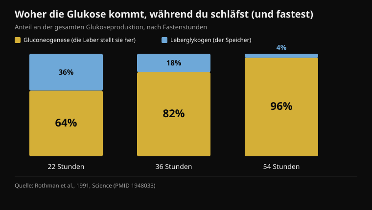
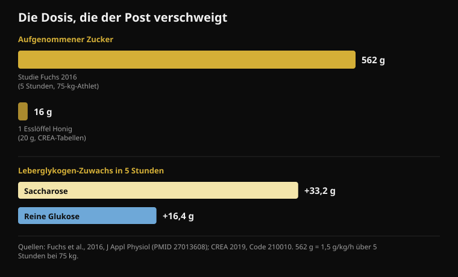

# Honig vor dem Schlafen: bringt das wirklich was?

Von [Giammaria Loi](/autore/giammaria-loi) · aktualisiert am 18. Oktober 2026

Ein vielgeteiltes Karussell erklärt, warum ein Löffel Honig vor dem Schlafen das Aufwachen um drei Uhr nachts verhindern soll: Die Leber verbraucht ihr Glykogen, das Cortisol springt an, du wachst auf. Die Kette ist gut erzählt, und der Beitrag ist ehrlicher als der Durchschnitt — er räumt ein, dass die Humandaten zum Schlaf dünn sind. Ich habe elf Studien gelesen, um den Rest zu prüfen. Der Mechanismus scheitert an genau den zwei Punkten, auf denen alles ruht, und die fehlende Zahl ist immer dieselbe: die Dosis.

## Kurz gefasst

- **Nachts läuft die Leber nicht leer.** Schon in den ersten 22 Stunden des Fastens stellt die Leber 64 % der zirkulierenden Glukose selbst her, statt sie dem Speicher zu entnehmen (Rothman et al., 1991).
- **Das Cortisol, das gegen Ende der Nacht steigt, ist eine Uhr, kein Alarm.** Es ist der zirkadiane Rhythmus: am niedrigsten beim Einschlafen, am höchsten im Moment des Aufwachens (Mohd Azmi et al., 2021).
- **Um einen gesunden Menschen über den Blutzucker zu wecken, braucht es 2,2 mmol/l** — eine mit Insulin erzeugte schwere Unterzuckerung —, und selbst dann wachten nur 10 von 16 auf (Schultes et al., 2007).
- **Ein Esslöffel Honig sind 16 Gramm Zucker** (CREA-Tabellen). Die Studie, die den Fruktose-Mechanismus belegt, verwendete 562 Gramm in fünf Stunden (Fuchs et al., 2016).
- **„Reine Glukose füllt das Leberglykogen nicht auf" ist falsch:** In derselben Studie legte Glukose allein 16,4 Gramm zu, etwa die Hälfte von Saccharose. Die Hälfte, nicht null.

## Was der Beitrag behauptet

Die Kette geht so. Das Gehirn macht 2 % des Körpergewichts aus, verbrennt aber rund 20 % der Ruheglukose. Nachts verbraucht es weiter, das Leberglykogen geht zur Neige, der Körper mobilisiert „Notfalltreibstoff", indem er gegen zwei Uhr das Cortisol anhebt, und das Cortisol reißt dich aus dem Tiefschlaf. Honig, halb Glukose und halb Fruktose, liefere dem Gehirn sofort Zucker und der Leber die Fruktose zum Wiederaufbau des Speichers. Protokoll: ein Esslöffel roher Honig dreißig Minuten vor dem Schlafengehen.

Der erste Baustein stimmt. Das Gehirn ist ein extrem teures Organ: Es verbraucht durchgehend zwischen 20 % und 25 % der Energie des gesamten Organismus, auch im Schlaf. Darüber gibt es keine Diskussion.

Zu sagen ist auch, dass dieser Beitrag transparenter ist als fast alles Vergleichbare: Eine ganze Folie widmet sich der Stärke der Evidenz und räumt offen ein, dass die Humanstudien zu Honig und Schlaf „dünn" sind und vieles aus Tierversuchen hochgerechnet wird. Das ist selten und verdient Anerkennung. Das Problem: Die zwei Folien davor präsentieren als gesicherte Physiologie zwei Schritte, die Humanstudien anders erzählen. Zur Einordnung: Instagram kennzeichnet diesen Beitrag als **mit künstlicher Intelligenz erzeugten oder bearbeiteten Inhalt**.

## Die Leber läuft im Schlaf nicht leer

Hier fällt der erste Baustein des Mechanismus.

Die Leber hat zwei Wege, den Blutzucker stabil zu halten, wenn du nichts isst. Sie kann Glykogen abbauen, den fertigen Zuckerspeicher (Glykogenolyse), oder sie kann aus Laktat, Aminosäuren und Glycerin neue Glukose *herstellen*: die Gluconeogenese, ein Prozess, der durchgehend läuft.

1991 maß eine Gruppe aus Yale erstmals, wie viel jeder der beiden Wege beim Menschen beiträgt, und verfolgte per Magnetresonanz die Leberglykogen-Konzentration Stunde für Stunde über ein 68-stündiges Fasten. Das Ergebnis: **Schon in den ersten 22 Stunden deckt die Gluconeogenese 64 % der gesamten Glukoseproduktion**. Nach 36 Stunden sind es 82 %, nach 54 Stunden 96 %.

*Anteil der gesamten Glukoseproduktion, den die beiden Wege der Leber decken, zu drei Zeitpunkten des Fastens. Je länger das Fasten dauert, desto weniger zählt der Glykogenspeicher. Quelle: Rothman et al., 1991.*

Übersetzt: Der Leberglykogen-Speicher ist nicht die Säule, die deine Nacht trägt. Er ist schon am Ende eines Fastens, das dreimal so lang ist wie eine Nacht Schlaf, der kleinere Anteil. In den acht Stunden im Bett sinkt der Speicher sehr wohl, aber du bist noch in dem Fenster, in dem die Leber eine komplette zweite Produktionslinie laufen hat, die den größten Teil des Bedarfs deckt. Es gibt keinen Moment, in dem „der Sprit ausgeht" und der Notfall einsetzt.

## Das Cortisol um drei Uhr ist kein Blutzucker-Alarm

Zweiter Baustein — und auch der hält nicht.

Cortisol folgt einem sehr ausgeprägten zirkadianen Rhythmus, gesteuert von der Hypothalamus-Hypophysen-Nebennieren-Achse: **Es ist zu Beginn des Schlafs am niedrigsten, steigt in der zweiten Nachthälfte an und erreicht seinen Höchstwert in dem Moment, in dem du aufwachst**. Dieser nächtliche Anstieg ist keine Reaktion auf etwas, das im Stoffwechsel schiefgelaufen wäre: Er ist eingeplant, er bereitet den Organismus aufs Aufwachen vor, und er passiert auch bei denen, die bestens zu Abend gegessen haben.

Aber kann ein niedriger Blutzucker wecken? Ja — und wir wissen genau, bei welchem Wert, denn es wurde gemessen. In einer 2007 in *PLoS Medicine* veröffentlichten Studie senkte man den Blutzucker im Schlaf per Insulininfusion, bei 16 Gesunden und 16 Menschen mit Typ-1-Diabetes. Der erreichte Tiefpunkt lag bei **2,2 mmol/l**, rund 40 mg/dl: eine schwere Unterzuckerung, die ein Eingreifen erfordert. An diesem Punkt wachten **10 von 16 Gesunden** auf — und nur eine von 16 Personen mit Diabetes.

Das sind zwei Informationen in einer. Erstens: Der gesunde Organismus hat tatsächlich einen blutzuckergekoppelten Weckmechanismus, und das Adrenalin steigt im Mittel siebeneinhalb Minuten *vor* den ersten Anzeichen des Erwachens. Zweitens, und wichtiger: Dieser Mechanismus springt bei Werten an, die ein gesunder Mensch im Schlaf nach dem Abendessen nicht erreicht. Dafür brauchte es eine Insulininfusion.

Wenn du um drei Uhr aufwachst, kommen viele plausible Ursachen infrage: Alkohol, Zimmertemperatur, Stress, Schlafapnoe, zu spät getrunkenes Koffein, normale kurze Wachphasen, an die man sich sonst nicht erinnert. Es ist dieselbe Überlegung wie bei [Koffein und Schlaf](/de/blog/koffein-schlaf-wann-letzter-kaffee): Bevor man zu einem Supplement greift, prüft man die Variablen mit gemessener Wirkung.

## Ein Löffel ist viel zu wenig — und der Beitrag sagt es nie

Das ist die Zahl, die auf allen sieben Folien fehlt: **wie viel Zucker in einem Löffel Honig steckt**.

Die CREA-Nährwerttabellen, dieselben, die Nurvan für das Ernährungstagebuch nutzt, geben Honig mit 80,3 Gramm Kohlenhydraten je 100 Gramm an — alles Einfachzucker — und 304 kcal, bei einer Standardportion von 20 Gramm. Ein Esslöffel sind also **rund 16 Gramm Zucker und 61 Kalorien**.

Vergleichen wir das mit der Studie, die den vom Beitrag beschworenen Mechanismus belegt. 2016 entleerten fünfzehn trainierte Radfahrer ihre Speicher durch erschöpfende Belastung und nahmen dann fünf Stunden lang **1,5 Gramm Kohlenhydrate je Kilo Körpergewicht pro Stunde**: bei einem 75-Kilo-Athleten rund 112 Gramm pro Stunde, **562 Gramm insgesamt**. Das per Magnetresonanz gemessene Leberglykogen stieg mit Saccharose von 53,6 auf 86,8 Gramm.

*Oben die Dosis: die der Studie, die den Mechanismus belegt, und die eines Esslöffels Honig nach den CREA-Tabellen. Unten das per Magnetresonanz gemessene Ergebnis: Reine Glukose legt etwa die Hälfte von Saccharose zu, nicht null. Quellen: Fuchs et al., 2016; CREA 2019.*

Ein Esslöffel Honig sind **2,9 %** dieser Dosis. Und dieselbe Übersichtsarbeit zum Leberglykogen setzt die Schwelle, unterhalb derer Kohlenhydrate die Entleerung während der Belastung nicht verhindern: über **1,5 Gramm pro Minute**, also mehr als 90 Gramm pro Stunde. Fünf Löffel Honig pro Stunde, nicht einer am Ende des Tages.

Das heißt nicht, dass 16 Gramm Zucker gar nichts tun. Es heißt, dass sie genau das nicht können, was der Beitrag ihnen zuschreibt: einen Leberspeicher füllen, der bei jenen Athleten zwischen 49 und 87 Gramm Glykogen enthielt.

## „Reine Glukose bringt nichts": falsch — und dieselbe Studie sagt es

Folie 4 enthält die schärfste Behauptung des Beitrags, die, die Honig gegenüber jedem anderen Zucker rechtfertigt: Reine Glukose treibe den Blutzucker schnell hoch und ebenso schnell wieder runter, ohne das Leberglykogen „in nennenswertem Maß" aufzufüllen.

Die Studie von 2016 verglich genau das: Saccharose gegen reine Glukose, gleiche Dosis, dieselben fünf Stunden. Saccharose schnitt besser ab, und das ist der Befund, der dem Fruktose-Teil recht gibt: **+3,4 Gramm Leberglykogen pro Stunde** gegenüber Glukose (95-%-Konfidenzintervall: 1,6 bis 5,1). Aber reine Glukose blieb nicht bei null: Sie brachte das Leberglykogen von 49,3 auf 65,7 Gramm, also **+16,4 Gramm**, gegenüber +33,2 bei Saccharose. Etwa die Hälfte. Beim Muskelglykogen waren beide Zucker identisch (p = 0,673).

„Die Hälfte" und „in nicht nennenswertem Maß" sind nicht dasselbe. Der Fruktose-Vorteil ist real und gemessen, und er ist ein vernünftiger Grund, Honig, Saccharose oder eine Glukose-Fruktose-Mischung zu bevorzugen, wenn die Leber schnell wieder aufgeladen werden muss — etwa zwischen zwei Einheiten am selben Tag. Er ist kein Grund zu sagen, Glukose funktioniere nicht.

## Beim Training dagegen ist etwas dran

Der Leistungsteil ist der solideste des Beitrags, und auch hier verändert das Detail den Sinn.

Die Studie hinter der Behauptung stammt von 2004: neun Radfahrer, 64 Kilometer Einzelzeitfahren, drei verblindete Durchgänge mit **15 Gramm Honig (glykämischer Index 35), 15 Gramm Dextrose (glykämischer Index 100) oder Placebo alle 16 Kilometer**. Zeiten: Honig 128 Minuten 42 Sekunden, Dextrose 128:18, Placebo 131:18. Zwischen Honig und Dextrose beträgt der Unterschied **0,39 %**, mit einem Intervall von -3,39 % bis +4,15 %: kein Unterschied. Beide Kohlenhydrate zusammen schlagen das Placebo (p < 0,02).

Also ja: Honig zieht mit dem Gel gleich. Aber im selben Versuch **zieht auch Dextrose gleich, also reine Glukose** — genau das, was Folie 4 für nutzlos erklärt. Und die Dosis waren 15 Gramm alle 16 Kilometer, rund 60 Gramm in zwei Stunden: ein Löffel nach dem anderen, während der Belastung. Nicht ein Löffel vor dem Losfahren.

Ein neuerer Befund dämpft die Begeisterung weiter: 2025 wurde ein Supplement aus Honigpulver und Protein an zwölf Radfahrern mit einem 20-Minuten-Zeitfahren nach 100 Minuten Arbeit getestet. Gesamtarbeit 294 kJ gegenüber 292 beim Placebo, mittlere Leistung 245 gegenüber 243 Watt: **kein Unterschied** (p = 0,72 und p = 0,61), auch nicht bei Blutzucker, Laktat oder empfundener Anstrengung.

Beim Preis hat der Beitrag recht, und das ist ein echter praktischer Punkt: Wenn du drei Stunden fährst und 60 bis 90 Gramm Kohlenhydrate pro Stunde brauchst, kostet Honig einen Bruchteil dessen, was Gels kosten. Der doppelte Aufnahmeweg, den Folie 6 nennt — die Transporter SGLT1 für Glukose und GLUT5 für Fruktose, die parallel arbeiten —, ist real und zählt tatsächlich, *aber nur bei diesen Zufuhrraten*. Bei 16 Gramm gibt es keinen Weg zu sättigen.

## Und Honig vor dem Schlafen? Die Daten fehlen

Zu Honig und Schlaf bei Erwachsenen habe ich auf PubMed keine randomisierte Studie gefunden. Die 2024 erschienene Übersichtsarbeit zum Thema beschreibt Honig als vielversprechenden Ansatz für den Schlaf, kommt aber zu dem Schluss, dass die Mechanismen ungeklärt sind und weitere Forschung nötig ist: eine Sammlung von Hypothesen, nicht von Ergebnissen.

Die einzige randomisierte, kontrollierte Studie mit einem Schlaf-Endpunkt betrifft Kinder: 161 Kinder zwischen 1 und 5 Jahren mit Erkältungshusten, Akazienhonig gegen einen Placebo-Sirup mit Honiggeschmack in der Stunde vor dem Zubettgehen. Beide Gruppen besserten sich, **ohne jeden Unterschied zwischen Honig und Placebo**, weder beim Husten noch bei den Schlafproblemen. Ein anderer Kontext, aber es ist die einzige kontrollierte Evidenz, die existiert — und sie weist in die Gegenrichtung zur Erzählung des Beitrags.

Etwas funktioniert allerdings tatsächlich mit Kohlenhydraten und Schlaf, und das übersieht der Beitrag. 2007 aßen zwölf gesunde Männer eine Mahlzeit mit hohem glykämischen Index **vier Stunden vor dem Schlafengehen**: Die Einschlaflatenz sank von 17,5 auf 9,0 Minuten (p = 0,009). Dieselbe Mahlzeit **eine Stunde vorher** wirkte schlechter: 14,6 Minuten. Das Protokoll des Beitrags nennt dreißig Minuten vor dem Licht-aus — genau die falsche Seite der einzigen verfügbaren Daten.

## Was die Forschung wirklich sagt

- **Bestätigt** — Das Gehirn ist ein enormer und konstanter Energieverbraucher: zwischen 20 % und 25 % des Verbrauchs des ganzen Organismus, Tag und Nacht.
- **Bestätigt** — Fruktose hilft beim Wiederauffüllen des Leberglykogens besser als Glukose allein: 3,4 Gramm pro Stunde mehr, per Magnetresonanz gemessen.
- **Bestätigt** — Im Ausdauerbereich zieht Honig über ein 64-km-Zeitfahren mit einem kommerziellen Gel gleich — in derselben Studie aber auch reine Glukose.
- **Zu präzisieren** — „Das 1:1-Verhältnis ist der ganze Mechanismus": Die Richtung stimmt, die Dosis nicht. Ein Löffel sind 2,9 % der Kohlenhydrate aus der Studie, die diesen Mechanismus belegt.
- **Zu präzisieren** — Honig kostet weniger als Gels: stimmt, aber der Vergleich gilt bei gleicher Dosis, also 60 bis 90 Gramm Kohlenhydrate pro Stunde während der Belastung, nicht ein Löffel.
- **Widerlegt** — „Nachts verbraucht die Leber ihr Glykogen": Schon in den ersten 22 Stunden des Fastens stammen 64 % der produzierten Glukose aus der Gluconeogenese, nicht aus dem Speicher.
- **Widerlegt** — „Leeres Glykogen lässt um zwei Uhr das Cortisol anspringen und weckt dich": Der nächtliche Cortisolanstieg ist zirkadian, und einen gesunden Menschen über den Blutzucker zu wecken erfordert einen insulininduzierten Abfall auf 2,2 mmol/l.
- **Widerlegt** — „Reine Glukose füllt das Leberglykogen nicht nennenswert auf": Sie legte in fünf Stunden 16,4 Gramm zu, etwa die Hälfte von Saccharose.
- **Nicht überprüfbar** — „Nur roher Honig: verarbeiteter verliert die entscheidende Enzymaktivität." Keine Studie auf PubMed vergleicht rohen und verarbeiteten Honig bei Schlaf oder Glykogen; in der Studie von 2004 war der Honig ein kommerzielles Produkt und wirkte.
- **Nicht überprüfbar** — Weniger Aufwachen um drei Uhr durch einen Löffel Honig: keine randomisierte Studie bei Erwachsenen. Der einzige kontrollierte Schlaf-Endpunkt, bei Kindern, findet keinen Unterschied zum Placebo.

## So wendest du es an

1. **Wenn du nachts aufwachst, fang bei den Ursachen mit Daten an.** Alkohol vor dem Schlafen, warmes Zimmer, spätes Koffein, Stress, Schlafapnoe. Sie haben gemessene Wirkungen auf den Schlaf; das Leberglykogen hat sie bei Gesunden nicht.
2. **Wenn du Kohlenhydrate für den Schlaf testen willst, verschieb sie.** Der einzige positive Befund betrifft eine Mahlzeit mit hohem glykämischen Index vier Stunden vor dem Zubettgehen, nicht einen Löffel dreißig Minuten vorher. Ein normales Abendessen mit Kohlenhydraten erledigt das bereits.
3. **Nutze Honig dort, wo er wirklich hingehört: während langer Belastungen.** Ab 90 Minuten 60 bis 90 Gramm Kohlenhydrate pro Stunde. Honig ist eine ausgezeichnete günstige Quelle, und die Glukose-Fruktose-Mischung ist bei diesen Mengen ein echter Vorteil.
4. **Nach dem Training zählt Fruktose, wenn bald die nächste Einheit kommt.** Honig, Saccharose oder ein Glukose-Fruktose-Getränk laden die Leber fast doppelt so schnell wieder auf wie reine Glukose. Ist die nächste Einheit erst morgen, hast du alle Zeit und die Zuckerwahl fällt kaum ins Gewicht.
5. **Trag es ins Tagebuch ein.** Ein Löffel sind 61 Kalorien und 16 Gramm Zucker: an einem Abend vernachlässigbar, als tägliche Gewohnheit zusätzlich zum Rest nicht mehr. Es ist dasselbe Thema wie bei [Kohlenhydraten und verstecktem Fett](/de/blog/machen-kohlenhydrate-dick-verstecktes-fett).
6. **Wenn du es probierst, probier es als echtes Experiment.** Zwei Wochen mit und zwei ohne, gleiche Schlafenszeit, Wachphasen notiert. Das ist der beste Vorschlag des Beitrags und der einzige Weg, eine Wirkung von einer Erwartung zu unterscheiden.

> **Honig im Tagebuch, mit den richtigen Zahlen**  
> Die Ernährung in Nurvan läuft über die offiziellen CREA-Tabellen: Du suchst „Honig", wählst die Portion, und die 16 Gramm Zucker landen dort, wo sie hingehören — in der Tagesbilanz. Und wenn du ihn als Treibstoff in langen Einheiten nutzt, trägst du ihn zusammen mit dem Training ein, statt ihn im Kopf zu behalten.  
> [Nurvan testen](https://nurvan.app)

## Häufige Fragen

### Hilft Honig vor dem Schlafen wirklich beim Schlafen?

Es gibt keine randomisierte Studie bei Erwachsenen, die das zeigt. Die einzige kontrollierte Studie mit einem Schlaf-Endpunkt betrifft hustende Kinder und findet keinen Unterschied zwischen Honig und Placebo-Sirup. Der Leberglykogen-Mechanismus, die meistgenannte Erklärung, hält den Daten nicht stand: Nachts stellt die Leber den Großteil der Glukose selbst her, statt sie dem Speicher zu entnehmen.

### Warum wache ich nachts um drei auf?

Bei Gesunden fast nie wegen des Blutzuckers: Dafür müsste er auf rund 2,2 mmol/l fallen, ein Wert, den man im Schlaf nach dem Abendessen nicht erreicht. Die häufigsten und am besten dokumentierten Ursachen sind Alkohol, Zimmertemperatur, zu spät getrunkenes Koffein, Stress und schlafbezogene Atemstörungen. Wenn das Aufwachen häufig ist und dich tagsüber müde zurücklässt, sprich mit deiner Ärztin oder deinem Arzt, statt ein Hausmittel zu suchen.

### Honig oder Kohlenhydrat-Gel während des Trainings?

Für die Leistung sind sie gleichwertig: Im direkten Vergleich über ein 64-km-Zeitfahren ergaben Honig und Dextrose dieselbe Zeit, beide besser als Placebo. Honig kostet deutlich weniger. Entscheidend ist die Dosis: Ab 90 Minuten Belastung brauchst du 60 bis 90 Gramm Kohlenhydrate pro Stunde, also vier bis fünf Löffel, nicht einen.

### Ist roher Honig besser als verarbeiteter?

Für Schlaf und Glykogen gibt es keine Studien, die beide vergleichen — die Aussage ist also ohne Beleg, weder bewiesen noch widerlegt. Bemerkenswert ist, dass der Honig in der Radfahrstudie ein kommerzielles Gel-Produkt war und genauso gut wirkte wie Dextrose.

## Weiterlesen

- [Koffein und Schlaf: wann der letzte Kaffee](/de/blog/koffein-schlaf-wann-letzter-kaffee) — die realen Schwellen, von der Schlafenszeit rückwärts gerechnet
- [Wann Nahrungsergänzungsmittel einnehmen?](/de/blog/wann-nahrungsergaenzungsmittel-einnehmen) — acht Studien zum Timing — und wie viel es wirklich ändert
- [Machen Kohlenhydrate dick? Das versteckte Fett](/de/blog/machen-kohlenhydrate-dick-verstecktes-fett) — was wirklich in deinem Essen steckt, nach den CREA-Tabellen

## Quellen

1. Rothman DL, Magnusson I, Katz LD, Shulman RG, Shulman GI, 1991. Quantitation of hepatic glycogenolysis and gluconeogenesis in fasting humans with 13C NMR. *Science* 254(5031):573-576. PMID 1948033 — [doi.org/10.1126/science.1948033](https://doi.org/10.1126/science.1948033)
2. Schultes B, Jauch-Chara K, Gais S, et al., 2007. Defective awakening response to nocturnal hypoglycemia in patients with type 1 diabetes mellitus. *PLoS Med* 4(2):e69. PMID 17326710 — [doi.org/10.1371/journal.pmed.0040069](https://doi.org/10.1371/journal.pmed.0040069)
3. Mohd Azmi NAS, Juliana N, Azmani S, et al., 2021. Cortisol on circadian rhythm and its effect on cardiovascular system. *Int J Environ Res Public Health* 18(2):676. PMID 33466883 — [doi.org/10.3390/ijerph18020676](https://doi.org/10.3390/ijerph18020676)
4. Beard E, Lengacher S, Dias S, Magistretti PJ, Finsterwald C, 2022. Astrocytes as key regulators of brain energy metabolism: new therapeutic perspectives. *Front Physiol* 12:825816. PMID 35087428 — [doi.org/10.3389/fphys.2021.825816](https://doi.org/10.3389/fphys.2021.825816)
5. Fuchs CJ, Gonzalez JT, Beelen M, et al., 2016. Sucrose ingestion after exhaustive exercise accelerates liver, but not muscle glycogen repletion compared with glucose ingestion in trained athletes. *J Appl Physiol* 120(11):1328-1334. PMID 27013608 — [doi.org/10.1152/japplphysiol.01023.2015](https://doi.org/10.1152/japplphysiol.01023.2015)
6. Gonzalez JT, Fuchs CJ, Betts JA, van Loon LJC, 2016. Liver glycogen metabolism during and after prolonged endurance-type exercise. *Am J Physiol Endocrinol Metab* 311(3):E543-E553. PMID 27436612 — [doi.org/10.1152/ajpendo.00232.2016](https://doi.org/10.1152/ajpendo.00232.2016)
7. Earnest CP, Lancaster SL, Rasmussen CJ, et al., 2004. Low vs. high glycemic index carbohydrate gel ingestion during simulated 64-km cycling time trial performance. *J Strength Cond Res* 18(3):466-472. PMID 15320674 (der für diesen Artikel registrierte DOI ist ein nicht funktionierender Platzhalter; zitiert über PMID)
8. Toniazzo T, de Almeida Azevedo R, Oliveira TN, et al., 2025. A novel honey powder-based supplement containing carbohydrate and protein did not improve endurance performance in recreationally trained cyclists. *Int J Sport Nutr Exerc Metab* 35(6):520-529. PMID 40812383 — [doi.org/10.1123/ijsnem.2025-0021](https://doi.org/10.1123/ijsnem.2025-0021)
9. Nishimura T, Muta H, Hosaka T, Ueda M, Kishida K, 2022. Multicentre, randomised study found that honey had no pharmacological effect on nocturnal coughs and sleep quality at 1-5 years of age. *Acta Paediatr* 111(11):2157-2164. PMID 35927828 — [doi.org/10.1111/apa.16509](https://doi.org/10.1111/apa.16509)
10. Zulkifli MF, Masimen MAA, Ridzuan PM, Wan Ismail WI, 2024. Exploring honey's potential as a functional food for natural sleep aid. *Food Funct* 15(19):9678-9689. PMID 39248637 — [doi.org/10.1039/d4fo02013h](https://doi.org/10.1039/d4fo02013h)
11. Afaghi A, O'Connor H, Chow CM, 2007. High-glycemic-index carbohydrate meals shorten sleep onset. *Am J Clin Nutr* 85(2):426-430. PMID 17284739 — [doi.org/10.1093/ajcn/85.2.426](https://doi.org/10.1093/ajcn/85.2.426)
12. CREA — Forschungszentrum für Lebensmittel und Ernährung, italienische Nährwerttabellen, Stand 2019, Eintrag „Miele" (Honig, Code 210010): 304 kcal, 80,3 g Kohlenhydrate, Standardportion 20 g.

Ausgangspunkt: Karussell von [Christian Poulos](https://www.instagram.com/p/DdwWWxYkfEW/) (26. September 2026), das Instagram als mit künstlicher Intelligenz erzeugten oder bearbeiteten Inhalt kennzeichnet. Kein Text und kein Bild des Beitrags wurde reproduziert: Die Aussagen wurden neu geschrieben und an der Primärliteratur überprüft.

Giammaria Loi ist der Gründer von Nurvan. Er trainiert seit 2012 mit Gewichten, arbeitet seit 2013 als FIPE-zertifizierter Personal Trainer und Coach und startet seit 2018 auf nationaler Ebene im Powerlifting. Jeder Artikel, den er zeichnet, geht von den Studien aus und endet bei dem, was im Gym wirklich funktioniert. [Autorenseite](/autore/giammaria-loi)

> Hinweis: informativer Inhalt, der die Beurteilung durch eine Ärztin, einen Arzt oder eine andere qualifizierte Fachperson nicht ersetzt. Wenn du häufig nachts aufwachst, müde aufstehst, Diabetes hast oder Medikamente nimmst, die den Blutzucker senken, sprich mit deiner Ärztin oder deinem Arzt: In diesen Fällen ist nächtliche Unterzuckerung ein echtes Problem und gehört in die Hände derer, die dich behandeln, nicht zu einem Löffel Honig.
