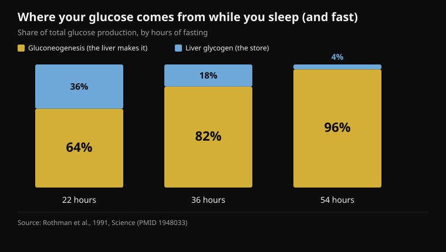
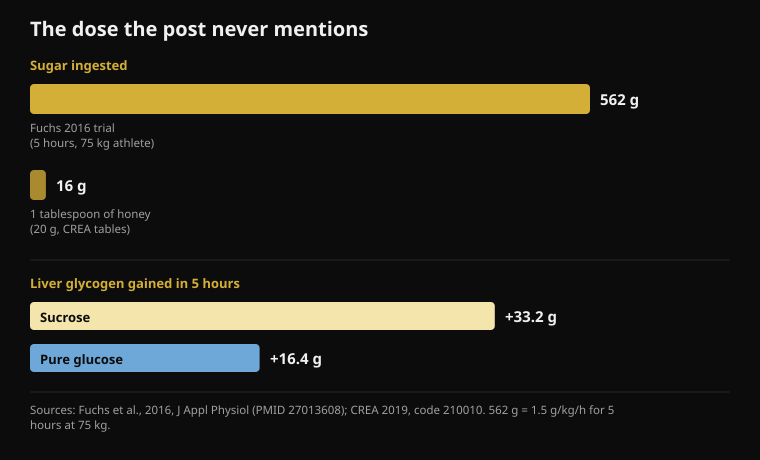

# Honey before bed: does it actually work?

By [Giammaria Loi](/autore/giammaria-loi) · updated 18 October 2026

A widely shared carousel explains why a spoonful of honey before bed should stop those 3am wake-ups: the liver runs out of glycogen, cortisol fires, you wake. The chain is told well, and the post is more honest than most — it admits the human sleep data is thin. I read eleven studies to check the rest. The mechanism fails at the two points everything rests on, and the missing number is always the same one: the dose.

## The short version

- **Your liver does not run dry overnight.** Within the first 22 hours of a fast, 64% of circulating glucose is manufactured by the liver, not drawn from the store (Rothman et al., 1991).
- **The cortisol that climbs late at night is a clock, not an alarm.** It is the circadian rhythm: lowest as sleep begins, highest the moment you wake (Mohd Azmi et al., 2021).
- **Waking a healthy person through low blood sugar takes 2.2 mmol/l** — severe hypoglycaemia induced with insulin — and even then only 10 people out of 16 woke up (Schultes et al., 2007).
- **One tablespoon of honey is 16 grams of sugar** (CREA food tables). The study that demonstrates the fructose mechanism used 562 grams across five hours (Fuchs et al., 2016).
- **"Pure glucose doesn't replenish liver glycogen" is false:** in that same study glucose alone added 16.4 grams, about half of what sucrose did. Half, not zero.

## What the post claims

The chain goes like this. Your brain is 2% of body weight but burns roughly 20% of resting glucose. It keeps burning overnight, liver glycogen runs out, the body mobilises "emergency fuel" by raising cortisol around 2am, and cortisol pulls you out of deep sleep. Honey, half glucose and half fructose, would give the brain immediate sugar and the liver the fructose it needs to rebuild the store. Protocol: one tablespoon of raw honey thirty minutes before bed.

The first piece is correct. The brain is an expensive organ: it burns between 20% and 25% of the whole body's energy, continuously, including while you sleep. Nobody disputes that.

It is also worth saying that this post is more transparent than almost anything comparable: an entire slide is given over to the strength of the evidence, and it openly calls the human honey-and-sleep trials "thin", noting that much of the rest extrapolates from animal research. That is rare and good. The problem is that the two slides before it present as settled physiology two steps that human studies tell differently. One piece of context: Instagram labels this post as **content generated or edited with artificial intelligence**.

## Your liver does not run dry while you sleep

This is where the first piece of the mechanism falls.

The liver has two ways of holding blood sugar steady when you are not eating. It can break down glycogen, the ready-made sugar store (glycogenolysis), or it can *manufacture* new glucose from lactate, amino acids and glycerol — gluconeogenesis, a process that runs continuously.

In 1991 a Yale group measured for the first time how much each route contributes in humans, tracking liver glycogen concentration hour by hour with magnetic resonance through a 68-hour fast. The result: **within the first 22 hours, gluconeogenesis already covers 64% of total glucose production**. By 36 hours it is 82%; by 54 hours, 96%.

*Share of total glucose production covered by the liver's two routes, at three points of a fast. The longer the fast runs, the less the glycogen store matters. Source: Rothman et al., 1991.*

In other words, the liver glycogen store is not the pillar holding up your night. It is already the minority contributor by the end of a fast three times longer than a night's sleep. Across eight hours in bed the store does fall — but you are still inside the window where the liver has a whole second production line running and covering most of the demand. There is no moment where the tank hits empty and the emergency kicks in.

## The 3am cortisol is not a blood-sugar alarm

Second piece, and it does not hold either.

Cortisol follows a strong circadian rhythm controlled by the hypothalamic-pituitary-adrenal axis: **it is at its lowest as sleep begins, starts rising in the second half of the night, and peaks at the moment you wake**. That overnight rise is not a reaction to something going wrong in metabolism. It is scheduled, it prepares the body for waking, and it happens whatever you ate for dinner.

But can low blood sugar wake you? Yes — and we know exactly at what level, because it has been measured. In a 2007 study in *PLoS Medicine*, researchers lowered blood glucose with an insulin infusion during sleep in 16 healthy people and 16 with type 1 diabetes. The nadir reached was **2.2 mmol/l**, roughly 40 mg/dl: severe hypoglycaemia, the kind that needs intervention. At that point **10 of the 16 healthy participants** woke up — and only one of the 16 with diabetes.

That is two findings in one. First: a healthy body really does have a glucose-linked waking response, and adrenaline rises on average seven and a half minutes *before* any sign of waking appears. Second, and more to the point: that response triggers at a level a healthy person does not reach sleeping after dinner. Getting there required an insulin drip.

If you wake at 3am, the plausible causes are many — alcohol, bedroom temperature, stress, sleep apnoea, caffeine taken too late, ordinary brief awakenings you usually do not remember. It is the same reasoning I applied to [caffeine and sleep](/en/blog/caffeine-sleep-when-to-stop-coffee): before reaching for a supplement, check the variables with measured effects.

## One tablespoon is far too little, and the post never says so

Here is the number missing from all seven slides: **how much sugar is in a tablespoon of honey**.

The CREA food composition tables — the same ones Nurvan uses for its food diary — put honey at 80.3 grams of carbohydrate per 100 grams, all of it simple sugars, and 304 kcal, with a standard 20-gram portion. One tablespoon is therefore **about 16 grams of sugar and 61 calories**.

Compare that with the study that demonstrates the mechanism the post invokes. In 2016, fifteen trained cyclists emptied their stores with exhaustive exercise and then, for five hours, took **1.5 grams of carbohydrate per kilo of body weight every hour**: for a 75 kg athlete that is around 112 grams an hour, **562 grams in total**. Liver glycogen, measured by magnetic resonance, went from 53.6 to 86.8 grams on sucrose.

*Above, the dose: the one used in the study that demonstrates the mechanism, and the one in a tablespoon of honey per the CREA tables. Below, the measured result on magnetic resonance: pure glucose adds about half what sucrose does, not zero. Sources: Fuchs et al., 2016; CREA 2019.*

A tablespoon of honey is **2.9%** of that dose. And the liver glycogen review sets the threshold below which carbohydrate fails to prevent depletion during exercise: above **1.5 grams per minute**, meaning more than 90 grams every hour. Five tablespoons of honey an hour, not one at the end of the day.

This does not mean 16 grams of sugar does nothing at all. It means it cannot do the specific thing the post credits it with: filling a liver store that in those athletes held between 49 and 87 grams of glycogen.

## "Pure glucose is useless": false, and the same study says so

Slide 4 carries the post's sharpest claim, the one that justifies honey over any other sugar: pure glucose supposedly spikes fast and clears fast, without replenishing liver glycogen "in a meaningful way".

That 2016 study compared exactly this: sucrose against pure glucose, same dose, same five hours. Sucrose did better, and that is the finding that vindicates the fructose argument: **+3.4 grams of liver glycogen per hour** over glucose (95% confidence interval: 1.6 to 5.1). But pure glucose did not sit at zero. It took liver glycogen from 49.3 to 65.7 grams — **+16.4 grams**, against +33.2 for sucrose. About half. On muscle glycogen the two sugars were identical (p = 0.673).

"Half" and "not in a meaningful way" are not the same statement. The fructose advantage is real and measured, and it is a sound reason to prefer honey, sucrose or a glucose-fructose mix when you need to refill the liver quickly — between two sessions on the same day, for instance. It is not a reason to say glucose does not work.

## On training, though, there is something there

The performance section is the strongest part of the post, and here too the detail changes the meaning.

The study behind the claim is from 2004: nine cyclists, a simulated 64 km time trial, three blinded rides taking **15 grams of honey (glycaemic index 35), 15 grams of dextrose (glycaemic index 100) or placebo every 16 km**. Times: honey 128 minutes 42 seconds, dextrose 128:18, placebo 131:18. Between honey and dextrose the difference is **0.39%**, with an interval running from -3.39% to +4.15%: no difference. Both carbohydrates together beat placebo (p < 0.02).

So yes, honey matches the gel. But in that same experiment **so does dextrose — pure glucose**, the thing slide 4 declares useless. And the dose was 15 grams every 16 km, around 60 grams across two hours: a spoonful at a time, repeated, during the effort. Not one spoonful before heading out.

A more recent result cools the enthusiasm further. In 2025 a supplement built on honey powder and protein was tested on twelve cyclists with a 20-minute time trial after 100 minutes of work. Total work 294 kJ against 292 for placebo, mean power 245 against 243 watts: **no difference** (p = 0.72 and p = 0.61), and none in blood glucose, lactate or perceived exertion either.

On cost the post is right, and it is a genuinely practical point: if you are riding for three hours and need 60-90 grams of carbohydrate an hour, taking it from honey costs a fraction of what gels cost. The dual absorption route slide 6 cites — the SGLT1 transporter for glucose and GLUT5 for fructose, working in parallel — is real and genuinely matters, *but only at those intake rates*. At 16 grams there is no route to saturate.

## And honey before bed? The data isn't there

On honey and sleep in adults I found no randomised trial on PubMed. The 2024 review dedicated to the subject describes honey as a promising avenue for sleep but concludes that the mechanisms are not established and that more research is needed: it is a survey of hypotheses, not of results.

The only randomised controlled trial measuring a sleep outcome is in children: 161 children aged 1 to 5 with a cough from a cold, acacia honey against a honey-flavoured placebo syrup in the hour before bed. Both groups improved, with **no difference between honey and placebo**, on cough or on sleep difficulty. It is a different context, but it is the only controlled data that exists, and it points the opposite way to the post's story.

There is something that does work with carbohydrate and sleep, though, and the post misses it. In 2007 twelve healthy men ate a high-glycaemic-index meal **four hours before bed**: sleep onset latency fell from 17.5 to 9.0 minutes (p = 0.009). The identical meal given **one hour before** worked worse: 14.6 minutes. The post's protocol says thirty minutes before lights out — precisely the wrong side of the only data available.

## What the research actually says

- **Confirmed** — The brain is a huge, constant consumer of energy: between 20% and 25% of the whole body's expenditure, day and night.
- **Confirmed** — Fructose helps refill liver glycogen better than glucose alone: 3.4 grams per hour more, measured by magnetic resonance.
- **Confirmed** — During endurance work honey matches a commercial gel over a 64 km time trial — but in that same study so does pure glucose.
- **Needs nuance** — "The 1:1 ratio is the whole mechanism": the direction is right, the dose is not. A tablespoon is 2.9% of the carbohydrate used in the study that demonstrates that mechanism.
- **Needs nuance** — Honey costs less than gels: true, but the comparison holds at matched doses, meaning 60-90 grams of carbohydrate an hour during effort, not one spoonful.
- **Debunked** — "Overnight the liver runs out of glycogen": within the first 22 hours of a fast, 64% of glucose produced comes from gluconeogenesis, not from the store.
- **Debunked** — "Empty glycogen fires cortisol at 2am and wakes you": the late-night cortisol rise is circadian, and waking a healthy person through blood sugar takes an insulin-induced drop to 2.2 mmol/l.
- **Debunked** — "Pure glucose doesn't replenish liver glycogen in any meaningful way": it added 16.4 grams in five hours, about half of what sucrose added.
- **Unverifiable** — "Raw only: processed honey loses the enzyme activity that matters." No study on PubMed compares raw and processed honey on sleep or glycogen; in the 2004 trial the honey was a commercial gel product and it worked.
- **Unverifiable** — Fewer 3am wake-ups from a spoon of honey: no randomised trial in adults. The only controlled sleep outcome, in children, finds no difference from placebo.

## How to apply it

1. **If you wake in the night, start with the causes that have data behind them.** Alcohol before bed, a warm room, late caffeine, stress, sleep apnoea. These have measured effects on sleep; liver glycogen, in healthy people, does not.
2. **If you want to try carbohydrate for sleep, move it.** The only positive finding involves a high-glycaemic-index meal four hours before bed, not a spoonful thirty minutes before. A normal dinner with carbohydrate already does that job.
3. **Use honey where it genuinely earns its place: during long efforts.** Beyond 90 minutes, 60-90 grams of carbohydrate an hour. Honey is an excellent low-cost source, and the glucose-fructose mix is a real advantage at those quantities.
4. **After training, if another session is close, fructose counts.** Honey, sucrose or a glucose-fructose drink refill the liver at nearly twice the rate of pure glucose. If the next session is tomorrow, you have all the time you need and the choice of sugar matters little.
5. **Log it.** A tablespoon is 61 calories and 16 grams of sugar: negligible for one evening, not negligible as a daily habit on top of everything else. It is the same point I made about [carbs and hidden fat](/en/blog/do-carbs-make-you-gain-weight-hidden-fat).
6. **If you try it, try it as a real experiment.** Two weeks with and two without, same bedtime, logging wake-ups. It is the best suggestion in the post and the only way to tell an effect from an expectation.

> **Honey in the diary, with the right numbers**  
> Nurvan's nutrition module runs on the official CREA tables: search "honey", pick the portion, and those 16 grams of sugar land where they belong, in the day's total. And if you use it as fuel on long sessions, you log it with the session instead of keeping it in your head.  
> [Try Nurvan](https://nurvan.app)

## Frequently asked questions

### Does honey before bed really help you sleep better?

No randomised trial in adults shows that it does. The only controlled study measuring a sleep outcome involves children with a cough and finds no difference between honey and a placebo syrup. The liver glycogen mechanism, which is the usual explanation, does not survive the data: overnight, most of your glucose is manufactured by the liver rather than drawn from the store.

### Why do I wake up at 3am?

In healthy people, almost never because of blood sugar: that would take a drop to around 2.2 mmol/l, a level you do not reach sleeping after dinner. The commonest and best documented causes are alcohol, bedroom temperature, caffeine taken too late, stress and sleep-related breathing problems. If the wake-ups are frequent and leave you tired during the day, raise it with your doctor rather than hunting for a food remedy.

### Honey or a carbohydrate gel during training?

For performance they are equivalent: head to head over a 64 km time trial, honey and dextrose produced the same time, both better than placebo. Honey costs far less. The dose is what matters: beyond 90 minutes of effort you need 60-90 grams of carbohydrate an hour, which is four or five tablespoons, not one.

### Is raw honey better than processed honey?

For sleep and glycogen there are no studies comparing them, so it is a claim without evidence — neither proven nor disproven. Worth noting that in the cycling study the honey was a commercial product prepared as a gel, and it performed as well as dextrose.

## Read next

- [Caffeine and sleep: when to stop drinking coffee](/en/blog/caffeine-sleep-when-to-stop-coffee) — the real thresholds, counted back from bedtime
- [When to take supplements: does the hour matter?](/en/blog/when-to-take-supplements-timing) — eight studies on timing, and how much it really changes
- [Do carbs make you gain weight? The hidden fat](/en/blog/do-carbs-make-you-gain-weight-hidden-fat) — what is actually inside what you eat, from the CREA tables

## Sources

1. Rothman DL, Magnusson I, Katz LD, Shulman RG, Shulman GI, 1991. Quantitation of hepatic glycogenolysis and gluconeogenesis in fasting humans with 13C NMR. *Science* 254(5031):573-576. PMID 1948033 — [doi.org/10.1126/science.1948033](https://doi.org/10.1126/science.1948033)
2. Schultes B, Jauch-Chara K, Gais S, et al., 2007. Defective awakening response to nocturnal hypoglycemia in patients with type 1 diabetes mellitus. *PLoS Med* 4(2):e69. PMID 17326710 — [doi.org/10.1371/journal.pmed.0040069](https://doi.org/10.1371/journal.pmed.0040069)
3. Mohd Azmi NAS, Juliana N, Azmani S, et al., 2021. Cortisol on circadian rhythm and its effect on cardiovascular system. *Int J Environ Res Public Health* 18(2):676. PMID 33466883 — [doi.org/10.3390/ijerph18020676](https://doi.org/10.3390/ijerph18020676)
4. Beard E, Lengacher S, Dias S, Magistretti PJ, Finsterwald C, 2022. Astrocytes as key regulators of brain energy metabolism: new therapeutic perspectives. *Front Physiol* 12:825816. PMID 35087428 — [doi.org/10.3389/fphys.2021.825816](https://doi.org/10.3389/fphys.2021.825816)
5. Fuchs CJ, Gonzalez JT, Beelen M, et al., 2016. Sucrose ingestion after exhaustive exercise accelerates liver, but not muscle glycogen repletion compared with glucose ingestion in trained athletes. *J Appl Physiol* 120(11):1328-1334. PMID 27013608 — [doi.org/10.1152/japplphysiol.01023.2015](https://doi.org/10.1152/japplphysiol.01023.2015)
6. Gonzalez JT, Fuchs CJ, Betts JA, van Loon LJC, 2016. Liver glycogen metabolism during and after prolonged endurance-type exercise. *Am J Physiol Endocrinol Metab* 311(3):E543-E553. PMID 27436612 — [doi.org/10.1152/ajpendo.00232.2016](https://doi.org/10.1152/ajpendo.00232.2016)
7. Earnest CP, Lancaster SL, Rasmussen CJ, et al., 2004. Low vs. high glycemic index carbohydrate gel ingestion during simulated 64-km cycling time trial performance. *J Strength Cond Res* 18(3):466-472. PMID 15320674 (the DOI registered for this article is a non-working placeholder; cited by PMID)
8. Toniazzo T, de Almeida Azevedo R, Oliveira TN, et al., 2025. A novel honey powder-based supplement containing carbohydrate and protein did not improve endurance performance in recreationally trained cyclists. *Int J Sport Nutr Exerc Metab* 35(6):520-529. PMID 40812383 — [doi.org/10.1123/ijsnem.2025-0021](https://doi.org/10.1123/ijsnem.2025-0021)
9. Nishimura T, Muta H, Hosaka T, Ueda M, Kishida K, 2022. Multicentre, randomised study found that honey had no pharmacological effect on nocturnal coughs and sleep quality at 1-5 years of age. *Acta Paediatr* 111(11):2157-2164. PMID 35927828 — [doi.org/10.1111/apa.16509](https://doi.org/10.1111/apa.16509)
10. Zulkifli MF, Masimen MAA, Ridzuan PM, Wan Ismail WI, 2024. Exploring honey's potential as a functional food for natural sleep aid. *Food Funct* 15(19):9678-9689. PMID 39248637 — [doi.org/10.1039/d4fo02013h](https://doi.org/10.1039/d4fo02013h)
11. Afaghi A, O'Connor H, Chow CM, 2007. High-glycemic-index carbohydrate meals shorten sleep onset. *Am J Clin Nutr* 85(2):426-430. PMID 17284739 — [doi.org/10.1093/ajcn/85.2.426](https://doi.org/10.1093/ajcn/85.2.426)
12. CREA — Research Centre for Food and Nutrition, Italian food composition tables, 2019 update, entry "Miele" (honey, code 210010): 304 kcal, 80.3 g carbohydrate, standard portion 20 g.

Prompted by a carousel from [Christian Poulos](https://www.instagram.com/p/DdwWWxYkfEW/) (26 September 2026), which Instagram labels as content generated or edited with artificial intelligence. No text and no image from the post has been reproduced: the claims were rewritten and checked against the primary literature.

Giammaria Loi is the founder of Nurvan. He has been lifting since 2012, has worked as a FIPE-certified personal trainer and coach since 2013, and has competed in powerlifting at national level since 2018. Every article he writes starts from the research and ends with what actually works in the gym. [Author page](/autore/giammaria-loi)

> Note: this is informational content and does not replace advice from a doctor or qualified professional. If night-time wake-ups are frequent, if you wake up tired, or if you have diabetes or take medication that lowers blood sugar, speak to your doctor: in those cases nocturnal hypoglycaemia is a real problem and belongs with the people treating you, not with a spoonful of honey.
