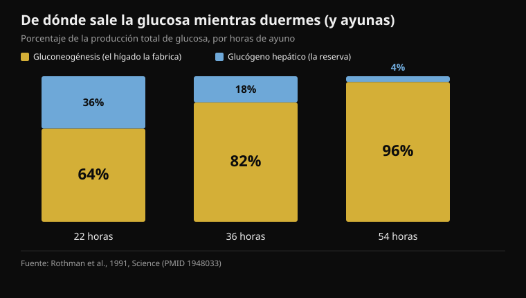
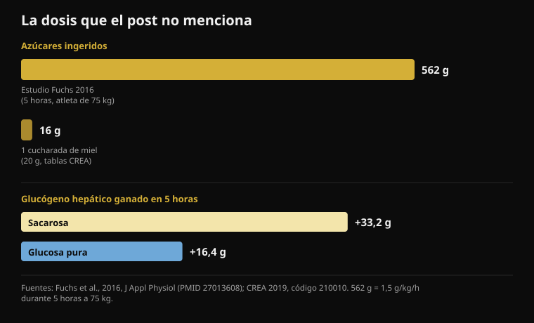

# Miel antes de dormir: ¿sirve de verdad?

Por [Giammaria Loi](/autore/giammaria-loi) · actualizado el 18 de octubre de 2026

Un carrusel muy compartido explica por qué una cucharada de miel antes de dormir reduciría los despertares de las 3 de la madrugada: el hígado agota el glucógeno, sube el cortisol, te despiertas. La cadena está bien contada y el post es más honesto que la media: admite que los datos humanos sobre el sueño son escasos. He leído once estudios para comprobar el resto. El mecanismo falla en los dos puntos sobre los que se apoya todo, y el número que falta siempre es el mismo: la dosis.

## En resumen

- **Por la noche el hígado no se queda seco.** Ya en las primeras 22 horas de ayuno, el 64% de la glucosa que circula la fabrica el hígado, no sale de la reserva (Rothman et al., 1991).
- **El cortisol que sube al final de la noche es un reloj, no una alarma.** Es el ritmo circadiano: mínimo al empezar a dormir, máximo en el momento de despertar (Mohd Azmi et al., 2021).
- **Despertar a una persona sana por glucemia baja exige llegar a 2,2 mmol/l**, una hipoglucemia grave inducida con insulina, y aun así solo se despertaron 10 de 16 (Schultes et al., 2007).
- **Una cucharada de miel son 16 gramos de azúcares** (tablas CREA). El estudio que demuestra el mecanismo de la fructosa usaba 562 gramos en cinco horas (Fuchs et al., 2016).
- **"La glucosa pura no repone el glucógeno hepático" es falso:** en ese mismo estudio la glucosa sola añadió 16,4 gramos, aproximadamente la mitad que la sacarosa. La mitad, no cero.

## Lo que sostiene el post

La cadena es esta. El cerebro es el 2% del peso corporal pero quema alrededor del 20% de la glucosa en reposo. Por la noche sigue consumiendo, el glucógeno del hígado se agota, el cuerpo moviliza "combustible de emergencia" subiendo el cortisol hacia las 2, y el cortisol te saca del sueño profundo. La miel, mitad glucosa y mitad fructosa, daría al cerebro azúcar inmediato y al hígado la fructosa para reconstruir la reserva. Protocolo: una cucharada de miel cruda treinta minutos antes de dormir.

La primera pieza es correcta. El cerebro es un órgano carísimo: consume de forma continua entre el 20% y el 25% de la energía de todo el organismo, también mientras duermes. Ahí no hay discusión.

Hay que decir además que el post es más transparente que casi todo lo comparable: dedica una diapositiva entera a la fuerza de la evidencia y admite abiertamente que los estudios humanos sobre miel y sueño son "escasos" y que buena parte se extrapola de investigación animal. Es un mérito poco común. El problema es que las dos diapositivas anteriores presentan como fisiología establecida dos pasos que los estudios en humanos cuentan de otra manera. Un dato de contexto: Instagram etiqueta este post como **contenido generado o modificado con inteligencia artificial**.

## El hígado no se queda seco mientras duermes

Aquí cae la primera pieza del mecanismo.

El hígado tiene dos maneras de mantener estable la glucemia cuando no comes. Puede romper el glucógeno, la reserva de azúcar ya lista (glucogenólisis), o puede *fabricar* glucosa nueva a partir de lactato, aminoácidos y glicerol: es la gluconeogénesis, un proceso que trabaja de forma continua.

En 1991 un grupo de Yale midió por primera vez cuánto pesa cada vía en el ser humano, siguiendo con resonancia magnética la concentración de glucógeno hepático hora a hora durante un ayuno de 68 horas. El resultado: **ya en las primeras 22 horas la gluconeogénesis cubre el 64% de la producción total de glucosa**. A las 36 horas sube al 82%; a las 54, al 96%.

*Porcentaje de la producción total de glucosa cubierto por las dos vías del hígado, en tres momentos del ayuno. Cuanto más avanza el ayuno, menos cuenta la reserva de glucógeno. Fuente: Rothman et al., 1991.*

Traducido: la reserva de glucógeno hepático no es el pilar que sostiene la noche; es la parte minoritaria ya al final de un ayuno tres veces más largo que una noche de sueño. En las ocho horas que pasas en la cama la reserva baja, sí, pero sigues dentro de la ventana en la que el hígado tiene una segunda línea de producción funcionando y cubriendo la mayor parte. No existe el momento en que "se acaba la gasolina" y salta la emergencia.

## El cortisol de las 3 no es una alarma de glucemia

Segunda pieza, y tampoco se sostiene.

El cortisol sigue un ritmo circadiano muy marcado, controlado por el eje hipotálamo-hipófisis-suprarrenal: **está en su mínimo al empezar el sueño, empieza a subir en la segunda mitad de la noche y alcanza su máximo justo al despertar**. Esa subida nocturna no es una reacción a algo que ha ido mal en el metabolismo: está programada, prepara al organismo para despertarse y ocurre también en quien ha cenado perfectamente.

Pero ¿la glucemia baja puede despertarte? Sí, y sabemos exactamente a qué nivel, porque se ha medido. En un estudio de 2007 publicado en *PLoS Medicine* se bajó la glucemia con una infusión de insulina durante el sueño en 16 personas sanas y 16 con diabetes tipo 1. El valor alcanzado fue **2,2 mmol/l**, unos 40 mg/dl: una hipoglucemia grave, de las que requieren intervención. En ese punto se despertaron **10 de las 16 personas sanas**, y solo una de las 16 con diabetes.

Son dos informaciones en una. La primera: el organismo sano sí tiene un mecanismo de despertar ligado a la glucemia, y la adrenalina sube de media siete minutos y medio *antes* de que aparezcan los signos del despertar. La segunda, más importante: ese mecanismo se activa a niveles que una persona sana no alcanza durmiendo después de cenar. Para llegar allí hizo falta una infusión de insulina.

Si te despiertas a las 3, las causas plausibles son muchas: alcohol, temperatura de la habitación, estrés, apneas, cafeína tomada demasiado tarde, despertares breves normales que no recuerdas. Es el mismo razonamiento que hice hablando de [cafeína y sueño](/es/blog/cafeina-sueno-cuando-dejar-el-cafe): antes de buscar un suplemento conviene revisar las variables con efectos medidos.

## Una cucharada es demasiado poco, y el post nunca lo dice

Este es el dato que falta en las siete diapositivas: **cuánto azúcar hay en una cucharada de miel**.

Las tablas de composición CREA, las mismas que usa Nurvan para el diario de alimentos, dan la miel a 80,3 gramos de hidratos por 100 gramos —todos azúcares simples— y 304 kcal, con una ración estándar de 20 gramos. Una cucharada son por tanto **unos 16 gramos de azúcares y 61 calorías**.

Compáralo con el estudio que demuestra el mecanismo que invoca el post. En 2016 quince ciclistas entrenados vaciaron sus reservas con ejercicio extenuante y después, durante cinco horas, tomaron **1,5 gramos de hidratos por kilo de peso cada hora**: para un atleta de 75 kilos son unos 112 gramos por hora, **562 gramos en total**. El glucógeno hepático, medido con resonancia magnética, pasó de 53,6 a 86,8 gramos con sacarosa.

*Arriba, la dosis: la del estudio que demuestra el mecanismo y la de una cucharada de miel según las tablas CREA. Abajo, el resultado medido con resonancia magnética: la glucosa pura añade alrededor de la mitad que la sacarosa, no cero. Fuentes: Fuchs et al., 2016; CREA 2019.*

Una cucharada de miel es el **2,9%** de esa dosis. Y la propia revisión sobre glucógeno hepático fija el umbral por debajo del cual los hidratos no bastan para impedir la depleción durante el ejercicio: más de **1,5 gramos por minuto**, es decir más de 90 gramos por hora. Cinco cucharadas de miel por hora, no una al final del día.

Esto no significa que 16 gramos de azúcares no hagan absolutamente nada. Significa que no pueden hacer lo que el post les atribuye: llenar una reserva hepática que en aquellos atletas contenía entre 49 y 87 gramos de glucógeno.

## "La glucosa pura no sirve": falso, y lo dice el mismo estudio

La diapositiva 4 contiene la afirmación más tajante del post, la que justifica la miel frente a cualquier otro azúcar: la glucosa pura subiría la glucemia deprisa y la bajaría igual de deprisa, sin reponer el glucógeno hepático "de forma significativa".

El estudio de 2016 comparó exactamente eso: sacarosa frente a glucosa pura, misma dosis, mismas cinco horas. La sacarosa lo hizo mejor, y es el dato que da la razón a la parte sobre la fructosa: **+3,4 gramos de glucógeno hepático por hora** respecto a la glucosa (intervalo de confianza del 95%: de 1,6 a 5,1). Pero la glucosa pura no se quedó en cero: llevó el glucógeno hepático de 49,3 a 65,7 gramos, o sea **+16,4 gramos**, frente a los +33,2 de la sacarosa. Cerca de la mitad. Y en glucógeno muscular los dos azúcares resultaron idénticos (p = 0,673).

"La mitad" y "de forma no significativa" no son lo mismo. La ventaja de la fructosa es real y está medida, y es una razón sensata para preferir miel, sacarosa o una mezcla glucosa-fructosa cuando hay que recargar el hígado rápido, por ejemplo entre dos entrenamientos del mismo día. No es una razón para decir que la glucosa no funciona.

## En el entrenamiento, en cambio, algo hay

La parte sobre el rendimiento es la más sólida del post, y también aquí el detalle cambia el sentido.

El estudio al que remite la afirmación es de 2004: nueve ciclistas, 64 kilómetros contrarreloj, tres pruebas a ciegas con **15 gramos de miel (índice glucémico 35), 15 gramos de dextrosa (índice glucémico 100) o placebo cada 16 kilómetros**. Tiempos: miel 128 minutos y 42 segundos, dextrosa 128:18, placebo 131:18. Entre miel y dextrosa la diferencia es del **0,39%**, con un intervalo que va de -3,39% a +4,15%: ninguna diferencia. Los dos hidratos juntos sí baten al placebo (p < 0,02).

Así que sí, la miel iguala al gel. Pero en el mismo experimento **también lo iguala la dextrosa, es decir glucosa pura**, la que la diapositiva 4 declara inútil. Y la dosis era de 15 gramos cada 16 kilómetros, unos 60 gramos en dos horas: una cucharada cada vez, repetida, durante el esfuerzo. No una cucharada antes de salir.

Un dato más reciente enfría aún más el entusiasmo: en 2025 un suplemento a base de miel en polvo y proteínas se probó en doce ciclistas con una contrarreloj de 20 minutos tras 100 minutos de trabajo. Trabajo total 294 kJ frente a 292 del placebo, potencia media 245 frente a 243 vatios: **ninguna diferencia** (p = 0,72 y p = 0,61), ni en glucemia, ni en lactato, ni en esfuerzo percibido.

En el coste el post tiene razón, y es un punto práctico real: si estás pedaleando tres horas y necesitas 60-90 gramos de hidratos por hora, sacarlos de la miel cuesta una fracción de lo que cuestan los geles. La doble vía de absorción que cita la diapositiva 6 —los transportadores SGLT1 para la glucosa y GLUT5 para la fructosa, trabajando en paralelo— es real y cuenta de verdad, *pero solo a esos ritmos de ingesta*. Con 16 gramos no hay ninguna vía que saturar.

## ¿Y la miel antes de dormir? El dato no existe

Sobre miel y sueño en adultos no he encontrado ningún ensayo aleatorizado en PubMed. La revisión dedicada al tema, de 2024, describe la miel como una vía prometedora para el sueño pero concluye que los mecanismos no están aclarados y que hacen falta más investigaciones: es un repaso de hipótesis, no de resultados.

El único ensayo aleatorizado y controlado que mide un resultado de sueño es en niños: 161 niños de 1 a 5 años con tos por resfriado, miel de acacia frente a un jarabe placebo con sabor a miel en la hora anterior a dormir. Los dos grupos mejoraron, **sin ninguna diferencia entre miel y placebo**, ni en la tos ni en las dificultades de sueño. Es un contexto distinto, pero es el único dato controlado que existe y va en dirección opuesta al relato del post.

Hay algo que sí funciona con los hidratos y el sueño, y el post lo pasa por alto. En 2007 doce hombres sanos tomaron una comida de índice glucémico alto **cuatro horas antes de dormir**: la latencia para dormirse bajó de 17,5 a 9,0 minutos (p = 0,009). La misma comida dada **una hora antes** funcionaba peor: 14,6 minutos. El protocolo del post dice treinta minutos antes de acostarse, justo el lado equivocado del único dato disponible.

## Qué dice realmente la investigación

- **Confirmado** — El cerebro es un consumidor enorme y constante de energía: entre el 20% y el 25% del gasto de todo el organismo, de día y de noche.
- **Confirmado** — La fructosa ayuda a recargar el glucógeno hepático más que la glucosa sola: 3,4 gramos por hora más, medidos con resonancia magnética.
- **Confirmado** — Durante el trabajo de resistencia la miel iguala a un gel comercial en una contrarreloj de 64 km, pero en el mismo estudio también lo iguala la glucosa pura.
- **Matizar** — "La proporción 1:1 es todo el mecanismo": la dirección es correcta, la dosis no. Una cucharada es el 2,9% de los hidratos usados en el estudio que demuestra ese mecanismo.
- **Matizar** — La miel cuesta menos que los geles: cierto, pero la comparación vale a igualdad de dosis, es decir 60-90 gramos de hidratos por hora durante el esfuerzo, no una cucharada.
- **Desmentido** — "Por la noche el hígado agota el glucógeno": ya en las primeras 22 horas de ayuno el 64% de la glucosa producida viene de la gluconeogénesis, no de la reserva.
- **Desmentido** — "El glucógeno agotado dispara el cortisol a las 2 y te despierta": la subida nocturna del cortisol es circadiana, y despertar a una persona sana por glucemia exige bajar a 2,2 mmol/l con insulina.
- **Desmentido** — "La glucosa pura no repone el glucógeno hepático de forma significativa": añadió 16,4 gramos en cinco horas, cerca de la mitad que la sacarosa.
- **No verificable** — "Solo miel cruda: la procesada pierde la actividad enzimática que importa". Ningún estudio en PubMed compara miel cruda y procesada en sueño o glucógeno; en el ensayo de 2004 la miel era un producto comercial en gel y funcionó.
- **No verificable** — Menos despertares a las 3 con una cucharada de miel: ningún ensayo aleatorizado en adultos. El único resultado controlado sobre sueño, en niños, no halla diferencias frente al placebo.

## Cómo aplicarlo

1. **Si te despiertas de noche, empieza por las causas con datos detrás.** Alcohol antes de dormir, habitación caliente, cafeína tardía, estrés, apneas del sueño. Tienen efectos medidos sobre el sueño; el glucógeno hepático, en personas sanas, no.
2. **Si quieres probar los hidratos para dormir, cámbialos de hora.** El único dato positivo es una comida de índice glucémico alto cuatro horas antes de acostarse, no una cucharada treinta minutos antes. Una cena normal con hidratos ya hace ese trabajo.
3. **Usa la miel donde de verdad tiene sentido: durante el esfuerzo largo.** Más allá de 90 minutos, 60-90 gramos de hidratos por hora. La miel es una fuente excelente y barata, y la mezcla glucosa-fructosa es una ventaja real a esas cantidades.
4. **Después de entrenar, si tienes otra sesión cerca, la fructosa cuenta.** Miel, sacarosa o una bebida glucosa-fructosa recargan el hígado casi al doble de velocidad que la glucosa pura. Si el próximo entrenamiento es mañana, tienes tiempo de sobra y el azúcar elegido pesa poco.
5. **Anótalo en el diario.** Una cucharada son 61 calorías y 16 gramos de azúcares: irrelevante una noche, no tanto como hábito diario sumado al resto. Es el mismo asunto de los [hidratos y las grasas escondidas](/es/blog/carbohidratos-engordan-grasa-oculta).
6. **Si lo pruebas, pruébalo como un experimento de verdad.** Dos semanas con y dos sin, misma hora de acostarte, anotando los despertares. Es la mejor sugerencia del post y la única forma de distinguir un efecto de una expectativa.

> **La miel en el diario, con los números correctos**  
> La nutrición de Nurvan usa las tablas oficiales CREA: buscas "miel", eliges la ración y esos 16 gramos de azúcares acaban donde deben, en el total del día. Y si la usas como combustible en los entrenamientos largos, la registras junto a la sesión en vez de guardarla en la memoria.  
> [Prueba Nurvan](https://nurvan.app)

## Preguntas frecuentes

### ¿La miel antes de dormir ayuda de verdad a dormir mejor?

No hay ensayos aleatorizados en adultos que lo demuestren. El único estudio controlado que mide un resultado de sueño es en niños con tos y no encuentra diferencias entre miel y jarabe placebo. El mecanismo del glucógeno hepático, que es la explicación más citada, no se sostiene con los datos: por la noche la mayor parte de la glucosa la fabrica el hígado, no sale de la reserva.

### ¿Por qué me despierto a las 3 de la madrugada?

En personas sanas casi nunca por la glucemia: haría falta bajar a unos 2,2 mmol/l, un nivel que no se alcanza durmiendo después de cenar. Las causas más comunes y mejor documentadas son el alcohol, la temperatura de la habitación, la cafeína tomada tarde, el estrés y los trastornos respiratorios del sueño. Si los despertares son frecuentes y te dejan cansado de día, coméntalo con tu médico en vez de buscar un remedio alimentario.

### ¿Mejor miel o gel de hidratos durante el entrenamiento?

En rendimiento son equivalentes: en la comparación directa de una contrarreloj de 64 km, miel y dextrosa dieron el mismo tiempo, ambas mejor que el placebo. La miel cuesta mucho menos. Lo que cuenta es la dosis: más allá de 90 minutos de esfuerzo hacen falta 60-90 gramos de hidratos por hora, es decir cuatro o cinco cucharadas, no una.

### ¿La miel cruda es mejor que la procesada?

Para sueño y glucógeno no existen estudios que las comparen, así que es una afirmación sin pruebas: ni demostrada ni desmentida. Vale la pena señalar que en el estudio de ciclismo la miel era un producto comercial preparado en gel y funcionó igual que la dextrosa.

## Lee también

- [Cafeína y sueño: cuándo dejar el café](/es/blog/cafeina-sueno-cuando-dejar-el-cafe) — los umbrales reales, contados desde la hora de dormir
- [Cuándo tomar los suplementos: ¿importa la hora?](/es/blog/cuando-tomar-los-suplementos-horario) — ocho estudios sobre el timing y cuánto cambia realmente
- [¿Los carbohidratos engordan? La grasa oculta](/es/blog/carbohidratos-engordan-grasa-oculta) — qué hay de verdad en lo que comes, según las tablas CREA

## Fuentes

1. Rothman DL, Magnusson I, Katz LD, Shulman RG, Shulman GI, 1991. Quantitation of hepatic glycogenolysis and gluconeogenesis in fasting humans with 13C NMR. *Science* 254(5031):573-576. PMID 1948033 — [doi.org/10.1126/science.1948033](https://doi.org/10.1126/science.1948033)
2. Schultes B, Jauch-Chara K, Gais S, et al., 2007. Defective awakening response to nocturnal hypoglycemia in patients with type 1 diabetes mellitus. *PLoS Med* 4(2):e69. PMID 17326710 — [doi.org/10.1371/journal.pmed.0040069](https://doi.org/10.1371/journal.pmed.0040069)
3. Mohd Azmi NAS, Juliana N, Azmani S, et al., 2021. Cortisol on circadian rhythm and its effect on cardiovascular system. *Int J Environ Res Public Health* 18(2):676. PMID 33466883 — [doi.org/10.3390/ijerph18020676](https://doi.org/10.3390/ijerph18020676)
4. Beard E, Lengacher S, Dias S, Magistretti PJ, Finsterwald C, 2022. Astrocytes as key regulators of brain energy metabolism: new therapeutic perspectives. *Front Physiol* 12:825816. PMID 35087428 — [doi.org/10.3389/fphys.2021.825816](https://doi.org/10.3389/fphys.2021.825816)
5. Fuchs CJ, Gonzalez JT, Beelen M, et al., 2016. Sucrose ingestion after exhaustive exercise accelerates liver, but not muscle glycogen repletion compared with glucose ingestion in trained athletes. *J Appl Physiol* 120(11):1328-1334. PMID 27013608 — [doi.org/10.1152/japplphysiol.01023.2015](https://doi.org/10.1152/japplphysiol.01023.2015)
6. Gonzalez JT, Fuchs CJ, Betts JA, van Loon LJC, 2016. Liver glycogen metabolism during and after prolonged endurance-type exercise. *Am J Physiol Endocrinol Metab* 311(3):E543-E553. PMID 27436612 — [doi.org/10.1152/ajpendo.00232.2016](https://doi.org/10.1152/ajpendo.00232.2016)
7. Earnest CP, Lancaster SL, Rasmussen CJ, et al., 2004. Low vs. high glycemic index carbohydrate gel ingestion during simulated 64-km cycling time trial performance. *J Strength Cond Res* 18(3):466-472. PMID 15320674 (el DOI registrado para este artículo es un marcador de posición no funcional; se cita por PMID)
8. Toniazzo T, de Almeida Azevedo R, Oliveira TN, et al., 2025. A novel honey powder-based supplement containing carbohydrate and protein did not improve endurance performance in recreationally trained cyclists. *Int J Sport Nutr Exerc Metab* 35(6):520-529. PMID 40812383 — [doi.org/10.1123/ijsnem.2025-0021](https://doi.org/10.1123/ijsnem.2025-0021)
9. Nishimura T, Muta H, Hosaka T, Ueda M, Kishida K, 2022. Multicentre, randomised study found that honey had no pharmacological effect on nocturnal coughs and sleep quality at 1-5 years of age. *Acta Paediatr* 111(11):2157-2164. PMID 35927828 — [doi.org/10.1111/apa.16509](https://doi.org/10.1111/apa.16509)
10. Zulkifli MF, Masimen MAA, Ridzuan PM, Wan Ismail WI, 2024. Exploring honey's potential as a functional food for natural sleep aid. *Food Funct* 15(19):9678-9689. PMID 39248637 — [doi.org/10.1039/d4fo02013h](https://doi.org/10.1039/d4fo02013h)
11. Afaghi A, O'Connor H, Chow CM, 2007. High-glycemic-index carbohydrate meals shorten sleep onset. *Am J Clin Nutr* 85(2):426-430. PMID 17284739 — [doi.org/10.1093/ajcn/85.2.426](https://doi.org/10.1093/ajcn/85.2.426)
12. CREA — Centro de investigación de Alimentos y Nutrición, tablas italianas de composición de alimentos, actualización 2019, entrada "Miele" (miel, código 210010): 304 kcal, 80,3 g de hidratos, ración estándar 20 g.

A partir del carrusel de [Christian Poulos](https://www.instagram.com/p/DdwWWxYkfEW/) (26 de septiembre de 2026), que Instagram etiqueta como contenido generado o modificado con inteligencia artificial. No se ha reproducido ningún texto ni ninguna imagen del post: las afirmaciones se han reescrito y verificado en la literatura primaria.

Giammaria Loi es el fundador de Nurvan. Entrena con pesas desde 2012, trabaja como entrenador personal y coach certificado FIPE desde 2013 y compite en powerlifting a nivel nacional desde 2018. Cada artículo que firma parte de los estudios científicos y llega a lo que funciona de verdad en el gimnasio. [Página del autor](/autore/giammaria-loi)

> Nota: contenido informativo, no sustituye la opinión de un médico ni de un profesional cualificado. Si los despertares nocturnos son frecuentes, si te levantas cansado o si tienes diabetes o tomas fármacos que bajan la glucemia, háblalo con tu médico: en esos casos la hipoglucemia nocturna es un problema real y debe manejarlo quien te trata, no una cucharada de miel.
