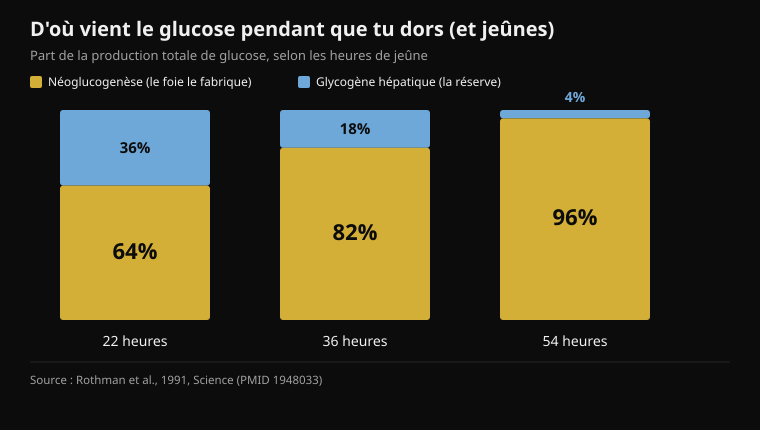
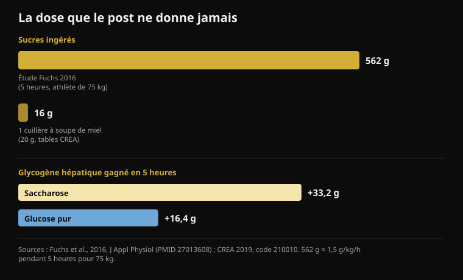

# Miel avant de dormir : est-ce que ça marche ?

Par [Giammaria Loi](/autore/giammaria-loi) · mis à jour le 18 octobre 2026

Un carrousel très partagé explique pourquoi une cuillère de miel avant de dormir réduirait les réveils de 3 heures du matin : le foie épuise son glycogène, le cortisol se déclenche, tu te réveilles. La chaîne est bien racontée, et le post est plus honnête que la moyenne — il admet que les données humaines sur le sommeil sont minces. J'ai lu onze études pour vérifier le reste. Le mécanisme ne tient pas sur les deux points qui portent tout le raisonnement, et le chiffre manquant est toujours le même : la dose.

## En bref

- **La nuit, le foie ne se vide pas.** Dès les 22 premières heures de jeûne, 64 % du glucose qui circule est fabriqué par le foie, pas puisé dans la réserve (Rothman et al., 1991).
- **Le cortisol qui monte en fin de nuit est une horloge, pas une alarme.** C'est le rythme circadien : au plus bas au début du sommeil, au plus haut au moment du réveil (Mohd Azmi et al., 2021).
- **Réveiller une personne saine par une glycémie basse exige 2,2 mmol/l**, une hypoglycémie sévère provoquée à l'insuline — et même là, seules 10 personnes sur 16 se sont réveillées (Schultes et al., 2007).
- **Une cuillère à soupe de miel, c'est 16 grammes de sucres** (tables CREA). L'étude qui démontre le mécanisme du fructose en utilisait 562 en cinq heures (Fuchs et al., 2016).
- **« Le glucose pur ne reconstitue pas le glycogène hépatique » est faux :** dans cette même étude, le glucose seul en a ajouté 16,4 grammes, environ la moitié du saccharose. La moitié, pas zéro.

## Ce que soutient le post

La chaîne est la suivante. Le cerveau représente 2 % du poids du corps mais brûle environ 20 % du glucose au repos. La nuit il continue de consommer, le glycogène du foie s'épuise, le corps mobilise du « carburant d'urgence » en augmentant le cortisol vers 2 heures, et le cortisol t'arrache au sommeil profond. Le miel, moitié glucose moitié fructose, donnerait au cerveau du sucre immédiat et au foie le fructose pour reconstruire la réserve. Protocole : une cuillère de miel cru trente minutes avant de dormir.

Le premier morceau est exact. Le cerveau est un organe très coûteux : il consomme en continu entre 20 % et 25 % de l'énergie de tout l'organisme, y compris pendant le sommeil. Là-dessus, aucune discussion.

Il faut aussi dire que ce post est plus transparent que presque tout ce qui lui ressemble : une diapositive entière est consacrée à la force des preuves, et elle admet ouvertement que les études humaines sur miel et sommeil sont « minces » et qu'une grande partie du reste est extrapolée de la recherche animale. C'est un mérite rare. Le problème, c'est que les deux diapositives précédentes présentent comme physiologie établie deux étapes que les études humaines racontent autrement. Un élément de contexte : Instagram étiquette ce post comme **contenu généré ou modifié avec de l'intelligence artificielle**.

## Le foie ne se vide pas pendant que tu dors

C'est ici que tombe le premier morceau du mécanisme.

Le foie a deux façons de maintenir la glycémie stable quand tu ne manges pas. Il peut casser le glycogène, la réserve de sucre déjà prête (la glycogénolyse), ou il peut *fabriquer* du glucose neuf à partir de lactate, d'acides aminés et de glycérol : c'est la néoglucogenèse, un processus qui tourne en continu.

En 1991, une équipe de Yale a mesuré pour la première fois le poids de chaque voie chez l'homme, en suivant par résonance magnétique la concentration de glycogène hépatique heure par heure pendant un jeûne de 68 heures. Résultat : **dès les 22 premières heures, la néoglucogenèse couvre 64 % de la production totale de glucose**. À 36 heures, 82 % ; à 54 heures, 96 %.

*Part de la production totale de glucose couverte par les deux voies du foie, à trois moments du jeûne. Plus le jeûne avance, moins la réserve de glycogène compte. Source : Rothman et al., 1991.*

Autrement dit : la réserve de glycogène hépatique n'est pas le pilier qui porte la nuit, elle est déjà la part minoritaire au bout d'un jeûne trois fois plus long qu'une nuit de sommeil. Pendant les huit heures passées au lit, la réserve baisse, bien sûr, mais tu es encore dans la fenêtre où le foie dispose d'une seconde ligne de production qui tourne et couvre l'essentiel du besoin. Il n'existe pas de moment où « il n'y a plus d'essence » et où l'urgence se déclenche.

## Le cortisol de 3 heures n'est pas une alarme glycémique

Deuxième morceau, et il ne tient pas non plus.

Le cortisol suit un rythme circadien très marqué, contrôlé par l'axe hypothalamo-hypophyso-surrénalien : **il est au minimum au début du sommeil, commence à remonter dans la seconde moitié de la nuit et atteint son maximum au moment où tu te réveilles**. Cette remontée nocturne n'est pas une réaction à quelque chose qui aurait mal tourné dans le métabolisme : elle est programmée, elle prépare l'organisme au réveil, et elle a lieu même chez quelqu'un qui a parfaitement dîné.

Mais une glycémie basse peut-elle réveiller ? Oui, et on sait exactement à quel niveau, parce que cela a été mesuré. Dans une étude de 2007 publiée dans *PLoS Medicine*, la glycémie a été abaissée par perfusion d'insuline pendant le sommeil, chez 16 personnes saines et 16 diabétiques de type 1. Le niveau atteint était de **2,2 mmol/l**, environ 40 mg/dl : une hypoglycémie sévère, de celles qui exigent une intervention. À ce moment-là, **10 personnes saines sur 16** se sont réveillées — et une seule sur 16 chez les diabétiques.

C'est deux informations en une. La première : l'organisme sain possède bien un mécanisme de réveil lié à la glycémie, et l'adrénaline monte en moyenne sept minutes et demie *avant* l'apparition des signes de réveil. La seconde, plus importante : ce mécanisme s'active à des niveaux qu'une personne saine n'atteint pas en dormant après le dîner. Pour y arriver, il a fallu une perfusion d'insuline.

Si tu te réveilles à 3 heures, les causes plausibles sont nombreuses — alcool, température de la chambre, stress, apnées, caféine prise trop tard, micro-réveils physiologiques dont on ne se souvient pas. C'est le même raisonnement que j'ai tenu à propos de [la caféine et du sommeil](/fr/blog/cafeine-sommeil-quand-arreter-le-cafe) : avant de chercher un complément, mieux vaut contrôler les variables dont les effets sont mesurés.

## Une cuillère, c'est bien trop peu — et le post ne le dit jamais

Voici le chiffre absent des sept diapositives : **combien de sucre contient une cuillère de miel**.

Les tables de composition CREA, celles-là mêmes que Nurvan utilise pour le carnet alimentaire, donnent le miel à 80,3 grammes de glucides pour 100 grammes — tous des sucres simples — et 304 kcal, avec une portion standard de 20 grammes. Une cuillère, c'est donc **environ 16 grammes de sucres et 61 calories**.

Comparons avec l'étude qui démontre le mécanisme invoqué par le post. En 2016, quinze cyclistes entraînés ont vidé leurs réserves par un exercice épuisant, puis, pendant cinq heures, ont pris **1,5 gramme de glucides par kilo de poids toutes les heures** : pour un athlète de 75 kilos, cela fait environ 112 grammes par heure, **562 grammes au total**. Le glycogène hépatique, mesuré par résonance magnétique, est passé de 53,6 à 86,8 grammes avec le saccharose.

*En haut, la dose : celle de l'étude qui démontre le mécanisme et celle d'une cuillère de miel d'après les tables CREA. En bas, le résultat mesuré par résonance magnétique : le glucose pur ajoute environ la moitié du saccharose, pas zéro. Sources : Fuchs et al., 2016 ; CREA 2019.*

Une cuillère de miel, c'est **2,9 %** de cette dose. Et la revue consacrée au glycogène hépatique fixe le seuil en dessous duquel les glucides ne suffisent pas à empêcher la déplétion pendant l'effort : plus de **1,5 gramme par minute**, soit plus de 90 grammes par heure. Cinq cuillères de miel par heure, pas une en fin de journée.

Cela ne veut pas dire que 16 grammes de sucres ne font absolument rien. Cela veut dire qu'ils ne peuvent pas faire la chose précise que le post leur attribue : remplir une réserve hépatique qui, chez ces athlètes, contenait entre 49 et 87 grammes de glycogène.

## « Le glucose pur ne sert à rien » : faux, et c'est la même étude qui le dit

La diapositive 4 contient l'affirmation la plus tranchée du post, celle qui justifie le miel contre n'importe quel autre sucre : le glucose pur ferait monter la glycémie vite et redescendre aussi vite, sans reconstituer le glycogène hépatique « de façon significative ».

L'étude de 2016 a comparé exactement cela : saccharose contre glucose pur, même dose, mêmes cinq heures. Le saccharose a fait mieux, et c'est le résultat qui donne raison à la partie sur le fructose : **+3,4 grammes de glycogène hépatique par heure** par rapport au glucose (intervalle de confiance à 95 % : de 1,6 à 5,1). Mais le glucose pur n'est pas resté à zéro : il a fait passer le glycogène hépatique de 49,3 à 65,7 grammes, soit **+16,4 grammes**, contre +33,2 pour le saccharose. Environ la moitié. Sur le glycogène musculaire, les deux sucres se sont révélés identiques (p = 0,673).

« La moitié » et « de façon non significative » ne sont pas la même chose. L'avantage du fructose est réel et mesuré, et c'est une raison sensée de préférer le miel, le saccharose ou un mélange glucose-fructose quand il faut recharger le foie vite — entre deux séances dans la même journée, par exemple. Ce n'est pas une raison pour dire que le glucose ne marche pas.

## À l'entraînement, en revanche, il y a quelque chose

La partie sur la performance est la plus solide du post, et là aussi le détail change le sens.

L'étude à laquelle l'affirmation renvoie date de 2004 : neuf cyclistes, 64 kilomètres contre la montre, trois essais en aveugle avec **15 grammes de miel (index glycémique 35), 15 grammes de dextrose (index glycémique 100) ou un placebo tous les 16 kilomètres**. Temps : miel 128 minutes 42 secondes, dextrose 128:18, placebo 131:18. Entre miel et dextrose, la différence est de **0,39 %**, avec un intervalle allant de -3,39 % à +4,15 % : aucune différence. Les deux glucides réunis battent le placebo (p < 0,02).

Donc oui, le miel fait jeu égal avec le gel. Mais dans la même expérience **le dextrose fait jeu égal lui aussi, c'est-à-dire du glucose pur**, celui que la diapositive 4 déclare inutile. Et la dose était de 15 grammes tous les 16 kilomètres, environ 60 grammes en deux heures : une cuillère à la fois, répétée, pendant l'effort. Pas une cuillère avant de partir.

Une donnée plus récente refroidit encore l'enthousiasme : en 2025, un complément à base de miel en poudre et de protéines a été testé sur douze cyclistes avec un contre-la-montre de 20 minutes après 100 minutes de travail. Travail total 294 kJ contre 292 pour le placebo, puissance moyenne 245 contre 243 watts : **aucune différence** (p = 0,72 et p = 0,61), ni sur la glycémie, ni sur le lactate, ni sur la fatigue perçue.

Sur le coût, le post a raison, et c'est un point pratique réel : si tu pédales trois heures et qu'il te faut 60 à 90 grammes de glucides par heure, les prendre dans le miel coûte une fraction du prix des gels. La double voie d'absorption citée par la diapositive 6 — les transporteurs SGLT1 pour le glucose et GLUT5 pour le fructose, qui travaillent en parallèle — est réelle et compte vraiment, *mais seulement à ces débits d'apport*. À 16 grammes, il n'y a aucune voie à saturer.

## Et le miel avant de dormir ? La donnée n'existe pas

Sur le miel et le sommeil chez l'adulte, je n'ai trouvé aucun essai randomisé sur PubMed. La revue consacrée au sujet, de 2024, décrit le miel comme une piste prometteuse pour le sommeil mais conclut que les mécanismes ne sont pas établis et qu'il faut d'autres recherches : c'est un recensement d'hypothèses, pas de résultats.

Le seul essai randomisé contrôlé mesurant un critère de sommeil concerne des enfants : 161 enfants de 1 à 5 ans avec une toux de rhume, miel d'acacia contre un sirop placebo au goût de miel dans l'heure précédant le coucher. Les deux groupes se sont améliorés, **sans aucune différence entre miel et placebo**, ni sur la toux ni sur les difficultés de sommeil. C'est un contexte différent, mais c'est la seule donnée contrôlée qui existe, et elle va dans le sens inverse du récit du post.

Il y a pourtant quelque chose qui marche vraiment avec les glucides et le sommeil, et le post passe à côté. En 2007, douze hommes sains ont pris un repas à index glycémique élevé **quatre heures avant de dormir** : la latence d'endormissement est passée de 17,5 à 9,0 minutes (p = 0,009). Le même repas donné **une heure avant** marchait moins bien : 14,6 minutes. Le protocole du post dit trente minutes avant le coucher, soit exactement du mauvais côté de la seule donnée disponible.

## Ce que dit vraiment la recherche

- **Confirmé** — Le cerveau est un consommateur énorme et constant d'énergie : entre 20 % et 25 % de la dépense de tout l'organisme, jour et nuit.
- **Confirmé** — Le fructose aide à recharger le glycogène du foie mieux que le glucose seul : 3,4 grammes de plus par heure, mesurés par résonance magnétique.
- **Confirmé** — En endurance, le miel fait jeu égal avec un gel commercial sur un contre-la-montre de 64 km — mais dans la même étude, le glucose pur aussi.
- **À préciser** — « Le rapport 1:1 est tout le mécanisme » : la direction est juste, la dose non. Une cuillère représente 2,9 % des glucides utilisés dans l'étude qui démontre ce mécanisme.
- **À préciser** — Le miel coûte moins cher que les gels : vrai, mais la comparaison vaut à dose égale, soit 60 à 90 grammes de glucides par heure pendant l'effort, pas une cuillère.
- **Démenti** — « La nuit, le foie épuise son glycogène » : dès les 22 premières heures de jeûne, 64 % du glucose produit vient de la néoglucogenèse, pas de la réserve.
- **Démenti** — « Le glycogène épuisé déclenche le cortisol à 2 heures et te réveille » : la remontée nocturne du cortisol est circadienne, et réveiller une personne saine par la glycémie exige de descendre à 2,2 mmol/l sous insuline.
- **Démenti** — « Le glucose pur ne reconstitue pas le glycogène hépatique de façon significative » : il en a ajouté 16,4 grammes en cinq heures, environ la moitié du saccharose.
- **Invérifiable** — « Miel cru uniquement : le miel transformé perd l'activité enzymatique qui compte. » Aucune étude sur PubMed ne compare miel cru et transformé sur le sommeil ou le glycogène ; dans l'essai de 2004, le miel était un produit commercial et il a fonctionné.
- **Invérifiable** — Moins de réveils à 3 heures avec une cuillère de miel : aucun essai randomisé chez l'adulte. Le seul critère de sommeil contrôlé, chez l'enfant, ne trouve pas de différence avec le placebo.

## Comment l'appliquer

1. **Si tu te réveilles la nuit, commence par les causes qui ont des données derrière elles.** Alcool avant de dormir, chambre trop chaude, caféine prise tard, stress, apnées du sommeil. Leurs effets sur le sommeil sont mesurés ; celui du glycogène hépatique, chez les gens sains, non.
2. **Si tu veux tester les glucides pour dormir, déplace-les.** La seule donnée positive porte sur un repas à index glycémique élevé quatre heures avant le coucher, pas sur une cuillère trente minutes avant. Un dîner normal avec des glucides fait déjà ce travail.
3. **Utilise le miel là où il a vraiment sa place : pendant l'effort long.** Au-delà de 90 minutes, 60 à 90 grammes de glucides par heure. Le miel est une excellente source bon marché, et le mélange glucose-fructose est un avantage réel à ces quantités.
4. **Après l'entraînement, si une autre séance arrive vite, le fructose compte.** Miel, saccharose ou boisson glucose-fructose rechargent le foie à près du double de la vitesse du glucose pur. Si la prochaine séance est demain, tu as tout le temps et le choix du sucre pèse peu.
5. **Compte-le dans le carnet.** Une cuillère, c'est 61 calories et 16 grammes de sucres : négligeable un soir, pas négligeable en habitude quotidienne ajoutée au reste. C'est le même sujet que [les glucides et le gras caché](/fr/blog/glucides-font-ils-grossir-gras-cache).
6. **Si tu l'essaies, essaie-le comme une vraie expérience.** Deux semaines avec et deux sans, même heure de coucher, en notant les réveils. C'est la meilleure suggestion du post, et le seul moyen de distinguer un effet d'une attente.

> **Le miel dans le carnet, avec les bons chiffres**  
> La nutrition de Nurvan s'appuie sur les tables officielles CREA : tu cherches « miel », tu choisis la portion, et ces 16 grammes de sucres atterrissent là où il faut, dans le total de la journée. Et si tu l'utilises comme carburant sur les séances longues, tu l'enregistres avec la séance plutôt que de le garder en tête.  
> [Essayer Nurvan](https://nurvan.app)

## Questions fréquentes

### Le miel avant de dormir aide-t-il vraiment à mieux dormir ?

Aucun essai randomisé chez l'adulte ne le démontre. Le seul essai contrôlé qui mesure un critère de sommeil porte sur des enfants qui toussent et ne trouve pas de différence entre miel et sirop placebo. Le mécanisme du glycogène hépatique, qui est l'explication la plus citée, ne résiste pas aux données : la nuit, la majeure partie du glucose est fabriquée par le foie et non puisée dans la réserve.

### Pourquoi je me réveille à 3 heures du matin ?

Chez les personnes saines, presque jamais à cause de la glycémie : il faudrait descendre autour de 2,2 mmol/l, un niveau qu'on n'atteint pas en dormant après le dîner. Les causes les plus fréquentes et les mieux documentées sont l'alcool, la température de la chambre, la caféine prise trop tard, le stress et les troubles respiratoires du sommeil. Si les réveils sont fréquents et te laissent fatigué la journée, parles-en à ton médecin plutôt que de chercher un remède alimentaire.

### Miel ou gel de glucides pendant l'entraînement ?

Sur la performance, ils sont équivalents : en comparaison directe sur un contre-la-montre de 64 km, le miel et le dextrose ont donné le même temps, tous deux meilleurs que le placebo. Le miel coûte bien moins cher. Mais c'est la dose qui compte : au-delà de 90 minutes d'effort il faut 60 à 90 grammes de glucides par heure, soit quatre ou cinq cuillères, pas une.

### Le miel cru est-il meilleur que le miel transformé ?

Pour le sommeil et le glycogène, aucune étude ne les compare : c'est donc une affirmation sans preuve, ni démontrée ni démentie. À noter que dans l'étude sur le cyclisme, le miel était un produit commercial préparé en gel et il a fait aussi bien que le dextrose.

## À lire aussi

- [Caféine et sommeil : quand arrêter le café](/fr/blog/cafeine-sommeil-quand-arreter-le-cafe) — les seuils réels, comptés depuis l'heure du coucher
- [Quand prendre les compléments : l'heure compte-t-elle ?](/fr/blog/quand-prendre-les-complements-horaire) — huit études sur le timing, et ce que cela change vraiment
- [Les glucides font-ils grossir ? Le gras caché](/fr/blog/glucides-font-ils-grossir-gras-cache) — ce qu'il y a vraiment dans ton assiette, d'après les tables CREA

## Sources

1. Rothman DL, Magnusson I, Katz LD, Shulman RG, Shulman GI, 1991. Quantitation of hepatic glycogenolysis and gluconeogenesis in fasting humans with 13C NMR. *Science* 254(5031):573-576. PMID 1948033 — [doi.org/10.1126/science.1948033](https://doi.org/10.1126/science.1948033)
2. Schultes B, Jauch-Chara K, Gais S, et al., 2007. Defective awakening response to nocturnal hypoglycemia in patients with type 1 diabetes mellitus. *PLoS Med* 4(2):e69. PMID 17326710 — [doi.org/10.1371/journal.pmed.0040069](https://doi.org/10.1371/journal.pmed.0040069)
3. Mohd Azmi NAS, Juliana N, Azmani S, et al., 2021. Cortisol on circadian rhythm and its effect on cardiovascular system. *Int J Environ Res Public Health* 18(2):676. PMID 33466883 — [doi.org/10.3390/ijerph18020676](https://doi.org/10.3390/ijerph18020676)
4. Beard E, Lengacher S, Dias S, Magistretti PJ, Finsterwald C, 2022. Astrocytes as key regulators of brain energy metabolism: new therapeutic perspectives. *Front Physiol* 12:825816. PMID 35087428 — [doi.org/10.3389/fphys.2021.825816](https://doi.org/10.3389/fphys.2021.825816)
5. Fuchs CJ, Gonzalez JT, Beelen M, et al., 2016. Sucrose ingestion after exhaustive exercise accelerates liver, but not muscle glycogen repletion compared with glucose ingestion in trained athletes. *J Appl Physiol* 120(11):1328-1334. PMID 27013608 — [doi.org/10.1152/japplphysiol.01023.2015](https://doi.org/10.1152/japplphysiol.01023.2015)
6. Gonzalez JT, Fuchs CJ, Betts JA, van Loon LJC, 2016. Liver glycogen metabolism during and after prolonged endurance-type exercise. *Am J Physiol Endocrinol Metab* 311(3):E543-E553. PMID 27436612 — [doi.org/10.1152/ajpendo.00232.2016](https://doi.org/10.1152/ajpendo.00232.2016)
7. Earnest CP, Lancaster SL, Rasmussen CJ, et al., 2004. Low vs. high glycemic index carbohydrate gel ingestion during simulated 64-km cycling time trial performance. *J Strength Cond Res* 18(3):466-472. PMID 15320674 (le DOI enregistré pour cet article est un espace réservé non fonctionnel ; cité par PMID)
8. Toniazzo T, de Almeida Azevedo R, Oliveira TN, et al., 2025. A novel honey powder-based supplement containing carbohydrate and protein did not improve endurance performance in recreationally trained cyclists. *Int J Sport Nutr Exerc Metab* 35(6):520-529. PMID 40812383 — [doi.org/10.1123/ijsnem.2025-0021](https://doi.org/10.1123/ijsnem.2025-0021)
9. Nishimura T, Muta H, Hosaka T, Ueda M, Kishida K, 2022. Multicentre, randomised study found that honey had no pharmacological effect on nocturnal coughs and sleep quality at 1-5 years of age. *Acta Paediatr* 111(11):2157-2164. PMID 35927828 — [doi.org/10.1111/apa.16509](https://doi.org/10.1111/apa.16509)
10. Zulkifli MF, Masimen MAA, Ridzuan PM, Wan Ismail WI, 2024. Exploring honey's potential as a functional food for natural sleep aid. *Food Funct* 15(19):9678-9689. PMID 39248637 — [doi.org/10.1039/d4fo02013h](https://doi.org/10.1039/d4fo02013h)
11. Afaghi A, O'Connor H, Chow CM, 2007. High-glycemic-index carbohydrate meals shorten sleep onset. *Am J Clin Nutr* 85(2):426-430. PMID 17284739 — [doi.org/10.1093/ajcn/85.2.426](https://doi.org/10.1093/ajcn/85.2.426)
12. CREA — Centre de recherche Alimentation et Nutrition, tables italiennes de composition des aliments, mise à jour 2019, entrée « Miele » (miel, code 210010) : 304 kcal, 80,3 g de glucides, portion standard 20 g.

Point de départ : carrousel de [Christian Poulos](https://www.instagram.com/p/DdwWWxYkfEW/) (26 septembre 2026), qu'Instagram étiquette comme contenu généré ou modifié avec de l'intelligence artificielle. Aucun texte et aucune image du post n'a été reproduit : les affirmations ont été réécrites et vérifiées dans la littérature primaire.

Giammaria Loi est le fondateur de Nurvan. Il s'entraîne avec des poids depuis 2012, travaille comme préparateur personnel et coach certifié FIPE depuis 2013 et participe à des compétitions nationales de powerlifting depuis 2018. Chaque article qu'il signe part des études scientifiques et aboutit à ce qui fonctionne vraiment en salle. [Page auteur](/autore/giammaria-loi)

> Note : contenu informatif, qui ne remplace pas l'avis d'un médecin ou d'un professionnel qualifié. Si les réveils nocturnes sont fréquents, si tu te lèves fatigué, ou si tu es diabétique ou prends des médicaments qui abaissent la glycémie, parles-en à ton médecin : dans ces cas l'hypoglycémie nocturne est un vrai problème, à gérer avec ceux qui te suivent, pas avec une cuillère de miel.
