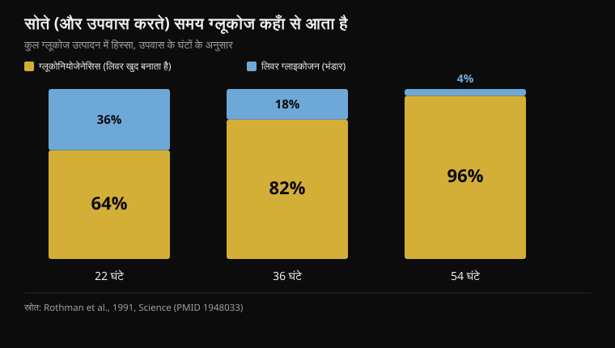
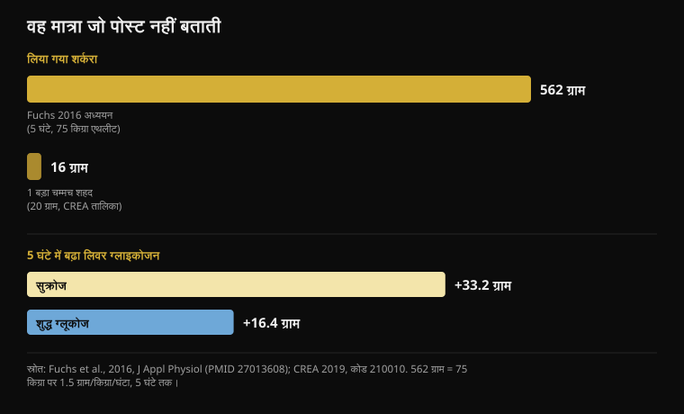

# सोने से पहले शहद: क्या यह सच में काम करता है?

लेखक: [Giammaria Loi](/autore/giammaria-loi) · 18 अक्टूबर 2026 को अद्यतन

खूब शेयर हुई एक स्लाइड सीरीज़ समझाती है कि सोने से पहले एक चम्मच शहद रात 3 बजे की नींद टूटना क्यों रोक देगा: लिवर का ग्लाइकोजन खत्म होता है, कॉर्टिसोल भड़कता है, और आप जाग जाते हैं। कड़ी अच्छी तरह बुनी गई है, और यह पोस्ट औसत से ज़्यादा ईमानदार भी है — यह मानती है कि नींद पर इंसानी डेटा कमज़ोर है। बाकी हिस्से की जाँच के लिए मैंने ग्यारह अध्ययन पढ़े। पूरी थ्योरी ठीक उन्हीं दो बिंदुओं पर टूटती है जिन पर सब कुछ टिका है, और जो आँकड़ा हर बार गायब रहता है वह एक ही है: मात्रा।

## संक्षेप में

- **रात में लिवर खाली नहीं होता।** उपवास के पहले 22 घंटों में ही खून में मौजूद 64% ग्लूकोज लिवर खुद बनाता है, भंडार से नहीं लेता (Rothman et al., 1991)।
- **रात के आख़िरी हिस्से में बढ़ता कॉर्टिसोल एक घड़ी है, अलार्म नहीं।** यह सर्कैडियन लय है: नींद शुरू होते समय सबसे कम, जागने के क्षण सबसे ज़्यादा (Mohd Azmi et al., 2021)।
- **कम शुगर से किसी स्वस्थ व्यक्ति को जगाने के लिए 2.2 mmol/L तक गिरना पड़ता है** — इंसुलिन से पैदा की गई गंभीर हाइपोग्लाइसीमिया — और तब भी 16 में से सिर्फ़ 10 जागे (Schultes et al., 2007)।
- **एक बड़ा चम्मच शहद यानी 16 ग्राम शर्करा** (CREA तालिकाएँ)। फ्रुक्टोज़ वाली थ्योरी साबित करने वाले अध्ययन में पाँच घंटे में 562 ग्राम दिए गए थे (Fuchs et al., 2016)।
- **“शुद्ध ग्लूकोज लिवर ग्लाइकोजन नहीं भरता” — यह ग़लत है:** उसी अध्ययन में अकेले ग्लूकोज ने 16.4 ग्राम जोड़े, यानी सुक्रोज़ का लगभग आधा। आधा, शून्य नहीं।

## पोस्ट का दावा क्या है

कड़ी इस तरह है। दिमाग शरीर के वज़न का 2% है लेकिन आराम की हालत में लगभग 20% ग्लूकोज जलाता है। रात में भी वह जलाता रहता है, लिवर का ग्लाइकोजन खत्म हो जाता है, शरीर रात दो बजे के आसपास कॉर्टिसोल बढ़ाकर “आपातकालीन ईंधन” जुटाता है, और कॉर्टिसोल आपको गहरी नींद से बाहर खींच लेता है। शहद, जो आधा ग्लूकोज और आधा फ्रुक्टोज़ है, दिमाग को तुरंत शुगर देगा और लिवर को भंडार दोबारा बनाने के लिए फ्रुक्टोज़। प्रोटोकॉल: सोने से तीस मिनट पहले एक चम्मच कच्चा शहद।

पहला हिस्सा सही है। दिमाग बेहद महँगा अंग है: यह लगातार पूरे शरीर की 20% से 25% ऊर्जा खर्च करता है, नींद में भी। इस पर कोई बहस नहीं।

यह भी कहना चाहिए कि यह पोस्ट अपने जैसी लगभग हर चीज़ से ज़्यादा पारदर्शी है: एक पूरी स्लाइड प्रमाणों की मज़बूती को दी गई है, और उसमें खुलकर माना गया है कि शहद और नींद पर इंसानी अध्ययन “कमज़ोर” हैं और बाकी बहुत कुछ जानवरों पर हुए शोध से निकाला गया है। यह दुर्लभ खूबी है। दिक्कत यह है कि उससे पहले की दो स्लाइडें दो ऐसे चरणों को स्थापित शरीरविज्ञान की तरह पेश करती हैं जिन्हें इंसानी अध्ययन अलग ढंग से बताते हैं। एक संदर्भ: इंस्टाग्राम इस पोस्ट को **कृत्रिम बुद्धिमत्ता से बनी या संपादित सामग्री** के रूप में चिह्नित करता है।

## सोते समय आपका लिवर खाली नहीं होता

यहीं थ्योरी का पहला हिस्सा गिरता है।

जब आप नहीं खाते, तब लिवर के पास ब्लड शुगर स्थिर रखने के दो तरीके हैं। वह ग्लाइकोजन तोड़ सकता है, यानी तैयार शुगर भंडार (ग्लाइकोजेनोलिसिस), या वह लैक्टेट, अमीनो अम्लों और ग्लिसरॉल से नया ग्लूकोज *बना* सकता है: इसे ग्लूकोनियोजेनेसिस कहते हैं, और यह प्रक्रिया लगातार चलती रहती है।

1991 में येल के एक समूह ने पहली बार मापा कि इंसान में दोनों रास्तों का कितना योगदान है — उन्होंने 68 घंटे के उपवास के दौरान चुंबकीय अनुनाद से लिवर ग्लाइकोजन की सांद्रता घंटे-दर-घंटे नापी। नतीजा: **पहले 22 घंटों में ही ग्लूकोनियोजेनेसिस कुल ग्लूकोज उत्पादन का 64% संभाल लेता है**। 36 घंटे पर यह 82% और 54 घंटे पर 96% हो जाता है।

*उपवास के तीन पड़ावों पर लिवर के दोनों रास्तों से पूरा होने वाला कुल ग्लूकोज उत्पादन का हिस्सा। उपवास जितना लंबा खिंचता है, ग्लाइकोजन भंडार उतना ही कम मायने रखता है। स्रोत: Rothman et al., 1991।*

यानी: लिवर ग्लाइकोजन का भंडार वह खंभा नहीं है जिस पर आपकी रात टिकी हो। एक रात की नींद से तीन गुना लंबे उपवास के अंत तक भी वह छोटा हिस्सा ही है। बिस्तर पर बिताए आठ घंटों में भंडार घटता ज़रूर है, लेकिन आप अब भी उसी खिड़की में हैं जहाँ लिवर की पूरी दूसरी उत्पादन लाइन चल रही है और ज़्यादातर ज़रूरत पूरी कर रही है। ऐसा कोई क्षण नहीं आता जब “पेट्रोल खत्म” हो और आपातकाल शुरू हो जाए।

## रात 3 बजे का कॉर्टिसोल ब्लड शुगर का अलार्म नहीं है

दूसरा हिस्सा — और यह भी नहीं टिकता।

कॉर्टिसोल की सर्कैडियन लय बहुत स्पष्ट है और उसे हाइपोथैलेमस-पिट्यूटरी-एड्रिनल अक्ष नियंत्रित करता है: **नींद शुरू होते समय यह सबसे नीचे होता है, रात के दूसरे आधे हिस्से में चढ़ना शुरू करता है, और जिस क्षण आप जागते हैं उसी समय चरम पर होता है**। यह रात वाली बढ़ोतरी चयापचय में किसी गड़बड़ी की प्रतिक्रिया नहीं है: यह पहले से तय है, शरीर को जागने के लिए तैयार करती है, और उनके साथ भी होती है जिन्होंने बढ़िया खाना खाया हो।

पर क्या कम ब्लड शुगर जगा सकती है? हाँ — और हमें ठीक-ठीक पता है किस स्तर पर, क्योंकि यह मापा जा चुका है। 2007 के एक अध्ययन में, जो *PLoS Medicine* में छपा, नींद के दौरान इंसुलिन देकर ब्लड शुगर गिराई गई — 16 स्वस्थ लोगों और टाइप-1 मधुमेह वाले 16 लोगों में। सबसे निचला स्तर **2.2 mmol/L** था, यानी लगभग 40 mg/dL: गंभीर हाइपोग्लाइसीमिया, जिसमें हस्तक्षेप ज़रूरी होता है। उस बिंदु पर **16 में से 10 स्वस्थ लोग** जागे — और मधुमेह वाले 16 में से सिर्फ़ एक।

इसमें दो बातें एक साथ हैं। पहली: स्वस्थ शरीर में वाकई ग्लूकोज से जुड़ी जागने की व्यवस्था है, और जागने का कोई भी लक्षण दिखने से औसतन साढ़े सात मिनट *पहले* एड्रिनलिन चढ़ने लगता है। दूसरी, और ज़्यादा अहम: यह व्यवस्था उस स्तर पर चालू होती है जहाँ कोई स्वस्थ व्यक्ति रात का खाना खाकर सोते हुए पहुँचता ही नहीं। वहाँ तक पहुँचने के लिए इंसुलिन की ड्रिप लगानी पड़ी।

अगर आपकी नींद रात 3 बजे खुलती है, तो संभावित कारण कई हैं — शराब, कमरे का तापमान, तनाव, स्लीप एपनिया, देर से ली गई कैफ़ीन, और वे सामान्य छोटी-छोटी जागृतियाँ जो आमतौर पर याद नहीं रहतीं। यही तर्क मैंने [कैफ़ीन और नींद](/hi/blog/caffeine-neend-kab-coffee-band-karein) पर लिखते हुए अपनाया था: सप्लीमेंट की ओर हाथ बढ़ाने से पहले उन चीज़ों को जाँचिए जिनका असर सचमुच मापा गया है।

## एक चम्मच बहुत कम है, और पोस्ट यह कभी नहीं बताती

यही वह आँकड़ा है जो सातों स्लाइडों से गायब है: **एक चम्मच शहद में कितनी शर्करा होती है**।

CREA की खाद्य संरचना तालिकाएँ — वही जो Nurvan अपने फ़ूड डायरी में इस्तेमाल करता है — शहद को प्रति 100 ग्राम 80.3 ग्राम कार्बोहाइड्रेट बताती हैं, पूरी की पूरी सरल शर्करा, और 304 किलो कैलोरी, जिसमें मानक मात्रा 20 ग्राम है। इसलिए एक बड़ा चम्मच यानी **लगभग 16 ग्राम शर्करा और 61 कैलोरी**।

अब इसकी तुलना उस अध्ययन से कीजिए जो पोस्ट की बताई थ्योरी को साबित करता है। 2016 में पंद्रह प्रशिक्षित साइक्लिस्टों ने थकाऊ व्यायाम से अपने भंडार खाली किए और फिर पाँच घंटे तक हर घंटे **शरीर के प्रति किलो 1.5 ग्राम कार्बोहाइड्रेट** लिए: 75 किलो के एथलीट के लिए यह लगभग 112 ग्राम प्रति घंटा, यानी **कुल 562 ग्राम** होता है। चुंबकीय अनुनाद से मापा गया लिवर ग्लाइकोजन सुक्रोज़ के साथ 53.6 से बढ़कर 86.8 ग्राम हो गया।

*ऊपर मात्रा: उस अध्ययन की जो तंत्र को साबित करता है, और CREA तालिकाओं के अनुसार एक चम्मच शहद की। नीचे चुंबकीय अनुनाद से मापा नतीजा: शुद्ध ग्लूकोज सुक्रोज़ का लगभग आधा जोड़ता है, शून्य नहीं। स्रोत: Fuchs et al., 2016; CREA 2019।*

एक चम्मच शहद उस मात्रा का **2.9%** है। और लिवर ग्लाइकोजन पर वही समीक्षा वह सीमा तय करती है जिसके नीचे कार्बोहाइड्रेट व्यायाम के दौरान भंडार खाली होने से नहीं रोक पाते: **प्रति मिनट 1.5 ग्राम** से ऊपर, यानी हर घंटे 90 ग्राम से ज़्यादा। हर घंटे पाँच चम्मच शहद, न कि दिन के अंत में एक।

इसका मतलब यह नहीं कि 16 ग्राम शर्करा कुछ भी नहीं करती। मतलब यह है कि वह ठीक वही काम नहीं कर सकती जो पोस्ट उसे सौंपती है: उस लिवर भंडार को भरना जिसमें उन एथलीटों के शरीर में 49 से 87 ग्राम तक ग्लाइकोजन था।

## “शुद्ध ग्लूकोज बेकार है”: ग़लत, और यह उसी अध्ययन में लिखा है

स्लाइड 4 में पोस्ट का सबसे तीखा दावा है, वही जो शहद को बाकी हर शर्करा से ऊपर बिठाता है: शुद्ध ग्लूकोज कथित तौर पर शुगर तेज़ी से चढ़ाता है और उतनी ही तेज़ी से गिरा देता है, और लिवर ग्लाइकोजन को “सार्थक ढंग से” नहीं भरता।

2016 का अध्ययन ठीक यही तुलना करता है: सुक्रोज़ बनाम शुद्ध ग्लूकोज, वही मात्रा, वही पाँच घंटे। सुक्रोज़ बेहतर रहा, और यही वह नतीजा है जो फ्रुक्टोज़ वाली बात को सही ठहराता है: ग्लूकोज के मुकाबले **प्रति घंटे 3.4 ग्राम ज़्यादा लिवर ग्लाइकोजन** (95% विश्वास अंतराल: 1.6 से 5.1)। लेकिन शुद्ध ग्लूकोज शून्य पर नहीं रहा: उसने लिवर ग्लाइकोजन 49.3 से 65.7 ग्राम तक पहुँचाया, यानी **16.4 ग्राम की बढ़त**, जबकि सुक्रोज़ से 33.2 ग्राम। लगभग आधा। और मांसपेशियों के ग्लाइकोजन पर दोनों शर्कराएँ बिल्कुल बराबर रहीं (p = 0.673)।

“आधा” और “सार्थक नहीं” एक बात नहीं हैं। फ्रुक्टोज़ का फ़ायदा असली है और मापा गया है, और जब लिवर को जल्दी भरना हो — मसलन एक ही दिन की दो ट्रेनिंग के बीच — तो शहद, सुक्रोज़ या ग्लूकोज-फ्रुक्टोज़ मिश्रण चुनने की यह ठोस वजह है। पर यह कहने की वजह नहीं कि ग्लूकोज काम ही नहीं करता।

## ट्रेनिंग के मामले में, हालाँकि, कुछ दम है

प्रदर्शन वाला हिस्सा पोस्ट का सबसे मज़बूत हिस्सा है, और यहाँ भी ब्यौरा मायने बदल देता है।

इस दावे के पीछे का अध्ययन 2004 का है: नौ साइक्लिस्ट, 64 किलोमीटर की नकली टाइम ट्रायल, तीन ब्लाइंडेड राइड जिनमें हर 16 किलोमीटर पर **15 ग्राम शहद (ग्लाइसेमिक इंडेक्स 35), 15 ग्राम डेक्स्ट्रोज़ (इंडेक्स 100) या प्लेसिबो** दिया गया। समय: शहद 128 मिनट 42 सेकंड, डेक्स्ट्रोज़ 128:18, प्लेसिबो 131:18। शहद और डेक्स्ट्रोज़ के बीच अंतर **0.39%** है, जिसका अंतराल -3.39% से +4.15% तक फैला है: कोई अंतर नहीं। दोनों कार्बोहाइड्रेट मिलकर प्लेसिबो से बेहतर रहे (p < 0.02)।

तो हाँ, शहद जेल की बराबरी करता है। लेकिन उसी प्रयोग में **डेक्स्ट्रोज़ भी बराबरी करता है, यानी शुद्ध ग्लूकोज** — वही जिसे स्लाइड 4 बेकार घोषित करती है। और मात्रा थी हर 16 किलोमीटर पर 15 ग्राम, यानी दो घंटे में लगभग 60 ग्राम: मेहनत के दौरान एक-एक चम्मच, बार-बार। निकलने से पहले एक चम्मच नहीं।

एक और हालिया नतीजा जोश को और ठंडा करता है: 2025 में शहद पाउडर और प्रोटीन वाले एक सप्लीमेंट को बारह साइक्लिस्टों पर परखा गया — 100 मिनट की मेहनत के बाद 20 मिनट की टाइम ट्रायल। कुल कार्य 294 kJ बनाम प्लेसिबो का 292, औसत पावर 245 बनाम 243 वाट: **कोई अंतर नहीं** (p = 0.72 और p = 0.61), न ब्लड शुगर में, न लैक्टेट में, न महसूस की गई मेहनत में।

लागत के मामले में पोस्ट सही है, और यह सचमुच व्यावहारिक बात है: अगर आप तीन घंटे साइकिल चला रहे हैं और आपको हर घंटे 60-90 ग्राम कार्बोहाइड्रेट चाहिए, तो शहद से लेना जेल के मुकाबले कई गुना सस्ता है। स्लाइड 6 में बताए दो अवशोषण रास्ते — ग्लूकोज के लिए SGLT1 और फ्रुक्टोज़ के लिए GLUT5, जो साथ-साथ काम करते हैं — असली हैं और सचमुच मायने रखते हैं, *लेकिन सिर्फ़ उन्हीं सेवन दरों पर*। 16 ग्राम पर संतृप्त करने लायक कोई रास्ता ही नहीं है।

## और सोने से पहले शहद? वह डेटा है ही नहीं

वयस्कों में शहद और नींद पर मुझे PubMed पर कोई भी रैंडमाइज़्ड ट्रायल नहीं मिला। 2024 की विषय-विशेष समीक्षा शहद को नींद के लिए एक आशाजनक दिशा बताती है, लेकिन निष्कर्ष यही देती है कि तंत्र स्थापित नहीं हैं और और शोध चाहिए: यह परिकल्पनाओं की सूची है, नतीजों की नहीं।

नींद से जुड़ा कोई नतीजा मापने वाला इकलौता रैंडमाइज़्ड नियंत्रित परीक्षण बच्चों पर है: ज़ुकाम की खाँसी वाले 1 से 5 साल के 161 बच्चे, सोने से एक घंटा पहले बबूल का शहद बनाम शहद के स्वाद वाला प्लेसिबो सिरप। दोनों समूहों में सुधार हुआ, **शहद और प्लेसिबो के बीच कोई अंतर नहीं** — न खाँसी में, न नींद की दिक्कत में। संदर्भ अलग है, पर यही एकमात्र नियंत्रित डेटा मौजूद है, और वह पोस्ट की कहानी के उलट दिशा में जाता है।

हालाँकि कार्बोहाइड्रेट और नींद के बीच एक चीज़ सचमुच काम करती है, और पोस्ट उसे चूक जाती है। 2007 में बारह स्वस्थ पुरुषों ने **सोने से चार घंटे पहले** उच्च ग्लाइसेमिक इंडेक्स वाला भोजन किया: नींद आने में लगने वाला समय 17.5 से घटकर 9.0 मिनट रह गया (p = 0.009)। वही भोजन **एक घंटा पहले** देने पर कम असरदार रहा: 14.6 मिनट। पोस्ट का प्रोटोकॉल कहता है सोने से तीस मिनट पहले — यानी उपलब्ध इकलौते डेटा के ठीक उलटे सिरे पर।

## शोध असल में क्या कहता है

- **पुष्ट** — दिमाग ऊर्जा का विशाल और लगातार उपभोक्ता है: पूरे शरीर के खर्च का 20% से 25%, दिन हो या रात।
- **पुष्ट** — फ्रुक्टोज़ अकेले ग्लूकोज के मुकाबले लिवर ग्लाइकोजन भरने में बेहतर है: प्रति घंटे 3.4 ग्राम ज़्यादा, चुंबकीय अनुनाद से मापा गया।
- **पुष्ट** — सहनशक्ति वाले काम में 64 किमी की टाइम ट्रायल पर शहद व्यावसायिक जेल की बराबरी करता है — पर उसी अध्ययन में शुद्ध ग्लूकोज भी करता है।
- **स्पष्टीकरण ज़रूरी** — “1:1 अनुपात ही पूरा तंत्र है”: दिशा सही है, मात्रा नहीं। एक चम्मच उस अध्ययन में इस्तेमाल हुए कार्बोहाइड्रेट का केवल 2.9% है जो इसी तंत्र को साबित करता है।
- **स्पष्टीकरण ज़रूरी** — शहद जेल से सस्ता है: सही, पर तुलना बराबर मात्रा पर टिकती है, यानी मेहनत के दौरान प्रति घंटे 60-90 ग्राम कार्बोहाइड्रेट, एक चम्मच नहीं।
- **खंडित** — “रात में लिवर का ग्लाइकोजन खत्म हो जाता है”: उपवास के पहले 22 घंटों में ही बना 64% ग्लूकोज ग्लूकोनियोजेनेसिस से आता है, भंडार से नहीं।
- **खंडित** — “खाली ग्लाइकोजन रात दो बजे कॉर्टिसोल छेड़ता है और आपको जगा देता है”: रात के आख़िर में कॉर्टिसोल का चढ़ना सर्कैडियन है, और किसी स्वस्थ व्यक्ति को शुगर से जगाने के लिए इंसुलिन से 2.2 mmol/L तक गिराना पड़ता है।
- **खंडित** — “शुद्ध ग्लूकोज लिवर ग्लाइकोजन को सार्थक ढंग से नहीं भरता”: उसने पाँच घंटे में 16.4 ग्राम जोड़े, यानी सुक्रोज़ का लगभग आधा।
- **असत्यापित** — “सिर्फ़ कच्चा शहद: प्रोसेस्ड शहद वह एंज़ाइम सक्रियता खो देता है जो मायने रखती है।” PubMed पर कोई अध्ययन नींद या ग्लाइकोजन के मामले में कच्चे और प्रोसेस्ड शहद की तुलना नहीं करता; 2004 के परीक्षण में शहद एक व्यावसायिक उत्पाद था और उसने काम किया।
- **असत्यापित** — एक चम्मच शहद से रात 3 बजे की जागृति कम होना: वयस्कों में कोई रैंडमाइज़्ड ट्रायल नहीं। नींद पर इकलौता नियंत्रित नतीजा, बच्चों में, प्लेसिबो से कोई फ़र्क़ नहीं पाता।

## इसे कैसे लागू करें

1. **रात में नींद खुलती है तो उन कारणों से शुरू करें जिनके पीछे डेटा है।** सोने से पहले शराब, गर्म कमरा, देर से ली गई कैफ़ीन, तनाव, स्लीप एपनिया। नींद पर इनका असर मापा जा चुका है; स्वस्थ लोगों में लिवर ग्लाइकोजन का नहीं।
2. **नींद के लिए कार्बोहाइड्रेट आज़माना है तो समय बदलिए।** इकलौता सकारात्मक नतीजा सोने से चार घंटे पहले उच्च ग्लाइसेमिक इंडेक्स वाले भोजन से जुड़ा है, तीस मिनट पहले एक चम्मच से नहीं। कार्बोहाइड्रेट वाला सामान्य रात का खाना यह काम पहले ही कर देता है।
3. **शहद को वहाँ इस्तेमाल करें जहाँ उसकी जगह सचमुच बनती है: लंबी मेहनत के दौरान।** 90 मिनट से आगे, प्रति घंटे 60-90 ग्राम कार्बोहाइड्रेट। शहद बढ़िया और सस्ता स्रोत है, और इतनी मात्रा पर ग्लूकोज-फ्रुक्टोज़ मिश्रण असली फ़ायदा देता है।
4. **ट्रेनिंग के बाद, अगर अगली सेशन जल्दी है, तो फ्रुक्टोज़ मायने रखता है।** शहद, सुक्रोज़ या ग्लूकोज-फ्रुक्टोज़ ड्रिंक लिवर को शुद्ध ग्लूकोज से लगभग दोगुनी रफ़्तार से भरते हैं। अगली सेशन कल है तो समय भरपूर है और शर्करा का चुनाव ज़्यादा मायने नहीं रखता।
5. **इसे डायरी में दर्ज करें।** एक चम्मच यानी 61 कैलोरी और 16 ग्राम शर्करा: एक शाम के लिए नगण्य, पर बाकी सब के ऊपर रोज़ की आदत बन जाए तो नहीं। यह वही बात है जो मैंने [कार्ब्स और छिपी चर्बी](/hi/blog/carbs-se-vajan-badhta-hai-chhipi-charbi) पर कही थी।
6. **आज़माना ही है तो एक सच्चे प्रयोग की तरह आज़माइए।** दो हफ़्ते साथ और दो हफ़्ते बिना, सोने का वही समय, और जागने की गिनती दर्ज करते हुए। यह पोस्ट का सबसे अच्छा सुझाव है और असर तथा अपेक्षा में फ़र्क़ करने का इकलौता तरीका।

> **डायरी में शहद, सही आँकड़ों के साथ**  
> Nurvan का पोषण मॉड्यूल आधिकारिक CREA तालिकाओं पर चलता है: “शहद” खोजिए, मात्रा चुनिए, और वे 16 ग्राम शर्करा वहीं पहुँचते हैं जहाँ उन्हें जाना चाहिए — दिन के कुल में। और अगर आप इसे लंबी ट्रेनिंग का ईंधन बनाते हैं, तो उसे सेशन के साथ ही दर्ज कीजिए, दिमाग में रखने के बजाय।  
> [Nurvan आज़माएँ](https://nurvan.app)

## अक्सर पूछे जाने वाले सवाल

### क्या सोने से पहले शहद सचमुच बेहतर नींद देता है?

वयस्कों पर ऐसा दिखाने वाला कोई रैंडमाइज़्ड ट्रायल नहीं है। नींद से जुड़ा नतीजा मापने वाला इकलौता नियंत्रित अध्ययन खाँसी वाले बच्चों पर है और उसमें शहद तथा प्लेसिबो सिरप में कोई अंतर नहीं मिला। लिवर ग्लाइकोजन वाला तंत्र, जो सबसे ज़्यादा दोहराई जाने वाली व्याख्या है, डेटा के सामने नहीं टिकता: रात में ज़्यादातर ग्लूकोज लिवर खुद बनाता है, भंडार से नहीं लेता।

### मेरी नींद रात 3 बजे क्यों खुल जाती है?

स्वस्थ लोगों में लगभग कभी भी ब्लड शुगर की वजह से नहीं: उसके लिए करीब 2.2 mmol/L तक गिरना पड़ेगा, और यह स्तर रात का खाना खाकर सोते हुए नहीं आता। सबसे आम और सबसे अच्छी तरह दर्ज कारण हैं शराब, कमरे का तापमान, देर से ली गई कैफ़ीन, तनाव और नींद से जुड़ी साँस की दिक्कतें। अगर नींद बार-बार टूटती है और दिन में थकान रहती है, तो खाने का कोई नुस्ख़ा ढूँढ़ने के बजाय डॉक्टर से बात कीजिए।

### ट्रेनिंग के दौरान शहद लें या कार्बोहाइड्रेट जेल?

प्रदर्शन के लिहाज़ से दोनों बराबर हैं: 64 किमी टाइम ट्रायल की सीधी तुलना में शहद और डेक्स्ट्रोज़ ने एक जैसा समय दिया, और दोनों प्लेसिबो से बेहतर रहे। शहद कहीं सस्ता है। असली बात मात्रा की है: 90 मिनट से लंबी मेहनत में हर घंटे 60-90 ग्राम कार्बोहाइड्रेट चाहिए, यानी चार-पाँच चम्मच, एक नहीं।

### क्या कच्चा शहद प्रोसेस्ड शहद से बेहतर है?

नींद और ग्लाइकोजन के मामले में दोनों की तुलना करने वाला कोई अध्ययन नहीं है, इसलिए यह बिना प्रमाण वाला दावा है — न सिद्ध, न खंडित। ध्यान देने लायक बात यह है कि साइक्लिंग वाले अध्ययन में शहद जेल के रूप में तैयार व्यावसायिक उत्पाद था और उसने डेक्स्ट्रोज़ जितना ही अच्छा काम किया।

## यह भी पढ़ें

- [कैफ़ीन और नींद: कॉफ़ी कब बंद करें](/hi/blog/caffeine-neend-kab-coffee-band-karein) — असली सीमाएँ, सोने के समय से उल्टा गिनकर
- [सप्लीमेंट कब लें: क्या समय मायने रखता है?](/hi/blog/supplements-kab-lein-samay) — टाइमिंग पर आठ अध्ययन, और असल में कितना फ़र्क़ पड़ता है
- [क्या कार्ब्स से वज़न बढ़ता है? छिपी चर्बी](/hi/blog/carbs-se-vajan-badhta-hai-chhipi-charbi) — CREA तालिकाओं के अनुसार, आपकी थाली में असल में क्या है

## स्रोत

1. Rothman DL, Magnusson I, Katz LD, Shulman RG, Shulman GI, 1991. Quantitation of hepatic glycogenolysis and gluconeogenesis in fasting humans with 13C NMR. *Science* 254(5031):573-576. PMID 1948033 — [doi.org/10.1126/science.1948033](https://doi.org/10.1126/science.1948033)
2. Schultes B, Jauch-Chara K, Gais S, et al., 2007. Defective awakening response to nocturnal hypoglycemia in patients with type 1 diabetes mellitus. *PLoS Med* 4(2):e69. PMID 17326710 — [doi.org/10.1371/journal.pmed.0040069](https://doi.org/10.1371/journal.pmed.0040069)
3. Mohd Azmi NAS, Juliana N, Azmani S, et al., 2021. Cortisol on circadian rhythm and its effect on cardiovascular system. *Int J Environ Res Public Health* 18(2):676. PMID 33466883 — [doi.org/10.3390/ijerph18020676](https://doi.org/10.3390/ijerph18020676)
4. Beard E, Lengacher S, Dias S, Magistretti PJ, Finsterwald C, 2022. Astrocytes as key regulators of brain energy metabolism: new therapeutic perspectives. *Front Physiol* 12:825816. PMID 35087428 — [doi.org/10.3389/fphys.2021.825816](https://doi.org/10.3389/fphys.2021.825816)
5. Fuchs CJ, Gonzalez JT, Beelen M, et al., 2016. Sucrose ingestion after exhaustive exercise accelerates liver, but not muscle glycogen repletion compared with glucose ingestion in trained athletes. *J Appl Physiol* 120(11):1328-1334. PMID 27013608 — [doi.org/10.1152/japplphysiol.01023.2015](https://doi.org/10.1152/japplphysiol.01023.2015)
6. Gonzalez JT, Fuchs CJ, Betts JA, van Loon LJC, 2016. Liver glycogen metabolism during and after prolonged endurance-type exercise. *Am J Physiol Endocrinol Metab* 311(3):E543-E553. PMID 27436612 — [doi.org/10.1152/ajpendo.00232.2016](https://doi.org/10.1152/ajpendo.00232.2016)
7. Earnest CP, Lancaster SL, Rasmussen CJ, et al., 2004. Low vs. high glycemic index carbohydrate gel ingestion during simulated 64-km cycling time trial performance. *J Strength Cond Res* 18(3):466-472. PMID 15320674 (इस लेख के लिए दर्ज DOI एक निष्क्रिय प्लेसहोल्डर है; इसे PMID से उद्धृत किया गया है)
8. Toniazzo T, de Almeida Azevedo R, Oliveira TN, et al., 2025. A novel honey powder-based supplement containing carbohydrate and protein did not improve endurance performance in recreationally trained cyclists. *Int J Sport Nutr Exerc Metab* 35(6):520-529. PMID 40812383 — [doi.org/10.1123/ijsnem.2025-0021](https://doi.org/10.1123/ijsnem.2025-0021)
9. Nishimura T, Muta H, Hosaka T, Ueda M, Kishida K, 2022. Multicentre, randomised study found that honey had no pharmacological effect on nocturnal coughs and sleep quality at 1-5 years of age. *Acta Paediatr* 111(11):2157-2164. PMID 35927828 — [doi.org/10.1111/apa.16509](https://doi.org/10.1111/apa.16509)
10. Zulkifli MF, Masimen MAA, Ridzuan PM, Wan Ismail WI, 2024. Exploring honey's potential as a functional food for natural sleep aid. *Food Funct* 15(19):9678-9689. PMID 39248637 — [doi.org/10.1039/d4fo02013h](https://doi.org/10.1039/d4fo02013h)
11. Afaghi A, O'Connor H, Chow CM, 2007. High-glycemic-index carbohydrate meals shorten sleep onset. *Am J Clin Nutr* 85(2):426-430. PMID 17284739 — [doi.org/10.1093/ajcn/85.2.426](https://doi.org/10.1093/ajcn/85.2.426)
12. CREA — खाद्य एवं पोषण अनुसंधान केंद्र, इतालवी खाद्य संरचना तालिकाएँ, 2019 संस्करण, प्रविष्टि “Miele” (शहद, कोड 210010): 304 किलो कैलोरी, 80.3 ग्राम कार्बोहाइड्रेट, मानक मात्रा 20 ग्राम।

प्रेरणा: [Christian Poulos](https://www.instagram.com/p/DdwWWxYkfEW/) की स्लाइड सीरीज़ (26 सितंबर 2026), जिसे इंस्टाग्राम कृत्रिम बुद्धिमत्ता से बनी या संपादित सामग्री के रूप में चिह्नित करता है। पोस्ट का कोई पाठ या चित्र दोहराया नहीं गया है: सभी दावे नए सिरे से लिखे गए और मूल शोध साहित्य पर जाँचे गए हैं।

जियाम्मारिया लोई Nurvan के संस्थापक हैं। वे 2012 से वेट ट्रेनिंग कर रहे हैं, 2013 से FIPE-प्रमाणित पर्सनल ट्रेनर और कोच के रूप में काम कर रहे हैं, और 2018 से राष्ट्रीय स्तर पर पावरलिफ्टिंग में हिस्सा लेते हैं। उनके हर लेख की शुरुआत शोध से होती है और अंत उस पर जो जिम में सचमुच काम करता है। [लेखक पृष्ठ](/autore/giammaria-loi)

> नोट: यह जानकारीपरक सामग्री है और डॉक्टर या किसी योग्य पेशेवर की सलाह की जगह नहीं लेती। अगर रात में बार-बार नींद खुलती है, अगर आप थके हुए उठते हैं, या अगर आपको मधुमेह है या आप ब्लड शुगर घटाने वाली दवाएँ लेते हैं, तो अपने डॉक्टर से बात कीजिए: ऐसे मामलों में रात की हाइपोग्लाइसीमिया असली समस्या है और उसे वही संभालें जो आपका इलाज कर रहे हैं, न कि एक चम्मच शहद।
