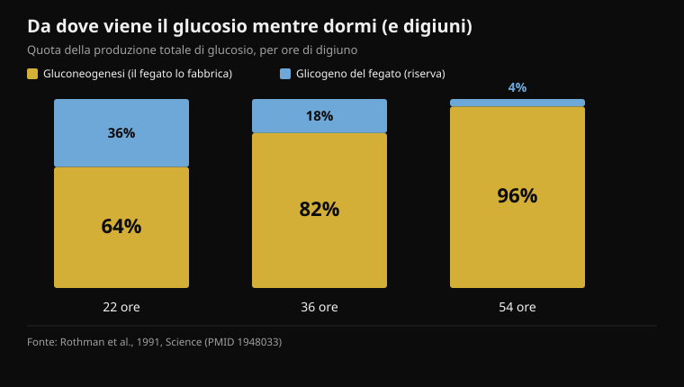
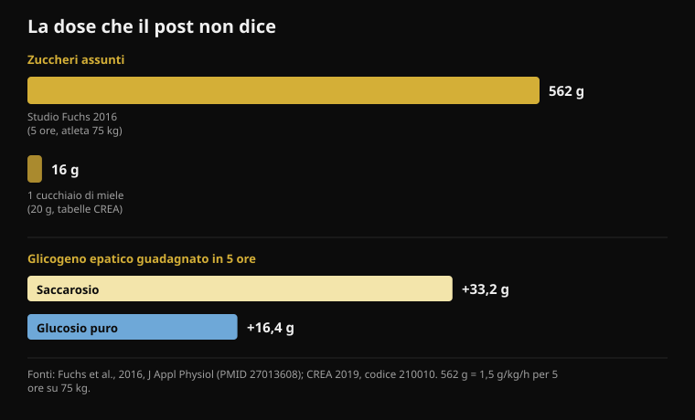

# Miele prima di dormire: serve davvero?

Di [Giammaria Loi](/autore/giammaria-loi) · aggiornato il 18 ottobre 2026

Un carosello molto condiviso spiega perché un cucchiaio di miele prima di dormire ridurrebbe i risvegli delle 3 di notte: il fegato finisce il glicogeno, parte il cortisolo, ti svegli. La catena è raccontata bene e il post è più onesto della media — ammette che i dati umani sul sonno sono scarsi. Ho letto undici studi per controllare il resto. Il meccanismo non regge nei due punti su cui tutto si appoggia, e il numero che manca è sempre lo stesso: la dose.

## In breve

- **Di notte il fegato non resta a secco.** Già nelle prime 22 ore di digiuno il 64% del glucosio che circola viene fabbricato dal fegato, non preso dalla riserva (Rothman et al., 1991).
- **Il cortisolo che sale a fine notte è un orologio, non un allarme.** È il ritmo circadiano: parte basso all'inizio del sonno e arriva al massimo al risveglio (Mohd Azmi et al., 2021).
- **Per svegliare una persona sana con la glicemia bassa servono 2,2 mmol/l**, cioè un'ipoglicemia grave indotta con insulina — e anche così si sveglia solo 10 persone su 16 (Schultes et al., 2007).
- **Un cucchiaio di miele sono 16 grammi di zuccheri** (tabelle CREA). Lo studio che dimostra il meccanismo del fruttosio ne usava 562 in cinque ore (Fuchs et al., 2016).
- **"Il glucosio puro non rifà il glicogeno epatico" è falso:** nello stesso studio il glucosio da solo ne ha aggiunti 16,4 grammi, circa la metà del saccarosio. Metà, non zero.

## Cosa sostiene il post

La catena è questa. Il cervello è il 2% del peso corporeo ma brucia circa il 20% del glucosio a riposo. Di notte continua a consumare, il glicogeno del fegato si esaurisce, il corpo mobilita "carburante di emergenza" alzando il cortisolo verso le 2, e il cortisolo ti tira fuori dal sonno profondo. Il miele, che è per metà glucosio e per metà fruttosio, darebbe al cervello zucchero immediato e al fegato il fruttosio con cui ricostruire la riserva. Protocollo: un cucchiaio di miele crudo trenta minuti prima di dormire.

Il primo pezzo è corretto. Il cervello è un organo costosissimo: consuma in continuo tra il 20% e il 25% dell'energia dell'intero organismo, e lo fa anche mentre dormi. Su questo non c'è discussione.

Va detto anche che il post è più trasparente di quasi tutti i contenuti simili: una slide intera è dedicata alla forza delle prove, e ammette apertamente che gli studi umani su miele e sonno sono "sottili" e che molto viene estrapolato da ricerca animale. È un merito raro. Il problema è che le due slide precedenti presentano come fisiologia accertata due passaggi che gli studi sull'uomo raccontano diversamente. E una nota di contesto: Instagram etichetta questo post come **contenuto generato o modificato con l'intelligenza artificiale**.

## Il fegato non resta a secco mentre dormi

Qui casca il primo pezzo del meccanismo.

Il fegato ha due modi di tenere stabile la glicemia quando non mangi. Può rompere il glicogeno, cioè la riserva di zucchero già pronta (si chiama glicogenolisi), oppure può *fabbricare* glucosio nuovo partendo da lattato, aminoacidi e glicerolo: si chiama gluconeogenesi, ed è un processo che lavora in continuo.

Nel 1991 un gruppo di Yale ha misurato per la prima volta quanto pesa ciascuna delle due strade nell'uomo, seguendo con la risonanza magnetica la concentrazione di glicogeno nel fegato ora per ora durante un digiuno di 68 ore. Il risultato: **già nelle prime 22 ore la gluconeogenesi copre il 64% della produzione totale di glucosio**. Dopo 36 ore sale all'82%, dopo 54 ore al 96%.

*Quota della produzione totale di glucosio coperta dalle due strade del fegato, a tre momenti del digiuno. Più il digiuno avanza, meno conta la riserva di glicogeno. Fonte: Rothman et al., 1991.*

Tradotto: la riserva di glicogeno epatico non è il pilastro che regge la notte, è la quota minoritaria già alla fine di un digiuno lungo il triplo di una dormita. Nelle otto ore che passi a letto la riserva si riduce, certo, ma sei ancora dentro la finestra in cui il fegato ha un'intera seconda via di produzione che lavora e copre la maggior parte del fabbisogno. Non esiste il momento in cui "finisce la benzina" e scatta l'emergenza.

## Il cortisolo delle 3 non è un allarme glicemico

Secondo pezzo, e anche questo non regge.

Il cortisolo ha un ritmo circadiano molto marcato, controllato dall'asse ipotalamo-ipofisi-surrene: **è al minimo all'inizio del sonno, inizia a risalire nella seconda metà della notte e tocca il valore più alto nel momento in cui ti svegli**. Quella risalita notturna non è una reazione a qualcosa che è andato storto nel metabolismo: è programmata, serve a preparare l'organismo al risveglio, e avviene anche in chi ha cenato benissimo.

Ma la glicemia bassa può svegliare, questo è vero? Sì, e sappiamo esattamente a quale livello, perché è stato misurato. In uno studio del 2007 pubblicato su *PLoS Medicine* hanno fatto scendere la glicemia con un'infusione di insulina durante il sonno, in 16 persone sane e 16 con diabete di tipo 1. La soglia raggiunta era di **2,2 mmol/l**, cioè circa 40 mg/dl: un'ipoglicemia grave, di quelle che richiedono intervento. A quel punto si sono svegliate **10 persone sane su 16** — e una sola su 16 fra i diabetici.

Sono due informazioni in una. La prima: l'organismo sano ha davvero un meccanismo di risveglio legato alla glicemia, e l'adrenalina sale in media sette minuti e mezzo *prima* che compaiano i segni del risveglio. La seconda, più importante: quel meccanismo si attiva a livelli che una persona sana non raggiunge dormendo dopo cena. Per arrivarci è servita un'infusione di insulina.

Se ti svegli alle 3 di notte, le cause plausibili sono molte — alcol, temperatura della stanza, stress, apnee, caffeina presa troppo tardi, risvegli fisiologici che normalmente non ricordi. È lo stesso ragionamento che ho fatto parlando di [caffeina e sonno](/blog/caffeina-sonno-quando-smettere-caffe): prima di cercare un integratore conviene controllare le variabili che hanno effetti misurati.

## Un cucchiaio è troppo poco, e il post non lo dice mai

Questo è il dato che manca in tutte e sette le slide: **quanto zucchero c'è in un cucchiaio di miele**.

Le tabelle di composizione CREA, le stesse che Nurvan usa per il diario alimentare, danno il miele a 80,3 grammi di carboidrati per 100 grammi — tutti zuccheri semplici — e 304 kcal, con una porzione standard di 20 grammi. Un cucchiaio sono quindi **circa 16 grammi di zuccheri e 61 calorie**.

Confrontiamolo con lo studio che dimostra il meccanismo che il post invoca. Nel 2016 quindici ciclisti allenati hanno svuotato le riserve con un esercizio esaustivo e poi, per cinque ore, hanno assunto **1,5 grammi di carboidrati per chilo di peso ogni ora**: per un atleta di 75 chili fanno circa 112 grammi all'ora, **562 grammi in totale**. Il glicogeno epatico, misurato con la risonanza magnetica, è passato da 53,6 a 86,8 grammi con il saccarosio.

*Sopra, la dose: quella dello studio che dimostra il meccanismo e quella di un cucchiaio di miele secondo le tabelle CREA. Sotto, il risultato misurato alla risonanza magnetica: il glucosio puro aggiunge circa metà del saccarosio, non zero. Fonti: Fuchs et al., 2016; CREA 2019.*

Un cucchiaio di miele è il **2,9%** di quella dose. E la stessa review sul glicogeno epatico fissa la soglia sotto cui i carboidrati non bastano a impedire la deplezione durante l'esercizio: oltre **1,5 grammi al minuto**, cioè più di 90 grammi ogni ora. Cinque cucchiai di miele all'ora, non uno a fine giornata.

Questo non significa che 16 grammi di zuccheri non facciano assolutamente nulla. Significa che non possono fare la cosa specifica che il post gli attribuisce: riempire una riserva epatica che in quegli atleti conteneva tra i 49 e gli 87 grammi di glicogeno.

## "Il glucosio puro non serve": falso, e lo dice lo stesso studio

La slide 4 contiene l'affermazione più netta del post, quella che giustifica il miele contro qualsiasi altro zucchero: il glucosio puro alzerebbe la glicemia in fretta e la farebbe scendere altrettanto in fretta, senza rifare il glicogeno epatico "in modo significativo".

Lo studio del 2016 ha confrontato proprio questo: saccarosio contro glucosio puro, stessa dose, stesse cinque ore. Il saccarosio ha fatto meglio, ed è il dato che dà ragione alla parte sul fruttosio: **+3,4 grammi di glicogeno epatico all'ora** rispetto al glucosio (intervallo di confidenza al 95%: da 1,6 a 5,1). Ma il glucosio puro non è rimasto a zero: ha portato il glicogeno epatico da 49,3 a 65,7 grammi, cioè **+16,4 grammi**, contro i +33,2 del saccarosio. Circa la metà. Sul glicogeno muscolare, poi, i due zuccheri sono risultati identici (p = 0,673).

"Metà" e "in modo non significativo" non sono la stessa cosa. Il vantaggio del fruttosio è reale e misurato, ed è una ragione sensata per preferire miele, saccarosio o una miscela glucosio-fruttosio quando devi ricaricare il fegato in fretta — per esempio fra due allenamenti nella stessa giornata. Non è una ragione per dire che il glucosio non funziona.

## Sull'allenamento, invece, qualcosa c'è

La parte sulla prestazione è la più solida del post, e anche qui il dettaglio cambia il senso.

Lo studio a cui l'affermazione rimanda è del 2004: nove ciclisti, 64 chilometri a cronometro, tre prove in cieco con **15 grammi di miele (indice glicemico 35), 15 grammi di destrosio (indice glicemico 100) o placebo ogni 16 chilometri**. Tempi: miele 128 minuti e 42 secondi, destrosio 128 e 18, placebo 131 e 18. Fra miele e destrosio la differenza è **0,39%**, con un intervallo che va da -3,39% a +4,15%: nessuna differenza. I due carboidrati insieme battono il placebo (p < 0,02).

Quindi sì, il miele pareggia il gel. Ma nello stesso esperimento **lo pareggia anche il destrosio, cioè glucosio puro**, quello che la slide 4 dichiara inutile. E la dose era di 15 grammi ogni 16 chilometri, circa 60 grammi in due ore: un cucchiaio alla volta, ripetuto, durante lo sforzo. Non un cucchiaio prima di uscire.

Un dato più recente raffredda ulteriormente l'entusiasmo: nel 2025 un integratore a base di miele in polvere e proteine è stato testato su dodici ciclisti con una cronometro di 20 minuti dopo 100 minuti di lavoro. Lavoro totale 294 kJ contro 292 del placebo, potenza media 245 contro 243 watt: **nessuna differenza** (p = 0,72 e p = 0,61), né sulla glicemia né sul lattato né sulla fatica percepita.

Sul costo il post ha ragione, ed è un punto pratico vero: se stai pedalando per tre ore e ti servono 60-90 grammi di carboidrati all'ora, prenderli dal miele costa una frazione di quello che costano i gel. La doppia via di assorbimento che la slide 6 cita — i trasportatori SGLT1 per il glucosio e GLUT5 per il fruttosio, che lavorano in parallelo — è reale e conta davvero, *ma solo a quei ritmi di assunzione*. A 16 grammi non c'è nessuna via da saturare.

## E il miele prima di dormire? Il dato non c'è

Su miele e sonno negli adulti non ho trovato nessuno studio randomizzato su PubMed. La review dedicata all'argomento, del 2024, descrive il miele come una pista promettente per il sonno ma conclude che i meccanismi non sono chiariti e che servono altre ricerche: è una rassegna di ipotesi, non di risultati.

L'unico studio randomizzato e controllato che misura un esito di sonno riguarda i bambini: 161 bambini tra 1 e 5 anni con tosse da raffreddamento, miele di acacia contro uno sciroppo placebo al gusto di miele nell'ora prima di dormire. Entrambi i gruppi sono migliorati, **senza nessuna differenza fra miele e placebo**, né sulla tosse né sulle difficoltà di sonno. È un contesto diverso, ma è l'unico dato controllato che esiste, e va nella direzione opposta al racconto del post.

C'è però una cosa che funziona davvero con i carboidrati e il sonno, e il post la manca. Nel 2007 dodici uomini sani hanno mangiato un pasto ad alto indice glicemico **quattro ore prima di dormire**: la latenza di addormentamento è scesa da 17,5 a 9,0 minuti (p = 0,009). Lo stesso identico pasto dato **un'ora prima** funzionava peggio: 14,6 minuti. Il protocollo del post dice trenta minuti prima di coricarsi, cioè esattamente dalla parte sbagliata dell'unico dato disponibile.

## Cosa dice davvero la ricerca

- **Confermato** — Il cervello è un consumatore enorme e costante di energia: fra il 20% e il 25% del dispendio dell'intero organismo, giorno e notte.
- **Confermato** — Il fruttosio aiuta a ricaricare il glicogeno del fegato più del glucosio da solo: 3,4 grammi all'ora in più, misurati con la risonanza magnetica.
- **Confermato** — Durante l'endurance il miele pareggia un gel commerciale su un cronometro di 64 km — ma nello stesso studio lo pareggia anche il glucosio puro.
- **Da precisare** — "Il rapporto 1:1 è tutto il meccanismo": la direzione è giusta, la dose no. Un cucchiaio è il 2,9% dei carboidrati usati nello studio che dimostra quel meccanismo.
- **Da precisare** — Il miele costa meno dei gel: vero, ma il confronto vale a parità di dose, cioè 60-90 grammi di carboidrati all'ora durante lo sforzo, non un cucchiaio.
- **Smentito** — "Di notte il fegato esaurisce il glicogeno": già nelle prime 22 ore di digiuno il 64% del glucosio prodotto viene dalla gluconeogenesi, non dalla riserva.
- **Smentito** — "Il glicogeno finito fa partire il cortisolo alle 2 e ti sveglia": la risalita del cortisolo a fine notte è circadiana, e per svegliare una persona sana con la glicemia serve scendere a 2,2 mmol/l con l'insulina.
- **Smentito** — "Il glucosio puro non rifà il glicogeno epatico in modo significativo": ne ha aggiunti 16,4 grammi in cinque ore, circa la metà del saccarosio.
- **Non verificabile** — "Solo miele crudo: quello lavorato perde l'attività enzimatica che conta". Nessuno studio su PubMed confronta miele crudo e lavorato su sonno o glicogeno; nello studio del 2004 il miele era un prodotto commerciale e ha funzionato.
- **Non verificabile** — Meno risvegli alle 3 di notte con un cucchiaio di miele: nessuno studio randomizzato negli adulti. L'unico dato controllato su un esito di sonno, nei bambini, non trova differenze dal placebo.

## Come applicarlo

1. **Se ti svegli di notte, parti dalle cause con dati dietro.** Alcol prima di dormire, stanza calda, caffeina presa tardi, stress, apnee notturne. Hanno effetti misurati sul sonno; il glicogeno epatico, nelle persone sane, no.
2. **Se vuoi provare i carboidrati per dormire, spostali.** L'unico dato positivo riguarda un pasto ad alto indice glicemico quattro ore prima di coricarsi, non un cucchiaio trenta minuti prima. Una cena normale con carboidrati fa già quel lavoro.
3. **Usa il miele dove ha davvero senso: durante lo sforzo lungo.** Oltre i 90 minuti, 60-90 grammi di carboidrati all'ora. Il miele è un'ottima fonte a basso costo, e il mix glucosio-fruttosio è un vantaggio reale a quelle quantità.
4. **Dopo un allenamento, se ne hai un altro a breve, il fruttosio conta.** Miele, saccarosio o una bevanda glucosio-fruttosio ricaricano il fegato quasi al doppio della velocità del glucosio puro. Se invece il prossimo allenamento è domani, hai tutto il tempo e la scelta dello zucchero pesa poco.
5. **Contalo nel diario.** Un cucchiaio sono 61 calorie e 16 grammi di zuccheri: trascurabile una sera, non trascurabile se diventa un'abitudine quotidiana sommata al resto. È lo stesso discorso dei [carboidrati e dei grassi nascosti](/blog/carboidrati-fanno-ingrassare-grassi-nascosti).
6. **Se lo provi, provalo come un esperimento vero.** Due settimane con e due senza, stessa ora di coricamento, segnando i risvegli. È il suggerimento migliore del post ed è l'unico modo per distinguere un effetto da un'aspettativa.

> **Il miele nel diario, con i numeri giusti**  
> La nutrizione di Nurvan usa le tabelle ufficiali CREA: cerchi "miele", scegli la porzione e i 16 grammi di zuccheri finiscono dove devono, nel conto della giornata. E se lo usi come carburante durante gli allenamenti lunghi, lo registri insieme alla seduta invece di tenerlo a mente.  
> [Prova Nurvan](https://nurvan.app)

## Domande frequenti

### Il miele prima di dormire aiuta davvero a dormire meglio?

Non ci sono studi randomizzati negli adulti che lo dimostrino. L'unico studio controllato che misura un esito di sonno riguarda bambini con tosse e non trova differenze fra miele e sciroppo placebo. Il meccanismo del glicogeno epatico, che è la spiegazione più citata, non regge sui dati: di notte la maggior parte del glucosio viene fabbricata dal fegato, non presa dalla riserva.

### Perché mi sveglio alle 3 di notte?

Nelle persone sane quasi mai per la glicemia: servirebbe scendere intorno a 2,2 mmol/l, un livello che non si raggiunge dormendo dopo cena. Le cause più comuni e meglio documentate sono alcol, temperatura della camera, caffeina assunta troppo tardi, stress e disturbi respiratori del sonno. Se i risvegli sono frequenti e ti lasciano stanco di giorno, parlane con il medico invece di cercare un rimedio alimentare.

### Meglio miele o gel di carboidrati durante l'allenamento?

Sulla prestazione sono equivalenti: nel confronto diretto su una cronometro di 64 km il miele e il destrosio hanno dato lo stesso tempo, entrambi meglio del placebo. Il miele costa molto meno. Conta però la dose: oltre i 90 minuti di sforzo servono 60-90 grammi di carboidrati all'ora, cioè quattro o cinque cucchiai, non uno.

### Il miele crudo è meglio di quello lavorato?

Per sonno e glicogeno non esistono studi che li confrontino, quindi è un'affermazione senza prove, né dimostrata né smentita. Vale la pena notare che nello studio sul ciclismo il miele era un prodotto commerciale preparato in gel e ha funzionato quanto il destrosio.

## Leggi anche

- [Caffeina e sonno: a che ora smettere col caffè](/blog/caffeina-sonno-quando-smettere-caffe) — le soglie reali, calcolate sulle ore prima di dormire
- [Quando prendere gli integratori: conta l'ora?](/blog/quando-prendere-gli-integratori-orario) — otto studi sul timing, e quanto conta davvero
- [I carboidrati fanno ingrassare? Il grasso nascosto](/blog/carboidrati-fanno-ingrassare-grassi-nascosti) — cosa c'è davvero dentro quello che mangi, dalle tabelle CREA

## Fonti

1. Rothman DL, Magnusson I, Katz LD, Shulman RG, Shulman GI, 1991. Quantitation of hepatic glycogenolysis and gluconeogenesis in fasting humans with 13C NMR. *Science* 254(5031):573-576. PMID 1948033 — [doi.org/10.1126/science.1948033](https://doi.org/10.1126/science.1948033)
2. Schultes B, Jauch-Chara K, Gais S, et al., 2007. Defective awakening response to nocturnal hypoglycemia in patients with type 1 diabetes mellitus. *PLoS Med* 4(2):e69. PMID 17326710 — [doi.org/10.1371/journal.pmed.0040069](https://doi.org/10.1371/journal.pmed.0040069)
3. Mohd Azmi NAS, Juliana N, Azmani S, et al., 2021. Cortisol on circadian rhythm and its effect on cardiovascular system. *Int J Environ Res Public Health* 18(2):676. PMID 33466883 — [doi.org/10.3390/ijerph18020676](https://doi.org/10.3390/ijerph18020676)
4. Beard E, Lengacher S, Dias S, Magistretti PJ, Finsterwald C, 2022. Astrocytes as key regulators of brain energy metabolism: new therapeutic perspectives. *Front Physiol* 12:825816. PMID 35087428 — [doi.org/10.3389/fphys.2021.825816](https://doi.org/10.3389/fphys.2021.825816)
5. Fuchs CJ, Gonzalez JT, Beelen M, et al., 2016. Sucrose ingestion after exhaustive exercise accelerates liver, but not muscle glycogen repletion compared with glucose ingestion in trained athletes. *J Appl Physiol* 120(11):1328-1334. PMID 27013608 — [doi.org/10.1152/japplphysiol.01023.2015](https://doi.org/10.1152/japplphysiol.01023.2015)
6. Gonzalez JT, Fuchs CJ, Betts JA, van Loon LJC, 2016. Liver glycogen metabolism during and after prolonged endurance-type exercise. *Am J Physiol Endocrinol Metab* 311(3):E543-E553. PMID 27436612 — [doi.org/10.1152/ajpendo.00232.2016](https://doi.org/10.1152/ajpendo.00232.2016)
7. Earnest CP, Lancaster SL, Rasmussen CJ, et al., 2004. Low vs. high glycemic index carbohydrate gel ingestion during simulated 64-km cycling time trial performance. *J Strength Cond Res* 18(3):466-472. PMID 15320674 (il DOI registrato per questo articolo è un segnaposto non funzionante: si cita per PMID)
8. Toniazzo T, de Almeida Azevedo R, Oliveira TN, et al., 2025. A novel honey powder-based supplement containing carbohydrate and protein did not improve endurance performance in recreationally trained cyclists. *Int J Sport Nutr Exerc Metab* 35(6):520-529. PMID 40812383 — [doi.org/10.1123/ijsnem.2025-0021](https://doi.org/10.1123/ijsnem.2025-0021)
9. Nishimura T, Muta H, Hosaka T, Ueda M, Kishida K, 2022. Multicentre, randomised study found that honey had no pharmacological effect on nocturnal coughs and sleep quality at 1-5 years of age. *Acta Paediatr* 111(11):2157-2164. PMID 35927828 — [doi.org/10.1111/apa.16509](https://doi.org/10.1111/apa.16509)
10. Zulkifli MF, Masimen MAA, Ridzuan PM, Wan Ismail WI, 2024. Exploring honey's potential as a functional food for natural sleep aid. *Food Funct* 15(19):9678-9689. PMID 39248637 — [doi.org/10.1039/d4fo02013h](https://doi.org/10.1039/d4fo02013h)
11. Afaghi A, O'Connor H, Chow CM, 2007. High-glycemic-index carbohydrate meals shorten sleep onset. *Am J Clin Nutr* 85(2):426-430. PMID 17284739 — [doi.org/10.1093/ajcn/85.2.426](https://doi.org/10.1093/ajcn/85.2.426)
12. CREA — Centro di ricerca Alimenti e Nutrizione, Tabelle di composizione degli alimenti, aggiornamento 2019, voce "Miele" (codice 210010): 304 kcal, 80,3 g di carboidrati, porzione standard 20 g.

Spunto: carosello di [Christian Poulos](https://www.instagram.com/p/DdwWWxYkfEW/) (26 settembre 2026), che Instagram etichetta come contenuto generato o modificato con l'intelligenza artificiale. Nessun testo e nessuna immagine del post è stato riprodotto: le affermazioni sono state riscritte e verificate sulla letteratura primaria.

Giammaria Loi è il fondatore di Nurvan. Si allena con i pesi dal 2012, lavora come personal trainer e coach certificato FIPE dal 2013 e gareggia nel powerlifting a livello nazionale dal 2018. Ogni articolo che firma parte dagli studi scientifici e arriva a ciò che funziona davvero in palestra. [Pagina autore](/autore/giammaria-loi)

> Nota: contenuto informativo, non sostituisce il parere di un medico o di un professionista qualificato. Se i risvegli notturni sono frequenti, se ti svegli stanco o se hai il diabete o prendi farmaci che abbassano la glicemia, parlane con il tuo medico: in quei casi l'ipoglicemia notturna è un problema reale e va gestita da chi ti segue, non con un cucchiaio di miele.
