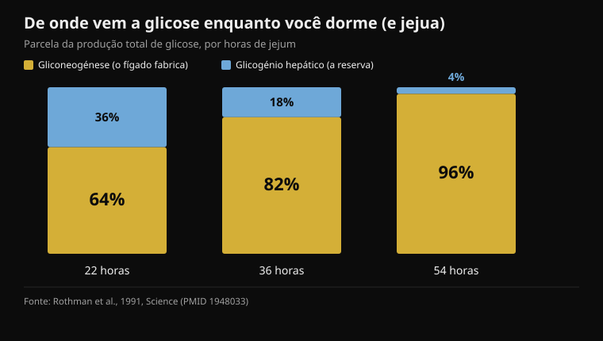
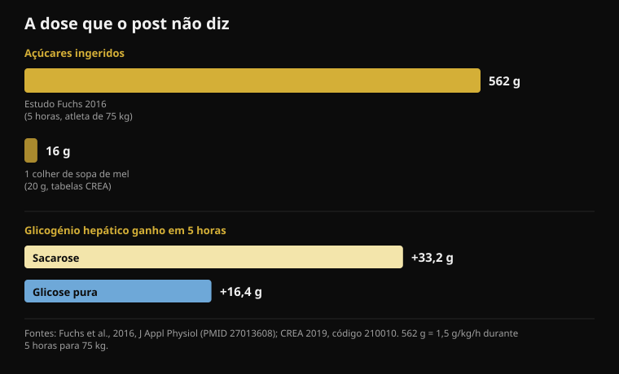

# Mel antes de dormir: funciona mesmo?

Por [Giammaria Loi](/autore/giammaria-loi) · atualizado a 18 de outubro de 2026

Um carrossel muito partilhado explica por que motivo uma colher de mel antes de dormir reduziria os despertares das 3 da manhã: o fígado esgota o glicogénio, o cortisol dispara, acordas. A cadeia está bem contada e o post é mais honesto do que a média — admite que os dados humanos sobre o sono são escassos. Li onze estudos para verificar o resto. O mecanismo falha exatamente nos dois pontos em que tudo assenta, e o número que falta é sempre o mesmo: a dose.

## Em resumo

- **À noite o fígado não fica seco.** Já nas primeiras 22 horas de jejum, 64% da glicose em circulação é fabricada pelo fígado, não retirada da reserva (Rothman et al., 1991).
- **O cortisol que sobe no fim da noite é um relógio, não um alarme.** É o ritmo circadiano: mínimo ao começar a dormir, máximo no momento de acordar (Mohd Azmi et al., 2021).
- **Acordar uma pessoa saudável por glicemia baixa exige chegar a 2,2 mmol/l**, uma hipoglicemia grave induzida com insulina — e mesmo assim só acordaram 10 em 16 (Schultes et al., 2007).
- **Uma colher de sopa de mel são 16 gramas de açúcares** (tabelas CREA). O estudo que demonstra o mecanismo da frutose usava 562 gramas em cinco horas (Fuchs et al., 2016).
- **"A glicose pura não repõe o glicogénio hepático" é falso:** nesse mesmo estudo a glicose sozinha acrescentou 16,4 gramas, cerca de metade da sacarose. Metade, não zero.

## O que o post defende

A cadeia é esta. O cérebro é 2% do peso corporal mas queima cerca de 20% da glicose em repouso. De noite continua a consumir, o glicogénio do fígado esgota-se, o corpo mobiliza "combustível de emergência" subindo o cortisol por volta das 2, e o cortisol tira-te do sono profundo. O mel, metade glicose e metade frutose, daria ao cérebro açúcar imediato e ao fígado a frutose para reconstruir a reserva. Protocolo: uma colher de mel cru trinta minutos antes de dormir.

A primeira peça está correta. O cérebro é um órgão caríssimo: consome continuamente entre 20% e 25% da energia de todo o organismo, também enquanto dormes. Sobre isso não há discussão.

Há que dizer também que este post é mais transparente do que quase tudo o que lhe é comparável: dedica um slide inteiro à força da evidência e admite abertamente que os estudos humanos sobre mel e sono são "escassos" e que boa parte do resto é extrapolada de investigação animal. É um mérito raro. O problema é que os dois slides anteriores apresentam como fisiologia estabelecida dois passos que os estudos em humanos contam de outra maneira. Um dado de contexto: o Instagram etiqueta este post como **conteúdo gerado ou modificado com inteligência artificial**.

## O fígado não fica seco enquanto dormes

É aqui que cai a primeira peça do mecanismo.

O fígado tem duas formas de manter a glicemia estável quando não comes. Pode partir o glicogénio, a reserva de açúcar já pronta (glicogenólise), ou pode *fabricar* glicose nova a partir de lactato, aminoácidos e glicerol: é a gliconeogénese, um processo que trabalha continuamente.

Em 1991 um grupo de Yale mediu pela primeira vez quanto pesa cada via no ser humano, seguindo por ressonância magnética a concentração de glicogénio hepático hora a hora durante um jejum de 68 horas. O resultado: **já nas primeiras 22 horas a gliconeogénese cobre 64% da produção total de glicose**. Às 36 horas sobe para 82%; às 54, para 96%.

*Parcela da produção total de glicose coberta pelas duas vias do fígado, em três momentos do jejum. Quanto mais o jejum avança, menos conta a reserva de glicogénio. Fonte: Rothman et al., 1991.*

Traduzindo: a reserva de glicogénio hepático não é o pilar que sustenta a noite; é já a parcela minoritária no fim de um jejum três vezes mais longo do que uma noite de sono. Nas oito horas que passas na cama a reserva desce, sim, mas ainda estás dentro da janela em que o fígado tem uma segunda linha de produção a trabalhar e a cobrir a maior parte da necessidade. Não existe o momento em que "acaba a gasolina" e dispara a emergência.

## O cortisol das 3 não é um alarme de glicemia

Segunda peça, e também não se sustenta.

O cortisol segue um ritmo circadiano muito marcado, controlado pelo eixo hipotálamo-hipófise-suprarrenal: **está no mínimo ao começar o sono, começa a subir na segunda metade da noite e atinge o valor mais alto no momento em que acordas**. Essa subida noturna não é uma reação a algo que correu mal no metabolismo: está programada, prepara o organismo para acordar e acontece também em quem jantou lindamente.

Mas a glicemia baixa pode acordar-te? Pode, e sabemos exatamente a que nível, porque foi medido. Num estudo de 2007 publicado na *PLoS Medicine*, a glicemia foi baixada com uma infusão de insulina durante o sono, em 16 pessoas saudáveis e 16 com diabetes tipo 1. O valor atingido foi **2,2 mmol/l**, cerca de 40 mg/dl: uma hipoglicemia grave, das que exigem intervenção. Nesse ponto acordaram **10 das 16 pessoas saudáveis** — e apenas uma em 16 entre as diabéticas.

São duas informações numa. A primeira: o organismo saudável tem mesmo um mecanismo de despertar ligado à glicemia, e a adrenalina sobe em média sete minutos e meio *antes* de aparecerem os sinais do despertar. A segunda, mais importante: esse mecanismo ativa-se a níveis que uma pessoa saudável não alcança a dormir depois de jantar. Para lá chegar foi preciso uma infusão de insulina.

Se acordas às 3, as causas plausíveis são muitas: álcool, temperatura do quarto, stress, apneias, cafeína tomada demasiado tarde, despertares breves normais de que não te lembras. É o mesmo raciocínio que fiz ao falar de [cafeína e sono](/pt/blog/cafeina-sono-quando-parar-de-tomar-cafe): antes de procurar um suplemento, convém verificar as variáveis com efeitos medidos.

## Uma colher é pouquíssimo, e o post nunca o diz

Este é o dado que falta nos sete slides: **quanto açúcar tem uma colher de mel**.

As tabelas de composição CREA, as mesmas que a Nurvan usa para o diário alimentar, dão o mel a 80,3 gramas de hidratos por 100 gramas — todos açúcares simples — e 304 kcal, com uma porção padrão de 20 gramas. Uma colher são portanto **cerca de 16 gramas de açúcares e 61 calorias**.

Compare-se com o estudo que demonstra o mecanismo invocado pelo post. Em 2016, quinze ciclistas treinados esvaziaram as reservas com exercício exaustivo e depois, durante cinco horas, tomaram **1,5 gramas de hidratos por quilo de peso por hora**: para um atleta de 75 quilos são cerca de 112 gramas por hora, **562 gramas no total**. O glicogénio hepático, medido por ressonância magnética, passou de 53,6 para 86,8 gramas com sacarose.

*Em cima, a dose: a do estudo que demonstra o mecanismo e a de uma colher de mel segundo as tabelas CREA. Em baixo, o resultado medido por ressonância magnética: a glicose pura acrescenta cerca de metade da sacarose, não zero. Fontes: Fuchs et al., 2016; CREA 2019.*

Uma colher de mel é **2,9%** dessa dose. E a própria revisão sobre glicogénio hepático fixa o limiar abaixo do qual os hidratos não chegam para impedir a depleção durante o exercício: mais de **1,5 gramas por minuto**, ou seja mais de 90 gramas por hora. Cinco colheres de mel por hora, não uma ao fim do dia.

Isto não significa que 16 gramas de açúcares não façam absolutamente nada. Significa que não podem fazer aquilo que o post lhes atribui: encher uma reserva hepática que naqueles atletas continha entre 49 e 87 gramas de glicogénio.

## "A glicose pura não serve": falso, e é o mesmo estudo que o diz

O slide 4 contém a afirmação mais categórica do post, a que justifica o mel face a qualquer outro açúcar: a glicose pura subiria a glicemia depressa e desceria igualmente depressa, sem repor o glicogénio hepático "de forma significativa".

O estudo de 2016 comparou exatamente isso: sacarose contra glicose pura, mesma dose, mesmas cinco horas. A sacarose foi melhor, e é o dado que dá razão à parte sobre a frutose: **+3,4 gramas de glicogénio hepático por hora** face à glicose (intervalo de confiança a 95%: de 1,6 a 5,1). Mas a glicose pura não ficou a zero: levou o glicogénio hepático de 49,3 a 65,7 gramas, ou seja **+16,4 gramas**, contra os +33,2 da sacarose. Cerca de metade. No glicogénio muscular, os dois açúcares foram idênticos (p = 0,673).

"Metade" e "de forma não significativa" não são a mesma coisa. A vantagem da frutose é real e está medida, e é uma razão sensata para preferir mel, sacarose ou uma mistura glicose-frutose quando é preciso recarregar o fígado depressa — por exemplo entre dois treinos no mesmo dia. Não é uma razão para dizer que a glicose não funciona.

## No treino, pelo contrário, há alguma coisa

A parte sobre o desempenho é a mais sólida do post, e também aqui o detalhe muda o sentido.

O estudo a que a afirmação remete é de 2004: nove ciclistas, 64 quilómetros contrarrelógio, três provas em cego com **15 gramas de mel (índice glicémico 35), 15 gramas de dextrose (índice glicémico 100) ou placebo a cada 16 quilómetros**. Tempos: mel 128 minutos e 42 segundos, dextrose 128:18, placebo 131:18. Entre mel e dextrose a diferença é de **0,39%**, com um intervalo que vai de -3,39% a +4,15%: nenhuma diferença. Os dois hidratos juntos batem o placebo (p < 0,02).

Então sim, o mel iguala o gel. Mas no mesmo ensaio **a dextrose também o iguala, isto é, glicose pura**, aquela que o slide 4 declara inútil. E a dose era de 15 gramas a cada 16 quilómetros, cerca de 60 gramas em duas horas: uma colher de cada vez, repetida, durante o esforço. Não uma colher antes de sair.

Um dado mais recente arrefece ainda mais o entusiasmo: em 2025 um suplemento à base de mel em pó e proteína foi testado em doze ciclistas com um contrarrelógio de 20 minutos após 100 minutos de trabalho. Trabalho total 294 kJ contra 292 do placebo, potência média 245 contra 243 watts: **nenhuma diferença** (p = 0,72 e p = 0,61), nem na glicemia, nem no lactato, nem no esforço percebido.

No custo o post tem razão, e é um ponto prático real: se estás a pedalar três horas e precisas de 60 a 90 gramas de hidratos por hora, tirá-los do mel custa uma fração do que custam os géis. A dupla via de absorção citada no slide 6 — os transportadores SGLT1 para a glicose e GLUT5 para a frutose, a trabalhar em paralelo — é real e conta de facto, *mas só a esses ritmos de ingestão*. Com 16 gramas não há via nenhuma para saturar.

## E o mel antes de dormir? O dado não existe

Sobre mel e sono em adultos não encontrei nenhum ensaio aleatorizado na PubMed. A revisão dedicada ao tema, de 2024, descreve o mel como uma via promissora para o sono mas conclui que os mecanismos não estão esclarecidos e que é preciso mais investigação: é um levantamento de hipóteses, não de resultados.

O único ensaio aleatorizado e controlado que mede um desfecho de sono é em crianças: 161 crianças de 1 a 5 anos com tosse de constipação, mel de acácia contra um xarope placebo com sabor a mel na hora antes de deitar. Ambos os grupos melhoraram, **sem qualquer diferença entre mel e placebo**, nem na tosse nem nas dificuldades de sono. É um contexto diferente, mas é o único dado controlado que existe, e vai no sentido oposto ao relato do post.

Há porém uma coisa que funciona mesmo com os hidratos e o sono, e o post deixa-a escapar. Em 2007 doze homens saudáveis fizeram uma refeição de índice glicémico alto **quatro horas antes de dormir**: a latência para adormecer desceu de 17,5 para 9,0 minutos (p = 0,009). A mesma refeição dada **uma hora antes** funcionava pior: 14,6 minutos. O protocolo do post diz trinta minutos antes de deitar, exatamente o lado errado do único dado disponível.

## O que a investigação diz mesmo

- **Confirmado** — O cérebro é um consumidor enorme e constante de energia: entre 20% e 25% do gasto de todo o organismo, de dia e de noite.
- **Confirmado** — A frutose ajuda a recarregar o glicogénio do fígado melhor do que a glicose sozinha: mais 3,4 gramas por hora, medidos por ressonância magnética.
- **Confirmado** — No trabalho de resistência o mel iguala um gel comercial num contrarrelógio de 64 km — mas no mesmo estudo a glicose pura também.
- **A precisar** — "A proporção 1:1 é todo o mecanismo": a direção está certa, a dose não. Uma colher são 2,9% dos hidratos usados no estudo que demonstra esse mecanismo.
- **A precisar** — O mel custa menos do que os géis: verdade, mas a comparação vale a doses iguais, ou seja 60 a 90 gramas de hidratos por hora durante o esforço, não uma colher.
- **Desmentido** — "À noite o fígado esgota o glicogénio": já nas primeiras 22 horas de jejum, 64% da glicose produzida vem da gliconeogénese, não da reserva.
- **Desmentido** — "O glicogénio esgotado dispara o cortisol às 2 e acorda-te": a subida noturna do cortisol é circadiana, e acordar uma pessoa saudável pela glicemia exige descer a 2,2 mmol/l com insulina.
- **Desmentido** — "A glicose pura não repõe o glicogénio hepático de forma significativa": acrescentou 16,4 gramas em cinco horas, cerca de metade da sacarose.
- **Não verificável** — "Só mel cru: o processado perde a atividade enzimática que importa." Nenhum estudo na PubMed compara mel cru e processado no sono ou no glicogénio; no ensaio de 2004 o mel era um produto comercial e funcionou.
- **Não verificável** — Menos despertares às 3 com uma colher de mel: nenhum ensaio aleatorizado em adultos. O único desfecho de sono controlado, em crianças, não encontra diferenças face ao placebo.

## Como aplicar

1. **Se acordas de noite, começa pelas causas com dados por trás.** Álcool antes de dormir, quarto quente, cafeína tardia, stress, apneia do sono. Têm efeitos medidos sobre o sono; o glicogénio hepático, em pessoas saudáveis, não.
2. **Se queres testar os hidratos para dormir, muda-lhes a hora.** O único dado positivo é uma refeição de índice glicémico alto quatro horas antes de deitar, não uma colher trinta minutos antes. Um jantar normal com hidratos já faz esse trabalho.
3. **Usa o mel onde faz mesmo sentido: durante o esforço longo.** Para além dos 90 minutos, 60 a 90 gramas de hidratos por hora. O mel é uma excelente fonte barata, e a mistura glicose-frutose é uma vantagem real nessas quantidades.
4. **Depois de treinar, se tens outra sessão perto, a frutose conta.** Mel, sacarose ou uma bebida glicose-frutose recarregam o fígado quase ao dobro da velocidade da glicose pura. Se o próximo treino é amanhã, tens tempo de sobra e a escolha do açúcar pesa pouco.
5. **Regista-o no diário.** Uma colher são 61 calorias e 16 gramas de açúcares: irrelevante numa noite, não tanto como hábito diário somado ao resto. É o mesmo assunto dos [hidratos e da gordura escondida](/pt/blog/carboidratos-engordam-gordura-escondida).
6. **Se o experimentares, experimenta-o como uma experiência a sério.** Duas semanas com e duas sem, mesma hora de deitar, anotando os despertares. É a melhor sugestão do post e a única forma de distinguir um efeito de uma expectativa.

> **O mel no diário, com os números certos**  
> A nutrição da Nurvan assenta nas tabelas oficiais CREA: procuras "mel", escolhes a porção e esses 16 gramas de açúcares vão parar onde devem, ao total do dia. E se o usares como combustível nos treinos longos, registas-o junto com a sessão em vez de o guardares de cabeça.  
> [Experimentar a Nurvan](https://nurvan.app)

## Perguntas frequentes

### O mel antes de dormir ajuda mesmo a dormir melhor?

Não há ensaios aleatorizados em adultos que o demonstrem. O único estudo controlado que mede um desfecho de sono é em crianças com tosse e não encontra diferenças entre mel e xarope placebo. O mecanismo do glicogénio hepático, a explicação mais citada, não resiste aos dados: de noite a maior parte da glicose é fabricada pelo fígado, não retirada da reserva.

### Porque é que acordo às 3 da manhã?

Em pessoas saudáveis, quase nunca por causa da glicemia: seria preciso descer para cerca de 2,2 mmol/l, um nível que não se atinge a dormir depois de jantar. As causas mais comuns e mais bem documentadas são o álcool, a temperatura do quarto, a cafeína tomada tarde, o stress e os distúrbios respiratórios do sono. Se os despertares são frequentes e te deixam cansado de dia, fala com o teu médico em vez de procurar um remédio alimentar.

### Mel ou gel de hidratos durante o treino?

No desempenho são equivalentes: na comparação direta num contrarrelógio de 64 km, mel e dextrose deram o mesmo tempo, ambos melhores do que o placebo. O mel custa muito menos. O que conta é a dose: para além de 90 minutos de esforço são precisos 60 a 90 gramas de hidratos por hora, ou seja quatro ou cinco colheres, não uma.

### O mel cru é melhor do que o processado?

Para sono e glicogénio não existem estudos que os comparem, portanto é uma afirmação sem provas: nem demonstrada nem desmentida. Vale a pena notar que no estudo sobre ciclismo o mel era um produto comercial preparado em gel e funcionou tão bem como a dextrose.

## Lê também

- [Cafeína e sono: quando parar de tomar café](/pt/blog/cafeina-sono-quando-parar-de-tomar-cafe) — os limiares reais, contados a partir da hora de deitar
- [Quando tomar os suplementos: a hora conta?](/pt/blog/quando-tomar-os-suplementos-horario) — oito estudos sobre o timing e quanto muda realmente
- [Os carboidratos engordam? A gordura escondida](/pt/blog/carboidratos-engordam-gordura-escondida) — o que há mesmo no que comes, segundo as tabelas CREA

## Fontes

1. Rothman DL, Magnusson I, Katz LD, Shulman RG, Shulman GI, 1991. Quantitation of hepatic glycogenolysis and gluconeogenesis in fasting humans with 13C NMR. *Science* 254(5031):573-576. PMID 1948033 — [doi.org/10.1126/science.1948033](https://doi.org/10.1126/science.1948033)
2. Schultes B, Jauch-Chara K, Gais S, et al., 2007. Defective awakening response to nocturnal hypoglycemia in patients with type 1 diabetes mellitus. *PLoS Med* 4(2):e69. PMID 17326710 — [doi.org/10.1371/journal.pmed.0040069](https://doi.org/10.1371/journal.pmed.0040069)
3. Mohd Azmi NAS, Juliana N, Azmani S, et al., 2021. Cortisol on circadian rhythm and its effect on cardiovascular system. *Int J Environ Res Public Health* 18(2):676. PMID 33466883 — [doi.org/10.3390/ijerph18020676](https://doi.org/10.3390/ijerph18020676)
4. Beard E, Lengacher S, Dias S, Magistretti PJ, Finsterwald C, 2022. Astrocytes as key regulators of brain energy metabolism: new therapeutic perspectives. *Front Physiol* 12:825816. PMID 35087428 — [doi.org/10.3389/fphys.2021.825816](https://doi.org/10.3389/fphys.2021.825816)
5. Fuchs CJ, Gonzalez JT, Beelen M, et al., 2016. Sucrose ingestion after exhaustive exercise accelerates liver, but not muscle glycogen repletion compared with glucose ingestion in trained athletes. *J Appl Physiol* 120(11):1328-1334. PMID 27013608 — [doi.org/10.1152/japplphysiol.01023.2015](https://doi.org/10.1152/japplphysiol.01023.2015)
6. Gonzalez JT, Fuchs CJ, Betts JA, van Loon LJC, 2016. Liver glycogen metabolism during and after prolonged endurance-type exercise. *Am J Physiol Endocrinol Metab* 311(3):E543-E553. PMID 27436612 — [doi.org/10.1152/ajpendo.00232.2016](https://doi.org/10.1152/ajpendo.00232.2016)
7. Earnest CP, Lancaster SL, Rasmussen CJ, et al., 2004. Low vs. high glycemic index carbohydrate gel ingestion during simulated 64-km cycling time trial performance. *J Strength Cond Res* 18(3):466-472. PMID 15320674 (o DOI registado para este artigo é um marcador não funcional; citado por PMID)
8. Toniazzo T, de Almeida Azevedo R, Oliveira TN, et al., 2025. A novel honey powder-based supplement containing carbohydrate and protein did not improve endurance performance in recreationally trained cyclists. *Int J Sport Nutr Exerc Metab* 35(6):520-529. PMID 40812383 — [doi.org/10.1123/ijsnem.2025-0021](https://doi.org/10.1123/ijsnem.2025-0021)
9. Nishimura T, Muta H, Hosaka T, Ueda M, Kishida K, 2022. Multicentre, randomised study found that honey had no pharmacological effect on nocturnal coughs and sleep quality at 1-5 years of age. *Acta Paediatr* 111(11):2157-2164. PMID 35927828 — [doi.org/10.1111/apa.16509](https://doi.org/10.1111/apa.16509)
10. Zulkifli MF, Masimen MAA, Ridzuan PM, Wan Ismail WI, 2024. Exploring honey's potential as a functional food for natural sleep aid. *Food Funct* 15(19):9678-9689. PMID 39248637 — [doi.org/10.1039/d4fo02013h](https://doi.org/10.1039/d4fo02013h)
11. Afaghi A, O'Connor H, Chow CM, 2007. High-glycemic-index carbohydrate meals shorten sleep onset. *Am J Clin Nutr* 85(2):426-430. PMID 17284739 — [doi.org/10.1093/ajcn/85.2.426](https://doi.org/10.1093/ajcn/85.2.426)
12. CREA — Centro de investigação de Alimentos e Nutrição, tabelas italianas de composição dos alimentos, atualização de 2019, entrada "Miele" (mel, código 210010): 304 kcal, 80,3 g de hidratos, porção padrão 20 g.

Ponto de partida: carrossel de [Christian Poulos](https://www.instagram.com/p/DdwWWxYkfEW/) (26 de setembro de 2026), que o Instagram etiqueta como conteúdo gerado ou modificado com inteligência artificial. Nenhum texto e nenhuma imagem do post foi reproduzido: as afirmações foram reescritas e verificadas na literatura primária.

Giammaria Loi é o fundador da Nurvan. Treina com pesos desde 2012, trabalha como personal trainer e coach certificado FIPE desde 2013 e compete em powerlifting a nível nacional desde 2018. Cada artigo que assina parte dos estudos científicos e chega ao que funciona mesmo no ginásio. [Página do autor](/autore/giammaria-loi)

> Nota: conteúdo informativo, não substitui a opinião de um médico ou de um profissional qualificado. Se os despertares noturnos são frequentes, se acordas cansado, ou se tens diabetes ou tomas medicamentos que baixam a glicemia, fala com o teu médico: nesses casos a hipoglicemia noturna é um problema real e deve ser gerida por quem te acompanha, não com uma colher de mel.
