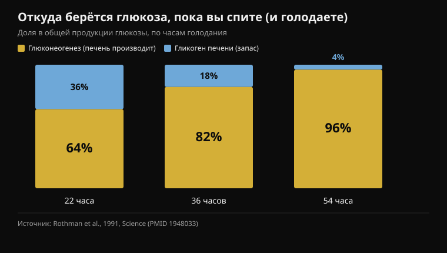
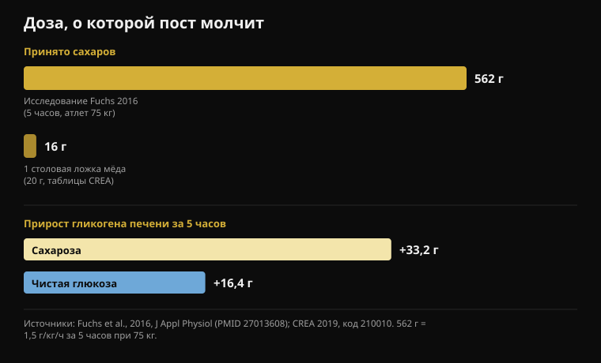

# Мёд перед сном: работает ли это на самом деле?

Автор: [Giammaria Loi](/autore/giammaria-loi) · обновлено 18 октября 2026

Разлетевшаяся по лентам карусель объясняет, почему ложка мёда перед сном якобы избавляет от пробуждений в три часа ночи: печень исчерпывает гликоген, подскакивает кортизол, вы просыпаетесь. Цепочка рассказана хорошо, и сам пост честнее среднего — он признаёт, что данных по сну у людей мало. Я прочитал одиннадцать исследований, чтобы проверить остальное. Механизм рушится ровно в тех двух точках, на которых всё держится, а недостающее число всегда одно и то же: доза.

## Коротко

- **Ночью печень не пустеет.** Уже в первые 22 часа голодания 64% циркулирующей глюкозы печень производит сама, а не берёт из запаса (Rothman et al., 1991).
- **Кортизол, растущий под утро, — это часы, а не тревога.** Это циркадный ритм: минимум в начале сна, максимум в момент пробуждения (Mohd Azmi et al., 2021).
- **Чтобы разбудить здорового человека низким сахаром, нужно 2,2 ммоль/л** — тяжёлая гипогликемия, вызванная инсулином, — и даже тогда проснулись лишь 10 из 16 (Schultes et al., 2007).
- **Одна столовая ложка мёда — это 16 граммов сахаров** (таблицы CREA). В исследовании, доказывающем механизм фруктозы, использовали 562 грамма за пять часов (Fuchs et al., 2016).
- **«Чистая глюкоза не восполняет гликоген печени» — неправда:** в том же исследовании одна глюкоза добавила 16,4 грамма, примерно половину от сахарозы. Половину, а не ноль.

## Что утверждает пост

Цепочка такая. Мозг — это 2% массы тела, но сжигает около 20% глюкозы в покое. Ночью он продолжает потреблять, гликоген печени исчерпывается, тело мобилизует «аварийное топливо», поднимая кортизол около двух часов, и кортизол вытаскивает вас из глубокого сна. Мёд, наполовину глюкоза и наполовину фруктоза, дал бы мозгу немедленный сахар, а печени — фруктозу для восстановления запаса. Протокол: столовая ложка сырого мёда за тридцать минут до сна.

Первая часть верна. Мозг — крайне затратный орган: он непрерывно потребляет от 20% до 25% энергии всего организма, в том числе во сне. Здесь спорить не о чем.

Надо сказать и другое: этот пост прозрачнее почти всего сопоставимого. Целый слайд отведён силе доказательств, и в нём прямо сказано, что исследований на людях по мёду и сну «мало», а многое экстраполировано с животных. Это редкое достоинство. Проблема в том, что два предыдущих слайда подают как установленную физиологию два шага, которые исследования на людях описывают иначе. Для контекста: Instagram помечает этот пост как **контент, созданный или изменённый искусственным интеллектом**.

## Печень не пустеет, пока вы спите

Здесь рушится первая часть механизма.

У печени есть два способа держать сахар крови стабильным, когда вы не едите. Она может расщеплять гликоген — готовый запас сахара (гликогенолиз), — или может *производить* новую глюкозу из лактата, аминокислот и глицерина: это глюконеогенез, процесс, работающий непрерывно.

В 1991 году группа из Йеля впервые измерила вклад каждого пути у человека, отслеживая магнитно-резонансной спектроскопией концентрацию гликогена печени час за часом в течение 68-часового голодания. Результат: **уже в первые 22 часа глюконеогенез покрывает 64% всей продукции глюкозы**. К 36 часам — 82%, к 54 часам — 96%.

*Доля общей продукции глюкозы, покрываемая двумя путями печени, в три момента голодания. Чем дольше голодание, тем меньше значит запас гликогена. Источник: Rothman et al., 1991.*

В переводе: запас гликогена печени не тот столп, на котором держится ночь. Он уже меньшая часть к концу голодания, втрое более длинного, чем ночной сон. За восемь часов в постели запас действительно снижается, но вы всё ещё в том окне, где у печени работает целая вторая производственная линия, покрывающая большую часть потребности. Нет момента, когда «кончается бензин» и включается аварийный режим.

## Кортизол в три часа — не сигнал тревоги по сахару

Вторая часть — и она тоже не держится.

У кортизола выраженный циркадный ритм под управлением гипоталамо-гипофизарно-надпочечниковой оси: **он минимален в начале сна, начинает расти во второй половине ночи и достигает максимума в момент пробуждения**. Этот ночной подъём — не реакция на сбой в обмене веществ: он запрограммирован, он готовит организм к пробуждению и происходит и у тех, кто поужинал прекрасно.

Но может ли низкий сахар разбудить? Да — и мы точно знаем, на каком уровне, потому что это измеряли. В исследовании 2007 года в *PLoS Medicine* сахар крови снижали инфузией инсулина во сне у 16 здоровых людей и 16 человек с диабетом 1 типа. Достигнутый минимум — **2,2 ммоль/л**, около 40 мг/дл: тяжёлая гипогликемия, требующая вмешательства. В этот момент проснулись **10 из 16 здоровых** — и только один из 16 с диабетом.

Это две новости в одной. Первая: у здорового организма действительно есть механизм пробуждения, связанный с глюкозой, и адреналин поднимается в среднем за семь с половиной минут *до* первых признаков пробуждения. Вторая, более важная: этот механизм срабатывает на уровнях, которых здоровый человек не достигает, засыпая после ужина. Чтобы до них добраться, понадобилась инфузия инсулина.

Если вы просыпаетесь в три ночи, правдоподобных причин много: алкоголь, температура в спальне, стресс, апноэ, слишком поздний кофеин, обычные короткие пробуждения, которых вы не помните. Это та же логика, что и в тексте про [кофеин и сон](/ru/blog/kofein-i-son-kogda-perestat-pit-kofe): прежде чем искать добавку, проверьте переменные с измеренным эффектом.

## Одной ложки слишком мало, и пост этого не говорит

Вот число, которого нет ни на одном из семи слайдов: **сколько сахара в ложке мёда**.

Таблицы состава CREA — те же, что Nurvan использует для дневника питания, — дают мёду 80,3 грамма углеводов на 100 граммов, все простые сахара, и 304 ккал, при стандартной порции 20 граммов. Столовая ложка — это, стало быть, **около 16 граммов сахаров и 61 калория**.

Сравним с исследованием, которое доказывает призываемый постом механизм. В 2016 году пятнадцать тренированных велосипедистов опустошили запасы изнуряющей нагрузкой, а затем в течение пяти часов принимали **1,5 грамма углеводов на килограмм веса каждый час**: для атлета 75 кг это около 112 граммов в час, **562 грамма суммарно**. Гликоген печени, измеренный магнитным резонансом, вырос с 53,6 до 86,8 грамма на сахарозе.

*Сверху доза: та, что применялась в исследовании, доказывающем механизм, и та, что содержится в ложке мёда по таблицам CREA. Снизу измеренный магнитным резонансом результат: чистая глюкоза добавляет примерно половину от сахарозы, а не ноль. Источники: Fuchs et al., 2016; CREA 2019.*

Столовая ложка мёда — это **2,9%** той дозы. А тот же обзор по гликогену печени задаёт порог, ниже которого углеводы не предотвращают истощение во время нагрузки: более **1,5 грамма в минуту**, то есть свыше 90 граммов в час. Пять ложек мёда в час, а не одна в конце дня.

Это не значит, что 16 граммов сахаров не делают вообще ничего. Это значит, что они не могут сделать именно то, что им приписывает пост: наполнить печёночный запас, который у тех атлетов составлял от 49 до 87 граммов гликогена.

## «Чистая глюкоза бесполезна»: неправда, и это говорит то же исследование

На слайде 4 — самое категоричное утверждение поста, то самое, что оправдывает мёд против любого другого сахара: чистая глюкоза якобы быстро поднимает сахар и так же быстро его роняет, не восполняя гликоген печени «сколько-нибудь значимо».

Исследование 2016 года сравнило ровно это: сахарозу против чистой глюкозы, та же доза, те же пять часов. Сахароза оказалась лучше — и это тот результат, который подтверждает часть про фруктозу: **+3,4 грамма гликогена печени в час** по сравнению с глюкозой (95% доверительный интервал: от 1,6 до 5,1). Но чистая глюкоза не осталась на нуле: она подняла гликоген печени с 49,3 до 65,7 грамма, то есть **+16,4 грамма**, против +33,2 у сахарозы. Примерно половина. А по мышечному гликогену оба сахара оказались одинаковы (p = 0,673).

«Половина» и «незначимо» — не одно и то же. Преимущество фруктозы реально и измерено, и это здравая причина предпочесть мёд, сахарозу или смесь глюкозы с фруктозой, когда печень нужно перезарядить быстро — например, между двумя тренировками в один день. Но это не причина утверждать, что глюкоза не работает.

## А вот в тренировке кое-что есть

Часть про работоспособность — самая крепкая в посте, и здесь деталь тоже меняет смысл.

Исследование, на которое опирается утверждение, — 2004 года: девять велосипедистов, 64 километра на время, три слепых заезда с приёмом **15 граммов мёда (гликемический индекс 35), 15 граммов декстрозы (индекс 100) или плацебо каждые 16 километров**. Время: мёд 128 минут 42 секунды, декстроза 128:18, плацебо 131:18. Между мёдом и декстрозой разница **0,39%** с интервалом от -3,39% до +4,15%: никакой разницы. Оба углевода вместе быстрее плацебо (p < 0,02).

Так что да, мёд не уступает гелю. Но в том же эксперименте **не уступает и декстроза, то есть чистая глюкоза** — та самая, которую слайд 4 объявляет бесполезной. И доза была 15 граммов каждые 16 километров, около 60 граммов за два часа: по ложке за раз, повторно, во время работы. Не одна ложка перед выездом.

Более свежие данные охлаждают энтузиазм ещё сильнее: в 2025 году добавку на основе сухого мёда и белка проверили на двенадцати велосипедистах — 20-минутная гонка на время после 100 минут работы. Общая работа 294 кДж против 292 у плацебо, средняя мощность 245 против 243 Вт: **никакой разницы** (p = 0,72 и p = 0,61), ни по глюкозе крови, ни по лактату, ни по воспринимаемому усилию.

Насчёт цены пост прав, и это по-настоящему практичный довод: если вы едете три часа и вам нужно 60–90 граммов углеводов в час, брать их из мёда стоит малой доли того, что стоят гели. Двойной путь всасывания, упомянутый на слайде 6, — переносчики SGLT1 для глюкозы и GLUT5 для фруктозы, работающие параллельно, — реален и действительно важен, *но только при таких темпах приёма*. На 16 граммах насыщать нечего.

## А мёд перед сном? Данных нет

По мёду и сну у взрослых я не нашёл в PubMed ни одного рандомизированного исследования. Обзор 2024 года, посвящённый теме, описывает мёд как перспективное направление для сна, но заключает, что механизмы не установлены и нужны дальнейшие исследования: это каталог гипотез, а не результатов.

Единственное рандомизированное контролируемое исследование с исходом по сну — у детей: 161 ребёнок от 1 до 5 лет с кашлем при простуде, акациевый мёд против плацебо-сиропа со вкусом мёда за час до сна. Улучшились обе группы, **без какой-либо разницы между мёдом и плацебо** — ни по кашлю, ни по трудностям со сном. Контекст другой, но это единственные контролируемые данные, и они идут против рассказа поста.

А вот что с углеводами и сном действительно работает — пост упускает. В 2007 году двенадцать здоровых мужчин съели блюдо с высоким гликемическим индексом **за четыре часа до сна**: время засыпания сократилось с 17,5 до 9,0 минуты (p = 0,009). То же самое блюдо **за час до сна** работало хуже: 14,6 минуты. Протокол поста предлагает тридцать минут до отбоя — ровно не ту сторону единственных имеющихся данных.

## Что на самом деле говорят исследования

- **Подтверждено** — Мозг — огромный и постоянный потребитель энергии: от 20% до 25% расхода всего организма, днём и ночью.
- **Подтверждено** — Фруктоза помогает перезаряжать гликоген печени лучше, чем одна глюкоза: на 3,4 грамма в час больше, по данным магнитного резонанса.
- **Подтверждено** — В работе на выносливость мёд не уступает коммерческому гелю на 64-километровой гонке — но в том же исследовании не уступает и чистая глюкоза.
- **Требует уточнения** — «Соотношение 1:1 — это весь механизм»: направление верное, доза — нет. Ложка составляет 2,9% углеводов из исследования, доказывающего этот механизм.
- **Требует уточнения** — Мёд дешевле гелей: верно, но сравнение действует при равной дозе, то есть 60–90 граммов углеводов в час во время нагрузки, а не одна ложка.
- **Опровергнуто** — «Ночью печень исчерпывает гликоген»: уже в первые 22 часа голодания 64% произведённой глюкозы идёт из глюконеогенеза, а не из запаса.
- **Опровергнуто** — «Пустой гликоген запускает кортизол в два часа и будит вас»: ночной подъём кортизола циркадный, а чтобы разбудить здорового человека через сахар, нужно падение до 2,2 ммоль/л под инсулином.
- **Опровергнуто** — «Чистая глюкоза не восполняет гликоген печени сколько-нибудь значимо»: она добавила 16,4 грамма за пять часов, примерно половину от сахарозы.
- **Не проверяемо** — «Только сырой мёд: обработанный теряет важную ферментную активность». В PubMed нет исследований, сравнивающих сырой и обработанный мёд по сну или гликогену; в работе 2004 года мёд был коммерческим продуктом и сработал.
- **Не проверяемо** — Меньше пробуждений в три часа от ложки мёда: рандомизированных исследований у взрослых нет. Единственный контролируемый исход по сну, у детей, не находит отличий от плацебо.

## Как это применить

1. **Если просыпаетесь ночью, начните с причин, за которыми есть данные.** Алкоголь перед сном, жаркая спальня, поздний кофеин, стресс, апноэ сна. У них измеренное влияние на сон; у гликогена печени у здоровых людей — нет.
2. **Если хотите попробовать углеводы для сна, перенесите их.** Единственный положительный результат касается блюда с высоким гликемическим индексом за четыре часа до сна, а не ложки за тридцать минут. Обычный ужин с углеводами эту работу уже делает.
3. **Используйте мёд там, где он действительно уместен: на длинной работе.** Свыше 90 минут — 60–90 граммов углеводов в час. Мёд — отличный недорогой источник, и смесь глюкозы с фруктозой при таких количествах даёт реальное преимущество.
4. **После тренировки, если следующая близко, фруктоза важна.** Мёд, сахароза или напиток с глюкозой и фруктозой перезаряжают печень почти вдвое быстрее чистой глюкозы. Если следующая тренировка завтра, времени достаточно и выбор сахара почти не значит.
5. **Учитывайте это в дневнике.** Ложка — 61 калория и 16 граммов сахаров: пустяк за один вечер, но не пустяк как ежедневная привычка поверх всего остального. Это тот же сюжет, что и с [углеводами и скрытым жиром](/ru/blog/uglevody-polnyat-skrytyy-zhir).
6. **Если пробуете — пробуйте как настоящий эксперимент.** Две недели с и две без, одно и то же время отбоя, с записью пробуждений. Это лучший совет из поста и единственный способ отличить эффект от ожидания.

> **Мёд в дневнике, с правильными цифрами**  
> Питание в Nurvan работает на официальных таблицах CREA: ищете «мёд», выбираете порцию, и эти 16 граммов сахаров попадают туда, куда нужно, — в итог дня. А если используете его как топливо на длинных тренировках, записываете вместе с сессией, а не держите в голове.  
> [Попробовать Nurvan](https://nurvan.app)

## Частые вопросы

### Действительно ли мёд перед сном помогает спать лучше?

Рандомизированных исследований у взрослых, которые бы это показали, нет. Единственное контролируемое исследование с исходом по сну проведено у детей с кашлем и не находит разницы между мёдом и плацебо-сиропом. Механизм гликогена печени, самое частое объяснение, не выдерживает проверки данными: ночью большую часть глюкозы печень производит сама, а не берёт из запаса.

### Почему я просыпаюсь в три часа ночи?

У здоровых людей почти никогда из-за сахара крови: для этого нужно падение примерно до 2,2 ммоль/л, уровня, которого не достигают, засыпая после ужина. Самые частые и лучше всего документированные причины — алкоголь, температура в спальне, поздний кофеин, стресс и нарушения дыхания во сне. Если пробуждения частые и днём вы разбиты, обсудите это с врачом, а не ищите пищевое средство.

### Мёд или углеводный гель на тренировке?

По работоспособности они равны: в прямом сравнении на 64-километровой гонке мёд и декстроза дали одинаковое время, оба лучше плацебо. Мёд стоит намного дешевле. Важна доза: свыше 90 минут нагрузки нужно 60–90 граммов углеводов в час, то есть четыре-пять ложек, а не одна.

### Сырой мёд лучше обработанного?

По сну и гликогену исследований, сравнивающих их, нет, так что это утверждение без доказательств — ни подтверждённое, ни опровергнутое. Стоит заметить, что в велосипедном исследовании мёд был коммерческим продуктом в виде геля и сработал не хуже декстрозы.

## Читайте также

- [Кофеин и сон: когда перестать пить кофе](/ru/blog/kofein-i-son-kogda-perestat-pit-kofe) — реальные пороги, отсчитанные от времени отбоя
- [Когда принимать добавки: важно ли время?](/ru/blog/kogda-prinimat-dobavki-vremya) — восемь исследований о тайминге и сколько он на деле меняет
- [Полнеют ли от углеводов? Скрытый жир](/ru/blog/uglevody-polnyat-skrytyy-zhir) — что на самом деле в вашей еде, по таблицам CREA

## Источники

1. Rothman DL, Magnusson I, Katz LD, Shulman RG, Shulman GI, 1991. Quantitation of hepatic glycogenolysis and gluconeogenesis in fasting humans with 13C NMR. *Science* 254(5031):573-576. PMID 1948033 — [doi.org/10.1126/science.1948033](https://doi.org/10.1126/science.1948033)
2. Schultes B, Jauch-Chara K, Gais S, et al., 2007. Defective awakening response to nocturnal hypoglycemia in patients with type 1 diabetes mellitus. *PLoS Med* 4(2):e69. PMID 17326710 — [doi.org/10.1371/journal.pmed.0040069](https://doi.org/10.1371/journal.pmed.0040069)
3. Mohd Azmi NAS, Juliana N, Azmani S, et al., 2021. Cortisol on circadian rhythm and its effect on cardiovascular system. *Int J Environ Res Public Health* 18(2):676. PMID 33466883 — [doi.org/10.3390/ijerph18020676](https://doi.org/10.3390/ijerph18020676)
4. Beard E, Lengacher S, Dias S, Magistretti PJ, Finsterwald C, 2022. Astrocytes as key regulators of brain energy metabolism: new therapeutic perspectives. *Front Physiol* 12:825816. PMID 35087428 — [doi.org/10.3389/fphys.2021.825816](https://doi.org/10.3389/fphys.2021.825816)
5. Fuchs CJ, Gonzalez JT, Beelen M, et al., 2016. Sucrose ingestion after exhaustive exercise accelerates liver, but not muscle glycogen repletion compared with glucose ingestion in trained athletes. *J Appl Physiol* 120(11):1328-1334. PMID 27013608 — [doi.org/10.1152/japplphysiol.01023.2015](https://doi.org/10.1152/japplphysiol.01023.2015)
6. Gonzalez JT, Fuchs CJ, Betts JA, van Loon LJC, 2016. Liver glycogen metabolism during and after prolonged endurance-type exercise. *Am J Physiol Endocrinol Metab* 311(3):E543-E553. PMID 27436612 — [doi.org/10.1152/ajpendo.00232.2016](https://doi.org/10.1152/ajpendo.00232.2016)
7. Earnest CP, Lancaster SL, Rasmussen CJ, et al., 2004. Low vs. high glycemic index carbohydrate gel ingestion during simulated 64-km cycling time trial performance. *J Strength Cond Res* 18(3):466-472. PMID 15320674 (зарегистрированный для этой статьи DOI — нерабочая заглушка; цитируется по PMID)
8. Toniazzo T, de Almeida Azevedo R, Oliveira TN, et al., 2025. A novel honey powder-based supplement containing carbohydrate and protein did not improve endurance performance in recreationally trained cyclists. *Int J Sport Nutr Exerc Metab* 35(6):520-529. PMID 40812383 — [doi.org/10.1123/ijsnem.2025-0021](https://doi.org/10.1123/ijsnem.2025-0021)
9. Nishimura T, Muta H, Hosaka T, Ueda M, Kishida K, 2022. Multicentre, randomised study found that honey had no pharmacological effect on nocturnal coughs and sleep quality at 1-5 years of age. *Acta Paediatr* 111(11):2157-2164. PMID 35927828 — [doi.org/10.1111/apa.16509](https://doi.org/10.1111/apa.16509)
10. Zulkifli MF, Masimen MAA, Ridzuan PM, Wan Ismail WI, 2024. Exploring honey's potential as a functional food for natural sleep aid. *Food Funct* 15(19):9678-9689. PMID 39248637 — [doi.org/10.1039/d4fo02013h](https://doi.org/10.1039/d4fo02013h)
11. Afaghi A, O'Connor H, Chow CM, 2007. High-glycemic-index carbohydrate meals shorten sleep onset. *Am J Clin Nutr* 85(2):426-430. PMID 17284739 — [doi.org/10.1093/ajcn/85.2.426](https://doi.org/10.1093/ajcn/85.2.426)
12. CREA — Исследовательский центр пищевых продуктов и питания, итальянские таблицы состава продуктов, редакция 2019 года, позиция «Miele» (мёд, код 210010): 304 ккал, 80,3 г углеводов, стандартная порция 20 г.

Отправная точка: карусель [Christian Poulos](https://www.instagram.com/p/DdwWWxYkfEW/) (26 сентября 2026), которую Instagram помечает как контент, созданный или изменённый искусственным интеллектом. Ни текст, ни изображения поста не воспроизводились: утверждения переписаны и проверены по первичной литературе.

Джаммария Лои — основатель Nurvan. Тренируется с отягощениями с 2012 года, работает персональным тренером и коучем с сертификатом FIPE с 2013 года и выступает в пауэрлифтинге на национальном уровне с 2018 года. Каждая его статья начинается с научных исследований и заканчивается тем, что действительно работает в зале. [Страница автора](/autore/giammaria-loi)

> Примечание: информационный материал, не заменяющий мнение врача или другого квалифицированного специалиста. Если ночные пробуждения частые, если вы просыпаетесь разбитым или если у вас диабет либо вы принимаете препараты, снижающие сахар крови, обсудите это с врачом: в таких случаях ночная гипогликемия — реальная проблема, и ею должны заниматься те, кто вас ведёт, а не ложка мёда.
