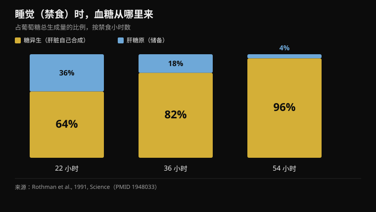
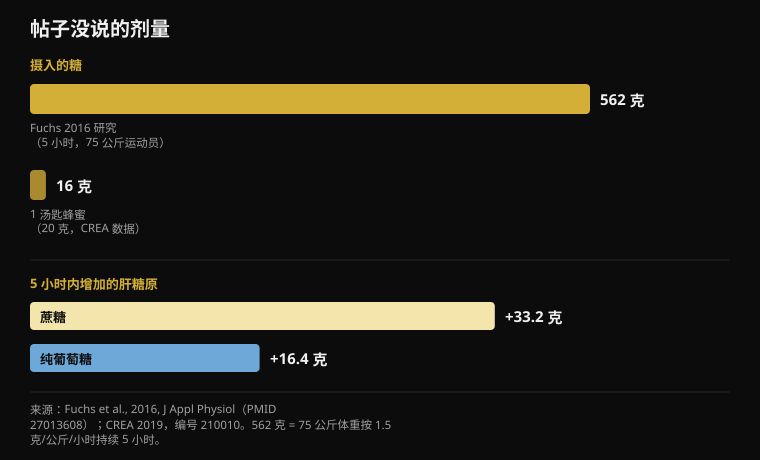

# 睡前吃蜂蜜，真的有用吗？

作者： [Giammaria Loi](/autore/giammaria-loi) · 更新于 2026 年 10 月 18 日

一组被大量转发的图文解释，为什么睡前一勺蜂蜜能让你不再凌晨三点醒来：肝脏糖原耗尽，皮质醇飙升，你就醒了。这条链条讲得很顺，而且这个帖子比同类内容诚实——它承认人体睡眠数据很薄弱。我读了十一项研究来核对其余部分。整套机制恰恰在支撑它的那两个点上站不住，而缺的那个数字始终是同一个：剂量。

## 要点速览

- **夜里肝脏不会被抽干。**在禁食的头 22 小时内，循环中 64% 的葡萄糖是肝脏自己合成的，而不是从储备里取的（Rothman et al., 1991）。
- **后半夜上升的皮质醇是一只钟，不是警报。**这是昼夜节律：入睡时最低，醒来那一刻最高（Mohd Azmi et al., 2021）。
- **要靠低血糖唤醒一个健康的人需要降到 2.2 mmol/L**，也就是用胰岛素诱发的严重低血糖——即便如此，16 人中也只有 10 人醒来（Schultes et al., 2007）。
- **一汤匙蜂蜜是 16 克糖**（CREA 食物成分表）。证明果糖机制的那项研究，五小时里用了 562 克（Fuchs et al., 2016）。
- **“纯葡萄糖不能补充肝糖原”是错的：**在同一项研究中，单用葡萄糖增加了 16.4 克，约为蔗糖的一半。是一半，不是零。

## 帖子的说法

链条是这样的。大脑占体重 2%，却消耗静息状态下约 20% 的葡萄糖。夜里它继续消耗，肝糖原耗尽，身体通过在凌晨两点左右抬高皮质醇来调动“应急燃料”，而皮质醇把你拽出深睡眠。蜂蜜一半葡萄糖一半果糖，既给大脑即时的糖，也给肝脏重建储备所需的果糖。方案：睡前三十分钟一汤匙生蜂蜜。

第一环是对的。大脑是极其昂贵的器官：它持续消耗全身 20% 到 25% 的能量，睡觉时也一样。这一点没有争议。

还要说一句：这个帖子比几乎所有同类内容都更透明。它用整整一页来标注证据强度，并直接承认关于蜂蜜与睡眠的人体研究“很薄弱”，其余很多是从动物实验外推的。这种坦白很少见。问题在于，前面两页把人体研究讲述方式完全不同的两个环节，当作已确立的生理学呈现出来。还有一个背景信息：Instagram 把这个帖子标记为**由人工智能生成或修改的内容**。

## 你睡着时，肝脏不会被抽干

机制的第一环就倒在这里。

不进食时，肝脏有两种办法维持血糖稳定。它可以分解糖原，也就是现成的糖储备（糖原分解），也可以从乳酸、氨基酸和甘油*合成*新的葡萄糖：这叫糖异生，是一个持续运转的过程。

1991 年，耶鲁的一个团队首次测量了这两条路在人体中各占多少，用磁共振逐小时追踪 68 小时禁食期间的肝糖原浓度。结果是：**仅在头 22 小时内，糖异生就已经承担了葡萄糖总产量的 64%**。到 36 小时升至 82%，到 54 小时升至 96%。

*在禁食的三个时间点上，肝脏两条通路各自覆盖的葡萄糖总产量比例。禁食越久，糖原储备越不重要。来源：Rothman et al., 1991。*

换句话说：肝糖原储备并不是撑起你一夜的支柱，在一段比睡眠长三倍的禁食结束时，它已经是少数派。你躺在床上的八小时里，储备确实会下降，但你仍处在肝脏另有一整条生产线在运转、并覆盖大部分需求的窗口里。不存在“油箱见底、应急启动”的那一刻。

## 凌晨三点的皮质醇不是血糖警报

第二环，同样站不住。

皮质醇有非常鲜明的昼夜节律，由下丘脑-垂体-肾上腺轴控制：**入睡时最低，在后半夜开始回升，并在你醒来的那一刻达到最高**。这个夜间上升不是对代谢出错的反应：它是预设的，用来为醒来做准备，晚饭吃得再好也照样发生。

但低血糖真的能把人弄醒吗？能——而且我们清楚是在什么水平，因为有人测过。2007 年发表在《PLoS Medicine》的一项研究，在睡眠中用胰岛素输注降低血糖，对象是 16 名健康者和 16 名 1 型糖尿病患者。达到的低谷是 **2.2 mmol/L**，约合 40 mg/dL：需要干预的严重低血糖。在这一点上，**16 名健康者中有 10 人**醒来——而糖尿病组 16 人中只有 1 人。

这其实是两条信息。第一：健康的身体确实有一套与血糖挂钩的唤醒机制，而且肾上腺素平均在出现任何觉醒迹象*之前*七分半钟就开始上升。第二，也更要紧：这套机制触发的水平，是一个健康人晚饭后睡觉时达不到的。要到那个水平，得靠胰岛素输注。

如果你凌晨三点醒来，合理的原因有很多——酒精、卧室温度、压力、睡眠呼吸暂停、咖啡因喝得太晚，以及平时根本记不住的正常短暂觉醒。这和我写[咖啡因与睡眠](/zh/blog/kafeiyin-shuimian-jidian-jie-kafei)时的思路一样：在伸手去拿补剂之前，先检查那些效应被真正测量过的变量。

## 一勺太少了，而帖子从没说过这一点

这就是七页里全都缺席的那个数字：**一勺蜂蜜里有多少糖**。

CREA 食物成分表——也是 Nurvan 饮食日记所用的那套——给出蜂蜜每 100 克含 80.3 克碳水化合物，全部为简单糖，304 千卡，标准份量 20 克。因此一汤匙大约是 **16 克糖、61 千卡**。

拿它和证明该机制的那项研究比一比。2016 年，十五名训练有素的自行车运动员先用力竭运动清空储备，随后五小时内每小时摄入**每公斤体重 1.5 克碳水化合物**：对 75 公斤的运动员来说每小时约 112 克，**总计 562 克**。经磁共振测得的肝糖原，在蔗糖组从 53.6 克升到 86.8 克。

*上方是剂量：证明该机制的研究所用的剂量，以及按 CREA 成分表计算的一汤匙蜂蜜。下方是磁共振测得的结果：纯葡萄糖增加的约为蔗糖的一半，不是零。来源：Fuchs et al., 2016；CREA 2019。*

一汤匙蜂蜜是那个剂量的 **2.9%**。而同一篇肝糖原综述给出了运动中碳水不足以阻止耗竭的下限：每分钟超过 **1.5 克**，也就是每小时 90 克以上。是每小时五勺蜂蜜，不是一天结束时的一勺。

这并不意味着 16 克糖什么都不做。它意味着这 16 克做不到帖子赋予它的那件具体事：填满一个在那些运动员身上含有 49 到 87 克糖原的肝脏储备。

## “纯葡萄糖没用”：错，而且就是同一项研究说的

第 4 页包含了帖子最斩钉截铁的论断，也是用来把蜂蜜抬到其他所有糖之上的那一句：纯葡萄糖据说升得快、降得也快，无法“有意义地”补充肝糖原。

2016 年那项研究比较的正是这一点：蔗糖对纯葡萄糖，相同剂量，同样五小时。蔗糖确实更好，这个结果也为果糖那部分说法撑了腰：相比葡萄糖，**每小时多 3.4 克肝糖原**（95% 置信区间：1.6 到 5.1）。但纯葡萄糖并没有停在零：它把肝糖原从 49.3 克带到 65.7 克，也就是**增加 16.4 克**，对比蔗糖的 +33.2 克。大约一半。而在肌糖原上，两种糖完全一样（p = 0.673）。

“一半”和“没有意义”不是同一句话。果糖的优势真实且被测量到，当你需要快速给肝脏充电时——比如同一天的两次训练之间——它确实是偏好蜂蜜、蔗糖或葡萄糖-果糖混合物的合理理由。但它不是说葡萄糖没用的理由。

## 不过在训练上，确实有点东西

运动表现这一部分是帖子里最扎实的，而这里的细节同样改变了意思。

这个说法背后的研究来自 2004 年：九名自行车运动员，模拟 64 公里计时赛，三次盲法骑行，每 16 公里摄入**15 克蜂蜜（升糖指数 35）、15 克右旋葡萄糖（升糖指数 100）或安慰剂**。成绩：蜂蜜 128 分 42 秒，葡萄糖 128 分 18 秒，安慰剂 131 分 18 秒。蜂蜜与葡萄糖之间差 **0.39%**，区间从 -3.39% 到 +4.15%：没有差别。两种碳水合在一起确实快过安慰剂（p < 0.02）。

所以是的，蜂蜜打平了能量胶。但在同一个实验里，**右旋葡萄糖——也就是纯葡萄糖——同样打平**，正是第 4 页宣称无用的那个东西。而且剂量是每 16 公里 15 克，两小时里约 60 克：在运动过程中一勺接一勺地反复补给，不是出门前吃一勺。

更新的数据让热度进一步降温：2025 年，一款以蜂蜜粉和蛋白质为基础的补剂在十二名自行车运动员身上接受测试，方式是 100 分钟工作后做 20 分钟计时赛。总功 294 kJ 对安慰剂 292 kJ，平均功率 245 对 243 瓦：**没有差别**（p = 0.72 和 p = 0.61），血糖、乳酸和主观用力程度也都没有差别。

在成本上帖子说得对，这也是个真正实用的点：如果你要骑三小时、每小时需要 60 到 90 克碳水，用蜂蜜来补的花费只是能量胶的零头。第 6 页提到的双通道吸收——葡萄糖走 SGLT1、果糖走 GLUT5，两条并行——是真实的，而且确实重要，*但只在那样的摄入速率下*。在 16 克这个量上，根本没有通道需要饱和。

## 那睡前吃蜂蜜呢？数据并不存在

关于成人蜂蜜与睡眠，我在 PubMed 上没有找到任何随机对照试验。2024 年那篇专门的综述把蜂蜜描述为睡眠方面有前景的方向，但结论是机制尚未明确、需要更多研究：那是一份假说清单，不是结果清单。

唯一测量了睡眠结局的随机对照试验发生在儿童身上：161 名 1 到 5 岁、因感冒咳嗽的儿童，睡前一小时服用洋槐蜜或蜂蜜味安慰剂糖浆。两组都有改善，**蜂蜜与安慰剂之间没有任何差别**，咳嗽如此，睡眠困难也如此。场景不同，但这是现存唯一的对照数据，而且方向与帖子的叙述相反。

不过，碳水和睡眠之间确实有一件事是管用的，而帖子恰好漏掉了。2007 年，十二名健康男性在**睡前四小时**吃了一顿高升糖指数的餐食：入睡潜伏期从 17.5 分钟降到 9.0 分钟（p = 0.009）。同样这顿饭放在**睡前一小时**效果反而更差：14.6 分钟。而帖子的方案说睡前三十分钟——恰好站在现有唯一数据的反面。

## 研究到底怎么说

- **证实** — 大脑是巨大而持续的能量消耗者：占全身消耗的 20% 到 25%，白天黑夜都是如此。
- **证实** — 果糖在补充肝糖原方面确实优于单用葡萄糖：每小时多 3.4 克，由磁共振测得。
- **证实** — 在耐力运动中，蜂蜜在 64 公里计时赛上与商业能量胶打平——但在同一项研究里，纯葡萄糖也打平。
- **需要补充** — “1:1 的比例就是全部机制”：方向没错，剂量不对。一勺只相当于证明该机制那项研究所用碳水的 2.9%。
- **需要补充** — 蜂蜜比能量胶便宜：属实，但这个比较成立的前提是等剂量，也就是运动中每小时 60 到 90 克碳水，不是一勺。
- **已被推翻** — “夜里肝脏会耗尽糖原”：在禁食的头 22 小时内，产生的葡萄糖已有 64% 来自糖异生，而非储备。
- **已被推翻** — “糖原耗尽会在凌晨两点触发皮质醇并把你弄醒”：后半夜的皮质醇上升属于昼夜节律，而靠血糖唤醒一个健康人需要用胰岛素把血糖压到 2.2 mmol/L。
- **已被推翻** — “纯葡萄糖无法有意义地补充肝糖原”：它在五小时内增加了 16.4 克，约为蔗糖的一半。
- **无法核实** — “只能用生蜂蜜：加工蜂蜜会失去关键的酶活性。”PubMed 上没有任何研究在睡眠或糖原方面比较过生蜂蜜与加工蜂蜜；在 2004 年的试验里，蜂蜜是商业产品，而且有效。
- **无法核实** — 一勺蜂蜜减少凌晨三点醒来：成人中没有随机对照试验。唯一一项有对照的睡眠结局研究在儿童身上，未发现与安慰剂的差别。

## 怎么落地

1. **如果你夜里醒来，先从有数据支撑的原因查起。**睡前饮酒、卧室过热、咖啡因喝得太晚、压力、睡眠呼吸暂停。这些对睡眠的影响都被测量过；而肝糖原在健康人身上没有。
2. **如果你想试碳水助眠，就把时间挪一挪。**唯一的阳性结果来自睡前四小时的高升糖指数餐食，而不是睡前三十分钟的一勺。一顿含碳水的正常晚餐其实已经在做这件事。
3. **把蜂蜜用在真正配得上它的地方：长时间运动中。**超过 90 分钟，每小时 60 到 90 克碳水。蜂蜜是优秀又便宜的来源，而在这种量级上，葡萄糖-果糖的组合是真实的优势。
4. **训练后如果很快还有一场，果糖就重要了。**蜂蜜、蔗糖或葡萄糖-果糖饮料给肝脏充电的速度接近纯葡萄糖的两倍。如果下一场是明天，你时间充裕，选哪种糖影响不大。
5. **把它记进日记。**一汤匙是 61 千卡、16 克糖：偶尔一晚无关紧要，但作为每天叠加在其他东西上的习惯就不是了。这和[碳水与隐形脂肪](/zh/blog/tanshui-huahewu-bianpang-yincang-zhifang)是同一个道理。
6. **如果你要试，就当成一次真正的实验来试。**两周吃、两周不吃，保持同样的上床时间，记录醒来的次数。这是帖子里最好的建议，也是区分效应与期待的唯一办法。

> **把蜂蜜记进日记，用对数字**  
> Nurvan 的营养模块基于官方 CREA 成分表：搜索“蜂蜜”，选好份量，那 16 克糖就会落到该去的地方——当天的总量里。如果你把它当成长时间训练的燃料，也可以和训练一起记录，而不是全靠脑子记。  
> [试用 Nurvan](https://nurvan.app)

## 常见问题

### 睡前吃蜂蜜真的能让人睡得更好吗？

没有任何成人随机对照试验能证明这一点。唯一测量睡眠结局的对照研究对象是咳嗽的儿童，结果显示蜂蜜与安慰剂糖浆没有差别。最常被引用的肝糖原机制在数据面前站不住：夜里大部分葡萄糖是肝脏自己合成的，而不是从储备里取的。

### 我为什么总在凌晨三点醒来？

在健康人身上几乎不会是血糖的原因：那需要降到大约 2.2 mmol/L，而晚饭后睡觉根本到不了这个水平。最常见也最有据可查的原因是酒精、卧室温度、过晚摄入咖啡因、压力，以及睡眠相关的呼吸问题。如果醒来频繁且白天疲倦，请和医生讨论，而不是去找某种食物偏方。

### 训练时该选蜂蜜还是碳水凝胶？

就表现而言两者相当：在 64 公里计时赛的直接比较中，蜂蜜和右旋葡萄糖成绩一样，都好于安慰剂。蜂蜜便宜得多。真正要紧的是剂量：超过 90 分钟的运动每小时需要 60 到 90 克碳水，也就是四五勺，不是一勺。

### 生蜂蜜比加工蜂蜜更好吗？

在睡眠和糖原方面没有研究比较过两者，所以这是一个没有证据的说法——既没被证明，也没被推翻。值得一提的是，在那项自行车研究里，蜂蜜是制成凝胶的商业产品，效果和右旋葡萄糖一样好。

## 延伸阅读

- [咖啡因与睡眠：几点该停止喝咖啡](/zh/blog/kafeiyin-shuimian-jidian-jie-kafei) — 真实的时间阈值，从上床时间倒推
- [补剂什么时间吃：时辰真的有影响吗](/zh/blog/buji-shenme-shijian-chi) — 八项关于时机的研究，以及它到底改变了多少
- [碳水化合物会让人变胖吗？隐藏的脂肪](/zh/blog/tanshui-huahewu-bianpang-yincang-zhifang) — 按 CREA 成分表，看看你吃的东西里到底有什么

## 参考文献

1. Rothman DL, Magnusson I, Katz LD, Shulman RG, Shulman GI, 1991. Quantitation of hepatic glycogenolysis and gluconeogenesis in fasting humans with 13C NMR. *Science* 254(5031):573-576. PMID 1948033 — [doi.org/10.1126/science.1948033](https://doi.org/10.1126/science.1948033)
2. Schultes B, Jauch-Chara K, Gais S, et al., 2007. Defective awakening response to nocturnal hypoglycemia in patients with type 1 diabetes mellitus. *PLoS Med* 4(2):e69. PMID 17326710 — [doi.org/10.1371/journal.pmed.0040069](https://doi.org/10.1371/journal.pmed.0040069)
3. Mohd Azmi NAS, Juliana N, Azmani S, et al., 2021. Cortisol on circadian rhythm and its effect on cardiovascular system. *Int J Environ Res Public Health* 18(2):676. PMID 33466883 — [doi.org/10.3390/ijerph18020676](https://doi.org/10.3390/ijerph18020676)
4. Beard E, Lengacher S, Dias S, Magistretti PJ, Finsterwald C, 2022. Astrocytes as key regulators of brain energy metabolism: new therapeutic perspectives. *Front Physiol* 12:825816. PMID 35087428 — [doi.org/10.3389/fphys.2021.825816](https://doi.org/10.3389/fphys.2021.825816)
5. Fuchs CJ, Gonzalez JT, Beelen M, et al., 2016. Sucrose ingestion after exhaustive exercise accelerates liver, but not muscle glycogen repletion compared with glucose ingestion in trained athletes. *J Appl Physiol* 120(11):1328-1334. PMID 27013608 — [doi.org/10.1152/japplphysiol.01023.2015](https://doi.org/10.1152/japplphysiol.01023.2015)
6. Gonzalez JT, Fuchs CJ, Betts JA, van Loon LJC, 2016. Liver glycogen metabolism during and after prolonged endurance-type exercise. *Am J Physiol Endocrinol Metab* 311(3):E543-E553. PMID 27436612 — [doi.org/10.1152/ajpendo.00232.2016](https://doi.org/10.1152/ajpendo.00232.2016)
7. Earnest CP, Lancaster SL, Rasmussen CJ, et al., 2004. Low vs. high glycemic index carbohydrate gel ingestion during simulated 64-km cycling time trial performance. *J Strength Cond Res* 18(3):466-472. PMID 15320674 (该文登记的 DOI 是一个无法访问的占位符，此处按 PMID 引用)
8. Toniazzo T, de Almeida Azevedo R, Oliveira TN, et al., 2025. A novel honey powder-based supplement containing carbohydrate and protein did not improve endurance performance in recreationally trained cyclists. *Int J Sport Nutr Exerc Metab* 35(6):520-529. PMID 40812383 — [doi.org/10.1123/ijsnem.2025-0021](https://doi.org/10.1123/ijsnem.2025-0021)
9. Nishimura T, Muta H, Hosaka T, Ueda M, Kishida K, 2022. Multicentre, randomised study found that honey had no pharmacological effect on nocturnal coughs and sleep quality at 1-5 years of age. *Acta Paediatr* 111(11):2157-2164. PMID 35927828 — [doi.org/10.1111/apa.16509](https://doi.org/10.1111/apa.16509)
10. Zulkifli MF, Masimen MAA, Ridzuan PM, Wan Ismail WI, 2024. Exploring honey's potential as a functional food for natural sleep aid. *Food Funct* 15(19):9678-9689. PMID 39248637 — [doi.org/10.1039/d4fo02013h](https://doi.org/10.1039/d4fo02013h)
11. Afaghi A, O'Connor H, Chow CM, 2007. High-glycemic-index carbohydrate meals shorten sleep onset. *Am J Clin Nutr* 85(2):426-430. PMID 17284739 — [doi.org/10.1093/ajcn/85.2.426](https://doi.org/10.1093/ajcn/85.2.426)
12. CREA — 食品与营养研究中心，意大利食物成分表，2019 年更新，条目「Miele」（蜂蜜，编号 210010）：304 千卡，碳水化合物 80.3 克，标准份量 20 克。

灵感来源：[Christian Poulos](https://www.instagram.com/p/DdwWWxYkfEW/) 的图文帖（2026 年 9 月 26 日），Instagram 将其标记为由人工智能生成或修改的内容。帖子的文字与图片均未被复制：所有论点都是重新撰写并对照原始文献核实的。

Giammaria Loi 是 Nurvan 的创始人。他自 2012 年开始进行力量训练，自 2013 年起担任 FIPE 认证的私人教练，并自 2018 年起在全国级别参加力量举比赛。他署名的每一篇文章都从科学研究出发，落到健身房里真正有效的做法。 [作者页面](/autore/giammaria-loi)

> 说明：本文为科普内容，不能替代医生或其他合格专业人士的意见。如果夜间醒来频繁、醒来时疲惫，或你患有糖尿病、正在服用降血糖的药物，请与医生沟通：在这些情况下，夜间低血糖是真实存在的问题，应当交给照护你的人处理，而不是一勺蜂蜜。
