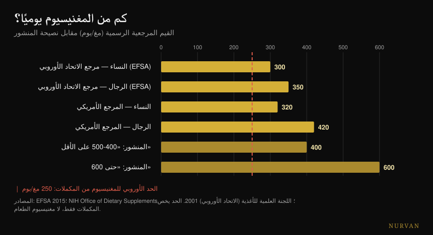
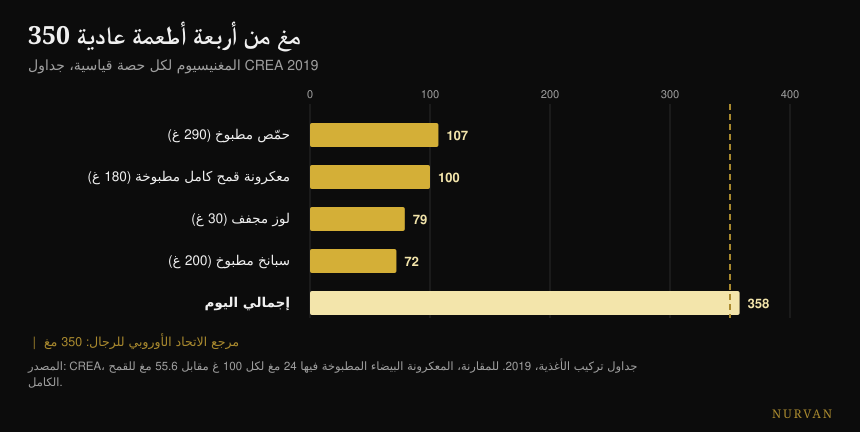

# أي مغنيسيوم تختار وكم تحتاج منه

بقلم [Giammaria Loi](/autore/giammaria-loi) · حُدِّث في 19 أكتوبر 2026

منشور متسلسل واسع الانتشار يعدّ ستة عشر شيئاً يفعله المغنيسيوم، ويرتّب اثني عشر شكلاً منه بتقييم بالنجوم، ويُغلق برقم: 400-500 ملغ يومياً، وحتى 600 عند بعض الناس. راجعتُ خمسة عشر مصدراً. قائمة الأدوار صحيحة، وترتيب الأشكال ينقلب رأساً على عقب عند النقطة الوحيدة التي تختبره فيها دراسة بشرية، أما الرقم الختامي فهو أخطر مشكلة في المنشور — لأنه يتجاهل الرقم الوحيد المتعلق بالسلامة.

## باختصار

- **المرجع الرسمي ليس 400-600 ملغ.** في أوروبا هو 350 ملغ يومياً للرجال و300 للنساء (EFSA, 2015)؛ وفي الولايات المتحدة 400-420 و310-320.
- **سقف المغنيسيوم من المكمّلات هو 250 ملغ يومياً في الاتحاد الأوروبي** و350 في الولايات المتحدة. يخصّ الحبّة وحدها لا الطعام — والمنشور لا يذكره أبداً.
- **في المقارنة البشرية المباشرة يتفوّق السترات على مخلّب الأحماض الأمينية**، أي عكس ترتيب النجوم تماماً. أما الأكسيد فلا يختلف عن الدواء الوهمي (Walker et al., 2003).
- **في التشنجات العضلية المغنيسيوم لا ينفع.** تقول مراجعة كوكرين ذلك بدرجة يقين عالية، ولا توجد عن تشنجات التمرين دراسة واحدة (Garrison et al., 2020).
- **أربعة أطعمة عادية توصلك إلى 358 ملغ** دون أن تفتح أي عُلبة: المعكرونة الكاملة تحتوي 2.3 ضعف ما تحتويه المكرّرة (جداول CREA).

## الستمئة تفاعل حقيقية (لكنها ليست سبباً للمكمّل)

لنبدأ بما يصيبه المنشور. المغنيسيوم هو ثاني أكثر الكاتيونات وفرةً داخل الخلايا، ويشارك في **أكثر من 600 تفاعل إنزيمي**: إنتاج الـATP، وتصنيع الـDNA والـRNA، والتقلّص العضلي، ووظيفة القلب والدماغ. الرقم مأخوذ من مراجعة فيزيولوجية كثيرة الاستشهاد وهو صحيح — مع توضيح واحد: المصدر يتحدث عن 600 *تفاعل*، والمنشور عن 600 *إنزيم*. ليسا الشيء نفسه، لكن رتبة المقدار تصمد.

المشكلة في القفزة المنطقية التي تدعو إليها تلك القائمة. «إنه لازم لستة عشر شيئاً» لا تعني «تحتاج منه أكثر». العنصر الغذائي اللازم لألف عملية يبقى لازماً بالكمية التي يُحتاج إليها: وما بعد تلك العتبة لا مكافأة فيه. وهو الخطأ نفسه الذي يجعل قوائم فوائد أي مكمّل مقنعة — وقد تناولته أيضاً في [تصنيف مكمّلات القوة](/ar/blog/tasnif-mukammilat-alquwa)، حيث تكون المسافة بين ما يفعله المنتج داخل الجسم وما يفعله في الصالة هائلة في كثير من الأحيان.

## كم مغنيسيوم تحتاج فعلاً

هنا يخطئ المنشور، ويخطئ في الشيء الذي سيفعله القارئ فعلاً.

تضع الهيئة الأوروبية لسلامة الأغذية، في رأيها الصادر عام 2015 بشأن القيم الغذائية المرجعية، المدخول الكافي عند **350 ملغ يومياً للرجال البالغين و300 للنساء**. والجهة المرجعية الأمريكية تعطي 400-420 ملغ للرجال و310-320 للنساء. أما «420-600» في الشريحة الرابعة فتأخذ أعلى قيمة في فئة *واحدة* فقط — الرجال فوق 31 عاماً — وتقدّمها كحدّ أدنى للجميع، ثم تبني عليها سقفاً عند 600 لا يظهر في أي توصية.

الرقم الغائب هو الآخر. المغنيسيوم **المأخوذ كمكمّل** له حدّ أعلى للسلامة: **250 ملغ يومياً في الاتحاد الأوروبي** (حُدِّد عام 2001 على أساس الإسهال الخفيف، وهو أول أثر غير مرغوب يظهر) و350 ملغ في الولايات المتحدة. وهذا الحد لا يخصّ مغنيسيوم الطعام، الذي لا يسبّب هذه المشكلة: إنه يخصّ الكبسولات والأكياس فقط.

*المراجع الرسمية مقابل نصيحة المنشور. الخط الأحمر هو السقف الأوروبي للمغنيسيوم من المكمّلات: يسري على الحبّة وحدها لا على الطعام. المصادر: EFSA 2015؛ مكتب المكمّلات الغذائية في المعاهد الوطنية للصحة؛ اللجنة العلمية للأغذية (الاتحاد الأوروبي)، 2001.*

وبالترجمة العملية: عبارة «خُذ 400-600 ملغ»، إذا قرأها شخص لا يتابع ما يأكل، تصير «اشترِ كبسولة 400 ملغ»، وهذه فوق السقف الأوروبي وقريبة من الأمريكي. والجملة الصحيحة غيرها — تحتاج إلى 300-420 ملغ **إجمالاً**، بما في ذلك الطعام، والمكمّل يغطّي الفرق لا المجموع.

وهناك تفصيل أخير لا يكاد أحد يقوله: **المغنيسيوم في الدم مؤشر رديء** على المغنيسيوم الذي تملكه فعلاً. أقل من 1% من مغنيسيوم الجسم يوجد في المصل، وتلك القيمة ترتبط ارتباطاً ضعيفاً بالمحتوى الكلي في الأنسجة. تحليل دم في النطاق الطبيعي لا يثبت أنك بخير، وآخر أقل منه بقليل لا يثبت العكس.

## ترتيب الأشكال لا يصمد

الشريحة الثالثة هي الجزء الأكثر تحميلاً ومشاركةً: اثنا عشر شكلاً، وعمود «الأفضل لـ»، وتقييم للامتصاص بالنجوم. الجلايسينات خمس نجوم للنوم والقلق، والسترات أربع للإمساك، والأكسيد نجمة واحدة، وملح إبسوم ثلاث نجوم لحمّامات الاسترخاء.

توجد دراسة واحدة تضع ثلاثة من هذه الأشكال وجهاً لوجه عند الإنسان. إنها **تجربة عشوائية مزدوجة التعمية على 46 شخصاً**، 300 ملغ من المغنيسيوم العنصري يومياً لمدة 60 يوماً، بمقارنة مباشرة بين مخلّب الأحماض الأمينية والسترات والأكسيد. النتيجة: **السترات هو الأفضل**، في مغنيسيوم الدم بعد الجرعة الأولى (p = 0.026) وبعد شهرين (p = 0.006)، وفي مغنيسيوم اللعاب أيضاً. أما الأكسيد فلا يختلف عن الدواء الوهمي.

أي أن الشكل الذي يمنحه المنشور أربع نجوم يتفوّق، في المقارنة البشرية المباشرة الوحيدة المتاحة، على الشكل الذي يمنحه خمساً. والنجمة الوحيدة التي تصمد هي النجمة المنخفضة للأكسيد.

ومراجعة منهجية لاحقة — 433 دراسة مفحوصة و14 مُدرَجة — تؤكّد الصورة العامة: الأشكال اللاعضوية تنحو إلى أن تكون أقل توافراً حيوياً من العضوية، ونسبة الممتص تتوقف على الجرعة. لكن خلاصة المؤلفين أقل إثارة بكثير من ورقة الاختصارات: **كل** مكمّلات المغنيسيوم تحافظ على المستويات الفيزيولوجية لدى الأصحاء الذين لا يعانون نقصاً سابقاً.

والمنتج يهمّ أكثر من الشكل. اختبرت دراسة بلجيكية خمسة عشر منتجاً تجارياً فوجدت تبايناً «واسعاً جداً»؛ والمنتجان الواقعان في الطرفين، بعد تجربتهما على ثلاثين شخصاً، أعطيا مساحة تحت المنحنى قدرها 6.87 مقابل 0.31 ملّي مول·دقيقة. المعدن نفسه، وعلبتان مختلفتان، وفرق بعشرين ضعفاً.

| ما تقوله الشريحة | ما تقوله الدراسات البشرية |
|---|---|
| الجلايسينات 5 نجوم، السترات 4 | في المقارنة المباشرة يفوز السترات في المصل واللعاب (Walker 2003) |
| الأكسيد نجمة واحدة | مؤكَّد: لا يختلف عن الدواء الوهمي (Walker 2003) |
| «العضوي أفضل من اللاعضوي» | صحيح كاتجاه، لكن كل الأشكال تحافظ على المستويات عند من لا يعاني نقصاً (Pardo 2021) |
| لكل شكل هدفه الخاص | لا توجد أي مقارنة مباشرة بين الأشكال على النوم أو القلق أو ضغط الدم أو الاستشفاء |
| إل-ثريونات للذاكرة والإدراك | تجربتان عشوائيتان: إحداهما موقّعة من شركة المنتج، والأخرى على تركيبة تحتوي فوسفاتيديل سيرين وفيتامينات |
| ملح إبسوم، 3 نجوم للامتصاص | لا توجد دراسة بشرية على الامتصاص عبر الجلد |

يستحق إل-ثريونات وقفة قصيرة، لأنه أغلى أشكال السوق. الدراستان البشريتان موجودتان فعلاً، لكن الأولى — 44 شخصاً بين 50 و70 عاماً، بتحسّن إدراكي حقيقي وأثر كبير — موقّعة من باحثين في الشركة المنتجة للمركّب، و**المؤلفون أنفسهم يكتبون أن الآثار على النوم والقلق غير قابلة للتحديد** بسبب قوة أثر الدواء الوهمي. أما الثانية فتختبر تركيبة تحتوي أيضاً فوسفاتيديل سيرين وفيتامين C وفيتامين D: أيّاً كان ما حدث، لا يمكنك أن تنسبه إلى الثريونات.

## حيث تصمد الأدلة وحيث لا تصمد

**النوم.** تجد المراجعة التحليلية المخصّصة ثلاث تجارب عشوائية فقط، على 151 مسنّاً يعانون الأرق: زمن الخلود إلى النوم ينخفض **17.36 دقيقة** (فاصل ثقة 95%: -27.27 / -7.44). ويتحسّن إجمالي وقت النوم 16 دقيقة لكنه غير دالّ إحصائياً، وخطر التحيّز من متوسط إلى مرتفع، وجودة الأدلة من منخفضة إلى منخفضة جداً. وفي مراجعة أوسع ضمّت 31 تجربة لمكمّلات النوم، **لم تكن بيانات المغنيسيوم كافية لدخول التحليل التجميعي**، بينما دخله الميلاتونين وفيتامين D والأحماض الأمينية. هناك شيء، على الأرجح. لكنه ليس العمود الذي يبدو عليه.

**ضغط الدم.** هذا أفضل أثر موثَّق في القائمة كلها، وهو أيضاً الأكثر تواضعاً: 34 تجربة مزدوجة التعمية على 2,028 شخصاً، بجرعة وسيطة 368 ملغ يومياً لثلاثة أشهر، والنتيجة **-2.00 ملم زئبق للانقباضي و-1.78 للانبساطي**. حقيقي، قابل للقياس، صغير. وإن كنت تتناول أدوية للضغط أو تعاني من مشكلات في الكلى، فهذا حديث مع طبيبك لا مع منشور متسلسل.

**التشنجات.** هنا يشير المنشور إلى الاتجاه الخاطئ. مراجعة كوكرين — 11 تجربة و735 شخصاً — تجد في التشنجات الليلية عند البالغين فرقاً قدره **-0.18 تشنج في الأسبوع** (فاصل ثقة: -0.84 / +0.49)، ونسبة من يحصلون على انخفاض لا يقل عن 25% هي RR 1.04 **بدرجة يقين عالية**: وهو أمتن رقم في المراجعة، ويقول إنه لا ينفع. والآثار الجانبية الخفيفة أكثر شيوعاً من الدواء الوهمي، والإسهال يظهر عند 11-37% من المشاركين. والأهم: **لا توجد تجربة عشوائية واحدة على تشنجات التمرين**. ومراجعة صادرة عام 2026 تؤكّد الصورة — ينفع في تشنجات الحمل، لا في التشنجات الليلية عند البالغين.

**الاستشفاء.** تبدأ المراجعة المنهجية حول المغنيسيوم وأوجاع العضلات بعد التمرين من 1,254 مقالاً وتُدرج منها **أربعة**. ويفترض المؤلفون احتياجاً أعلى بنسبة 10-20% عند من يتدرّبون بشدّة، وهو أمر معقول — لكن أربع دراسات ليست قاعدة تُبنى عليها خمس نجوم.

## ما الذي يقوله البحث فعلاً

- **مؤكَّد** — المغنيسيوم يشارك في أكثر من 600 تفاعل إنزيمي.
- **مؤكَّدة** — قيم الأطعمة في الشريحة الرابعة، منسوخة واحدة واحدة من الصحيفة الرسمية الأمريكية. مع خطأ مطبعي واحد: البطاطا 3.5 *أونصة* لا 3.5 *كوب*.
- **مؤكَّد لكنه صغير** — الأثر على ضغط الدم: -2.00 / -1.78 ملم زئبق عند 368 ملغ يومياً.
- **يحتاج إلى تدقيق** — النوم: -17.36 دقيقة من زمن الخلود إلى النوم، على ثلاث تجارب منخفضة الجودة.
- **مُفنَّد** — «معظم الناس يحتاجون 400-500 ملغ، وبعضهم 600». المراجع الرسمية هي 300-420 ملغ إجمالاً، وسقف المكمّلات 250 ملغ في الاتحاد الأوروبي.
- **مُفنَّد** — تراتبية النجوم: في المقارنة البشرية يتفوّق السترات على مخلّب الأحماض الأمينية.
- **مُفنَّد** — المغنيسيوم للتشنجات: يقين عالٍ بأنه لا يقلّل التشنجات الليلية، ولا توجد أي دراسة على تشنجات التمرين.
- **غير قابل للتحقق** — كل أعمدة «الأفضل لـ» (لا مقارنة بين الأشكال على نتائج سريرية)، ونجوم ملح إبسوم الثلاث (لا دراسة بشرية على الامتصاص عبر الجلد)، وانجراف التربة (بلا مصدر).

## كيف تطبّق ذلك

**احسب أولاً ما تأكله.** ليست هذه نصيحة أخلاقية: مغنيسيوم الطعام لا سقف سلامة له وتكلفته أقل. وأربعة أطعمة عادية تتجاوز بك 350 ملغ.

*المغنيسيوم في الحصة القياسية بحسب جداول CREA 2019. الخط المتقطّع هو المرجع الأوروبي للرجال البالغين.*

| الطعام | ملغ لكل 100 جرام | الحصة | ملغ في الحصة |
|---|---|---|---|
| لوز حلو مجفّف | 264 | 30 جراماً | 79 |
| كاجو | 260 | 30 جراماً | 78 |
| جوز مجفّف | 131 | 30 جراماً | 39 |
| معكرونة سمولينا كاملة، مطبوخة | 55.6 | 180 جراماً | 100 |
| حمص مجفّف، مطبوخ | 37 | 290 جراماً | 107 |
| سبانخ مطبوخة، مسلوقة | 36 | 200 جرام | 72 |
| معكرونة سمولينا، مطبوخة | 24 | 200 جرام | 48 |

*جداول CREA 2019.*

**أنفع تفصيل هو السطر الأخير.** المعكرونة الكاملة المطبوخة تحتوي 55.6 ملغ من المغنيسيوم لكل 100 جرام، والمكرّرة 24: **2.3 ضعفاً**. إذا أكلت المعكرونة أربع مرات في الأسبوع، فتغيير النوع يساوي أكثر من أي اختيار بين البيسجلايسينات والتوراة.

**وإن أخذت مكمّلاً، فابدأ بجرعة منخفضة.** الأدبيات التي تُظهر آثاراً حقيقية تعمل في حدود 300-370 ملغ يومياً، أي في رتبة مقدار الاحتياج الكلي لا ضِعفه. وبإضافة الطعام، تكفي كبسولة 100-200 ملغ في معظم الحالات لإغلاق الحساب وتبقى داخل السقف الأوروبي.

**اختر شكلاً قابلاً للذوبان ومنتجاً يعلن المغنيسيوم العنصري.** السترات والكلوريد واللاكتات والمخلّبات كلها مناسبة؛ والأكسيد أسوأها سنداً. والأهم من الشكل: يجب أن يذكر الملصق كم مغنيسيوماً *عنصرياً* تحتوي الجرعة، لا كم مليجراماً يزن الملح.

**وإن أخذته للنوم، فخذه في المساء وأعطه ثلاثة أسابيع.** واحتفظ بتوقعات منخفضة: سبع عشرة دقيقة أقل للخلود إلى النوم، على أدلة ضعيفة. أما توقيت تناول كل مكمّل فقد حلّلته بالتفصيل [في هذا المقال عن ساعة التناول](/ar/blog/mata-tatanawal-almukammilat-alghidhaiya).

**وإذا صار البراز رخواً، فقد تجاوزت عتبتك.** هذه أول إشارة، وهي بالضبط الأثر الذي بُني عليه حدّ السلامة الأوروبي.

> ### المغنيسيوم في يومك، داخل Nurvan
> خلاصة هذا المقال أن الحساب يُغلق على المائدة لا في العُلبة. تعمل يوميات الطعام في Nurvan على قاعدة بيانات CREA — القيم نفسها الموجودة في الجدول أعلاه — فترى كم مغنيسيوماً تمنحك وجباتك فعلاً قبل أن تقرّر هل تأخذ مكمّلاً وبأي مقدار. ويسجّل قسم المكمّلات الجرعة والشكل والتوقيت، ويضعها إلى جانب أحمال التدريب والنوم في الأسابيع نفسها. **[جرّب Nurvan](https://nurvan.app)**

## أسئلة شائعة

**أيهما أفضل: بيسجلايسينات المغنيسيوم أم السترات؟**
في الدراسة البشرية الوحيدة التي تقارنهما مباشرةً، يخرج السترات أعلى توافراً حيوياً من مخلّب الأحماض الأمينية عند 300 ملغ يومياً لمدة 60 يوماً. لكن الفرق العملي بين الشكلين العضويين يبقى صغيراً أمام الفرق بين أن تأخذ مكمّلاً وألا تأخذه: عند الأصحاء بلا نقص، كل الأشكال تحافظ على المستويات. والوحيد الذي يُستحسن تجنّبه هو الأكسيد.

**كم مغنيسيوماً ينبغي أن آخذ يومياً؟**
الاحتياج الكلي، بما في ذلك الطعام، هو 350 ملغ للرجال و300 للنساء بحسب EFSA (والمراجع الأمريكية 400-420 و310-320). وللمغنيسيوم المأخوذ كمكمّل سقف سلامة منفصل: 250 ملغ يومياً في الاتحاد الأوروبي و350 في الولايات المتحدة. فوظيفة المكمّل تغطية الفرق بين ما تأكله والاحتياج، لا تغطية الاحتياج كله.

**هل يُزيل المغنيسيوم التشنجات العضلية؟**
في التشنجات الليلية عند البالغين تقول مراجعة كوكرين لا، بدرجة يقين عالية على أحد النواتج. وعن تشنجات التمرين لا توجد أي تجربة عشوائية، فمن ينصحك به لها لا يملك بيانات يستند إليها. ويُستثنى الحمل، حيث يظهر بعض الأثر.

**هل يجعلك المغنيسيوم تنام أفضل؟**
في ثلاث تجارب على مسنّين يعانون الأرق يقلّل زمن الخلود إلى النوم نحو سبع عشرة دقيقة، لكن جودة الأدلة منخفضة وإجمالي وقت النوم لا يتغيّر بدلالة إحصائية. وفي مراجعة أوسع لمكمّلات النوم لم تكن بيانات المغنيسيوم كافية حتى لإدخاله في التحليل التجميعي.

**هل يُمتصّ المغنيسيوم من حمّام بأملاح إبسوم؟**
لا توجد على PubMed دراسة بشرية تقيس ذلك. والقياس المباشر الوحيد للامتصاص عبر الجلد مُجرى في المختبر على جلد الخنزير. الحمّام الساخن قد يُرخي الجسم، أما نسبة الفضل إلى المغنيسيوم العابر للجلد فلا سند بشري لها اليوم.

## اقرأ أيضاً

- [تصنيف مكمّلات القوة: ما الذي ينفع فعلاً](/ar/blog/tasnif-mukammilat-alquwa)
- [متى تتناول المكمّلات الغذائية: هل تهم الساعة؟](/ar/blog/mata-tatanawal-almukammilat-alghidhaiya)
- [الكافيين والنوم: متى تتوقف عن القهوة](/ar/blog/alkafayin-walnawm-mata-tatawaqaf-an-alqahwa)

## المصادر

- de Baaij JHF, Hoenderop JGJ, Bindels RJM, 2015. Magnesium in man: implications for health and disease. *Physiological Reviews* 95(1):1-46. [PMID 25540137](https://pubmed.ncbi.nlm.nih.gov/25540137/) · [DOI](https://doi.org/10.1152/physrev.00012.2014)
- EFSA, 2015. *Dietary reference values: magnesium and phosphorus* (28 يوليو 2015). [efsa.europa.eu](https://www.efsa.europa.eu/en/press/news/150728)
- اللجنة العلمية للأغذية (الاتحاد الأوروبي)، 2001. الحد الأعلى المقبول لتناول المغنيسيوم من المكمّلات: 250 ملغ/يوم. [وثيقة BfR المرجعية](https://www.bfr.bund.de/cm/349/proposed-maximum-levels-for-the-addition-of-magnesium-to-foods-including-food-supplements.pdf)
- NIH Office of Dietary Supplements. *Magnesium — Fact Sheet for Health Professionals*. [ods.od.nih.gov](https://ods.od.nih.gov/factsheets/Magnesium-HealthProfessional/)
- Walker AF, Marakis G, Christie S, Byng M, 2003. Mg citrate found more bioavailable than other Mg preparations in a randomised, double-blind study. *Magnesium Research* 16(3):183-91. [PMID 14596323](https://pubmed.ncbi.nlm.nih.gov/14596323/)
- Pardo MR, Garicano Vilar E, San Mauro Martín I, Camina Martín MA, 2021. Bioavailability of magnesium food supplements: a systematic review. *Nutrition* 89:111294. [PMID 34111673](https://pubmed.ncbi.nlm.nih.gov/34111673/) · [DOI](https://doi.org/10.1016/j.nut.2021.111294)
- Blancquaert L, Vervaet C, Derave W, 2019. Predicting and testing bioavailability of magnesium supplements. *Nutrients* 11(7):1663. [PMID 31330811](https://pubmed.ncbi.nlm.nih.gov/31330811/) · [DOI](https://doi.org/10.3390/nu11071663)
- Mah J, Pitre T, 2021. Oral magnesium supplementation for insomnia in older adults: a systematic review and meta-analysis. *BMC Complementary Medicine and Therapies* 21(1):125. [PMID 33865376](https://pubmed.ncbi.nlm.nih.gov/33865376/) · [DOI](https://doi.org/10.1186/s12906-021-03297-z)
- Chan V, Lo K, 2021. Efficacy of dietary supplements on improving sleep quality: a systematic review and meta-analysis. *Postgraduate Medical Journal* 98(1158):285-293. [PMID 33441476](https://pubmed.ncbi.nlm.nih.gov/33441476/) · [DOI](https://doi.org/10.1136/postgradmedj-2020-139319)
- Zhang X, Li Y, Del Gobbo LC et al., 2016. Effects of magnesium supplementation on blood pressure: a meta-analysis of randomized double-blind placebo-controlled trials. *Hypertension* 68(2):324-33. [PMID 27402922](https://pubmed.ncbi.nlm.nih.gov/27402922/) · [DOI](https://doi.org/10.1161/HYPERTENSIONAHA.116.07664)
- Garrison SR, Korownyk CS, Kolber MR et al., 2020. Magnesium for skeletal muscle cramps. *Cochrane Database of Systematic Reviews* 9:CD009402. [PMID 32956536](https://pubmed.ncbi.nlm.nih.gov/32956536/) · [DOI](https://doi.org/10.1002/14651858.CD009402.pub3)
- Patil S, Falkowski A, Venkataiah VS et al., 2026. The role of electrolytes in muscle pain syndromes: a systematic review and meta-analysis. *International Dental Journal* 76(3):109488. [PMID 41812583](https://pubmed.ncbi.nlm.nih.gov/41812583/) · [DOI](https://doi.org/10.1016/j.identj.2026.109488)
- Tarsitano MG, Quinzi F, Folino K et al., 2024. Effects of magnesium supplementation on muscle soreness in different types of physical activities: a systematic review. *Journal of Translational Medicine* 22(1):629. [PMID 38970118](https://pubmed.ncbi.nlm.nih.gov/38970118/) · [DOI](https://doi.org/10.1186/s12967-024-05434-x)
- Liu G, Weinger JG, Lu ZL, Xue F, Sadeghpour S, 2016. Efficacy and safety of MMFS-01, a synapse density enhancer, for treating cognitive impairment in older adults. *Journal of Alzheimer's Disease* 49(4):971-90. [PMID 26519439](https://pubmed.ncbi.nlm.nih.gov/26519439/) · [DOI](https://doi.org/10.3233/JAD-150538)
- Ghimirey KB, Ita K, 2020. Microneedle-assisted percutaneous transport of magnesium sulfate. *Current Drug Delivery* 17(2):140-147. [PMID 31845631](https://pubmed.ncbi.nlm.nih.gov/31845631/) · [DOI](https://doi.org/10.2174/1567201817666191217093936)
- CREA — مركز أبحاث الأغذية والتغذية، *جداول التركيب الغذائي الإيطالية*، تحديث 2019. [alimentinutrizione.it](https://www.alimentinutrizione.it/tabelle-nutrizionali/ricerca-per-ordine-alfabetico)

*نقطة الانطلاق: منشور Siim Land المتسلسل ([@siimland](https://www.instagram.com/siimland/)) بتاريخ 30 سبتمبر 2026، [هذا المنشور](https://www.instagram.com/p/Dd7HfSdgKyl/). لم يُستنسخ أي نص أو صورة من المنشور: قرأنا ادعاءاته وتحقّقنا منها في الأدبيات.*

---

**جيامّاريا لوي** مؤسس تطبيق Nurvan. يتدرب بالأثقال منذ 2012، ويعمل مدرباً شخصياً ومدرّباً معتمداً من الاتحاد الإيطالي لرفع الأثقال منذ 2013، ويشارك في منافسات رفع القوة على المستوى الوطني منذ 2018. كل مقال يوقّعه ينطلق من الدراسات العلمية وينتهي عند ما ينفع فعلاً في الصالة. [صفحة الكاتب](/autore/giammaria-loi)

> ملاحظة: محتوى معلوماتي لا يحلّ محل رأي طبيب أو مختص مؤهل. قد يتفاعل المغنيسيوم مع بعض الأدوية، ويعتمد إطراحه على وظيفة الكلى: فإن كنت تتناول علاجات، أو تعاني من مشكلات في الكلى أو القلب، أو كنت حاملاً، فتحدّث مع طبيبك قبل تناول أي مكمّل.
