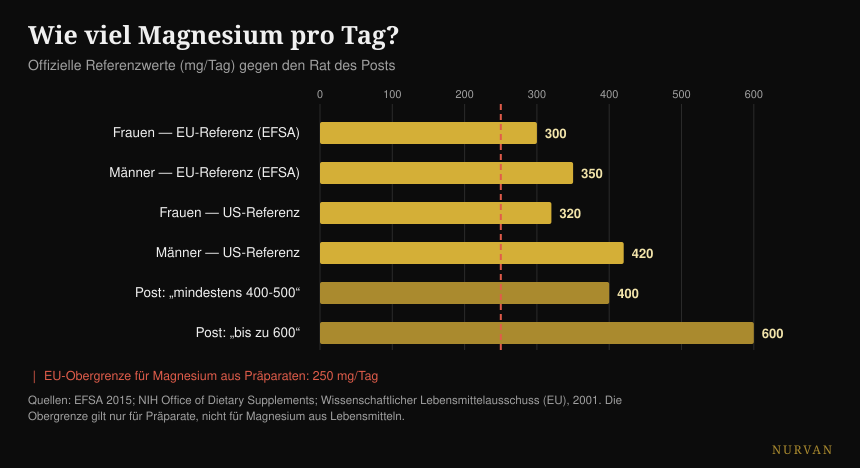
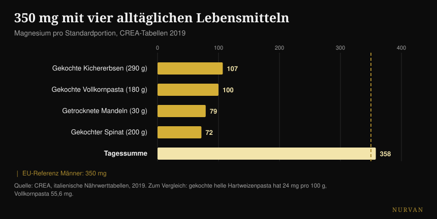

# Welches Magnesium wählen und wie viel du brauchst

Von [Giammaria Loi](/autore/giammaria-loi) · aktualisiert am 19. Oktober 2026

Ein vielgeteiltes Karussell listet sechzehn Dinge auf, die Magnesium tut, reiht zwölf Formen mit einer Sternebewertung auf und endet mit einer Zahl: 400-500 mg am Tag, bei manchen bis zu 600. Ich habe fünfzehn Quellen geprüft. Die Liste der Aufgaben stimmt, die Rangliste der Formen kippt genau an der Stelle, an der es eine Humanstudie dazu gibt, und die Zahl am Ende ist das ernsteste Problem des Beitrags — weil sie die einzige Zahl ignoriert, bei der es um Sicherheit geht.

## Kurz gefasst

- **Der offizielle Referenzwert liegt nicht bei 400-600 mg.** In Europa sind es 350 mg am Tag für Männer und 300 für Frauen (EFSA, 2015); in den USA 400-420 und 310-320.
- **Die Obergrenze für Magnesium aus Präparaten liegt in der EU bei 250 mg am Tag**, in den USA bei 350. Sie gilt nur für die Kapsel, nicht für das Essen — und der Beitrag nennt sie nie.
- **Im direkten Humanvergleich schlägt Citrat das Aminosäure-Chelat**, also genau umgekehrt zur Sternerangliste. Oxid dagegen unterscheidet sich nicht von Placebo (Walker et al., 2003).
- **Gegen Krämpfe wirkt Magnesium nicht.** Der Cochrane-Review sagt das mit hoher Vertrauenswürdigkeit, und zu belastungsbedingten Krämpfen gibt es nicht eine einzige Studie (Garrison et al., 2020).
- **Mit vier alltäglichen Lebensmitteln kommst du auf 358 mg**, ohne ein Döschen zu öffnen: Vollkornpasta hat das 2,3-Fache der helleren Variante (CREA-Tabellen).

## Die 600 Reaktionen stimmen (sind aber kein Grund zu supplementieren)

Fangen wir damit an, was der Beitrag richtig macht. Magnesium ist das zweithäufigste Kation innerhalb der Zellen und an **über 600 enzymatischen Reaktionen** beteiligt: ATP-Produktion, DNA- und RNA-Synthese, Muskelkontraktion, Herz- und Hirnfunktion. Die Zahl stammt aus einer vielzitierten physiologischen Übersichtsarbeit und ist korrekt — mit einer Präzisierung: Die Quelle spricht von 600 *Reaktionen*, der Beitrag von 600 *Enzymen*. Das ist nicht dasselbe, aber die Größenordnung hält.

Das Problem ist der Denksprung, zu dem diese Liste einlädt. „Es ist für sechzehn Dinge nötig" heißt nicht „man braucht mehr davon". Ein Nährstoff, der für tausend Prozesse nötig ist, bleibt in der Menge nötig, in der er gebraucht wird: oberhalb dieser Schwelle gibt es keinen Bonus. Es ist derselbe Fehler, der die Vorteilslisten jedes Supplements überzeugend macht — ich habe das auch in der [Tier-List der Supplemente für Kraft](/de/blog/kraftsport-supplemente-tier-list) beschrieben, wo der Abstand zwischen dem, was ein Produkt im Körper tut, und dem, was es im Gym tut, oft enorm ist.

## Wie viel Magnesium du wirklich brauchst

Hier irrt der Beitrag, und er irrt bei genau dem, was die Leserin am Ende tatsächlich tut.

Die EFSA setzt in ihrer Stellungnahme von 2015 zu den Referenzwerten die angemessene Zufuhr auf **350 mg am Tag für erwachsene Männer und 300 für Frauen**. Die US-Referenzstelle nennt 400-420 mg für Männer und 310-320 für Frauen. Die „420-600" der vierten Folie nimmt den höchsten Wert aus *einer einzigen* Gruppe — Männer über 31 Jahre — und verkauft ihn als Minimum für alle, um darauf eine Obergrenze von 600 zu bauen, die in keiner Empfehlung vorkommt.

Die fehlende Zahl ist die andere. Magnesium, das **als Präparat eingenommen** wird, hat eine Sicherheitsobergrenze: **250 mg am Tag in der Europäischen Union** (2001 festgelegt auf Grundlage von leichtem Durchfall, dem ersten auftretenden unerwünschten Effekt) und 350 mg in den USA. Diese Grenze betrifft nicht das Magnesium aus Lebensmitteln, das dieses Problem nicht macht: Sie betrifft nur Kapseln und Trinkpulver.

*Offizielle Referenzwerte gegen den Rat des Beitrags. Die rote Linie ist die europäische Obergrenze für Magnesium aus Präparaten: Sie gilt nur für die Kapsel, nicht für das Essen. Quellen: EFSA 2015; NIH Office of Dietary Supplements; Wissenschaftlicher Lebensmittelausschuss (EU), 2001.*

Praktisch übersetzt: „Nimm 400-600 mg" wird bei jemandem, der nicht verfolgt, was er isst, zu „kauf eine Kapsel mit 400 mg" — und das liegt über der europäischen Obergrenze und nah an der amerikanischen. Der richtige Satz ist ein anderer: Du brauchst 300-420 mg **insgesamt**, Essen inklusive, und das Präparat deckt die Differenz, nicht die Gesamtmenge.

Ein letztes Detail, das fast niemand sagt: **Magnesium im Blut ist ein schlechter Indikator** für das Magnesium, das du wirklich hast. Weniger als 1 % des Körpermagnesiums steckt im Serum, und dieser Wert korreliert nur schwach mit dem Gesamtgehalt der Gewebe. Ein normaler Blutwert beweist nicht, dass alles in Ordnung ist, und ein knapp zu niedriger beweist nicht das Gegenteil.

## Die Rangliste der Formen hält nicht

Die dritte Folie ist der am häufigsten gespeicherte und geteilte Teil: zwölf Formen, eine Spalte „ideal für" und eine Aufnahme-Bewertung in Sternen. Glycinat fünf Sterne für Schlaf und Angst, Citrat vier gegen Verstopfung, Oxid nur einen, Epsom-Salz drei für entspannende Bäder.

Es gibt eine Studie, die drei dieser Formen beim Menschen gegeneinander stellt. Eine **randomisierte Doppelblindstudie an 46 Personen**, 300 mg elementares Magnesium am Tag über 60 Tage, im direkten Vergleich von Aminosäure-Chelat, Citrat und Oxid. Ergebnis: **Citrat ist das Beste**, beim Magnesium im Blut sowohl nach der ersten Dosis (p = 0,026) als auch nach zwei Monaten (p = 0,006), und auch beim Magnesium im Speichel. Oxid unterscheidet sich nicht von Placebo.

Heißt: Im einzigen verfügbaren direkten Humanvergleich schlägt die Form, der der Beitrag vier Sterne gibt, die mit fünf Sternen. Der einzige Stern, der hält, ist der niedrige des Oxids.

Ein späterer systematischer Review — 433 geprüfte Studien, 14 eingeschlossen — bestätigt das Gesamtbild: Anorganische Formen sind tendenziell schlechter bioverfügbar als organische, und der aufgenommene Anteil hängt von der Dosis ab. Die Schlussfolgerung der Autoren ist aber viel weniger aufregend als das Cheat Sheet: **alle** Magnesiumpräparate halten die physiologischen Spiegel bei gesunden Menschen ohne vorbestehenden Mangel.

Und das Produkt zählt mehr als die Form. Eine belgische Studie testete fünfzehn Handelsprodukte und fand eine „sehr große" Streuung; die beiden Extreme, anschließend an dreißig Personen geprüft, ergaben eine Fläche unter der Kurve von 6,87 gegenüber 0,31 mM·min. Dasselbe Mineral, zwei verschiedene Packungen, Faktor zwanzig Unterschied.

| Was die Folie sagt | Was die Humanstudien sagen |
|---|---|
| Glycinat 5 Sterne, Citrat 4 | Im direkten Vergleich gewinnt Citrat bei Serum und Speichel (Walker 2003) |
| Oxid 1 Stern | Bestätigt: unterscheidet sich nicht von Placebo (Walker 2003) |
| „Organisch besser als anorganisch" | Als Tendenz richtig, aber alle Formen halten die Spiegel bei Nicht-Mangelnden (Pardo 2021) |
| Jede Form hat ihr eigenes Ziel | Kein Kopf-an-Kopf-Vergleich der Formen zu Schlaf, Angst, Blutdruck oder Regeneration |
| L-Threonat für Gedächtnis und Kognition | Zwei RCTs: eines gezeichnet von der Herstellerfirma, das andere zu einer Formel mit Phosphatidylserin und Vitaminen |
| Epsom-Salz, 3 Sterne Aufnahme | Keine Humanstudie zur Aufnahme über die Haut |

Beim L-Threonat lohnt ein kurzer Halt, weil es die teuerste Form auf dem Markt ist. Die zwei Humanstudien existieren wirklich, aber die erste — 44 Erwachsene zwischen 50 und 70 Jahren, mit einer realen kognitiven Verbesserung und einem großen Effekt — ist von Autoren der Firma gezeichnet, die den Wirkstoff herstellt, und **die Autoren schreiben selbst, dass die Effekte auf Schlaf und Angst nicht bestimmbar sind**, so stark war der Placeboeffekt. Die zweite testet eine Formel, die auch Phosphatidylserin, Vitamin C und Vitamin D enthält: Was auch passiert ist, dem Threonat zuschreiben kannst du es nicht.

## Wo die Belege halten und wo nicht

**Der Schlaf.** Die einschlägige Meta-Analyse findet nur drei randomisierte Studien, an 151 älteren Menschen mit Insomnie: Die Einschlaflatenz sinkt um **17,36 Minuten** (95-%-KI -27,27 / -7,44). Die Gesamtschlafzeit verbessert sich um 16 Minuten, ist aber nicht signifikant, das Bias-Risiko ist moderat bis hoch und die Evidenzqualität niedrig bis sehr niedrig. In einer breiteren Übersicht über 31 Studien zu Schlafsupplementen hatte Magnesium **nicht genug Daten, um in die Meta-Analyse zu kommen**, während Melatonin, Vitamin D und Aminosäuren es hinein geschafft haben. Etwas ist da, wahrscheinlich. Die Säule, nach der es aussieht, ist es nicht.

**Der Blutdruck.** Das ist der am besten dokumentierte Effekt der ganzen Liste, und auch der bescheidenste: 34 Doppelblindstudien an 2.028 Personen, mediane Dosis 368 mg am Tag über drei Monate, Ergebnis **-2,00 mmHg systolisch und -1,78 diastolisch**. Real, messbar, klein. Wenn du Blutdruckmedikamente nimmst oder Nierenprobleme hast, ist das ein Gespräch für deine Ärztin oder deinen Arzt, nicht für ein Karussell.

**Die Krämpfe.** Hier zeigt der Beitrag in die falsche Richtung. Der Cochrane-Review — 11 Studien, 735 Personen — findet bei nächtlichen Krämpfen Erwachsener einen Unterschied von **-0,18 Krämpfen pro Woche** (KI -0,84 / +0,49), und der Anteil derer, die mindestens 25 % Reduktion erreichen, liegt bei RR 1,04 mit **hoher Vertrauenswürdigkeit**: Das ist der belastbarste Befund des Reviews, und er sagt, dass es nicht funktioniert. Leichte Nebenwirkungen sind häufiger als unter Placebo, und Durchfall tritt bei 11-37 % der Teilnehmenden auf. Und vor allem: **Es existiert nicht eine einzige randomisierte Studie zu belastungsbedingten Krämpfen**. Ein Review von 2026 bestätigt das Bild — es wirkt bei Krämpfen in der Schwangerschaft, nicht bei nächtlichen Krämpfen Erwachsener.

**Die Regeneration.** Der systematische Review zu Magnesium und Muskelkater nach dem Training startet mit 1.254 Artikeln und schließt **vier** ein. Die Autoren vermuten einen 10-20 % höheren Bedarf bei intensiv Trainierenden, was plausibel ist — aber vier Studien sind keine Basis, auf der man fünf Sterne baut.

## Was die Forschung wirklich sagt

- **Bestätigt** — Magnesium ist an über 600 enzymatischen Reaktionen beteiligt.
- **Bestätigt** — die Lebensmittelwerte der vierten Folie, eins zu eins vom offiziellen US-Factsheet übernommen. Mit einem Tippfehler: Die Kartoffeln sind 3,5 *Unzen*, nicht 3,5 *Cup*.
- **Bestätigt, aber klein** — der Effekt auf den Blutdruck: -2,00 / -1,78 mmHg bei 368 mg am Tag.
- **Zu präzisieren** — der Schlaf: -17,36 Minuten Einschlaflatenz, auf Basis von drei Studien niedriger Qualität.
- **Widerlegt** — „die meisten Menschen brauchen 400-500 mg, manche 600". Die offiziellen Referenzwerte sind 300-420 mg insgesamt, und die Obergrenze für Präparate liegt in der EU bei 250 mg.
- **Widerlegt** — die Sternehierarchie: Im Humanvergleich schlägt Citrat das Aminosäure-Chelat.
- **Widerlegt** — Magnesium gegen Krämpfe: hohe Vertrauenswürdigkeit, dass es nächtliche Krämpfe nicht reduziert, keine Studie zu belastungsbedingten Krämpfen.
- **Nicht überprüfbar** — alle Spalten „ideal für" (kein Vergleich der Formen zu klinischen Endpunkten), die drei Sterne des Epsom-Salzes (keine Humanstudie zur Aufnahme über die Haut) und die Bodenerosion (keine Quelle).

## So wendest du es an

**Zähl erst, was du isst.** Das ist kein moralischer Rat: Magnesium aus Lebensmitteln hat keine Sicherheitsobergrenze und kostet weniger. Mit vier alltäglichen Lebensmitteln kommst du über 350 mg.

*Magnesium pro Standardportion nach den CREA-Tabellen 2019. Die gestrichelte Linie ist der europäische Referenzwert für erwachsene Männer.*

| Lebensmittel | mg pro 100 g | Portion | mg pro Portion |
|---|---|---|---|
| Mandeln, süß, getrocknet | 264 | 30 g | 79 |
| Cashewkerne | 260 | 30 g | 78 |
| Walnüsse, getrocknet | 131 | 30 g | 39 |
| Vollkorn-Hartweizenpasta, gekocht | 55,6 | 180 g | 100 |
| Kichererbsen, getrocknet, gekocht | 37 | 290 g | 107 |
| Spinat, in Wasser gekocht | 36 | 200 g | 72 |
| Hartweizenpasta, gekocht | 24 | 200 g | 48 |

*CREA-Tabellen 2019.*

**Das nützlichste Detail ist die letzte Zeile.** Gekochte Vollkornpasta hat 55,6 mg Magnesium pro 100 g, die helle 24: **das 2,3-Fache**. Wenn du vier Mal pro Woche Pasta isst, bringt der Wechsel der Sorte mehr als jede Wahl zwischen Bisglycinat und Taurat.

**Wenn du supplementierst, starte mit einer niedrigen Dosis.** Die Literatur, die reale Effekte zeigt, arbeitet um 300-370 mg am Tag, also in der Größenordnung des Gesamtbedarfs, nicht des Doppelten. Rechnet man das Essen dazu, reicht eine Kapsel mit 100-200 mg fast immer, um die Rechnung zu schließen, und bleibt innerhalb der europäischen Obergrenze.

**Wähl eine lösliche Form und ein Produkt, das das elementare Magnesium angibt.** Citrat, Chlorid, Lactat und die Chelate sind in Ordnung; Oxid hat die schlechteste Grundlage. Wichtiger als die Form: Auf dem Etikett muss stehen, wie viel *elementares* Magnesium eine Dosis enthält, nicht wie viele Milligramm das Salz wiegt.

**Wenn du es zum Schlafen nimmst, nimm es abends und gib ihm drei Wochen.** Und halt die Erwartungen niedrig: siebzehn Minuten schnelleres Einschlafen, auf schwacher Evidenz. Den Einnahmezeitpunkt jedes Supplements habe ich im Detail [in diesem Artikel zum Timing](/de/blog/wann-nahrungsergaenzungsmittel-einnehmen) analysiert.

**Wenn weicher Stuhl auftritt, hast du deine Schwelle überschritten.** Das ist das erste Signal, und genau auf diesem Effekt ist die europäische Sicherheitsgrenze aufgebaut.

> ### Magnesium im Tagesverlauf, in Nurvan
> Der Punkt dieses Artikels ist, dass die Rechnung am Tisch aufgeht, nicht im Döschen. Das Ernährungstagebuch von Nurvan arbeitet mit der CREA-Datenbank — denselben Werten wie in der Tabelle oben — also siehst du, wie viel Magnesium wirklich aus deinen Mahlzeiten kommt, bevor du entscheidest, ob und wie viel du supplementierst. Der Supplement-Bereich hält Dosis, Form und Uhrzeit fest und stellt sie neben die Trainingslasten und den Schlaf derselben Wochen. **[Nurvan testen](https://nurvan.app)**

## Häufige Fragen

**Magnesium Bisglycinat oder Citrat: was ist besser?**
In der einzigen Humanstudie, die beide direkt vergleicht, ist Citrat bei 300 mg am Tag über 60 Tage besser bioverfügbar als das Aminosäure-Chelat. Der praktische Unterschied zwischen den beiden organischen Formen bleibt aber klein gegenüber dem Unterschied zwischen supplementieren und nicht supplementieren: Bei gesunden Menschen ohne Mangel halten alle Formen die Spiegel. Die einzige, die du meiden solltest, ist Oxid.

**Wie viel Magnesium soll ich am Tag nehmen?**
Der Gesamtbedarf, Essen inklusive, liegt nach EFSA bei 350 mg für Männer und 300 für Frauen (400-420 und 310-320 sind die US-Referenzwerte). Magnesium als Präparat hat eine eigene Sicherheitsobergrenze: 250 mg am Tag in der EU, 350 in den USA. Das Präparat deckt also die Differenz zwischen dem, was du isst, und dem Bedarf, nicht den ganzen Bedarf.

**Nimmt Magnesium die Krämpfe weg?**
Bei nächtlichen Krämpfen Erwachsener sagt der Cochrane-Review nein, mit hoher Vertrauenswürdigkeit bei einem der Endpunkte. Zu belastungsbedingten Krämpfen existiert keine einzige randomisierte Studie, wer es dir dafür empfiehlt, hat also keine Daten, auf die er sich stützen kann. Eine Ausnahme ist die Schwangerschaft, dort zeigt sich ein Effekt.

**Lässt Magnesium besser schlafen?**
In drei Studien an älteren Menschen mit Insomnie verkürzt es die Einschlafzeit um etwa siebzehn Minuten, aber die Evidenzqualität ist niedrig und die Gesamtschlafzeit ändert sich nicht signifikant. In einer breiteren Übersicht zu Schlafsupplementen hatte Magnesium nicht einmal genug Daten, um meta-analysiert zu werden.

**Nimmt man beim Bad mit Epsom-Salz Magnesium auf?**
Auf PubMed gibt es keine Humanstudie, die das messen würde. Die einzige direkte Messung der Aufnahme über die Haut ist in vitro, an Schweinehaut. Das warme Bad kann entspannen, aber das Verdienst dem Magnesium zuzuschreiben, das die Haut durchquert, hat heute keine humane Grundlage.

## Weiterlesen

- [Tier-List der Supplemente für Kraft: was wirklich funktioniert](/de/blog/kraftsport-supplemente-tier-list)
- [Wann Nahrungsergänzungsmittel einnehmen: zählt die Uhrzeit?](/de/blog/wann-nahrungsergaenzungsmittel-einnehmen)
- [Koffein und Schlaf: wann der letzte Kaffee](/de/blog/koffein-schlaf-wann-letzter-kaffee)

## Quellen

- de Baaij JHF, Hoenderop JGJ, Bindels RJM, 2015. Magnesium in man: implications for health and disease. *Physiological Reviews* 95(1):1-46. [PMID 25540137](https://pubmed.ncbi.nlm.nih.gov/25540137/) · [DOI](https://doi.org/10.1152/physrev.00012.2014)
- EFSA, 2015. *Dietary reference values: magnesium and phosphorus* (28. Juli 2015). [efsa.europa.eu](https://www.efsa.europa.eu/en/press/news/150728)
- Wissenschaftlicher Lebensmittelausschuss (EU), 2001. Tolerierbare Obergrenze der Zufuhr für Magnesium aus Präparaten: 250 mg/Tag. [BfR-Referenzdokument](https://www.bfr.bund.de/cm/349/proposed-maximum-levels-for-the-addition-of-magnesium-to-foods-including-food-supplements.pdf)
- NIH Office of Dietary Supplements. *Magnesium — Fact Sheet for Health Professionals*. [ods.od.nih.gov](https://ods.od.nih.gov/factsheets/Magnesium-HealthProfessional/)
- Walker AF, Marakis G, Christie S, Byng M, 2003. Mg citrate found more bioavailable than other Mg preparations in a randomised, double-blind study. *Magnesium Research* 16(3):183-91. [PMID 14596323](https://pubmed.ncbi.nlm.nih.gov/14596323/)
- Pardo MR, Garicano Vilar E, San Mauro Martín I, Camina Martín MA, 2021. Bioavailability of magnesium food supplements: a systematic review. *Nutrition* 89:111294. [PMID 34111673](https://pubmed.ncbi.nlm.nih.gov/34111673/) · [DOI](https://doi.org/10.1016/j.nut.2021.111294)
- Blancquaert L, Vervaet C, Derave W, 2019. Predicting and testing bioavailability of magnesium supplements. *Nutrients* 11(7):1663. [PMID 31330811](https://pubmed.ncbi.nlm.nih.gov/31330811/) · [DOI](https://doi.org/10.3390/nu11071663)
- Mah J, Pitre T, 2021. Oral magnesium supplementation for insomnia in older adults: a systematic review and meta-analysis. *BMC Complementary Medicine and Therapies* 21(1):125. [PMID 33865376](https://pubmed.ncbi.nlm.nih.gov/33865376/) · [DOI](https://doi.org/10.1186/s12906-021-03297-z)
- Chan V, Lo K, 2021. Efficacy of dietary supplements on improving sleep quality: a systematic review and meta-analysis. *Postgraduate Medical Journal* 98(1158):285-293. [PMID 33441476](https://pubmed.ncbi.nlm.nih.gov/33441476/) · [DOI](https://doi.org/10.1136/postgradmedj-2020-139319)
- Zhang X, Li Y, Del Gobbo LC et al., 2016. Effects of magnesium supplementation on blood pressure: a meta-analysis of randomized double-blind placebo-controlled trials. *Hypertension* 68(2):324-33. [PMID 27402922](https://pubmed.ncbi.nlm.nih.gov/27402922/) · [DOI](https://doi.org/10.1161/HYPERTENSIONAHA.116.07664)
- Garrison SR, Korownyk CS, Kolber MR et al., 2020. Magnesium for skeletal muscle cramps. *Cochrane Database of Systematic Reviews* 9:CD009402. [PMID 32956536](https://pubmed.ncbi.nlm.nih.gov/32956536/) · [DOI](https://doi.org/10.1002/14651858.CD009402.pub3)
- Patil S, Falkowski A, Venkataiah VS et al., 2026. The role of electrolytes in muscle pain syndromes: a systematic review and meta-analysis. *International Dental Journal* 76(3):109488. [PMID 41812583](https://pubmed.ncbi.nlm.nih.gov/41812583/) · [DOI](https://doi.org/10.1016/j.identj.2026.109488)
- Tarsitano MG, Quinzi F, Folino K et al., 2024. Effects of magnesium supplementation on muscle soreness in different types of physical activities: a systematic review. *Journal of Translational Medicine* 22(1):629. [PMID 38970118](https://pubmed.ncbi.nlm.nih.gov/38970118/) · [DOI](https://doi.org/10.1186/s12967-024-05434-x)
- Liu G, Weinger JG, Lu ZL, Xue F, Sadeghpour S, 2016. Efficacy and safety of MMFS-01, a synapse density enhancer, for treating cognitive impairment in older adults. *Journal of Alzheimer's Disease* 49(4):971-90. [PMID 26519439](https://pubmed.ncbi.nlm.nih.gov/26519439/) · [DOI](https://doi.org/10.3233/JAD-150538)
- Ghimirey KB, Ita K, 2020. Microneedle-assisted percutaneous transport of magnesium sulfate. *Current Drug Delivery* 17(2):140-147. [PMID 31845631](https://pubmed.ncbi.nlm.nih.gov/31845631/) · [DOI](https://doi.org/10.2174/1567201817666191217093936)
- CREA — Forschungszentrum für Lebensmittel und Ernährung, *Italienische Nährwerttabellen*, Stand 2019. [alimentinutrizione.it](https://www.alimentinutrizione.it/tabelle-nutrizionali/ricerca-per-ordine-alfabetico)

*Ausgangspunkt: das Karussell von Siim Land ([@siimland](https://www.instagram.com/siimland/)) vom 30. September 2026, [dieser Beitrag](https://www.instagram.com/p/Dd7HfSdgKyl/). Kein Text und kein Bild des Beitrags wurde reproduziert: Wir haben seine Aussagen gelesen und an der Literatur überprüft.*

---

**Giammaria Loi** ist der Gründer von Nurvan. Er trainiert seit 2012 mit Gewichten, arbeitet seit 2013 als FIPE-zertifizierter Personal Trainer und Coach und startet seit 2018 auf nationaler Ebene im Powerlifting. Jeder Artikel, den er zeichnet, geht von den Studien aus und endet bei dem, was im Gym wirklich funktioniert.

> Hinweis: informativer Inhalt, der die Beurteilung durch eine Ärztin, einen Arzt oder eine andere qualifizierte Fachperson nicht ersetzt. Magnesium kann mit einigen Medikamenten interagieren, und seine Ausscheidung hängt von der Nierenfunktion ab: Wenn du Medikamente nimmst, Nieren- oder Herzprobleme hast oder schwanger bist, sprich vor dem Supplementieren mit deiner Ärztin oder deinem Arzt.
