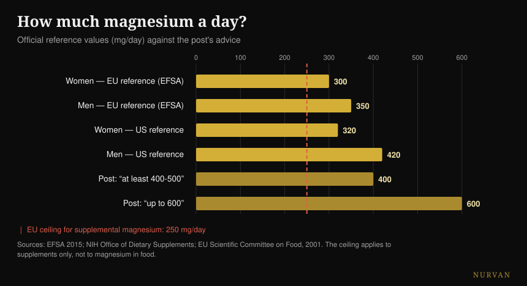
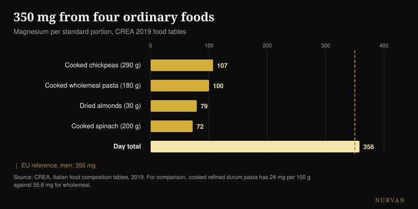

# Which magnesium to take, and how much you need

By [Giammaria Loi](/autore/giammaria-loi) · updated 19 October 2026

A heavily shared carousel lists sixteen things magnesium does, ranks twelve forms with a star score, and closes with a number: 400-500 mg a day, up to 600 for some people. I checked fifteen sources. The list of roles is correct, the ranking of the forms flips over at the exact point where a human study tests it, and the closing number is the most serious problem in the post — because it ignores the one number that is about safety.

## The short version

- **The official reference is not 400-600 mg.** In Europe it is 350 mg a day for men and 300 for women (EFSA, 2015); in the United States 400-420 and 310-320.
- **The cap on magnesium from supplements is 250 mg a day in the EU** and 350 in the US. It applies to the pill only, not to food — and the post never mentions it.
- **In the direct human comparison, citrate beats the amino acid chelate**, which is the reverse of the star ranking. Oxide, on the other hand, is no different from placebo (Walker et al., 2003).
- **For cramps, magnesium does not work.** The Cochrane review says so with high certainty, and for exercise-associated cramps there is not a single trial (Garrison et al., 2020).
- **Four ordinary foods get you to 358 mg** without opening a jar: wholewheat pasta has 2.3 times the magnesium of the refined kind (CREA tables).

## The 600 reactions are real (but they are not a reason to supplement)

Let us start with what the post gets right. Magnesium is the second most abundant cation inside your cells and it is involved in **more than 600 enzymatic reactions**: ATP production, DNA and RNA synthesis, muscle contraction, heart and brain function. The number comes from a heavily cited physiology review and it is correct — with one clarification: the source says 600 *reactions*, the post says 600 *enzymes*. Not the same thing, but the order of magnitude holds.

The problem is the logical jump that list invites. "It is needed for sixteen things" does not mean "you need more of it". A nutrient required by a thousand processes is still required in the amount that is required: past that threshold there is no bonus. It is the same error that makes the benefit lists of any supplement convincing — I wrote about it in the [strength supplement tier list](/en/blog/strength-supplements-tier-list-evidence), where the distance between what a product does inside your body and what it does in the gym is often enormous.

## How much magnesium you actually need

This is where the post gets it wrong, and it gets it wrong on the thing the reader will actually do.

EFSA, in its 2015 opinion on dietary reference values, sets adequate intake at **350 mg a day for adult men and 300 for women**. The US reference body gives 400-420 mg for men and 310-320 for women. The "420-600" on the fourth slide takes the highest value from *one single* band — men over 31 — presents it as the floor for everybody, and then builds a ceiling of 600 on top of it that appears in no recommendation anywhere.

The missing number is the other one. Magnesium **taken as a supplement** has an upper safety limit: **250 mg a day in the European Union** (set in 2001 on the basis of mild diarrhoea, the first unwanted effect that shows up) and 350 mg in the United States. That limit does not apply to magnesium from food, which does not cause this problem: it applies only to capsules and sachets.

*Official references against the advice in the post. The red line is the European cap on magnesium from supplements: it applies to the pill only, not to food. Sources: EFSA 2015; NIH Office of Dietary Supplements; Scientific Committee on Food (EU), 2001.*

In practice: "take 400-600 mg", read by someone who does not track what they eat, becomes "buy a 400 mg capsule", which is above the European cap and close to the American one. The correct sentence is a different one — you need 300-420 mg **in total**, food included, and the supplement covers the gap, not the whole thing.

There is one last detail almost nobody mentions: **magnesium in your blood is a poor indicator** of the magnesium you actually have. Less than 1% of body magnesium sits in serum, and that value correlates weakly with total tissue content. A blood test in the normal range does not prove you are fine, and one just below it does not prove the opposite.

## The ranking of the forms does not hold up

The third slide is the most downloaded and shared part: twelve forms, a "best for" column and an absorption score in stars. Glycinate five stars for sleep and anxiety, citrate four for constipation, oxide just one, Epsom salt three for relaxing baths.

There is one study that puts three of those forms head to head in humans. It is a **randomised double-blind trial in 46 people**, 300 mg of elemental magnesium a day for 60 days, directly comparing amino acid chelate, citrate and oxide. Result: **citrate is the best**, on blood magnesium both after the first dose (p = 0.026) and after two months (p = 0.006), and on salivary magnesium too. Oxide is no different from placebo.

In other words: in the only direct human comparison available, the form the post gives four stars beats the one it gives five. The only star rating that holds up is the low one for oxide.

A later systematic review — 433 studies screened, 14 included — confirms the general picture: inorganic forms tend to be less bioavailable than organic ones, and the percentage absorbed depends on the dose. But the authors' conclusion is far less exciting than the cheat sheet: **all** magnesium supplements maintain physiological levels in healthy people with no pre-existing deficiency.

And the product matters more than the form. A Belgian study tested fifteen commercial products and found a "very wide" variation; the two at the extremes, then tested in thirty people, gave an area under the curve of 6.87 versus 0.31 mM·min. Same mineral, two different boxes, a twentyfold difference.

| What the slide says | What the human studies say |
|---|---|
| Glycinate 5 stars, citrate 4 | In the head-to-head, citrate wins on serum and saliva (Walker 2003) |
| Oxide 1 star | Confirmed: no different from placebo (Walker 2003) |
| "Organic beats inorganic" | True as a trend, but every form maintains levels in people who are not deficient (Pardo 2021) |
| Each form has its own target | No head-to-head between forms on sleep, anxiety, blood pressure or recovery |
| L-threonate for memory and cognition | Two RCTs: one authored by the company that makes the compound, the other on a formula with phosphatidylserine and vitamins |
| Epsom salt, 3 stars for absorption | No human study on absorption through the skin |

L-threonate is worth a pause, because it is the most expensive form on the market. The two human studies do exist, but the first — 44 adults between 50 and 70, with a real cognitive improvement and a large effect — is authored by people from the company that makes the compound, and **the authors themselves write that the effects on sleep and anxiety are not determinable** because the placebo effect was so strong. The second tests a formula that also contains phosphatidylserine, vitamin C and vitamin D: whatever happened, you cannot credit the threonate for it.

## Where the evidence holds and where it does not

**Sleep.** The dedicated meta-analysis finds only three randomised trials, in 151 older adults with insomnia: time to fall asleep drops by **17.36 minutes** (95% CI -27.27 / -7.44). Total sleep time improves by 16 minutes but is not significant, risk of bias is moderate to high, and the quality of the evidence is low to very low. In a broader review of 31 trials of sleep supplements, magnesium **did not have enough data to enter the meta-analysis**, while melatonin, vitamin D and amino acids did. Something is probably there. It is not the pillar it looks like.

**Blood pressure.** This is the best documented effect on the whole list, and also the most modest: 34 double-blind trials in 2,028 people, median dose 368 mg a day for three months, result **-2.00 mmHg systolic and -1.78 diastolic**. Real, measurable, small. If you take blood pressure medication or have kidney problems, this is a conversation for your doctor, not for a carousel.

**Cramps.** Here the post points in the wrong direction. The Cochrane review — 11 trials, 735 people — finds, for nocturnal cramps in adults, a difference of **-0.18 cramps per week** (CI -0.84 / +0.49), and the proportion of people getting at least a 25% reduction is RR 1.04 with **high certainty**: it is the most solid figure in the review, and it says it does not work. Minor adverse effects are more common than with placebo, and diarrhoea shows up in 11-37% of participants. Above all: **there is not a single randomised trial on exercise-associated cramps**. A 2026 review confirms the picture — it works for cramps in pregnancy, not for nocturnal cramps in adults.

**Recovery.** The systematic review on magnesium and post-training muscle soreness starts from 1,254 articles and includes **four**. The authors hypothesise a requirement 10-20% higher in people training hard, which is plausible — but four studies are not a base you can build a five-star rating on.

## What the research actually says

- **Confirmed** — magnesium is involved in more than 600 enzymatic reactions.
- **Confirmed** — the food values on the fourth slide, copied one by one from the official US fact sheet. With one typo: potatoes are 3.5 *ounces*, not 3.5 *cups*.
- **Confirmed but small** — the effect on blood pressure: -2.00 / -1.78 mmHg at 368 mg a day.
- **Needs qualifying** — sleep: -17.36 minutes of onset latency, from three low-quality trials.
- **Refuted** — "most people need 400-500 mg, some 600". The official references are 300-420 mg in total, and the cap for supplements is 250 mg in the EU.
- **Refuted** — the star hierarchy: in the human comparison, citrate beats the amino acid chelate.
- **Refuted** — magnesium for cramps: high certainty that it does not reduce nocturnal cramps, no trial at all on exercise-associated cramps.
- **Not verifiable** — every "best for" column (no comparison between forms on clinical outcomes), the three stars for Epsom salt (no human study on absorption through the skin) and the soil erosion claim (no source).

## How to apply it

**Count what you eat first.** This is not a moral point: magnesium from food has no safety cap and costs less. Four ordinary foods take you past 350 mg.

*Magnesium per standard portion according to the CREA 2019 tables. The dashed line is the European reference for adult men.*

| Food | mg per 100 g | Portion | mg per portion |
|---|---|---|---|
| Sweet almonds, dried | 264 | 30 g | 79 |
| Cashews | 260 | 30 g | 78 |
| Walnuts, dried | 131 | 30 g | 39 |
| Wholewheat durum pasta, cooked | 55.6 | 180 g | 100 |
| Dried chickpeas, cooked | 37 | 290 g | 107 |
| Spinach, cooked, boiled | 36 | 200 g | 72 |
| Durum wheat pasta, cooked | 24 | 200 g | 48 |

*CREA 2019 tables.*

**The most useful detail is the last row.** Cooked wholewheat pasta has 55.6 mg of magnesium per 100 g, the refined kind 24: **2.3 times** as much. If you eat pasta four times a week, switching versions is worth more than any choice between glycinate and taurate.

**If you do supplement, start low.** The literature that shows real effects works around 300-370 mg a day, which is the order of magnitude of the total requirement, not double it. Adding in the food, a 100-200 mg capsule is almost always enough to close the gap, and it stays inside the European cap.

**Pick a soluble form and a product that states elemental magnesium.** Citrate, chloride, lactate and the chelates are all fine; oxide has the worst evidence behind it. More important than the form: the label has to say how much *elemental* magnesium a dose contains, not how many milligrams the salt weighs.

**If you take it for sleep, take it in the evening and give it three weeks.** And keep your expectations low: seventeen minutes less to fall asleep, on weak evidence. I went through the timing of every supplement in detail [in this article on when to take them](/en/blog/when-to-take-supplements-timing).

**If your stools turn loose, you have passed your own threshold.** That is the first signal, and it is exactly the effect the European safety limit is built on.

> ### Magnesium across your day, inside Nurvan
> The point of this article is that the sum is settled at the table, not in a jar. Nurvan's food diary runs on the CREA database — the same values as the table above — so you can see how much magnesium your meals actually deliver before you decide whether and how much to supplement. The supplement section tracks dose, form and timing, and puts them next to the training loads and the sleep of the same weeks. **[Try Nurvan](https://nurvan.app)**

## Frequently asked questions

**Magnesium glycinate or citrate: which is better?**
In the only human study that compares them directly, citrate comes out more bioavailable than the amino acid chelate at 300 mg a day for 60 days. The practical difference between the two organic forms stays small, though, compared with the difference between supplementing and not: in healthy people without a deficiency, all forms maintain levels. The only one to avoid is oxide.

**How much magnesium per day should I take?**
Total requirement, food included, is 350 mg for men and 300 for women according to EFSA (400-420 and 310-320 are the US references). Magnesium taken as a supplement has a separate safety cap: 250 mg a day in the EU, 350 in the US. So the supplement is there to cover the gap between what you eat and what you need, not to cover the whole requirement.

**Does magnesium stop muscle cramps?**
For nocturnal cramps in adults the Cochrane review says no, with high certainty on one of the outcomes. For exercise-associated cramps there is no randomised trial at all, so anyone recommending it for those has no data to stand on. Pregnancy is the exception, where some effect does show up.

**Does magnesium help you sleep better?**
In three trials in older adults with insomnia it cuts the time to fall asleep by about seventeen minutes, but the quality of the evidence is low and total sleep time does not change significantly. In a broader review of sleep supplements, magnesium did not even have enough data to be meta-analysed.

**Does an Epsom salt bath get magnesium into you?**
There is no human study on PubMed measuring it. The only direct measurement of absorption through the skin is in vitro, on pig skin. A hot bath can relax you, but crediting the magnesium crossing your skin has no human basis today.

## Read next

- [Strength supplement tier list: what actually works](/en/blog/strength-supplements-tier-list-evidence)
- [When to take supplements: does the hour matter?](/en/blog/when-to-take-supplements-timing)
- [Caffeine and sleep: when to stop drinking coffee](/en/blog/caffeine-sleep-when-to-stop-coffee)

## Sources

- de Baaij JHF, Hoenderop JGJ, Bindels RJM, 2015. Magnesium in man: implications for health and disease. *Physiological Reviews* 95(1):1-46. [PMID 25540137](https://pubmed.ncbi.nlm.nih.gov/25540137/) · [DOI](https://doi.org/10.1152/physrev.00012.2014)
- EFSA, 2015. *Dietary reference values: magnesium and phosphorus* (28 July 2015). [efsa.europa.eu](https://www.efsa.europa.eu/en/press/news/150728)
- Scientific Committee on Food (EU), 2001. Tolerable upper intake level for magnesium from supplements: 250 mg/day. [BfR reference document](https://www.bfr.bund.de/cm/349/proposed-maximum-levels-for-the-addition-of-magnesium-to-foods-including-food-supplements.pdf)
- NIH Office of Dietary Supplements. *Magnesium — Fact Sheet for Health Professionals*. [ods.od.nih.gov](https://ods.od.nih.gov/factsheets/Magnesium-HealthProfessional/)
- Walker AF, Marakis G, Christie S, Byng M, 2003. Mg citrate found more bioavailable than other Mg preparations in a randomised, double-blind study. *Magnesium Research* 16(3):183-91. [PMID 14596323](https://pubmed.ncbi.nlm.nih.gov/14596323/)
- Pardo MR, Garicano Vilar E, San Mauro Martín I, Camina Martín MA, 2021. Bioavailability of magnesium food supplements: a systematic review. *Nutrition* 89:111294. [PMID 34111673](https://pubmed.ncbi.nlm.nih.gov/34111673/) · [DOI](https://doi.org/10.1016/j.nut.2021.111294)
- Blancquaert L, Vervaet C, Derave W, 2019. Predicting and testing bioavailability of magnesium supplements. *Nutrients* 11(7):1663. [PMID 31330811](https://pubmed.ncbi.nlm.nih.gov/31330811/) · [DOI](https://doi.org/10.3390/nu11071663)
- Mah J, Pitre T, 2021. Oral magnesium supplementation for insomnia in older adults: a systematic review and meta-analysis. *BMC Complementary Medicine and Therapies* 21(1):125. [PMID 33865376](https://pubmed.ncbi.nlm.nih.gov/33865376/) · [DOI](https://doi.org/10.1186/s12906-021-03297-z)
- Chan V, Lo K, 2021. Efficacy of dietary supplements on improving sleep quality: a systematic review and meta-analysis. *Postgraduate Medical Journal* 98(1158):285-293. [PMID 33441476](https://pubmed.ncbi.nlm.nih.gov/33441476/) · [DOI](https://doi.org/10.1136/postgradmedj-2020-139319)
- Zhang X, Li Y, Del Gobbo LC et al., 2016. Effects of magnesium supplementation on blood pressure: a meta-analysis of randomized double-blind placebo-controlled trials. *Hypertension* 68(2):324-33. [PMID 27402922](https://pubmed.ncbi.nlm.nih.gov/27402922/) · [DOI](https://doi.org/10.1161/HYPERTENSIONAHA.116.07664)
- Garrison SR, Korownyk CS, Kolber MR et al., 2020. Magnesium for skeletal muscle cramps. *Cochrane Database of Systematic Reviews* 9:CD009402. [PMID 32956536](https://pubmed.ncbi.nlm.nih.gov/32956536/) · [DOI](https://doi.org/10.1002/14651858.CD009402.pub3)
- Patil S, Falkowski A, Venkataiah VS et al., 2026. The role of electrolytes in muscle pain syndromes: a systematic review and meta-analysis. *International Dental Journal* 76(3):109488. [PMID 41812583](https://pubmed.ncbi.nlm.nih.gov/41812583/) · [DOI](https://doi.org/10.1016/j.identj.2026.109488)
- Tarsitano MG, Quinzi F, Folino K et al., 2024. Effects of magnesium supplementation on muscle soreness in different types of physical activities: a systematic review. *Journal of Translational Medicine* 22(1):629. [PMID 38970118](https://pubmed.ncbi.nlm.nih.gov/38970118/) · [DOI](https://doi.org/10.1186/s12967-024-05434-x)
- Liu G, Weinger JG, Lu ZL, Xue F, Sadeghpour S, 2016. Efficacy and safety of MMFS-01, a synapse density enhancer, for treating cognitive impairment in older adults. *Journal of Alzheimer's Disease* 49(4):971-90. [PMID 26519439](https://pubmed.ncbi.nlm.nih.gov/26519439/) · [DOI](https://doi.org/10.3233/JAD-150538)
- Ghimirey KB, Ita K, 2020. Microneedle-assisted percutaneous transport of magnesium sulfate. *Current Drug Delivery* 17(2):140-147. [PMID 31845631](https://pubmed.ncbi.nlm.nih.gov/31845631/) · [DOI](https://doi.org/10.2174/1567201817666191217093936)
- CREA — Research Centre for Food and Nutrition, *Italian food composition tables*, 2019 update. [alimentinutrizione.it](https://www.alimentinutrizione.it/tabelle-nutrizionali/ricerca-per-ordine-alfabetico)

*Prompted by the carousel from Siim Land ([@siimland](https://www.instagram.com/siimland/)) of 30 September 2026, [this post](https://www.instagram.com/p/Dd7HfSdgKyl/). No text and no image from the post has been reproduced: we read its claims and checked them against the literature.*

---

**Giammaria Loi** is the founder of Nurvan. He has been lifting since 2012, has worked as a FIPE-certified personal trainer and coach since 2013, and has competed in powerlifting at national level since 2018. Every article he writes starts from the research and ends with what actually works in the gym.

> Note: this is informational content and does not replace advice from a doctor or qualified professional. Magnesium can interact with some medications and its clearance depends on kidney function: if you are on any treatment, if you have kidney or heart problems, or if you are pregnant, speak to your doctor before supplementing.
