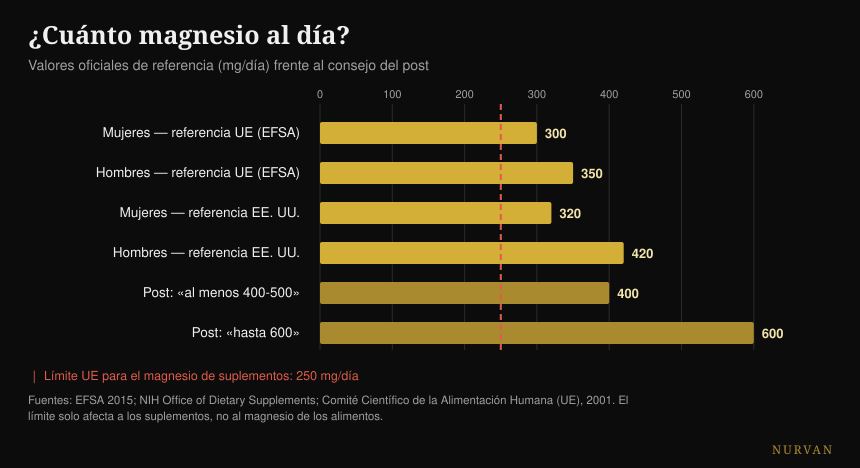
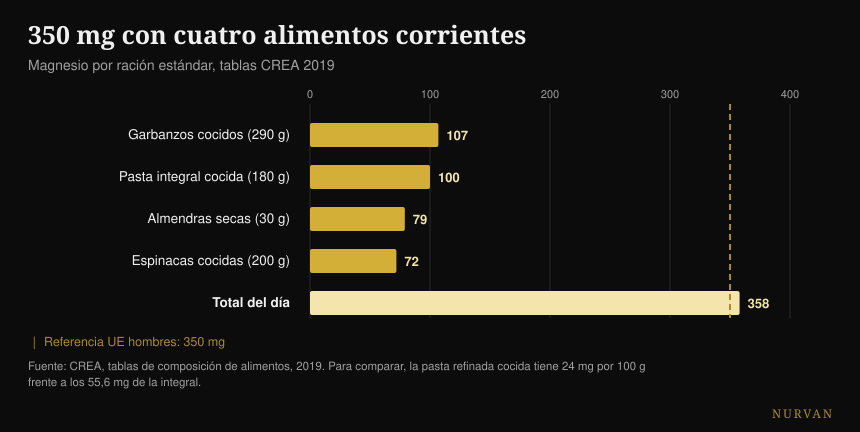

# ¿Qué magnesio elegir y cuánto hace falta?

Por [Giammaria Loi](/autore/giammaria-loi) · actualizado el 19 de octubre de 2026

Un carrusel muy compartido enumera dieciséis cosas que hace el magnesio, ordena doce formas con una puntuación de estrellas y cierra con una cifra: 400-500 mg al día, hasta 600 para algunos. He revisado quince fuentes. La lista de funciones es correcta, la clasificación de las formas se da la vuelta justo donde existe un estudio humano que la comprueba, y la cifra final es el problema más grave del post, porque ignora el único número que tiene que ver con la seguridad.

## En resumen

- **La referencia oficial no es 400-600 mg.** En Europa son 350 mg al día para los hombres y 300 para las mujeres (EFSA, 2015); en Estados Unidos 400-420 y 310-320.
- **El tope del magnesio procedente de suplementos es de 250 mg al día en la UE** y 350 en EE. UU. Afecta solo a la pastilla, no a la comida, y el post no lo menciona nunca.
- **En la comparación humana directa el citrato gana al quelato de aminoácidos**, es decir lo contrario de la clasificación de estrellas. El óxido, en cambio, no se distingue del placebo (Walker et al., 2003).
- **Para los calambres el magnesio no funciona.** La revisión Cochrane lo dice con certeza alta, y de calambres por ejercicio no existe ni un solo estudio (Garrison et al., 2020).
- **Con cuatro alimentos corrientes se llega a 358 mg** sin abrir un bote: la pasta integral tiene 2,3 veces el magnesio de la refinada (tablas CREA).

## Las 600 reacciones son ciertas (pero no son un motivo para suplementar)

Empecemos por lo que el post acierta. El magnesio es el segundo catión más abundante dentro de las células y participa en **más de 600 reacciones enzimáticas**: producción de ATP, síntesis de ADN y ARN, contracción muscular, función del corazón y del cerebro. La cifra viene de una revisión de fisiología muy citada y es correcta, con una precisión: la fuente habla de 600 *reacciones*, el post de 600 *enzimas*. No es lo mismo, pero el orden de magnitud se sostiene.

El problema es el salto lógico al que invita esa lista. "Sirve para dieciséis cosas" no significa "hace falta más". Un nutriente necesario para mil procesos sigue siendo necesario en la cantidad en la que hace falta: por encima de ese umbral no hay bonus. Es el mismo error que hace convincentes las listas de beneficios de cualquier suplemento, y lo conté también en la [clasificación de suplementos para la fuerza](/es/blog/clasificacion-suplementos-fuerza-tier-list), donde la distancia entre lo que hace un producto en el cuerpo y lo que hace en el gimnasio suele ser enorme.

## Cuánto magnesio hace falta de verdad

Aquí el post se equivoca, y se equivoca en lo que el lector va a hacer de verdad.

La EFSA, en su dictamen de 2015 sobre los valores dietéticos de referencia, fija la ingesta adecuada en **350 mg al día para los hombres adultos y 300 para las mujeres**. El organismo de referencia estadounidense indica 400-420 mg para los hombres y 310-320 para las mujeres. El "420-600" de la cuarta diapositiva coge el valor más alto de *una sola* franja —hombres de más de 31 años— y lo presenta como el mínimo para todos; luego construye encima un techo de 600 que no aparece en ninguna recomendación.

El número que falta es el otro. El magnesio **tomado como suplemento** tiene un límite superior de seguridad: **250 mg al día en la Unión Europea** (fijado en 2001 a partir de la diarrea leve, el primer efecto indeseado que aparece) y 350 mg en Estados Unidos. Ese límite no afecta al magnesio de los alimentos, que no da este problema: afecta solo a las cápsulas y los sobres.

*Referencias oficiales frente al consejo del post. La línea roja es el tope europeo para el magnesio de suplementos: vale solo para la pastilla, no para la comida. Fuentes: EFSA 2015; NIH Office of Dietary Supplements; Comité Científico de la Alimentación Humana (UE), 2001.*

Traducido a la práctica: "toma 400-600 mg", leído por quien no controla lo que come, se convierte en "compra una cápsula de 400 mg", que está por encima del tope europeo y cerca del estadounidense. La frase correcta es otra: hacen falta 300-420 mg **en total**, comida incluida, y el suplemento cubre la diferencia, no el total.

Hay un último detalle que casi nadie cuenta: el **magnesio en sangre es un indicador malo** del magnesio que tienes de verdad. Menos del 1% del magnesio corporal está en el suero y ese valor correlaciona poco con el contenido total de los tejidos. Un análisis de sangre normal no demuestra que estés bien, y uno justo por debajo no demuestra lo contrario.

## La clasificación de las formas no se sostiene

La tercera diapositiva es la parte más descargada y compartida: doce formas, una columna "ideal para" y una puntuación de absorción en estrellas. Glicinato cinco estrellas para el sueño y la ansiedad, citrato cuatro para el estreñimiento, óxido solo una, sal de Epsom tres para los baños relajantes.

Existe un estudio que enfrenta tres de esas formas entre sí en humanos. Es un **ensayo aleatorizado a doble ciego en 46 personas**, 300 mg de magnesio elemental al día durante 60 días, con comparación directa entre quelato de aminoácidos, citrato y óxido. Resultado: **el citrato es el mejor**, en el magnesio sanguíneo tanto tras la primera dosis (p = 0,026) como a los dos meses (p = 0,006), y también en el magnesio salival. El óxido no se distingue del placebo.

Es decir: en la única comparación humana directa disponible, la forma a la que el post da cuatro estrellas gana a la que le da cinco. La única estrella que se sostiene es la baja del óxido.

Una revisión sistemática posterior —433 estudios examinados, 14 incluidos— confirma el cuadro general: las formas inorgánicas tienden a ser menos biodisponibles que las orgánicas y el porcentaje absorbido depende de la dosis. Pero la conclusión de los autores es mucho menos emocionante que la chuleta: **todos** los suplementos de magnesio mantienen los niveles fisiológicos en personas sanas sin una carencia previa.

Y cuenta más el producto que la forma. Un estudio belga probó quince productos comerciales y encontró una variación "muy amplia"; los dos de los extremos, probados después en treinta personas, dieron un área bajo la curva de 6,87 frente a 0,31 mM·min. El mismo mineral, dos envases distintos, un factor veinte de diferencia.

| Lo que dice la diapositiva | Lo que dicen los estudios en humanos |
|---|---|
| Glicinato 5 estrellas, citrato 4 | En la comparación directa el citrato gana en sérico y salival (Walker 2003) |
| Óxido 1 estrella | Confirmado: no se distingue del placebo (Walker 2003) |
| "Orgánico mejor que inorgánico" | Cierto como tendencia, pero todas las formas mantienen los niveles en quien no tiene carencia (Pardo 2021) |
| Cada forma tiene su objetivo | Ninguna comparación cara a cara entre formas sobre sueño, ansiedad, presión o recuperación |
| L-treonato para la memoria y la cognición | Dos ensayos: uno firmado por la empresa del producto, el otro sobre una fórmula con fosfatidilserina y vitaminas |
| Sal de Epsom, 3 estrellas de absorción | Ningún estudio humano sobre la absorción a través de la piel |

Sobre el L-treonato vale la pena pararse un momento, porque es la forma más cara del mercado. Los dos estudios humanos existen de verdad, pero el primero —44 adultos de entre 50 y 70 años, con una mejora cognitiva real y un efecto grande— está firmado por autores de la empresa que fabrica el compuesto, y **los propios autores escriben que los efectos sobre el sueño y la ansiedad no son determinables** por lo fuerte que fue el efecto placebo. El segundo prueba una fórmula que contiene también fosfatidilserina, vitamina C y vitamina D: pasara lo que pasara, no puedes atribuirlo al treonato.

## Dónde aguantan las pruebas y dónde no

**El sueño.** El metaanálisis dedicado encuentra solo tres estudios aleatorizados, en 151 mayores con insomnio: la latencia para dormirse baja **17,36 minutos** (IC 95% -27,27 / -7,44). El tiempo total de sueño mejora 16 minutos pero no es significativo, el riesgo de sesgo va de moderado a alto y la calidad de las pruebas de baja a muy baja. En una revisión más amplia sobre 31 estudios de suplementos para el sueño, el magnesio **no tenía datos suficientes para entrar en el metaanálisis**, mientras que melatonina, vitamina D y aminoácidos sí entraron. Algo hay, probablemente. No es el pilar que parece.

**La presión.** Es el efecto mejor documentado de toda la lista y también el más modesto: 34 estudios a doble ciego en 2.028 personas, dosis mediana 368 mg al día durante tres meses, resultado **-2,00 mmHg de sistólica y -1,78 de diastólica**. Real, medible, pequeño. Si tomas fármacos para la presión o tienes problemas renales, esta es una conversación para tu médico, no para un carrusel.

**Los calambres.** Aquí el post apunta en la dirección equivocada. La revisión Cochrane —11 estudios, 735 personas— encuentra en los calambres nocturnos de los adultos una diferencia de **-0,18 calambres por semana** (IC -0,84 / +0,49), y la proporción de quienes consiguen al menos un 25% de reducción es RR 1,04 con **certeza alta**: es el dato más sólido de la revisión, y dice que no funciona. Los efectos adversos menores son más frecuentes que con el placebo y la diarrea aparece en el 11-37% de los participantes. Y sobre todo: **no existe ni un solo estudio aleatorizado sobre los calambres por ejercicio**. Una revisión de 2026 confirma el cuadro: funciona en los calambres del embarazo, no en los nocturnos de los adultos.

**La recuperación.** La revisión sistemática sobre el magnesio y las agujetas posentrenamiento parte de 1.254 artículos e incluye **cuatro**. Los autores plantean la hipótesis de una necesidad un 10-20% más alta en quien entrena intenso, lo cual es plausible, pero cuatro estudios no son una base sobre la que construir una estrella de cinco.

## Qué dice de verdad la investigación

- **Confirmado**: el magnesio participa en más de 600 reacciones enzimáticas.
- **Confirmados**: los valores de los alimentos de la cuarta diapositiva, copiados uno a uno de la ficha oficial estadounidense. Con una errata: las patatas son 3,5 *onzas*, no 3,5 *cup*.
- **Confirmado pero pequeño**: el efecto sobre la presión, -2,00 / -1,78 mmHg a 368 mg al día.
- **Por matizar**: el sueño, -17,36 minutos de latencia, sobre tres estudios de calidad baja.
- **Desmentido**: "la mayoría de la gente necesita 400-500 mg, algunos 600". Las referencias oficiales son 300-420 mg totales, y el tope para los suplementos es de 250 mg en la UE.
- **Desmentida**: la jerarquía de estrellas; en la comparación humana el citrato gana al quelato de aminoácidos.
- **Desmentido**: el magnesio para los calambres; certeza alta de que no reduce los calambres nocturnos, ningún estudio sobre los calambres por ejercicio.
- **No verificables**: todas las columnas "ideal para" (ninguna comparación entre formas sobre desenlaces clínicos), las tres estrellas de la sal de Epsom (ningún estudio humano sobre la absorción cutánea) y la erosión del suelo (ninguna fuente).

## Cómo aplicarlo

**Primero cuenta lo que comes.** No es un consejo moral: es que el magnesio de los alimentos no tiene tope de seguridad y cuesta menos. Con cuatro alimentos corrientes se superan los 350 mg.

*Magnesio por ración estándar según las tablas CREA 2019. La línea discontinua es la referencia europea para los hombres adultos.*

| Alimento | mg por 100 g | Ración | mg por ración |
|---|---|---|---|
| Almendras dulces, secas | 264 | 30 g | 79 |
| Anacardos | 260 | 30 g | 78 |
| Nueces, secas | 131 | 30 g | 39 |
| Pasta de sémola integral, cocida | 55,6 | 180 g | 100 |
| Garbanzos secos, cocidos | 37 | 290 g | 107 |
| Espinacas, cocidas, hervidas | 36 | 200 g | 72 |
| Pasta de sémola, cocida | 24 | 200 g | 48 |

*Tablas CREA 2019.*

**El detalle más útil es la última fila.** La pasta integral cocida tiene 55,6 mg de magnesio por 100 g, la refinada 24: **2,3 veces**. Si comes pasta cuatro veces a la semana, cambiar de versión vale más que cualquier elección entre bisglicinato y taurato.

**Si suplementas, empieza por una dosis baja.** La literatura que muestra efectos reales trabaja alrededor de 300-370 mg al día, es decir en el orden de magnitud de la necesidad total, no del doble. Sumando la comida, una cápsula de 100-200 mg casi siempre basta para cerrar la cuenta y se queda dentro del tope europeo.

**Elige una forma soluble y un producto que declare el magnesio elemental.** Citrato, cloruro, lactato y los quelatos van bien; el óxido es el que tiene la peor base. Más importante que la forma: en la etiqueta tiene que estar cuánto magnesio *elemental* contiene una dosis, no cuántos miligramos pesa la sal.

**Si lo tomas para dormir, dalo por la noche y dale tres semanas.** Y mantén bajas las expectativas: diecisiete minutos menos para dormirte, sobre pruebas débiles. El momento en el que tomar cada suplemento lo analicé en detalle [en este artículo sobre el horario de toma](/es/blog/cuando-tomar-los-suplementos-horario).

**Si aparecen heces blandas, has pasado tu umbral.** Es la primera señal, y es justo el efecto sobre el que está construido el límite de seguridad europeo.

> ### El magnesio en tu día, dentro de Nurvan
> La idea de este artículo es que la cuenta se cierra en la mesa, no en el bote. El diario alimentario de Nurvan trabaja sobre la base de datos CREA —los mismos valores de la tabla de arriba—, así que ves cuánto magnesio llega de verdad de tus comidas antes de decidir si suplementar y cuánto. La sección de suplementación registra dosis, forma y horario, y las pone al lado de las cargas y del sueño de esas mismas semanas. **[Prueba Nurvan](https://nurvan.app)**

## Preguntas frecuentes

**¿Mejor el magnesio bisglicinato o el citrato?**
En el único estudio humano que los compara directamente, el citrato resulta más biodisponible que el quelato de aminoácidos a 300 mg al día durante 60 días. La diferencia práctica entre las dos formas orgánicas sigue siendo pequeña, eso sí, comparada con la diferencia entre suplementar y no hacerlo: en personas sanas sin carencia, todas las formas mantienen los niveles. La única que hay que evitar es el óxido.

**¿Cuánto magnesio al día tengo que tomar?**
La necesidad total, comida incluida, es de 350 mg para los hombres y 300 para las mujeres según la EFSA (400-420 y 310-320 las referencias estadounidenses). El magnesio tomado como suplemento tiene un tope de seguridad aparte: 250 mg al día en la UE, 350 en EE. UU. Así que el suplemento sirve para cubrir la diferencia entre lo que comes y la necesidad, no para cubrir la necesidad entera.

**¿El magnesio quita los calambres?**
En los calambres nocturnos de los adultos la revisión Cochrane dice que no, con certeza alta en uno de los desenlaces. Sobre los calambres por ejercicio no existe ningún estudio aleatorizado, así que quien te lo recomienda para esos no tiene datos en los que apoyarse. La excepción es el embarazo, donde sí se ve algún efecto.

**¿El magnesio hace dormir mejor?**
En tres estudios en mayores con insomnio reduce unos diecisiete minutos el tiempo para dormirse, pero la calidad de las pruebas es baja y el tiempo total de sueño no cambia de forma significativa. En una revisión más amplia sobre suplementos para el sueño, el magnesio no tenía ni datos suficientes para ser metaanalizado.

**¿Un baño con sales de Epsom hace absorber magnesio?**
En PubMed no existe un estudio en humanos que lo mida. La única medida directa de la absorción a través de la piel es in vitro, en piel de cerdo. El baño caliente puede relajar, pero atribuir el mérito al magnesio que atraviesa la piel no tiene hoy una base humana.

## Lee también

- [Clasificación de suplementos para la fuerza: qué funciona de verdad](/es/blog/clasificacion-suplementos-fuerza-tier-list)
- [Cuándo tomar los suplementos: ¿cuenta la hora?](/es/blog/cuando-tomar-los-suplementos-horario)
- [Cafeína y sueño: a qué hora dejar el café](/es/blog/cafeina-sueno-cuando-dejar-el-cafe)

## Fuentes

- de Baaij JHF, Hoenderop JGJ, Bindels RJM, 2015. Magnesium in man: implications for health and disease. *Physiological Reviews* 95(1):1-46. [PMID 25540137](https://pubmed.ncbi.nlm.nih.gov/25540137/) · [DOI](https://doi.org/10.1152/physrev.00012.2014)
- EFSA, 2015. *Dietary reference values: magnesium and phosphorus* (28 de julio de 2015). [efsa.europa.eu](https://www.efsa.europa.eu/en/press/news/150728)
- Comité Científico de la Alimentación Humana (UE), 2001. Nivel máximo tolerable de ingesta para el magnesio de suplementos: 250 mg/día. [Documento de referencia del BfR](https://www.bfr.bund.de/cm/349/proposed-maximum-levels-for-the-addition-of-magnesium-to-foods-including-food-supplements.pdf)
- NIH Office of Dietary Supplements. *Magnesium — Fact Sheet for Health Professionals*. [ods.od.nih.gov](https://ods.od.nih.gov/factsheets/Magnesium-HealthProfessional/)
- Walker AF, Marakis G, Christie S, Byng M, 2003. Mg citrate found more bioavailable than other Mg preparations in a randomised, double-blind study. *Magnesium Research* 16(3):183-91. [PMID 14596323](https://pubmed.ncbi.nlm.nih.gov/14596323/)
- Pardo MR, Garicano Vilar E, San Mauro Martín I, Camina Martín MA, 2021. Bioavailability of magnesium food supplements: a systematic review. *Nutrition* 89:111294. [PMID 34111673](https://pubmed.ncbi.nlm.nih.gov/34111673/) · [DOI](https://doi.org/10.1016/j.nut.2021.111294)
- Blancquaert L, Vervaet C, Derave W, 2019. Predicting and testing bioavailability of magnesium supplements. *Nutrients* 11(7):1663. [PMID 31330811](https://pubmed.ncbi.nlm.nih.gov/31330811/) · [DOI](https://doi.org/10.3390/nu11071663)
- Mah J, Pitre T, 2021. Oral magnesium supplementation for insomnia in older adults: a systematic review and meta-analysis. *BMC Complementary Medicine and Therapies* 21(1):125. [PMID 33865376](https://pubmed.ncbi.nlm.nih.gov/33865376/) · [DOI](https://doi.org/10.1186/s12906-021-03297-z)
- Chan V, Lo K, 2021. Efficacy of dietary supplements on improving sleep quality: a systematic review and meta-analysis. *Postgraduate Medical Journal* 98(1158):285-293. [PMID 33441476](https://pubmed.ncbi.nlm.nih.gov/33441476/) · [DOI](https://doi.org/10.1136/postgradmedj-2020-139319)
- Zhang X, Li Y, Del Gobbo LC et al., 2016. Effects of magnesium supplementation on blood pressure: a meta-analysis of randomized double-blind placebo-controlled trials. *Hypertension* 68(2):324-33. [PMID 27402922](https://pubmed.ncbi.nlm.nih.gov/27402922/) · [DOI](https://doi.org/10.1161/HYPERTENSIONAHA.116.07664)
- Garrison SR, Korownyk CS, Kolber MR et al., 2020. Magnesium for skeletal muscle cramps. *Cochrane Database of Systematic Reviews* 9:CD009402. [PMID 32956536](https://pubmed.ncbi.nlm.nih.gov/32956536/) · [DOI](https://doi.org/10.1002/14651858.CD009402.pub3)
- Patil S, Falkowski A, Venkataiah VS et al., 2026. The role of electrolytes in muscle pain syndromes: a systematic review and meta-analysis. *International Dental Journal* 76(3):109488. [PMID 41812583](https://pubmed.ncbi.nlm.nih.gov/41812583/) · [DOI](https://doi.org/10.1016/j.identj.2026.109488)
- Tarsitano MG, Quinzi F, Folino K et al., 2024. Effects of magnesium supplementation on muscle soreness in different types of physical activities: a systematic review. *Journal of Translational Medicine* 22(1):629. [PMID 38970118](https://pubmed.ncbi.nlm.nih.gov/38970118/) · [DOI](https://doi.org/10.1186/s12967-024-05434-x)
- Liu G, Weinger JG, Lu ZL, Xue F, Sadeghpour S, 2016. Efficacy and safety of MMFS-01, a synapse density enhancer, for treating cognitive impairment in older adults. *Journal of Alzheimer's Disease* 49(4):971-90. [PMID 26519439](https://pubmed.ncbi.nlm.nih.gov/26519439/) · [DOI](https://doi.org/10.3233/JAD-150538)
- Ghimirey KB, Ita K, 2020. Microneedle-assisted percutaneous transport of magnesium sulfate. *Current Drug Delivery* 17(2):140-147. [PMID 31845631](https://pubmed.ncbi.nlm.nih.gov/31845631/) · [DOI](https://doi.org/10.2174/1567201817666191217093936)
- CREA — Centro de investigación de Alimentos y Nutrición, *tablas italianas de composición de alimentos*, actualización 2019. [alimentinutrizione.it](https://www.alimentinutrizione.it/tabelle-nutrizionali/ricerca-per-ordine-alfabetico)

*Punto de partida: el carrusel de Siim Land ([@siimland](https://www.instagram.com/siimland/)) del 30 de septiembre de 2026, [este post](https://www.instagram.com/p/Dd7HfSdgKyl/). No se ha reproducido ningún texto ni ninguna imagen del post: hemos leído sus afirmaciones y las hemos verificado en la literatura.*

---

**Giammaria Loi** es el fundador de Nurvan. Entrena con pesas desde 2012, trabaja como entrenador personal y coach certificado FIPE desde 2013 y compite en powerlifting a nivel nacional desde 2018. Cada artículo que firma parte de los estudios científicos y llega a lo que funciona de verdad en el gimnasio.

> Nota: contenido informativo, no sustituye la opinión de un médico ni de un profesional cualificado. El magnesio puede interactuar con algunos fármacos y su eliminación depende de la función renal: si tomas tratamientos, si tienes problemas de riñón o de corazón, o si estás embarazada, háblalo con tu médico antes de suplementar.
