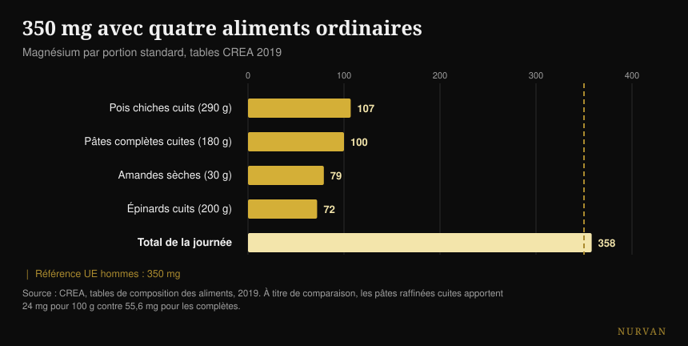

# Quel magnésium choisir et quelle dose

Par [Giammaria Loi](/autore/giammaria-loi) · mis à jour le 19 octobre 2026

Un carrousel très partagé énumère seize choses que fait le magnésium, classe douze formes avec un score en étoiles et termine sur un chiffre : 400-500 mg par jour, jusqu'à 600 pour certains. J'ai vérifié quinze sources. La liste des rôles est correcte, le classement des formes s'inverse à l'endroit exact où une étude humaine le teste, et le chiffre final est le problème le plus sérieux du post — parce qu'il ignore le seul nombre qui concerne la sécurité.

## En bref

- **La référence officielle n'est pas 400-600 mg.** En Europe, c'est 350 mg par jour pour les hommes et 300 pour les femmes (EFSA, 2015) ; aux États-Unis 400-420 et 310-320.
- **Le plafond du magnésium issu des compléments est de 250 mg par jour dans l'UE** et de 350 aux États-Unis. Il ne concerne que la gélule, pas l'alimentation — et le post ne le nomme jamais.
- **Dans la comparaison humaine directe, le citrate bat le chélate d'acides aminés**, soit l'inverse du classement en étoiles. L'oxyde, lui, ne se distingue pas du placebo (Walker et al., 2003).
- **Sur les crampes, le magnésium ne marche pas.** La revue Cochrane le dit avec un niveau de certitude élevé, et sur les crampes liées à l'exercice il n'existe pas une seule étude (Garrison et al., 2020).
- **Avec quatre aliments ordinaires, on arrive à 358 mg** sans ouvrir un pot : les pâtes complètes en contiennent 2,3 fois plus que les raffinées (tables CREA).

## Les 600 réactions sont vraies (mais ce n'est pas une raison de se complémenter)

Commençons par ce que le post réussit. Le magnésium est le deuxième cation le plus abondant à l'intérieur des cellules et il intervient dans **plus de 600 réactions enzymatiques** : production d'ATP, synthèse de l'ADN et de l'ARN, contraction musculaire, fonction du cœur et du cerveau. Le chiffre vient d'une revue de physiologie très citée et il est correct — avec une précision : la source parle de 600 *réactions*, le post de 600 *enzymes*. Ce n'est pas la même chose, mais l'ordre de grandeur tient.

Le problème, c'est le saut logique auquel cette liste invite. « Il sert à seize choses » ne veut pas dire « il en faut davantage ». Un nutriment nécessaire à mille processus reste nécessaire dans la quantité où il est nécessaire : au-delà de ce seuil, il n'y a pas de bonus. C'est la même erreur qui rend convaincantes les listes de bénéfices de n'importe quel complément — j'en ai parlé aussi dans le [classement des compléments pour la force](/fr/blog/classement-complements-force-tier-list), où l'écart entre ce qu'un produit fait dans le corps et ce qu'il fait en salle est souvent énorme.

## Combien de magnésium il faut vraiment

C'est là que le post se trompe, et il se trompe sur ce que le lecteur va réellement faire.

L'EFSA, dans son avis de 2015 sur les valeurs nutritionnelles de référence, fixe l'apport adéquat à **350 mg par jour pour les hommes adultes et 300 pour les femmes**. L'organisme de référence américain indique 400-420 mg pour les hommes et 310-320 pour les femmes. Le « 420-600 » de la quatrième diapositive prend la valeur la plus haute d'*une seule* tranche — les hommes de plus de 31 ans — la présente comme le minimum pour tout le monde, puis construit par-dessus un plafond de 600 qui n'apparaît dans aucune recommandation.

Le nombre qui manque est l'autre. Le magnésium **pris sous forme de complément** a une limite supérieure de sécurité : **250 mg par jour dans l'Union européenne** (fixée en 2001 sur la base de la diarrhée légère, le premier effet indésirable qui apparaît) et 350 mg aux États-Unis. Cette limite ne concerne pas le magnésium des aliments, qui ne pose pas ce problème : elle ne concerne que les gélules et les sachets.

*Références officielles contre le conseil du post. La ligne rouge est le plafond européen pour le magnésium issu des compléments : il ne vaut que pour la gélule, pas pour l'alimentation. Sources : EFSA 2015 ; NIH Office of Dietary Supplements ; Comité scientifique de l'alimentation humaine (UE), 2001.*

Traduit en pratique : « prends 400-600 mg », lu par quelqu'un qui ne contrôle pas ce qu'il mange, devient « achète une gélule de 400 mg », ce qui est au-dessus du plafond européen et proche de l'américain. La bonne phrase est une autre — il faut 300-420 mg **en tout**, alimentation comprise, et le complément couvre la différence, pas le total.

Il y a un dernier détail que presque personne ne dit : le **magnésium sanguin est un mauvais indicateur** du magnésium que tu as vraiment. Moins de 1 % du magnésium corporel se trouve dans le sérum et cette valeur corrèle peu avec le contenu total des tissus. Une prise de sang dans la norme ne prouve pas que tout va bien, et une juste en dessous ne prouve pas le contraire.

## Le classement des formes ne tient pas

La troisième diapositive est la partie la plus téléchargée et partagée : douze formes, une colonne « idéal pour » et un score d'absorption en étoiles. Glycinate cinq étoiles pour le sommeil et l'anxiété, citrate quatre pour la constipation, oxyde une seule, sel d'Epsom trois pour les bains relaxants.

Il existe une étude qui met trois de ces formes face à face chez l'humain. C'est un **essai randomisé en double aveugle sur 46 personnes**, 300 mg de magnésium élément par jour pendant 60 jours, avec comparaison directe entre chélate d'acides aminés, citrate et oxyde. Résultat : **le citrate est le meilleur**, sur le magnésium sanguin aussi bien après la première dose (p = 0,026) qu'après deux mois (p = 0,006), et aussi sur le magnésium salivaire. L'oxyde ne se distingue pas du placebo.

Autrement dit : dans la seule comparaison humaine directe disponible, la forme à laquelle le post donne quatre étoiles bat celle à laquelle il en donne cinq. La seule étoile qui tient est la note basse de l'oxyde.

Une revue systématique postérieure — 433 études examinées, 14 incluses — confirme le tableau général : les formes inorganiques tendent à être moins biodisponibles que les organiques et le pourcentage absorbé dépend de la dose. Mais la conclusion des auteurs est beaucoup moins excitante que l'aide-mémoire : **tous** les compléments de magnésium maintiennent les niveaux physiologiques chez des personnes saines sans carence préexistante.

Et le produit compte plus que la forme. Une étude belge a testé quinze produits du commerce et trouvé une variation « très large » ; les deux situés aux extrêmes, ensuite testés sur trente personnes, ont donné une aire sous la courbe de 6,87 contre 0,31 mM·min. Le même minéral, deux boîtes différentes, un facteur vingt d'écart.

| Ce que dit la diapositive | Ce que disent les études chez l'humain |
|---|---|
| Glycinate 5 étoiles, citrate 4 | Dans la comparaison directe, le citrate gagne sur le sérique et le salivaire (Walker 2003) |
| Oxyde 1 étoile | Confirmé : ne se distingue pas du placebo (Walker 2003) |
| « Organique mieux qu'inorganique » | Vrai comme tendance, mais toutes les formes maintiennent les niveaux chez qui n'est pas carencé (Pardo 2021) |
| Chaque forme a son objectif | Aucune comparaison face à face entre formes sur le sommeil, l'anxiété, la tension ou la récupération |
| L-thréonate pour la mémoire et la cognition | Deux essais : l'un signé par l'entreprise du produit, l'autre sur une formule avec phosphatidylsérine et vitamines |
| Sel d'Epsom, 3 étoiles d'absorption | Aucune étude humaine sur l'absorption à travers la peau |

Sur le L-thréonate, il vaut la peine de s'arrêter un instant, car c'est la forme la plus chère du marché. Les deux études humaines existent bel et bien, mais la première — 44 adultes entre 50 et 70 ans, avec une amélioration cognitive réelle et un effet important — est signée par des auteurs de l'entreprise qui produit le composé, et **les auteurs eux-mêmes écrivent que les effets sur le sommeil et l'anxiété ne sont pas déterminables** tant l'effet placebo était fort. La seconde teste une formule qui contient aussi de la phosphatidylsérine, de la vitamine C et de la vitamine D : quoi qu'il se soit passé, tu ne peux pas l'attribuer au thréonate.

## Où les preuves tiennent et où elles ne tiennent pas

**Le sommeil.** La méta-analyse dédiée ne trouve que trois essais randomisés, sur 151 personnes âgées insomniaques : la latence d'endormissement baisse de **17,36 minutes** (IC 95 % -27,27 / -7,44). Le temps de sommeil total s'améliore de 16 minutes mais ce n'est pas significatif, le risque de biais va de modéré à élevé et la qualité des preuves de faible à très faible. Dans une revue plus large sur 31 études de compléments pour le sommeil, le magnésium **n'avait pas assez de données pour entrer dans la méta-analyse**, alors que mélatonine, vitamine D et acides aminés y sont entrés. Il y a quelque chose, probablement. Ce n'est pas le pilier qu'il semble être.

**La tension.** C'est l'effet le mieux documenté de toute la liste, et aussi le plus modeste : 34 études en double aveugle sur 2 028 personnes, dose médiane 368 mg par jour pendant trois mois, résultat **-2,00 mmHg de systolique et -1,78 de diastolique**. Réel, mesurable, petit. Si tu prends des médicaments pour la tension ou si tu as des problèmes rénaux, c'est une conversation à avoir avec ton médecin, pas avec un carrousel.

**Les crampes.** Ici le post se trompe de direction. La revue Cochrane — 11 études, 735 personnes — trouve, sur les crampes nocturnes de l'adulte, une différence de **-0,18 crampe par semaine** (IC -0,84 / +0,49), et la proportion de ceux qui obtiennent au moins 25 % de réduction est de RR 1,04 avec un **niveau de certitude élevé** : c'est la donnée la plus solide de la revue, et elle dit que ça ne marche pas. Les effets indésirables mineurs sont plus fréquents qu'avec le placebo et la diarrhée apparaît chez 11-37 % des participants. Et surtout : **il n'existe pas un seul essai randomisé sur les crampes liées à l'exercice**. Une revue de 2026 confirme le tableau — ça marche sur les crampes de la grossesse, pas sur les crampes nocturnes de l'adulte.

**La récupération.** La revue systématique sur le magnésium et les courbatures post-entraînement part de 1 254 articles et en inclut **quatre**. Les auteurs émettent l'hypothèse d'un besoin 10-20 % plus élevé chez qui s'entraîne intensément, ce qui est plausible — mais quatre études ne sont pas une base sur laquelle on construit une étoile sur cinq.

## Ce que dit vraiment la recherche

- **Confirmé** — le magnésium intervient dans plus de 600 réactions enzymatiques.
- **Confirmés** — les valeurs des aliments de la quatrième diapositive, copiées une à une de la fiche officielle américaine. Avec une coquille : les pommes de terre font 3,5 *onces*, pas 3,5 *cup*.
- **Confirmé mais petit** — l'effet sur la tension : -2,00 / -1,78 mmHg à 368 mg par jour.
- **À préciser** — le sommeil : -17,36 minutes de latence, sur trois études de faible qualité.
- **Démenti** — « la plupart des gens ont besoin de 400-500 mg, certains de 600 ». Les références officielles sont de 300-420 mg au total, et le plafond pour les compléments est de 250 mg dans l'UE.
- **Démentie** — la hiérarchie en étoiles : dans la comparaison humaine, le citrate bat le chélate d'acides aminés.
- **Démenti** — le magnésium pour les crampes : niveau de certitude élevé qu'il ne réduit pas les crampes nocturnes, aucune étude sur les crampes liées à l'exercice.
- **Non vérifiables** — toutes les colonnes « idéal pour » (aucune comparaison entre formes sur des critères cliniques), les trois étoiles du sel d'Epsom (aucune étude humaine sur l'absorption cutanée) et l'érosion des sols (aucune source).

## Comment l'appliquer

**Commence par compter ce que tu manges.** Ce n'est pas un conseil moral : le magnésium alimentaire n'a pas de plafond de sécurité et il coûte moins cher. Avec quatre aliments ordinaires, on dépasse les 350 mg.

*Magnésium par portion standard d'après les tables CREA 2019. La ligne en pointillés est la référence européenne pour les hommes adultes.*

| Aliment | mg pour 100 g | Portion | mg par portion |
|---|---|---|---|
| Amandes douces, sèches | 264 | 30 g | 79 |
| Noix de cajou | 260 | 30 g | 78 |
| Noix, sèches | 131 | 30 g | 39 |
| Pâtes de semoule complète, cuites | 55,6 | 180 g | 100 |
| Pois chiches secs, cuits | 37 | 290 g | 107 |
| Épinards, cuits, bouillis | 36 | 200 g | 72 |
| Pâtes de semoule, cuites | 24 | 200 g | 48 |

*Tables CREA 2019.*

**Le détail le plus utile est la dernière ligne.** Les pâtes complètes cuites contiennent 55,6 mg de magnésium pour 100 g, les raffinées 24 : **2,3 fois** plus. Si tu manges des pâtes quatre fois par semaine, changer de version vaut plus que n'importe quel choix entre bisglycinate et taurate.

**Si tu te complémentes, commence par une dose basse.** La littérature qui montre des effets réels travaille autour de 300-370 mg par jour, c'est-à-dire dans l'ordre de grandeur du besoin total, pas du double. En ajoutant l'alimentation, une gélule de 100-200 mg suffit presque toujours à boucler le compte et reste sous le plafond européen.

**Choisis une forme soluble et un produit qui déclare le magnésium élément.** Citrate, chlorure, lactate et les chélates conviennent ; l'oxyde est celui dont la base est la plus faible. Plus important que la forme : l'étiquette doit indiquer combien de magnésium *élément* contient une dose, pas combien de milligrammes pèse le sel.

**Si tu le prends pour dormir, prends-le le soir et donne-lui trois semaines.** Et garde des attentes basses : dix-sept minutes d'endormissement en moins, sur des preuves faibles. Le moment où prendre chaque complément, je l'ai analysé en détail [dans cet article sur l'horaire de prise](/fr/blog/quand-prendre-les-complements-horaire).

**Si des selles molles apparaissent, tu as dépassé ton seuil.** C'est le premier signal, et c'est précisément l'effet sur lequel est construite la limite de sécurité européenne.

> ### Le magnésium dans ta journée, dans Nurvan
> L'idée de cet article, c'est que le compte se boucle à table, pas dans un pot. Le journal alimentaire de Nurvan travaille sur la base de données CREA — les mêmes valeurs que le tableau ci-dessus — donc tu vois combien de magnésium arrive vraiment de tes repas avant de décider si et combien te complémenter. La section complémentation garde la trace de la dose, de la forme et de l'horaire, et les met à côté des charges et du sommeil des mêmes semaines. **[Essayez Nurvan](https://nurvan.app)**

## Questions fréquentes

**Magnésium bisglycinate ou citrate : lequel choisir ?**
Dans la seule étude humaine qui les compare directement, le citrate ressort plus biodisponible que le chélate d'acides aminés à 300 mg par jour pendant 60 jours. La différence pratique entre les deux formes organiques reste toutefois petite face à la différence entre se complémenter et ne pas le faire : chez des personnes saines sans carence, toutes les formes maintiennent les niveaux. La seule à éviter est l'oxyde.

**Combien de magnésium par jour faut-il prendre ?**
Le besoin total, alimentation comprise, est de 350 mg pour les hommes et 300 pour les femmes selon l'EFSA (400-420 et 310-320 pour les références américaines). Le magnésium pris sous forme de complément a un plafond de sécurité séparé : 250 mg par jour dans l'UE, 350 aux États-Unis. Le complément sert donc à couvrir la différence entre ce que tu manges et le besoin, pas à couvrir le besoin entier.

**Le magnésium enlève-t-il les crampes ?**
Sur les crampes nocturnes de l'adulte, la revue Cochrane dit non, avec un niveau de certitude élevé sur l'un des critères. Sur les crampes liées à l'exercice, il n'existe aucun essai randomisé, donc qui te le conseille pour celles-là n'a aucune donnée sur laquelle s'appuyer. La grossesse fait exception : là, un effet se voit.

**Le magnésium fait-il mieux dormir ?**
Dans trois études sur des personnes âgées insomniaques, il réduit d'environ dix-sept minutes le temps d'endormissement, mais la qualité des preuves est faible et le temps de sommeil total ne change pas de façon significative. Dans une revue plus large sur les compléments pour le sommeil, le magnésium n'avait même pas assez de données pour être méta-analysé.

**Un bain au sel d'Epsom fait-il absorber du magnésium ?**
Sur PubMed, il n'existe aucune étude humaine qui le mesure. La seule mesure directe de l'absorption à travers la peau est in vitro, sur de la peau de porc. Le bain chaud peut détendre, mais en attribuer le mérite au magnésium qui traverse la peau n'a aujourd'hui aucune base humaine.

## À lire aussi

- [Classement des compléments pour la force : ce qui marche vraiment](/fr/blog/classement-complements-force-tier-list)
- [Quand prendre les compléments : l'heure compte-t-elle ?](/fr/blog/quand-prendre-les-complements-horaire)
- [Caféine et sommeil : à quelle heure arrêter le café](/fr/blog/cafeine-sommeil-quand-arreter-le-cafe)

## Sources

- de Baaij JHF, Hoenderop JGJ, Bindels RJM, 2015. Magnesium in man: implications for health and disease. *Physiological Reviews* 95(1):1-46. [PMID 25540137](https://pubmed.ncbi.nlm.nih.gov/25540137/) · [DOI](https://doi.org/10.1152/physrev.00012.2014)
- EFSA, 2015. *Dietary reference values: magnesium and phosphorus* (28 juillet 2015). [efsa.europa.eu](https://www.efsa.europa.eu/en/press/news/150728)
- Comité scientifique de l'alimentation humaine (UE), 2001. Limite supérieure de sécurité pour le magnésium issu des compléments : 250 mg/jour. [Document de référence du BfR](https://www.bfr.bund.de/cm/349/proposed-maximum-levels-for-the-addition-of-magnesium-to-foods-including-food-supplements.pdf)
- NIH Office of Dietary Supplements. *Magnesium — Fact Sheet for Health Professionals*. [ods.od.nih.gov](https://ods.od.nih.gov/factsheets/Magnesium-HealthProfessional/)
- Walker AF, Marakis G, Christie S, Byng M, 2003. Mg citrate found more bioavailable than other Mg preparations in a randomised, double-blind study. *Magnesium Research* 16(3):183-91. [PMID 14596323](https://pubmed.ncbi.nlm.nih.gov/14596323/)
- Pardo MR, Garicano Vilar E, San Mauro Martín I, Camina Martín MA, 2021. Bioavailability of magnesium food supplements: a systematic review. *Nutrition* 89:111294. [PMID 34111673](https://pubmed.ncbi.nlm.nih.gov/34111673/) · [DOI](https://doi.org/10.1016/j.nut.2021.111294)
- Blancquaert L, Vervaet C, Derave W, 2019. Predicting and testing bioavailability of magnesium supplements. *Nutrients* 11(7):1663. [PMID 31330811](https://pubmed.ncbi.nlm.nih.gov/31330811/) · [DOI](https://doi.org/10.3390/nu11071663)
- Mah J, Pitre T, 2021. Oral magnesium supplementation for insomnia in older adults: a systematic review and meta-analysis. *BMC Complementary Medicine and Therapies* 21(1):125. [PMID 33865376](https://pubmed.ncbi.nlm.nih.gov/33865376/) · [DOI](https://doi.org/10.1186/s12906-021-03297-z)
- Chan V, Lo K, 2021. Efficacy of dietary supplements on improving sleep quality: a systematic review and meta-analysis. *Postgraduate Medical Journal* 98(1158):285-293. [PMID 33441476](https://pubmed.ncbi.nlm.nih.gov/33441476/) · [DOI](https://doi.org/10.1136/postgradmedj-2020-139319)
- Zhang X, Li Y, Del Gobbo LC et al., 2016. Effects of magnesium supplementation on blood pressure: a meta-analysis of randomized double-blind placebo-controlled trials. *Hypertension* 68(2):324-33. [PMID 27402922](https://pubmed.ncbi.nlm.nih.gov/27402922/) · [DOI](https://doi.org/10.1161/HYPERTENSIONAHA.116.07664)
- Garrison SR, Korownyk CS, Kolber MR et al., 2020. Magnesium for skeletal muscle cramps. *Cochrane Database of Systematic Reviews* 9:CD009402. [PMID 32956536](https://pubmed.ncbi.nlm.nih.gov/32956536/) · [DOI](https://doi.org/10.1002/14651858.CD009402.pub3)
- Patil S, Falkowski A, Venkataiah VS et al., 2026. The role of electrolytes in muscle pain syndromes: a systematic review and meta-analysis. *International Dental Journal* 76(3):109488. [PMID 41812583](https://pubmed.ncbi.nlm.nih.gov/41812583/) · [DOI](https://doi.org/10.1016/j.identj.2026.109488)
- Tarsitano MG, Quinzi F, Folino K et al., 2024. Effects of magnesium supplementation on muscle soreness in different types of physical activities: a systematic review. *Journal of Translational Medicine* 22(1):629. [PMID 38970118](https://pubmed.ncbi.nlm.nih.gov/38970118/) · [DOI](https://doi.org/10.1186/s12967-024-05434-x)
- Liu G, Weinger JG, Lu ZL, Xue F, Sadeghpour S, 2016. Efficacy and safety of MMFS-01, a synapse density enhancer, for treating cognitive impairment in older adults. *Journal of Alzheimer's Disease* 49(4):971-90. [PMID 26519439](https://pubmed.ncbi.nlm.nih.gov/26519439/) · [DOI](https://doi.org/10.3233/JAD-150538)
- Ghimirey KB, Ita K, 2020. Microneedle-assisted percutaneous transport of magnesium sulfate. *Current Drug Delivery* 17(2):140-147. [PMID 31845631](https://pubmed.ncbi.nlm.nih.gov/31845631/) · [DOI](https://doi.org/10.2174/1567201817666191217093936)
- CREA — Centre de recherche Alimentation et Nutrition, *tables italiennes de composition des aliments*, mise à jour 2019. [alimentinutrizione.it](https://www.alimentinutrizione.it/tabelle-nutrizionali/ricerca-per-ordine-alfabetico)

*Point de départ : le carrousel de Siim Land ([@siimland](https://www.instagram.com/siimland/)) du 30 septembre 2026, [ce post](https://www.instagram.com/p/Dd7HfSdgKyl/). Aucun texte et aucune image du post n'ont été reproduits : nous avons lu ses affirmations et les avons vérifiées dans la littérature.*

---

**Giammaria Loi** est le fondateur de Nurvan. Il s'entraîne avec des poids depuis 2012, travaille comme préparateur personnel et coach certifié FIPE depuis 2013 et participe à des compétitions nationales de powerlifting depuis 2018. Chaque article qu'il signe part des études scientifiques et aboutit à ce qui fonctionne vraiment en salle.

> Note : contenu informatif, qui ne remplace pas l'avis d'un médecin ou d'un professionnel qualifié. Le magnésium peut interagir avec certains médicaments et son élimination dépend de la fonction rénale : si tu suis un traitement, si tu as des problèmes de reins ou de cœur, ou si tu es enceinte, parles-en à ton médecin avant de te complémenter.
