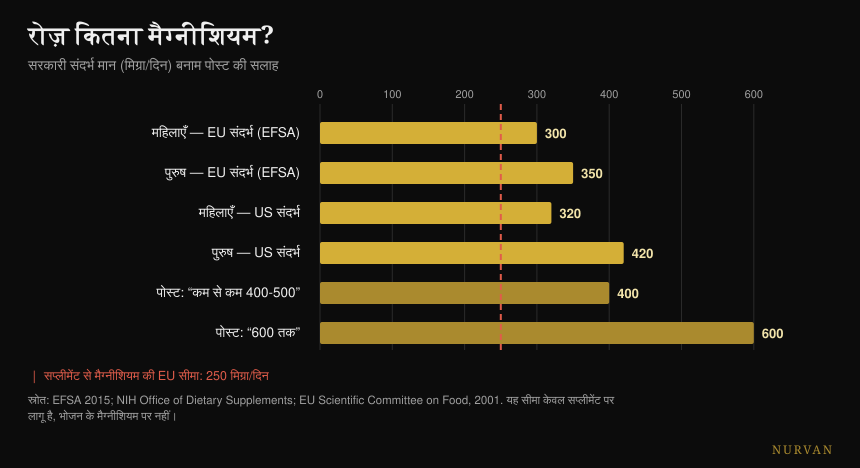
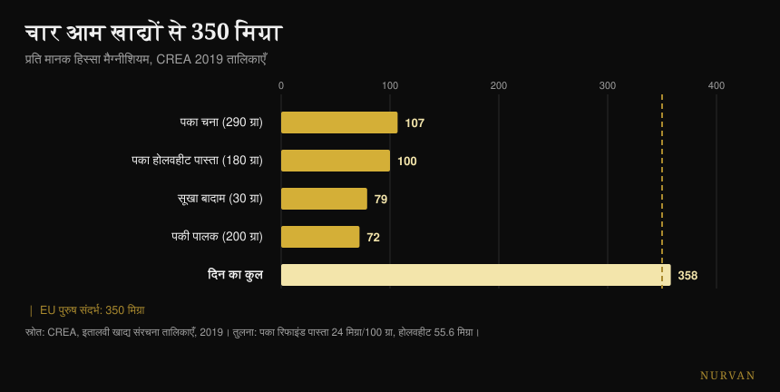

# कौन सा मैग्नीशियम चुनें और कितना चाहिए

लेखक: [Giammaria Loi](/autore/giammaria-loi) · 19 अक्टूबर 2026 को अद्यतन

खूब शेयर हुई एक स्लाइड सीरीज़ मैग्नीशियम के सोलह काम गिनाती है, बारह रूपों को सितारों से रैंक करती है, और एक आँकड़े पर खत्म होती है: रोज़ 400-500 mg, कुछ लोगों के लिए 600 तक। मैंने पंद्रह स्रोत जाँचे। कामों की सूची सही है, रूपों की रैंकिंग ठीक उसी बिंदु पर उलट जाती है जहाँ एक इंसानी अध्ययन उसे परखता है, और आख़िरी आँकड़ा इस पोस्ट की सबसे गंभीर गड़बड़ है — क्योंकि वह उस एक आँकड़े को छोड़ देता है जो सुरक्षा से जुड़ा है।

## संक्षेप में

- **आधिकारिक संदर्भ 400-600 mg नहीं है।** यूरोप में यह पुरुषों के लिए रोज़ 350 mg और महिलाओं के लिए 300 है (EFSA, 2015); अमेरिका में 400-420 और 310-320।
- **सप्लीमेंट से मिलने वाले मैग्नीशियम की ऊपरी सीमा यूरोपीय संघ में रोज़ 250 mg है** और अमेरिका में 350। यह सिर्फ़ गोली पर लागू है, खाने पर नहीं — और पोस्ट इसका ज़िक्र एक बार भी नहीं करती।
- **इंसानों पर हुई सीधी तुलना में सिट्रेट अमीनो एसिड कीलेट से आगे निकलता है**, यानी सितारों वाली रैंकिंग का ठीक उल्टा। ऑक्साइड का असर प्लेसिबो से अलग ही नहीं है (Walker et al., 2003)।
- **मसल क्रैम्प पर मैग्नीशियम काम नहीं करता।** कोक्रेन समीक्षा यह बात ऊँची निश्चितता के साथ कहती है, और व्यायाम से होने वाली ऐंठन पर एक भी अध्ययन मौजूद नहीं है (Garrison et al., 2020)।
- **चार आम खाद्य पदार्थ आपको 358 mg तक पहुँचा देते हैं** — कोई डिब्बा खोले बिना: साबुत गेहूँ का पास्ता मैदे वाले से 2.3 गुना मैग्नीशियम देता है (CREA तालिकाएँ)।

## 600 प्रतिक्रियाएँ सच हैं (पर वे सप्लीमेंट लेने की वजह नहीं हैं)

पहले वह देखें जो पोस्ट सही कहती है। मैग्नीशियम कोशिकाओं के भीतर दूसरा सबसे भरपूर कैटायन है और **600 से ज़्यादा एंज़ाइमैटिक प्रतिक्रियाओं** में शामिल है: ATP बनना, DNA और RNA का संश्लेषण, मांसपेशी का संकुचन, हृदय और दिमाग का काम। यह आँकड़ा खूब उद्धृत होने वाली एक फ़िज़ियोलॉजी समीक्षा से आता है और सही है — एक स्पष्टीकरण के साथ: स्रोत 600 *प्रतिक्रियाओं* की बात करता है, पोस्ट 600 *एंज़ाइमों* की। ये एक चीज़ नहीं हैं, पर परिमाण का क्रम टिकता है।

दिक्कत उस तार्किक छलाँग में है जिसका न्योता यह सूची देती है। “यह सोलह चीज़ों के लिए ज़रूरी है” का मतलब “आपको इसकी ज़्यादा ज़रूरत है” नहीं होता। हज़ार प्रक्रियाओं के लिए ज़रूरी पोषक तत्व उतनी ही मात्रा में ज़रूरी रहता है जितनी ज़रूरत है: उस सीमा के आगे कोई बोनस नहीं है। यही वह ग़लती है जो किसी भी सप्लीमेंट की फ़ायदों वाली सूची को असरदार बना देती है — इस पर मैंने [ताक़त के सप्लीमेंट्स की टियर लिस्ट](/hi/blog/strength-supplements-tier-list-hindi) में भी लिखा था, जहाँ कोई उत्पाद शरीर के भीतर जो करता है और जिम में जो करता है, उनके बीच का फ़ासला अक्सर बहुत बड़ा होता है।

## आपको असल में कितना मैग्नीशियम चाहिए

यहीं पोस्ट चूकती है, और ठीक उस चीज़ पर चूकती है जो पाठक सचमुच करेगा।

EFSA ने आहार संदर्भ मानों पर अपनी 2015 की राय में पर्याप्त सेवन **वयस्क पुरुषों के लिए रोज़ 350 mg और महिलाओं के लिए 300 mg** रखा है। अमेरिकी संदर्भ संस्था पुरुषों के लिए 400-420 mg और महिलाओं के लिए 310-320 mg बताती है। चौथी स्लाइड का “420-600” *एक ही* वर्ग का सबसे ऊँचा मान उठाता है — 31 साल से ऊपर के पुरुष — उसे सबके लिए न्यूनतम बनाकर पेश करता है, और फिर उसके ऊपर 600 की छत खड़ी कर देता है, जो किसी भी सिफ़ारिश में कहीं नहीं मिलती।

जो आँकड़ा गायब है वह दूसरा है। **सप्लीमेंट के रूप में लिए गए** मैग्नीशियम की एक ऊपरी सुरक्षा सीमा है: **यूरोपीय संघ में रोज़ 250 mg** (2001 में हल्के दस्त के आधार पर तय, जो सबसे पहले दिखने वाला अवांछित असर है) और अमेरिका में 350 mg। यह सीमा खाने के मैग्नीशियम पर लागू नहीं होती, जो यह दिक्कत पैदा नहीं करता: यह सिर्फ़ कैप्सूल और सैशे पर लागू है।

*आधिकारिक संदर्भ मान बनाम पोस्ट की सलाह। लाल रेखा सप्लीमेंट से मिलने वाले मैग्नीशियम की यूरोपीय सीमा है: यह सिर्फ़ गोली पर लागू है, खाने पर नहीं। स्रोत: EFSA 2015; NIH ऑफ़िस ऑफ़ डाइटरी सप्लीमेंट्स; वैज्ञानिक खाद्य समिति (यूरोपीय संघ), 2001।*

व्यवहार में इसका अनुवाद यह है: “400-600 mg लो” — जब यह कोई ऐसा व्यक्ति पढ़ता है जो अपने खाने का हिसाब नहीं रखता, तो यह बन जाता है “400 mg का कैप्सूल खरीद लो”, जो यूरोपीय सीमा से ऊपर और अमेरिकी के करीब है। सही वाक्य दूसरा है — आपको **कुल मिलाकर** 300-420 mg चाहिए, खाना शामिल, और सप्लीमेंट फ़र्क़ भरता है, पूरा जोड़ नहीं।

एक आख़िरी बात, जो लगभग कोई नहीं कहता: **खून में मैग्नीशियम बहुत कमज़ोर संकेतक है** कि आपके पास असल में कितना मैग्नीशियम है। शरीर के मैग्नीशियम का 1% से भी कम सीरम में रहता है, और वह मान ऊतकों की कुल मात्रा से कमज़ोर ढंग से जुड़ा है। सामान्य सीमा में आया ब्लड टेस्ट यह नहीं साबित करता कि आप ठीक हैं, और ज़रा नीचे आया टेस्ट उल्टा भी नहीं साबित करता।

## रूपों की रैंकिंग नहीं टिकती

तीसरी स्लाइड सबसे ज़्यादा डाउनलोड और शेयर होने वाला हिस्सा है: बारह रूप, एक “किसके लिए सबसे अच्छा” कॉलम, और सितारों में अवशोषण का स्कोर। ग्लाइसिनेट को नींद और चिंता के लिए पाँच सितारे, सिट्रेट को कब्ज़ के लिए चार, ऑक्साइड को बस एक, और एप्सम सॉल्ट को आरामदेह नहाने के लिए तीन।

एक अध्ययन है जो इनमें से तीन रूपों को इंसानों में आमने-सामने रखता है। यह **46 लोगों पर रैंडमाइज़्ड डबल-ब्लाइंड ट्रायल** है: रोज़ 300 mg एलिमेंटल मैग्नीशियम, 60 दिन तक, और अमीनो एसिड कीलेट, सिट्रेट तथा ऑक्साइड की सीधी तुलना। नतीजा: **सिट्रेट सबसे अच्छा है** — खून के मैग्नीशियम पर पहली खुराक के बाद भी (p = 0.026) और दो महीने बाद भी (p = 0.006), और लार के मैग्नीशियम पर भी। ऑक्साइड प्लेसिबो से अलग नहीं निकलता।

यानी: उपलब्ध एकमात्र सीधी इंसानी तुलना में, जिस रूप को पोस्ट चार सितारे देती है वह उस रूप को हरा देता है जिसे वह पाँच देती है। टिकने वाली एकमात्र रेटिंग ऑक्साइड का कम स्कोर है।

बाद की एक सिस्टमैटिक समीक्षा — 433 अध्ययन छाने गए, 14 शामिल किए — बड़ी तस्वीर की पुष्टि करती है: अकार्बनिक रूपों की जैव-उपलब्धता आम तौर पर कार्बनिक रूपों से कम रहती है, और अवशोषित प्रतिशत खुराक पर निर्भर करता है। पर लेखकों का निष्कर्ष उस चीट शीट से कहीं कम रोमांचक है: जिन स्वस्थ लोगों में पहले से कमी नहीं है, उनमें **सभी** मैग्नीशियम सप्लीमेंट शारीरिक स्तर बनाए रखते हैं।

और रूप से ज़्यादा उत्पाद मायने रखता है। एक बेल्जियाई अध्ययन ने पंद्रह व्यावसायिक उत्पाद परखे और “बहुत व्यापक” अंतर पाया; दोनों छोरों वाले उत्पाद तीस लोगों पर आज़माने पर कर्व के नीचे का क्षेत्रफल 6.87 बनाम 0.31 mM·min निकला। वही खनिज, दो अलग डिब्बे, बीस गुना का फ़र्क़।

| स्लाइड क्या कहती है | इंसानी अध्ययन क्या कहते हैं |
|---|---|
| ग्लाइसिनेट 5 सितारे, सिट्रेट 4 | सीधी तुलना में सिट्रेट सीरम और लार दोनों पर जीतता है (Walker 2003) |
| ऑक्साइड 1 सितारा | पुष्ट: प्लेसिबो से कोई अंतर नहीं (Walker 2003) |
| “कार्बनिक अकार्बनिक से बेहतर” | रुझान के तौर पर सही, पर जिनमें कमी नहीं है उनमें हर रूप स्तर बनाए रखता है (Pardo 2021) |
| हर रूप का अपना लक्ष्य है | नींद, चिंता, ब्लड प्रेशर या रिकवरी पर रूपों की कोई आमने-सामने तुलना नहीं |
| याददाश्त और अनुभूति के लिए एल-थ्रिओनेट | दो RCT: एक उस कंपनी के नाम से जो यह यौगिक बनाती है, दूसरा फ़ॉस्फ़ेटिडिलसेरीन और विटामिन वाले फ़ॉर्मूले पर |
| एप्सम सॉल्ट, अवशोषण के 3 सितारे | त्वचा से अवशोषण पर कोई इंसानी अध्ययन नहीं |

एल-थ्रिओनेट पर एक पल रुकना बनता है, क्योंकि यह बाज़ार का सबसे महँगा रूप है। दोनों इंसानी अध्ययन सचमुच मौजूद हैं, पर पहला — 50 से 70 साल के 44 वयस्क, असली अनुभूति-सुधार और बड़ा प्रभाव — उस कंपनी के लोगों के नाम से है जो यह यौगिक बनाती है, और **लेखक स्वयं लिखते हैं कि नींद और चिंता पर असर तय नहीं किया जा सकता**, क्योंकि प्लेसिबो प्रभाव बहुत तगड़ा था। दूसरा जिस फ़ॉर्मूले को परखता है उसमें फ़ॉस्फ़ेटिडिलसेरीन, विटामिन C और विटामिन D भी हैं: जो भी हुआ, उसका श्रेय थ्रिओनेट को नहीं दिया जा सकता।

## प्रमाण कहाँ टिकते हैं और कहाँ नहीं

**नींद।** इस पर हुई समर्पित मेटा-विश्लेषण को सिर्फ़ तीन रैंडमाइज़्ड ट्रायल मिलते हैं, अनिद्रा वाले 151 बुज़ुर्गों पर: नींद आने में लगने वाला समय **17.36 मिनट** घटता है (95% CI -27.27 / -7.44)। कुल नींद का समय 16 मिनट सुधरता है पर सार्थक नहीं है, पक्षपात का जोखिम मध्यम से ऊँचा है, और प्रमाणों की गुणवत्ता कम से बहुत कम। नींद के सप्लीमेंट्स पर 31 ट्रायल वाली एक बड़ी समीक्षा में मैग्नीशियम के पास **मेटा-विश्लेषण में शामिल होने लायक डेटा ही नहीं था**, जबकि मेलाटोनिन, विटामिन D और अमीनो एसिड शामिल हो गए। कुछ है, संभवतः। पर यह वह खंभा नहीं है जैसा दिखता है।

**ब्लड प्रेशर।** पूरी सूची में यही सबसे अच्छी तरह दर्ज असर है, और सबसे मामूली भी: 2,028 लोगों पर 34 डबल-ब्लाइंड ट्रायल, माध्यिका खुराक रोज़ 368 mg, तीन महीने तक, नतीजा **सिस्टोलिक में -2.00 mmHg और डायस्टोलिक में -1.78**। असली, मापने योग्य, छोटा। अगर आप ब्लड प्रेशर की दवा लेते हैं या गुर्दे की दिक्कत है, तो यह बातचीत अपने डॉक्टर के साथ करने की है, किसी स्लाइड सीरीज़ के साथ नहीं।

**ऐंठन।** यहाँ पोस्ट उल्टी दिशा में इशारा करती है। कोक्रेन समीक्षा — 11 ट्रायल, 735 लोग — वयस्कों की रात की ऐंठन में **हफ़्ते में -0.18 ऐंठन** का अंतर पाती है (CI -0.84 / +0.49), और कम से कम 25% कमी पाने वालों का अनुपात RR 1.04 है, **ऊँची निश्चितता** के साथ: यह समीक्षा का सबसे मज़बूत आँकड़ा है, और यह कहता है कि काम नहीं करता। हल्के प्रतिकूल असर प्लेसिबो से ज़्यादा आम हैं, और दस्त 11-37% प्रतिभागियों में दिखता है। और सबसे अहम: **व्यायाम से होने वाली ऐंठन पर एक भी रैंडमाइज़्ड ट्रायल नहीं है**। 2026 की एक समीक्षा इसी तस्वीर की पुष्टि करती है — गर्भावस्था की ऐंठन में काम करता है, वयस्कों की रात की ऐंठन में नहीं।

**रिकवरी।** मैग्नीशियम और ट्रेनिंग के बाद की मांसपेशी-पीड़ा पर हुई सिस्टमैटिक समीक्षा 1,254 लेखों से शुरू होती है और **चार** शामिल करती है। लेखक अनुमान लगाते हैं कि कड़ी ट्रेनिंग करने वालों की ज़रूरत 10-20% ज़्यादा होती है, जो मुमकिन है — पर चार अध्ययन वह बुनियाद नहीं हैं जिस पर पाँच सितारे खड़े किए जा सकें।

## शोध असल में क्या कहता है

- **पुष्ट** — मैग्नीशियम 600 से ज़्यादा एंज़ाइमैटिक प्रतिक्रियाओं में शामिल है।
- **पुष्ट** — चौथी स्लाइड के खाद्य मान, जो अमेरिकी आधिकारिक फ़ैक्ट शीट से एक-एक कर उतारे गए हैं। एक टाइपो के साथ: आलू 3.5 *औंस* हैं, 3.5 *कप* नहीं।
- **पुष्ट पर छोटा** — ब्लड प्रेशर पर असर: रोज़ 368 mg पर -2.00 / -1.78 mmHg।
- **स्पष्ट करने लायक** — नींद: नींद आने में -17.36 मिनट, तीन कम गुणवत्ता वाले ट्रायल पर।
- **खंडित** — “ज़्यादातर लोगों को 400-500 mg चाहिए, कुछ को 600”। आधिकारिक संदर्भ कुल 300-420 mg हैं, और सप्लीमेंट की सीमा यूरोपीय संघ में 250 mg है।
- **खंडित** — सितारों वाली श्रेणीबद्धता: इंसानी तुलना में सिट्रेट अमीनो एसिड कीलेट से आगे निकलता है।
- **खंडित** — ऐंठन के लिए मैग्नीशियम: ऊँची निश्चितता कि यह रात की ऐंठन कम नहीं करता, और व्यायाम की ऐंठन पर कोई अध्ययन ही नहीं।
- **जाँचा नहीं जा सकता** — “किसके लिए सबसे अच्छा” वाले सारे कॉलम (क्लिनिकल नतीजों पर रूपों की कोई तुलना नहीं), एप्सम सॉल्ट के तीन सितारे (त्वचा से अवशोषण पर कोई इंसानी अध्ययन नहीं) और मिट्टी के क्षरण का दावा (कोई स्रोत नहीं)।

## इसे कैसे लागू करें

**पहले वह गिनिए जो आप खाते हैं।** यह नैतिक सलाह नहीं है: बात यह है कि खाने के मैग्नीशियम की कोई सुरक्षा सीमा नहीं है और वह सस्ता भी है। चार आम खाद्य पदार्थ आपको 350 mg के पार ले जाते हैं।

*CREA 2019 तालिकाओं के अनुसार प्रति मानक सर्विंग मैग्नीशियम। डैश वाली रेखा वयस्क पुरुषों के लिए यूरोपीय संदर्भ है।*

| खाद्य पदार्थ | प्रति 100 g में mg | सर्विंग | प्रति सर्विंग mg |
|---|---|---|---|
| मीठे बादाम, सूखे | 264 | 30 g | 79 |
| काजू | 260 | 30 g | 78 |
| अख़रोट, सूखे | 131 | 30 g | 39 |
| साबुत गेहूँ का सूजी पास्ता, पका | 55.6 | 180 g | 100 |
| सूखा चना, पका | 37 | 290 g | 107 |
| पालक, पकी, उबली | 36 | 200 g | 72 |
| सूजी पास्ता, पका | 24 | 200 g | 48 |

*CREA 2019 तालिकाएँ।*

**सबसे काम की बात आख़िरी पंक्ति है।** पके साबुत गेहूँ के पास्ते में प्रति 100 g 55.6 mg मैग्नीशियम है, मैदे वाले में 24: **2.3 गुना**। अगर आप हफ़्ते में चार बार पास्ता खाते हैं, तो वर्शन बदलना बिसग्लाइसिनेट और टॉरेट के बीच किसी भी चुनाव से ज़्यादा कीमती है।

**अगर सप्लीमेंट लेते हैं, तो कम खुराक से शुरू कीजिए।** जो साहित्य असली असर दिखाता है वह रोज़ 300-370 mg के आसपास काम करता है, यानी कुल ज़रूरत के परिमाण में, उसके दोगुने में नहीं। खाना जोड़ने के बाद 100-200 mg का एक कैप्सूल लगभग हमेशा हिसाब पूरा करने के लिए काफ़ी होता है और यूरोपीय सीमा के भीतर रहता है।

**घुलनशील रूप चुनिए और वह उत्पाद जो एलिमेंटल मैग्नीशियम बताता है।** सिट्रेट, क्लोराइड, लैक्टेट और कीलेट सब ठीक हैं; ऑक्साइड के पीछे सबसे कमज़ोर आधार है। रूप से ज़्यादा अहम: लेबल पर यह लिखा होना चाहिए कि एक खुराक में कितना *एलिमेंटल* मैग्नीशियम है, न कि नमक का वज़न कितने मिलीग्राम है।

**अगर नींद के लिए ले रहे हैं, तो शाम को लीजिए और तीन हफ़्ते दीजिए।** और अपेक्षाएँ कम रखिए: नींद आने में सत्रह मिनट की बचत, और वह भी कमज़ोर प्रमाणों पर। हर सप्लीमेंट किस समय लेना है, इसका विस्तार से विश्लेषण मैंने [लेने के समय पर इस लेख](/hi/blog/supplements-kab-lein-samay) में किया है।

**अगर मल ढीला होने लगे, तो आप अपनी सीमा पार कर चुके हैं।** यह पहला संकेत है, और ठीक यही असर है जिस पर यूरोपीय सुरक्षा सीमा बनी हुई है।

> ### आपके दिन में मैग्नीशियम, Nurvan के भीतर
> इस लेख का सार यही है कि हिसाब थाली पर पूरा होता है, डिब्बे में नहीं। Nurvan की फ़ूड डायरी CREA डेटाबेस पर चलती है — ऊपर की तालिका के वही मान — इसलिए आप पहले देख सकते हैं कि आपके भोजन असल में कितना मैग्नीशियम देते हैं, और फिर तय कीजिए कि सप्लीमेंट लेना है या नहीं और कितना। सप्लीमेंट सेक्शन खुराक, रूप और समय दर्ज रखता है, और उन्हें उन्हीं हफ़्तों के ट्रेनिंग लोड तथा नींद के साथ रखकर दिखाता है। **[Nurvan आज़माएँ](https://nurvan.app)**

## अक्सर पूछे जाने वाले सवाल

**मैग्नीशियम बिसग्लाइसिनेट या सिट्रेट: कौन बेहतर है?**
जो एकमात्र इंसानी अध्ययन दोनों की सीधी तुलना करता है, उसमें रोज़ 300 mg, 60 दिन तक लेने पर सिट्रेट अमीनो एसिड कीलेट से ज़्यादा जैव-उपलब्ध निकलता है। फिर भी दोनों कार्बनिक रूपों के बीच का व्यावहारिक फ़र्क़ उस फ़र्क़ के सामने छोटा रहता है जो सप्लीमेंट लेने और न लेने के बीच है: जिन स्वस्थ लोगों में कमी नहीं है, उनमें हर रूप स्तर बनाए रखता है। बचने लायक अकेला रूप ऑक्साइड है।

**मुझे रोज़ कितना मैग्नीशियम लेना चाहिए?**
खाना शामिल करके कुल ज़रूरत EFSA के अनुसार पुरुषों के लिए 350 mg और महिलाओं के लिए 300 mg है (अमेरिकी संदर्भ 400-420 और 310-320 हैं)। सप्लीमेंट के रूप में लिए गए मैग्नीशियम की अलग सुरक्षा सीमा है: यूरोपीय संघ में रोज़ 250 mg, अमेरिका में 350। इसलिए सप्लीमेंट का काम आपके खाने और ज़रूरत के बीच का फ़र्क़ भरना है, पूरी ज़रूरत उठाना नहीं।

**क्या मैग्नीशियम मसल क्रैम्प ठीक करता है?**
वयस्कों की रात की ऐंठन पर कोक्रेन समीक्षा कहती है नहीं, और एक नतीजे पर ऊँची निश्चितता के साथ। व्यायाम से होने वाली ऐंठन पर कोई रैंडमाइज़्ड ट्रायल ही नहीं है, इसलिए जो इसके लिए इसकी सलाह देता है उसके पास टिकने को डेटा नहीं है। गर्भावस्था अपवाद है, जहाँ कुछ असर दिखता है।

**क्या मैग्नीशियम से नींद बेहतर आती है?**
अनिद्रा वाले बुज़ुर्गों पर हुए तीन ट्रायल में यह नींद आने का समय लगभग सत्रह मिनट घटाता है, पर प्रमाणों की गुणवत्ता कम है और कुल नींद का समय सार्थक रूप से नहीं बदलता। नींद के सप्लीमेंट्स की एक बड़ी समीक्षा में मैग्नीशियम के पास मेटा-विश्लेषण में आने लायक डेटा भी नहीं था।

**क्या एप्सम सॉल्ट से नहाने पर मैग्नीशियम शरीर में जाता है?**
PubMed पर इसे मापने वाला कोई इंसानी अध्ययन नहीं है। त्वचा से अवशोषण का एकमात्र सीधा माप इन विट्रो है, सुअर की त्वचा पर। गर्म पानी का स्नान आराम दे सकता है, पर इसका श्रेय त्वचा पार करने वाले मैग्नीशियम को देने का आज कोई इंसानी आधार नहीं है।

## यह भी पढ़ें

- [ताक़त के सप्लीमेंट्स की टियर लिस्ट: असल में क्या काम करता है](/hi/blog/strength-supplements-tier-list-hindi)
- [सप्लीमेंट कब लें: क्या समय मायने रखता है?](/hi/blog/supplements-kab-lein-samay)
- [कैफ़ीन और नींद: कॉफ़ी कब बंद करें](/hi/blog/caffeine-neend-kab-coffee-band-karein)

## स्रोत

- de Baaij JHF, Hoenderop JGJ, Bindels RJM, 2015. Magnesium in man: implications for health and disease. *Physiological Reviews* 95(1):1-46. [PMID 25540137](https://pubmed.ncbi.nlm.nih.gov/25540137/) · [DOI](https://doi.org/10.1152/physrev.00012.2014)
- EFSA, 2015. *Dietary reference values: magnesium and phosphorus* (28 जुलाई 2015)। [efsa.europa.eu](https://www.efsa.europa.eu/en/press/news/150728)
- वैज्ञानिक खाद्य समिति (यूरोपीय संघ), 2001। सप्लीमेंट से मैग्नीशियम के लिए सहनीय ऊपरी सेवन स्तर: 250 mg/दिन। [BfR संदर्भ दस्तावेज़](https://www.bfr.bund.de/cm/349/proposed-maximum-levels-for-the-addition-of-magnesium-to-foods-including-food-supplements.pdf)
- NIH Office of Dietary Supplements. *Magnesium — Fact Sheet for Health Professionals*. [ods.od.nih.gov](https://ods.od.nih.gov/factsheets/Magnesium-HealthProfessional/)
- Walker AF, Marakis G, Christie S, Byng M, 2003. Mg citrate found more bioavailable than other Mg preparations in a randomised, double-blind study. *Magnesium Research* 16(3):183-91. [PMID 14596323](https://pubmed.ncbi.nlm.nih.gov/14596323/)
- Pardo MR, Garicano Vilar E, San Mauro Martín I, Camina Martín MA, 2021. Bioavailability of magnesium food supplements: a systematic review. *Nutrition* 89:111294. [PMID 34111673](https://pubmed.ncbi.nlm.nih.gov/34111673/) · [DOI](https://doi.org/10.1016/j.nut.2021.111294)
- Blancquaert L, Vervaet C, Derave W, 2019. Predicting and testing bioavailability of magnesium supplements. *Nutrients* 11(7):1663. [PMID 31330811](https://pubmed.ncbi.nlm.nih.gov/31330811/) · [DOI](https://doi.org/10.3390/nu11071663)
- Mah J, Pitre T, 2021. Oral magnesium supplementation for insomnia in older adults: a systematic review and meta-analysis. *BMC Complementary Medicine and Therapies* 21(1):125. [PMID 33865376](https://pubmed.ncbi.nlm.nih.gov/33865376/) · [DOI](https://doi.org/10.1186/s12906-021-03297-z)
- Chan V, Lo K, 2021. Efficacy of dietary supplements on improving sleep quality: a systematic review and meta-analysis. *Postgraduate Medical Journal* 98(1158):285-293. [PMID 33441476](https://pubmed.ncbi.nlm.nih.gov/33441476/) · [DOI](https://doi.org/10.1136/postgradmedj-2020-139319)
- Zhang X, Li Y, Del Gobbo LC et al., 2016. Effects of magnesium supplementation on blood pressure: a meta-analysis of randomized double-blind placebo-controlled trials. *Hypertension* 68(2):324-33. [PMID 27402922](https://pubmed.ncbi.nlm.nih.gov/27402922/) · [DOI](https://doi.org/10.1161/HYPERTENSIONAHA.116.07664)
- Garrison SR, Korownyk CS, Kolber MR et al., 2020. Magnesium for skeletal muscle cramps. *Cochrane Database of Systematic Reviews* 9:CD009402. [PMID 32956536](https://pubmed.ncbi.nlm.nih.gov/32956536/) · [DOI](https://doi.org/10.1002/14651858.CD009402.pub3)
- Patil S, Falkowski A, Venkataiah VS et al., 2026. The role of electrolytes in muscle pain syndromes: a systematic review and meta-analysis. *International Dental Journal* 76(3):109488. [PMID 41812583](https://pubmed.ncbi.nlm.nih.gov/41812583/) · [DOI](https://doi.org/10.1016/j.identj.2026.109488)
- Tarsitano MG, Quinzi F, Folino K et al., 2024. Effects of magnesium supplementation on muscle soreness in different types of physical activities: a systematic review. *Journal of Translational Medicine* 22(1):629. [PMID 38970118](https://pubmed.ncbi.nlm.nih.gov/38970118/) · [DOI](https://doi.org/10.1186/s12967-024-05434-x)
- Liu G, Weinger JG, Lu ZL, Xue F, Sadeghpour S, 2016. Efficacy and safety of MMFS-01, a synapse density enhancer, for treating cognitive impairment in older adults. *Journal of Alzheimer's Disease* 49(4):971-90. [PMID 26519439](https://pubmed.ncbi.nlm.nih.gov/26519439/) · [DOI](https://doi.org/10.3233/JAD-150538)
- Ghimirey KB, Ita K, 2020. Microneedle-assisted percutaneous transport of magnesium sulfate. *Current Drug Delivery* 17(2):140-147. [PMID 31845631](https://pubmed.ncbi.nlm.nih.gov/31845631/) · [DOI](https://doi.org/10.2174/1567201817666191217093936)
- CREA — खाद्य एवं पोषण अनुसंधान केंद्र, *इतालवी खाद्य संरचना तालिकाएँ*, 2019 संस्करण। [alimentinutrizione.it](https://www.alimentinutrizione.it/tabelle-nutrizionali/ricerca-per-ordine-alfabetico)

*शुरुआती बिंदु: Siim Land ([@siimland](https://www.instagram.com/siimland/)) की 30 सितंबर 2026 की स्लाइड सीरीज़, [यह पोस्ट](https://www.instagram.com/p/Dd7HfSdgKyl/)। पोस्ट का कोई पाठ या चित्र दोहराया नहीं गया है: हमने उसके दावे पढ़े और उन्हें शोध साहित्य पर जाँचा।*

---

**जियाम्मारिया लोई** Nurvan के संस्थापक हैं। वे 2012 से वेट ट्रेनिंग कर रहे हैं, 2013 से FIPE-प्रमाणित पर्सनल ट्रेनर और कोच के रूप में काम कर रहे हैं, और 2018 से राष्ट्रीय स्तर पर पावरलिफ्टिंग में हिस्सा लेते हैं। उनके हर लेख की शुरुआत शोध से होती है और अंत उस पर जो जिम में सचमुच काम करता है। [लेखक पृष्ठ](/autore/giammaria-loi)

> नोट: यह जानकारीपरक सामग्री है और डॉक्टर या किसी योग्य पेशेवर की सलाह की जगह नहीं लेती। मैग्नीशियम कुछ दवाओं के साथ प्रतिक्रिया कर सकता है और उसका निकलना गुर्दे की कार्यक्षमता पर निर्भर करता है: अगर आप कोई इलाज ले रहे हैं, अगर आपको गुर्दे या हृदय की दिक्कत है, या अगर आप गर्भवती हैं, तो सप्लीमेंट शुरू करने से पहले अपने डॉक्टर से बात कीजिए।
