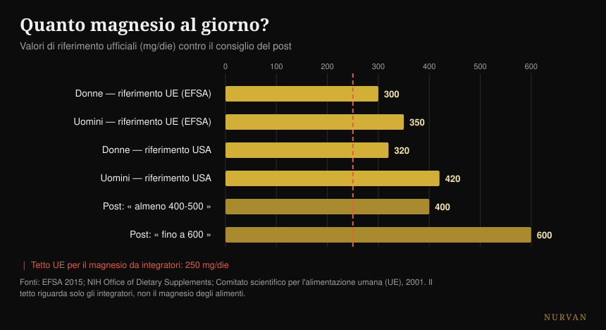
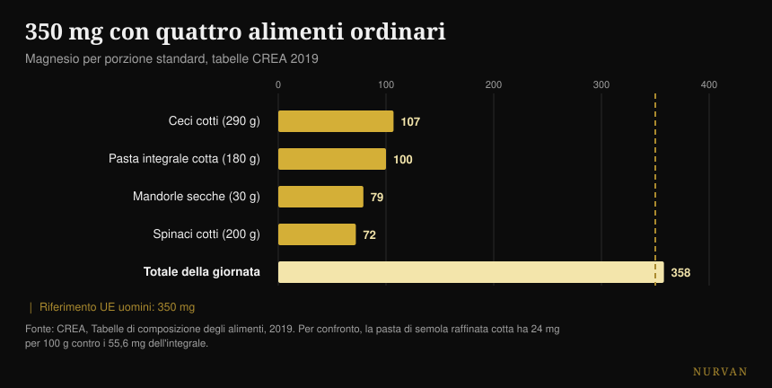

# Quale magnesio scegliere e quanto ne serve

Di [Giammaria Loi](/autore/giammaria-loi) · aggiornato il 19 ottobre 2026

Un carosello molto condiviso elenca sedici cose che fa il magnesio, mette in fila dodici forme con un punteggio a stelline e chiude con una cifra: 400-500 mg al giorno, fino a 600 per alcuni. Ho controllato quindici fonti. La lista dei ruoli è corretta, la classifica delle forme si rovescia nel punto in cui esiste uno studio umano che la verifica, e la cifra finale è il problema più serio del post — perché ignora l'unico numero che riguarda la sicurezza.

## In breve

- **Il riferimento ufficiale non è 400-600 mg.** In Europa è 350 mg al giorno per gli uomini e 300 per le donne (EFSA, 2015); negli Stati Uniti 400-420 e 310-320.
- **Il tetto per il magnesio da integratori è 250 mg al giorno in UE** e 350 negli USA. Riguarda solo la pillola, non il cibo — e il post non lo nomina mai.
- **Nel confronto umano diretto il citrato batte il chelato amminoacidico**, cioè l'opposto della classifica a stelline. L'ossido, invece, non si distingue dal placebo (Walker et al., 2003).
- **Sui crampi il magnesio non funziona.** La revisione Cochrane lo dice con certezza alta, e di crampi da esercizio non esiste nemmeno uno studio (Garrison et al., 2020).
- **Con quattro alimenti ordinari si arriva a 358 mg** senza aprire un barattolo: la pasta integrale ne ha 2,3 volte quella raffinata (tabelle CREA).

## Le 600 reazioni sono vere (ma non sono un motivo per integrare)

Partiamo da ciò che il post azzecca. Il magnesio è il secondo catione più abbondante dentro le cellule ed è coinvolto in **oltre 600 reazioni enzimatiche**: produzione di ATP, sintesi di DNA e RNA, contrazione muscolare, funzione del cuore e del cervello. Il numero viene da una revisione di fisiologia molto citata ed è corretto — con una precisazione: la fonte parla di 600 *reazioni*, il post di 600 *enzimi*. Non è la stessa cosa, ma l'ordine di grandezza regge.

Il problema è il salto logico che quella lista invita a fare. "Serve a sedici cose" non significa "ne serve di più". Un nutriente necessario a mille processi resta necessario nella quantità in cui serve: oltre quella soglia non c'è un bonus. È lo stesso errore che rende convincenti le liste di benefici di qualsiasi integratore — ne ho parlato anche nella [classifica degli integratori per la forza](/blog/classifica-integratori-forza-tier-list), dove la distanza fra ciò che un prodotto fa nel corpo e ciò che fa in palestra è spesso enorme.

## Quanto magnesio serve davvero

Qui il post sbaglia, e sbaglia su ciò che il lettore farà davvero.

L'EFSA, nel parere del 2015 sui valori dietetici di riferimento, fissa l'assunzione adeguata a **350 mg al giorno per gli uomini adulti e 300 per le donne**. L'ente statunitense di riferimento indica 400-420 mg per gli uomini e 310-320 per le donne. Il "420-600" della quarta slide prende il valore più alto di *una sola* fascia — uomini sopra i 31 anni — e lo presenta come il minimo per tutti, poi ci costruisce sopra un tetto di 600 che non compare in nessuna raccomandazione.

Il numero che manca è l'altro. Il magnesio **assunto come integratore** ha un limite superiore di sicurezza: **250 mg al giorno nell'Unione Europea** (fissato nel 2001 sulla base della diarrea lieve, il primo effetto indesiderato che compare) e 350 mg negli Stati Uniti. Quel limite non riguarda il magnesio degli alimenti, che non dà questo problema: riguarda solo le capsule e le bustine.

*Riferimenti ufficiali contro il consiglio del post. La linea rossa è il tetto europeo per il magnesio da integratori: vale solo per la pillola, non per il cibo. Fonti: EFSA 2015; NIH Office of Dietary Supplements; Comitato scientifico per l'alimentazione umana (UE), 2001.*

Tradotto in pratica: "prendi 400-600 mg" letto da chi non controlla cosa mangia diventa "compra una capsula da 400 mg", che è sopra il tetto europeo e vicino a quello americano. La frase giusta è un'altra — servono 300-420 mg **in tutto**, cibo compreso, e l'integratore copre la differenza, non il totale.

C'è un ultimo dettaglio che quasi nessuno dice: il **magnesio nel sangue è un indicatore scadente** del magnesio che hai davvero. Meno dell'1% del magnesio corporeo sta nel siero e quel valore correla poco con il contenuto totale dei tessuti. Un esame del sangue nella norma non dimostra che stai bene, e uno appena sotto non dimostra il contrario.

## La classifica delle forme non regge

La terza slide è la parte più scaricata e condivisa: dodici forme, una colonna "ideale per" e un punteggio di assorbimento a stelline. Glicinato cinque stelle per sonno e ansia, citrato quattro per la stipsi, ossido una sola, sale di Epsom tre per i bagni rilassanti.

Esiste uno studio che mette tre di queste forme una contro l'altra nell'uomo. È uno **studio randomizzato in doppio cieco su 46 persone**, 300 mg di magnesio elementare al giorno per 60 giorni, con confronto diretto fra chelato amminoacidico, citrato e ossido. Risultato: **il citrato è il migliore**, sul magnesio del sangue sia dopo la prima dose (p = 0,026) sia dopo due mesi (p = 0,006), e anche sul magnesio salivare. L'ossido non si distingue dal placebo.

Cioè: nell'unico confronto umano diretto disponibile, la forma a cui il post dà quattro stelle batte quella a cui ne dà cinque. L'unica stella che regge è quella bassa dell'ossido.

Una revisione sistematica successiva — 433 studi esaminati, 14 inclusi — conferma il quadro generale: le forme inorganiche tendono a essere meno biodisponibili delle organiche e la percentuale assorbita dipende dalla dose. Ma la conclusione degli autori è molto meno eccitante della cheat sheet: **tutti** gli integratori di magnesio mantengono i livelli fisiologici in persone sane senza una carenza pregressa.

E conta più il prodotto della forma. Uno studio belga ha testato quindici prodotti commerciali e trovato una variazione "molto ampia"; i due agli estremi, provati poi su trenta persone, hanno dato un'area sotto la curva di 6,87 contro 0,31 mM·min. Lo stesso minerale, due confezioni diverse, un fattore venti di differenza.

| Cosa dice la slide | Cosa dicono gli studi sull'uomo |
|---|---|
| Glicinato 5 stelle, citrato 4 | Nel confronto diretto il citrato vince su sierico e salivare (Walker 2003) |
| Ossido 1 stella | Confermato: non si distingue dal placebo (Walker 2003) |
| "Organico meglio di inorganico" | Vero come tendenza, ma tutte le forme mantengono i livelli in chi non è carente (Pardo 2021) |
| Ogni forma ha il suo obiettivo | Nessun confronto testa a testa fra forme su sonno, ansia, pressione o recupero |
| L-treonato per memoria e cognizione | Due RCT: uno firmato dall'azienda del prodotto, l'altro su una formula con fosfatidilserina e vitamine |
| Sale di Epsom, 3 stelle di assorbimento | Nessuno studio umano sull'assorbimento attraverso la pelle |

Sull'L-treonato vale la pena fermarsi un attimo, perché è la forma più costosa del mercato. I due studi umani esistono davvero, ma il primo — 44 adulti fra 50 e 70 anni, con un miglioramento cognitivo reale e un effetto grande — è firmato da autori dell'azienda che produce il composto, e **gli autori stessi scrivono che gli effetti su sonno e ansia non sono determinabili** per quanto era forte l'effetto placebo. Il secondo testa una formula che contiene anche fosfatidilserina, vitamina C e vitamina D: qualunque cosa sia successa, non puoi attribuirla al treonato.

## Dove le prove reggono e dove no

**Il sonno.** La meta-analisi dedicata trova tre soli studi randomizzati, su 151 anziani con insonnia: la latenza di addormentamento scende di **17,36 minuti** (IC 95% -27,27 / -7,44). Il tempo totale di sonno migliora di 16 minuti ma non è significativo, il rischio di bias è da moderato ad alto e la qualità delle prove è da bassa a molto bassa. In una rassegna più ampia su 31 studi di integratori per il sonno, il magnesio **non aveva dati sufficienti per entrare nella meta-analisi**, mentre melatonina, vitamina D e amminoacidi ci sono entrati. Qualcosa c'è, probabilmente. Non è il pilastro che sembra.

**La pressione.** È l'effetto meglio documentato di tutta la lista, ed è anche il più modesto: 34 studi in doppio cieco su 2.028 persone, dose mediana 368 mg al giorno per tre mesi, risultato **-2,00 mmHg di sistolica e -1,78 di diastolica**. Reale, misurabile, piccolo. Se prendi farmaci per la pressione o hai problemi renali, questa è una conversazione da fare con il tuo medico, non con un carosello.

**I crampi.** Qui il post sbaglia direzione. La revisione Cochrane — 11 studi, 735 persone — trova nei crampi notturni degli adulti una differenza di **-0,18 crampi a settimana** (IC -0,84 / +0,49), e la quota di chi ottiene almeno il 25% di riduzione è RR 1,04 con **certezza alta**: è il dato più solido della revisione, e dice che non funziona. Gli effetti avversi minori sono più frequenti che con il placebo e la diarrea compare nell'11-37% dei partecipanti. E soprattutto: **non esiste un solo studio randomizzato sui crampi da esercizio**. Una revisione del 2026 conferma il quadro — funziona nei crampi in gravidanza, non in quelli notturni degli adulti.

**Il recupero.** La revisione sistematica sul magnesio e i dolori muscolari post-allenamento parte da 1.254 articoli e ne include **quattro**. Gli autori ipotizzano un fabbisogno del 10-20% più alto in chi si allena intensamente, il che è plausibile — ma quattro studi sono una base su cui non si costruisce una stella su cinque.

## Cosa dice davvero la ricerca

- **Confermato** — il magnesio è coinvolto in oltre 600 reazioni enzimatiche.
- **Confermati** — i valori degli alimenti della quarta slide, copiati uno per uno dalla scheda ufficiale statunitense. Con un refuso: le patate sono 3,5 *once*, non 3,5 *cup*.
- **Confermato ma piccolo** — l'effetto sulla pressione: -2,00 / -1,78 mmHg a 368 mg al giorno.
- **Da precisare** — il sonno: -17,36 minuti di latenza, su tre studi di qualità bassa.
- **Smentito** — "la maggior parte delle persone ha bisogno di 400-500 mg, alcuni 600". I riferimenti ufficiali sono 300-420 mg totali, e il tetto per gli integratori è 250 mg in UE.
- **Smentita** — la gerarchia a stelline: nel confronto umano il citrato batte il chelato amminoacidico.
- **Smentito** — il magnesio per i crampi: certezza alta che non riduca i crampi notturni, nessuno studio sui crampi da esercizio.
- **Non verificabili** — tutte le colonne "ideale per" (nessun confronto fra forme su esiti clinici), le tre stelle del sale di Epsom (nessuno studio umano sull'assorbimento cutaneo) e l'erosione del suolo (nessuna fonte).

## Come applicarlo

**Prima conta quello che mangi.** Non è un consiglio morale: è che il magnesio alimentare non ha tetto di sicurezza e costa meno. Con quattro alimenti ordinari si superano i 350 mg.

*Magnesio per porzione standard secondo le tabelle CREA 2019. La linea tratteggiata è il riferimento europeo per gli uomini adulti.*

| Alimento | mg per 100 g | Porzione | mg per porzione |
|---|---|---|---|
| Mandorle dolci, secche | 264 | 30 g | 79 |
| Anacardi | 260 | 30 g | 78 |
| Noci, secche | 131 | 30 g | 39 |
| Pasta di semola integrale, cotta | 55,6 | 180 g | 100 |
| Ceci secchi, cotti | 37 | 290 g | 107 |
| Spinaci, cotti, bolliti | 36 | 200 g | 72 |
| Pasta di semola, cotta | 24 | 200 g | 48 |

*Tabelle CREA 2019.*

**Il dettaglio più utile è l'ultima riga.** La pasta integrale cotta ha 55,6 mg di magnesio per 100 g, quella raffinata 24: **2,3 volte**. Se mangi pasta quattro volte a settimana, cambiare versione vale più di qualsiasi scelta fra bisglicinato e taurato.

**Se integri, parti da una dose bassa.** La letteratura che mostra effetti reali lavora intorno ai 300-370 mg al giorno, cioè nell'ordine di grandezza del fabbisogno totale, non del doppio. Sommando il cibo, una capsula da 100-200 mg è quasi sempre sufficiente a chiudere il conto e resta dentro il tetto europeo.

**Scegli una forma solubile e un prodotto che dichiara il magnesio elementare.** Citrato, cloruro, lattato e i chelati vanno bene; l'ossido è quello con la base peggiore. Più importante della forma: sull'etichetta deve esserci quanto magnesio *elementare* contiene una dose, non quanti milligrammi pesa il sale.

**Se lo prendi per dormire, dallo alla sera e dagli tre settimane.** E tieni basse le aspettative: diciassette minuti di addormentamento in meno, su prove deboli. Il momento in cui prendere ogni integratore l'ho analizzato in dettaglio [in questo articolo sull'orario di assunzione](/blog/quando-prendere-gli-integratori-orario).

**Se compaiono feci molli, hai superato la tua soglia.** È il primo segnale, ed è proprio l'effetto su cui è costruito il limite di sicurezza europeo.

> ### Il magnesio nella giornata, dentro Nurvan
> Il punto di questo articolo è che il conto si chiude a tavola, non in barattolo. Il diario alimentare di Nurvan lavora sul database CREA — gli stessi valori della tabella qui sopra — quindi vedi quanto magnesio arriva davvero dai tuoi pasti prima di decidere se e quanto integrare. La sezione integrazione tiene traccia di dose, forma e orario, e le mette accanto ai carichi e al sonno delle stesse settimane. **[Prova Nurvan](https://nurvan.app)**

## Domande frequenti

**Meglio il magnesio bisglicinato o il citrato?**
Nell'unico studio umano che li confronta direttamente, il citrato risulta più biodisponibile del chelato amminoacidico a 300 mg al giorno per 60 giorni. La differenza pratica fra le due forme organiche resta però piccola rispetto alla differenza fra integrare e non integrare: su persone sane senza carenza, tutte le forme mantengono i livelli. L'unica da evitare è l'ossido.

**Quanto magnesio al giorno devo prendere?**
Il fabbisogno totale, cibo compreso, è 350 mg per gli uomini e 300 per le donne secondo l'EFSA (400-420 e 310-320 i riferimenti statunitensi). Il magnesio assunto come integratore ha un tetto di sicurezza separato: 250 mg al giorno in UE, 350 negli USA. Quindi l'integratore serve a coprire la differenza fra quello che mangi e il fabbisogno, non a coprire il fabbisogno intero.

**Il magnesio toglie i crampi?**
Nei crampi notturni degli adulti la revisione Cochrane dice di no, con certezza alta su uno degli esiti. Sui crampi da esercizio non esiste nessuno studio randomizzato, quindi chi te lo consiglia per quelli non ha dati a cui appoggiarsi. Fa eccezione la gravidanza, dove qualche effetto si vede.

**Il magnesio fa dormire meglio?**
In tre studi su anziani con insonnia riduce di circa diciassette minuti il tempo per addormentarsi, ma la qualità delle prove è bassa e il tempo totale di sonno non cambia in modo significativo. In una rassegna più ampia sugli integratori per il sonno il magnesio non aveva nemmeno dati sufficienti per essere meta-analizzato.

**Un bagno con i sali di Epsom fa assorbire magnesio?**
Su PubMed non esiste uno studio sull'uomo che lo misuri. L'unica misura diretta dell'assorbimento attraverso la pelle è in vitro, su cute di maiale. Il bagno caldo può rilassare, ma attribuire il merito al magnesio che attraversa la pelle non ha oggi una base umana.

## Leggi anche

- [Classifica degli integratori per la forza: cosa funziona davvero](/blog/classifica-integratori-forza-tier-list)
- [Quando prendere gli integratori: conta l'ora?](/blog/quando-prendere-gli-integratori-orario)
- [Caffeina e sonno: a che ora smettere con il caffè](/blog/caffeina-sonno-quando-smettere-caffe)

## Fonti

- de Baaij JHF, Hoenderop JGJ, Bindels RJM, 2015. Magnesium in man: implications for health and disease. *Physiological Reviews* 95(1):1-46. [PMID 25540137](https://pubmed.ncbi.nlm.nih.gov/25540137/) · [DOI](https://doi.org/10.1152/physrev.00012.2014)
- EFSA, 2015. *Dietary reference values: magnesium and phosphorus* (28 luglio 2015). [efsa.europa.eu](https://www.efsa.europa.eu/en/press/news/150728)
- Comitato scientifico per l'alimentazione umana (UE), 2001. Livello massimo tollerabile di assunzione per il magnesio da integratori: 250 mg/die. [Documento di riferimento BfR](https://www.bfr.bund.de/cm/349/proposed-maximum-levels-for-the-addition-of-magnesium-to-foods-including-food-supplements.pdf)
- NIH Office of Dietary Supplements. *Magnesium — Fact Sheet for Health Professionals*. [ods.od.nih.gov](https://ods.od.nih.gov/factsheets/Magnesium-HealthProfessional/)
- Walker AF, Marakis G, Christie S, Byng M, 2003. Mg citrate found more bioavailable than other Mg preparations in a randomised, double-blind study. *Magnesium Research* 16(3):183-91. [PMID 14596323](https://pubmed.ncbi.nlm.nih.gov/14596323/)
- Pardo MR, Garicano Vilar E, San Mauro Martín I, Camina Martín MA, 2021. Bioavailability of magnesium food supplements: a systematic review. *Nutrition* 89:111294. [PMID 34111673](https://pubmed.ncbi.nlm.nih.gov/34111673/) · [DOI](https://doi.org/10.1016/j.nut.2021.111294)
- Blancquaert L, Vervaet C, Derave W, 2019. Predicting and testing bioavailability of magnesium supplements. *Nutrients* 11(7):1663. [PMID 31330811](https://pubmed.ncbi.nlm.nih.gov/31330811/) · [DOI](https://doi.org/10.3390/nu11071663)
- Mah J, Pitre T, 2021. Oral magnesium supplementation for insomnia in older adults: a systematic review and meta-analysis. *BMC Complementary Medicine and Therapies* 21(1):125. [PMID 33865376](https://pubmed.ncbi.nlm.nih.gov/33865376/) · [DOI](https://doi.org/10.1186/s12906-021-03297-z)
- Chan V, Lo K, 2021. Efficacy of dietary supplements on improving sleep quality: a systematic review and meta-analysis. *Postgraduate Medical Journal* 98(1158):285-293. [PMID 33441476](https://pubmed.ncbi.nlm.nih.gov/33441476/) · [DOI](https://doi.org/10.1136/postgradmedj-2020-139319)
- Zhang X, Li Y, Del Gobbo LC et al., 2016. Effects of magnesium supplementation on blood pressure: a meta-analysis of randomized double-blind placebo-controlled trials. *Hypertension* 68(2):324-33. [PMID 27402922](https://pubmed.ncbi.nlm.nih.gov/27402922/) · [DOI](https://doi.org/10.1161/HYPERTENSIONAHA.116.07664)
- Garrison SR, Korownyk CS, Kolber MR et al., 2020. Magnesium for skeletal muscle cramps. *Cochrane Database of Systematic Reviews* 9:CD009402. [PMID 32956536](https://pubmed.ncbi.nlm.nih.gov/32956536/) · [DOI](https://doi.org/10.1002/14651858.CD009402.pub3)
- Patil S, Falkowski A, Venkataiah VS et al., 2026. The role of electrolytes in muscle pain syndromes: a systematic review and meta-analysis. *International Dental Journal* 76(3):109488. [PMID 41812583](https://pubmed.ncbi.nlm.nih.gov/41812583/) · [DOI](https://doi.org/10.1016/j.identj.2026.109488)
- Tarsitano MG, Quinzi F, Folino K et al., 2024. Effects of magnesium supplementation on muscle soreness in different types of physical activities: a systematic review. *Journal of Translational Medicine* 22(1):629. [PMID 38970118](https://pubmed.ncbi.nlm.nih.gov/38970118/) · [DOI](https://doi.org/10.1186/s12967-024-05434-x)
- Liu G, Weinger JG, Lu ZL, Xue F, Sadeghpour S, 2016. Efficacy and safety of MMFS-01, a synapse density enhancer, for treating cognitive impairment in older adults. *Journal of Alzheimer's Disease* 49(4):971-90. [PMID 26519439](https://pubmed.ncbi.nlm.nih.gov/26519439/) · [DOI](https://doi.org/10.3233/JAD-150538)
- Ghimirey KB, Ita K, 2020. Microneedle-assisted percutaneous transport of magnesium sulfate. *Current Drug Delivery* 17(2):140-147. [PMID 31845631](https://pubmed.ncbi.nlm.nih.gov/31845631/) · [DOI](https://doi.org/10.2174/1567201817666191217093936)
- CREA — Centro di ricerca Alimenti e Nutrizione, *Tabelle di composizione degli alimenti*, aggiornamento 2019. [alimentinutrizione.it](https://www.alimentinutrizione.it/tabelle-nutrizionali/ricerca-per-ordine-alfabetico)

*Spunto di partenza: il carosello di Siim Land ([@siimland](https://www.instagram.com/siimland/)) del 30 settembre 2026, [questo post](https://www.instagram.com/p/Dd7HfSdgKyl/). Nessun testo e nessuna immagine del post sono stati riprodotti: ne abbiamo letto le affermazioni e le abbiamo verificate sulla letteratura.*

---

**Giammaria Loi** è il fondatore di Nurvan. Si allena con i pesi dal 2012, lavora come personal trainer e coach certificato FIPE dal 2013 e gareggia nel powerlifting a livello nazionale dal 2018. Ogni articolo che firma parte dagli studi scientifici e arriva a ciò che funziona davvero in palestra.

> Nota: contenuto informativo, non sostituisce il parere di un medico o di un professionista. Il magnesio può interagire con alcuni farmaci e il suo smaltimento dipende dalla funzione renale: se assumi terapie, se hai problemi ai reni o al cuore, o se sei in gravidanza, parlane con il tuo medico prima di integrare.
