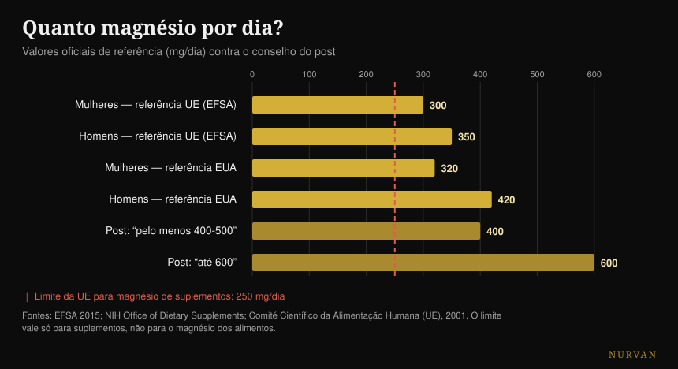
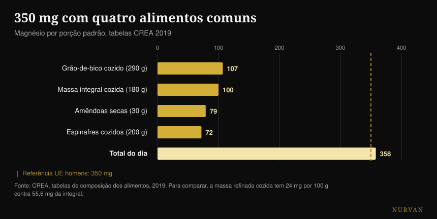

# Que magnésio escolher e qual a dose certa

Por [Giammaria Loi](/autore/giammaria-loi) · atualizado a 19 de outubro de 2026

Um carrossel muito partilhado lista dezasseis coisas que o magnésio faz, alinha doze formas com uma pontuação em estrelas e fecha com um número: 400-500 mg por dia, até 600 para alguns. Verifiquei quinze fontes. A lista de funções está correta, o ranking das formas inverte-se exatamente no ponto em que existe um estudo humano que o testa, e o número final é o problema mais sério do post — porque ignora o único valor que diz respeito à segurança.

## Em resumo

- **A referência oficial não é 400-600 mg.** Na Europa são 350 mg por dia para os homens e 300 para as mulheres (EFSA, 2015); nos Estados Unidos, 400-420 e 310-320.
- **O limite para o magnésio de suplementos é 250 mg por dia na UE** e 350 nos EUA. Vale só para a cápsula, não para a comida — e o post nunca o menciona.
- **Na comparação humana direta o citrato ganha ao quelato de aminoácidos**, ou seja, o oposto do ranking em estrelas. O óxido, por sua vez, não se distingue do placebo (Walker et al., 2003).
- **Nas cãibras o magnésio não funciona.** A revisão Cochrane diz isso com certeza alta, e sobre cãibras ligadas ao exercício não existe um único estudo (Garrison et al., 2020).
- **Com quatro alimentos comuns chega-se a 358 mg** sem abrir um frasco: a massa integral tem 2,3 vezes o magnésio da refinada (tabelas CREA).

## As 600 reações são verdade (mas não são motivo para suplementar)

Comecemos pelo que o post acerta. O magnésio é o segundo catião mais abundante dentro das células e está envolvido em **mais de 600 reações enzimáticas**: produção de ATP, síntese de DNA e RNA, contração muscular, função do coração e do cérebro. O número vem de uma revisão de fisiologia muito citada e está certo — com uma precisão: a fonte fala de 600 *reações*, o post de 600 *enzimas*. Não é a mesma coisa, mas a ordem de grandeza aguenta.

O problema é o salto lógico que essa lista convida a dar. "Serve para dezasseis coisas" não significa "é preciso mais". Um nutriente necessário a mil processos continua a ser necessário na quantidade em que é necessário: acima desse limiar não há bónus. É o mesmo erro que torna convincentes as listas de benefícios de qualquer suplemento — falei disso também no [ranking dos suplementos para a força](/pt/blog/ranking-suplementos-forca-tier-list), onde a distância entre o que um produto faz no corpo e o que faz no ginásio é muitas vezes enorme.

## Quanto magnésio é mesmo preciso

Aqui o post erra, e erra naquilo que o leitor vai realmente fazer.

A EFSA, no parecer de 2015 sobre os valores dietéticos de referência, fixa a ingestão adequada em **350 mg por dia para os homens adultos e 300 para as mulheres**. A entidade de referência dos Estados Unidos indica 400-420 mg para os homens e 310-320 para as mulheres. O "420-600" do quarto slide pega no valor mais alto de *uma só* faixa — homens acima dos 31 anos — e apresenta-o como o mínimo para todos, e depois constrói em cima um teto de 600 que não aparece em nenhuma recomendação.

O número que falta é o outro. O magnésio **tomado como suplemento** tem um limite superior de segurança: **250 mg por dia na União Europeia** (fixado em 2001 com base na diarreia ligeira, o primeiro efeito indesejável a aparecer) e 350 mg nos Estados Unidos. Esse limite não diz respeito ao magnésio dos alimentos, que não dá este problema: diz respeito só às cápsulas e às saquetas.

*Referências oficiais contra o conselho do post. A linha vermelha é o limite europeu para o magnésio de suplementos: vale só para a cápsula, não para a comida. Fontes: EFSA 2015; NIH Office of Dietary Supplements; Comité Científico da Alimentação Humana (UE), 2001.*

Traduzido na prática: "toma 400-600 mg" lido por quem não controla o que come transforma-se em "compra uma cápsula de 400 mg", que está acima do teto europeu e perto do americano. A frase certa é outra — são precisos 300-420 mg **no total**, comida incluída, e o suplemento cobre a diferença, não o total.

Há um último detalhe que quase ninguém diz: o **magnésio no sangue é um indicador fraco** do magnésio que tens de facto. Menos de 1% do magnésio corporal está no soro e esse valor correlaciona-se pouco com o conteúdo total dos tecidos. Uma análise normal não prova que estás bem, e uma ligeiramente abaixo não prova o contrário.

## O ranking das formas não se sustenta

O terceiro slide é a parte mais guardada e partilhada: doze formas, uma coluna "ideal para" e uma pontuação de absorção em estrelas. Glicinato cinco estrelas para sono e ansiedade, citrato quatro para a prisão de ventre, óxido uma só, sal de Epsom três para banhos relaxantes.

Existe um estudo que põe três destas formas uma contra a outra no ser humano. É um **estudo randomizado em duplo-cego com 46 pessoas**, 300 mg de magnésio elementar por dia durante 60 dias, com comparação direta entre quelato de aminoácidos, citrato e óxido. Resultado: **o citrato é o melhor**, no magnésio do sangue tanto depois da primeira dose (p = 0,026) como depois de dois meses (p = 0,006), e também no magnésio salivar. O óxido não se distingue do placebo.

Ou seja: na única comparação humana direta disponível, a forma a que o post dá quatro estrelas ganha àquela a que dá cinco. A única estrela que se sustenta é a estrela baixa do óxido.

Uma revisão sistemática posterior — 433 estudos examinados, 14 incluídos — confirma o quadro geral: as formas inorgânicas tendem a ser menos biodisponíveis do que as orgânicas e a percentagem absorvida depende da dose. Mas a conclusão dos autores é muito menos entusiasmante do que o cheat sheet: **todos** os suplementos de magnésio mantêm os níveis fisiológicos em pessoas saudáveis sem uma carência prévia.

E conta mais o produto do que a forma. Um estudo belga testou quinze produtos comerciais e encontrou uma variação "muito ampla"; os dois extremos, depois testados em trinta pessoas, deram uma área sob a curva de 6,87 contra 0,31 mM·min. O mesmo mineral, duas embalagens diferentes, um fator vinte de diferença.

| O que diz o slide | O que dizem os estudos em humanos |
|---|---|
| Glicinato 5 estrelas, citrato 4 | Na comparação direta o citrato ganha no soro e na saliva (Walker 2003) |
| Óxido 1 estrela | Confirmado: não se distingue do placebo (Walker 2003) |
| "Orgânico melhor que inorgânico" | Verdade como tendência, mas todas as formas mantêm os níveis em quem não tem carência (Pardo 2021) |
| Cada forma tem o seu objetivo | Nenhuma comparação direta entre formas no sono, ansiedade, tensão arterial ou recuperação |
| L-treonato para memória e cognição | Dois RCT: um assinado pela empresa do produto, o outro sobre uma fórmula com fosfatidilserina e vitaminas |
| Sal de Epsom, 3 estrelas de absorção | Nenhum estudo humano sobre a absorção pela pele |

Sobre o L-treonato vale a pena parar um momento, porque é a forma mais cara do mercado. Os dois estudos humanos existem mesmo, mas o primeiro — 44 adultos entre os 50 e os 70 anos, com uma melhoria cognitiva real e um efeito grande — é assinado por autores da empresa que produz o composto, e **os próprios autores escrevem que os efeitos no sono e na ansiedade não são determináveis**, tão forte foi o efeito placebo. O segundo testa uma fórmula que contém também fosfatidilserina, vitamina C e vitamina D: o que quer que tenha acontecido, não podes atribuí-lo ao treonato.

## Onde as provas se sustentam e onde não

**O sono.** A meta-análise dedicada encontra apenas três estudos randomizados, em 151 idosos com insónia: a latência para adormecer desce **17,36 minutos** (IC 95% -27,27 / -7,44). O tempo total de sono melhora 16 minutos mas não é significativo, o risco de viés é moderado a alto e a qualidade das provas é baixa a muito baixa. Numa revisão mais ampla sobre 31 estudos de suplementos para o sono, o magnésio **não tinha dados suficientes para entrar na meta-análise**, enquanto melatonina, vitamina D e aminoácidos entraram. Algo há, provavelmente. Não é o pilar que parece.

**A tensão arterial.** É o efeito melhor documentado de toda a lista, e é também o mais modesto: 34 estudos em duplo-cego com 2.028 pessoas, dose mediana 368 mg por dia durante três meses, resultado **-2,00 mmHg de sistólica e -1,78 de diastólica**. Real, mensurável, pequeno. Se tomas medicação para a tensão ou tens problemas renais, esta é uma conversa para o teu médico, não para um carrossel.

**As cãibras.** Aqui o post aponta na direção errada. A revisão Cochrane — 11 estudos, 735 pessoas — encontra nas cãibras noturnas dos adultos uma diferença de **-0,18 cãibras por semana** (IC -0,84 / +0,49), e a proporção de quem obtém pelo menos 25% de redução é RR 1,04 com **certeza alta**: é o dado mais sólido da revisão, e diz que não funciona. Os efeitos adversos menores são mais frequentes do que com placebo e a diarreia aparece em 11-37% dos participantes. E, sobretudo: **não existe um único estudo randomizado sobre cãibras ligadas ao exercício**. Uma revisão de 2026 confirma o quadro — funciona nas cãibras da gravidez, não nas noturnas dos adultos.

**A recuperação.** A revisão sistemática sobre magnésio e dores musculares pós-treino parte de 1.254 artigos e inclui **quatro**. Os autores levantam a hipótese de uma necessidade 10-20% mais alta em quem treina intensamente, o que é plausível — mas quatro estudos não são uma base em que se construam cinco estrelas.

## O que a investigação diz de facto

- **Confirmado** — o magnésio está envolvido em mais de 600 reações enzimáticas.
- **Confirmados** — os valores dos alimentos do quarto slide, copiados um a um da ficha oficial norte-americana. Com uma gralha: as batatas são 3,5 *onças*, não 3,5 *cup*.
- **Confirmado mas pequeno** — o efeito na tensão arterial: -2,00 / -1,78 mmHg com 368 mg por dia.
- **A precisar** — o sono: -17,36 minutos de latência, em três estudos de qualidade baixa.
- **Desmentido** — "a maior parte das pessoas precisa de 400-500 mg, algumas de 600". As referências oficiais são 300-420 mg totais, e o limite para os suplementos é 250 mg na UE.
- **Desmentida** — a hierarquia em estrelas: na comparação humana o citrato ganha ao quelato de aminoácidos.
- **Desmentido** — o magnésio para as cãibras: certeza alta de que não reduz as cãibras noturnas, nenhum estudo sobre as cãibras do exercício.
- **Não verificáveis** — todas as colunas "ideal para" (nenhuma comparação entre formas em desfechos clínicos), as três estrelas do sal de Epsom (nenhum estudo humano sobre a absorção cutânea) e a erosão do solo (nenhuma fonte).

## Como aplicar isto

**Primeiro conta o que comes.** Não é um conselho moral: é que o magnésio dos alimentos não tem limite de segurança e custa menos. Com quatro alimentos comuns passas os 350 mg.

*Magnésio por porção padrão segundo as tabelas CREA 2019. A linha tracejada é a referência europeia para os homens adultos.*

| Alimento | mg por 100 g | Porção | mg por porção |
|---|---|---|---|
| Amêndoas doces, secas | 264 | 30 g | 79 |
| Castanha de caju | 260 | 30 g | 78 |
| Nozes, secas | 131 | 30 g | 39 |
| Massa de sêmola integral, cozida | 55,6 | 180 g | 100 |
| Grão-de-bico seco, cozido | 37 | 290 g | 107 |
| Espinafres, cozidos em água | 36 | 200 g | 72 |
| Massa de sêmola, cozida | 24 | 200 g | 48 |

*Tabelas CREA 2019.*

**O detalhe mais útil é a última linha.** A massa integral cozida tem 55,6 mg de magnésio por 100 g, a refinada 24: **2,3 vezes**. Se comes massa quatro vezes por semana, trocar a versão vale mais do que qualquer escolha entre bisglicinato e taurato.

**Se suplementares, começa por uma dose baixa.** A literatura que mostra efeitos reais trabalha em torno dos 300-370 mg por dia, ou seja na ordem de grandeza da necessidade total, não do dobro. Somando a comida, uma cápsula de 100-200 mg é quase sempre suficiente para fechar a conta e fica dentro do limite europeu.

**Escolhe uma forma solúvel e um produto que declare o magnésio elementar.** Citrato, cloreto, lactato e os quelatos servem; o óxido é o que tem a pior base. Mais importante do que a forma: no rótulo tem de estar quanto magnésio *elementar* contém uma dose, não quantos miligramas pesa o sal.

**Se o tomas para dormir, toma-o à noite e dá-lhe três semanas.** E mantém as expectativas baixas: dezassete minutos menos para adormecer, com provas fracas. O momento para tomar cada suplemento analisei-o em detalhe [neste artigo sobre o horário](/pt/blog/quando-tomar-os-suplementos-horario).

**Se aparecerem fezes moles, passaste o teu limiar.** É o primeiro sinal, e é exatamente o efeito em que está construído o limite de segurança europeu.

> ### O magnésio no dia a dia, dentro do Nurvan
> O ponto deste artigo é que a conta se fecha à mesa, não no frasco. O diário alimentar do Nurvan trabalha com a base de dados CREA — os mesmos valores da tabela aqui em cima — por isso vês quanto magnésio chega de facto das tuas refeições antes de decidires se e quanto suplementar. A secção de suplementação regista dose, forma e horário, e põe-nos ao lado das cargas de treino e do sono das mesmas semanas. **[Experimenta o Nurvan](https://nurvan.app)**

## Perguntas frequentes

**Melhor o magnésio bisglicinato ou o citrato?**
No único estudo humano que os compara diretamente, o citrato é mais biodisponível do que o quelato de aminoácidos a 300 mg por dia durante 60 dias. A diferença prática entre as duas formas orgânicas continua, porém, pequena face à diferença entre suplementar e não suplementar: em pessoas saudáveis sem carência, todas as formas mantêm os níveis. A única a evitar é o óxido.

**Quanto magnésio por dia devo tomar?**
A necessidade total, comida incluída, é 350 mg para os homens e 300 para as mulheres segundo a EFSA (400-420 e 310-320 são as referências norte-americanas). O magnésio tomado como suplemento tem um limite de segurança separado: 250 mg por dia na UE, 350 nos EUA. Portanto o suplemento serve para cobrir a diferença entre o que comes e a necessidade, não para cobrir a necessidade inteira.

**O magnésio tira as cãibras?**
Nas cãibras noturnas dos adultos a revisão Cochrane diz que não, com certeza alta num dos desfechos. Sobre as cãibras ligadas ao exercício não existe nenhum estudo randomizado, portanto quem te aconselha isso para essas não tem dados em que se apoiar. A exceção é a gravidez, onde se vê algum efeito.

**O magnésio faz dormir melhor?**
Em três estudos em idosos com insónia reduz cerca de dezassete minutos o tempo para adormecer, mas a qualidade das provas é baixa e o tempo total de sono não muda de forma significativa. Numa revisão mais ampla sobre suplementos para o sono o magnésio não tinha nem dados suficientes para ser meta-analisado.

**Um banho com sais de Epsom faz absorver magnésio?**
No PubMed não existe um estudo em humanos que o meça. A única medição direta da absorção pela pele é in vitro, em pele de porco. O banho quente pode relaxar, mas atribuir o mérito ao magnésio que atravessa a pele não tem hoje base humana.

## Leia também

- [Ranking dos suplementos para a força: o que funciona de verdade](/pt/blog/ranking-suplementos-forca-tier-list)
- [Quando tomar os suplementos: o horário conta?](/pt/blog/quando-tomar-os-suplementos-horario)
- [Cafeína e sono: a que horas parar de tomar café](/pt/blog/cafeina-sono-quando-parar-de-tomar-cafe)

## Fontes

- de Baaij JHF, Hoenderop JGJ, Bindels RJM, 2015. Magnesium in man: implications for health and disease. *Physiological Reviews* 95(1):1-46. [PMID 25540137](https://pubmed.ncbi.nlm.nih.gov/25540137/) · [DOI](https://doi.org/10.1152/physrev.00012.2014)
- EFSA, 2015. *Dietary reference values: magnesium and phosphorus* (28 de julho de 2015). [efsa.europa.eu](https://www.efsa.europa.eu/en/press/news/150728)
- Comité Científico da Alimentação Humana (UE), 2001. Nível máximo tolerável de ingestão para o magnésio de suplementos: 250 mg/dia. [Documento de referência BfR](https://www.bfr.bund.de/cm/349/proposed-maximum-levels-for-the-addition-of-magnesium-to-foods-including-food-supplements.pdf)
- NIH Office of Dietary Supplements. *Magnesium — Fact Sheet for Health Professionals*. [ods.od.nih.gov](https://ods.od.nih.gov/factsheets/Magnesium-HealthProfessional/)
- Walker AF, Marakis G, Christie S, Byng M, 2003. Mg citrate found more bioavailable than other Mg preparations in a randomised, double-blind study. *Magnesium Research* 16(3):183-91. [PMID 14596323](https://pubmed.ncbi.nlm.nih.gov/14596323/)
- Pardo MR, Garicano Vilar E, San Mauro Martín I, Camina Martín MA, 2021. Bioavailability of magnesium food supplements: a systematic review. *Nutrition* 89:111294. [PMID 34111673](https://pubmed.ncbi.nlm.nih.gov/34111673/) · [DOI](https://doi.org/10.1016/j.nut.2021.111294)
- Blancquaert L, Vervaet C, Derave W, 2019. Predicting and testing bioavailability of magnesium supplements. *Nutrients* 11(7):1663. [PMID 31330811](https://pubmed.ncbi.nlm.nih.gov/31330811/) · [DOI](https://doi.org/10.3390/nu11071663)
- Mah J, Pitre T, 2021. Oral magnesium supplementation for insomnia in older adults: a systematic review and meta-analysis. *BMC Complementary Medicine and Therapies* 21(1):125. [PMID 33865376](https://pubmed.ncbi.nlm.nih.gov/33865376/) · [DOI](https://doi.org/10.1186/s12906-021-03297-z)
- Chan V, Lo K, 2021. Efficacy of dietary supplements on improving sleep quality: a systematic review and meta-analysis. *Postgraduate Medical Journal* 98(1158):285-293. [PMID 33441476](https://pubmed.ncbi.nlm.nih.gov/33441476/) · [DOI](https://doi.org/10.1136/postgradmedj-2020-139319)
- Zhang X, Li Y, Del Gobbo LC et al., 2016. Effects of magnesium supplementation on blood pressure: a meta-analysis of randomized double-blind placebo-controlled trials. *Hypertension* 68(2):324-33. [PMID 27402922](https://pubmed.ncbi.nlm.nih.gov/27402922/) · [DOI](https://doi.org/10.1161/HYPERTENSIONAHA.116.07664)
- Garrison SR, Korownyk CS, Kolber MR et al., 2020. Magnesium for skeletal muscle cramps. *Cochrane Database of Systematic Reviews* 9:CD009402. [PMID 32956536](https://pubmed.ncbi.nlm.nih.gov/32956536/) · [DOI](https://doi.org/10.1002/14651858.CD009402.pub3)
- Patil S, Falkowski A, Venkataiah VS et al., 2026. The role of electrolytes in muscle pain syndromes: a systematic review and meta-analysis. *International Dental Journal* 76(3):109488. [PMID 41812583](https://pubmed.ncbi.nlm.nih.gov/41812583/) · [DOI](https://doi.org/10.1016/j.identj.2026.109488)
- Tarsitano MG, Quinzi F, Folino K et al., 2024. Effects of magnesium supplementation on muscle soreness in different types of physical activities: a systematic review. *Journal of Translational Medicine* 22(1):629. [PMID 38970118](https://pubmed.ncbi.nlm.nih.gov/38970118/) · [DOI](https://doi.org/10.1186/s12967-024-05434-x)
- Liu G, Weinger JG, Lu ZL, Xue F, Sadeghpour S, 2016. Efficacy and safety of MMFS-01, a synapse density enhancer, for treating cognitive impairment in older adults. *Journal of Alzheimer's Disease* 49(4):971-90. [PMID 26519439](https://pubmed.ncbi.nlm.nih.gov/26519439/) · [DOI](https://doi.org/10.3233/JAD-150538)
- Ghimirey KB, Ita K, 2020. Microneedle-assisted percutaneous transport of magnesium sulfate. *Current Drug Delivery* 17(2):140-147. [PMID 31845631](https://pubmed.ncbi.nlm.nih.gov/31845631/) · [DOI](https://doi.org/10.2174/1567201817666191217093936)
- CREA — Centro de Investigação em Alimentos e Nutrição, *Tabelas de composição dos alimentos*, atualização de 2019. [alimentinutrizione.it](https://www.alimentinutrizione.it/tabelle-nutrizionali/ricerca-per-ordine-alfabetico)

*Ponto de partida: o carrossel de Siim Land ([@siimland](https://www.instagram.com/siimland/)) de 30 de setembro de 2026, [este post](https://www.instagram.com/p/Dd7HfSdgKyl/). Nenhum texto e nenhuma imagem do post foram reproduzidos: lemos as suas afirmações e verificámo-las na literatura.*

---

**Giammaria Loi** é o fundador do Nurvan. Treina com pesos desde 2012, trabalha como personal trainer e coach certificado FIPE desde 2013 e compete em powerlifting a nível nacional desde 2018. Cada artigo que assina parte dos estudos científicos e chega ao que funciona de verdade no ginásio.

> Nota: conteúdo informativo, não substitui a opinião de um médico ou de um profissional qualificado. O magnésio pode interagir com alguns medicamentos e a sua eliminação depende da função renal: se tomas medicação, se tens problemas nos rins ou no coração, ou se estás grávida, fala com o teu médico antes de suplementar.
