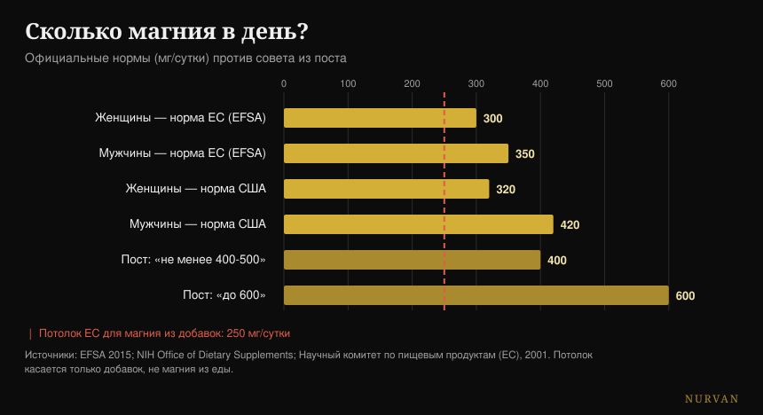
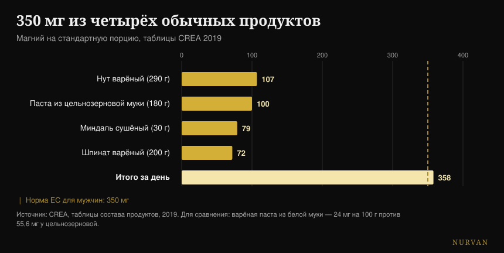

# Какой магний выбрать и сколько его нужно

Автор: [Giammaria Loi](/autore/giammaria-loi) · обновлено 19 октября 2026

Популярная карусель перечисляет шестнадцать вещей, которые делает магний, выстраивает двенадцать форм с оценкой в звёздах и заканчивается цифрой: 400-500 мг в сутки, у некоторых до 600. Я проверил пятнадцать источников. Список функций верный, рейтинг форм переворачивается именно там, где есть исследование на людях, а финальная цифра — самая серьёзная проблема этого поста, потому что она игнорирует единственное число, которое касается безопасности.

## Коротко

- **Официальная норма — не 400-600 мг.** В Европе это 350 мг в сутки для мужчин и 300 для женщин (EFSA, 2015); в США — 400-420 и 310-320.
- **Потолок для магния из добавок — 250 мг в сутки в ЕС** и 350 в США. Он касается только капсулы, а не еды — и пост его ни разу не называет.
- **В прямом сравнении на людях цитрат побеждает аминокислотный хелат**, то есть всё наоборот по сравнению с рейтингом в звёздах. А оксид не отличается от плацебо (Walker et al., 2003).
- **От судорог магний не работает.** Кокрейновский обзор говорит это с высокой степенью уверенности, а по судорогам при нагрузке нет ни одного исследования (Garrison et al., 2020).
- **Четыре обычных продукта дают 358 мг** без единой банки добавок: цельнозерновая паста содержит в 2,3 раза больше магния, чем белая (таблицы CREA).

## 600 реакций — правда (но это не повод принимать добавку)

Начнём с того, в чём пост прав. Магний — второй по распространённости катион внутри клеток, и он участвует в **более чем 600 ферментативных реакциях**: производство АТФ, синтез ДНК и РНК, мышечное сокращение, работа сердца и мозга. Цифра взята из часто цитируемого физиологического обзора и верна — с одной поправкой: источник говорит о 600 *реакциях*, а пост о 600 *ферментах*. Это не одно и то же, но порядок величины держится.

Проблема в логическом прыжке, к которому подталкивает такой список. «Нужен для шестнадцати вещей» не означает «нужно больше». Нутриент, необходимый тысяче процессов, остаётся нужным в том количестве, в котором он нужен: выше этого порога бонуса нет. Это та же ошибка, которая делает убедительными списки преимуществ любой добавки — я писал об этом и в [рейтинге добавок для силы](/ru/blog/reyting-sportivnykh-dobavok-dlya-sily), где разрыв между тем, что продукт делает в организме, и тем, что он делает в зале, часто огромен.

## Сколько магния нужно на самом деле

Здесь пост ошибается, и ошибается именно в том, что читатель реально сделает.

EFSA в заключении 2015 года о референсных значениях устанавливает адекватное потребление на уровне **350 мг в сутки для взрослых мужчин и 300 для женщин**. Американский референсный орган указывает 400-420 мг для мужчин и 310-320 для женщин. «420-600» с четвёртого слайда берёт самое высокое значение *одной* группы — мужчины старше 31 года — и подаёт его как минимум для всех, а сверху надстраивает потолок в 600, которого нет ни в одной рекомендации.

Не хватает другого числа. У магния, **принимаемого в виде добавки**, есть верхний предел безопасности: **250 мг в сутки в Европейском союзе** (установлен в 2001 году на основании лёгкой диареи — первого нежелательного эффекта, который появляется) и 350 мг в США. Этот предел не относится к магнию из продуктов, который такой проблемы не даёт: он относится только к капсулам и порошкам в саше.

*Официальные нормы против совета из поста. Красная линия — европейский потолок для магния из добавок: он касается только капсулы, а не еды. Источники: EFSA 2015; NIH Office of Dietary Supplements; Научный комитет по пищевым продуктам (ЕС), 2001.*

На практике это значит вот что: «принимай 400-600 мг» в руках человека, который не следит за своим питанием, превращается в «купи капсулу на 400 мг» — а это выше европейского потолка и близко к американскому. Правильная формулировка другая: нужно 300-420 мг **всего**, включая еду, и добавка закрывает разницу, а не всю сумму.

Есть последняя деталь, о которой почти никто не говорит: **магний в крови — плохой показатель** того магния, который у тебя действительно есть. Менее 1% магния организма находится в сыворотке, и этот показатель слабо связан с общим содержанием в тканях. Нормальный анализ не доказывает, что всё хорошо, а чуть пониженный не доказывает обратного.

## Рейтинг форм не выдерживает проверки

Третий слайд — самая сохраняемая и расшариваемая часть: двенадцать форм, колонка «идеально для» и оценка усвоения в звёздах. Глицинат — пять звёзд для сна и тревоги, цитрат — четыре от запоров, оксид — одна, соль Эпсома — три для расслабляющих ванн.

Есть исследование, которое сталкивает три из этих форм друг с другом на людях. Это **рандомизированное двойное слепое исследование с участием 46 человек**, 300 мг элементарного магния в сутки в течение 60 дней, с прямым сравнением аминокислотного хелата, цитрата и оксида. Результат: **лучший — цитрат**, по магнию в крови и после первой дозы (p = 0,026), и через два месяца (p = 0,006), и по магнию в слюне. Оксид не отличается от плацебо.

То есть: в единственном доступном прямом сравнении на людях форма, которой пост даёт четыре звезды, обыгрывает ту, которой он даёт пять. Единственная звезда, которая держится, — низкая у оксида.

Более поздний систематический обзор — 433 рассмотренных исследования, 14 включённых — подтверждает общую картину: неорганические формы в среднем менее биодоступны, чем органические, и доля всосавшегося зависит от дозы. Но вывод авторов гораздо менее захватывающий, чем шпаргалка: **все** добавки магния поддерживают физиологический уровень у здоровых людей без исходного дефицита.

И продукт значит больше, чем форма. Бельгийское исследование проверило пятнадцать коммерческих продуктов и нашло «очень широкий» разброс; два крайних, затем испытанных на тридцати участниках, дали площадь под кривой 6,87 против 0,31 мМ·мин. Один и тот же минерал, две разные упаковки, разница в двадцать раз.

| Что говорит слайд | Что говорят исследования на людях |
|---|---|
| Глицинат 5 звёзд, цитрат 4 | В прямом сравнении цитрат выигрывает по сыворотке и слюне (Walker 2003) |
| Оксид 1 звезда | Подтверждено: не отличается от плацебо (Walker 2003) |
| «Органическое лучше неорганического» | Как тенденция верно, но все формы поддерживают уровень у тех, у кого нет дефицита (Pardo 2021) |
| У каждой формы своя цель | Нет ни одного прямого сравнения форм по сну, тревоге, давлению или восстановлению |
| L-треонат для памяти и когнитивных функций | Два РКИ: одно подписано компанией — производителем продукта, другое по формуле с фосфатидилсерином и витаминами |
| Соль Эпсома, 3 звезды усвоения | Нет ни одного исследования на людях о всасывании через кожу |

На L-треонате стоит задержаться на минуту, потому что это самая дорогая форма на рынке. Два исследования на людях действительно существуют, но первое — 44 взрослых от 50 до 70 лет, с реальным улучшением когнитивных функций и большим размером эффекта — подписано авторами из компании, которая производит это соединение, и **сами авторы пишут, что эффекты на сон и тревогу определить невозможно** — настолько сильным был эффект плацебо. Второе проверяет формулу, в которой есть ещё фосфатидилсерин, витамин C и витамин D: что бы там ни произошло, приписать это треонату нельзя.

## Где доказательства держатся, а где нет

**Сон.** Посвящённый этому метаанализ находит всего три рандомизированных исследования, на 151 пожилом человеке с бессонницей: время засыпания сокращается на **17,36 минуты** (95% ДИ -27,27 / -7,44). Общее время сна улучшается на 16 минут, но незначимо, риск систематической ошибки от умеренного до высокого, а качество доказательств от низкого до очень низкого. В более широком обзоре по 31 исследованию добавок для сна у магния **не хватило данных, чтобы попасть в метаанализ**, тогда как мелатонин, витамин D и аминокислоты туда попали. Что-то есть, вероятно. Но это не тот столп, каким кажется.

**Давление.** Это самый хорошо задокументированный эффект из всего списка, и он же самый скромный: 34 двойных слепых исследования с участием 2.028 человек, медианная доза 368 мг в сутки в течение трёх месяцев, результат **-2,00 мм рт. ст. систолического и -1,78 диастолического**. Реальный, измеримый, маленький. Если ты принимаешь препараты от давления или у тебя проблемы с почками, это разговор с твоим врачом, а не с каруселью.

**Судороги.** Здесь пост указывает не туда. Кокрейновский обзор — 11 исследований, 735 человек — находит при ночных судорогах у взрослых разницу **-0,18 судороги в неделю** (ДИ -0,84 / +0,49), а доля тех, кто получает хотя бы 25% снижения, — ОР 1,04 с **высокой степенью уверенности**: это самый надёжный результат обзора, и он говорит, что это не работает. Лёгкие нежелательные эффекты встречаются чаще, чем на плацебо, а диарея появляется у 11-37% участников. И главное: **нет ни одного рандомизированного исследования по судорогам при нагрузке**. Обзор 2026 года подтверждает картину — работает при судорогах во время беременности, но не при ночных судорогах у взрослых.

**Восстановление.** Систематический обзор по магнию и мышечной болезненности после тренировки начинается с 1.254 статей и включает **четыре**. Авторы предполагают, что у тех, кто тренируется интенсивно, потребность на 10-20% выше, и это правдоподобно — но четыре исследования не та база, на которой строят пять звёзд.

## Что на самом деле говорит наука

- **Подтверждено** — магний участвует более чем в 600 ферментативных реакциях.
- **Подтверждены** — значения продуктов с четвёртого слайда, скопированные один в один с официальной американской справки. С опечаткой: картофель — это 3,5 *унции*, а не 3,5 *чашки*.
- **Подтверждено, но мало** — эффект на давление: -2,00 / -1,78 мм рт. ст. при 368 мг в сутки.
- **Требует уточнения** — сон: -17,36 минуты времени засыпания, на трёх исследованиях низкого качества.
- **Опровергнуто** — «большинству нужно 400-500 мг, некоторым 600». Официальные нормы — 300-420 мг всего, а потолок для добавок в ЕС — 250 мг.
- **Опровергнута** — иерархия в звёздах: в сравнении на людях цитрат побеждает аминокислотный хелат.
- **Опровергнуто** — магний от судорог: высокая степень уверенности в том, что он не снижает ночные судороги, и ни одного исследования по судорогам при нагрузке.
- **Не проверяемо** — все колонки «идеально для» (нет сравнения форм по клиническим исходам), три звезды соли Эпсома (нет исследований на людях о всасывании через кожу) и эрозия почв (нет источника).

## Как это применить

**Сначала посчитай то, что ешь.** Это не моральный совет: магний из еды не имеет потолка безопасности и стоит дешевле. Четырьмя обычными продуктами ты переходишь планку 350 мг.

*Магний на стандартную порцию по таблицам CREA 2019. Пунктирная линия — европейская норма для взрослых мужчин.*

| Продукт | мг на 100 г | Порция | мг на порцию |
|---|---|---|---|
| Миндаль сладкий, сушёный | 264 | 30 г | 79 |
| Кешью | 260 | 30 г | 78 |
| Грецкие орехи, сушёные | 131 | 30 г | 39 |
| Паста из цельнозерновой семолы, варёная | 55,6 | 180 г | 100 |
| Нут сухой, варёный | 37 | 290 г | 107 |
| Шпинат, отварной | 36 | 200 г | 72 |
| Паста из семолы, варёная | 24 | 200 г | 48 |

*Таблицы CREA 2019.*

**Самая полезная деталь — последняя строка.** В варёной цельнозерновой пасте 55,6 мг магния на 100 г, в белой — 24: **в 2,3 раза больше**. Если ты ешь пасту четыре раза в неделю, смена версии даёт больше, чем любой выбор между бисглицинатом и тауратом.

**Если принимаешь добавку, начни с низкой дозы.** Литература, которая показывает реальные эффекты, работает в районе 300-370 мг в сутки, то есть на уровне общей потребности, а не её удвоения. С учётом еды капсулы на 100-200 мг почти всегда хватает, чтобы закрыть счёт, и это остаётся внутри европейского потолка.

**Выбирай растворимую форму и продукт, который указывает элементарный магний.** Цитрат, хлорид, лактат и хелаты подходят; у оксида самая слабая база. Важнее формы другое: на этикетке должно быть написано, сколько *элементарного* магния в одной дозе, а не сколько миллиграммов весит соль.

**Если принимаешь его для сна, принимай вечером и дай ему три недели.** И держи ожидания низкими: засыпание на семнадцать минут быстрее, и это на слабых доказательствах. Время приёма каждой добавки я разобрал подробно [в этой статье о времени приёма](/ru/blog/kogda-prinimat-dobavki-vremya).

**Если появился жидкий стул, ты перешёл свой порог.** Это первый сигнал, и именно на этом эффекте построен европейский предел безопасности.

> ### Магний в твоём дне, внутри Nurvan
> Смысл этой статьи в том, что счёт закрывается за столом, а не в банке. Дневник питания в Nurvan работает на базе данных CREA — те же значения, что в таблице выше, — поэтому ты видишь, сколько магния реально приходит из твоих приёмов пищи, прежде чем решать, нужна ли добавка и в каком количестве. Раздел добавок фиксирует дозу, форму и время приёма и ставит их рядом с тренировочными нагрузками и сном тех же недель. **[Попробовать Nurvan](https://nurvan.app)**

## Частые вопросы

**Что лучше: бисглицинат магния или цитрат?**
В единственном исследовании на людях, которое сравнивает их напрямую, цитрат оказывается более биодоступным, чем аминокислотный хелат, при 300 мг в сутки в течение 60 дней. Но практическая разница между двумя органическими формами остаётся маленькой по сравнению с разницей между «принимать» и «не принимать»: у здоровых людей без дефицита все формы поддерживают уровень. Единственная, которой стоит избегать, — оксид.

**Сколько магния в сутки мне принимать?**
Общая потребность, включая еду, — 350 мг для мужчин и 300 для женщин по EFSA (400-420 и 310-320 — американские нормы). У магния в виде добавки есть отдельный предел безопасности: 250 мг в сутки в ЕС, 350 в США. То есть добавка нужна, чтобы закрыть разницу между тем, что ты ешь, и потребностью, а не чтобы закрыть всю потребность.

**Магний убирает судороги?**
При ночных судорогах у взрослых Кокрейновский обзор говорит «нет», с высокой степенью уверенности по одному из исходов. По судорогам при нагрузке нет ни одного рандомизированного исследования, так что у того, кто советует магний для них, нет данных, на которые можно опереться. Исключение — беременность, там какой-то эффект виден.

**Магний помогает лучше спать?**
В трёх исследованиях на пожилых людях с бессонницей он сокращает время засыпания примерно на семнадцать минут, но качество доказательств низкое, а общее время сна значимо не меняется. В более широком обзоре добавок для сна у магния не хватило данных даже для того, чтобы войти в метаанализ.

**Ванна с солью Эпсома даёт усвоение магния?**
В PubMed нет исследования на людях, которое это измеряет. Единственное прямое измерение всасывания через кожу сделано in vitro, на свиной коже. Горячая ванна может расслаблять, но приписывать заслугу магнию, который проходит через кожу, сегодня не на чем.

## Читайте также

- [Рейтинг добавок для силы: что работает на самом деле](/ru/blog/reyting-sportivnykh-dobavok-dlya-sily)
- [Когда принимать добавки: важно ли время?](/ru/blog/kogda-prinimat-dobavki-vremya)
- [Кофеин и сон: во сколько перестать пить кофе](/ru/blog/kofein-i-son-kogda-perestat-pit-kofe)

## Источники

- de Baaij JHF, Hoenderop JGJ, Bindels RJM, 2015. Magnesium in man: implications for health and disease. *Physiological Reviews* 95(1):1-46. [PMID 25540137](https://pubmed.ncbi.nlm.nih.gov/25540137/) · [DOI](https://doi.org/10.1152/physrev.00012.2014)
- EFSA, 2015. *Dietary reference values: magnesium and phosphorus* (28 июля 2015). [efsa.europa.eu](https://www.efsa.europa.eu/en/press/news/150728)
- Научный комитет по пищевым продуктам (ЕС), 2001. Допустимый верхний уровень потребления магния из добавок: 250 мг/сутки. [Справочный документ BfR](https://www.bfr.bund.de/cm/349/proposed-maximum-levels-for-the-addition-of-magnesium-to-foods-including-food-supplements.pdf)
- NIH Office of Dietary Supplements. *Magnesium — Fact Sheet for Health Professionals*. [ods.od.nih.gov](https://ods.od.nih.gov/factsheets/Magnesium-HealthProfessional/)
- Walker AF, Marakis G, Christie S, Byng M, 2003. Mg citrate found more bioavailable than other Mg preparations in a randomised, double-blind study. *Magnesium Research* 16(3):183-91. [PMID 14596323](https://pubmed.ncbi.nlm.nih.gov/14596323/)
- Pardo MR, Garicano Vilar E, San Mauro Martín I, Camina Martín MA, 2021. Bioavailability of magnesium food supplements: a systematic review. *Nutrition* 89:111294. [PMID 34111673](https://pubmed.ncbi.nlm.nih.gov/34111673/) · [DOI](https://doi.org/10.1016/j.nut.2021.111294)
- Blancquaert L, Vervaet C, Derave W, 2019. Predicting and testing bioavailability of magnesium supplements. *Nutrients* 11(7):1663. [PMID 31330811](https://pubmed.ncbi.nlm.nih.gov/31330811/) · [DOI](https://doi.org/10.3390/nu11071663)
- Mah J, Pitre T, 2021. Oral magnesium supplementation for insomnia in older adults: a systematic review and meta-analysis. *BMC Complementary Medicine and Therapies* 21(1):125. [PMID 33865376](https://pubmed.ncbi.nlm.nih.gov/33865376/) · [DOI](https://doi.org/10.1186/s12906-021-03297-z)
- Chan V, Lo K, 2021. Efficacy of dietary supplements on improving sleep quality: a systematic review and meta-analysis. *Postgraduate Medical Journal* 98(1158):285-293. [PMID 33441476](https://pubmed.ncbi.nlm.nih.gov/33441476/) · [DOI](https://doi.org/10.1136/postgradmedj-2020-139319)
- Zhang X, Li Y, Del Gobbo LC et al., 2016. Effects of magnesium supplementation on blood pressure: a meta-analysis of randomized double-blind placebo-controlled trials. *Hypertension* 68(2):324-33. [PMID 27402922](https://pubmed.ncbi.nlm.nih.gov/27402922/) · [DOI](https://doi.org/10.1161/HYPERTENSIONAHA.116.07664)
- Garrison SR, Korownyk CS, Kolber MR et al., 2020. Magnesium for skeletal muscle cramps. *Cochrane Database of Systematic Reviews* 9:CD009402. [PMID 32956536](https://pubmed.ncbi.nlm.nih.gov/32956536/) · [DOI](https://doi.org/10.1002/14651858.CD009402.pub3)
- Patil S, Falkowski A, Venkataiah VS et al., 2026. The role of electrolytes in muscle pain syndromes: a systematic review and meta-analysis. *International Dental Journal* 76(3):109488. [PMID 41812583](https://pubmed.ncbi.nlm.nih.gov/41812583/) · [DOI](https://doi.org/10.1016/j.identj.2026.109488)
- Tarsitano MG, Quinzi F, Folino K et al., 2024. Effects of magnesium supplementation on muscle soreness in different types of physical activities: a systematic review. *Journal of Translational Medicine* 22(1):629. [PMID 38970118](https://pubmed.ncbi.nlm.nih.gov/38970118/) · [DOI](https://doi.org/10.1186/s12967-024-05434-x)
- Liu G, Weinger JG, Lu ZL, Xue F, Sadeghpour S, 2016. Efficacy and safety of MMFS-01, a synapse density enhancer, for treating cognitive impairment in older adults. *Journal of Alzheimer's Disease* 49(4):971-90. [PMID 26519439](https://pubmed.ncbi.nlm.nih.gov/26519439/) · [DOI](https://doi.org/10.3233/JAD-150538)
- Ghimirey KB, Ita K, 2020. Microneedle-assisted percutaneous transport of magnesium sulfate. *Current Drug Delivery* 17(2):140-147. [PMID 31845631](https://pubmed.ncbi.nlm.nih.gov/31845631/) · [DOI](https://doi.org/10.2174/1567201817666191217093936)
- CREA — Центр исследований пищевых продуктов и питания, *Таблицы состава продуктов*, обновление 2019. [alimentinutrizione.it](https://www.alimentinutrizione.it/tabelle-nutrizionali/ricerca-per-ordine-alfabetico)

*Отправная точка: карусель Siim Land ([@siimland](https://www.instagram.com/siimland/)) от 30 сентября 2026, [этот пост](https://www.instagram.com/p/Dd7HfSdgKyl/). Ни текст, ни изображения поста не воспроизводились: мы прочитали его утверждения и проверили их по литературе.*

---

**Giammaria Loi** — основатель Nurvan. Он тренируется с отягощениями с 2012 года, работает персональным тренером и коучем с сертификацией FIPE с 2013 года и выступает в пауэрлифтинге на национальном уровне с 2018 года. Каждая его статья начинается с научных исследований и заканчивается тем, что действительно работает в зале.

> Примечание: информационный материал, он не заменяет мнение врача или квалифицированного специалиста. Магний может взаимодействовать с некоторыми лекарствами, а его выведение зависит от функции почек: если ты принимаешь лекарства, если у тебя есть проблемы с почками или сердцем или если ты беременна, обсуди приём добавки с врачом.
