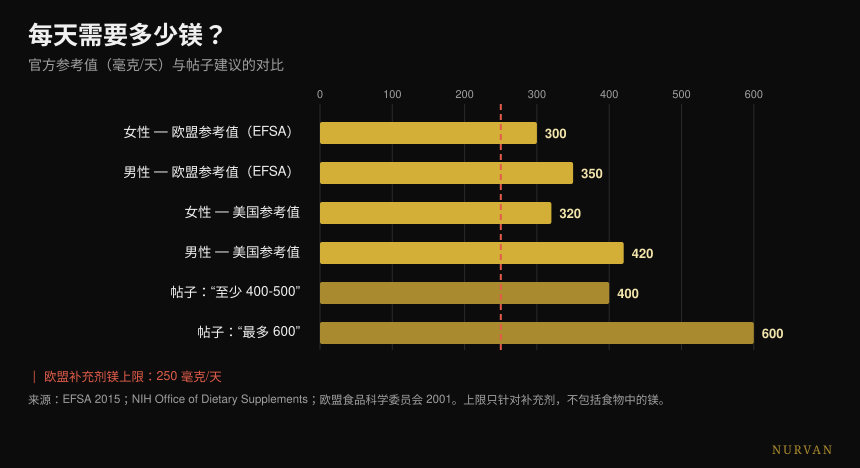
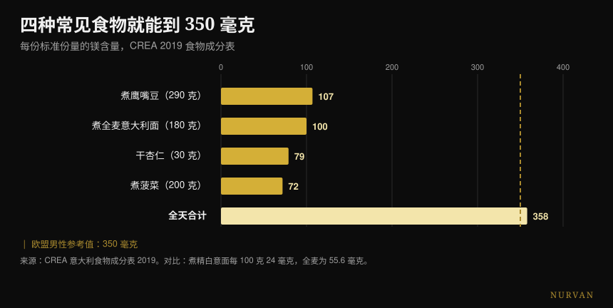

# 镁怎么选？剂量与形式的科学答案

作者： [Giammaria Loi](/autore/giammaria-loi) · 更新于 2026 年 10 月 19 日

一组被大量转发的图文列出镁能做的十六件事，用星级给十二种形式排了名，最后落在一个数字上：每天 400-500 毫克，有些人到 600。我核对了十五份来源。作用清单是对的，形式排行榜在唯一一项人体研究检验它的地方整个反转，而结尾那个数字是这个帖子最严重的问题——因为它漏掉了唯一和安全有关的数字。

## 要点速览

- **官方参考值不是 400-600 毫克。**在欧洲是男性每天 350 毫克、女性 300 毫克（EFSA, 2015）；在美国是 400-420 和 310-320。
- **来自补剂的镁，欧盟上限是每天 250 毫克**，美国是 350 毫克。它只管药片，不管食物——而帖子一次都没提。
- **在人体直接对比中，柠檬酸镁胜过氨基酸螯合物**，正好是星级排行榜的反面。氧化镁则与安慰剂没有区别（Walker et al., 2003）。
- **对肌肉抽筋，镁没有用。**Cochrane 系统评价以高确定性这么说，而关于运动性抽筋连一项研究都不存在（Garrison et al., 2020）。
- **四样普通食物就能吃到 358 毫克**，一个罐子都不用打开：全麦意面的镁是精白意面的 2.3 倍（CREA 成分表）。

## 600 个反应是真的（但它不是补镁的理由）

先说帖子说对的地方。镁是细胞内第二丰富的阳离子，参与**600 多个酶反应**：ATP 生成、DNA 和 RNA 合成、肌肉收缩、心脏和大脑功能。这个数字来自一篇被大量引用的生理学综述，是准确的——只需补一句：来源说的是 600 个*反应*，帖子说的是 600 种*酶*。这不是一回事，但量级站得住。

问题是那张清单引着你去做的那个逻辑跳跃。“它有十六种用处”不等于“你需要更多”。一个被上千个过程需要的营养素，仍然只在被需要的量上被需要：越过那个门槛就没有额外奖励了。这正是让任何补剂的功效清单听起来很有说服力的同一个错误——我在[力量补剂等级榜](/zh/blog/liliang-buji-dengji-bang)里也写过，一个产品在身体里做了什么，和它在健身房里做了什么，两者的距离往往大得惊人。

## 你到底需要多少镁

帖子在这里弄错了，而且错在读者真正会去做的那件事上。

EFSA 在 2015 年关于膳食参考值的意见中，把适宜摄入量定为**成年男性每天 350 毫克、女性 300 毫克**。美国的参考机构给出男性 400-420 毫克、女性 310-320 毫克。第四页那个“420-600”取的是*某一个*年龄段——31 岁以上男性——里的最高值，把它当成所有人的下限，再在上面搭了一个 600 的天花板，而这个数字在任何一份推荐里都找不到。

缺的是另一个数字。**作为补剂摄入**的镁有一个安全上限：**欧盟每天 250 毫克**（2001 年依据轻度腹泻设定，那是最先出现的不良反应），美国 350 毫克。这个上限不针对食物里的镁，食物不会造成这个问题：它只针对胶囊和冲剂。

*官方参考值对比帖子的建议。红线是欧洲对补剂来源镁的上限：只适用于药片，不适用于食物。来源：EFSA 2015；NIH 膳食补充剂办公室；欧盟食品科学委员会，2001。*

换成实际场景：“吃 400-600 毫克”，被一个根本不记录自己吃什么的人读到，就变成“买一粒 400 毫克的胶囊”，而这已经高于欧洲上限、接近美国上限。正确的说法是另一句——你需要的是**总共** 300-420 毫克，包括食物，而补剂补的是差额，不是全部。

还有最后一个几乎没人说的细节：**血液里的镁是个很差的指标**，说明不了你身体里真正有多少镁。体内镁不到 1% 待在血清里，而这个数值与组织总含量的相关性很弱。血检在正常范围并不证明你没问题，刚刚低于范围也不证明相反。

## 形式排行榜站不住

第三页是被下载和转发最多的部分：十二种形式，一栏“适合什么”，再加一个星级吸收评分。甘氨酸镁五星，管睡眠和焦虑；柠檬酸镁四星，管便秘；氧化镁只有一星；泻盐三星，用来泡放松浴。

确实有一项研究把其中三种形式放在人体里正面比较。它是一项**纳入 46 人的随机双盲试验**，每天 300 毫克元素镁，持续 60 天，直接对比氨基酸螯合物、柠檬酸盐和氧化物。结果：**柠檬酸镁最好**，无论是首剂之后（p = 0.026）还是两个月之后（p = 0.006）的血镁，唾液镁也一样。氧化镁与安慰剂没有区别。

也就是说：在现有唯一一项人体直接对比里，帖子给四星的那个形式，打败了它给五星的那个。唯一站得住的星级，是氧化镁那个低分。

后来的一篇系统评价——筛查 433 项研究，纳入 14 项——证实了大方向：无机形式的生物利用度通常低于有机形式，而吸收百分比取决于剂量。但作者的结论远没有那张速查表那么刺激：对没有既存缺乏的健康人来说，**所有**镁补剂都能维持生理水平。

而且产品比形式更要紧。一项比利时研究测试了十五种市售产品，发现差异“非常大”；把两端的两种拿到三十人身上试，曲线下面积是 6.87 对 0.31 mM·min。同一种矿物质，两个不同的包装，二十倍的差距。

| 这一页怎么说 | 人体研究怎么说 |
|---|---|
| 甘氨酸镁 5 星，柠檬酸镁 4 星 | 正面对比中柠檬酸镁在血清和唾液上都胜出（Walker 2003） |
| 氧化镁 1 星 | 确认：与安慰剂没有区别（Walker 2003） |
| “有机优于无机” | 作为趋势成立，但在不缺乏的人身上所有形式都能维持水平（Pardo 2021） |
| 每种形式各有专攻 | 在睡眠、焦虑、血压或恢复上，没有任何形式间的正面对比 |
| L-苏糖酸镁管记忆和认知 | 两项随机对照试验：一项由产品公司署名，另一项用的是含磷脂酰丝氨酸和维生素的复方 |
| 泻盐，吸收 3 星 | 没有任何关于经皮吸收的人体研究 |

L-苏糖酸镁值得停一下，因为它是市面上最贵的形式。两项人体研究确实存在，但第一项——44 名 50 到 70 岁的成年人，认知确有改善且效应量很大——由生产该化合物的公司的研究者署名，而且**作者本人写道，睡眠和焦虑上的效果无法判定**，因为安慰剂效应太强。第二项测试的复方里还含有磷脂酰丝氨酸、维生素 C 和维生素 D：不管发生了什么，你没法把它归到苏糖酸上。

## 证据在哪里成立，在哪里不成立

**睡眠。**专门的荟萃分析只找到三项随机试验，对象是 151 名失眠的老年人：入睡潜伏期缩短 **17.36 分钟**（95% 置信区间 -27.27 / -7.44）。总睡眠时间改善 16 分钟，但不显著，偏倚风险从中等到高，证据质量从低到极低。在一项覆盖 31 项睡眠补剂试验的更大范围综述里，镁**连进入荟萃分析的数据都不够**，而褪黑素、维生素 D 和氨基酸都进去了。大概是有点东西的。但它不是看起来那样的支柱。

**血压。**这是整张清单里证据最充分的效果，也是最温和的：34 项双盲试验，2,028 人，中位剂量每天 368 毫克，持续三个月，结果是**收缩压 -2.00 mmHg、舒张压 -1.78**。真实、可测、很小。如果你在吃降压药或有肾脏问题，这是该跟你的医生谈的事，不是跟一组图文谈的事。

**抽筋。**这里帖子的方向是错的。Cochrane 系统评价——11 项研究、735 人——在成人夜间抽筋上发现的差异是**每周 -0.18 次**（置信区间 -0.84 / +0.49），而至少获得 25% 减少的人群比例是 RR 1.04，且**确定性为高**：这是整篇评价里最扎实的数据，而它说的是没用。轻微不良反应比安慰剂更常见，腹泻出现在 11-37% 的参与者身上。更要紧的是：**关于运动性抽筋，连一项随机试验都不存在**。2026 年的一篇综述证实了这个格局——它在妊娠期抽筋上有用，在成人夜间抽筋上没有。

**恢复。**关于镁与训练后肌肉酸痛的系统评价从 1,254 篇文章出发，最后纳入**四篇**。作者推测高强度训练者的需求要高出 10-20%，这说得通——但四项研究不是能撑起五星评分的底座。

## 研究到底怎么说

- **证实** — 镁参与 600 多个酶反应。
- **证实** — 第四页的食物数值，是从美国官方资料页一条条抄下来的。有一个笔误：马铃薯是 3.5 *盎司*，不是 3.5 *杯*。
- **证实但很小** — 对血压的效果：每天 368 毫克下 -2.00 / -1.78 mmHg。
- **需要补充** — 睡眠：入睡潜伏期 -17.36 分钟，来自三项低质量研究。
- **已被推翻** — “大多数人需要 400-500 毫克，有些人要 600”。官方参考值是总共 300-420 毫克，而补剂的上限在欧盟是 250 毫克。
- **已被推翻** — 星级层级：在人体对比中柠檬酸镁胜过氨基酸螯合物。
- **已被推翻** — 用镁治抽筋：高确定性地不能减少夜间抽筋，而关于运动性抽筋没有任何研究。
- **无法核实** — 所有“适合什么”的栏目（没有任何形式间在临床结局上的对比）、泻盐的三颗星（没有经皮吸收的人体研究），以及土壤流失那一条（没有来源）。

## 怎么落地

**先把吃进去的算清楚。**这不是道德建议：而是食物里的镁没有安全上限，而且更便宜。四样普通食物就能超过 350 毫克。

*按 CREA 2019 成分表计算的每标准份镁含量。虚线是欧洲对成年男性的参考值。*

| 食物 | 每 100 克毫克数 | 份量 | 每份毫克数 |
|---|---|---|---|
| 甜杏仁，干 | 264 | 30 g | 79 |
| 腰果 | 260 | 30 g | 78 |
| 核桃，干 | 131 | 30 g | 39 |
| 全麦硬粒小麦意面，煮熟 | 55.6 | 180 g | 100 |
| 干鹰嘴豆，煮熟 | 37 | 290 g | 107 |
| 菠菜，水煮 | 36 | 200 g | 72 |
| 硬粒小麦意面，煮熟 | 24 | 200 g | 48 |

*CREA 2019 成分表。*

**最有用的细节是最后一行。**煮熟的全麦意面每 100 克含 55.6 毫克镁，精白的是 24 毫克：**2.3 倍**。如果你一周吃四次意面，换一种版本比在甘氨酸镁和牛磺酸镁之间做选择更值。

**如果要补，从低剂量开始。**显示出真实效果的文献，工作区间在每天 300-370 毫克左右，也就是总需求的量级，不是它的两倍。把食物算进去，一粒 100-200 毫克的胶囊几乎总能补上差额，而且留在欧洲上限之内。

**选一种可溶的形式，和一个标明元素镁的产品。**柠檬酸盐、氯化物、乳酸盐和各种螯合物都可以；氧化物的证据基础最差。比形式更重要的是：标签上必须写清一份含多少*元素*镁，而不是这个盐一共重多少毫克。

**如果是为了睡眠，就晚上吃，并给它三周时间。**同时把期待放低：入睡快十七分钟，而且证据薄弱。每种补剂该什么时候吃，我在[这篇关于服用时间的文章](/zh/blog/buji-shenme-shijian-chi)里做了详细分析。

**如果出现稀便，说明你越过了自己的阈值。**这是第一个信号，也正是欧洲安全上限所依据的那个效应。

> ### 一天里的镁，在 Nurvan 里
> 这篇文章的要点是：这笔账在餐桌上结清，不在罐子里。Nurvan 的饮食日记跑在 CREA 数据库上——和上面那张表同一套数值——所以你能先看清自己的几餐真正提供了多少镁，再决定要不要补、补多少。补剂板块会记录剂量、形式和时间，并把它们放在同一些周里的训练负荷和睡眠旁边。**[试用 Nurvan](https://nurvan.app)**

## 常见问题

**甘氨酸镁和柠檬酸镁哪个更好？**
在唯一一项直接比较两者的人体研究里，每天 300 毫克、持续 60 天，柠檬酸镁的生物利用度更高。不过两种有机形式之间的实际差别，相比“补”与“不补”的差别仍然很小：在没有缺乏的健康人身上，所有形式都能维持水平。唯一要避开的是氧化镁。

**我每天该吃多少镁？**
包括食物在内的总需求，按 EFSA 是男性 350 毫克、女性 300 毫克（美国参考值为 400-420 和 310-320）。作为补剂摄入的镁另有一个安全上限：欧盟每天 250 毫克，美国 350 毫克。所以补剂的作用是补上你吃到的量和需求之间的差额，而不是承担全部需求。

**镁能治好肌肉抽筋吗？**
在成人夜间抽筋上，Cochrane 系统评价说不能，其中一个结局的确定性为高。关于运动性抽筋则没有任何随机试验，所以为此向你推荐镁的人没有数据可依。妊娠期是例外，那里确实能看到一些效果。

**镁能让人睡得更好吗？**
在三项针对失眠老年人的研究里，它把入睡时间缩短约十七分钟，但证据质量低，总睡眠时间也没有显著变化。在一项范围更广的睡眠补剂综述里，镁连被纳入荟萃分析的数据都不够。

**用泻盐泡浴能吸收到镁吗？**
PubMed 上没有任何人体研究测量过这件事。关于经皮吸收唯一的直接测量是体外的，用的是猪皮。热水浴可以让人放松，但把功劳归给穿过皮肤的镁，今天没有人体依据。

## 延伸阅读

- [力量补剂等级榜：到底什么有效](/zh/blog/liliang-buji-dengji-bang)
- [补剂什么时间吃：时辰真的有影响吗](/zh/blog/buji-shenme-shijian-chi)
- [咖啡因与睡眠：几点该停止喝咖啡](/zh/blog/kafeiyin-shuimian-jidian-jie-kafei)

## 参考文献

- de Baaij JHF, Hoenderop JGJ, Bindels RJM, 2015. Magnesium in man: implications for health and disease. *Physiological Reviews* 95(1):1-46. [PMID 25540137](https://pubmed.ncbi.nlm.nih.gov/25540137/) · [DOI](https://doi.org/10.1152/physrev.00012.2014)
- EFSA, 2015. *Dietary reference values: magnesium and phosphorus*（2015 年 7 月 28 日）。[efsa.europa.eu](https://www.efsa.europa.eu/en/press/news/150728)
- 欧盟食品科学委员会，2001。补剂来源镁的可耐受最高摄入量：250 mg/天。[BfR 参考文件](https://www.bfr.bund.de/cm/349/proposed-maximum-levels-for-the-addition-of-magnesium-to-foods-including-food-supplements.pdf)
- NIH 膳食补充剂办公室。*Magnesium — Fact Sheet for Health Professionals*。[ods.od.nih.gov](https://ods.od.nih.gov/factsheets/Magnesium-HealthProfessional/)
- Walker AF, Marakis G, Christie S, Byng M, 2003. Mg citrate found more bioavailable than other Mg preparations in a randomised, double-blind study. *Magnesium Research* 16(3):183-91. [PMID 14596323](https://pubmed.ncbi.nlm.nih.gov/14596323/)
- Pardo MR, Garicano Vilar E, San Mauro Martín I, Camina Martín MA, 2021. Bioavailability of magnesium food supplements: a systematic review. *Nutrition* 89:111294. [PMID 34111673](https://pubmed.ncbi.nlm.nih.gov/34111673/) · [DOI](https://doi.org/10.1016/j.nut.2021.111294)
- Blancquaert L, Vervaet C, Derave W, 2019. Predicting and testing bioavailability of magnesium supplements. *Nutrients* 11(7):1663. [PMID 31330811](https://pubmed.ncbi.nlm.nih.gov/31330811/) · [DOI](https://doi.org/10.3390/nu11071663)
- Mah J, Pitre T, 2021. Oral magnesium supplementation for insomnia in older adults: a systematic review and meta-analysis. *BMC Complementary Medicine and Therapies* 21(1):125. [PMID 33865376](https://pubmed.ncbi.nlm.nih.gov/33865376/) · [DOI](https://doi.org/10.1186/s12906-021-03297-z)
- Chan V, Lo K, 2021. Efficacy of dietary supplements on improving sleep quality: a systematic review and meta-analysis. *Postgraduate Medical Journal* 98(1158):285-293. [PMID 33441476](https://pubmed.ncbi.nlm.nih.gov/33441476/) · [DOI](https://doi.org/10.1136/postgradmedj-2020-139319)
- Zhang X, Li Y, Del Gobbo LC et al., 2016. Effects of magnesium supplementation on blood pressure: a meta-analysis of randomized double-blind placebo-controlled trials. *Hypertension* 68(2):324-33. [PMID 27402922](https://pubmed.ncbi.nlm.nih.gov/27402922/) · [DOI](https://doi.org/10.1161/HYPERTENSIONAHA.116.07664)
- Garrison SR, Korownyk CS, Kolber MR et al., 2020. Magnesium for skeletal muscle cramps. *Cochrane Database of Systematic Reviews* 9:CD009402. [PMID 32956536](https://pubmed.ncbi.nlm.nih.gov/32956536/) · [DOI](https://doi.org/10.1002/14651858.CD009402.pub3)
- Patil S, Falkowski A, Venkataiah VS et al., 2026. The role of electrolytes in muscle pain syndromes: a systematic review and meta-analysis. *International Dental Journal* 76(3):109488. [PMID 41812583](https://pubmed.ncbi.nlm.nih.gov/41812583/) · [DOI](https://doi.org/10.1016/j.identj.2026.109488)
- Tarsitano MG, Quinzi F, Folino K et al., 2024. Effects of magnesium supplementation on muscle soreness in different types of physical activities: a systematic review. *Journal of Translational Medicine* 22(1):629. [PMID 38970118](https://pubmed.ncbi.nlm.nih.gov/38970118/) · [DOI](https://doi.org/10.1186/s12967-024-05434-x)
- Liu G, Weinger JG, Lu ZL, Xue F, Sadeghpour S, 2016. Efficacy and safety of MMFS-01, a synapse density enhancer, for treating cognitive impairment in older adults. *Journal of Alzheimer's Disease* 49(4):971-90. [PMID 26519439](https://pubmed.ncbi.nlm.nih.gov/26519439/) · [DOI](https://doi.org/10.3233/JAD-150538)
- Ghimirey KB, Ita K, 2020. Microneedle-assisted percutaneous transport of magnesium sulfate. *Current Drug Delivery* 17(2):140-147. [PMID 31845631](https://pubmed.ncbi.nlm.nih.gov/31845631/) · [DOI](https://doi.org/10.2174/1567201817666191217093936)
- CREA — 食品与营养研究中心，*意大利食物成分表*，2019 年更新。[alimentinutrizione.it](https://www.alimentinutrizione.it/tabelle-nutrizionali/ricerca-per-ordine-alfabetico)

*出发点：Siim Land（[@siimland](https://www.instagram.com/siimland/)）2026 年 9 月 30 日的图文帖，[这个帖子](https://www.instagram.com/p/Dd7HfSdgKyl/)。帖子的文字与图片均未被复制：我们读了它的论点，并对照文献逐条核实。*

---

**Giammaria Loi** 是 Nurvan 的创始人。他自 2012 年开始进行力量训练，自 2013 年起担任 FIPE 认证的私人教练，并自 2018 年起在全国级别参加力量举比赛。他署名的每一篇文章都从科学研究出发，落到健身房里真正有效的做法。 [作者页面](/autore/giammaria-loi)

> 说明：本文为科普内容，不能替代医生或其他合格专业人士的意见。镁可能与某些药物相互作用，它的排出依赖肾功能：如果你正在接受治疗、有肾脏或心脏问题，或处于孕期，请在补充之前与你的医生沟通。
