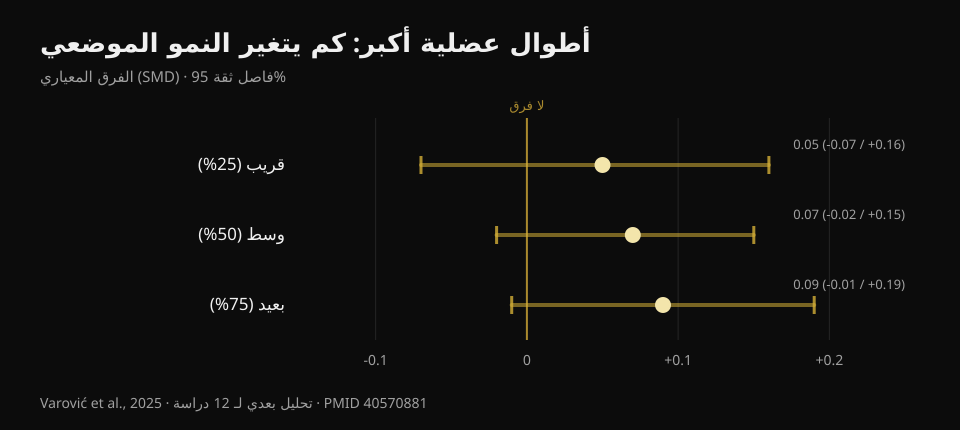
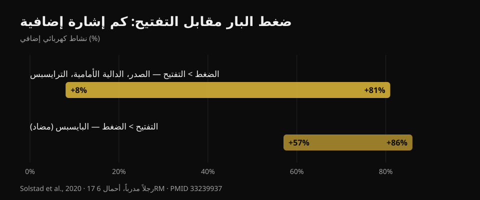

# دفع الدمبل أم التفتيح: أيهما يكبّر الصدر أكثر؟

بقلم [Giammaria Loi](/autore/giammaria-loi) · تحديث 20 أكتوبر 2026

منشور متسلسل انتشر على نطاق واسع يروي دراسة حديثة جدًا: عشرة أسابيع، دفع الدمبل على البنش مقابل التفتيح بالدمبل، وفي النهاية ينمو الصدر بالقدر نفسه. الخلاصة مريحة — اختر ما يروق لك — وهي صحيحة إلى حد بعيد. لكنني قرأت ست دراسات مفهرسة للتحقق منها، فظهرت ثلاثة أمور لا وجود لها في المنشور: هذه الدراسة لم تُنشر بعد، ومنطقة الصدر التي يهم فيها اختيار التمرين فعلًا لم تُقَس أصلًا، والتمرينان لا يكلّفانك الوقت نفسه مقابل عدد العضلات المدرَّبة.

## باختصار

- **دفع الدمبل والتفتيح أعطيا نموًا متقاربًا للصدر** خلال عشرة أسابيع. لكن الدراسة *مقبولة* للنشر لا منشورة: حتى 20 أكتوبر 2026 لا يمكن التحقق منها على PubMed.
- **أنهى ثلاثة عشر شخصًا في كل مجموعة** من أصل 46 بدأوا. بهذا الحجم، «لا فرق ذا دلالة» لا تعني «التمرينان متكافئان».
- **فكرة أن التفتيح ينمّي أكثر لأنه يحمّل العضلة في وضع التمدد سبق اختبارها** — من الباحث نفسه الذي نشر المنشور: تأثيرات تافهة، SMD بين 0.05 و0.09 (Varović وآخرون، 2025).
- **الدفع يدرّب أيضًا الدالية الأمامية والترايسبس**: نشاط كهربائي أعلى بنسبة 8% إلى 81% مقارنة بالتفتيح (Solstad وآخرون، 2020). التفتيح لا يفعل ذلك.
- **بالنسبة لأعلى الصدر فالاختيار مهم**، وهي بالضبط المنطقة التي لم تقسها الدراسة الجديدة: الفرق الوحيد الموثّق هو 0.62 سم سماكة إضافية مع الدفع المائل (Chaves وآخرون، 2020).

## ما الذي تقارنه الدراسة الجديدة فعلًا

التصميم كما يصفه الباحثون: ممارسون لديهم ستة أشهر تدريب على الأقل (ثلاث إلى أربع سنوات في المتوسط)، حصتان أسبوعيًا لعشرة أسابيع، **تمرين واحد فقط في كل حصة** — إما دفع الدمبل أو التفتيح — ومُنع أي عمل آخر للصدر والدالية الأمامية. الحجم لم يُفرض: كل مشارك أبقى عدد المجموعات الذي اعتاده، بمعدل نحو 14 مجموعة أسبوعيًا في مجموعة الدفع و13 في مجموعة التفتيح. من ثمانية إلى اثني عشر تكرارًا مع بقاء نحو تكرارين في الخزان، والمجموعة الأخيرة حتى الفشل المركزي. قيست سماكة العضلة الصدرية بالموجات فوق الصوتية في ثلاث نقاط من منتصف الصدر نحو الخارج.

النتيجة المعلنة: المجموعتان تنموان في النقاط الثلاث، بلا فرق بينهما.

أول ما لا يقوله المنشور: **هذه الدراسة لم تُنشر بعد**. بحثت عنها في PubMed بالمؤلف وبالعنوان وبالمؤلفين المشاركين، وليست هناك. المصدر الأولي الوحيد المتاح هو إعلان من المؤلف الأخير، براد شونفيلد، بأن الورقة قُبلت للتو في *Journal of Strength and Conditioning Research*. لا DOI عام ولا نسخة مسبقة. هذه ليست تهمة: تمر أسابيع عادةً بين القبول والنشر. لكنها تعني أن لا أحد، وأنا منهم، يستطيع بعد قراءة الأرقام وفترات الثقة والجداول. لذلك **لا يستعمل هذا المقال رقمًا واحدًا من تلك الدراسة**: كل الأرقام أدناه من أعمال منشورة ومُتحقَّق منها.

## «لا فرق ذا دلالة» ليست «متساويان»

من بين 46 مشاركًا بدأوا، **أنهى 26**: ثلاثة عشر لكل مجموعة. الباحثون أنفسهم يصفون نسبة الانسحاب بأنها مرتفعة بشكل غير معتاد. هذه 43% من العينة.

هنا يلزم تمييز ينطبق على نصف محتوى اللياقة الذي تقرأه. «لا فرق ذو دلالة إحصائية» تعني أن البيانات المجموعة لم تكفِ لإثبات فرق. لا تعني أن الفرق غير موجود. بثلاثة عشر شخصًا في المجموعة، لا ترى الدراسة إلا الفروق الكبيرة: لو كان الدفع ينمّي الصدر، مثلًا، بنسبة 15% أكثر من التفتيح، لما لاحظته غالبًا. وللقول بالتكافؤ يلزم تصميم مُعدّ لذلك، بحد تكافؤ معلن مسبقًا.

القراءة الأمينة إذًا: **ليس لدينا دليل على أن أحدهما أفضل**. وهذه معلومة مفيدة بحد ذاتها، وهي غير «الاثنان شيء واحد».

وهو خطأ القراءة نفسه الذي شرحته عند الحديث عن [دفع الحوض والقرفصاء للمؤخرة](/ar/blog/tamarin-almuakkadat-hip-thrust-am-alqurfusa): هناك أيضًا مالت التقديرات إلى جهة، بفترات ثقة تحتوي الصفر بسهولة.

## الفرضية الأولية كان لها جواب سلفًا

المثير أن سبب الدراسة كان توقع فوز **التفتيح**. المنطق هو الذي شاع في السنوات الأخيرة: التفتيح يحمّل الصدرية وهي في أقصى تمدد، والتدريب عند أطوال عضلية أكبر يُفترض أن يعطي نموًا أكثر.

غير أن لهذه الفرضية جوابًا بالفعل، ومن الشخص نفسه الذي نشر المنشور. في 2025 أصدر دوريان فاروفيتش تحليلًا بعديًا بايزيًا لاثنتي عشرة دراسة تلاعبت بطول العضلة — عبر مدى الحركة أو عبر اختيار التمرين — وقاست النمو في مناطق مختلفة من العضلة نفسها. النتائج **تافهة**: فرق معياري 0.05 في المنطقة القريبة، و0.07 في الوسط، و0.09 في البعيدة، وكل الفترات تحتوي الصفر. بالنسب المئوية للنمو: بين 0.6% و1.9%.

*الفرق المعياري في النمو الموضعي بين الأطوال العضلية الأكبر والأقصر. القيم الموجبة لصالح الأطوال الأكبر. الفترات الثلاث عند 95% تعبر الصفر جميعها. المصدر: Varović وآخرون، 2025، تحليل بعدي بايزي لـ12 دراسة (PMID 40570881).*

هناك اتجاه تصاعدي من القريب إلى البعيد، والباحثون يشيرون إليه. ويشيرون أيضًا إلى القيد الأكثر أمانة: الفرق المتوسط في طول العضلة بين الظروف المقارَنة لم يتجاوز 21.8%.

بلغة الصالة: إن اخترت التفتيح أملًا في «مكافأة التمدد»، فالأرجح أن هذه المكافأة لن تصل.

## ما يمنحه الدفع ولا يمنحه التفتيح

هذه هي المعلومة العملية الغائبة تمامًا عن المنشور، وهي تجيب سؤالًا بقي بلا جواب في تعليقات المنشور نفسه: *هل أستطيع تدريب الصدر كما في الدفع لكن دون إشراك الترايسبس والدالية؟*

في 2020 قاس فريق نرويجي النشاط الكهربائي لأربع عضلات لدى سبعة عشر رجلًا مدرَّبًا (قرابة خمس سنوات خبرة) أثناء دفع البار على البنش والتفتيح بالدمبل بأحمال ستة تكرارات قصوى، مع تقسيم كل تكرار إلى ست مراحل. الدفع ينتج إشارة أعلى في **الصدرية الكبرى والدالية الأمامية والترايسبس**، بفروق **من +8% إلى +81%** بحسب العضلة والمرحلة. التفتيح يتفوق في عضلة واحدة فقط: **البايسبس**، بنسبة 57% إلى 86%، لكن كعضلة مضادة تثبّت المرفق لا كعضلة مستهدفة بالتدريب.

*مقدار الإشارة الكهربائية الإضافية لكل تمرين، وهو المدى الذي أورده الباحثون عبر العضلات ومراحل الحركة. المصدر: Solstad وآخرون، 2020، 17 رجلًا مدرَّبًا، أحمال 6RM (PMID 33239937).*

انتبه إلى عدم قلب الاستنتاج: التفعيل الكهربائي **لا يتنبأ** بالنمو، وهذه المدونة أثبتت ذلك بالأرقام عند الحديث عن [تمديد الساقين ودفع الأرجل](/ar/blog/tamdid-alsaqayn-am-dafe-alarjul-alfakhidh-almustaqim). النقطة هنا أبسط: الدفع يضع ثلاث عضلات تحت الحمل، والتفتيح عضلة واحدة أساسًا. إن كان وقتك في الصالة محدودًا — وهو كذلك لدى الجميع تقريبًا — فهذا معيار أكثر واقعية من أي نقاش حول أطوال العضلات.

والوجه الآخر مفيد بالقدر نفسه: إن كان الدفع يزعج كتفك، فالتفتيح يتيح لك تدريب الصدر دون التنازل عن النمو، وما تخسره هو عمل الترايسبس فقط، ويمكن تعويضه في مكان آخر.

## أين يهم الاختيار فعلًا: أعلى الصدر

أهم قيد في الدراسة الجديدة يذكره الباحثون أنفسهم: قيست السماكة في ثلاث نقاط من المنتصف نحو الخارج، و**المنطقة الترقوية — أعلى الصدر — لم تُقَس مباشرة**.

وهذه مشكلة، لأنها المنطقة الوحيدة التي غيّر فيها اختيار التمرين شيئًا فعليًا في الدراسات المنشورة.

في 2020 وزّع Chaves وزملاؤه 47 رجلًا غير مدرَّب على ثلاث مجموعات — بنش مستوٍ فقط، أو مائل فقط، أو الاثنان — لثمانية أسابيع بعدد مجموعات متساوٍ. ارتفعت القوة بالقدر نفسه في المجموعات الثلاث (نحو 10–11 كجم، بلا فرق ذي دلالة). أما سماكة العضلة فتغيرت بشكل مختلف في **نقطة واحدة من ثلاث**: المسافة بين الضلعين الثانية، أي أعلى الصدر، حيث تفوّق المائل على المستوي بـ**0.62 سم (الفترة 0.23–1.00؛ p = 0.003)** وعلى المجموعة المركبة بـ**0.50 سم (0.14–0.86؛ p = 0.008)**.

تفصيلان يستحقان الانتباه. الأول: المجموعة التي أدّت **الاثنين** لم تتفوق على أي من المجموعتين؛ فعل القليل من كل شيء قسّم المحفز. الثاني: المشاركون غير مدرَّبين، فخذها مؤشرًا لا قانونًا.

الآلية تنسجم مع ما يُقاس آنيًا. في 2022 سجّل فريق إيطالي-برازيلي رأسَي الصدرية أثناء الدفع المستوي والمائل بزاوية 45°: على المائل يعمل الرأس الترقوي أكثر من الرأس القصي الضلعي، وعلى المستوي يحدث العكس، والاستجابة الفورية لمقطع العضلة تسير في الاتجاه نفسه. أما الزاوية الدقيقة، فثلاثون بالغًا مدرَّبًا اختُبروا عند خمس زوايا يُظهرون ذروة أعلى الصدر عند **30°**، بينما يعمل الجزءان الأوسط والسفلي أكثر عند **0°**؛ وفوق 45° ينتقل العمل تدريجيًا إلى الدالية الأمامية ويقل أداء الصدرية.

## ما تقوله الأبحاث فعلًا

- **مؤكَّد** — الصدرية الكبرى لها منطقتان، ترقوية وقصية ضلعية، بتعصيب واستجابة منفصلين (Albarello وآخرون، 2022).
- **مؤكَّد** — تمارين مختلفة تعطي نموًا متقاربًا متى حُمِّلت العضلة المستهدفة بما يكفي على مديات حركة متقاربة (Chaves وآخرون، 2020؛ Kassiano وآخرون، 2022).
- **يحتاج توضيحًا** — «لا فرق ذا دلالة» مع 13 شخصًا في المجموعة بعد انسحاب 43% لا يسمح بالحديث عن تكافؤ.
- **يحتاج توضيحًا** — تنويع التمارين مفيد، لكن بشرط أن يكون منهجيًا: التدوير العشوائي لتمارين ذات محفز مكرر قد يضر بالنتائج (Kassiano وآخرون، 2022).
- **مُفنَّد** — توقّع نمو أكبر من التفتيح بسبب التمدد: التأثيرات على النمو الموضعي تافهة (Varović وآخرون، 2025).
- **غير قابل للتحقق** — أرقام دراسة Dell'Avanzi: مقبولة في *Journal of Strength and Conditioning Research*، وحتى 20 أكتوبر 2026 غير منشورة ولا مفهرسة.

## كيف تطبّقه

1. **اختر حركة الدفع التي تستطيع تحميلها وتطويرها مع الوقت.** بار أو دمبل أو جهاز: عند تساوي المجموعات والقرب من الفشل، ينمو الصدر. المعيار ليس «أيها يفعّل أكثر» بل أيها تستطيع أن تضيف عليه وزنًا أو تكرارات شهرًا بعد شهر.
2. **أبقِ التفتيح تمرينًا ثانيًا لا بديلًا إلزاميًا.** يفيد إن كان الدفع يزعج كتفك، أو أردت حجمًا إضافيًا للصدر دون إرهاق الترايسبس أكثر، أو ببساطة لأنك تحبه فتلتزم به.
3. **إن كان أعلى الصدر نقطة ضعفك، اضبط البنش على 30°.** هناك يعمل الجزء الترقوي أكثر. وفوق 45° تدرّب الأكتاف أساسًا.
4. **لا تخلط عشوائيًا.** تمرينان أو ثلاثة ثابتة لمدة ستة إلى اثني عشر أسبوعًا أفضل من تدوير جديد كل أسبوع.
5. **اقترب بالمجموعات من الفشل بما يكفي.** بروتوكول الدراسة عمل عند نحو تكرارين في الخزان مع مجموعة أخيرة حتى الفشل. الصورة الكاملة للمجموعات والتكرارات والراحة لخّصتها [هنا](/ar/blog/kam-takrar-lilkutla-aladalia).

### جرّب Nurvan — صدرك ينمو إذا ارتفع الحمل

ما يحسم ليس التمرين الذي «تشعر به» أكثر، بل ما إذا كان ذلك التمرين يتقدم. في Nurvan تُسجَّل كل مجموعة بالحمل والتكرارات وRIR (كم تكرارًا بقي في الخزان)، ويعرض التطبيق المسار تمرينًا بتمرين: فترى بالأبيض والأسود إن كان دفع الدمبل لديك يرتفع أم متوقفًا منذ شهرين، وتقرر بأرقامك لا بآخر دراسة منتشرة. **[جرّب Nurvan](https://nurvan.app)**

## أسئلة شائعة

**الأفضل للصدر: الدفع أم التفتيح؟**
بالنسبة للصدرية ككل لا تُظهر الأدلة المتاحة فائزًا: كلاهما ينجح إذا اقتربت المجموعات من الفشل بما يكفي. لكن الدفع يدرّب في المجموعة نفسها الدالية الأمامية والترايسبس، فيعطي عائدًا أكبر لكل دقيقة. ويبقى التفتيح خيارًا ممتازًا إن كان الدفع يزعجك.

**هل التفتيح يستهدف «الصدر الداخلي»؟**
لا. الصدرية الكبرى تنقسم إلى جزء ترقوي وآخر قصي ضلعي، لا إلى «داخلي» و«خارجي»: لا يوجد تمرين ينمّي المنطقة الوسطى وحدها. الفروق الموضعية الموثّقة هي أعلى مقابل أسفل، وتعتمد أساسًا على زاوية البنش.

**ما الزاوية الأفضل لأعلى الصدر؟**
ثلاثون درجة هي الزاوية التي يسجل عندها الجزء العلوي أعلى نشاط. وعند صفر درجة يعمل الجزءان الأوسط والسفلي أكثر. وفوق 45° تتولى الدالية الأمامية المهمة.

**هل يجب أداء التمرينين معًا؟**
ليس إلزاميًا. في الدراسة الوحيدة التي قارنت مجموعة «الاثنين» بمجموعتي التمرين الواحد، لم يتفوق أداء الاثنين. اختر وفق وقتك والمعدات المتاحة وراحة المفصل.

## اقرأ أيضًا

- [تمديد الساقين أم دفع الأرجل: ما الذي ينمو فعلًا](/ar/blog/tamdid-alsaqayn-am-dafe-alarjul-alfakhidh-almustaqim) — لماذا «يفعّل أكثر» لا تعني «ينمّي أكثر».
- [تمارين المؤخرة: دفع الحوض أم القرفصاء؟](/ar/blog/tamarin-almuakkadat-hip-thrust-am-alqurfusa) — خطأ القراءة نفسه في عضلة أخرى.
- [التكرارات والمجموعات والراحة للتضخيم](/ar/blog/kam-takrar-lilkutla-aladalia) — المتغيرات التي تزن أكثر من اختيار التمرين.

## المصادر

1. Solstad TE, Andersen V, Shaw M, Hoel EM, Vonheim A, Saeterbakken AH, 2020. *A Comparison of Muscle Activation between Barbell Bench Press and Dumbbell Flyes in Resistance-Trained Males.* Journal of Sports Science & Medicine 19(4):645-651. [PMID 33239937](https://pubmed.ncbi.nlm.nih.gov/33239937/)
2. Chaves SFN, et al., 2020. *Effects of Horizontal and Incline Bench Press on Neuromuscular Adaptations in Untrained Young Men.* International Journal of Exercise Science 13(6):859-872. [PMID 32922646](https://pubmed.ncbi.nlm.nih.gov/32922646/) · [DOI 10.70252/FDNB1158](https://doi.org/10.70252/FDNB1158)
3. Albarello JCS, et al., 2022. *Non-uniform excitation of pectoralis major induced by changes in bench press inclination leads to uneven variations in the cross-sectional area measured by panoramic ultrasonography.* Journal of Electromyography and Kinesiology 67:102722. [PMID 36334406](https://pubmed.ncbi.nlm.nih.gov/36334406/) · [DOI 10.1016/j.jelekin.2022.102722](https://doi.org/10.1016/j.jelekin.2022.102722)
4. Varović D, Wolf M, Schoenfeld BJ, Steele J, Grgic J, Mikulic P, 2025. *Does Muscle Length Influence Regional Hypertrophy? A Systematic Review and Meta-Analysis.* International Journal of Sports Medicine 46(14):1027-1036. [PMID 40570881](https://pubmed.ncbi.nlm.nih.gov/40570881/) · [DOI 10.1055/a-2615-4935](https://doi.org/10.1055/a-2615-4935)
5. Kassiano W, Nunes JP, Costa B, Ribeiro AS, Schoenfeld BJ, Cyrino ES, 2022. *Does Varying Resistance Exercises Promote Superior Muscle Hypertrophy and Strength Gains? A Systematic Review.* Journal of Strength and Conditioning Research 36(6):1753-1762. [PMID 35438660](https://pubmed.ncbi.nlm.nih.gov/35438660/) · [DOI 10.1519/JSC.0000000000004258](https://doi.org/10.1519/JSC.0000000000004258)
6. Rodríguez-Ridao D, Antequera-Vique JA, Martín-Fuentes I, Muyor JM, 2020. *Effect of Five Bench Inclinations on the Electromyographic Activity of the Pectoralis Major, Anterior Deltoid, and Triceps Brachii during the Bench Press Exercise.* International Journal of Environmental Research and Public Health 17(19):7339. [PMID 33049982](https://pubmed.ncbi.nlm.nih.gov/33049982/) · [DOI 10.3390/ijerph17197339](https://doi.org/10.3390/ijerph17197339)
7. Dell'Avanzi FG، وآخرون. *Dumbbell bench press and dumbbell fly elicit similar pectoralis major muscle hypertrophy in recreationally-trained individuals.* مقبولة في Journal of Strength and Conditioning Research؛ وحتى 20 أكتوبر 2026 غير منشورة ولا مفهرسة في PubMed. التصميم والنتائج منقولة كما أعلنها الباحثون.

المراجع مستخرجة عبر PubMed. نقطة الانطلاق: منشور **Dorian Varović** ([@varovicdorian](https://www.instagram.com/varovicdorian/)) بتاريخ 9 سبتمبر 2026، [المنشور الأصلي](https://www.instagram.com/p/DdFF9e8HIOQ/). لم يُعَد إنتاج أي نص أو صورة من المنشور.

---

**Giammaria Loi** هو مؤسس Nurvan. يتدرب بالأثقال منذ 2012، ويعمل مدربًا شخصيًا ومدربًا معتمدًا من FIPE منذ 2013، ويشارك في منافسات رفع الأثقال القوة على المستوى الوطني منذ 2018.

> ملاحظة: محتوى تثقيفي لا يغني عن رأي طبيب أو مختص مؤهل. إذا سبّب لك الدفع ألمًا في الكتف، فاعرضه للتقييم قبل الاستمرار.
