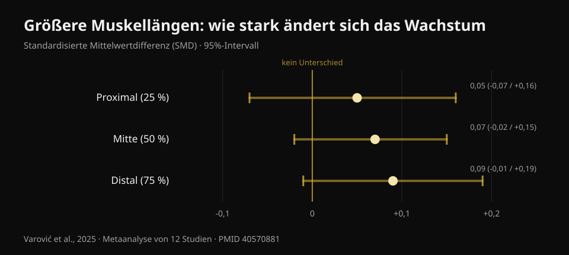
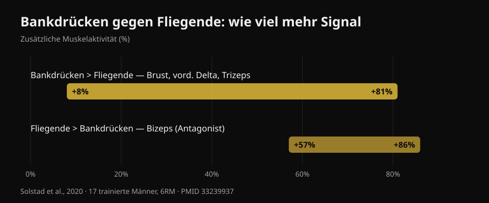

# Kurzhantel-Bankdrücken oder Fliegende: was wächst mehr?

Von [Giammaria Loi](/autore/giammaria-loi) · aktualisiert am 20. Oktober 2026

Ein vielgeteiltes Karussell berichtet von einer brandneuen Studie: zehn Wochen, Kurzhantel-Bankdrücken gegen Fliegende, und am Ende wächst die Brust gleich stark. Die Schlussfolgerung ist bequem — nimm, was dir lieber ist — und sie trägt größtenteils. Ich habe sie aber mit sechs indexierten Studien geprüft, und dabei kamen drei Dinge heraus, die im Beitrag fehlen: die Studie ist noch nicht veröffentlicht, der Brustbereich, in dem die Übungswahl wirklich zählt, wurde nicht gemessen, und beide Übungen kosten pro trainiertem Muskel nicht gleich viel Zeit.

## Kurz gefasst

- **Kurzhantel-Bankdrücken und Fliegende ließen die Brust ähnlich wachsen** — über zehn Wochen. Die Studie ist allerdings *angenommen*, nicht veröffentlicht: Stand 20. Oktober 2026 auf PubMed nicht prüfbar.
- **Dreizehn Personen pro Gruppe haben beendet**, von 46 Startern. Bei dieser Größe heißt "kein signifikanter Unterschied" nicht "beide Übungen sind gleichwertig".
- **Die Idee, Fliegende würden wegen der gedehnten Position mehr Wachstum bringen, war längst geprüft** — vom selben Forscher, der das Karussell gepostet hat: triviale Effekte, SMD von 0,05 bis 0,09 (Varović et al., 2025).
- **Drücken trainiert zusätzlich vordere Schulter und Trizeps**: 8 % bis 81 % mehr elektrische Aktivität als Fliegende (Solstad et al., 2020). Fliegende nicht.
- **Für die obere Brust zählt die Übungswahl sehr wohl** — und genau diese Region hat die neue Studie nicht gemessen: der einzige dokumentierte Unterschied sind +0,62 cm Dicke mit Schrägbankdrücken (Chaves et al., 2020).

## Was die neue Studie wirklich vergleicht

Das Design, wie die Autoren es beschreiben: Trainierende mit mindestens sechs Monaten Erfahrung (im Schnitt drei bis vier Jahre), zwei Einheiten pro Woche über zehn Wochen, **eine einzige Übung pro Einheit** — entweder Kurzhantel-Bankdrücken oder Fliegende — und keine weitere Arbeit für Brust und vordere Schulter. Das Volumen war nicht vorgegeben: jeder behielt seine gewohnte Satzzahl, im Schnitt etwa 14 Wochensätze in der Drückgruppe und 13 bei den Fliegenden. Acht bis zwölf Wiederholungen bei rund 2 Wiederholungen im Tank, letzter Satz bis zum konzentrischen Muskelversagen. Die Brustdicke wurde per Ultraschall an drei Punkten von der Mitte nach außen gemessen.

Berichtetes Ergebnis: beide Gruppen wachsen an allen drei Punkten, ohne Unterschied zwischen den Gruppen.

Was der Beitrag nicht sagt: **diese Studie ist noch nicht veröffentlicht**. Ich habe auf PubMed nach Autor, Titel und Koautoren gesucht — sie ist nicht da. Die einzige auffindbare Primärquelle ist eine Ankündigung des Letztautors Brad Schoenfeld, die Arbeit sei gerade vom *Journal of Strength and Conditioning Research* angenommen worden. Keine öffentliche DOI, kein Preprint. Das ist kein Vorwurf: zwischen Annahme und Veröffentlichung vergehen normalerweise Wochen. Es heißt aber, dass niemand — ich eingeschlossen — die Zahlen, Konfidenzintervalle und Tabellen lesen kann. Deshalb **stammt in diesem Artikel keine einzige Zahl aus jener Studie**: alles Quantitative unten kommt aus veröffentlichten, geprüften Arbeiten.

## "Kein signifikanter Unterschied" heißt nicht "gleich"

Von 46 Teilnehmern haben **26 beendet**: dreizehn pro Gruppe. Die Autoren selbst nennen die Abbruchquote ungewöhnlich hoch. Das sind 43 % der Stichprobe.

Hier braucht es eine Unterscheidung, die für die Hälfte aller Fitnessinhalte gilt. "Kein statistisch signifikanter Unterschied" heißt, dass die erhobenen Daten nicht ausreichen, um einen Unterschied zu zeigen. Nicht, dass keiner existiert. Mit dreizehn Personen pro Gruppe erkennt eine Studie nur große Unterschiede: würde Drücken die Brust etwa 15 % stärker wachsen lassen als Fliegende, würde sie das vermutlich gar nicht bemerken. Für eine Gleichwertigkeitsaussage braucht es ein eigens dafür gebautes Design mit vorab festgelegter Äquivalenzgrenze.

Die ehrliche Lesart lautet also: **wir haben keinen Beleg, dass eine der beiden besser ist**. Das ist eine nützliche Information — und etwas anderes als "beides ist dasselbe".

Es ist derselbe Lesefehler, den ich bei [Hip Thrust und Kniebeuge für den Po](/de/blog/po-uebungen-hip-thrust-oder-kniebeuge) beschrieben habe: auch dort neigten sich die Schätzungen zu einer Seite, mit Intervallen, die die Null bequem einschlossen.

## Die Ausgangshypothese war längst geprüft

Interessant ist der Anlass der Studie: die Forscher erwarteten, dass die **Fliegenden** gewinnen. Die Begründung ist die in den letzten Jahren populär gewordene: Fliegende belasten die Brust in der gedehntesten Position, und Training bei größeren Muskellängen sollte mehr Wachstum bringen.

Nur hat diese Hypothese bereits eine Antwort — von derselben Person, die das Karussell gepostet hat. 2025 veröffentlichte Dorian Varović eine bayesianische Metaanalyse von zwölf Studien, die die Muskellänge manipulierten — über den Bewegungsumfang oder über die Übungswahl — und das Wachstum in verschiedenen Zonen desselben Muskels maßen. Die Ergebnisse sind **trivial**: standardisierte Differenz von 0,05 proximal, 0,07 in der Mitte, 0,09 distal, mit Intervallen, die alle die Null enthalten. In Wachstumsprozent: zwischen 0,6 % und 1,9 %.

*Standardisierte Differenz des regionalen Wachstums zwischen größeren und kürzeren Muskellängen. Positive Werte sprechen für größere Längen. Alle drei 95%-Intervalle überschneiden die Null. Quelle: Varović et al., 2025, bayesianische Metaanalyse von 12 Studien (PMID 40570881).*

Es gibt einen steigenden Trend von proximal nach distal, und die Autoren weisen darauf hin. Sie weisen auch auf die ehrlichste Einschränkung hin: zwischen den verglichenen Bedingungen betrug der mittlere Unterschied der Muskellänge nur 21,8 %.

Im Gym übersetzt: wer Fliegende wegen des Dehnungsbonus wählt, wird diesen Bonus wahrscheinlich nicht bekommen.

## Was Drücken dir gibt und Fliegende nicht

Das ist der praktische Punkt, der im Beitrag komplett fehlt — und er beantwortet eine Frage, die unter dem Beitrag selbst unbeantwortet blieb: *kann ich die Brust wie beim Bankdrücken trainieren, aber ohne Trizeps und Schultern?*

2020 maß eine norwegische Gruppe die elektrische Aktivität von vier Muskeln bei siebzehn trainierten Männern (knapp fünf Jahre Erfahrung) bei Langhantel-Bankdrücken und Kurzhantel-Fliegenden mit 6RM-Lasten und zerlegte jede Wiederholung in sechs Phasen. Das Drücken erzeugt mehr Signal im **großen Brustmuskel, im vorderen Deltamuskel und im Trizeps**, mit Unterschieden **von +8 % bis +81 %** je nach Muskel und Phase. Die Fliegenden gewinnen bei genau einem Muskel: dem **Bizeps**, mit +57 % bis +86 % — aber als Antagonist zur Stabilisierung des Ellbogens, nicht als trainierter Muskel.

*Wie viel zusätzliches elektrisches Signal jede Übung erzeugt, Spannweite laut Autoren über Muskeln und Bewegungsphasen. Quelle: Solstad et al., 2020, 17 trainierte Männer, 6RM (PMID 33239937).*

Nicht umdrehen: elektrische Aktivierung **sagt Wachstum nicht voraus**, und dieser Blog hat das mit Daten bereits bei [Beinstrecker und Beinpresse](/de/blog/beinstrecker-oder-beinpresse-rectus-femoris) gezeigt. Der Punkt hier ist schlichter: Drücken belastet drei Muskeln, Fliegende im Wesentlichen einen. Wenn deine Zeit im Gym knapp ist — und das ist sie bei fast allen — ist das ein konkreteres Auswahlkriterium als jede Debatte über Muskellängen.

Die Kehrseite ist genauso nützlich: wenn Drücken deine Schulter stört, kannst du mit Fliegenden die Brust trainieren, ohne auf Wachstum zu verzichten, und verlierst nur die Trizepsarbeit, die du anderswo nachholen kannst.

## Wo die Wahl wirklich zählt: die obere Brust

Die wichtigste Einschränkung der neuen Studie nennen die Autoren selbst: die Dicke wurde an drei Punkten von der Mitte nach außen gemessen, und **die klavikuläre Region — die obere Brust — wurde nicht direkt gemessen**.

Das ist ein Problem, denn das ist die einzige Zone, in der in veröffentlichten Studien die Übungswahl wirklich etwas verändert hat.

2020 teilten Chaves und Kollegen 47 untrainierte Männer in drei Gruppen — nur Flachbank, nur Schrägbank oder beides — für acht Wochen bei gleicher Satzzahl. Die Kraft stieg in allen drei Gruppen gleich (rund 10-11 kg, kein signifikanter Unterschied). Die Muskeldicke veränderte sich nur an **einer von drei Stellen** unterschiedlich: am zweiten Interkostalraum, der oberen Brust, wo die Schrägbank die Flachbank um **0,62 cm (Intervall 0,23-1,00; p = 0,003)** und die Kombination um **0,50 cm (0,14-0,86; p = 0,008)** übertraf.

Zwei Details. Erstens: die Gruppe mit **beiden** Übungen schlug keine der beiden anderen; von allem ein bisschen hat den Reiz aufgeteilt. Zweitens: es waren Untrainierte, also ein Hinweis, kein Gesetz.

Der Mechanismus passt zu akuten Messungen. 2022 zeichnete eine italienisch-brasilianische Gruppe beide Brustanteile bei Flach- und 45°-Schrägdrücken auf: auf der Schrägbank arbeitet der klavikuläre Anteil mehr als der sternokostale, auf der Flachbank umgekehrt, und die unmittelbare Veränderung des Muskelquerschnitts folgt derselben Richtung. Zum genauen Winkel: dreißig trainierte Erwachsene, getestet bei fünf Neigungen, zeigen das Maximum der oberen Brust bei **30°**, während mittlerer und unterer Anteil bei **0°** am meisten leisten; über 45° wandert die Arbeit zunehmend in den vorderen Deltamuskel und die Leistung der Brust sinkt.

## Was die Forschung wirklich sagt

- **Bestätigt** — Der große Brustmuskel hat zwei Regionen, klavikulär und sternokostal, mit getrennter Innervation und getrennter Reaktion (Albarello et al., 2022).
- **Bestätigt** — Verschiedene Übungen erzeugen ähnliches Wachstum, wenn der Zielmuskel über vergleichbare Bewegungsumfänge ausreichend gefordert wird (Chaves et al., 2020; Kassiano et al., 2022).
- **Zu präzisieren** — "Kein signifikanter Unterschied" bei 13 Personen pro Gruppe nach 43 % Abbrüchen erlaubt keine Gleichwertigkeitsaussage.
- **Zu präzisieren** — Übungen zu variieren hilft, aber nur systematisch: zufälliges Rotieren reizgleicher Übungen kann die Ergebnisse verschlechtern (Kassiano et al., 2022).
- **Widerlegt** — Die Erwartung, Fliegende brächten wegen der Dehnung mehr Wachstum: die Effekte auf regionales Wachstum sind trivial (Varović et al., 2025).
- **Nicht überprüfbar** — Die Zahlen der Dell'Avanzi-Studie: angenommen vom *Journal of Strength and Conditioning Research*, Stand 20. Oktober 2026 weder veröffentlicht noch indexiert.

## So setzt du es um

1. **Wähle die Drückübung, die du über die Zeit belasten und steigern kannst.** Langhantel, Kurzhantel oder Maschine: bei gleicher Satzzahl und gleicher Nähe zum Muskelversagen wächst die Brust. Das Kriterium ist nicht, was "mehr aktiviert", sondern worauf du Monat für Monat Gewicht oder Wiederholungen draufpacken kannst.
2. **Behalte Fliegende als zweite Übung, nicht als Pflichtersatz.** Sie lohnen sich, wenn Drücken die Schulter stört, wenn du Brustvolumen ohne zusätzliche Trizepsermüdung willst, oder wenn sie dir einfach liegen.
3. **Ist die obere Brust deine Schwachstelle, stelle die Bank auf 30°.** Dort leistet der klavikuläre Anteil am meisten. Über 45° trainierst du vor allem Schultern.
4. **Nicht wahllos mischen.** Zwei oder drei stabile Brustübungen über sechs bis zwölf Wochen schlagen eine neue Rotation jede Woche.
5. **Geh nah genug ans Muskelversagen.** Das Studienprotokoll arbeitete bei etwa zwei Wiederholungen Reserve, letzter Satz bis zum Versagen. Das vollständige Bild zu Sätzen, Wiederholungen und Pausen habe ich [hier](/de/blog/wie-viele-wiederholungen-muskelaufbau) zusammengefasst.

### Probiere Nurvan — deine Brust wächst, wenn das Gewicht steigt

Entscheidend ist nicht, welche Übung du mehr "spürst", sondern ob sie vorankommt. In Nurvan wird jeder Satz mit Gewicht, Wiederholungen und RIR (wie viele Wiederholungen noch im Tank waren) erfasst, und die App zeigt den Verlauf Übung für Übung: so siehst du schwarz auf weiß, ob dein Kurzhantel-Drücken steigt oder seit zwei Monaten steht, und entscheidest nach deinen Zahlen statt nach der letzten viralen Studie. **[Probiere Nurvan](https://nurvan.app)**

## Häufige Fragen

**Bankdrücken oder Fliegende für die Brust?**
Für die Brust als Ganzes zeigen die verfügbaren Daten keinen Sieger: beides funktioniert, wenn die Sätze nah genug ans Versagen gehen. Drücken trainiert im selben Satz zusätzlich vordere Schulter und Trizeps und bringt damit mehr pro Minute. Fliegende bleiben eine sehr gute Wahl, wenn Drücken stört.

**Sind Fliegende für die "innere Brust"?**
Nein. Der große Brustmuskel ist in einen klavikulären und einen sternokostalen Anteil geteilt, nicht in "innen" und "außen": keine Übung lässt nur die Mitte wachsen. Die dokumentierten regionalen Unterschiede betreffen oben gegen unten und hängen vor allem vom Bankwinkel ab.

**Welcher Winkel für die obere Brust?**
Dreißig Grad ist die Neigung mit der höchsten Aktivität des oberen Anteils. Bei null Grad leisten mittlerer und unterer Anteil mehr. Über 45° übernimmt der vordere Deltamuskel.

**Muss ich beide Übungen machen?**
Nein. In der einzigen Studie, die eine "beides"-Gruppe gegen Einzelübungsgruppen verglich, war beides nicht besser als eines. Entscheide nach Zeit, Ausrüstung und Gelenkkomfort.

## Auch lesenswert

- [Beinstrecker oder Beinpresse: was wirklich wächst](/de/blog/beinstrecker-oder-beinpresse-rectus-femoris) — warum "aktiviert mehr" nicht "wächst mehr" heißt.
- [Po-Übungen: Hip Thrust oder Kniebeuge?](/de/blog/po-uebungen-hip-thrust-oder-kniebeuge) — derselbe Lesefehler an einem anderen Muskel.
- [Wiederholungen, Sätze und Pausen für Hypertrophie](/de/blog/wie-viele-wiederholungen-muskelaufbau) — die Variablen, die mehr zählen als die Übungswahl.

## Quellen

1. Solstad TE, Andersen V, Shaw M, Hoel EM, Vonheim A, Saeterbakken AH, 2020. *A Comparison of Muscle Activation between Barbell Bench Press and Dumbbell Flyes in Resistance-Trained Males.* Journal of Sports Science & Medicine 19(4):645-651. [PMID 33239937](https://pubmed.ncbi.nlm.nih.gov/33239937/)
2. Chaves SFN, et al., 2020. *Effects of Horizontal and Incline Bench Press on Neuromuscular Adaptations in Untrained Young Men.* International Journal of Exercise Science 13(6):859-872. [PMID 32922646](https://pubmed.ncbi.nlm.nih.gov/32922646/) · [DOI 10.70252/FDNB1158](https://doi.org/10.70252/FDNB1158)
3. Albarello JCS, et al., 2022. *Non-uniform excitation of pectoralis major induced by changes in bench press inclination leads to uneven variations in the cross-sectional area measured by panoramic ultrasonography.* Journal of Electromyography and Kinesiology 67:102722. [PMID 36334406](https://pubmed.ncbi.nlm.nih.gov/36334406/) · [DOI 10.1016/j.jelekin.2022.102722](https://doi.org/10.1016/j.jelekin.2022.102722)
4. Varović D, Wolf M, Schoenfeld BJ, Steele J, Grgic J, Mikulic P, 2025. *Does Muscle Length Influence Regional Hypertrophy? A Systematic Review and Meta-Analysis.* International Journal of Sports Medicine 46(14):1027-1036. [PMID 40570881](https://pubmed.ncbi.nlm.nih.gov/40570881/) · [DOI 10.1055/a-2615-4935](https://doi.org/10.1055/a-2615-4935)
5. Kassiano W, Nunes JP, Costa B, Ribeiro AS, Schoenfeld BJ, Cyrino ES, 2022. *Does Varying Resistance Exercises Promote Superior Muscle Hypertrophy and Strength Gains? A Systematic Review.* Journal of Strength and Conditioning Research 36(6):1753-1762. [PMID 35438660](https://pubmed.ncbi.nlm.nih.gov/35438660/) · [DOI 10.1519/JSC.0000000000004258](https://doi.org/10.1519/JSC.0000000000004258)
6. Rodríguez-Ridao D, Antequera-Vique JA, Martín-Fuentes I, Muyor JM, 2020. *Effect of Five Bench Inclinations on the Electromyographic Activity of the Pectoralis Major, Anterior Deltoid, and Triceps Brachii during the Bench Press Exercise.* International Journal of Environmental Research and Public Health 17(19):7339. [PMID 33049982](https://pubmed.ncbi.nlm.nih.gov/33049982/) · [DOI 10.3390/ijerph17197339](https://doi.org/10.3390/ijerph17197339)
7. Dell'Avanzi FG, et al. *Dumbbell bench press and dumbbell fly elicit similar pectoralis major muscle hypertrophy in recreationally-trained individuals.* Angenommen vom Journal of Strength and Conditioning Research; Stand 20. Oktober 2026 weder veröffentlicht noch auf PubMed indexiert. Design und Ergebnisse wie von den Autoren angegeben wiedergegeben.

Literatur über PubMed recherchiert. Ausgangspunkt: das Karussell von **Dorian Varović** ([@varovicdorian](https://www.instagram.com/varovicdorian/)) vom 9. September 2026, [Originalbeitrag](https://www.instagram.com/p/DdFF9e8HIOQ/). Kein Text und kein Bild aus dem Beitrag wurde reproduziert.

---

**Giammaria Loi** ist der Gründer von Nurvan. Er trainiert seit 2012 mit Gewichten, arbeitet seit 2013 als FIPE-zertifizierter Personal Trainer und Coach und tritt seit 2018 national im Powerlifting an.

> Hinweis: informativer Inhalt, kein Ersatz für die Beurteilung durch eine Ärztin, einen Arzt oder eine qualifizierte Fachkraft. Wenn Drücken in der Schulter schmerzt, lass es abklären, bevor du weitermachst.
