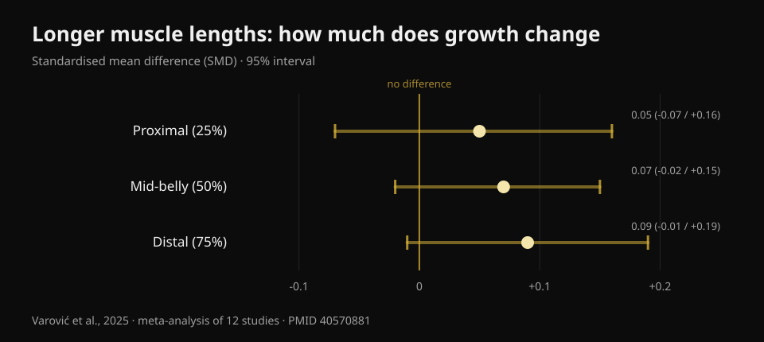
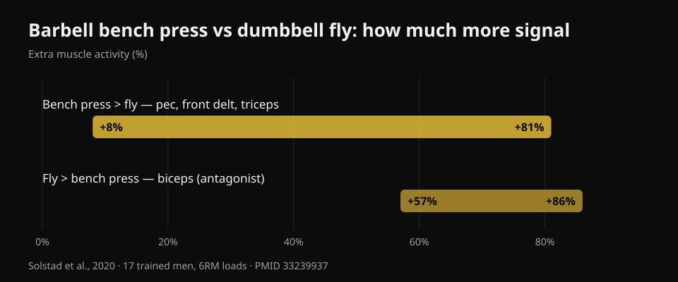

# Dumbbell Press vs Fly: Which Builds More Chest?

By [Giammaria Loi](/autore/giammaria-loi) · updated 20 October 2026

A widely shared carousel reports a brand-new study: ten weeks, dumbbell bench press against dumbbell fly, and in the end both grow the chest the same. The takeaway is convenient — pick whichever you like — and it mostly holds. But I read six indexed studies to check it, and three things turned up that the post never mentions: the study is not published yet, the part of the chest where exercise choice actually matters was never measured, and the two exercises do not cost you the same amount of gym time per muscle trained.

## The short version

- **Dumbbell bench press and dumbbell fly grew the pecs similarly** over 10 weeks. But the study has been *accepted* by a journal, not published: as of 20 October 2026 it cannot be checked on PubMed.
- **Thirteen people per group finished**, out of 46 who started. At that size, "no significant difference" does not mean "the two exercises are equivalent".
- **The idea that flyes grow more because they load the stretched position had already been tested** — by the same researcher who posted the carousel. The effects were trivial: SMDs of 0.05 to 0.09 (Varović et al., 2025).
- **Pressing also trains your front delts and triceps**: 8% to 81% more electrical activity than the fly (Solstad et al., 2020). The fly does not.
- **For the upper chest, exercise choice does matter** — and that is exactly the region the new study did not measure. The only documented difference is +0.62 cm of thickness with the incline press (Chaves et al., 2020).

## What the new study actually compared

The design, as the authors describe it: people with at least six months of lifting behind them (three to four years on average), two sessions a week for ten weeks, **one exercise per session** — either dumbbell bench press or dumbbell fly — and no other chest or front-delt work allowed. Volume was not imposed: each participant kept the number of sets they were used to, averaging about 14 weekly sets in the press group and 13 in the fly group. Eight to twelve reps at roughly 2 reps in reserve, with the last set taken to concentric failure. Pec thickness was measured by ultrasound at three points running outward from the midline of the chest.

Reported result: both groups grew at all three points, with no difference between groups.

First thing the post does not say: **this study is not published yet**. I searched PubMed by author, by title and by co-author, and it is not there. The only primary source available is an announcement from the senior author, Brad Schoenfeld, saying the paper has just been accepted by the *Journal of Strength and Conditioning Research*. No public DOI, no preprint. That is not an accusation — weeks routinely pass between acceptance and publication. But it means nobody, me included, can yet read the numbers, the confidence intervals or the tables. Which is why **not a single number in this article comes from that study**: everything quantitative below is from published, verifiable work.

## "No significant difference" is not "they are the same"

Of the 46 participants who started, **26 finished**: thirteen per group. The authors themselves call the dropout unusually high. That is 43% of the sample gone.

This calls for a distinction that applies to half the fitness content you read. "No statistically significant difference" means the data collected were not enough to demonstrate a difference. It does not mean there is none. With thirteen people per group, a study can only detect large gaps: if pressing grew the chest, say, 15% more than flyes, it would most likely miss it entirely. Claiming equivalence requires a trial designed for that, with an equivalence margin declared in advance.

So the honest reading is: **we have no evidence that either one is better**. That is genuinely useful — and it is not the same statement as "they are identical".

It is the same reading error I covered when writing about [hip thrusts and squats for the glutes](/en/blog/glute-exercises-hip-thrust-vs-squat): the estimates leaned one way, but the confidence intervals comfortably contained zero.

## The starting hypothesis had already been tested

Here is what makes this study interesting: the researchers expected the **fly** to win. The reasoning is the one that has taken over social media in recent years — flyes load the pec when it is most stretched, and training at longer muscle lengths should produce more growth.

Except that hypothesis already has an answer, and it comes from the person who posted the carousel. In 2025 Dorian Varović published a Bayesian meta-analysis of twelve studies that manipulated muscle length — through range of motion or through exercise selection — and measured growth in different regions of the same muscle. The results are **trivial**, meaning effectively nil: a standardised difference of 0.05 at the proximal site, 0.07 at mid-belly, 0.09 distally, with intervals that all contain zero. Translated into growth percentages: between 0.6% and 1.9%.

*Standardised difference in regional growth between longer and shorter muscle lengths. Positive values favour longer lengths. All three 95% intervals cross zero. Source: Varović et al., 2025, Bayesian meta-analysis of 12 studies (PMID 40570881).*

There is an upward trend from proximal to distal, and the authors flag it. They also flag the most honest limitation: across the conditions compared, the average difference in mean muscle length was only 21.8%. The available studies compare things that are more alike than the online debate suggests.

In gym terms: if you pick flyes expecting a stretch bonus, that bonus probably is not coming.

## What pressing gives you that the fly does not

This is the practical point missing from the post entirely, and it answers a question left unanswered in the post's own comments: *can I train my chest like a bench press does, but without involving triceps and delts?*

In 2020 a Norwegian group measured the electrical activity of four muscles in seventeen trained men (almost five years of experience) during barbell bench press and dumbbell fly, at six-rep-max loads, breaking each repetition into six phases. The press produced more signal in the **pectoralis major, anterior deltoid and triceps**, with differences ranging **from +8% to +81%** depending on muscle and phase. The fly won on exactly one muscle: the **biceps**, by 57% to 86% — but as an antagonist stabilising the elbow, not as a muscle being trained.

*How much extra electrical signal each exercise produced, the range the authors report across muscles and movement phases. Source: Solstad et al., 2020, 17 trained men, 6RM loads (PMID 33239937).*

Do not flip this around: electrical activation **does not predict** growth, and this blog has already shown that with data when covering [leg extensions and leg presses](/en/blog/leg-extension-vs-leg-press-rectus-femoris). The point here is simpler: the press loads three muscles, the fly essentially loads one. If your gym time is limited — and it is, for nearly everyone — that is a far more concrete selection criterion than any argument about muscle lengths.

The flip side is just as useful: if pressing bothers your shoulder, flyes let you train the chest without giving up growth, and the only thing you lose is the triceps work, which you can make up elsewhere.

## Where the choice really matters: the upper chest

The most important limitation of the new study is stated by the authors themselves: thickness was measured at three points running from the midline outward, and the **clavicular region — the upper chest — was not directly measured**.

That matters, because it is the one area where, in published studies, exercise choice has actually changed something.

In 2020 Chaves and colleagues split 47 untrained men into three groups — flat press only, incline press only, or both — for eight weeks with matched set counts. Strength rose equally in all three groups (about 10–11 kg, no significant difference). Muscle thickness changed differently at **one site out of three**: the second intercostal space, the upper chest, where the incline press beat the flat press by **0.62 cm (interval 0.23–1.00; p = 0.003)** and the combination by **0.50 cm (0.14–0.86; p = 0.008)**.

Two details worth noting. First: the group doing **both** exercises beat neither single group; doing a bit of everything split the stimulus. Second: these were untrained men, so treat it as a pointer, not a law.

The mechanism fits what is measured acutely. In 2022 an Italian-Brazilian group recorded both heads of the pec during flat and 45° incline pressing: on the incline the clavicular head works more than the sternocostal head, on the flat the opposite happens, and the immediate change in muscle cross-section follows the same direction. As for the exact angle, thirty trained adults tested at five inclinations show the upper pec peaking at **30°**, while the mid and lower portions perform best at **0°**; past 45° the work shifts increasingly to the anterior deltoid and the pec's output drops.

## What the research actually says

- **Confirmed** — The pectoralis major has two regions, clavicular and sternocostal, with separate innervation and separate responses: it does not behave as one single muscle (Albarello et al., 2022).
- **Confirmed** — Different exercises produce similar growth when the prime mover is sufficiently challenged over comparable ranges of motion (Chaves et al., 2020; Kassiano et al., 2022).
- **Needs qualifying** — "No significant difference" between press and fly, with 13 people per group after a 43% dropout, does not license calling the two exercises equivalent.
- **Needs qualifying** — Varying exercises helps, but only when the variation is systematic: randomly rotating exercises that provide a redundant stimulus can make results worse (Kassiano et al., 2022).
- **Busted** — The expectation that flyes grow more because they load the stretched muscle: effects on regional growth are trivial (Varović et al., 2025).
- **Not verifiable** — The numbers from the Dell'Avanzi study: accepted by the *Journal of Strength and Conditioning Research*, not published or indexed as of 20 October 2026.

## How to apply it

1. **Pick the pressing movement you can load and progress over time.** Barbell, dumbbell or machine: with sets matched and taken close enough to failure, the chest grows. The criterion is not which one "activates more", but which one you can keep adding weight or reps to, month after month.
2. **Keep flyes as a second exercise, not a mandatory replacement.** They earn their place if pressing bothers your shoulder, if you want more chest volume without further fatiguing the triceps, or simply if you enjoy them and therefore do them consistently.
3. **If the upper chest is your weak point, set the bench to 30°.** That is where the clavicular portion performs best. Above 45° you are mostly training shoulders.
4. **Do not shuffle at random.** Two or three stable chest exercises held for six to twelve weeks beat a new rotation every week.
5. **Take your sets close enough to failure.** The study protocol worked at about two reps in reserve with the last set to failure, which is a sound reference frame. For the full picture on sets, reps and rest, I summarised it [here](/en/blog/how-many-reps-build-muscle).

### Try Nurvan — your chest grows when the load goes up

What decides the outcome is not which exercise you "feel" more, but whether that exercise is progressing. In Nurvan every set is logged with load, reps and RIR (how many reps you had left in the tank), and the app shows the trend exercise by exercise — so you can see in black and white whether your dumbbell press is climbing or has been stuck for two months, and decide from your own numbers instead of the latest viral study. **[Try Nurvan](https://nurvan.app)**

## Frequently asked questions

**Is the dumbbell press or the fly better for chest growth?**
For the pec as a whole, the available evidence shows no winner: both work when sets are taken close enough to failure. The press, though, also trains the front delt and triceps in the same set, so it gives you more per minute. Flyes remain an excellent choice if pressing bothers you.

**Do flyes target the "inner chest"?**
No. The pectoralis major is divided into clavicular and sternocostal portions, not into an "inner" and an "outer" half: no exercise grows only the middle. The documented regional differences are upper versus lower, and they depend mostly on bench angle.

**What bench angle is best for the upper chest?**
Thirty degrees is where the upper portion of the pec shows peak activity. At zero degrees the mid and lower portions do more. Past 45° the anterior deltoid takes over and the pec does less.

**Do I have to do both exercises?**
No. In the one study that compared a "both" group against single-exercise groups, doing both did not beat doing one. Choose based on time, available equipment and joint comfort.

## Read next

- [Leg extension vs leg press: what actually grows](/en/blog/leg-extension-vs-leg-press-rectus-femoris) — why "activates more" does not mean "grows more".
- [Glute exercises: hip thrust or squat?](/en/blog/glute-exercises-hip-thrust-vs-squat) — the same reading error on a different muscle.
- [Reps, sets and rest for hypertrophy](/en/blog/how-many-reps-build-muscle) — the variables that matter more than exercise choice.

## Sources

1. Solstad TE, Andersen V, Shaw M, Hoel EM, Vonheim A, Saeterbakken AH, 2020. *A Comparison of Muscle Activation between Barbell Bench Press and Dumbbell Flyes in Resistance-Trained Males.* Journal of Sports Science & Medicine 19(4):645-651. [PMID 33239937](https://pubmed.ncbi.nlm.nih.gov/33239937/)
2. Chaves SFN, Rocha-Júnior VA, Encarnação IGA, Martins-Costa HC, Freitas EDS, Coelho DB, Franco FSC, Loenneke JP, Bottaro M, Ferreira-Júnior JB, 2020. *Effects of Horizontal and Incline Bench Press on Neuromuscular Adaptations in Untrained Young Men.* International Journal of Exercise Science 13(6):859-872. [PMID 32922646](https://pubmed.ncbi.nlm.nih.gov/32922646/) · [DOI 10.70252/FDNB1158](https://doi.org/10.70252/FDNB1158)
3. Albarello JCS, Cabral HV, Leitão BFM, Halmenschlager GH, Lulic-Kuryllo T, Matta TT, 2022. *Non-uniform excitation of pectoralis major induced by changes in bench press inclination leads to uneven variations in the cross-sectional area measured by panoramic ultrasonography.* Journal of Electromyography and Kinesiology 67:102722. [PMID 36334406](https://pubmed.ncbi.nlm.nih.gov/36334406/) · [DOI 10.1016/j.jelekin.2022.102722](https://doi.org/10.1016/j.jelekin.2022.102722)
4. Varović D, Wolf M, Schoenfeld BJ, Steele J, Grgic J, Mikulic P, 2025. *Does Muscle Length Influence Regional Hypertrophy? A Systematic Review and Meta-Analysis.* International Journal of Sports Medicine 46(14):1027-1036. [PMID 40570881](https://pubmed.ncbi.nlm.nih.gov/40570881/) · [DOI 10.1055/a-2615-4935](https://doi.org/10.1055/a-2615-4935)
5. Kassiano W, Nunes JP, Costa B, Ribeiro AS, Schoenfeld BJ, Cyrino ES, 2022. *Does Varying Resistance Exercises Promote Superior Muscle Hypertrophy and Strength Gains? A Systematic Review.* Journal of Strength and Conditioning Research 36(6):1753-1762. [PMID 35438660](https://pubmed.ncbi.nlm.nih.gov/35438660/) · [DOI 10.1519/JSC.0000000000004258](https://doi.org/10.1519/JSC.0000000000004258)
6. Rodríguez-Ridao D, Antequera-Vique JA, Martín-Fuentes I, Muyor JM, 2020. *Effect of Five Bench Inclinations on the Electromyographic Activity of the Pectoralis Major, Anterior Deltoid, and Triceps Brachii during the Bench Press Exercise.* International Journal of Environmental Research and Public Health 17(19):7339. [PMID 33049982](https://pubmed.ncbi.nlm.nih.gov/33049982/) · [DOI 10.3390/ijerph17197339](https://doi.org/10.3390/ijerph17197339)
7. Dell'Avanzi FG, Enes A, Alves-Marques F, Costa-Rodrigues J, Bello G, Seima G, Nass G, Moreira NF, Santana C, Mohan AE, Piñero A, Schoenfeld BJ, Souza-Junior TP. *Dumbbell bench press and dumbbell fly elicit similar pectoralis major muscle hypertrophy in recreationally-trained individuals.* Accepted by the Journal of Strength and Conditioning Research; as of 20 October 2026 not yet published or indexed on PubMed. Design and findings reported as stated by the authors.

References retrieved through PubMed. Starting point: the carousel by **Dorian Varović** ([@varovicdorian](https://www.instagram.com/varovicdorian/)) of 9 September 2026, [original post](https://www.instagram.com/p/DdFF9e8HIOQ/). No text and no image from the post was reproduced: the topic was rewritten from scratch from primary sources.

---

**Giammaria Loi** is the founder of Nurvan. He has been lifting since 2012, has worked as a FIPE-certified personal trainer and coach since 2013, and has competed in powerlifting at national level since 2018. Every article he writes starts from the research and ends with what actually works in the gym.

> Note: educational content, not a substitute for advice from a doctor or qualified professional. If pressing hurts your shoulder, get it assessed before pushing through.
