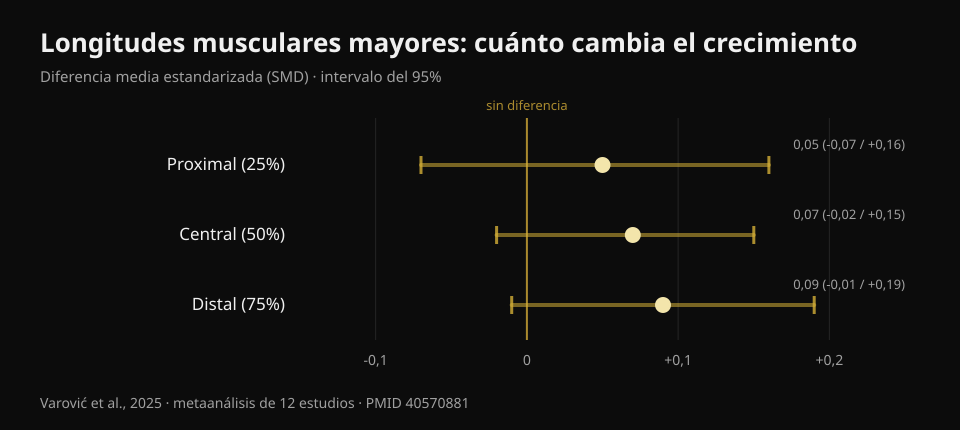
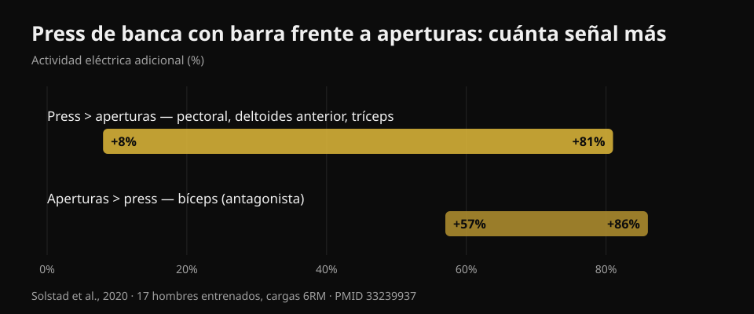

# Press con mancuernas o aperturas: ¿qué hace crecer más?

Por [Giammaria Loi](/autore/giammaria-loi) · actualizado el 20 de octubre de 2026

Un carrusel muy compartido cuenta un estudio recién salido: diez semanas, press con mancuernas contra aperturas con mancuernas, y al final el pecho crece igual. La conclusión es cómoda —elige el que prefieras— y en buena medida se sostiene. Pero leí seis estudios indexados para comprobarla y aparecieron tres cosas que el post no dice: ese estudio todavía no está publicado, la zona del pecho donde la elección sí importa no se midió, y los dos ejercicios no cuestan lo mismo en músculos entrenados por minuto.

## En resumen

- **El press con mancuernas y las aperturas hicieron crecer el pectoral de forma parecida** en diez semanas. Pero el estudio está *aceptado*, no publicado: a 20 de octubre de 2026 no se puede comprobar en PubMed.
- **Terminaron trece personas por grupo** de las 46 que empezaron. Con esos números, "sin diferencia significativa" no significa "son equivalentes".
- **La idea de que las aperturas crecen más por cargar el músculo estirado ya se había puesto a prueba**, y por el mismo investigador que publicó el carrusel: efectos triviales, SMD de 0,05 a 0,09 (Varović et al., 2025).
- **El press también te entrena deltoides anterior y tríceps**: entre un 8% y un 81% más de actividad eléctrica que las aperturas (Solstad et al., 2020). Las aperturas no.
- **Para el pecho alto la elección sí importa**, y es justo la región que el nuevo estudio no midió: la única diferencia documentada es +0,62 cm de grosor con el press inclinado (Chaves et al., 2020).

## Qué compara realmente el estudio nuevo

El diseño, tal como lo describen los autores: personas con al menos seis meses de entrenamiento (tres o cuatro años de media), dos sesiones semanales durante diez semanas, **un solo ejercicio por sesión** —press con mancuernas o aperturas— y prohibido cualquier otro trabajo de pectoral y deltoides anterior. El volumen no se impuso: cada uno siguió con las series a las que estaba acostumbrado, una media de unas 14 series semanales en el grupo press y 13 en el de aperturas. Entre ocho y doce repeticiones a unas 2 repeticiones en reserva, con la última serie al fallo concéntrico. El grosor del pectoral se midió con ecógrafo en tres puntos, desde el centro del pecho hacia fuera.

Resultado declarado: los dos grupos crecen en los tres puntos, sin diferencias entre grupos.

Lo primero que el post no dice: **este estudio todavía no está publicado**. Lo busqué en PubMed por autor, por título y por coautores, y no aparece. La única fuente primaria localizable es un anuncio del último autor, Brad Schoenfeld, que escribe que el trabajo acaba de ser aceptado por el *Journal of Strength and Conditioning Research*. Sin DOI público, sin preprint. No es una acusación: entre aceptación y publicación suelen pasar semanas. Pero significa que nadie, yo incluido, puede leer aún las cifras, los intervalos ni las tablas. Por eso **en este artículo no uso ni un solo número de ese estudio**: todos los valores vienen de trabajos publicados y verificados.

## "Sin diferencia significativa" no es "son iguales"

De los 46 participantes iniciales **terminaron 26**: trece por grupo. Los propios autores califican el abandono de inusualmente alto. Es el 43% de la muestra.

Aquí hace falta una distinción que vale para la mitad del contenido fitness que lees. "Sin diferencia estadísticamente significativa" quiere decir que los datos recogidos no bastan para demostrar una diferencia. No quiere decir que no exista. Con trece personas por grupo un estudio solo detecta diferencias grandes: si el press hiciera crecer el pecho, pongamos, un 15% más que las aperturas, probablemente ni se enteraría. Para afirmar equivalencia hace falta un diseño hecho a propósito, con un margen declarado de antemano.

La lectura honesta es: **no tenemos pruebas de que uno sea mejor**. Que ya es información útil, y es distinto de "son lo mismo".

Es el mismo error de lectura que conté hablando de [hip thrust y sentadilla para glúteos](/es/blog/ejercicios-de-gluteos-hip-thrust-o-sentadilla): allí también las estimaciones se inclinaban hacia un lado, con intervalos que contenían el cero.

## La hipótesis de partida ya tenía respuesta

Lo interesante es por qué se hizo el estudio: los investigadores esperaban que ganaran las **aperturas**. El razonamiento es el que se ha hecho popular estos años: las aperturas cargan el pectoral cuando está más estirado, y entrenar a longitudes musculares mayores debería dar más crecimiento.

Solo que esa hipótesis ya tiene respuesta, y viene de la misma persona que publicó el carrusel. En 2025 Dorian Varović firmó un metaanálisis bayesiano de doce estudios que manipularon la longitud muscular —con el rango de movimiento o con la elección del ejercicio— y midieron el crecimiento en distintas zonas del mismo músculo. Los resultados son **triviales**: diferencia estandarizada de 0,05 en la zona proximal, 0,07 en el centro, 0,09 en la distal, con intervalos que contienen el cero. En porcentaje de crecimiento: entre 0,6% y 1,9%.

*Diferencia estandarizada de crecimiento regional entre longitudes musculares mayores y menores. Los valores positivos favorecen las longitudes mayores. Los tres intervalos al 95% cruzan el cero. Fuente: Varović et al., 2025, metaanálisis bayesiano de 12 estudios (PMID 40570881).*

Hay una tendencia creciente de proximal a distal, y los autores la señalan. También señalan el límite más honesto: entre las condiciones comparadas la diferencia media de longitud muscular era solo del 21,8%.

En el gimnasio: si eliges aperturas esperando el bonus del estiramiento, es probable que ese bonus no llegue.

## Lo que el press te da y las aperturas no

Este es el dato práctico que falta por completo en el post, y responde a una pregunta que quedó sin respuesta en sus propios comentarios: *¿puedo entrenar el pecho como con el press pero sin implicar tríceps y deltoides?*

En 2020 un grupo noruego midió la actividad eléctrica de cuatro músculos en diecisiete hombres entrenados (casi cinco años de experiencia) durante press de banca con barra y aperturas con mancuernas, con cargas de seis repeticiones máximas, descomponiendo cada repetición en seis fases. El press produce más señal en **pectoral mayor, deltoides anterior y tríceps**, con diferencias **del +8% al +81%** según el músculo y la fase. Las aperturas ganan en un solo músculo: el **bíceps**, entre un 57% y un 86%, pero como antagonista que estabiliza el codo, no como músculo entrenado.

*Cuánta señal eléctrica adicional produce cada ejercicio, intervalo reportado por los autores a través de músculos y fases. Fuente: Solstad et al., 2020, 17 hombres entrenados, cargas de 6RM (PMID 33239937).*

Cuidado con darle la vuelta al razonamiento: la activación eléctrica **no predice** el crecimiento, y este blog ya lo mostró con datos al hablar de [extensión de piernas y prensa](/es/blog/extension-de-piernas-o-prensa-recto-femoral). El punto aquí es más simple: el press pone bajo carga tres músculos, las aperturas esencialmente uno. Si tu tiempo en el gimnasio es limitado —y lo es para casi todos—, ese criterio es más concreto que cualquier discusión sobre longitudes musculares.

La otra cara también sirve: si el press te molesta en el hombro, las aperturas te permiten entrenar el pecho sin renunciar al crecimiento, y solo pierdes el trabajo de tríceps, que puedes recuperar en otro sitio.

## Dónde sí importa la elección: el pecho alto

El límite más importante del nuevo estudio lo declaran los propios autores: el grosor se midió en tres puntos que van del centro del pecho hacia fuera, y **la región clavicular —el pecho alto— no se midió directamente**.

Es un problema, porque es la única zona en la que, en los estudios publicados, la elección del ejercicio ha cambiado algo.

En 2020 Chaves y colegas repartieron a 47 hombres no entrenados en tres grupos —solo banca plana, solo banca inclinada, o ambas— durante ocho semanas con el mismo número de series. La fuerza creció igual en los tres grupos (unos 10-11 kg, sin diferencias significativas). El grosor muscular cambió de forma distinta en **un solo punto de tres**: el segundo espacio intercostal, el pecho alto, donde la inclinada superó a la plana en **0,62 cm (intervalo 0,23-1,00; p = 0,003)** y a la combinación en **0,50 cm (0,14-0,86; p = 0,008)**.

Dos detalles. Primero: el grupo que hacía **las dos** no superó a ninguno de los otros; hacer un poco de todo repartió el estímulo. Segundo: eran personas no entrenadas, así que es una indicación, no una ley.

El mecanismo encaja con lo que se mide en agudo. En 2022 un grupo italo-brasileño registró los dos haces del pectoral en banca plana y a 45°: en la inclinada el haz clavicular trabaja más que el esternocostal, en la plana ocurre lo contrario, y la respuesta inmediata de la sección muscular sigue la misma dirección. En cuanto al ángulo exacto, treinta adultos entrenados probados en cinco inclinaciones muestran el pico del pecho alto a **30°**, mientras que las porciones media y baja rinden más a **0°**; por encima de 45° el trabajo pasa al deltoides anterior y el pectoral rinde menos.

## Qué dice realmente la investigación

- **Confirmado** — El pectoral mayor tiene dos regiones, clavicular y esternocostal, con inervación y respuesta separadas (Albarello et al., 2022).
- **Confirmado** — Ejercicios distintos producen crecimiento parecido cuando el agonista se solicita lo suficiente en rangos de movimiento comparables (Chaves et al., 2020; Kassiano et al., 2022).
- **Por matizar** — "Sin diferencia significativa" con 13 personas por grupo tras un 43% de abandonos no autoriza a hablar de equivalencia.
- **Por matizar** — Variar los ejercicios ayuda, pero solo si la variación es sistemática: rotar al azar ejercicios con el mismo estímulo puede empeorar los resultados (Kassiano et al., 2022).
- **Desmentido** — Que las aperturas crezcan más por cargar el músculo estirado: los efectos sobre el crecimiento regional son triviales (Varović et al., 2025).
- **No verificable** — Las cifras del estudio Dell'Avanzi: aceptado por el *Journal of Strength and Conditioning Research*, no publicado ni indexado a 20 de octubre de 2026.

## Cómo aplicarlo

1. **Elige el empuje que puedas cargar y progresar en el tiempo.** Barra, mancuernas o máquina: a igualdad de series y de cercanía al fallo, el pecho crece. El criterio no es cuál "activa más", sino en cuál consigues sumar kilos o repeticiones mes a mes.
2. **Deja las aperturas como segundo ejercicio, no como sustituto obligatorio.** Son útiles si el empuje te molesta en el hombro, si quieres volumen de pecho sin fatigar más el tríceps, o si simplemente te gustan y por eso las haces con constancia.
3. **Si tu punto débil es el pecho alto, pon el banco a 30°.** Ahí rinde más la porción clavicular. Por encima de 45° entrenas sobre todo hombros.
4. **No mezcles al azar.** Dos o tres ejercicios estables durante seis a doce semanas ganan a una rotación nueva cada semana.
5. **Lleva las series lo bastante cerca del fallo.** El protocolo del estudio trabajaba a unas dos repeticiones en reserva con la última serie al fallo. El cuadro completo de series, repeticiones y descansos lo resumí [aquí](/es/blog/cuantas-repeticiones-masa-muscular).

### Prueba Nurvan — tu pecho crece si sube la carga

Lo que decide no es qué ejercicio "sientes" más, sino si ese ejercicio progresa. En Nurvan cada serie se registra con carga, repeticiones y RIR (cuántas repeticiones te quedaban), y la app te muestra la evolución ejercicio por ejercicio: así ves negro sobre blanco si tu press con mancuernas sube o lleva dos meses parado, y decides con tus números en vez de con el último estudio viral. **[Prueba Nurvan](https://nurvan.app)**

## Preguntas frecuentes

**¿Mejor press o aperturas para el pecho?**
Para el pectoral en conjunto las pruebas no muestran ganador: los dos funcionan si las series llegan lo bastante cerca del fallo. El press, además, entrena deltoides anterior y tríceps en la misma serie, así que rinde más por minuto. Las aperturas siguen siendo una gran opción si el empuje te molesta.

**¿Las aperturas sirven para el "pecho interno"?**
No. El pectoral mayor se divide en porción clavicular y esternocostal, no en una parte "interna" y otra "externa": ningún ejercicio hace crecer solo la zona central. Las diferencias regionales documentadas son alto contra bajo y dependen sobre todo del ángulo del banco.

**¿Qué inclinación es mejor para el pecho alto?**
Treinta grados es donde la porción alta muestra la máxima actividad. A cero grados rinden más la media y la baja. Por encima de 45° el deltoides anterior toma el relevo.

**¿Tengo que hacer los dos ejercicios?**
No es obligatorio. En el único estudio que comparó un grupo "ambos" con los grupos de un solo ejercicio, hacer los dos no dio mejores resultados. Elige según tiempo, material disponible y comodidad articular.

## Lee también

- [Extensión de piernas o prensa: qué crece de verdad](/es/blog/extension-de-piernas-o-prensa-recto-femoral) — por qué "activa más" no es "crece más".
- [Ejercicios de glúteos: ¿hip thrust o sentadilla?](/es/blog/ejercicios-de-gluteos-hip-thrust-o-sentadilla) — el mismo error de lectura en otro músculo.
- [Repeticiones, series y descanso para la hipertrofia](/es/blog/cuantas-repeticiones-masa-muscular) — las variables que pesan más que el ejercicio.

## Fuentes

1. Solstad TE, Andersen V, Shaw M, Hoel EM, Vonheim A, Saeterbakken AH, 2020. *A Comparison of Muscle Activation between Barbell Bench Press and Dumbbell Flyes in Resistance-Trained Males.* Journal of Sports Science & Medicine 19(4):645-651. [PMID 33239937](https://pubmed.ncbi.nlm.nih.gov/33239937/)
2. Chaves SFN, et al., 2020. *Effects of Horizontal and Incline Bench Press on Neuromuscular Adaptations in Untrained Young Men.* International Journal of Exercise Science 13(6):859-872. [PMID 32922646](https://pubmed.ncbi.nlm.nih.gov/32922646/) · [DOI 10.70252/FDNB1158](https://doi.org/10.70252/FDNB1158)
3. Albarello JCS, et al., 2022. *Non-uniform excitation of pectoralis major induced by changes in bench press inclination leads to uneven variations in the cross-sectional area measured by panoramic ultrasonography.* Journal of Electromyography and Kinesiology 67:102722. [PMID 36334406](https://pubmed.ncbi.nlm.nih.gov/36334406/) · [DOI 10.1016/j.jelekin.2022.102722](https://doi.org/10.1016/j.jelekin.2022.102722)
4. Varović D, Wolf M, Schoenfeld BJ, Steele J, Grgic J, Mikulic P, 2025. *Does Muscle Length Influence Regional Hypertrophy? A Systematic Review and Meta-Analysis.* International Journal of Sports Medicine 46(14):1027-1036. [PMID 40570881](https://pubmed.ncbi.nlm.nih.gov/40570881/) · [DOI 10.1055/a-2615-4935](https://doi.org/10.1055/a-2615-4935)
5. Kassiano W, Nunes JP, Costa B, Ribeiro AS, Schoenfeld BJ, Cyrino ES, 2022. *Does Varying Resistance Exercises Promote Superior Muscle Hypertrophy and Strength Gains? A Systematic Review.* Journal of Strength and Conditioning Research 36(6):1753-1762. [PMID 35438660](https://pubmed.ncbi.nlm.nih.gov/35438660/) · [DOI 10.1519/JSC.0000000000004258](https://doi.org/10.1519/JSC.0000000000004258)
6. Rodríguez-Ridao D, Antequera-Vique JA, Martín-Fuentes I, Muyor JM, 2020. *Effect of Five Bench Inclinations on the Electromyographic Activity of the Pectoralis Major, Anterior Deltoid, and Triceps Brachii during the Bench Press Exercise.* International Journal of Environmental Research and Public Health 17(19):7339. [PMID 33049982](https://pubmed.ncbi.nlm.nih.gov/33049982/) · [DOI 10.3390/ijerph17197339](https://doi.org/10.3390/ijerph17197339)
7. Dell'Avanzi FG, et al. *Dumbbell bench press and dumbbell fly elicit similar pectoralis major muscle hypertrophy in recreationally-trained individuals.* Aceptado por el Journal of Strength and Conditioning Research; a 20 de octubre de 2026 no publicado ni indexado en PubMed. Diseño y resultados referidos tal como los declaran los autores.

Referencias recuperadas a través de PubMed. Punto de partida: el carrusel de **Dorian Varović** ([@varovicdorian](https://www.instagram.com/varovicdorian/)) del 9 de septiembre de 2026, [post original](https://www.instagram.com/p/DdFF9e8HIOQ/). No se ha reproducido ningún texto ni imagen del post.

---

**Giammaria Loi** es el fundador de Nurvan. Entrena con pesas desde 2012, trabaja como entrenador personal y coach certificado FIPE desde 2013 y compite en powerlifting a nivel nacional desde 2018.

> Nota: contenido informativo, no sustituye la opinión de un médico o profesional cualificado. Si el empuje te duele en el hombro, hazlo valorar antes de insistir.
