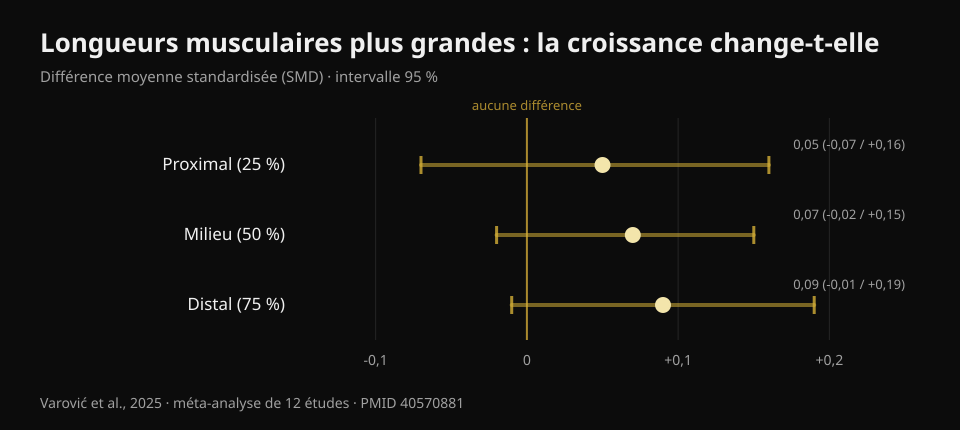
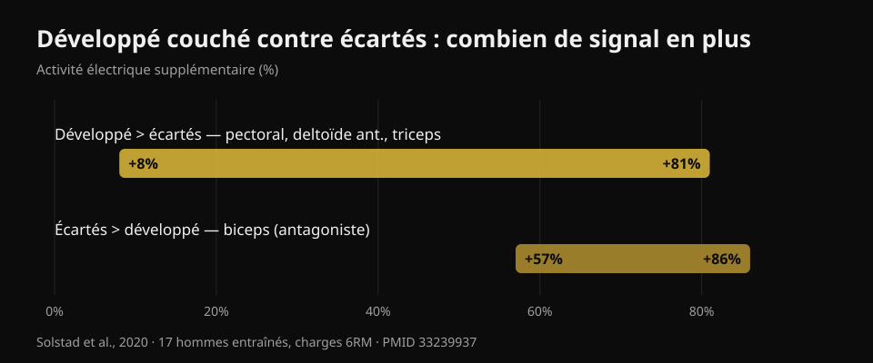

# Développé haltères ou écartés : qui fait le plus grossir ?

Par [Giammaria Loi](/autore/giammaria-loi) · mis à jour le 20 octobre 2026

Un carrousel très partagé raconte une étude toute fraîche : dix semaines, développé couché avec haltères contre écartés avec haltères, et au bout du compte les pectoraux grossissent pareil. La conclusion est confortable — prends celui que tu préfères — et elle tient en grande partie. Mais j'ai lu six études indexées pour la vérifier, et trois choses absentes du post sont remontées : cette étude n'est pas encore publiée, la zone des pectoraux où le choix compte vraiment n'a pas été mesurée, et les deux exercices ne coûtent pas le même temps par muscle entraîné.

## L'essentiel

- **Développé haltères et écartés ont fait grossir les pectoraux de façon comparable** sur dix semaines. Mais l'étude est *acceptée*, pas publiée : au 20 octobre 2026 elle n'est pas vérifiable sur PubMed.
- **Treize personnes par groupe ont terminé**, sur 46 au départ. À ce niveau, « pas de différence significative » ne veut pas dire « les deux exercices se valent ».
- **L'idée que les écartés font plus grossir parce qu'ils chargent le muscle allongé avait déjà été testée** — par le chercheur même qui a publié le carrousel : effets triviaux, SMD de 0,05 à 0,09 (Varović et al., 2025).
- **Le développé entraîne aussi le deltoïde antérieur et le triceps** : de +8 % à +81 % d'activité électrique de plus que les écartés (Solstad et al., 2020). Les écartés non.
- **Pour le haut des pectoraux le choix compte**, et c'est précisément la région que la nouvelle étude n'a pas mesurée : la seule différence documentée est +0,62 cm d'épaisseur avec le développé incliné (Chaves et al., 2020).

## Ce que compare vraiment la nouvelle étude

Le protocole, tel que décrit par les auteurs : des pratiquants avec au moins six mois d'entraînement (trois à quatre ans en moyenne), deux séances par semaine pendant dix semaines, **un seul exercice par séance** — développé haltères ou écartés — et interdiction de tout autre travail de pectoraux et de deltoïde antérieur. Le volume n'était pas imposé : chacun gardait le nombre de séries auquel il était habitué, environ 14 séries hebdomadaires en moyenne pour le développé et 13 pour les écartés. Huit à douze répétitions à environ 2 répétitions en réserve, dernière série menée à l'échec concentrique. Épaisseur du pectoral mesurée à l'échographe en trois points, du centre du thorax vers l'extérieur.

Résultat annoncé : les deux groupes progressent sur les trois points, sans différence entre groupes.

Première chose que le post ne dit pas : **cette étude n'est pas encore publiée**. Je l'ai cherchée sur PubMed par auteur, par titre et par co-auteurs : elle n'y est pas. La seule source primaire disponible est une annonce du dernier auteur, Brad Schoenfeld, indiquant que le travail vient d'être accepté par le *Journal of Strength and Conditioning Research*. Pas de DOI public, pas de preprint. Ce n'est pas une accusation : des semaines séparent normalement l'acceptation de la publication. Mais cela signifie que personne, moi compris, ne peut encore lire les chiffres, les intervalles et les tableaux. C'est pourquoi **aucun chiffre de cet article ne vient de cette étude** : tout ce qui est quantitatif ci-dessous provient de travaux publiés et vérifiés.

## « Pas de différence significative » n'est pas « c'est pareil »

Sur 46 participants au départ, **26 ont terminé** : treize par groupe. Les auteurs eux-mêmes qualifient l'abandon d'inhabituellement élevé. C'est 43 % de l'échantillon.

Une distinction s'impose, et elle vaut pour la moitié du contenu fitness que tu lis. « Pas de différence statistiquement significative » signifie que les données recueillies ne suffisent pas à démontrer une différence. Pas qu'il n'y en a aucune. Avec treize personnes par groupe, une étude ne repère que de gros écarts : si le développé faisait grossir les pectoraux, mettons, 15 % de plus que les écartés, elle passerait probablement à côté. Pour affirmer l'équivalence, il faut un protocole conçu pour ça, avec une marge déclarée à l'avance.

La lecture honnête est donc : **nous n'avons aucune preuve que l'un soit meilleur**. C'est déjà une information utile, et c'est différent de « c'est la même chose ».

C'est la même erreur de lecture que j'ai racontée à propos du [hip thrust et du squat pour les fessiers](/fr/blog/exercices-fessiers-hip-thrust-ou-squat) : là aussi les estimations penchaient d'un côté, avec des intervalles contenant largement le zéro.

## L'hypothèse de départ avait déjà une réponse

Ce qui rend l'étude intéressante, c'est sa motivation : les chercheurs s'attendaient à ce que les **écartés** l'emportent. Le raisonnement est celui devenu populaire ces dernières années : les écartés chargent le pectoral quand il est le plus allongé, et s'entraîner à des longueurs musculaires plus grandes devrait produire plus de croissance.

Sauf que cette hypothèse a déjà une réponse, et elle vient de la personne qui a publié le carrousel. En 2025, Dorian Varović a signé une méta-analyse bayésienne de douze études ayant manipulé la longueur musculaire — par l'amplitude de mouvement ou par le choix de l'exercice — et mesuré la croissance dans différentes zones d'un même muscle. Les résultats sont **triviaux** : différence standardisée de 0,05 en proximal, 0,07 au milieu, 0,09 en distal, avec des intervalles contenant tous le zéro. En pourcentage de croissance : entre 0,6 % et 1,9 %.

*Différence standardisée de croissance régionale entre longueurs musculaires plus grandes et plus courtes. Les valeurs positives favorisent les longueurs plus grandes. Les trois intervalles à 95 % traversent le zéro. Source : Varović et al., 2025, méta-analyse bayésienne de 12 études (PMID 40570881).*

Il existe une tendance croissante du proximal vers le distal, et les auteurs la signalent. Ils signalent aussi la limite la plus honnête : entre les conditions comparées, l'écart moyen de longueur musculaire n'était que de 21,8 %.

En salle : si tu choisis les écartés en espérant le bonus « étirement », ce bonus a peu de chances d'arriver.

## Ce que le développé t'apporte et pas les écartés

C'est la donnée pratique totalement absente du post, et elle répond à une question restée sans réponse dans ses propres commentaires : *puis-je entraîner mes pectoraux comme au développé, mais sans solliciter triceps et deltoïdes ?*

En 2020, une équipe norvégienne a mesuré l'activité électrique de quatre muscles chez dix-sept hommes entraînés (près de cinq ans d'expérience) au développé couché à la barre et aux écartés haltères, à des charges de six répétitions maximales, en découpant chaque répétition en six phases. Le développé produit plus de signal sur le **grand pectoral, le deltoïde antérieur et le triceps**, avec des écarts allant **de +8 % à +81 %** selon le muscle et la phase. Les écartés l'emportent sur un seul muscle : le **biceps**, de +57 % à +86 %, mais comme antagoniste stabilisant le coude, pas comme muscle travaillé.

*Signal électrique supplémentaire produit par chaque exercice, intervalle rapporté par les auteurs selon les muscles et les phases. Source : Solstad et al., 2020, 17 hommes entraînés, charges 6RM (PMID 33239937).*

Attention à ne pas retourner le raisonnement : l'activation électrique **ne prédit pas** la croissance, et ce blog l'a déjà montré chiffres à l'appui à propos de la [leg extension et de la presse](/fr/blog/leg-extension-ou-presse-a-cuisses-droit-femoral). Le point ici est plus simple : le développé met trois muscles sous charge, les écartés essentiellement un. Si ton temps en salle est limité — et il l'est pour presque tout le monde — c'est un critère plus concret que n'importe quel débat sur les longueurs musculaires.

Le revers est tout aussi utile : si le développé gêne ton épaule, les écartés permettent d'entraîner les pectoraux sans renoncer à la croissance, et tu n'y perds que le travail des triceps, rattrapable ailleurs.

## Là où le choix compte vraiment : le haut des pectoraux

La limite la plus importante de la nouvelle étude est déclarée par les auteurs : l'épaisseur a été mesurée en trois points allant du centre vers l'extérieur, et **la région claviculaire — le haut des pectoraux — n'a pas été mesurée directement**.

C'est gênant, car c'est la seule zone où, dans les études publiées, le choix de l'exercice a réellement changé quelque chose.

En 2020, Chaves et ses collègues ont réparti 47 hommes non entraînés en trois groupes — banc plat seul, banc incliné seul, ou les deux — pendant huit semaines à nombre de séries égal. La force a progressé de la même façon dans les trois groupes (environ 10-11 kg, sans différence significative). L'épaisseur musculaire a évolué différemment sur **un seul site sur trois** : le deuxième espace intercostal, le haut des pectoraux, où l'incliné a dépassé le plat de **0,62 cm (intervalle 0,23-1,00 ; p = 0,003)** et la combinaison de **0,50 cm (0,14-0,86 ; p = 0,008)**.

Deux détails. D'abord : le groupe faisant **les deux** n'a battu aucun des deux autres ; faire un peu de tout a dilué le stimulus. Ensuite : il s'agissait de débutants, donc c'est une indication, pas une loi.

Le mécanisme colle à ce qu'on mesure en aigu. En 2022, une équipe italo-brésilienne a enregistré les deux faisceaux du pectoral au développé plat et à 45° : sur l'incliné le faisceau claviculaire travaille plus que le sterno-costal, sur le plat c'est l'inverse, et la réponse immédiate de la section musculaire suit la même direction. Quant à l'angle précis, trente adultes entraînés testés à cinq inclinaisons montrent un pic du haut des pectoraux à **30°**, tandis que les portions moyenne et basse rendent le plus à **0°** ; au-delà de 45°, le travail glisse vers le deltoïde antérieur et le pectoral rend moins.

## Ce que dit vraiment la recherche

- **Confirmé** — Le grand pectoral comporte deux régions, claviculaire et sterno-costale, avec innervation et réponses distinctes (Albarello et al., 2022).
- **Confirmé** — Des exercices différents produisent une croissance comparable quand l'agoniste est suffisamment sollicité sur des amplitudes voisines (Chaves et al., 2020 ; Kassiano et al., 2022).
- **À nuancer** — « Pas de différence significative » avec 13 personnes par groupe après 43 % d'abandons n'autorise pas à parler d'équivalence.
- **À nuancer** — Varier les exercices aide, mais seulement si la variation est systématique : alterner au hasard des exercices au stimulus redondant peut dégrader les résultats (Kassiano et al., 2022).
- **Démenti** — L'attente d'une croissance supérieure avec les écartés du fait de l'étirement : les effets sur la croissance régionale sont triviaux (Varović et al., 2025).
- **Non vérifiable** — Les chiffres de l'étude Dell'Avanzi : acceptée par le *Journal of Strength and Conditioning Research*, ni publiée ni indexée au 20 octobre 2026.

## Comment l'appliquer

1. **Choisis le mouvement de poussée que tu peux charger et faire progresser dans le temps.** Barre, haltères ou machine : à séries égales et à proximité de l'échec égale, les pectoraux grossissent. Le critère n'est pas « lequel active le plus », mais sur lequel tu arrives à ajouter des kilos ou des répétitions mois après mois.
2. **Garde les écartés comme second exercice, pas comme remplaçant obligatoire.** Ils sont utiles si la poussée gêne ton épaule, si tu veux du volume pectoral sans fatiguer davantage les triceps, ou simplement si tu les aimes et les fais donc régulièrement.
3. **Si le haut des pectoraux est ton point faible, règle le banc à 30°.** C'est là que la portion claviculaire rend le plus. Au-delà de 45°, tu travailles surtout les épaules.
4. **Ne mélange pas au hasard.** Deux ou trois exercices stables tenus six à douze semaines battent une rotation nouvelle chaque semaine.
5. **Approche suffisamment l'échec.** Le protocole de l'étude travaillait à environ deux répétitions en réserve, dernière série à l'échec. Le tableau complet des séries, répétitions et récupérations est résumé [ici](/fr/blog/combien-de-repetitions-masse-musculaire).

### Essaie Nurvan — tes pectoraux grossissent si la charge monte

Ce qui décide n'est pas l'exercice que tu « sens » le plus, mais celui qui progresse. Dans Nurvan chaque série est enregistrée avec la charge, les répétitions et le RIR (combien de répétitions il te restait), et l'application affiche la tendance exercice par exercice : tu vois noir sur blanc si ton développé haltères monte ou stagne depuis deux mois, et tu décides avec tes chiffres plutôt qu'avec la dernière étude virale. **[Essaie Nurvan](https://nurvan.app)**

## Questions fréquentes

**Développé ou écartés pour faire grossir les pectoraux ?**
Pour le pectoral dans son ensemble, les preuves disponibles ne désignent pas de vainqueur : les deux fonctionnent si les séries approchent suffisamment l'échec. Le développé entraîne en plus deltoïde antérieur et triceps dans la même série, donc il rend davantage par minute. Les écartés restent un excellent choix si la poussée te gêne.

**Les écartés servent-ils à « l'intérieur » des pectoraux ?**
Non. Le grand pectoral se divise en portion claviculaire et sterno-costale, pas en une partie « interne » et une « externe » : aucun exercice ne fait grossir uniquement la zone centrale. Les différences régionales documentées opposent le haut et le bas, et dépendent surtout de l'inclinaison du banc.

**Quelle inclinaison pour le haut des pectoraux ?**
Trente degrés est l'inclinaison où la portion haute montre l'activité maximale. À zéro degré, les portions moyenne et basse rendent le plus. Au-delà de 45°, le deltoïde antérieur prend le relais.

**Faut-il faire les deux exercices ?**
Ce n'est pas obligatoire. Dans la seule étude ayant comparé un groupe « les deux » aux groupes à exercice unique, faire les deux n'a pas donné de meilleurs résultats. Choisis selon ton temps, ton matériel et ton confort articulaire.

## À lire aussi

- [Leg extension ou presse à cuisses : ce qui grossit vraiment](/fr/blog/leg-extension-ou-presse-a-cuisses-droit-femoral) — pourquoi « active plus » ne veut pas dire « grossit plus ».
- [Exercices fessiers : hip thrust ou squat ?](/fr/blog/exercices-fessiers-hip-thrust-ou-squat) — la même erreur de lecture sur un autre muscle.
- [Répétitions, séries et récupération pour l'hypertrophie](/fr/blog/combien-de-repetitions-masse-musculaire) — les variables qui comptent plus que le choix de l'exercice.

## Sources

1. Solstad TE, Andersen V, Shaw M, Hoel EM, Vonheim A, Saeterbakken AH, 2020. *A Comparison of Muscle Activation between Barbell Bench Press and Dumbbell Flyes in Resistance-Trained Males.* Journal of Sports Science & Medicine 19(4):645-651. [PMID 33239937](https://pubmed.ncbi.nlm.nih.gov/33239937/)
2. Chaves SFN, et al., 2020. *Effects of Horizontal and Incline Bench Press on Neuromuscular Adaptations in Untrained Young Men.* International Journal of Exercise Science 13(6):859-872. [PMID 32922646](https://pubmed.ncbi.nlm.nih.gov/32922646/) · [DOI 10.70252/FDNB1158](https://doi.org/10.70252/FDNB1158)
3. Albarello JCS, et al., 2022. *Non-uniform excitation of pectoralis major induced by changes in bench press inclination leads to uneven variations in the cross-sectional area measured by panoramic ultrasonography.* Journal of Electromyography and Kinesiology 67:102722. [PMID 36334406](https://pubmed.ncbi.nlm.nih.gov/36334406/) · [DOI 10.1016/j.jelekin.2022.102722](https://doi.org/10.1016/j.jelekin.2022.102722)
4. Varović D, Wolf M, Schoenfeld BJ, Steele J, Grgic J, Mikulic P, 2025. *Does Muscle Length Influence Regional Hypertrophy? A Systematic Review and Meta-Analysis.* International Journal of Sports Medicine 46(14):1027-1036. [PMID 40570881](https://pubmed.ncbi.nlm.nih.gov/40570881/) · [DOI 10.1055/a-2615-4935](https://doi.org/10.1055/a-2615-4935)
5. Kassiano W, Nunes JP, Costa B, Ribeiro AS, Schoenfeld BJ, Cyrino ES, 2022. *Does Varying Resistance Exercises Promote Superior Muscle Hypertrophy and Strength Gains? A Systematic Review.* Journal of Strength and Conditioning Research 36(6):1753-1762. [PMID 35438660](https://pubmed.ncbi.nlm.nih.gov/35438660/) · [DOI 10.1519/JSC.0000000000004258](https://doi.org/10.1519/JSC.0000000000004258)
6. Rodríguez-Ridao D, Antequera-Vique JA, Martín-Fuentes I, Muyor JM, 2020. *Effect of Five Bench Inclinations on the Electromyographic Activity of the Pectoralis Major, Anterior Deltoid, and Triceps Brachii during the Bench Press Exercise.* International Journal of Environmental Research and Public Health 17(19):7339. [PMID 33049982](https://pubmed.ncbi.nlm.nih.gov/33049982/) · [DOI 10.3390/ijerph17197339](https://doi.org/10.3390/ijerph17197339)
7. Dell'Avanzi FG, et al. *Dumbbell bench press and dumbbell fly elicit similar pectoralis major muscle hypertrophy in recreationally-trained individuals.* Acceptée par le Journal of Strength and Conditioning Research ; au 20 octobre 2026 ni publiée ni indexée sur PubMed. Protocole et résultats rapportés tels que déclarés par les auteurs.

Références récupérées via PubMed. Point de départ : le carrousel de **Dorian Varović** ([@varovicdorian](https://www.instagram.com/varovicdorian/)) du 9 septembre 2026, [post original](https://www.instagram.com/p/DdFF9e8HIOQ/). Aucun texte ni image du post n'a été reproduit.

---

**Giammaria Loi** est le fondateur de Nurvan. Il s'entraîne avec les poids depuis 2012, travaille comme coach et préparateur certifié FIPE depuis 2013 et compète en powerlifting au niveau national depuis 2018.

> Note : contenu informatif, qui ne remplace pas l'avis d'un médecin ou d'un professionnel qualifié. Si la poussée fait mal à l'épaule, fais-la évaluer avant d'insister.
