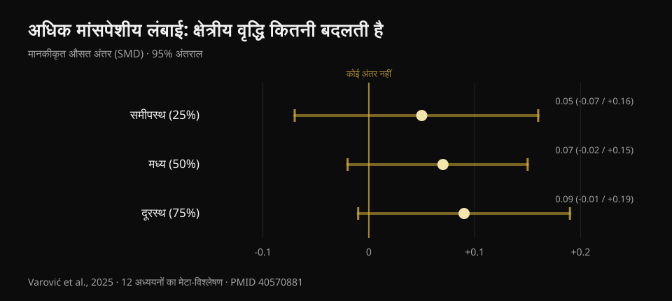
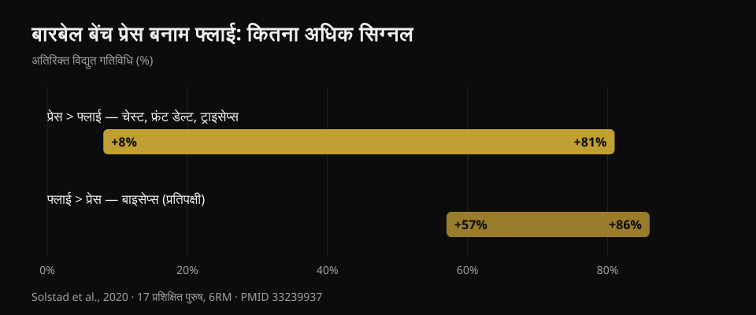

# डम्बल प्रेस या फ्लाई: चेस्ट किससे ज़्यादा बढ़ती है?

लेखक: [Giammaria Loi](/autore/giammaria-loi) · अपडेट 20 अक्टूबर 2026

एक ख़ूब शेयर हुए कैरोसेल में एकदम नई स्टडी का ज़िक्र है: दस हफ़्ते, डम्बल बेंच प्रेस बनाम डम्बल फ्लाई, और अंत में चेस्ट बराबर बढ़ती है। नतीजा आरामदेह है — जो पसंद हो वही करो — और काफ़ी हद तक सही भी है। लेकिन इसे जाँचने के लिए मैंने छह इंडेक्स्ड स्टडी पढ़ीं, और तीन बातें सामने आईं जो पोस्ट में हैं ही नहीं: वह स्टडी अभी प्रकाशित नहीं हुई है, चेस्ट का जो हिस्सा असल में एक्सरसाइज़ के चुनाव से फ़र्क़ पड़ता है वह नापा ही नहीं गया, और प्रति ट्रेन हुई मांसपेशी दोनों एक्सरसाइज़ का समय-खर्च बराबर नहीं है।

## संक्षेप में

- **दस हफ़्तों में डम्बल प्रेस और फ्लाई से चेस्ट की वृद्धि लगभग बराबर रही।** पर स्टडी जर्नल में *स्वीकृत* है, प्रकाशित नहीं: 20 अक्टूबर 2026 तक PubMed पर जाँची नहीं जा सकती।
- **हर ग्रुप में तेरह लोग पूरा कर पाए**, शुरू हुए 46 में से। इतने छोटे सैंपल में "कोई सार्थक अंतर नहीं" का मतलब "दोनों बराबर हैं" नहीं होता।
- **यह विचार कि फ्लाई स्ट्रेच पोज़िशन में लोड देने से ज़्यादा बढ़ाती है, पहले ही परखा जा चुका है** — उसी शोधकर्ता द्वारा जिसने पोस्ट डाली: प्रभाव नगण्य, SMD 0.05 से 0.09 (Varović et al., 2025)।
- **प्रेस साथ में फ्रंट डेल्ट और ट्राइसेप्स भी ट्रेन करती है**: फ्लाई से 8% से 81% ज़्यादा विद्युत गतिविधि (Solstad et al., 2020)। फ्लाई से नहीं।
- **अपर चेस्ट के लिए चुनाव मायने रखता है**, और यही वह हिस्सा है जो नई स्टडी ने नहीं नापा: दर्ज एकमात्र अंतर है इनक्लाइन प्रेस से +0.62 सेमी मोटाई (Chaves et al., 2020)।

## नई स्टडी असल में क्या तुलना करती है

लेखकों के विवरण के अनुसार: कम से कम छह महीने की ट्रेनिंग वाले लोग (औसतन तीन से चार साल), दस हफ़्ते तक हफ़्ते में दो सेशन, **हर सेशन में सिर्फ़ एक एक्सरसाइज़** — या डम्बल प्रेस या डम्बल फ्लाई — और चेस्ट व फ्रंट डेल्ट का कोई और काम मना। वॉल्यूम थोपा नहीं गया: हर कोई अपने आदतन सेट पर रहा, औसतन प्रेस ग्रुप में लगभग 14 साप्ताहिक सेट और फ्लाई ग्रुप में 13। आठ से बारह रेप्स, लगभग 2 रेप्स रिज़र्व पर, आख़िरी सेट कॉन्सेंट्रिक फ़ेलियर तक। चेस्ट की मोटाई अल्ट्रासाउंड से तीन जगह नापी गई, छाती के बीच से बाहर की ओर।

घोषित नतीजा: दोनों ग्रुप तीनों जगह बढ़े, ग्रुपों के बीच कोई अंतर नहीं।

पोस्ट जो नहीं बताती: **यह स्टडी अभी प्रकाशित नहीं हुई है**। मैंने PubMed पर लेखक, शीर्षक और सह-लेखकों से खोजा — वहाँ है ही नहीं। एकमात्र उपलब्ध प्राथमिक स्रोत अंतिम लेखक ब्रैड शोनफेल्ड की एक घोषणा है कि पेपर अभी-अभी *Journal of Strength and Conditioning Research* ने स्वीकार किया है। न सार्वजनिक DOI, न प्रीप्रिंट। यह आरोप नहीं है: स्वीकृति और प्रकाशन के बीच हफ़्ते लगना सामान्य है। पर इसका मतलब है कि मेरे समेत कोई भी अभी आँकड़े, कॉन्फ़िडेंस इंटरवल और टेबल नहीं पढ़ सकता। इसीलिए **इस लेख में उस स्टडी का एक भी आँकड़ा इस्तेमाल नहीं हुआ**: नीचे के सारे संख्यात्मक तथ्य प्रकाशित और जाँचे गए शोध से हैं।

## "कोई सार्थक अंतर नहीं" का मतलब "बराबर" नहीं

शुरू हुए 46 में से **26 ने पूरा किया**: हर ग्रुप में तेरह। लेखक ख़ुद इस ड्रॉपआउट को असामान्य रूप से ऊँचा कहते हैं। यह सैंपल का 43% है।

यहाँ एक फ़र्क़ समझना ज़रूरी है जो आपके पढ़े आधे फ़िटनेस कंटेंट पर लागू होता है। "सांख्यिकीय रूप से सार्थक अंतर नहीं" का अर्थ है कि जुटाया गया डेटा अंतर साबित करने के लिए काफ़ी नहीं था। यह नहीं कि अंतर है ही नहीं। तेरह लोगों वाले ग्रुप में स्टडी सिर्फ़ बड़े अंतर देख पाती है: अगर प्रेस से चेस्ट, मान लीजिए, फ्लाई से 15% ज़्यादा बढ़ती, तो शायद पकड़ में ही न आता। बराबरी का दावा करने के लिए उसी मक़सद से बना डिज़ाइन चाहिए, जिसमें समतुल्यता की सीमा पहले से तय हो।

ईमानदार पाठ यह है: **हमारे पास प्रमाण नहीं कि इनमें से कोई बेहतर है।** यह भी काम की जानकारी है, और "दोनों एक ही चीज़ हैं" से अलग है।

यह वही पढ़ने की ग़लती है जिसका ज़िक्र मैंने [हिप थ्रस्ट और स्क्वाट](/hi/blog/glutes-exercise-hip-thrust-ya-squat) वाले लेख में किया था: वहाँ भी अनुमान एक तरफ़ झुके थे, पर इंटरवल आराम से शून्य को समेट रहे थे।

## शुरुआती परिकल्पना का जवाब पहले से मौजूद था

दिलचस्प बात यह है कि स्टडी क्यों हुई: शोधकर्ताओं को उम्मीद थी कि **फ्लाई** जीतेगी। तर्क वही है जो हाल के सालों में लोकप्रिय हुआ — फ्लाई चेस्ट को सबसे ज़्यादा खिंची हुई स्थिति में लोड करती है, और लंबी मांसपेशीय लंबाई पर ट्रेनिंग से ज़्यादा वृद्धि मिलनी चाहिए।

बस इस परिकल्पना का जवाब पहले से है, और वह भी उसी व्यक्ति से जिसने कैरोसेल पोस्ट किया। 2025 में Dorian Varović ने बारह स्टडी का बेज़ियन मेटा-विश्लेषण प्रकाशित किया, जिनमें रेंज ऑफ़ मोशन या एक्सरसाइज़ चुनाव के ज़रिए मांसपेशीय लंबाई बदली गई और एक ही मांसपेशी के अलग-अलग हिस्सों में वृद्धि नापी गई। नतीजे **नगण्य** हैं: समीपस्थ हिस्से में मानकीकृत अंतर 0.05, मध्य में 0.07, दूरस्थ में 0.09, और तीनों इंटरवल शून्य को समेटते हैं। वृद्धि प्रतिशत में: 0.6% से 1.9% के बीच।

*लंबी और छोटी मांसपेशीय लंबाई के बीच क्षेत्रीय वृद्धि का मानकीकृत अंतर। धनात्मक मान लंबी लंबाई के पक्ष में। तीनों 95% इंटरवल शून्य को काटते हैं। स्रोत: Varović et al., 2025, 12 स्टडी का बेज़ियन मेटा-विश्लेषण (PMID 40570881)।*

समीपस्थ से दूरस्थ की ओर बढ़ता रुझान है, और लेखक इसे बताते भी हैं। वे सबसे ईमानदार सीमा भी बताते हैं: तुलना की गई स्थितियों के बीच औसत मांसपेशीय लंबाई का अंतर सिर्फ़ 21.8% था।

जिम की भाषा में: अगर आप "स्ट्रेच बोनस" की उम्मीद में फ्लाई चुन रहे हैं, तो वह बोनस शायद नहीं आएगा।

## प्रेस जो देती है, फ्लाई नहीं देती

यही वह व्यावहारिक जानकारी है जो पोस्ट में बिल्कुल नहीं है, और यह उसी पोस्ट के कमेंट में छूटे सवाल का जवाब देती है: *क्या मैं चेस्ट को प्रेस जैसी ट्रेनिंग दे सकता हूँ पर ट्राइसेप्स और डेल्ट लगाए बिना?*

2020 में एक नॉर्वेजियन टीम ने सत्रह ट्रेंड पुरुषों (लगभग पाँच साल अनुभव) में बारबेल बेंच प्रेस और डम्बल फ्लाई के दौरान चार मांसपेशियों की विद्युत गतिविधि नापी, 6RM लोड पर, और हर रेप को छह चरणों में बाँटा। प्रेस ने **पेक्टोरलिस मेजर, फ्रंट डेल्टॉइड और ट्राइसेप्स** में ज़्यादा सिग्नल पैदा किया, अंतर **+8% से +81% तक**, मांसपेशी और चरण के अनुसार। फ्लाई सिर्फ़ एक मांसपेशी में आगे रही: **बाइसेप्स**, 57% से 86% तक — पर कोहनी स्थिर रखने वाले प्रतिपक्षी के रूप में, लक्ष्य मांसपेशी के रूप में नहीं।

*हर एक्सरसाइज़ कितना अतिरिक्त विद्युत सिग्नल देती है; यह लेखकों द्वारा मांसपेशियों और गति-चरणों में बताया गया दायरा है। स्रोत: Solstad et al., 2020, 17 ट्रेंड पुरुष, 6RM लोड (PMID 33239937)।*

तर्क को उलटिए मत: विद्युत सक्रियता **वृद्धि की भविष्यवाणी नहीं करती**, और यह ब्लॉग [लेग एक्सटेंशन और लेग प्रेस](/hi/blog/leg-extension-vs-leg-press-rectus-femoris-hindi) पर आँकड़ों के साथ यह दिखा चुका है। यहाँ बात सीधी है: प्रेस तीन मांसपेशियों पर भार डालती है, फ्लाई मूलतः एक पर। अगर जिम में आपका समय सीमित है — और लगभग सबका है — तो यह मांसपेशीय लंबाई की किसी भी बहस से ज़्यादा ठोस कसौटी है।

दूसरा पहलू भी उतना ही काम का है: अगर प्रेस से कंधे में तकलीफ़ होती है, तो फ्लाई से चेस्ट ट्रेन करना संभव है बिना वृद्धि गँवाए, और आप सिर्फ़ ट्राइसेप्स का काम खोते हैं जिसे कहीं और पूरा किया जा सकता है।

## चुनाव असल में कहाँ मायने रखता है: अपर चेस्ट

नई स्टडी की सबसे बड़ी सीमा लेखक ख़ुद बताते हैं: मोटाई बीच से बाहर की ओर तीन बिंदुओं पर नापी गई, और **क्लैविक्युलर हिस्सा — अपर चेस्ट — सीधे नापा ही नहीं गया**।

यह समस्या है, क्योंकि प्रकाशित स्टडी में एक्सरसाइज़ के चुनाव से असल फ़र्क़ सिर्फ़ उसी हिस्से में दिखा है।

2020 में Chaves और सहयोगियों ने 47 अप्रशिक्षित पुरुषों को तीन ग्रुप में बाँटा — सिर्फ़ फ्लैट, सिर्फ़ इनक्लाइन, या दोनों — आठ हफ़्ते, बराबर सेट के साथ। तीनों ग्रुप में ताक़त बराबर बढ़ी (लगभग 10–11 किग्रा, कोई सार्थक अंतर नहीं)। मांसपेशीय मोटाई **तीन में से एक ही बिंदु** पर अलग बदली: दूसरा इंटरकॉस्टल स्पेस यानी अपर चेस्ट, जहाँ इनक्लाइन ने फ्लैट को **0.62 सेमी (इंटरवल 0.23–1.00; p = 0.003)** और "दोनों" ग्रुप को **0.50 सेमी (0.14–0.86; p = 0.008)** से पीछे छोड़ा।

दो बातें ध्यान देने लायक़। पहली: **दोनों** करने वाला ग्रुप किसी से नहीं जीता; थोड़ा-थोड़ा सब करने से उत्तेजना बँट गई। दूसरी: ये अप्रशिक्षित लोग थे, इसलिए यह संकेत है, नियम नहीं।

यह तंत्र तात्कालिक मापों से मेल खाता है। 2022 में एक इतालवी-ब्राज़ीली टीम ने फ्लैट और 45° इनक्लाइन प्रेस के दौरान चेस्ट के दोनों हेड रिकॉर्ड किए: इनक्लाइन पर क्लैविक्युलर हेड स्टर्नोकॉस्टल से ज़्यादा काम करता है, फ्लैट पर उल्टा, और मांसपेशीय अनुप्रस्थ काट की तात्कालिक प्रतिक्रिया भी उसी दिशा में जाती है। सटीक कोण की बात करें तो पाँच झुकावों पर परखे गए तीस ट्रेंड वयस्कों में अपर चेस्ट का शिखर **30°** पर दिखता है, जबकि मध्य और निचला हिस्सा **0°** पर सबसे ज़्यादा काम करता है; 45° से ऊपर काम फ्रंट डेल्ट की ओर खिसकता जाता है और चेस्ट का प्रदर्शन गिरता है।

## शोध असल में क्या कहता है

- **पुष्ट** — पेक्टोरलिस मेजर के दो हिस्से हैं, क्लैविक्युलर और स्टर्नोकॉस्टल, जिनका तंत्रिका-नियंत्रण और प्रतिक्रिया अलग है (Albarello et al., 2022)।
- **पुष्ट** — जब लक्ष्य मांसपेशी तुलनीय रेंज में पर्याप्त चुनौती पाती है तो अलग-अलग एक्सरसाइज़ से वृद्धि लगभग बराबर होती है (Chaves et al., 2020; Kassiano et al., 2022)।
- **स्पष्ट करने योग्य** — 43% ड्रॉपआउट के बाद हर ग्रुप में 13 लोगों के साथ "कोई सार्थक अंतर नहीं" से बराबरी का दावा नहीं बनता।
- **स्पष्ट करने योग्य** — एक्सरसाइज़ बदलना मदद करता है, पर तभी जब बदलाव व्यवस्थित हो: एक जैसी उत्तेजना वाली एक्सरसाइज़ को बेतरतीब घुमाना नतीजे बिगाड़ सकता है (Kassiano et al., 2022)।
- **ख़ारिज** — यह उम्मीद कि फ्लाई स्ट्रेच की वजह से ज़्यादा बढ़ाएगी: क्षेत्रीय वृद्धि पर प्रभाव नगण्य हैं (Varović et al., 2025)।
- **अप्रमाणित** — Dell'Avanzi स्टडी के आँकड़े: *Journal of Strength and Conditioning Research* ने स्वीकार किया है, पर 20 अक्टूबर 2026 तक न प्रकाशित है न इंडेक्स्ड।

## इसे कैसे लागू करें

1. **वह प्रेसिंग मूवमेंट चुनें जिस पर आप समय के साथ वज़न बढ़ा सकें।** बारबेल, डम्बल या मशीन: बराबर सेट और फ़ेलियर से बराबर दूरी पर चेस्ट बढ़ती है। कसौटी यह नहीं कि कौन "ज़्यादा एक्टिवेट" करता है, बल्कि यह कि किसमें आप महीने-दर-महीने वज़न या रेप्स जोड़ पाते हैं।
2. **फ्लाई को दूसरी एक्सरसाइज़ रखें, अनिवार्य विकल्प नहीं।** अगर प्रेस से कंधा दुखता है, अगर ट्राइसेप्स को और थकाए बिना चेस्ट वॉल्यूम चाहिए, या बस आपको पसंद है इसलिए नियमित करते हैं — तब यह उपयोगी है।
3. **अगर अपर चेस्ट कमज़ोर है तो बेंच 30° पर रखें।** वहीं क्लैविक्युलर हिस्सा सबसे ज़्यादा काम करता है। 45° से ऊपर आप मुख्यतः कंधे ट्रेन कर रहे हैं।
4. **बेतरतीब न बदलें।** छह से बारह हफ़्ते तक टिकी दो-तीन एक्सरसाइज़, हर हफ़्ते नई रोटेशन से बेहतर हैं।
5. **सेट को फ़ेलियर के काफ़ी क़रीब ले जाएँ।** स्टडी का प्रोटोकॉल लगभग दो रेप्स रिज़र्व पर था, आख़िरी सेट फ़ेलियर तक। सेट, रेप्स और रेस्ट की पूरी तस्वीर मैंने [यहाँ](/hi/blog/kitne-reps-muscle-ke-liye) समेटी है।

### Nurvan आज़माएँ — वज़न बढ़ेगा तभी चेस्ट बढ़ेगी

नतीजा इससे तय नहीं होता कि कौन-सी एक्सरसाइज़ आप ज़्यादा "महसूस" करते हैं, बल्कि इससे कि वह आगे बढ़ रही है या नहीं। Nurvan में हर सेट वज़न, रेप्स और RIR (कितने रेप्स बचे थे) के साथ दर्ज होता है, और ऐप हर एक्सरसाइज़ का रुझान दिखाता है: आप साफ़ देख सकते हैं कि आपकी डम्बल प्रेस चढ़ रही है या दो महीने से अटकी है, और किसी वायरल स्टडी के बजाय अपने आँकड़ों से फ़ैसला लेते हैं। **[Nurvan आज़माएँ](https://nurvan.app)**

## अक्सर पूछे जाने वाले सवाल

**चेस्ट के लिए प्रेस बेहतर या फ्लाई?**
पूरे पेक्टोरल के लिए उपलब्ध प्रमाण किसी को विजेता नहीं बताते: सेट फ़ेलियर के काफ़ी क़रीब हों तो दोनों काम करते हैं। पर प्रेस उसी सेट में फ्रंट डेल्ट और ट्राइसेप्स भी ट्रेन करती है, इसलिए प्रति मिनट ज़्यादा देती है। अगर प्रेस से तकलीफ़ है तो फ्लाई बढ़िया विकल्प है।

**क्या फ्लाई "इनर चेस्ट" के लिए है?**
नहीं। पेक्टोरलिस मेजर क्लैविक्युलर और स्टर्नोकॉस्टल हिस्सों में बँटा है, "अंदरूनी" और "बाहरी" में नहीं: कोई एक्सरसाइज़ सिर्फ़ बीच का हिस्सा नहीं बढ़ाती। दर्ज क्षेत्रीय अंतर ऊपर बनाम नीचे के हैं और मुख्यतः बेंच के कोण पर निर्भर हैं।

**अपर चेस्ट के लिए कौन-सा कोण?**
तीस डिग्री पर ऊपरी हिस्सा सबसे ज़्यादा सक्रिय दिखता है। शून्य डिग्री पर मध्य और निचला हिस्सा ज़्यादा काम करता है। 45° से ऊपर फ्रंट डेल्ट हावी हो जाता है।

**क्या दोनों एक्सरसाइज़ करना ज़रूरी है?**
ज़रूरी नहीं। जिस एकमात्र स्टडी ने "दोनों" ग्रुप की तुलना अकेली एक्सरसाइज़ वाले ग्रुपों से की, वहाँ दोनों करने से बेहतर नतीजा नहीं मिला। समय, उपलब्ध उपकरण और जोड़ों के आराम के हिसाब से चुनें।

## यह भी पढ़ें

- [लेग एक्सटेंशन या लेग प्रेस: असल में क्या बढ़ता है](/hi/blog/leg-extension-vs-leg-press-rectus-femoris-hindi) — "ज़्यादा एक्टिवेट" का मतलब "ज़्यादा बढ़ना" क्यों नहीं।
- [ग्लूट्स एक्सरसाइज़: हिप थ्रस्ट या स्क्वाट?](/hi/blog/glutes-exercise-hip-thrust-ya-squat) — वही पढ़ने की ग़लती, दूसरी मांसपेशी पर।
- [हाइपरट्रॉफी के लिए रेप्स, सेट और रेस्ट](/hi/blog/kitne-reps-muscle-ke-liye) — वे वेरिएबल जो एक्सरसाइज़ के चुनाव से ज़्यादा मायने रखते हैं।

## स्रोत

1. Solstad TE, Andersen V, Shaw M, Hoel EM, Vonheim A, Saeterbakken AH, 2020. *A Comparison of Muscle Activation between Barbell Bench Press and Dumbbell Flyes in Resistance-Trained Males.* Journal of Sports Science & Medicine 19(4):645-651. [PMID 33239937](https://pubmed.ncbi.nlm.nih.gov/33239937/)
2. Chaves SFN, et al., 2020. *Effects of Horizontal and Incline Bench Press on Neuromuscular Adaptations in Untrained Young Men.* International Journal of Exercise Science 13(6):859-872. [PMID 32922646](https://pubmed.ncbi.nlm.nih.gov/32922646/) · [DOI 10.70252/FDNB1158](https://doi.org/10.70252/FDNB1158)
3. Albarello JCS, et al., 2022. *Non-uniform excitation of pectoralis major induced by changes in bench press inclination leads to uneven variations in the cross-sectional area measured by panoramic ultrasonography.* Journal of Electromyography and Kinesiology 67:102722. [PMID 36334406](https://pubmed.ncbi.nlm.nih.gov/36334406/) · [DOI 10.1016/j.jelekin.2022.102722](https://doi.org/10.1016/j.jelekin.2022.102722)
4. Varović D, Wolf M, Schoenfeld BJ, Steele J, Grgic J, Mikulic P, 2025. *Does Muscle Length Influence Regional Hypertrophy? A Systematic Review and Meta-Analysis.* International Journal of Sports Medicine 46(14):1027-1036. [PMID 40570881](https://pubmed.ncbi.nlm.nih.gov/40570881/) · [DOI 10.1055/a-2615-4935](https://doi.org/10.1055/a-2615-4935)
5. Kassiano W, Nunes JP, Costa B, Ribeiro AS, Schoenfeld BJ, Cyrino ES, 2022. *Does Varying Resistance Exercises Promote Superior Muscle Hypertrophy and Strength Gains? A Systematic Review.* Journal of Strength and Conditioning Research 36(6):1753-1762. [PMID 35438660](https://pubmed.ncbi.nlm.nih.gov/35438660/) · [DOI 10.1519/JSC.0000000000004258](https://doi.org/10.1519/JSC.0000000000004258)
6. Rodríguez-Ridao D, Antequera-Vique JA, Martín-Fuentes I, Muyor JM, 2020. *Effect of Five Bench Inclinations on the Electromyographic Activity of the Pectoralis Major, Anterior Deltoid, and Triceps Brachii during the Bench Press Exercise.* International Journal of Environmental Research and Public Health 17(19):7339. [PMID 33049982](https://pubmed.ncbi.nlm.nih.gov/33049982/) · [DOI 10.3390/ijerph17197339](https://doi.org/10.3390/ijerph17197339)
7. Dell'Avanzi FG, et al. *Dumbbell bench press and dumbbell fly elicit similar pectoralis major muscle hypertrophy in recreationally-trained individuals.* Journal of Strength and Conditioning Research द्वारा स्वीकृत; 20 अक्टूबर 2026 तक न प्रकाशित न PubMed पर इंडेक्स्ड। डिज़ाइन और नतीजे लेखकों के कथन के अनुसार प्रस्तुत।

संदर्भ PubMed के ज़रिए खोजे गए। शुरुआती प्रेरणा: **Dorian Varović** ([@varovicdorian](https://www.instagram.com/varovicdorian/)) का 9 सितंबर 2026 का कैरोसेल, [मूल पोस्ट](https://www.instagram.com/p/DdFF9e8HIOQ/)। पोस्ट का कोई टेक्स्ट या चित्र दोबारा इस्तेमाल नहीं किया गया।

---

**Giammaria Loi** Nurvan के संस्थापक हैं। वे 2012 से वेट ट्रेनिंग करते हैं, 2013 से FIPE-प्रमाणित पर्सनल ट्रेनर और कोच के रूप में काम करते हैं, और 2018 से राष्ट्रीय स्तर पर पावरलिफ्टिंग में भाग लेते हैं।

> नोट: यह जानकारीपरक सामग्री है, किसी डॉक्टर या योग्य पेशेवर की सलाह का विकल्प नहीं। अगर प्रेस करते समय कंधे में दर्द हो तो आगे बढ़ने से पहले जाँच कराएँ।
