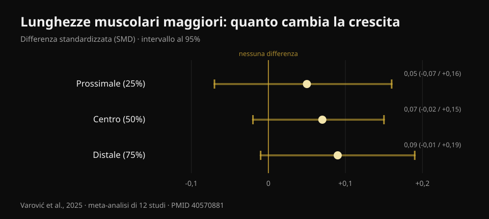
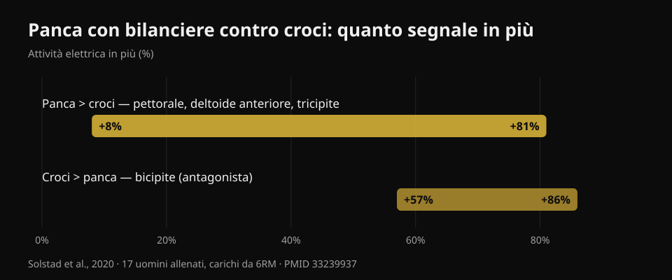

# Panca o croci: cosa fa crescere di più il petto?

Di [Giammaria Loi](/autore/giammaria-loi) · aggiornato il 20 ottobre 2026

Un carosello molto condiviso racconta uno studio appena uscito: dieci settimane, panca con manubri contro croci con manubri, e alla fine il petto cresce uguale. La conclusione è comoda — scegli quello che preferisci — e in gran parte regge. Ma ho letto sei studi indicizzati per controllarla, e sono saltate fuori tre cose che nel post non ci sono: lo studio in questione non è ancora pubblicato, la zona del petto dove la scelta conta davvero non è stata misurata, e i due esercizi non costano lo stesso tempo a parità di muscoli allenati.

## In breve

- **Panca con manubri e croci fanno crescere il pettorale in modo simile**, secondo uno studio di 10 settimane. Ma lo studio è stato *accettato* da una rivista, non ancora pubblicato: al 20 ottobre 2026 non è verificabile su PubMed.
- **Sono rimaste 13 persone per gruppo** su 46 partenti. Con numeri così, "nessuna differenza significativa" non significa "i due esercizi sono equivalenti".
- **L'idea che le croci crescano di più perché allungano di più il muscolo era già stata smontata** — dalla meta-analisi dello stesso ricercatore che ha pubblicato il post: effetti trivial, SMD da 0,05 a 0,09 (Varović et al., 2025).
- **La panca ti dà anche deltoide anteriore e tricipite**: da +8% a +81% di attività elettrica in più rispetto alle croci (Solstad et al., 2020). Le croci no.
- **Per il petto alto la scelta conta**, e lì il nuovo studio non guarda: l'unica differenza misurata in letteratura è +0,62 cm di spessore con la panca inclinata (Chaves et al., 2020).

## Cosa confronta davvero il nuovo studio

Il disegno, così come lo descrivono gli autori: persone allenate da almeno sei mesi (in media tre o quattro anni di esperienza), due sedute a settimana per dieci settimane, **un solo esercizio per seduta** — o panca con manubri, o croci con manubri — e divieto di fare altro lavoro per pettorali e deltoide anteriore. Il volume non era imposto: ognuno continuava con il numero di serie a cui era abituato, in media circa 14 serie a settimana nel gruppo panca e 13 nel gruppo croci. Otto-dodici ripetizioni a circa 2 ripetizioni dal cedimento, con l'ultima serie portata a cedimento concentrico. Spessore del pettorale misurato con l'ecografo in tre punti, dal centro del torace verso l'esterno.

Risultato dichiarato: entrambi i gruppi crescono in tutti e tre i punti, nessuna differenza fra i due gruppi.

Prima cosa che il post non dice: **questo studio non è ancora pubblicato**. L'ho cercato su PubMed per autore, per titolo e per coautori, e non c'è. L'unica fonte primaria rintracciabile è un annuncio dell'ultimo autore, Brad Schoenfeld, che scrive che il lavoro è stato appena accettato dal *Journal of Strength and Conditioning Research*. Nessun DOI pubblico, nessun preprint. Non è un'accusa: è normale che passino settimane fra accettazione e pubblicazione. Ma significa che nessuno — me compreso — può ancora leggere i numeri, i margini di errore e le tabelle. Per questo in tutto l'articolo che segue **non uso un solo numero preso da quello studio**: i valori che leggi vengono tutti da lavori pubblicati e verificati.

## "Nessuna differenza" non vuol dire "sono uguali"

Dei 46 partecipanti partiti, **26 hanno finito**: tredici per gruppo. Gli autori stessi definiscono l'abbandono insolitamente alto. È il 43% delle persone che sparisce per strada.

Qui serve una distinzione che vale per metà dei contenuti fitness che leggi. "Nessuna differenza statisticamente significativa" vuol dire che i dati raccolti non bastano a dimostrare una differenza. Non vuol dire che la differenza non c'è. Con tredici persone per gruppo, uno studio riesce a vedere solo differenze grandi: se la panca facesse crescere il petto, poniamo, il 15% in più delle croci, probabilmente nemmeno se ne accorgerebbe. Per dire "sono equivalenti" servirebbe un disegno costruito apposta, con una soglia di equivalenza dichiarata in anticipo.

Quindi la lettura onesta è: **non abbiamo prove che uno dei due sia meglio**. Che è già un'informazione utile, ed è diversa da "sono la stessa cosa".

È lo stesso errore di lettura che ho raccontato parlando di [hip thrust e squat per i glutei](/blog/esercizi-glutei-hip-thrust-squat): anche lì le stime pendevano da una parte, ma con intervalli di confidenza che contenevano comodamente lo zero.

## L'ipotesi di partenza era già stata messa alla prova

Il motivo per cui questo studio è stato fatto è interessante: i ricercatori si aspettavano che le **croci** facessero crescere di più. Il ragionamento è quello diventato popolare negli ultimi anni — le croci caricano il pettorale quando è più allungato, e allenare a lunghezze muscolari maggiori dovrebbe dare più crescita.

Solo che quell'ipotesi ha già una risposta, e arriva dalla stessa persona che ha pubblicato il carosello. Dorian Varović ha firmato nel 2025 una meta-analisi bayesiana su dodici studi che hanno manipolato la lunghezza del muscolo — con l'ampiezza di movimento o con la scelta dell'esercizio — e misurato la crescita in zone diverse dello stesso muscolo. I risultati sono **trivial**, cioè praticamente nulli: differenza standardizzata 0,05 nella parte prossimale, 0,07 al centro, 0,09 nella parte distale, con intervalli che contengono tutti lo zero. Tradotto in percentuali di crescita: fra 0,6% e 1,9%.

*Differenza standardizzata di crescita fra lunghezze muscolari maggiori e minori, per zona del muscolo. Valori positivi favoriscono le lunghezze maggiori. Tutti e tre gli intervalli al 95% attraversano lo zero. Fonte: Varović et al., 2025, meta-analisi bayesiana su 12 studi (PMID 40570881).*

C'è una tendenza in crescita dal prossimale al distale, e gli autori stessi la segnalano. Ma segnalano anche il limite più onesto: fra le condizioni confrontate la differenza media di lunghezza muscolare era solo del 21,8%. Cioè gli studi disponibili confrontano cose più simili di quanto suggerisca il dibattito online.

Detto in palestra: se scegli le croci sperando nel bonus "stretch", è probabile che quel bonus non arrivi.

## Quello che la panca ti dà e le croci no

Qui c'è il dato pratico che nel post manca del tutto, ed è quello che risponde a una domanda rimasta senza risposta nei commenti al post stesso: *posso allenare il petto come con la panca, ma senza coinvolgere tricipiti e deltoidi?*

Nel 2020 un gruppo norvegese ha misurato l'attività elettrica di quattro muscoli in diciassette uomini allenati (quasi cinque anni di esperienza) durante panca con bilanciere e croci con manubri, con carichi da sei ripetizioni massime, scomponendo la ripetizione in sei fasi. La panca produce più segnale su **grande pettorale, deltoide anteriore e tricipite**, con differenze che vanno **da +8% a +81%** a seconda del muscolo e della fase. Le croci vincono su un muscolo solo: il **bicipite**, da +57% a +86%, ma come antagonista, cioè come stabilizzatore del gomito, non come muscolo allenato.

*Quanto segnale elettrico in più produce ciascun esercizio, intervallo riportato dagli autori attraverso muscoli e fasi del movimento. Fonte: Solstad et al., 2020, 17 uomini allenati, carichi da 6RM (PMID 33239937).*

Attenzione a non ribaltare il ragionamento: l'attivazione elettrica **non predice** la crescita, e questo blog lo ha già mostrato con i dati alla mano parlando di [leg extension e leg press](/blog/leg-extension-o-leg-press-retto-femorale). Il punto qui è diverso e più banale: la panca mette sotto carico tre muscoli, le croci sostanzialmente uno. Se il tuo tempo in palestra è limitato — e lo è per quasi tutti — questo è un criterio di scelta più concreto di qualunque discorso sulle lunghezze muscolari.

Il rovescio della medaglia è altrettanto utile: se la panca ti dà fastidio alla spalla, le croci ti permettono di allenare il petto senza rinunciare alla crescita, e ti costeranno solo il lavoro sui tricipiti, che puoi recuperare altrove.

## Dove la scelta conta davvero: il petto alto

Il limite più importante del nuovo studio è dichiarato dagli autori stessi: lo spessore è stato misurato in tre punti che vanno dal centro del torace verso l'esterno, e **la regione clavicolare — il petto alto — non è stata misurata direttamente**.

È un problema, perché quella è l'unica zona in cui, negli studi pubblicati, la scelta dell'esercizio ha davvero cambiato qualcosa.

Nel 2020 Chaves e colleghi hanno diviso 47 uomini non allenati in tre gruppi — solo panca piana, solo panca inclinata, o entrambe — per otto settimane, con lo stesso numero di serie. La forza è cresciuta uguale in tutti e tre i gruppi (circa 10-11 kg, nessuna differenza significativa). Lo spessore muscolare è cambiato in modo diverso in **un solo punto su tre**: il secondo spazio intercostale, cioè il petto alto, dove la panca inclinata ha superato la piana di **0,62 cm (intervallo 0,23-1,00; p = 0,003)** e la combinazione delle due di **0,50 cm (0,14-0,86; p = 0,008)**.

Due dettagli che vale la pena notare. Primo: il gruppo che faceva **entrambi** gli esercizi non ha battuto nessuno dei due; fare "un po' di tutto" ha diviso lo stimolo. Secondo: parliamo di persone non allenate, quindi il risultato va preso come indicazione, non come legge.

Il meccanismo è coerente con quanto si misura in acuto. Nel 2022 un gruppo italo-brasiliano ha registrato l'attività dei due capi del pettorale durante panca piana e panca a 45°: sull'inclinata il capo clavicolare lavora più dello sternocostale, sulla piana succede l'opposto, e la risposta immediata della sezione muscolare segue la stessa direzione. Quanto all'angolo preciso, trenta adulti allenati testati a cinque inclinazioni diverse mostrano il picco del petto alto a **30°**, mentre la porzione media e bassa rendono di più a **0°**; oltre i 45° il lavoro passa sempre di più al deltoide anteriore e la prestazione del pettorale cala.

## Cosa dice davvero la ricerca

- **Confermato** — Il grande pettorale ha due regioni, clavicolare e sternocostale, con innervazione e risposta separate: non si comporta come un muscolo unico (Albarello et al., 2022).
- **Confermato** — Esercizi diversi producono crescita simile quando il muscolo agonista è sollecitato a sufficienza su ampiezze di movimento paragonabili (Chaves et al., 2020; Kassiano et al., 2022).
- **Da precisare** — "Nessuna differenza significativa" fra panca e croci, con 13 persone per gruppo dopo il 43% di abbandoni, non autorizza a dire che i due esercizi sono equivalenti.
- **Da precisare** — Variare gli esercizi aiuta, ma solo se la variazione è sistematica: ruotare a caso esercizi che danno lo stesso stimolo può peggiorare i risultati (Kassiano et al., 2022).
- **Smentito** — L'aspettativa che le croci facciano crescere di più perché caricano il muscolo allungato: gli effetti sulla crescita regionale sono trivial (Varović et al., 2025).
- **Non verificabile** — I numeri dello studio Dell'Avanzi: accettato dal *Journal of Strength and Conditioning Research*, non ancora pubblicato né indicizzato al 20 ottobre 2026.

## Come applicarlo

1. **Scegli l'esercizio di spinta che puoi caricare e progredire nel tempo.** Panca con bilanciere, con manubri o alla macchina: a parità di serie e di vicinanza al cedimento, il petto cresce. Il criterio non è quale "attiva di più", ma su quale riesci ad aggiungere carico o ripetizioni mese dopo mese.
2. **Tieni le croci come secondo esercizio, non come sostituto obbligatorio.** Sono utili se la spinta ti dà fastidio alla spalla, se vuoi aggiungere volume per il petto senza affaticare ulteriormente i tricipiti, o semplicemente se ti piacciono e le fai con più costanza.
3. **Se il petto alto è il tuo punto debole, metti la panca a 30°.** È lì che la porzione clavicolare rende di più. Sopra i 45° stai allenando soprattutto le spalle.
4. **Non mescolare a caso.** Due o tre esercizi stabili per il petto, tenuti per sei-dodici settimane, battono una rotazione nuova ogni settimana.
5. **Porta le serie abbastanza vicino al cedimento.** Nel protocollo dello studio si lavorava a circa due ripetizioni dal cedimento, con l'ultima serie a cedimento: è una buona cornice di riferimento. Se vuoi il quadro completo su serie, ripetizioni e recuperi, l'ho riassunto [qui](/blog/ripetizioni-serie-recupero-ipertrofia).

### Prova Nurvan — il tuo petto cresce se il carico sale

Il dato che decide non è quale esercizio "senti" di più, ma se quell'esercizio sta progredendo. Su Nurvan ogni serie viene registrata con carico, ripetizioni e RIR (quante ripetizioni ti restavano nel serbatoio), e l'app ti mostra l'andamento esercizio per esercizio: così vedi nero su bianco se la tua panca con manubri sta salendo o è ferma da due mesi, e decidi in base ai tuoi numeri invece che all'ultimo studio virale. **[Prova Nurvan](https://nurvan.app)**

## Domande frequenti

**Meglio panca o croci per far crescere il petto?**
Per il grande pettorale nel suo insieme, le prove disponibili non mostrano un vincitore: entrambi funzionano se le serie sono abbastanza vicine al cedimento. La panca però allena anche deltoide anteriore e tricipite nella stessa serie, quindi a parità di tempo rende di più. Le croci restano un'ottima scelta se la spinta ti dà fastidio.

**Le croci servono per "l'interno" del petto?**
No. Il grande pettorale è diviso in porzione clavicolare e sternocostale, non in una parte "interna" e una "esterna": non esiste un esercizio che faccia crescere solo la zona centrale. Le differenze regionali documentate riguardano alto contro basso, e dipendono soprattutto dall'inclinazione della panca.

**A che inclinazione va messa la panca per il petto alto?**
Trenta gradi è l'inclinazione a cui la porzione alta del pettorale mostra la massima attività. A zero gradi rendono di più la porzione media e bassa. Oltre i 45° il deltoide anteriore prende il sopravvento e il pettorale lavora meno.

**Devo fare per forza entrambi gli esercizi?**
Non è obbligatorio. Nell'unico studio che ha confrontato un gruppo "entrambi" con i gruppi singoli, fare le due varianti non ha dato risultati migliori di farne una sola. Scegli in base a tempo, attrezzatura disponibile e comfort articolare.

## Leggi anche

- [Leg extension o leg press: cosa cresce davvero](/blog/leg-extension-o-leg-press-retto-femorale) — perché "attiva di più" non vuol dire "cresce di più".
- [Esercizi per i glutei: hip thrust o squat?](/blog/esercizi-glutei-hip-thrust-squat) — lo stesso errore di lettura, su un altro muscolo.
- [Ripetizioni, serie e recupero per l'ipertrofia](/blog/ripetizioni-serie-recupero-ipertrofia) — le variabili che contano più della scelta dell'esercizio.

## Fonti

1. Solstad TE, Andersen V, Shaw M, Hoel EM, Vonheim A, Saeterbakken AH, 2020. *A Comparison of Muscle Activation between Barbell Bench Press and Dumbbell Flyes in Resistance-Trained Males.* Journal of Sports Science & Medicine 19(4):645-651. [PMID 33239937](https://pubmed.ncbi.nlm.nih.gov/33239937/)
2. Chaves SFN, Rocha-Júnior VA, Encarnação IGA, Martins-Costa HC, Freitas EDS, Coelho DB, Franco FSC, Loenneke JP, Bottaro M, Ferreira-Júnior JB, 2020. *Effects of Horizontal and Incline Bench Press on Neuromuscular Adaptations in Untrained Young Men.* International Journal of Exercise Science 13(6):859-872. [PMID 32922646](https://pubmed.ncbi.nlm.nih.gov/32922646/) · [DOI 10.70252/FDNB1158](https://doi.org/10.70252/FDNB1158)
3. Albarello JCS, Cabral HV, Leitão BFM, Halmenschlager GH, Lulic-Kuryllo T, Matta TT, 2022. *Non-uniform excitation of pectoralis major induced by changes in bench press inclination leads to uneven variations in the cross-sectional area measured by panoramic ultrasonography.* Journal of Electromyography and Kinesiology 67:102722. [PMID 36334406](https://pubmed.ncbi.nlm.nih.gov/36334406/) · [DOI 10.1016/j.jelekin.2022.102722](https://doi.org/10.1016/j.jelekin.2022.102722)
4. Varović D, Wolf M, Schoenfeld BJ, Steele J, Grgic J, Mikulic P, 2025. *Does Muscle Length Influence Regional Hypertrophy? A Systematic Review and Meta-Analysis.* International Journal of Sports Medicine 46(14):1027-1036. [PMID 40570881](https://pubmed.ncbi.nlm.nih.gov/40570881/) · [DOI 10.1055/a-2615-4935](https://doi.org/10.1055/a-2615-4935)
5. Kassiano W, Nunes JP, Costa B, Ribeiro AS, Schoenfeld BJ, Cyrino ES, 2022. *Does Varying Resistance Exercises Promote Superior Muscle Hypertrophy and Strength Gains? A Systematic Review.* Journal of Strength and Conditioning Research 36(6):1753-1762. [PMID 35438660](https://pubmed.ncbi.nlm.nih.gov/35438660/) · [DOI 10.1519/JSC.0000000000004258](https://doi.org/10.1519/JSC.0000000000004258)
6. Rodríguez-Ridao D, Antequera-Vique JA, Martín-Fuentes I, Muyor JM, 2020. *Effect of Five Bench Inclinations on the Electromyographic Activity of the Pectoralis Major, Anterior Deltoid, and Triceps Brachii during the Bench Press Exercise.* International Journal of Environmental Research and Public Health 17(19):7339. [PMID 33049982](https://pubmed.ncbi.nlm.nih.gov/33049982/) · [DOI 10.3390/ijerph17197339](https://doi.org/10.3390/ijerph17197339)
7. Dell'Avanzi FG, Enes A, Alves-Marques F, Costa-Rodrigues J, Bello G, Seima G, Nass G, Moreira NF, Santana C, Mohan AE, Piñero A, Schoenfeld BJ, Souza-Junior TP. *Dumbbell bench press and dumbbell fly elicit similar pectoralis major muscle hypertrophy in recreationally-trained individuals.* Accettato dal Journal of Strength and Conditioning Research; al 20 ottobre 2026 non ancora pubblicato né indicizzato su PubMed. Disegno e risultati riportati come dichiarati dagli autori.

Riferimenti bibliografici recuperati tramite PubMed. Spunto iniziale: il carosello di **Dorian Varović** ([@varovicdorian](https://www.instagram.com/varovicdorian/)) del 9 settembre 2026, [post originale](https://www.instagram.com/p/DdFF9e8HIOQ/). Nessun testo e nessuna immagine del post sono stati riprodotti: il tema è stato riscritto da zero a partire dalle fonti primarie.

---

**Giammaria Loi** è il fondatore di Nurvan. Si allena con i pesi dal 2012, lavora come personal trainer e coach certificato FIPE dal 2013 e gareggia nel powerlifting a livello nazionale dal 2018. Ogni articolo che firma parte dagli studi scientifici e arriva a ciò che funziona davvero in palestra.

> Nota: contenuto informativo, non sostituisce il parere di un medico o di un professionista qualificato. Se hai dolore alla spalla durante le spinte, fallo valutare prima di insistere.
