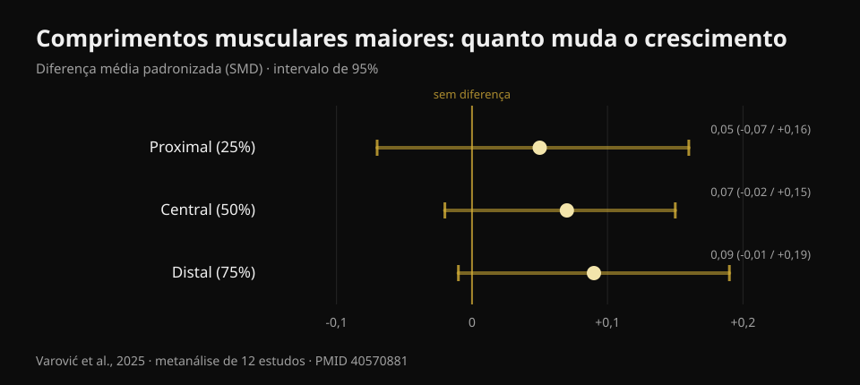
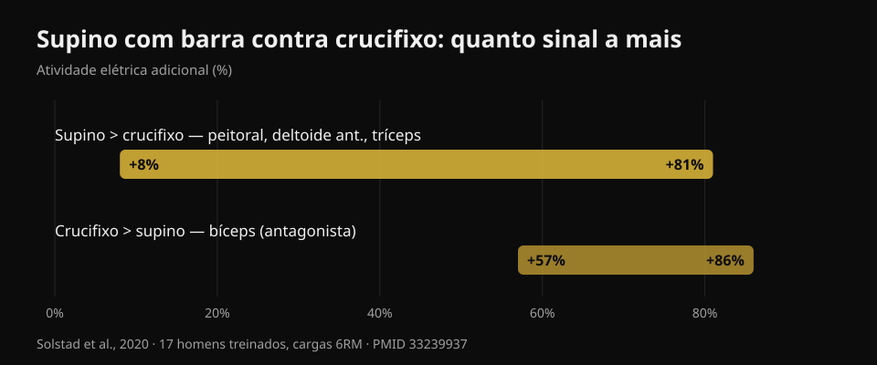

# Supino com halteres ou crucifixo: o que cresce mais?

Por [Giammaria Loi](/autore/giammaria-loi) · atualizado em 20 de outubro de 2026

Um carrossel muito compartilhado conta um estudo recém-saído: dez semanas, supino com halteres contra crucifixo com halteres, e no fim o peitoral cresce igual. A conclusão é confortável — escolha o que preferir — e em boa parte se sustenta. Mas li seis estudos indexados para conferir, e apareceram três coisas que o post não diz: esse estudo ainda não foi publicado, a região do peitoral onde a escolha realmente importa não foi medida, e os dois exercícios não custam o mesmo tempo por músculo treinado.

## Em resumo

- **Supino com halteres e crucifixo fizeram o peitoral crescer de forma parecida** em dez semanas. Mas o estudo está *aceito*, não publicado: em 20 de outubro de 2026 não dá para conferir no PubMed.
- **Treze pessoas por grupo terminaram**, de 46 que começaram. Com esse tamanho, "sem diferença significativa" não quer dizer "os dois exercícios são equivalentes".
- **A ideia de que o crucifixo cresce mais por carregar o músculo alongado já tinha sido testada** — pelo próprio pesquisador que publicou o carrossel: efeitos triviais, SMD de 0,05 a 0,09 (Varović et al., 2025).
- **O supino também treina deltoide anterior e tríceps**: de 8% a 81% mais atividade elétrica do que o crucifixo (Solstad et al., 2020). O crucifixo não.
- **Para o peitoral superior a escolha importa**, e é justamente a região que o novo estudo não mediu: a única diferença documentada é +0,62 cm de espessura com o supino inclinado (Chaves et al., 2020).

## O que o novo estudo compara de fato

O desenho, como descrito pelos autores: praticantes com pelo menos seis meses de treino (três a quatro anos em média), duas sessões por semana durante dez semanas, **um único exercício por sessão** — supino com halteres ou crucifixo — e proibido qualquer outro trabalho de peitoral e deltoide anterior. O volume não foi imposto: cada um manteve o número de séries a que estava habituado, em média cerca de 14 séries semanais no grupo supino e 13 no crucifixo. Oito a doze repetições a cerca de 2 repetições de reserva, com a última série até a falha concêntrica. Espessura do peitoral medida por ultrassom em três pontos, do centro do tórax para fora.

Resultado declarado: os dois grupos crescem nos três pontos, sem diferença entre grupos.

A primeira coisa que o post não diz: **esse estudo ainda não foi publicado**. Procurei no PubMed por autor, por título e por coautores, e não está lá. A única fonte primária localizável é um anúncio do último autor, Brad Schoenfeld, dizendo que o trabalho acaba de ser aceito pelo *Journal of Strength and Conditioning Research*. Sem DOI público, sem preprint. Não é acusação: semanas costumam separar aceitação e publicação. Mas significa que ninguém, eu incluído, consegue ainda ler os números, os intervalos e as tabelas. Por isso **neste artigo não uso um único número daquele estudo**: tudo o que é quantitativo abaixo vem de trabalhos publicados e verificados.

## "Sem diferença significativa" não é "são iguais"

Dos 46 participantes iniciais, **26 terminaram**: treze por grupo. Os próprios autores chamam o abandono de incomumente alto. São 43% da amostra.

Aqui vale uma distinção que serve para metade do conteúdo fitness que você lê. "Sem diferença estatisticamente significativa" quer dizer que os dados coletados não bastam para demonstrar uma diferença. Não quer dizer que ela não exista. Com treze pessoas por grupo, um estudo só enxerga diferenças grandes: se o supino fizesse o peitoral crescer, digamos, 15% mais que o crucifixo, provavelmente nem perceberia. Para afirmar equivalência é preciso um desenho feito para isso, com margem declarada antes.

A leitura honesta é: **não temos provas de que um seja melhor**. Isso já é informação útil, e é diferente de "são a mesma coisa".

É o mesmo erro de leitura que contei falando de [hip thrust e agachamento para glúteos](/pt/blog/exercicios-para-gluteos-hip-thrust-ou-agachamento): lá também as estimativas pendiam para um lado, com intervalos que continham o zero.

## A hipótese de partida já tinha resposta

O interessante é o motivo do estudo: os pesquisadores esperavam que o **crucifixo** vencesse. O raciocínio é o que ficou popular nos últimos anos: o crucifixo carrega o peitoral quando ele está mais alongado, e treinar em comprimentos musculares maiores deveria render mais crescimento.

Só que essa hipótese já tem resposta, e vem da mesma pessoa que publicou o carrossel. Em 2025 Dorian Varović assinou uma metanálise bayesiana de doze estudos que manipularam o comprimento muscular — pela amplitude de movimento ou pela escolha do exercício — e mediram o crescimento em zonas diferentes do mesmo músculo. Os resultados são **triviais**: diferença padronizada de 0,05 na porção proximal, 0,07 no centro, 0,09 na distal, com intervalos que contêm o zero. Em percentual de crescimento: entre 0,6% e 1,9%.

*Diferença padronizada de crescimento regional entre comprimentos musculares maiores e menores. Valores positivos favorecem os comprimentos maiores. Os três intervalos de 95% cruzam o zero. Fonte: Varović et al., 2025, metanálise bayesiana de 12 estudos (PMID 40570881).*

Há uma tendência crescente do proximal para o distal, e os autores a apontam. Também apontam o limite mais honesto: entre as condições comparadas, a diferença média de comprimento muscular era de apenas 21,8%.

Na academia: se você escolhe o crucifixo esperando o bônus do alongamento, esse bônus provavelmente não vem.

## O que o supino te dá e o crucifixo não

Este é o dado prático que falta por completo no post, e responde a uma pergunta que ficou sem resposta nos próprios comentários: *dá para treinar o peitoral como no supino, mas sem envolver tríceps e deltoides?*

Em 2020 um grupo norueguês mediu a atividade elétrica de quatro músculos em dezessete homens treinados (quase cinco anos de experiência) durante supino com barra e crucifixo com halteres, com cargas de seis repetições máximas, dividindo cada repetição em seis fases. O supino produz mais sinal em **peitoral maior, deltoide anterior e tríceps**, com diferenças **de +8% a +81%** conforme o músculo e a fase. O crucifixo vence em um único músculo: o **bíceps**, de +57% a +86%, mas como antagonista que estabiliza o cotovelo, não como músculo treinado.

*Quanto sinal elétrico a mais cada exercício produz, intervalo reportado pelos autores entre músculos e fases. Fonte: Solstad et al., 2020, 17 homens treinados, cargas de 6RM (PMID 33239937).*

Cuidado para não inverter o raciocínio: a ativação elétrica **não prevê** o crescimento, e este blog já mostrou isso com dados ao falar de [cadeira extensora e leg press](/pt/blog/cadeira-extensora-ou-leg-press-reto-femoral). O ponto aqui é mais simples: o supino coloca três músculos sob carga, o crucifixo essencialmente um. Se o seu tempo de academia é limitado — e é, para quase todo mundo — esse critério é mais concreto do que qualquer discussão sobre comprimentos musculares.

O outro lado é igualmente útil: se o supino incomoda o ombro, o crucifixo permite treinar o peitoral sem abrir mão do crescimento, e você só perde o trabalho de tríceps, que pode recuperar em outro lugar.

## Onde a escolha importa de verdade: o peitoral superior

O limite mais importante do novo estudo é declarado pelos próprios autores: a espessura foi medida em três pontos do centro para fora, e **a região clavicular — o peitoral superior — não foi medida diretamente**.

É um problema, porque essa é a única zona em que, nos estudos publicados, a escolha do exercício mudou algo de fato.

Em 2020, Chaves e colegas dividiram 47 homens não treinados em três grupos — só supino reto, só inclinado, ou os dois — por oito semanas com o mesmo número de séries. A força cresceu igual nos três grupos (cerca de 10-11 kg, sem diferença significativa). A espessura muscular mudou de forma diferente em **um único ponto de três**: o segundo espaço intercostal, o peitoral superior, onde o inclinado superou o reto em **0,62 cm (intervalo 0,23-1,00; p = 0,003)** e a combinação em **0,50 cm (0,14-0,86; p = 0,008)**.

Dois detalhes. Primeiro: o grupo que fazia **os dois** não superou nenhum dos outros; fazer um pouco de tudo dividiu o estímulo. Segundo: eram pessoas não treinadas, então é indicação, não lei.

O mecanismo bate com o que se mede de forma aguda. Em 2022 um grupo ítalo-brasileiro registrou as duas porções do peitoral no supino reto e a 45°: no inclinado a porção clavicular trabalha mais que a esternocostal, no reto ocorre o contrário, e a resposta imediata da secção muscular segue a mesma direção. Quanto ao ângulo exato, trinta adultos treinados testados em cinco inclinações mostram o pico do peitoral superior a **30°**, enquanto as porções média e inferior rendem mais a **0°**; acima de 45° o trabalho migra para o deltoide anterior e o peitoral rende menos.

## O que a pesquisa realmente diz

- **Confirmado** — O peitoral maior tem duas regiões, clavicular e esternocostal, com inervação e resposta separadas (Albarello et al., 2022).
- **Confirmado** — Exercícios diferentes produzem crescimento parecido quando o agonista é suficientemente solicitado em amplitudes comparáveis (Chaves et al., 2020; Kassiano et al., 2022).
- **A precisar** — "Sem diferença significativa" com 13 pessoas por grupo após 43% de abandonos não autoriza falar em equivalência.
- **A precisar** — Variar exercícios ajuda, mas só se a variação for sistemática: girar ao acaso exercícios de estímulo redundante pode piorar os resultados (Kassiano et al., 2022).
- **Desmentido** — A expectativa de que o crucifixo cresça mais por carregar o músculo alongado: os efeitos no crescimento regional são triviais (Varović et al., 2025).
- **Não verificável** — Os números do estudo Dell'Avanzi: aceito pelo *Journal of Strength and Conditioning Research*, não publicado nem indexado em 20 de outubro de 2026.

## Como aplicar

1. **Escolha o empurrar que você consegue carregar e progredir ao longo do tempo.** Barra, halteres ou máquina: com séries iguais e proximidade da falha igual, o peitoral cresce. O critério não é qual "ativa mais", e sim em qual você consegue somar carga ou repetições mês após mês.
2. **Deixe o crucifixo como segundo exercício, não como substituto obrigatório.** Ele é útil se o empurrar incomoda o ombro, se você quer volume de peito sem fatigar mais o tríceps, ou simplesmente se você gosta e por isso mantém a constância.
3. **Se o peitoral superior é seu ponto fraco, coloque o banco a 30°.** É ali que a porção clavicular rende mais. Acima de 45° você treina sobretudo ombros.
4. **Não misture ao acaso.** Dois ou três exercícios estáveis mantidos por seis a doze semanas ganham de uma rotação nova toda semana.
5. **Leve as séries perto o bastante da falha.** O protocolo do estudo trabalhava a cerca de duas repetições de reserva, com a última série até a falha. O quadro completo de séries, repetições e descansos está resumido [aqui](/pt/blog/quantas-repeticoes-massa-muscular).

### Experimente o Nurvan — seu peitoral cresce se a carga sobe

O que decide não é qual exercício você "sente" mais, e sim se aquele exercício está progredindo. No Nurvan cada série é registrada com carga, repetições e RIR (quantas repetições sobraram no tanque), e o app mostra a evolução exercício por exercício: você vê preto no branco se o seu supino com halteres está subindo ou parado há dois meses, e decide pelos seus números em vez do último estudo viral. **[Experimente o Nurvan](https://nurvan.app)**

## Perguntas frequentes

**Supino ou crucifixo para o peitoral?**
Para o peitoral como um todo as evidências não apontam vencedor: os dois funcionam se as séries chegarem perto o bastante da falha. O supino, porém, treina também deltoide anterior e tríceps na mesma série, então rende mais por minuto. O crucifixo continua ótimo se o empurrar incomoda.

**O crucifixo serve para o "peitoral interno"?**
Não. O peitoral maior se divide em porção clavicular e esternocostal, não em parte "interna" e "externa": nenhum exercício faz crescer só a região central. As diferenças regionais documentadas são superior contra inferior e dependem sobretudo do ângulo do banco.

**Qual inclinação para o peitoral superior?**
Trinta graus é onde a porção superior mostra atividade máxima. A zero graus rendem mais a média e a inferior. Acima de 45° o deltoide anterior assume.

**Preciso fazer os dois exercícios?**
Não é obrigatório. No único estudo que comparou um grupo "os dois" com grupos de exercício único, fazer os dois não deu resultado melhor. Escolha por tempo, equipamento disponível e conforto articular.

## Leia também

- [Cadeira extensora ou leg press: o que cresce de verdade](/pt/blog/cadeira-extensora-ou-leg-press-reto-femoral) — por que "ativa mais" não é "cresce mais".
- [Exercícios para glúteos: hip thrust ou agachamento?](/pt/blog/exercicios-para-gluteos-hip-thrust-ou-agachamento) — o mesmo erro de leitura em outro músculo.
- [Repetições, séries e descanso para hipertrofia](/pt/blog/quantas-repeticoes-massa-muscular) — as variáveis que pesam mais que a escolha do exercício.

## Fontes

1. Solstad TE, Andersen V, Shaw M, Hoel EM, Vonheim A, Saeterbakken AH, 2020. *A Comparison of Muscle Activation between Barbell Bench Press and Dumbbell Flyes in Resistance-Trained Males.* Journal of Sports Science & Medicine 19(4):645-651. [PMID 33239937](https://pubmed.ncbi.nlm.nih.gov/33239937/)
2. Chaves SFN, et al., 2020. *Effects of Horizontal and Incline Bench Press on Neuromuscular Adaptations in Untrained Young Men.* International Journal of Exercise Science 13(6):859-872. [PMID 32922646](https://pubmed.ncbi.nlm.nih.gov/32922646/) · [DOI 10.70252/FDNB1158](https://doi.org/10.70252/FDNB1158)
3. Albarello JCS, et al., 2022. *Non-uniform excitation of pectoralis major induced by changes in bench press inclination leads to uneven variations in the cross-sectional area measured by panoramic ultrasonography.* Journal of Electromyography and Kinesiology 67:102722. [PMID 36334406](https://pubmed.ncbi.nlm.nih.gov/36334406/) · [DOI 10.1016/j.jelekin.2022.102722](https://doi.org/10.1016/j.jelekin.2022.102722)
4. Varović D, Wolf M, Schoenfeld BJ, Steele J, Grgic J, Mikulic P, 2025. *Does Muscle Length Influence Regional Hypertrophy? A Systematic Review and Meta-Analysis.* International Journal of Sports Medicine 46(14):1027-1036. [PMID 40570881](https://pubmed.ncbi.nlm.nih.gov/40570881/) · [DOI 10.1055/a-2615-4935](https://doi.org/10.1055/a-2615-4935)
5. Kassiano W, Nunes JP, Costa B, Ribeiro AS, Schoenfeld BJ, Cyrino ES, 2022. *Does Varying Resistance Exercises Promote Superior Muscle Hypertrophy and Strength Gains? A Systematic Review.* Journal of Strength and Conditioning Research 36(6):1753-1762. [PMID 35438660](https://pubmed.ncbi.nlm.nih.gov/35438660/) · [DOI 10.1519/JSC.0000000000004258](https://doi.org/10.1519/JSC.0000000000004258)
6. Rodríguez-Ridao D, Antequera-Vique JA, Martín-Fuentes I, Muyor JM, 2020. *Effect of Five Bench Inclinations on the Electromyographic Activity of the Pectoralis Major, Anterior Deltoid, and Triceps Brachii during the Bench Press Exercise.* International Journal of Environmental Research and Public Health 17(19):7339. [PMID 33049982](https://pubmed.ncbi.nlm.nih.gov/33049982/) · [DOI 10.3390/ijerph17197339](https://doi.org/10.3390/ijerph17197339)
7. Dell'Avanzi FG, et al. *Dumbbell bench press and dumbbell fly elicit similar pectoralis major muscle hypertrophy in recreationally-trained individuals.* Aceito pelo Journal of Strength and Conditioning Research; em 20 de outubro de 2026 não publicado nem indexado no PubMed. Desenho e resultados relatados conforme declarado pelos autores.

Referências recuperadas via PubMed. Ponto de partida: o carrossel de **Dorian Varović** ([@varovicdorian](https://www.instagram.com/varovicdorian/)) de 9 de setembro de 2026, [post original](https://www.instagram.com/p/DdFF9e8HIOQ/). Nenhum texto ou imagem do post foi reproduzido.

---

**Giammaria Loi** é o fundador do Nurvan. Treina com pesos desde 2012, trabalha como personal trainer e coach certificado FIPE desde 2013 e compete em powerlifting em nível nacional desde 2018.

> Nota: conteúdo informativo, não substitui a avaliação de um médico ou profissional qualificado. Se o empurrar dói no ombro, avalie antes de insistir.
