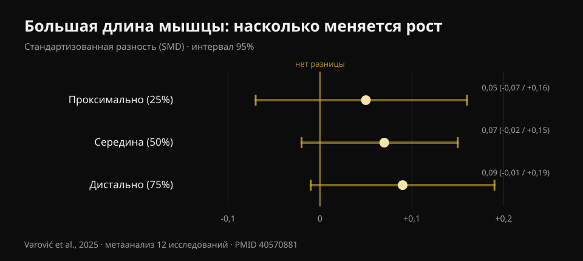
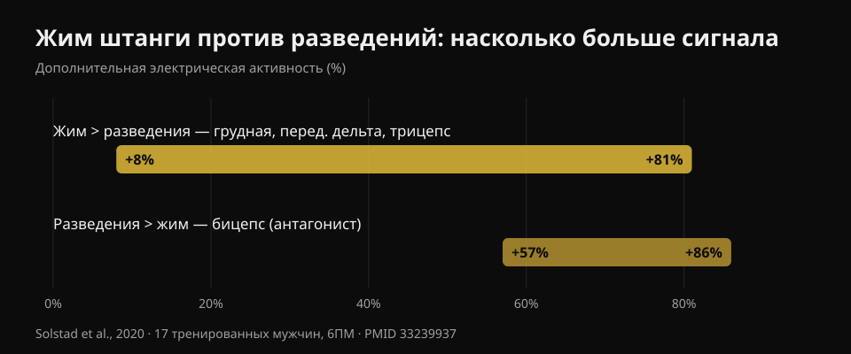

# Жим гантелями или разведения: что растит грудь?

Автор: [Giammaria Loi](/autore/giammaria-loi) · обновлено 20 октября 2026

Разошедшаяся карусель пересказывает свежее исследование: десять недель, жим гантелями против разведений гантелей, и в итоге грудь растёт одинаково. Вывод удобный — бери то, что нравится — и в основном он держится. Но я прочитал шесть проиндексированных исследований и нашёл три вещи, которых в посте нет: эта работа ещё не опубликована, та часть груди, где выбор упражнения действительно важен, вообще не измерялась, и два упражнения стоят разного времени в пересчёте на тренируемые мышцы.

## Коротко

- **Жим гантелями и разведения дали схожий рост грудной мышцы** за десять недель. Но исследование *принято* журналом, а не опубликовано: на 20 октября 2026 года проверить его в PubMed невозможно.
- **Закончили по тринадцать человек в группе** из 46 начавших. При таком размере «нет значимых различий» не означает «упражнения равноценны».
- **Мысль, что разведения растят больше из-за нагрузки в растянутом положении, уже проверяли** — тот же исследователь, что опубликовал карусель: эффекты тривиальные, SMD от 0,05 до 0,09 (Varović et al., 2025).
- **Жим попутно тренирует переднюю дельту и трицепс**: на 8–81% больше электрической активности, чем разведения (Solstad et al., 2020). Разведения — нет.
- **Для верха груди выбор важен**, и именно эту область новое исследование не измеряло: единственная задокументированная разница — +0,62 см толщины при наклонном жиме (Chaves et al., 2020).

## Что на самом деле сравнивает новое исследование

Дизайн, как его описывают авторы: занимающиеся со стажем не менее полугода (в среднем три-четыре года), две тренировки в неделю в течение десяти недель, **по одному упражнению за тренировку** — либо жим гантелями, либо разведения — и запрет на любую другую работу на грудь и переднюю дельту. Объём не навязывали: каждый сохранял привычное число подходов, в среднем около 14 недельных подходов в группе жима и 13 в группе разведений. Восемь–двенадцать повторений при примерно 2 повторениях в запасе, последний подход до концентрического отказа. Толщину грудной мышцы измеряли УЗИ в трёх точках от центра груди наружу.

Заявленный результат: обе группы растут во всех трёх точках, различий между группами нет.

Первое, чего пост не говорит: **эта работа ещё не опубликована**. Я искал её в PubMed по автору, по названию и по соавторам — её там нет. Единственный доступный первоисточник — сообщение последнего автора, Брэда Шонфелда, о том, что статья только что принята журналом *Journal of Strength and Conditioning Research*. Публичного DOI нет, препринта нет. Это не обвинение: между принятием и публикацией обычно проходят недели. Но это значит, что никто, включая меня, пока не может прочитать цифры, доверительные интервалы и таблицы. Поэтому **в этой статье нет ни одного числа из того исследования**: всё количественное ниже взято из опубликованных и проверенных работ.

## «Нет значимых различий» — это не «они одинаковы»

Из 46 участников **закончили 26**: по тринадцать в группе. Сами авторы называют отсев необычно высоким. Это 43% выборки.

Здесь нужна оговорка, применимая к половине фитнес-контента. «Нет статистически значимых различий» означает, что собранных данных не хватило, чтобы различие показать. Не означает, что его нет. С тринадцатью людьми в группе исследование видит только крупные разрывы: если бы жим растил грудь, скажем, на 15% сильнее разведений, он бы, скорее всего, этого не заметил. Чтобы утверждать равноценность, нужен специально спланированный дизайн с заранее объявленной границей эквивалентности.

Честное прочтение такое: **у нас нет доказательств, что одно лучше другого**. Это уже полезная информация — и это не то же самое, что «это одно и то же».

Та же ошибка чтения, о которой я писал в материале про [ягодичный мост и присед](/ru/blog/uprazhneniya-dlya-yagodits-hip-thrust-ili-prised): там оценки тоже склонялись в одну сторону, но интервалы спокойно включали ноль.

## Исходная гипотеза уже была проверена

Интересен сам повод исследования: учёные ожидали победы **разведений**. Логика та, что стала популярной в последние годы: разведения нагружают грудную мышцу в наиболее растянутом положении, а тренировка при большей длине мышцы должна давать больше роста.

Вот только у этой гипотезы уже есть ответ — от того самого человека, который опубликовал карусель. В 2025 году Дориан Варович выпустил байесовский метаанализ двенадцати исследований, где длину мышцы меняли через амплитуду движения или через выбор упражнения и измеряли рост в разных зонах одной мышцы. Результаты **тривиальны**: стандартизованная разность 0,05 в проксимальной зоне, 0,07 в середине, 0,09 в дистальной, и все интервалы включают ноль. В процентах роста — от 0,6% до 1,9%.

*Стандартизованная разность регионального роста между большей и меньшей длиной мышцы. Положительные значения в пользу большей длины. Все три 95% интервала пересекают ноль. Источник: Varović et al., 2025, байесовский метаанализ 12 исследований (PMID 40570881).*

Тренд от проксимального к дистальному есть, и авторы это отмечают. Они же отмечают самое честное ограничение: между сравниваемыми условиями средняя разница длины мышцы составляла всего 21,8%.

По-залу: если вы выбираете разведения ради «бонуса растяжения», этот бонус, скорее всего, не придёт.

## Что даёт жим и чего не дают разведения

Это практический факт, полностью отсутствующий в посте, и он отвечает на вопрос, оставшийся без ответа в комментариях под самим постом: *можно ли тренировать грудь как в жиме, но без трицепса и дельт?*

В 2020 году норвежская группа измерила электрическую активность четырёх мышц у семнадцати тренированных мужчин (почти пять лет стажа) в жиме штанги лёжа и разведениях гантелей с весами на шесть повторений, разбив каждое повторение на шесть фаз. Жим даёт больше сигнала в **большой грудной, передней дельте и трицепсе**, с разницей **от +8% до +81%** в зависимости от мышцы и фазы. Разведения выигрывают ровно в одной мышце — **бицепсе**, на 57–86%, но как антагонист, стабилизирующий локоть, а не как тренируемая мышца.

*Насколько больше электрического сигнала даёт каждое упражнение; диапазон, приведённый авторами по мышцам и фазам движения. Источник: Solstad et al., 2020, 17 тренированных мужчин, веса 6ПМ (PMID 33239937).*

Не переворачивайте вывод: электрическая активация **не предсказывает** рост, и этот блог уже показывал это на данных в материале про [разгибания ног и жим ногами](/ru/blog/razgibaniya-nog-ili-zhim-nogami-pryamaya-myshtsa-bedra). Здесь мысль проще: жим нагружает три мышцы, разведения — по сути одну. Если время в зале ограничено (а оно ограничено почти у всех), это более конкретный критерий, чем любые рассуждения о длине мышц.

Обратная сторона так же полезна: если жим беспокоит плечо, разведения позволяют тренировать грудь без потери роста, и вы теряете только работу на трицепс, которую можно добрать в другом месте.

## Где выбор действительно решает: верх груди

Самое важное ограничение нового исследования называют сами авторы: толщину мерили в трёх точках от центра наружу, а **ключичную область — верх груди — напрямую не измеряли**.

Это проблема, потому что именно там в опубликованных работах выбор упражнения реально что-то менял.

В 2020 году Chaves с коллегами разделили 47 нетренированных мужчин на три группы — только горизонтальный жим, только наклонный или оба — на восемь недель при равном числе подходов. Сила выросла одинаково во всех трёх группах (около 10–11 кг, без значимых различий). Толщина мышцы изменилась по-разному лишь **в одной точке из трёх**: во втором межреберье, то есть в верхней части груди, где наклонный жим превзошёл горизонтальный на **0,62 см (интервал 0,23–1,00; p = 0,003)** и комбинацию на **0,50 см (0,14–0,86; p = 0,008)**.

Две детали. Первая: группа, делавшая **оба** упражнения, не обошла ни одну из двух других; «понемногу всего» разделило стимул. Вторая: это нетренированные люди, так что это ориентир, а не закон.

Механизм согласуется с острыми измерениями. В 2022 году итало-бразильская группа записала обе порции грудной мышцы в горизонтальном жиме и при наклоне 45°: на наклонной ключичная порция работает больше грудинно-рёберной, на горизонтальной — наоборот, и немедленный отклик поперечного сечения идёт в ту же сторону. Что до точного угла, тридцать тренированных взрослых, протестированных при пяти наклонах, показывают пик верха груди при **30°**, а средняя и нижняя порции работают больше при **0°**; свыше 45° нагрузка всё сильнее уходит в переднюю дельту, а грудная отдаёт меньше.

## Что на самом деле говорит наука

- **Подтверждено** — Большая грудная состоит из двух областей, ключичной и грудинно-рёберной, с отдельной иннервацией и откликом (Albarello et al., 2022).
- **Подтверждено** — Разные упражнения дают схожий рост, если целевая мышца достаточно нагружена в сопоставимых амплитудах (Chaves et al., 2020; Kassiano et al., 2022).
- **Требует уточнения** — «Нет значимых различий» при 13 людях в группе после 43% отсева не позволяет говорить о равноценности.
- **Требует уточнения** — Менять упражнения полезно, но только систематически: случайная ротация упражнений с одинаковым стимулом может ухудшить результат (Kassiano et al., 2022).
- **Опровергнуто** — Ожидание большего роста от разведений из-за растяжения: эффекты на региональный рост тривиальны (Varović et al., 2025).
- **Непроверяемо** — Цифры исследования Dell'Avanzi: принято *Journal of Strength and Conditioning Research*, на 20 октября 2026 не опубликовано и не проиндексировано.

## Как это применить

1. **Выберите жимовое движение, которое можете нагружать и прогрессировать.** Штанга, гантели или тренажёр: при равных подходах и равной близости к отказу грудь растёт. Критерий — не «что сильнее активирует», а на чём вы месяц за месяцем добавляете вес или повторения.
2. **Разведения — второе упражнение, а не обязательная замена.** Они полезны, если жим беспокоит плечо, если нужен объём на грудь без лишней усталости трицепса или просто если вам они нравятся и вы делаете их стабильно.
3. **Если верх груди отстаёт, ставьте скамью на 30°.** Там ключичная порция работает больше всего. Выше 45° вы тренируете в основном плечи.
4. **Не тасуйте наугад.** Два-три стабильных упражнения на шесть-двенадцать недель лучше новой ротации каждую неделю.
5. **Доводите подходы достаточно близко к отказу.** В протоколе исследования работали примерно с двумя повторениями в запасе, последний подход до отказа. Полную картину по подходам, повторениям и отдыху я собрал [здесь](/ru/blog/skolko-povtoreniy-dlya-massy).

### Попробуйте Nurvan — грудь растёт, когда растёт вес

Решает не то, какое упражнение вы «чувствуете» сильнее, а прогрессирует ли оно. В Nurvan каждый подход записывается с весом, повторениями и RIR (сколько повторений осталось в запасе), и приложение показывает динамику по каждому упражнению: вы видите чёрным по белому, растёт ли ваш жим гантелями или стоит два месяца, и решаете по своим числам, а не по последнему вирусному исследованию. **[Попробуйте Nurvan](https://nurvan.app)**

## Частые вопросы

**Что лучше для груди — жим или разведения?**
Для грудной мышцы в целом доступные данные не выявляют победителя: работает и то, и другое, если подходы достаточно близки к отказу. Но жим в том же подходе тренирует переднюю дельту и трицепс, поэтому даёт больше за минуту. Разведения остаются отличным выбором, если жим беспокоит.

**Разведения нужны для «внутренней» груди?**
Нет. Большая грудная делится на ключичную и грудинно-рёберную порции, а не на «внутреннюю» и «внешнюю»: упражнения, растящего только середину, не существует. Задокументированные региональные различия — это верх против низа, и зависят они главным образом от угла скамьи.

**Какой наклон лучше для верха груди?**
Тридцать градусов — угол с максимальной активностью верхней порции. При нуле больше работают средняя и нижняя. Свыше 45° нагрузку забирает передняя дельта.

**Обязательно ли делать оба упражнения?**
Нет. В единственном исследовании, где группу «оба» сравнили с группами одного упражнения, «оба» не дали преимущества. Выбирайте по времени, доступному инвентарю и комфорту суставов.

## Читайте также

- [Разгибания ног или жим ногами: что растёт на самом деле](/ru/blog/razgibaniya-nog-ili-zhim-nogami-pryamaya-myshtsa-bedra) — почему «активирует больше» не значит «растит больше».
- [Упражнения на ягодицы: мост или присед?](/ru/blog/uprazhneniya-dlya-yagodits-hip-thrust-ili-prised) — та же ошибка чтения на другой мышце.
- [Повторения, подходы и отдых для гипертрофии](/ru/blog/skolko-povtoreniy-dlya-massy) — переменные, которые важнее выбора упражнения.

## Источники

1. Solstad TE, Andersen V, Shaw M, Hoel EM, Vonheim A, Saeterbakken AH, 2020. *A Comparison of Muscle Activation between Barbell Bench Press and Dumbbell Flyes in Resistance-Trained Males.* Journal of Sports Science & Medicine 19(4):645-651. [PMID 33239937](https://pubmed.ncbi.nlm.nih.gov/33239937/)
2. Chaves SFN, et al., 2020. *Effects of Horizontal and Incline Bench Press on Neuromuscular Adaptations in Untrained Young Men.* International Journal of Exercise Science 13(6):859-872. [PMID 32922646](https://pubmed.ncbi.nlm.nih.gov/32922646/) · [DOI 10.70252/FDNB1158](https://doi.org/10.70252/FDNB1158)
3. Albarello JCS, et al., 2022. *Non-uniform excitation of pectoralis major induced by changes in bench press inclination leads to uneven variations in the cross-sectional area measured by panoramic ultrasonography.* Journal of Electromyography and Kinesiology 67:102722. [PMID 36334406](https://pubmed.ncbi.nlm.nih.gov/36334406/) · [DOI 10.1016/j.jelekin.2022.102722](https://doi.org/10.1016/j.jelekin.2022.102722)
4. Varović D, Wolf M, Schoenfeld BJ, Steele J, Grgic J, Mikulic P, 2025. *Does Muscle Length Influence Regional Hypertrophy? A Systematic Review and Meta-Analysis.* International Journal of Sports Medicine 46(14):1027-1036. [PMID 40570881](https://pubmed.ncbi.nlm.nih.gov/40570881/) · [DOI 10.1055/a-2615-4935](https://doi.org/10.1055/a-2615-4935)
5. Kassiano W, Nunes JP, Costa B, Ribeiro AS, Schoenfeld BJ, Cyrino ES, 2022. *Does Varying Resistance Exercises Promote Superior Muscle Hypertrophy and Strength Gains? A Systematic Review.* Journal of Strength and Conditioning Research 36(6):1753-1762. [PMID 35438660](https://pubmed.ncbi.nlm.nih.gov/35438660/) · [DOI 10.1519/JSC.0000000000004258](https://doi.org/10.1519/JSC.0000000000004258)
6. Rodríguez-Ridao D, Antequera-Vique JA, Martín-Fuentes I, Muyor JM, 2020. *Effect of Five Bench Inclinations on the Electromyographic Activity of the Pectoralis Major, Anterior Deltoid, and Triceps Brachii during the Bench Press Exercise.* International Journal of Environmental Research and Public Health 17(19):7339. [PMID 33049982](https://pubmed.ncbi.nlm.nih.gov/33049982/) · [DOI 10.3390/ijerph17197339](https://doi.org/10.3390/ijerph17197339)
7. Dell'Avanzi FG, et al. *Dumbbell bench press and dumbbell fly elicit similar pectoralis major muscle hypertrophy in recreationally-trained individuals.* Принято Journal of Strength and Conditioning Research; на 20 октября 2026 не опубликовано и не проиндексировано в PubMed. Дизайн и результаты приведены так, как их заявляют авторы.

Источники найдены через PubMed. Отправная точка: карусель **Dorian Varović** ([@varovicdorian](https://www.instagram.com/varovicdorian/)) от 9 сентября 2026, [оригинальный пост](https://www.instagram.com/p/DdFF9e8HIOQ/). Ни текст, ни изображения поста не воспроизводились.

---

**Giammaria Loi** — основатель Nurvan. Тренируется с отягощениями с 2012 года, работает персональным тренером и коучем с сертификатом FIPE с 2013 года и выступает в пауэрлифтинге на национальном уровне с 2018 года.

> Примечание: информационный материал, не заменяет консультацию врача или квалифицированного специалиста. Если жим вызывает боль в плече, покажитесь специалисту, прежде чем продолжать.
