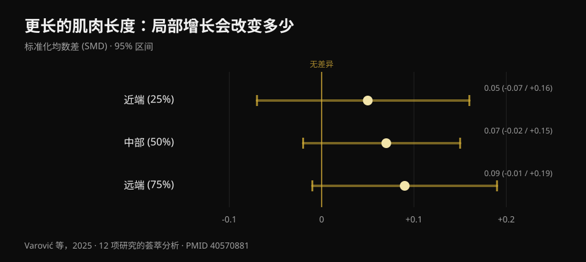
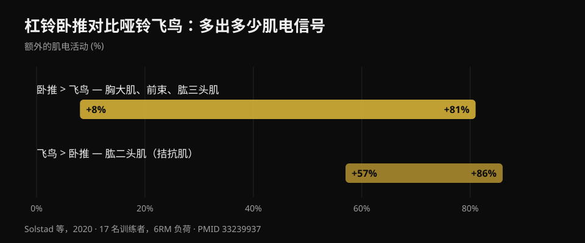

# 哑铃卧推还是飞鸟：哪个让胸肌长得更多？

作者 [Giammaria Loi](/autore/giammaria-loi) · 更新于 2026 年 10 月 20 日

一则被大量转发的图文帖讲了一项刚出炉的研究：十周，哑铃卧推对比哑铃飞鸟，最后胸肌长得一样多。这个结论很省事——喜欢哪个练哪个——而且大体上站得住脚。但我读了六篇已被收录的研究来核对，结果发现了帖子里完全没提的三件事：这项研究还没有正式发表；真正决定动作选择的那块胸肌区域根本没有测；而且按"训练到的肌肉"算，这两个动作花掉的时间并不一样。

## 要点速览

- **十周里哑铃卧推和飞鸟让胸肌的增长相近**。但这项研究是被期刊*接收*，不是已发表：截至 2026 年 10 月 20 日无法在 PubMed 上核对。
- **每组只有十三人完成**，起始 46 人。这个样本量下，"无显著差异"不等于"两个动作等效"。
- **"飞鸟因为在拉长位加载所以长得更多"这个想法早就被检验过**——而且是发帖的那位研究者本人做的：效应微不足道，SMD 在 0.05 到 0.09 之间（Varović 等，2025）。
- **卧推还会顺带练到前束和肱三头肌**：肌电活动比飞鸟高 8% 到 81%（Solstad 等，2020）。飞鸟没有这个附带收益。
- **对上胸来说动作选择确实重要**，而新研究偏偏没测这个区域：文献中唯一记录到的差异是上斜卧推多出 0.62 厘米厚度（Chaves 等，2020）。

## 这项新研究到底比较了什么

按作者的描述：受试者至少有六个月训练经历（平均三到四年），每周两练，持续十周，**每次只做一个动作**——哑铃卧推或哑铃飞鸟——并且禁止做任何其他胸部和前束动作。训练量不是统一规定的：每个人沿用自己习惯的组数，卧推组平均每周约 14 组，飞鸟组约 13 组。每组 8 到 12 次，保留约 2 次（RIR 2），最后一组做到向心力竭。胸大肌厚度用超声在三个点测量，从胸部中线向外排列。

公布的结果：两组在三个点都增长，组间没有差异。

帖子没说的第一件事：**这项研究还没有发表**。我在 PubMed 上按作者、按标题、按共同作者都搜过，没有。唯一能找到的原始来源，是末位作者 Brad Schoenfeld 的一则公告，说论文刚被 *Journal of Strength and Conditioning Research* 接收。没有公开 DOI，也没有预印本。这不是指控：从接收到见刊通常就要几周。但这意味着包括我在内，谁都还读不到具体数字、置信区间和表格。所以**本文没有使用那项研究的任何一个数字**：下面所有定量内容都来自已发表、可核对的文献。

## "无显著差异"不等于"一样"

起始的 46 人里**只有 26 人完成**：每组十三人。作者自己也把这个脱落率称为异常高。那是 43% 的样本。

这里需要一个适用于你看到的一半健身内容的区分。"无统计学显著差异"的意思是，收集到的数据不足以证明存在差异，而不是不存在差异。每组十三人，研究只能看见很大的差距：假如卧推让胸肌比飞鸟多长 15%，这样的研究多半也察觉不到。想说"两者等效"，需要专门为此设计的试验，并事先声明等效界值。

所以诚实的读法是：**我们没有证据说哪一个更好**。这本身就是有用的信息，而且和"两者一模一样"并不是一回事。

这和我写[臀桥与深蹲练臀](/zh/blog/tunbu-xunlian-tuigua-haishi-shenzun)时讲过的读法错误是同一个：那里的估计值也偏向一边，但置信区间轻松包含了零。

## 这个出发假设其实早有答案

研究的动机很有意思：研究者原本预期**飞鸟**会赢。理由就是近几年流行的那套——飞鸟在胸肌被拉得最长的位置加载，而在更长的肌肉长度下训练应该带来更多增长。

只是这个假设已经有答案了，而且来自发这则帖子的同一个人。2025 年 Dorian Varović 发表了一篇贝叶斯荟萃分析，纳入十二项通过活动范围或动作选择来改变肌肉长度、并测量同一块肌肉不同区域增长的研究。结果是**微不足道的**：近端标准化差值 0.05，中部 0.07，远端 0.09，三个区间都包含零。换算成增长百分比：0.6% 到 1.9%。

*较长与较短肌肉长度之间的局部增长标准化差值。正值有利于较长长度。三个 95% 区间全部跨过零。来源：Varović 等，2025，12 项研究的贝叶斯荟萃分析（PMID 40570881）。*

从近端到远端确实有上升趋势，作者也指出了这一点。他们同样指出了最诚实的局限：被比较的各条件之间，平均肌肉长度的差异只有 21.8%。

落到训练房：如果你是冲着"拉伸红利"去选飞鸟的，这个红利大概率不会到账。

## 卧推给你的，飞鸟给不了

这是帖子里完全缺失的实用信息，而且正好回答了帖子评论区里一个没人回答的问题：*能不能像卧推一样练胸，但不动用肱三头肌和三角肌？*

2020 年一个挪威团队测量了十七名训练者（近五年训练经验）在杠铃卧推和哑铃飞鸟中四块肌肉的肌电活动，负荷为 6RM，并把每次重复拆成六个阶段。卧推在**胸大肌、三角肌前束和肱三头肌**上产生更多信号，差距**从 +8% 到 +81%**，取决于肌肉和阶段。飞鸟只在一块肌肉上胜出：**肱二头肌**，高出 57% 到 86%——但那是作为稳定肘关节的拮抗肌，而不是被训练的目标肌。

*每个动作多出多少肌电信号，为作者报告的跨肌肉、跨动作阶段的区间。来源：Solstad 等，2020，17 名训练者，6RM 负荷（PMID 33239937）。*

注意别把逻辑倒过来：肌电激活**并不能预测**增长，这个博客在讲[腿屈伸与腿举](/zh/blog/tuibu-shenzhan-vs-dengtui-gusizhiji)时已经用数据说明过。这里的要点更朴素：卧推让三块肌肉受力，飞鸟基本上只有一块。如果你在健身房的时间有限——绝大多数人都有限——这个标准比任何关于肌肉长度的讨论都更实在。

反过来同样有用：如果推举让你的肩膀不舒服，飞鸟能让你继续练胸而不牺牲增长，你损失的只是肱三头肌的那部分工作，这可以在别处补回来。

## 真正该看选择的地方：上胸

新研究最重要的局限是作者自己写明的：厚度是在从胸部中线向外的三个点测的，而**锁骨部——也就是上胸——没有被直接测量**。

这很关键，因为在已发表的研究里，那恰恰是动作选择唯一真正造成差别的区域。

2020 年 Chaves 等人把 47 名未训练男性分成三组——只做平板、只做上斜、或两者都做——进行八周，组数相同。三组的力量增长相同（约 10–11 公斤，无显著差异）。肌肉厚度只在**三个点中的一个**出现不同：第二肋间，也就是上胸，上斜比平板多 **0.62 厘米（区间 0.23–1.00；p = 0.003）**，比"两者都做"多 **0.50 厘米（0.14–0.86；p = 0.008）**。

两个细节值得注意。第一：**两个都做**的那组并没有赢过任何一组；什么都练一点，把刺激摊薄了。第二：受试者是未训练者，所以这是参考，不是定律。

这个机制和急性测量相符。2022 年一个意大利—巴西团队记录了平板与 45° 上斜卧推时胸大肌两个头的活动：上斜时锁骨部比胸肋部工作更多，平板时相反，而肌肉横截面的即时反应也沿同一方向。至于具体角度，三十名训练者在五种倾角下的测试显示，上胸在 **30°** 达到峰值，中部和下部在 **0°** 表现最好；超过 45° 后负荷越来越多地转向三角肌前束，胸大肌的输出下降。

## 研究实际上怎么说

- **已证实** —— 胸大肌有锁骨部和胸肋部两个区域，神经支配与反应各自独立（Albarello 等，2022）。
- **已证实** —— 当主动肌在相近的活动范围内被充分刺激时，不同动作会带来相近的增长（Chaves 等，2020；Kassiano 等，2022）。
- **需要补充** —— 在 43% 脱落后每组仅 13 人的"无显著差异"，不足以得出两个动作等效的结论。
- **需要补充** —— 变换动作有用，但必须是系统性的：随机轮换刺激重复的动作反而可能让结果变差（Kassiano 等，2022）。
- **已被推翻** —— "飞鸟因为在拉长位加载所以长得更多"的预期：对局部增长的效应微不足道（Varović 等，2025）。
- **无法核实** —— Dell'Avanzi 那项研究的数字：已被 *Journal of Strength and Conditioning Research* 接收，但截至 2026 年 10 月 20 日尚未发表或收录。

## 怎么落到训练里

1. **选一个你能持续加重、持续进步的推类动作。** 杠铃、哑铃还是器械都行：在组数和接近力竭程度相同的前提下，胸肌都会长。标准不是"哪个激活更高"，而是哪个能让你月复一月地加上重量或次数。
2. **把飞鸟放在第二位，而不是强制替代品。** 如果推举让你肩膀不适、如果你想增加胸部容量又不想让肱三头更疲劳，或者单纯因为你喜欢所以能坚持做，它都值得安排。
3. **如果上胸是弱项，把靠背调到 30°。** 那是锁骨部表现最好的角度。超过 45° 你练的主要是肩。
4. **不要随机换动作。** 两三个固定的胸部动作坚持六到十二周，胜过每周换一套新的。
5. **把每组做到足够接近力竭。** 研究的方案大约保留两次，最后一组到力竭，这是个不错的参考框架。关于组数、次数和间歇的完整说明，我整理在[这里](/zh/blog/duoshao-cishu-zengji)。

### 试试 Nurvan —— 重量涨，胸才涨

决定结果的不是你"感觉"哪个动作更强，而是那个动作有没有在进步。在 Nurvan 里，每一组都会记录重量、次数和 RIR（还剩几次没做），应用会按动作展示趋势：你能白纸黑字看到自己的哑铃卧推是在涨，还是已经停了两个月，然后用自己的数字而不是最新的爆款研究来做决定。**[试试 Nurvan](https://nurvan.app)**

## 常见问题

**练胸选卧推还是飞鸟？**
就整块胸大肌而言，现有证据分不出胜负：只要组数做到足够接近力竭，两者都有效。但卧推在同一组里还会练到前束和肱三头肌，所以单位时间的回报更高。如果推举让你不舒服，飞鸟依然是很好的选择。

**飞鸟能练"内侧胸"吗？**
不能。胸大肌分为锁骨部和胸肋部，而不是"内侧"和"外侧"：没有哪个动作只让中间那一条长大。文献记录的区域差异是上部对下部，而且主要取决于靠背角度。

**上胸该用多大倾角？**
三十度是上部活动最高的角度。零度时中部和下部做的功更多。超过 45° 后前束会接管。

**两个动作必须都做吗？**
不必。在唯一一项把"两者都做"组和单一动作组做对比的研究里，两个都做并没有更好。按时间、器械和关节舒适度来选就行。

## 延伸阅读

- [腿屈伸还是腿举：到底什么在长](/zh/blog/tuibu-shenzhan-vs-dengtui-gusizhiji) —— 为什么"激活更高"不等于"长得更多"。
- [臀部训练：臀桥还是深蹲？](/zh/blog/tunbu-xunlian-tuigua-haishi-shenzun) —— 同一个读法错误，换了一块肌肉。
- [增肌的次数、组数与间歇](/zh/blog/duoshao-cishu-zengji) —— 比动作选择更重要的变量。

## 参考文献

1. Solstad TE, Andersen V, Shaw M, Hoel EM, Vonheim A, Saeterbakken AH, 2020. *A Comparison of Muscle Activation between Barbell Bench Press and Dumbbell Flyes in Resistance-Trained Males.* Journal of Sports Science & Medicine 19(4):645-651. [PMID 33239937](https://pubmed.ncbi.nlm.nih.gov/33239937/)
2. Chaves SFN, et al., 2020. *Effects of Horizontal and Incline Bench Press on Neuromuscular Adaptations in Untrained Young Men.* International Journal of Exercise Science 13(6):859-872. [PMID 32922646](https://pubmed.ncbi.nlm.nih.gov/32922646/) · [DOI 10.70252/FDNB1158](https://doi.org/10.70252/FDNB1158)
3. Albarello JCS, et al., 2022. *Non-uniform excitation of pectoralis major induced by changes in bench press inclination leads to uneven variations in the cross-sectional area measured by panoramic ultrasonography.* Journal of Electromyography and Kinesiology 67:102722. [PMID 36334406](https://pubmed.ncbi.nlm.nih.gov/36334406/) · [DOI 10.1016/j.jelekin.2022.102722](https://doi.org/10.1016/j.jelekin.2022.102722)
4. Varović D, Wolf M, Schoenfeld BJ, Steele J, Grgic J, Mikulic P, 2025. *Does Muscle Length Influence Regional Hypertrophy? A Systematic Review and Meta-Analysis.* International Journal of Sports Medicine 46(14):1027-1036. [PMID 40570881](https://pubmed.ncbi.nlm.nih.gov/40570881/) · [DOI 10.1055/a-2615-4935](https://doi.org/10.1055/a-2615-4935)
5. Kassiano W, Nunes JP, Costa B, Ribeiro AS, Schoenfeld BJ, Cyrino ES, 2022. *Does Varying Resistance Exercises Promote Superior Muscle Hypertrophy and Strength Gains? A Systematic Review.* Journal of Strength and Conditioning Research 36(6):1753-1762. [PMID 35438660](https://pubmed.ncbi.nlm.nih.gov/35438660/) · [DOI 10.1519/JSC.0000000000004258](https://doi.org/10.1519/JSC.0000000000004258)
6. Rodríguez-Ridao D, Antequera-Vique JA, Martín-Fuentes I, Muyor JM, 2020. *Effect of Five Bench Inclinations on the Electromyographic Activity of the Pectoralis Major, Anterior Deltoid, and Triceps Brachii during the Bench Press Exercise.* International Journal of Environmental Research and Public Health 17(19):7339. [PMID 33049982](https://pubmed.ncbi.nlm.nih.gov/33049982/) · [DOI 10.3390/ijerph17197339](https://doi.org/10.3390/ijerph17197339)
7. Dell'Avanzi FG, 等. *Dumbbell bench press and dumbbell fly elicit similar pectoralis major muscle hypertrophy in recreationally-trained individuals.* 已被 Journal of Strength and Conditioning Research 接收；截至 2026 年 10 月 20 日尚未发表，也未被 PubMed 收录。设计与结果按作者公开说明转述。

文献通过 PubMed 检索。灵感来源：**Dorian Varović** ([@varovicdorian](https://www.instagram.com/varovicdorian/)) 2026 年 9 月 9 日的图文帖，[原帖](https://www.instagram.com/p/DdFF9e8HIOQ/)。帖子的文字与图片均未被复制使用。

---

**Giammaria Loi** 是 Nurvan 的创始人。他自 2012 年开始进行力量训练，自 2013 年起担任 FIPE 认证私人教练，并自 2018 年起在国家级力量举比赛中参赛。

> 注：本文为科普内容，不能替代医生或合格专业人士的意见。如果推举时肩部疼痛，请先做评估再继续。
