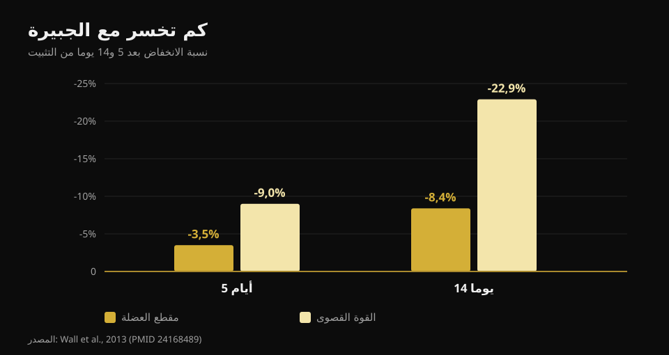
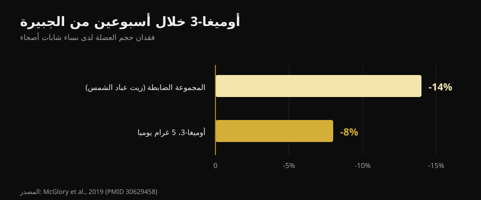

# ماذا تأكل عند الإصابة: التغذية خلال التوقف

بقلم [جياماريا لوي](/autore/giammaria-loi) · حُدّث في 21 أكتوبر 2026

تصاب، وتكون أول فكرة في الغالب واحدة: «لم أعد أتمرن، إذن عليّ أن آكل أقل وإلا سأزداد وزنا». هذا القرار تحديدا هو الذي يبطئ الشفاء أكثر من أي شيء آخر. قرأت ثماني مصادر لأفهم ما الذي يتغير فعلا في احتياجاتك عند التوقف، وكم بروتينا يلزم، وأي المكملات لها بيانات حقيقية.

## باختصار

- **القوة تذهب أسرع بكثير من العضلة.** خمسة أيام من الجبيرة تكلّف 3.5% من مقطع العضلة رباعية الرؤوس لكن 9% من القوة؛ وعند أربعة عشر يوما تصبح 8.4% و22.9% (Wall et al., 2013).
- **الخطأ الحقيقي هو خفض السعرات أكثر من اللازم.** حتى عجز معتدل يخفض تخليق البروتين العضلي بنسبة 20-30%، وهو بالضبط العملية التي تعيد البناء (Tipton, 2015).
- **البروتين يبقى مرتفعا بالغرامات المطلقة**، نحو 2-2.5 غرام لكل كيلوغرام، خصوصا إذا انخفضت السعرات. لكن التوصية غير مباشرة.
- **الليوسين وحده لا ينفع.** 7.5 غرام يوميا طوال أسبوع من التثبيت لم تغيّر لا المقطع ولا القوة (Backx et al., 2018).
- **الكرياتين وأوميغا-3 لهما بيانات حقيقية**، لكن وظيفتهما مختلفة: الكرياتين في إعادة التأهيل، وأوميغا-3 خلال التوقف.

## كم عضلة تخسر فعلا، وبأي سرعة

الرقم الغائب عن معظم ما يُكتب في هذا الموضوع هو السرعة. فريق من ماستريخت وضع الجبيرة على ساق واحدة لدى 24 شابا سليما، لمدة خمسة أيام أو أربعة عشر يوما، مع قياس مقطع العضلة رباعية الرؤوس بالأشعة المقطعية والقوة القصوى قبل وبعد.

بعد **خمسة أيام**: المقطع -3.5%، القوة -9.0%. بعد **أربعة عشر يوما**: المقطع -8.4%، القوة -22.9%.

*القيم من Wall et al., 2013 (PMID 24168489). مقطع العضلة رباعية الرؤوس بالأشعة المقطعية، والقوة كأقصى تكرار واحد.*

نقطتان. الأولى: العضلة تتقلص، لكن **القوة تهبط بسرعة تقارب ثلاثة أضعاف**. عند العودة ستشعر بضعف أكبر بكثير مما خسرته فعليا من عضلة، وهذا طبيعي لأن جزءا كبيرا من القوة المفقودة عصبي ويعود سريعا. الثانية: العدّاد يبدأ فورا، ولا يوجد أسبوع سماح.

السبب الأيضي مزدوج. تخليق البروتين في الراحة ينخفض، وتصبح العضلة **مقاومة للمحفز البنائي**: الجرعة نفسها من البروتين التي كانت ترفع التخليق جيدا صارت ترفعه أقل. هذه هي المقاومة البنائية، وهي عقدة الموضوع كله.

## السعرات: الخطأ الأول هو الخفض المبالغ فيه

هنا رقم يستحق التفكيك بهدوء. يُقال كثيرا إن الإصابة ترفع إنفاق الطاقة بنسبة 10-15%. التقدير المنشور أوسع فعليا — **من +15% وحتى +50%** — لكنه يخص كلفة الشفاء لا الاحتياج الكلي. والاحتياج الكلي **ينخفض** في الغالب، لأن التمرين يختفي وتتحرك أقل.

السؤال هو كم ينخفض، والجواب: أقل مما تظن. فوق كلفة الترميم، إذا مشيت على **عكازين** ترتفع كلفة التنقل **مرتين إلى ثلاث مرات**. بجمع الأمرين تكون الفجوة في الميزان أصغر بكثير مما تبدو عليه حين تقرر تنصيف وجباتك.

والخفض المبالغ فيه له ثمن قابل للقياس. تخليق البروتين وحده يستهلك نحو **500 سعرة يوميا** لدى رجل جيد العضلات، قبل أي نشاط. وفي عجز معتدل تنخفض عملية التخليق وإشاراتها البنائية بنسبة **20-30%**. أنت تقطع الطاقة عن العملية التي يفترض أن تعيد بناء النسيج. الميزان السالب يبطئ التئام الجروح و**يسرّع** فقدان العضلة.

والخطأ المعاكس موجود أيضا. في دراسة على الراحة في الفراش، أدى الميزان الطاقي **الموجب** إلى تسريع فقدان العضلة، على الأرجح عبر التهاب جهازي. فلا داعي لفكرة «ما دمت متوقفا فلأزد كتلتي». الهدف أثناء التوقف هو التوازن.

## البروتين: كم، ولماذا يهم الآن أكثر

التوصية المنشورة هي **2-2.5 غرام لكل كيلوغرام من وزن الجسم يوميا** أثناء التثبيت، أو على الأقل عدم خفض الكمية المطلقة من البروتين عند خفض السعرات. المنشور الذي انطلق منه هذا المقال ينقل ذلك بشكل شبه صحيح (1.8-2.5 غرام/كغ).

لكن يجب قول حال الأدلة، لأن أحدا لا يفعل. صاحب التوصية نفسه كتب عام 2011 أن «المبرر ضعيف» لرفع البروتين أثناء التثبيت؛ وبحلول 2015 غيّر موقفه. وفي دراسة على الراحة في الفراش، لم يقلل الانتقال من 1.0 إلى 1.6 غرام/كغ فقدان العضلة. أي أن إبقاء البروتين مرتفعا خيار معقول ولا يكلف شيئا، لكنه ليس تأمينا.

المشكلة العملية حسابية. إذا أكلت 500 سعرة أقل يوميا وأبقيت البروتين «بالنسبة نفسها»، فأنت تخفضه بالغرامات. تحتاج أطعمة تعطي بروتينا كثيرا مقابل طاقة قليلة. قرأت بطاقات CREA الرسمية واحدة واحدة:

| الطعام (100 غرام) | البروتين | السعرات | البروتين لكل 100 سعرة |
|---|---|---|---|
| بياض البيض | 10.7 غ | 43 سعرة | **24.9 غ** |
| القد أو النازلي | 17.0 غ | 71 سعرة | **23.9 غ** |
| صدر الدجاج | 23.3 غ | 100 سعرة | **23.3 غ** |
| بريزاولا (لحم بقري مجفف) | 33.1 غ | 152 سعرة | **21.8 غ** |
| زبادي يوناني خالي الدسم | 9.0 غ | 51 سعرة | **17.6 غ** |
| السلمون | 18.4 غ | 185 سعرة | 9.9 غ |
| بيضة كاملة | 12.4 غ | 128 سعرة | 9.7 غ |
| جبن غرانا بادانو | 33.9 غ | 392 سعرة | 8.6 غ |
| عدس جاف مسلوق | 6.9 غ | 109 سعرة | 6.3 غ |
| ريكوتا بقري | 8.8 غ | 146 سعرة | 6.0 غ |

*إعداد Nurvan استنادا إلى جداول تركيب الأغذية الصادرة عن CREA، تحديث 2019.*

الجبن الصلب يبدو الخيار البديهي بـ33.9 غرام بروتين لكل 100 غرام: لكنه يعطي 8.6 غرام لكل 100 سعرة، أي أقل من ثلث صدر الدجاج. حين تكون السعرات هي القيد، فالعمود الأيمن هو الذي يحسم. المنطق نفسه ينطبق على أي عجز، كما شرحت في [إعادة تركيب الجسم](/ar/blog/iadat-tarkib-aljisd-khasarat-aldohun-binaa-alazalat).

أما **التوقيت**، فالمنشور الأصلي دقيق جدا: كل 3-4 ساعات، خلال ساعة من الاستيقاظ، 30-40 غراما من الكازين قبل النوم. أرقام معقولة مأخوذة من أدبيات المتمرنين، لكن أثر توزيع الوجبات **أثناء الخمول الإجباري لم يُدرس قط**. التوزيع الجيد احتياط، لا دليل.

## ماذا يقول البحث فعلا

**مؤكد — مراحل الشفاء الثلاث.** التهاب، تكاثر، إعادة تشكّل: التسلسل صحيح والمراحل متداخلة. ويُضاف ما لم يقله المنشور: التعافي الكامل قد يستغرق سنوات، و**سحق الالتهاب قد يبطئ الشفاء**، لأن الاستجابة الالتهابية هي ما يطلق الترميم.

**يحتاج تدقيقا — «+10-15% من الإنفاق».** التقدير المنشور من +15% إلى +50% ويخص الشفاء لا الاحتياج الكلي، الذي ينخفض عادة.

**مُفنَّد — الليوسين الذي «يتغلب على المقاومة البنائية».** هذا هو الادعاء الوحيد في المنشور الذي اختُبر مباشرة في السياق الصحيح، والنتيجة سلبية. ثلاثون شابا، سبعة أيام من الجبيرة على الساق، 2.5 غرام ليوسين مع كل وجبة رئيسية (7.5 غرام يوميا) مقابل لا مكمل. مقطع العضلة: انخفض بالقدر نفسه في المجموعتين (p = 0.61). القوة: انخفضت بالقدر نفسه (p = 0.052).

**غير قابل للتحقق — بروتوكول التوقيت.** لا توجد دراسة قارنت أنماط الوجبات لدى أشخاص مثبّتين.

**يحتاج تدقيقا — عتبة REDs.** تستخدم الشريحة «أقل من 20 سعرة/كغ من الكتلة الخالية من الدهون» كمؤشر على تدني توافر الطاقة. توافق اللجنة الأولمبية الدولية لعام 2023 تخلى عن العتبة الواحدة: تُقيَّم المتلازمة بحسب **الشدة التراكمية وتصنيف الخطورة** بأداة سريرية مخصصة. إنه تشخيص طبي لا حساب منزلي.

## المكملات التي لها بيانات

**الكرياتين.** يفعل شيئا محددا، وليس البديهي: خلال أسبوعين من الجبيرة لم يقلل خسارة المقطع ولا القدرة، تماما كالدواء الوهمي. لكن في عشرة أسابيع إعادة التأهيل التالية، عاد مقطع العضلة رباعية الرؤوس والقدرة القصوى **أسرع** في مجموعة الكرياتين. إنه مكمل للعودة لا للتوقف.

**أوميغا-3.** عشرون امرأة، 5 غرامات يوميا بدأت قبل أربعة أسابيع، ثم أسبوعان من التثبيت: انخفض حجم العضلة بنسبة **8% مقابل 14%** في مجموعة المقارنة، وبعد أسبوعين من العودة للنشاط الطبيعي كانت مجموعة أوميغا-3 وحدها قد عادت إلى قيم البداية.

*القيم من McGlory et al., 2019 (PMID 30629458). عشرون امرأة سليمة، 5 غرامات أوميغا-3 يوميا بدأت قبل أربعة أسابيع من التثبيت.*

لكن انتبه للوجه الآخر: الإفراط في أوميغا-3 يكبح الالتهاب، والالتهاب ضروري للشفاء. الجرعة المناسبة للمصاب غير محددة.

**الجيلاتين وفيتامين C.** ثمانية رجال، 15 غراما من جيلاتين مدعّم بفيتامين C قبل ساعة من ست دقائق من نط الحبل: تضاعف مؤشر تخليق الكولاجين في الدم. واعد، لكنهم ثمانية أشخاص ومؤشر واحد، لا وتر شُفي.

**المغذيات الدقيقة.** القاعدة بسيطة: تجنب النقص يصنع فرقا، وإضافة جرعات فوق الكفاية لا تصنع. الكالسيوم وفيتامين D الكافيان مهمان في الكسور؛ والجرعات الضخمة من مضادات الأكسدة لم تظهر فائدة.

**الكحول**، الغائب تماما عن المنشور، هو البند الوحيد ذو الأثر السلبي الموثق: يضعف استجابة تخليق البروتين ويبطئ التئام الجروح. إيقافه مجاني وأدلته أقوى من نصف المكملات.

## كيف تطبّق ذلك

1. **لا تخفض بشكل أعمى.** قدّر الانخفاض الحقيقي في النشاط: بلا تمارين تصبح أكثر جلوسا، لكن الشفاء يكلف والعكازان يكلفان. استهدف التوازن لا العجز.
2. **ثبّت البروتين بالغرامات لا بالنسبة.** حدد الهدف بالغرام/كغ وحافظ عليه حتى مع انخفاض السعرات، بأطعمة عالية الكثافة البروتينية.
3. **وزّعه على 4-5 وجبات.** احتياط، غير مثبت في هذا السياق، ومجاني.
4. **حافظ على محفز ميكانيكي حيثما أمكن.** ما ليس مثبتا يُدرَّب: يكفي القليل جدا للحفاظ على ما لديك، كما شرحت في [تدريب القوة والعضلات والكارديو معا](/ar/blog/tadrib-alquwa-walazalat-walkardio-maan).
5. **الكرياتين عند العودة لا أثناء التوقف.**
6. **الكحول خارجا.**
7. **الأحمال والمدد والعودة يقررها من يتابع حالتك.** التغذية مرافق، لا خطة علاج.

> ### أبقِ الأرقام تحت السيطرة وأنت متوقف
> يحسب Nurvan هدفك من البروتين بالغرامات ويثبّته حتى حين تخفض السعرات، مع قاعدة أغذية CREA لترى فورا كم بروتينا تحصل عليه لكل سعرة. وعند العودة، تصبح الأحمال وقيم RIR المسجلة قبل التوقف نقطة انطلاق لإعادة البناء دون مبالغة. [جرّب Nurvan](https://nurvan.app)

## أسئلة شائعة

**كم بروتينا آكل إذا كنت مصابا؟**
تشير الأدبيات إلى نحو 2-2.5 غرام لكل كيلوغرام يوميا أثناء التثبيت، وعلى أي حال عدم خفض الكمية المطلقة من البروتين عند خفض السعرات. إنها توصية احترازية: الدراسات المباشرة قليلة وليست كلها إيجابية.

**هل آكل أقل ما دمت لا أتمرن؟**
أقل قليلا نعم، أقل بكثير لا. الاحتياج ينخفض لأنك تتحرك أقل، لكن الشفاء يستهلك طاقة والمشي بالعكازين يكلف مرتين إلى ثلاث مرات أكثر. العجز الكبير يخفض تخليق البروتين بنسبة 20-30%.

**هل أفقد كل كتلتي العضلية فورا؟**
لا، لكن أسرع مما يُظن: نحو 3.5% من مقطع العضلة رباعية الرؤوس في خمسة أيام و8.4% في أسبوعين. القوة تهبط أكثر بكثير، حتى 23% في أسبوعين، وهي عصبية في جزء كبير منها: تعود أسرع من الكتلة.

**هل ينفع الكرياتين وأنا في الجبيرة؟**
البيانات تقول لا أثناء التثبيت، ونعم في إعادة التأهيل التالية: مقارنة بالدواء الوهمي، عاد المقطع والقدرة أسرع في المجموعة التي تناولته.

## اقرأ أيضا

- [إعادة تركيب الجسم: خسارة الدهون وبناء العضلات](/ar/blog/iadat-tarkib-aljisd-khasarat-aldohun-binaa-alazalat) — ما الذي يفعله فعلا عجز غني بالبروتين.
- [تدريب القوة والعضلات والكارديو معا](/ar/blog/tadrib-alquwa-walazalat-walkardio-maan) — ويتضمن الجرعة الدنيا التي تحافظ على القوة والكتلة.
- [متى تتناول المكملات الغذائية](/ar/blog/mata-tatanawal-almukammilat-alghidhaiya) — ما الذي يغيّره التوقيت حقا.

## المصادر

1. Tipton KD, 2015. *Nutritional Support for Exercise-Induced Injuries.* Sports Medicine 45(Suppl 1):S93-104. [PMID 26553492](https://pubmed.ncbi.nlm.nih.gov/26553492/) · [DOI 10.1007/s40279-015-0398-4](https://doi.org/10.1007/s40279-015-0398-4)
2. Tipton KD, 2011. *Nutrition for acute exercise-induced injuries.* Annals of Nutrition and Metabolism 57(Suppl 2):43-53. [PMID 21346336](https://pubmed.ncbi.nlm.nih.gov/21346336/) · [DOI 10.1159/000322703](https://doi.org/10.1159/000322703)
3. Wall BT, Dirks ML, Snijders T, Senden JMG, Dolmans J, van Loon LJC, 2013. *Substantial skeletal muscle loss occurs during only 5 days of disuse.* Acta Physiologica 210(3):600-11. [PMID 24168489](https://pubmed.ncbi.nlm.nih.gov/24168489/) · [DOI 10.1111/apha.12190](https://doi.org/10.1111/apha.12190)
4. Backx EMP, Horstman AMH, Marzuca-Nassr GN, van Kranenburg J, Smeets JS, Fuchs CJ, Janssen AAW, de Groot LCPGM, Snijders T, Verdijk LB, van Loon LJC, 2018. *Leucine Supplementation Does Not Attenuate Skeletal Muscle Loss during Leg Immobilization in Healthy, Young Men.* Nutrients 10(5):635. [PMID 29772844](https://pubmed.ncbi.nlm.nih.gov/29772844/) · [DOI 10.3390/nu10050635](https://doi.org/10.3390/nu10050635)
5. McGlory C, Gorissen SHM, Kamal M, Bahniwal R, Hector AJ, Baker SK, Chabowski A, Phillips SM, 2019. *Omega-3 fatty acid supplementation attenuates skeletal muscle disuse atrophy during two weeks of unilateral leg immobilization in healthy young women.* The FASEB Journal 33(3):4586-4597. [PMID 30629458](https://pubmed.ncbi.nlm.nih.gov/30629458/) · [DOI 10.1096/fj.201801857RRR](https://doi.org/10.1096/fj.201801857RRR)
6. Hespel P, Op't Eijnde B, Van Leemputte M, Ursø B, Greenhaff PL, Labarque V, Dymarkowski S, Van Hecke P, Richter EA, 2001. *Oral creatine supplementation facilitates the rehabilitation of disuse atrophy and alters the expression of muscle myogenic factors in humans.* The Journal of Physiology 536(Pt 2):625-33. [PMID 11600695](https://pubmed.ncbi.nlm.nih.gov/11600695/) · [DOI 10.1111/j.1469-7793.2001.0625c.xd](https://doi.org/10.1111/j.1469-7793.2001.0625c.xd)
7. Shaw G, Lee-Barthel A, Ross MLR, Wang B, Baar K, 2017. *Vitamin C-enriched gelatin supplementation before intermittent activity augments collagen synthesis.* The American Journal of Clinical Nutrition 105(1):136-143. [PMID 27852613](https://pubmed.ncbi.nlm.nih.gov/27852613/) · [DOI 10.3945/ajcn.116.138594](https://doi.org/10.3945/ajcn.116.138594)
8. Mountjoy M, Ackerman KE, Bailey DM, et al., 2023. *2023 International Olympic Committee's (IOC) consensus statement on Relative Energy Deficiency in Sport (REDs).* British Journal of Sports Medicine 57(17):1073-1097. [PMID 37752011](https://pubmed.ncbi.nlm.nih.gov/37752011/) · [DOI 10.1136/bjsports-2023-106994](https://doi.org/10.1136/bjsports-2023-106994)

القيم الغذائية: CREA — مركز أبحاث الأغذية والتغذية (إيطاليا)، جداول تركيب الأغذية، تحديث 2019.

المراجع مستخرجة عبر PubMed. نقطة الانطلاق: منشور مصوّر لـ**Science for Sport** ([@scienceforsport](https://www.instagram.com/scienceforsport/)) مع James Morehen، [المنشور الأصلي](https://www.instagram.com/p/Dd3SC-iF3d7/). لم يُنسخ أي نص أو صورة من المنشور.

---

**جياماريا لوي** مؤسس Nurvan. يتدرب بالأثقال منذ 2012، ويعمل مدربا شخصيا ومدربا معتمدا من FIPE منذ 2013، ويشارك في منافسات رفع الأثقال على المستوى الوطني منذ 2018. كل مقال يوقّعه ينطلق من الدراسات العلمية وينتهي بما ينفع فعلا في الصالة.

> ملاحظة: محتوى تثقيفي ولا يغني عن رأي الطبيب أو أخصائي العلاج الطبيعي. التشخيص والأحمال ومواعيد العودة بعد الإصابة يقررها من يتابع حالتك.
